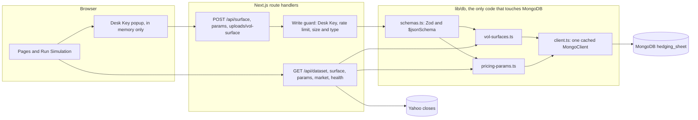

# 01 · Architecture

The Hedging Sheet app replaces the desk's hedging spreadsheet for the five year accelerator. It replicates the accelerator payoff with an option book, prices every leg on the vol surface, solves the Inbuilt, sizes the Day 1 vega hedge, stress-tests margin, and exports the five working sheets to Excel.

## Stack

Next.js 16 App Router with Turbopack, React 19, TypeScript in strict mode, Tailwind 3, framer-motion, lucide-react, zod, recharts, ExcelJS for the download and SheetJS for reading uploads, and MongoDB for the surface. Node 24. Vitest for the engine and Playwright for the browser.

## Layers

| Layer | Folder | Role |
|---|---|---|
| Engine | `lib/engine` | Pure TypeScript. No React, no browser, no network. One function per sheet block. See [02 Calculation Logic](02-calculation-logic.md). |
| Tables | `lib/tables.ts` | Every table defined once and rendered both on screen and in the Excel file, so the two always match. |
| Data | `lib/data`, `lib/db` | Built in seeds, and the one data access layer for MongoDB, with a seed fallback when the database is away. See [Database](#database). |
| Market | `lib/market-data.ts` | Yahoo closes for Nifty and Sensex, completed sessions only. |
| State | `lib/context` | `DeskProvider` holds the inputs, the market data and the last run. `DeskDialogProvider` holds the popup queue and toasts. |
| UI | `app`, `components` | One route per tab. Shared shell, tables, fields and dialogs. |
| Excel | `lib/excel` | Excel export and the surface upload parser. |

## State and the Run Simulation flow

- Inputs live in React context only. Nothing is saved between sessions; a refresh reloads live defaults.
- Editing an input never reprices. The desk presses **Run Simulation**, which validates, refreshes the active dataset, prices the book, solves the Inbuilt, builds the stress grid, and stores the result as the last run.
- Each run stores a key made of the inputs and a market version. When the inputs or the market change after a run, the output tabs show an Inputs Changed banner until the next run.
- Output tabs show a centred popup asking for a run until the first run. Market Data and Logic Atlas never need a run.
- Download Excel uses the last run.

## Database

The database holds reference data only: the volatility surface and the surface parameters, one document per month. It holds no inputs, no run results, no sessions, no logs and no market data. A run is computed in the browser from what the read routes return, and nothing is written.

- **One data access layer.** `lib/db/client.ts` keeps one `MongoClient` per server instance, with a pool of 10, six second server selection and thirty second socket timeouts; a failed connection returns null and the app runs from the seeds. `lib/db/vol-surfaces.ts` and `lib/db/pricing-params.ts` are the only modules that read or write a collection. No route or component imports the driver.
- **Validation on every write.** `lib/db/schemas.ts` holds the Zod schemas the app checks before writing, and the matching `$jsonSchema` validators that `scripts/db-apply-validators.ts` applies with `validationLevel: "strict"`, so the database rejects any other shape, unknown fields included.
- **One document per month.** Each collection has a unique index on `monthKey`, and every save replaces the month's document, so saving or uploading again never adds a duplicate. No collection holds time series, so there is no TTL index; if a history collection is ever added, it gets a TTL index, for example 400 days.
- **Protected, whole writes.** Every write route needs the Desk Key, set on the server as `DESK_WRITE_KEY`; without it, saving is turned off. Attempts are rate limited per address, bodies are capped at 1 megabyte and uploads at 8 megabytes, and an upload must be an Excel workbook by name and by content. The whole surface and parameters are checked before anything is written, and both are written in one transaction.
- **Separate databases.** Production uses `hedging_sheet`. Previews use `hedging_sheet_preview` and development deployments `hedging_sheet_development`, even if `MONGODB_DB` names production. Tests and the mock server use an in-memory replica set.
- **Health.** `GET /api/health` reports the connection, the database name, the document counts, the latest surface and parameter months and the latest Yahoo close date. It shows no secrets and writes nothing.

## Caching

| Data | Policy |
|---|---|
| Live spot | Never cached: fetched with `no-store`; the footer shows Fetched At. |
| Daily history | Cached by Next.js for three hours under the tags `history`, `history:nifty` and `history:sensex`. |
| Surface and parameters | Cached under the tag `surface` until a save expires it at once with `revalidateTag("surface", { expire: 0 })`, plus `revalidatePath("/", "layout")`. |
| Static assets | `/_next/static` is immutable by default; `/brand` images are cached for a year as immutable, and the sample workbook for a day. |
| Pages | Rendered per request through `connection()` in the root layout, with no stored HTML, so the date and the data are never stale. |

There is no service worker and no PWA cache. `npm run cache:clear -- --local`, `--app <url>` and `--vercel` clear the local build caches, the app's tagged reads and the Vercel CDN and data cache. The deploy steps are in [09 Deploy On Vercel](09-vercel-deploy.md).

## Design system

The shell, tabs, dialogs, tables and the Logic Atlas follow the Primary SP Dashboard. The upload shortcut, dialogs after upload, run button and loading states follow the Unwinding Calculator. Plain white surfaces with 1 px neutral borders, maroon and gold accents, controls with a faint neutral fill, Times New Roman for body copy and Segoe UI for controls and tables, and `deskEase` motion that respects reduced motion.

## Copy rules

Full words, no brackets, almost no "/", Title Case labels, dates as DD-MMM-YYYY, crore with Indian grouping and two decimals, and "-" with a tooltip for any value that cannot be computed. No copy hard-codes Sensex; every label follows the underlying.
