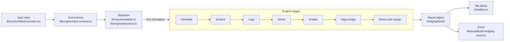

# The Default And Blank Pipeline

How an input becomes a number on a tab and in the Excel file, where every default comes from, and what happens when a source fails.

## The Pipeline

- **Input state** lives in memory only. Nothing is saved to local storage, session storage, cookies or the database.
- **Zod schema** checks the shape: every number is a number, every list has the right length.
- **Validation** checks the product: strikes descending, spreads above the start, the coupon reachable, each strike on the side the payoff needs. Inline errors, such as a strike on the wrong side or spreads paying above the coupon, block Run without a popup; the rest open the grouped popup when Run is pressed.
- **Engine stages** each take only what the stage before produced. `tests/unit/pipeline-stages.test.ts` spies on the stage functions and checks the order and the hand-offs: the surface is read only at the scheduled dates, each leg is priced at the volatility the surface returned, and the reported Inbuilt is the solver's root.
- **Result object** is the only source for the tabs and the Excel file. A result is shown only while the inputs that made it are unchanged.

## Default Values

| Input | Source | When The Source Fails |
|---|---|---|
| Underlying | Sensex, the desk's product | - |
| Spot | The last completed close from Yahoo Finance, `/api/market/levels` | The spot stays empty and Run is blocked until it is typed; Refresh From Yahoo retries, with a Fetch Failed popup if it fails again |
| Valuation Date | The date of that close, otherwise today in India | Today in India |
| Daily Volatility | One year of daily log returns from Yahoo, `/api/market/daily-vol` | The status reads Fallback and 0.9% is used until the history loads or a value is typed |
| Hedge Strike | The spot rounded to the nearest 100 | Empty while the spot is empty |
| Surface And Parameters | The desk database, `/api/dataset` | The built in surface, with a banner saying so |
| Product Terms | `lib/engine/defaults.ts`: coupon 102.5%, decay 1.6, tenor 1,940 days, strikes 137, 127, 125, 85, 84 and 70, all Put, each on the side the payoff needs | - |

## Blank Inputs

- Every field starts empty: numbers are blank, the underlying, each strike's Option Type and Buy Or Sell are unset. `lib/inputs/draft.ts` `blankInputs` builds it, and `tests/golden/products.test.ts` G6 checks that nothing in it comes from the defaults.
- No hidden fallback: the spot is never filled from Yahoo, Refresh From Yahoo needs an underlying first, and the volatility is never computed until asked.
- Run is blocked until every required field is set. The popup lists each missing field by section.
- No default leaks into the result: G6 types every Blank field to the G0 values and checks the result is identical to G0.

## Stale Results

- Switching mode clears the result.
- Changing any input, the underlying included, hides the result on every output tab behind a banner, empties the Logic Atlas values and disables Download Excel until Run Simulation is pressed again.
- `e2e/pipeline/stale-result.spec.ts` checks both.

## The Underlying

The underlying drives the spot, the start level, the expiry weekday (Thursday for Sensex, Tuesday for Nifty), the hedge strike, the surface anchor, the strikes in points, labels such as "Sensex Performance", the footer order, the Excel text and the Logic Atlas copy. `e2e/pipeline/underlying.spec.ts` checks each for both underlyings. Pages and components take the name from `lib/underlyings.ts` or the inputs, never as typed text, and `e2e/pipeline/no-hardcoded-underlying.spec.ts` keeps it that way.
