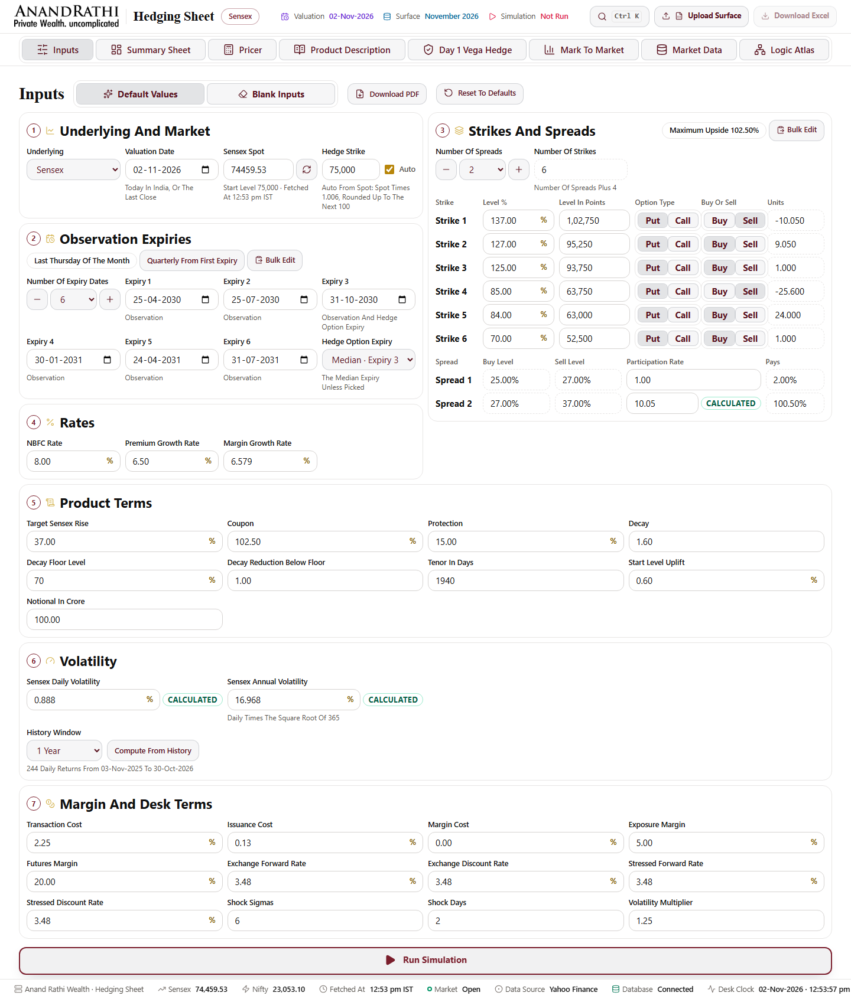
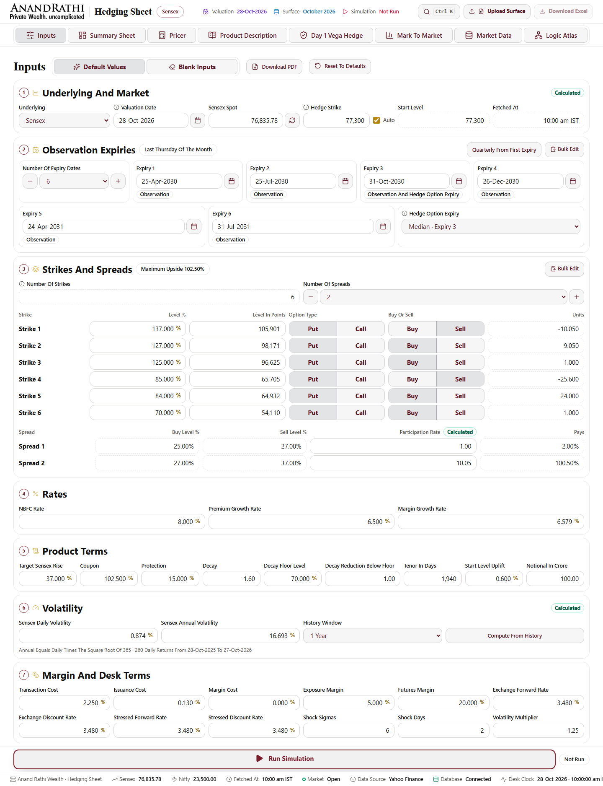
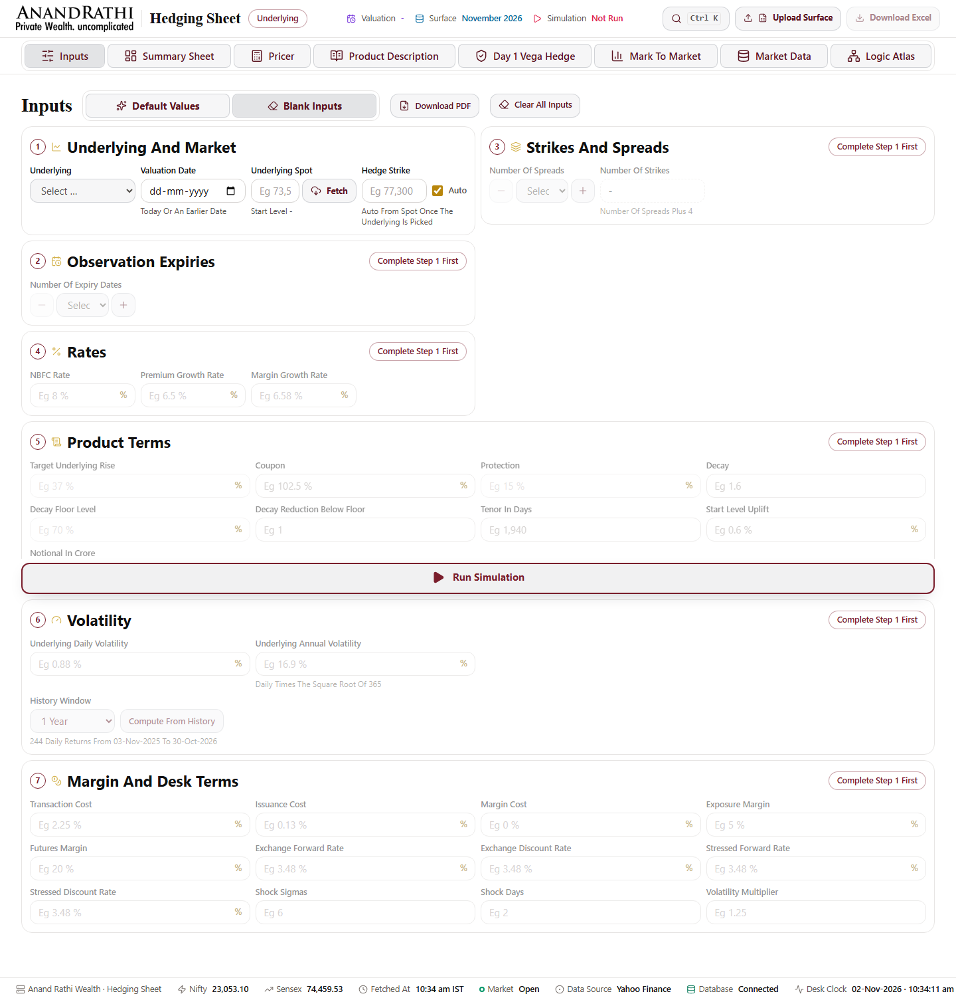
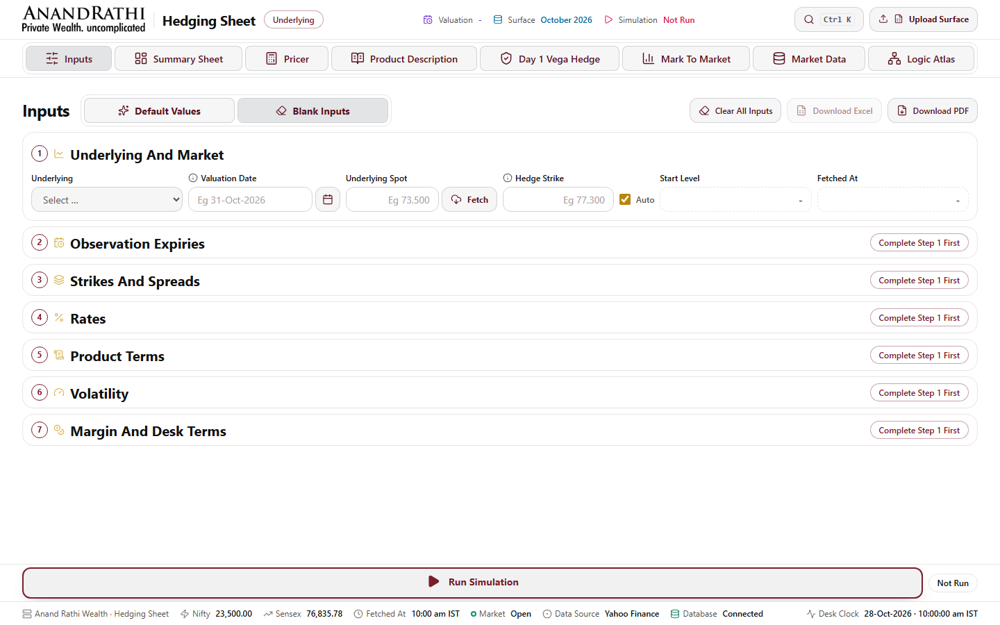
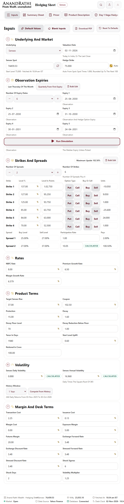
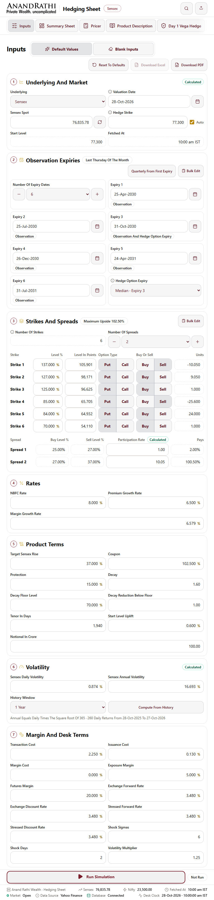
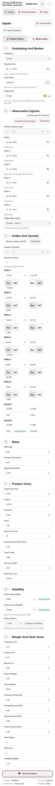
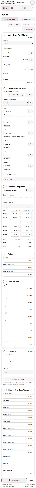

# Sign Off · Final Round And Final Polish

Local test run on the Windows laptop, 02-Nov-2026 22:20 to 03-Nov-2026 19:15 IST. Nothing had been pushed or deployed then, so every row that depended on the push said **Waiting On The Push**. Those rows now hold production results from 07-Nov-2026, against `55e2739`, which production has served since 05-Nov-2026 13:53 IST: see [Production Results · 55e2739](#production-results--55e2739).

- **Code commit tested:** `a898e8a`, for every app, script and spec file but one. After it, `17b6d80` changed only `e2e/visual/pages.spec.ts`: toast timers are now held from the toast's own step, and whole-page pictures get 60 s. That spec ran on Chromium on Windows (run 17) and in Docker (run 13). The commits after `17b6d80` hold only docs and screenshots.
- **Evidence:** every number below comes from a run made in this round. Its `summary.md` and JUnit totals, along with skip reasons and measured annotations read from Playwright's JSON report, are committed under [test-runs](test-runs/). The full HTML reports stay in `reports/`, which is gitignored and which `npm run clean:dev` deletes.
- **Laptop conditions:**
  - Another app held port 3000, so the runs used `E2E_PORT=3007`, which the test runner now accepts.
  - Windows logged Modern Standby again and again: 23:04 to 23:42, 00:43 to 01:42, 02:43 to 03:29, 04:29 to 05:31, 06:31 to 07:10 and 08:02 to 08:18; then 09:45 to 10:29, 11:31 to 12:02 and 12:13 to 16:51, each with short wakes; then 17:21 to 17:31 and 18:10 to 18:34. The log is in [00](test-runs/00-laptop-standby.md).
  - From about 08:00, other apps kept the CPU at 99 to 100%, with up to 1,029 processes running.
  - Every test that overlapped a standby is named below and was rerun.
  - A request to keep the laptop awake during the runs was refused by the permission check, so it was not used.

## Final Run On The Commit That Will Ship

`npm run test:all` with `E2E_PORT=3007` on `a898e8a` (run 14), 16:10 to 17:53 IST, exit 1. The static checks and Vitest ran through four standbys. Playwright ran from 17:28 to 17:53 with the CPU at 99 to 100% from other apps.

| Step | Result | Quoted |
|---|---|---|
| Type Check | Pass | |
| Lint | Pass | |
| Unused Code (knip) | Pass | |
| Copy Rules | Pass | "Tests 21 passed (21)" |
| Workbook Mapping | Pass | |
| Workbook Audit | Pass | |
| Production Build With The Test Hook | Pass | |
| Vitest with coverage, golden included | Pass | "Tests 757 passed (757)", "Test Files 74 passed (74)" |
| Playwright On Chromium | **Fail** | "1 failed, 1 skipped, 40 did not run, 276 passed (25.7m)". JUnit: `tests="318" failures="1" skipped="41"` |
| chromium-writes, run alone straight after (run 15) | Pass | "40 passed (3.9m)" |

What this says:

- **Every functional test passed** on the commit that will ship: Chromium 276, chromium-writes 40 and Vitest 757.
- **The one failure is a performance gate under load.** The new Chrome trace test measured a run at 1,757 ms, with a 249 ms longest task, against limits of 1.5 s and 200 ms.
- **The 40 chromium-writes tests show as "did not run"** because that project depends on Chromium passing. Run alone, they passed.
- **Performance under load:** five more perf repeats at the same load (run 16) passed 18 of 20. The failures were Inputs LCP at 3,876 ms and a traced run at 2,183 ms. Every observer-timed run stayed under 1.5 s (1,154 to 1,379 ms).
- **Performance on a quieter laptop:** in runs 1, 4, 5 and 7, at `f012839` and `6b13fdc`, the same perf tests passed 32 of 32. The hover fix in between only changes a CSS transform.

**The performance gates are therefore flaky when another load holds the CPU at 100%: 3 of 24 perf tests failed at `a898e8a`, across runs 14 and 16.** They need a measurement on a quiet machine or on CI.

## Every Run Made

| # | Run | Commit | Result | Evidence |
|---|---|---|---|---|
| 1 | `npm run test:all` | `f012839` | 8 of 9 steps passed. Unused Code failed on `e2e/visual/full-page.css`, a file this round had just added and has since removed. Vitest 757 of 757. Playwright 317: 310 passed, 7 skipped | [01](test-runs/01-test-all-f012839/totals.md) |
| 2 | `npm run test:all` | `83953bf` | Vitest 757 of 757. Playwright: 270 passed, 6 failed, 1 skipped, 40 did not run. Cause: a stale data cache, fixed in `6b13fdc` (see Failures) | [02](test-runs/02-test-all-83953bf/totals.md) |
| 3 | `npm run test:local:full` | `83953bf` | Not a test result. Windows refused to start new processes: mongod exited with 0xC0000142, and Playwright and Lighthouse failed in 0 s | [03](test-runs/03-test-local-full-83953bf-aborted/totals.md) |
| 4 | `npm run test:all` | `6b13fdc` | 8 of 9 steps passed. Vitest 757 of 757. Playwright: 274 passed, 2 failed, 1 skipped, 40 did not run. The 2 failures are the 2 tests that were running when the laptop entered standby at 02:43 | [04](test-runs/04-test-all-6b13fdc-standby/totals.md) |
| 5 | `npm run test:local:full` | `6b13fdc` | Build, Vitest 757 of 757, Lighthouse desktop and Lighthouse mobile passed. Playwright 1,046: 930 passed, 14 failed, 102 skipped. Chromium 319 of 319 and chromium-writes 40 of 40 passed | [05](test-runs/05-test-local-full-6b13fdc/totals.md) |
| 6 | `npm run test:a11y` | `6b13fdc` | 6 of 6 passed, exit 0 | [06](test-runs/06-test-a11y-6b13fdc/totals.md) |
| 7 | `e2e/perf.spec.ts` and `e2e/bundle.spec.ts` with `--repeat-each=5` | `6b13fdc` | 60 of 60 passed | [07](test-runs/07-perf-and-bundle-x5-6b13fdc/totals.md) |
| 8 | Lighthouse with the repo's configs, 5 runs a page | `6b13fdc` | Both exited 0 | [08](test-runs/08-lighthouse-6b13fdc.md) |
| 9 | `npm run bundle:report` | `6b13fdc` | Largest first load 210.7 KB gzipped of 250 KB | [09](test-runs/09-bundle-6b13fdc.md) |
| 11 | Reruns of run 5's failures | `6b13fdc` | Used to sort each failure into real, test or standby | [11 Firefox](test-runs/11-rerun-firefox-6b13fdc/totals.md), [WebKit](test-runs/11-rerun-webkit-6b13fdc/totals.md), [mobile](test-runs/11-rerun-mobile-6b13fdc/totals.md) |
| 12 | Fix check: the same specs after the fixes | `a898e8a` | Chromium 25 of 26, WebKit 10 of 11 with 4 skipped, mobile 9 of 9 with 6 skipped, Firefox 30 of 31. The 3 that failed are under Flaky | [12](test-runs/12-fixcheck-chromium-a898e8a/totals.md) and siblings |
| 13 | Linux visual baselines with Docker | `a6b5d45`, then `a898e8a` and `17b6d80` | Update: 36 passed, 98 written. Compare at `a6b5d45`: 36 of 36. After the hover fix, every test passed a compare across two runs, with no pixel difference, so the baselines stand | [13](test-runs/13-visual-linux.md) |
| 14 | `npm run test:all`, final | `a898e8a` | See the section above | [14](test-runs/14-final-test-all-a898e8a/totals.md) |
| 15 | chromium-writes alone, final | `a898e8a` | 40 of 40 | [15](test-runs/15-final-chromium-writes-a898e8a/totals.md) |
| 16 | `e2e/perf.spec.ts` with `--repeat-each=5`, final | `a898e8a` | 18 of 20, CPU at 100% | [16](test-runs/16-final-perf-x5-a898e8a/totals.md) |
| 17 | `e2e/visual` on Chromium on Windows, final spec | `a898e8a` app, `17b6d80` spec | 38 of 38: every flow runs; pixels are compared only on Linux | [17](test-runs/17-final-visual-spec-windows-17b6d80/totals.md) |

### Static Checks, Vitest And Gates (Run 4, `6b13fdc`)

| Step | Exit | Summary |
|---|---|---|
| Type Check `npx tsc --noEmit` | Pass | |
| Lint `npx eslint . --max-warnings 0` | Pass | |
| Unused Code `knip` with `KNIP_DISABLE_RAW_TRANSFER=1` | Pass | |
| Copy Rules | Pass | "Tests 21 passed (21)" |
| Workbook Mapping `scripts/extract-mapping.ts` | Pass | |
| Workbook Audit `scripts/audit-workbook.ts` | Pass | Unedited |
| Production Build | Pass | |
| Vitest with coverage | Pass | "Tests 757 passed (757)". The `junit-vitest.xml` testsuites line reads `tests="757" failures="0" errors="0"`. Golden: 71 tests in `tests/golden`, all passed. Coverage over `lib` and `app/api`: 98.28% of lines and 95.32% of branches; over `lib` alone, 98.81% of lines and 97.65% of branches, which clears the 95% gate in `vitest.config.ts` |

### Skipped Tests

Playwright's JUnit file has no skip reasons, so the runner now also writes a JSON report (`3375af5`). The reasons below come from it.

- **Run 4 and the final run, Chromium:** 1 test. `responsive/r01-r07-pages.spec.ts › 360 px › R7 every heading takes at most two lines` is skipped with "The 360 px check is part of the full width run." It ran and passed in run 5.
- **Run 1, chromium-writes:** 6 tests. `default/parity.spec.ts › D3` for summary, pricer, product, vega-hedge and margin, and `D4 the Excel export passes the workbook checks`, were skipped with "Rule and number checks run once, on desktop Chromium." That spec runs only on chromium-writes, so these six checks **ran on no project at all**. They had not run in earlier rounds either. Fixed in `a6b5d45`, and they now pass.
- **Run 5, 102 skipped:**
  - 96 are skipped with "Rule and number checks run once, on desktop Chromium.": 32 each on Firefox, WebKit and mobile. These are the Blank Inputs rule and number checks, B1 to B21, and D3 and D4. They ran on Chromium and chromium-writes.
  - 6 are skipped with "CPU throttling needs Chrome DevTools": the 3 tests in `nav-early-click.spec.ts`, on Firefox and on WebKit. Mobile runs on Chromium and ran them.
  - The full list, test by test, is in [05](test-runs/05-test-local-full-6b13fdc/totals.md) under "Skipped By The Test".
- **Fix check, WebKit:** the 4 tests in `embed.spec.ts` are now skipped with "WebKit blocks an http://localhost frame in an https page as mixed content".
- **Not counted as skipped, but compares nothing:** on Windows the visual tests open every tab and popup and then pass without comparing pixels, because `ignoreSnapshots` is on for any platform but Linux. The pixels were compared in Docker (run 13).
- **Gates that need `E2E_PROD` in the test process:** `bundle.spec.ts` skips itself without it, and `perf.spec.ts` drops its production thresholds. Both ran with it, because `test-run.ts` passes `E2E_PROD=1` to Playwright. Every run shows 8 bundle results with a measured size, and the perf annotations hold production numbers.

## Failures, Their Causes And What Was Done

| Failure | Where, How Often | Cause | Action |
|---|---|---|---|
| B13.1, B14 summary, B14 margin, B21.1, copy rules cells, S7 | Run 2, Chromium. Every check comparing against the frozen regression failed | **Test server bug.** `next start` keeps `unstable_cache` reads in `.next/cache/fetch-cache`, while the expired tag lives only in memory. A parity rerun that ended on D7 left `volBump 0.02` on disk, and the next server, with a new in-memory database, priced with it: Fair Volatility read 19.61% against 17.61% | `6b13fdc`: `scripts/e2e-server.ts` clears the fetch cache before it starts. Proven by a B13.1 pass from the contaminated state, and by runs 4 and 5 |
| Every step of a run | Run 3 | Windows could not start processes (0xC0000142, DLL initialisation failed) with 838 processes running | Rerun as run 5 |
| Final Inputs 390 Blank, layout at 1024 | Run 4, Chromium | Laptop standby from 02:43 to 03:29: these were the 2 tests in flight | Both passed in run 5 |
| Firefox crawl at 1280; mobile D5 | Run 5 | Both overlapped a standby | D5 passed on rerun. Crawl at 1280 passed on the fix check |
| Firefox Final Inputs at 1280 and 1024, 4 tests: "Put on Call", "Buy on Sell" | Run 5 and rerun, 2 of 2 | **Test bug.** Joined segments share a border on purpose with `margin-left: -1px`. Firefox lays that out as 1.00003 px, and the overlap check counted anything above 1 px | `a898e8a`: an overlap counts above 1.5 px. 30 of 31 passed on the fix check |
| Mobile large surface | Run 5 and rerun, 2 of 2 | **Test bug.** Phones print a surface date as "Apr 39", and the test matched the full year text | `a898e8a`: the test finds the row by its `title`, which holds the full date at every width. Passed |
| WebKit embed, 4 tests | Run 5 and rerun, 2 of 2 | **Test environment.** The stand-in Workstation is https and frames `http://localhost`. WebKit blocks that as mixed content (console: "[blocked] … requested insecure content"), and no launch option turns it off | `a898e8a`: skipped on WebKit with that reason. It still runs on Chromium, Firefox and mobile. Production is https framed in https |
| WebKit hydration, 2 tests | Run 5: 2 of 2. Rerun: 0 of 2 | **Test noise.** WebKit reports a fetch cut short by the next `page.goto` as "Fetch API cannot load … due to access control checks". Every fetch in `desk-provider.tsx` is caught, and the app never calls another origin | `a898e8a`: only that message is left out. Passed |
| WebKit "Losing The Network Mid Run" | Run 5 and rerun, 2 of 2 | **App bug, Safari.** The hover lift, `translateY(-2px)`, moved a button's lower edge off a resting pointer. WebKit rechecks hover after every frame, so the second popup's OK flipped between hovered and not and could never be clicked. Reproduced: 20 samples alternated between 445.7 and 448.4 px | `29e6dba`: hover only scales. Regression test "a hovered button only grows, so a pointer resting on its edge never sets it flickering" failed on the old build ("Expected ≥ 569.39, Received 568.60") and passes now. On the fix check the second OK click went through. The test then hit its 90 s limit with CPU at 100% (the spot took 18 s to fill), so it has no clean WebKit pass yet: see Flaky |

### Flaky

| Test | Record | Notes |
|---|---|---|
| Firefox crawl at 1440 | Passed in run 5. Failed in the rerun (Run did not reach /summary in 30 s) and in the fix check (the page showed Inputs, but `page.url()` still read /summary after 20 s). 1 pass in 3 | Not reproduced in 4 scripted Firefox rounds against the same build, where the URL and `location.pathname` agreed after every change. Both failures came with the CPU at 100%. The cause is **not established** |
| Chromium "Clicking Run Several Times Fast Runs Once" | Passed in runs 1, 4, 5 and 14. Failed once in the fix check, at 10:15, during standby | Standby |
| Perf gates: the trace test and Inputs LCP | 32 of 32 in runs 1, 4, 5 and 7. 21 of 24 at `a898e8a` in runs 14 and 16, with the CPU at 100% from other apps | Load. See Performance |
| WebKit "Losing The Network Mid Run" | See above | No clean pass since the fix, because of load |
| Hydration on WebKit | 2 of 4 before the filter | Fixed as above |

## Performance (Local)

These are local numbers on a loaded laptop. Production numbers, on `55e2739`, are under [Production Results · 55e2739](#production-results--55e2739).

| Measure | Target | Measured | Evidence |
|---|---|---|---|
| Run of the default book, click to Summary | Under 1.5 s | 1,052, 1,081, 1,154, 1,204 and 1,437 ms in 5 repeats. Median 1,154 ms. 1,131 ms in run 1 | `perf.spec.ts` "a run of the default book completes in under 1.5 s", [07](test-runs/07-perf-and-bundle-x5-6b13fdc/totals.md) |
| Longest main-thread task during a run, Chrome performance trace | Under 200 ms | 42, 44, 45, 46 and 66 ms in 5 repeats. Median 45 ms, with 0 to 2 tasks over 50 ms out of about 1,000. Run time under the trace: median 1,102 ms | New test "a Chrome performance trace of a default run shows no main thread task over 200 ms" (`browser.startTracing`, renderer main thread `RunTask` events) |
| Long tasks, observer | | 0 ms in all 5 runs. The trace is the stricter measure | same |
| The same two measures at `a898e8a`, CPU at 100% from other apps | Under 1.5 s, under 200 ms | Observer runs: 1,358 ms in run 14, then 1,154, 1,213, 1,313, 1,361 and 1,379 ms, all passing. Traced runs: 1,757 ms with a 249 ms task (failed), then 783, 1,311, 1,425, 1,475 and 2,183 ms (the last failed), with longest tasks of 61 to 125 ms | Runs [14](test-runs/14-final-test-all-a898e8a/totals.md) and [16](test-runs/16-final-perf-x5-a898e8a/totals.md) |
| Inputs and Pricer LCP and CLS in the browser | LCP under 2 s, CLS under 0.05 | Inputs LCP 204 to 400 ms, Pricer 108 to 164 ms. CLS at most 0.0021 | `perf.spec.ts` |
| Lighthouse desktop, 5 runs a page | Performance at least 90 | Inputs 100 (spread 0), Pricer 100 (spread 0). LCP median 643 and 606 ms, TBT 0 ms | [08](test-runs/08-lighthouse-6b13fdc.md) |
| Lighthouse mobile, 5 runs a page | Performance at least 90 | Inputs: 91, 90, 92, 94 and 90, so median 91 and spread 4. Pricer: 93, 95, 94, 96 and 95, so median 95 and spread 3. Inside run 5, 3 runs a page: medians 93 and 93 | same |
| Lighthouse mobile LCP | Under 2 s | **Not met.** Medians 2,780 and 2,745 ms under Lighthouse's simulated slow 4G. The mobile config does not assert LCP | same |
| Lighthouse mobile TBT, a stand-in for INP | Under 200 ms | Inputs median 249 ms (range 174 to 261), Pricer 119 ms. INP is a field metric and was not measured | same |
| First load JavaScript | Under 250 KB | 201.5 to 210.7 KB gzipped (`bundle:report`). 221.1 to 242.8 KB over the wire with headers (`bundle.spec.ts`, every tab, 5 repeats) | [09](test-runs/09-bundle-6b13fdc.md) |
| Accessibility, axe serious and critical | 0 | 0 on every tab after a run, on Blank Inputs with errors and the validation popup, in Blank Inputs before and after a run, at 390 px, and for colour contrast on every page | `npm run test:a11y`, 6 of 6, [06](test-runs/06-test-a11y-6b13fdc/totals.md) |

The repo's Lighthouse assertions already asked for Performance of at least 0.90 on both configs, and every median met that, so nothing was raised. Nothing was lowered.

## Baselines And Screenshots: What I Saw

- **Baselines:** 98 Linux pictures, made and compared in the CI image (see [13](test-runs/13-visual-linux.md)). Against the old 1440 px pictures, the output tabs keep their sections, tables and order. The changes are the agreed ones:
  - one sans family, with the serif headings gone;
  - Download Excel moved from the header into each tab's action group, at the right;
  - international grouping, so ₹ 1,000,000,000 rather than 1,00,00,00,000;
  - Market Data's surface buttons on their own row;
  - surface volatilities to at most 3 decimals.

  Apart from the observations below, nothing in them overlaps or is clipped.
- **Seen and reported, not fixed:**
  1. On a 390 px phone, the Missing Or Invalid Inputs popup caps its list at 45% of the screen height inside a full-height sheet. The list is cut mid-heading ("RATES"), with about 200 px of empty white below it. Short popups such as Expiries Beyond The Surface also fill the whole phone screen, mostly empty.
  2. On Summary Sheet at 390 px, the two-column Product Greeks table pushes its Value column past the right edge, so the labels show without numbers until the reader scrolls sideways. The fade hint is there.
  3. Long tables in whole-page pictures end mid-row at the bottom of their scroll box. This is the existing sticky-header scroll box (F11), not clipping.
  4. In Market Data's Surface Parameters, the Value column is left aligned, numbers included, against the rule that numbers align right. Surface volatilities print up to 3 decimals without trailing zeros, so 13.14 sits above 14.322 and the decimals do not line up.
  5. The command palette's placeholder reads "Jump to a page..." and is not in title case.
- **After screenshots:** from the final build (`a898e8a`), mock server, frozen clock, at 1440, 768 and 390 px:
  - Inputs in Default Values and in Blank Inputs;
  - Summary Sheet and Pricer after a finished run.

  The before pictures are production (`bee43c9`) on 02-Nov, Inputs only.

| Before: Production | After: Final Build |
|---|---|
|  |  |
|  |  |
|  |  |
|  |  |

After a finished run: [Summary 1440](screenshots/final/after/output-summary-1440.png), [Summary 768](screenshots/final/after/output-summary-768.png), [Summary 390](screenshots/final/after/output-summary-390.png), [Pricer 1440](screenshots/final/after/output-pricer-1440.png), [Pricer 768](screenshots/final/after/output-pricer-768.png), [Pricer 390](screenshots/final/after/output-pricer-390.png). Blank Inputs at [768](screenshots/final/after/inputs-blank-768.png) and [390](screenshots/final/after/inputs-blank-390.png).

Production after screenshots, `55e2739` on 07-Nov-2026 21:01 to 21:03 IST, live data, Google Chrome, whole page:

- Inputs in Default Values at [1440](screenshots/final/production/inputs-default-1440.png), [768](screenshots/final/production/inputs-default-768.png) and [390](screenshots/final/production/inputs-default-390.png), and in Blank Inputs at [1440](screenshots/final/production/inputs-blank-1440.png), [768](screenshots/final/production/inputs-blank-768.png) and [390](screenshots/final/production/inputs-blank-390.png);
- after a Default Values run, Summary Sheet at [1440](screenshots/final/production/output-summary-1440.png), [768](screenshots/final/production/output-summary-768.png) and [390](screenshots/final/production/output-summary-390.png), and Pricer at [1440](screenshots/final/production/output-pricer-1440.png), [768](screenshots/final/production/output-pricer-768.png) and [390](screenshots/final/production/output-pricer-390.png).

No console error was logged while they were taken. Observation 2 shows on production as it does locally: at 390 px, Product Greeks on Summary Sheet and Pot Computation on Pricer keep their values to the right, off screen until the reader scrolls the table sideways.

## Checklist · Final Round Inputs

| # | Row | Status | Evidence |
|---|---|---|---|
| 1 | Every group full width, fields fill the row, both modes | Done, with a different formula | `final-inputs.spec.ts` "Final Inputs at {1440, 1280, 1024, 768, 414, 390} px › Default Values: full width, no vacant space…" and "› Blank Inputs: the same layout once filled…", which check that cards are at least 98% wide and that each row ends within 24 px. Chromium passed in runs 4 and 5, and Firefox on the fix check. **Changed by decision:** `repeat(auto-fill, minmax(180px, 1fr))` is replaced by a wrapping flex row, `.inputs-grid` with a column count per width, so the last row stretches too |
| 2 | Rates, Product Terms and Volatility on one row at 1440 | Done | "Final Inputs at 1440 px › Rates, Product Terms and Volatility each fit one row" |
| 3 | Expiries as a card grid, Hedge Option Expiry in it, dates as 31-Oct-2026 | Done | "expiries: a card grid of 5 across with the hedge dropdown last…", "a date field takes the desk format…", and the measure's "no date matches \d{2}-\d{2}-\d{4}" |
| 4 | Full-width strike and spread tables, segmented toggles, single-line rows | Done, with the spreads capped | "strikes and spreads: full-width tables, one toggle per choice…". **Spec not met by decision:** Number Of Spreads runs from 1 to 6, not 1 to 10 (`MAX_SPREADS = 6`), so strikes run from 5 to 10 |
| 5 | One Calculated chip, top right of Volatility, one status chip per card | Done | `expectOneChipTopRight` in both modes, and `statusChips` at most 1 per card |
| 6 | One grouping style, at most 3 decimals | Done | International grouping throughout: "the spot and the strike points group the same way…", `numbers.spec.ts`, and the measure's `indianGrouping` and `longDecimals` |
| 7 | Locked groups in Blank Inputs collapse to slim rows | Done | "Blank Inputs: … locked steps are slim rows" (at most 56 px, 92 px on phones) and "Select Number Of Strikes is one slim row" |
| 8 | Output tabs keep their earlier layout, with only the bug fixes | Done, with observations | Baselines read side by side with the old ones (see above). Market Data's buttons are back on their own row (`e847a6f`, "Market Data downloads sit in the heading row and the surface buttons keep their own row…"). Observations 2 and 4 above are open |
| 9 | Round 12 suite green locally and on Vercel; Inputs baselines refreshed | Partly | Local: see the final run and the Flaky table. Vercel: `npm run test:vercel` against production `55e2739` twice, 96 of 97 each time; each failure passed on its rerun and in the other run ([20](test-runs/20-test-vercel-55e2739-run1/totals.md), [21](test-runs/21-test-vercel-55e2739-run2/totals.md), [rerun](test-runs/21-test-vercel-55e2739-run2-rerun/totals.md)). Baselines: all 98 refreshed in Docker, Inputs included. They were made at `a6b5d45`. After the hover fix, every picture compared clean (run 13) |
| 10 | Production deploy Ready; `docs/signoff-final.md` committed with before and after screenshots | Done | Production is `55e2739`, `dpl_4gTZKZmZhEZ3ccvncKWTHAF4WHbj`, Ready since 05-Nov-2026 13:53 IST. This page holds the local after screenshots and production ones taken on 07-Nov-2026 at 1440, 768 and 390 px (see above) |

## Checklist · Final Polish

| # | Row | Status | Evidence |
|---|---|---|---|
| 1 | `clean:dev`, local limits, heavy folders excluded, no stray processes | Done, with one change | `scripts/cleanup-dev.ps1`. Chromium only on 2 workers, no video, traces on failure only, a global teardown, `reuseExistingServer`. `.gitignore`, `.vscode/settings.json` and `.cursorignore` exclude the heavy folders. **Changed:** Vitest uses `forks` with 2 at most, not `threads`, because worker threads crash Node on this laptop (`vitest.config.ts`). For the `clean:dev` run and what was left, see the end of this page |
| 2 | Engine in a Web Worker, large tables virtualised, lazy tabs and exports, bundle under 250 KB | Partly, by decision | The engine runs in `lib/engine/engine.worker.ts`. **Virtualisation is on the surface grid only** (`VIRTUAL_ABOVE = 100`, `large-surface.spec.ts`), because the named tables never reach 100 rows: the largest book has 42 Pricer rows. The chart, the surface grid, the PDF and Excel load on demand; output tabs are split by route. **`next analyze`** replaces `@next/bundle-analyzer`, which sees nothing under Turbopack. Bundle 210.7 KB gzipped at most |
| 3 | Lighthouse at least 90; Run under 1.5 s | Partly | Lighthouse medians are 100 and 100 on desktop and 91 and 95 on mobile, all at least 90. Run time and long tasks passed 32 of 32 on a quieter laptop, but 21 of 24 at `a898e8a` with the CPU at 100% from other apps. Mobile LCP is not met. See Performance. Production, `55e2739`, 07-Nov-2026 on a saturated laptop: desktop medians 97 and 100; mobile medians 80 and 89, then 84 and 86 in a second set, both under 90 and not settled, because the drop is mostly load but not proven to be ([22](test-runs/22-lighthouse-production-55e2739.md)); mobile LCP 2.4 to 2.6 s, not met; Run in Google Chrome 1,132 to 1,639 ms, median 1,380 ms ([23](test-runs/23-worker-and-market-data-production-55e2739.md)) |
| 4 | Download PDF, Reset To Defaults and Download Excel at the far right on every tab and width | Done | `polish-layout.spec.ts` "Final polish layout at {9 widths} px › every tab, before and after Run": one action group in order, within 16 px of the content edge. Run 5, Chromium |
| 5 | Design tokens everywhere; alignment, hierarchy, states and motion | Partly | `app/tokens.css` and `design-tokens.test.ts` pass. A fresh grep still finds 121 raw px or rem declarations, 39 hex colours and 6 raw shadows in `globals.css`, plus 48 palette colour classes, 8 hex colours and 11 arbitrary sizes in `.tsx` ([10](test-runs/10-design-token-grep.md)). Observations 1, 2, 4 and 5 above are open |
| 6 | Every page at 9 widths: no overlap, clipping or vacant space | Done on Chromium | `polish-layout.spec.ts` at 360, 390, 414, 768, 1024, 1280, 1440, 1920 and 2560 px with `E2E_FULL_WIDTHS=1`, in run 5. Firefox, WebKit and mobile run the crawl and the Final Inputs layout at 6 widths |
| 7 | axe 0 serious; contrast AA | Done for what the specs reach | `test:a11y` 6 of 6. Not scanned by axe: the bulk edit dialogs, the command palette, the Desk Key dialog and the toasts |
| 8 | Baselines refreshed on Linux; CI and Vercel green | Partly | Baselines: Done in Docker. CI and Production Smoke: success on `4f4b2f6`, the last code commit ([CI 41993282620](https://github.com/ShibayanBiswas/hedging-sheet/actions/runs/41993282620), [Production Smoke 41993550214](https://github.com/ShibayanBiswas/hedging-sheet/actions/runs/41993550214)); `55e2739` changed docs only, so CI skipped it. Vercel: `test:vercel` 96 of 97 twice, every failure passed on rerun. `visual.yml` has never been run on GitHub, so the 98 baselines are not yet confirmed on a runner; it only compares and cannot write baselines |
| 9 | Production Ready; this page holds performance numbers and screenshots | Done | Production is Ready on `55e2739`. Its numbers are under [Production Results · 55e2739](#production-results--55e2739) and its screenshots under Baselines And Screenshots |

## Where The Spec Was Not Met Or Was Changed By Decision

- **Spreads are capped at 6**, not 10, so strikes run from 5 to 10.
- **Design tokens are partly done.** The counts are in [10](test-runs/10-design-token-grep.md).
- **The grid formula is replaced by a wrapping row** (`.inputs-grid`, flex with a column count per width) in place of `repeat(auto-fill, minmax(180px, 1fr))`.
- **Virtualisation is on the surface grid only**, because the named tables never reach 100 rows.
- **`next analyze` is used instead of `@next/bundle-analyzer`.**
- **Market Data's buttons are back on their own row**, which undoes the Round 11 compaction.
- **A residual security risk:** `scripts/bypass-target.ts` trusts `hedging-sheet-<9 characters>-shibayan-biswas-projects.vercel.app`. That pattern describes this team's previews, but a stranger's Vercel project could be given a name that produces a matching hostname and would then receive the bypass header.
- **Nightly and scheduled runs are replaced by manual ones.** No workflow has a `schedule`. Production Smoke runs after CI on main or by hand, and the browser suites, Lighthouse and the visual baselines are `workflow_dispatch` only.
- **Coverage is no longer gated on push.** `ci.yml` runs `npm run test:ci` with no coverage. The 95% gate on `lib` holds only in local `test:local` and `test:all` runs.
- **Mobile Lighthouse LCP** is about 2.8 s against a 2 s target, locally, and 2.4 to 2.6 s on production (medians, 07-Nov-2026). It is not asserted in `lighthouserc.mobile.json`.
- **Vitest runs on `forks`, not `threads`.**

## Production Results · 55e2739

Measured on Saturday 07-Nov-2026, market closed, from the Windows laptop, read only. Production serves `55e2739` (`dpl_4gTZKZmZhEZ3ccvncKWTHAF4WHbj`, Ready since 05-Nov-2026 13:53 IST). Its app code is `4f4b2f6`: the `a898e8a` tested above plus the later expiry and reset commits, the logic round (the Unwinding Calculator's shared surface, Blank Inputs auto fill, editable Surface Parameters) and the Pricer override ring.

Other sessions kept the laptop saturated: Cygwin's load average read 73 to 163, and WMI stopped answering. That slowed the browsers and Lighthouse. It also left each Playwright run waiting in `e2e/global-teardown.ts`, whose `powershell Get-CimInstance` call never returned, so no JUnit or JSON report was written. The totals are counted from each run's list output, one line per test.

| Check | Result | Evidence |
|---|---|---|
| Deploy, CI, Production Smoke | Ready. CI and Production Smoke success on `4f4b2f6`; `55e2739` changed docs only, so CI skipped it | [CI 41993282620](https://github.com/ShibayanBiswas/hedging-sheet/actions/runs/41993282620), [Smoke 41993550214](https://github.com/ShibayanBiswas/hedging-sheet/actions/runs/41993550214) |
| `npm run test:vercel`, run 1, 18:59 to 19:21 IST | Pages and APIs 16 of 16. Playwright **96 of 97**: prod 5 of 5, prod-live 27 of 27, prod-firefox 5 of 6, prod-webkit 6 of 6, prod-responsive 53 of 53. The failure, Firefox crawl at 1440 px, came while Firefox drew nothing for 43 s; it passed on rerun and in run 2 | [20](test-runs/20-test-vercel-55e2739-run1/totals.md) |
| `npm run test:vercel`, run 2, 21:04 to 21:23 IST | Pages and APIs 16 of 16. Playwright **96 of 97**: prod 5 of 5, prod-live 27 of 27, prod-firefox 6 of 6, prod-webkit 6 of 6, prod-responsive 52 of 53. In the failure, R1 to R7 at 2560 px in Blank Inputs, one navigation request to production had no answer in 24 s; it passed on rerun and in run 1 | [21](test-runs/21-test-vercel-55e2739-run2/totals.md) |
| Reruns of both failures | 2 of 2 passed | [21 rerun](test-runs/21-test-vercel-55e2739-run2-rerun/totals.md) |
| Lighthouse desktop, 3 runs a page | Performance: Inputs 96, 97 and 99, median 97; Pricer 100, 100 and 100. Accessibility 96 and 100, Best Practices 100, SEO 100. LCP medians 716 and 630 ms, TBT 61 and 23 ms, CLS 0.000 and 0.017. Every assertion passed | [22](test-runs/22-lighthouse-production-55e2739.md) |
| Lighthouse mobile, 3 runs a page, twice | Performance medians 80 and 89 (spreads 7 and 8), then 84 and 86: **under 0.90 both times**. Accessibility, Best Practices and SEO 100. LCP medians 2,564 and 2,390 ms, then 2,486 and 2,357 ms: **the 2 s target is not met**. TBT medians 665 and 426 ms. CLS 0.008 and 0.000. Mostly the laptop's load, by the evidence in 22, but not proven; it needs a rerun on a quiet machine | [22](test-runs/22-lighthouse-production-55e2739.md) |
| Engine worker in Google Chrome 156 | Each run starts one dedicated worker at Run. Default Values: 1,380, 1,639 and 1,132 ms to Summary Sheet, median 1,380 ms. The workbook case through Blank Inputs, 53 fields from `tests/fixtures/blank-workbook-fill.json`: 1,267 ms. Summary Sheet showed 86 of 86 cells as numbers each time, with no console error and no long task | [23](test-runs/23-worker-and-market-data-production-55e2739.md) |
| Market Data, read only | Surface November 2026, source "Shared With The Unwinding Calculator", matching `/api/health` `sharedSurface` (`unwinding_calculator`, 2026-11). The Surface Parameters month picker moved to December (new, from November) and October (loaded from the desk database), then back; Cancel left every row as it was. No request other than GET was sent | [23](test-runs/23-worker-and-market-data-production-55e2739.md) |
| Screenshots | 12, at 1440, 768 and 390 px | Baselines And Screenshots, above |
| Region trial, `bom1` | Skipped: previews are behind Vercel Authentication. Production from India: `/api/health` TTFB median 1,671 ms, `/` 480 ms, `/pricer` 418 ms, through `bom1::iad1` | [24](test-runs/24-region-trial-skipped.md) |

**A read can write.** On `55e2739`, `GET /api/dataset`, `GET /api/surface` and `GET /api/params?month=` copy the Unwinding Calculator's grid into `hedging_sheet.vol_surfaces` whenever the desk's month document differs from it, as the logic round designed. No check here posts, uploads or saves, but any page load can be the read that makes that one copy. See [23](test-runs/23-worker-and-market-data-production-55e2739.md).

**Still open:**

- `visual.yml` on GitHub, to confirm the 98 baselines on a runner. It has never been run.
- `vercel-preview.yml`, which never runs, because Vercel sends this repository no deployment events.
- Mobile Lighthouse on a quiet machine, to settle the 0.90 gate for `55e2739`.

Runs 18 and 19 tested production on 04-Nov-2026, when it served `819e9a1`. They are kept as history and marked superseded.

## Clean Up

`npm run clean:dev` was run once, as the last step, after this page and its evidence were committed. Its output and the processes left afterwards are in the hand-off report that goes with this commit; they cannot be on this page without a commit after the clean up. After it, `.next/cache` is gone, so the next `next build` starts cold.
