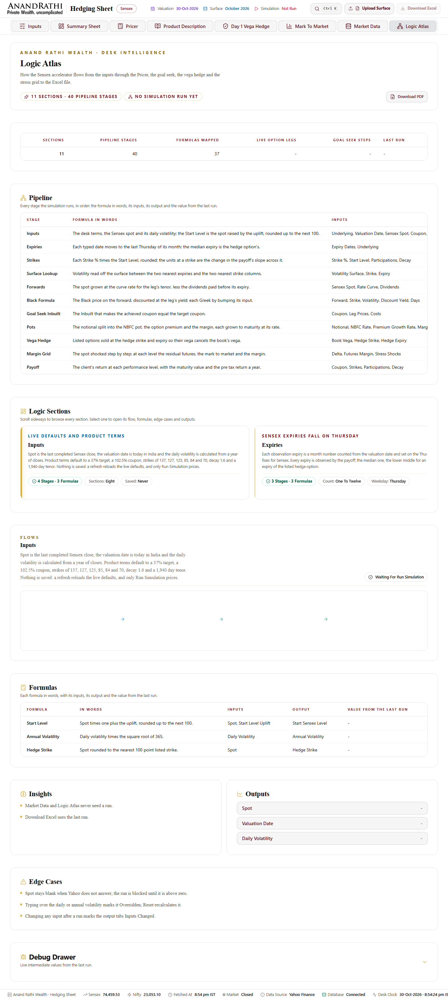
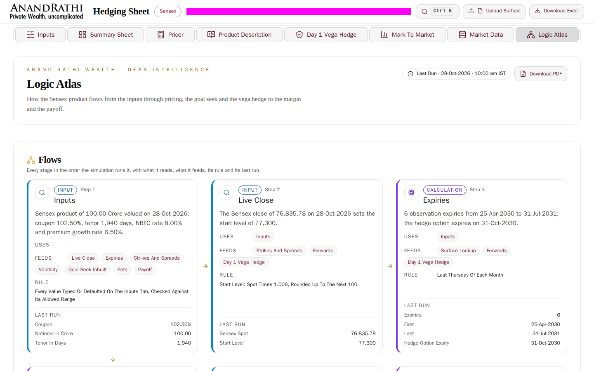
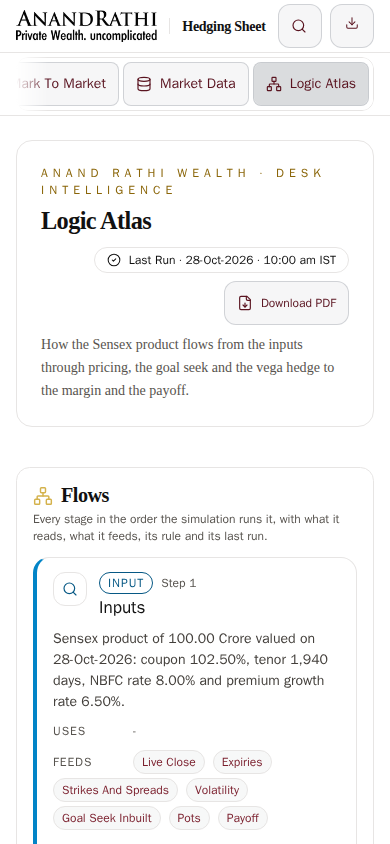

# Sign Off · Round 12

Logic Atlas rebuild, edge cases, full automation testing on local and Vercel, and end to end debugging.

## Checklist

| # | Row | Status | Evidence |
|---|---|---|---|
| 1 | Formulas and Debug Drawer removed with all their code; `knip` clean | Done | Commit `ba2fc84`; the Unused Code step passes in every run below |
| 2 | Logic Atlas has only Flows, Insights and Outputs, as detailed cards matching Primary SP Dashboard | Done | `e2e/atlas.spec.ts`; screenshots below |
| 3 | Card text from live inputs or run values, with the right hedge strike and expiry rules | Done | `tests/unit/logic-atlas.test.ts`, `tests/unit/rules-and-tables.test.ts`, `e2e/atlas.spec.ts` |
| 4 | Every edge case has defined behaviour and a named test | Done | `tests/edge/*`, `e2e/edge-cases.spec.ts`, [10 Edge Cases](10-edge-cases.md) |
| 5 | `test:all`, `test:local` and `test:vercel` pass | Local done, Vercel waiting on the push | Local runs below. `test:vercel` passed 99 of 99 against the Round 11 production; the Round 12 deployment cannot run until the push goes through |
| 6 | Coverage at least 95% on `lib/`; golden tests pass for 5 books | Done | 96.2% branches and 98.6% lines on `lib/`, enforced in `vitest.config.ts`; `tests/golden` |
| 7 | Playwright on 3 browsers at 6 widths, locally and on Vercel; crawler finds 0 errors | Local done, Vercel waiting on the push | `e2e/crawl.spec.ts` and `e2e/buttons.spec.ts` on Chromium, Firefox and WebKit |
| 8 | Layout, visual, axe and Lighthouse pass | Done | Linux baselines compared in the CI image at 0.1%; Lighthouse Performance 85 and Accessibility 95 asserted |
| 9 | CI starts a runner and is green; preview, smoke and nightly pass | Blocked | GitHub refuses the push until the account email is verified, and Actions billing must be fixed for a runner to start |
| 10 | Bug log has every bug fixed with a regression test, 0 open | Done | [Bug Log Round 12](bug-log-round-12.md) |
| 11 | Workbook audit has 0 Mismatches | Done | [Workbook Audit](workbook-audit.md): 10,802 cells, 0 Mismatch |
| 12 | Production deploy Ready; this page holds CI links, reports and screenshots | Waiting on the push | Before and local after screenshots below |

## Local Runs, Twice In A Row

Both runs are `npm run test:all` on Windows: every static check, then the production build on port 3000 against a seeded in-memory Mongo, which is gone when the run ends. Visual comparisons run on Linux only, which is why 96 tests are skipped here; the Linux baselines were compared separately in the CI image.

| Run | Report Folder | Steps | Vitest | Playwright | Lighthouse |
|---|---|---|---|---|---|
| A | `reports/all-2026-10-31_05-05-52` | 10 of 10 pass | 540 pass | 706 pass, 0 fail | Pass |
| B | `reports/all-2026-10-31_06-58-33` | 10 of 10 pass | 540 pass | 706 pass, 0 fail | Pass |

Each folder holds `summary.md`, coverage, JUnit, the Playwright HTML report and Lighthouse.

## Vercel

`npm run test:vercel -- --url https://hedging-sheet.vercel.app` against the Round 11 production deployment, read only: 2 of 2 steps, every page and API, and 99 of 99 Playwright tests on Chromium, Firefox and WebKit, in `reports/vercel-2026-10-31_00-38-05`. The bypass header was not sent, because `VERCEL_AUTOMATION_BYPASS_SECRET` is not yet in `.env.local`.

## Screenshots

| Before: Production, Round 11 | After: Local Build, Round 12 |
|---|---|
|  |  |

## Still To Do After The Push

1. Verify the GitHub account email at https://github.com/settings/emails, so the push to `main` is accepted.
2. Fix Actions billing, so `ci.yml` starts a runner.
3. Add `VERCEL_AUTOMATION_BYPASS_SECRET` to `.env.local` and to the repository secrets.
4. After the push: confirm the Vercel deployment is Ready, run `npm run test:vercel` against it twice, take the production after screenshot, and add the CI, preview and smoke run links here.
5. Protect `main` once CI and the preview tests are green, requiring both before a merge.
