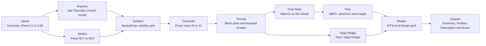

# Workbook Audit

Every non-empty cell of the reference workbook, `fixtures/reference/reference-workbook.xlsm`, checked against the engine run on the workbook's own inputs: trade date 04-Aug-2026, close 76,799, daily volatility 0.895%, hedge strike 76,800 and the 5.5% forward growth of 'Pricing Params'!H69. Numbers match within 0.001 relative, or 1e-4 absolute for prices and the bumped Greeks; dates, text and whole numbers match exactly. Generated by `scripts/audit-workbook.ts`; do not edit by hand.

## 1. Summary

| Sheet | Cells | Match | Mismatch Fixed | Not Applicable | Mismatch |
|---|---|---|---|---|---|
| Summary Sheet | 173 | 78 | 6 | 89 | 0 |
| Pricer | 4286 | 2696 | 0 | 1590 | 0 |
| MTM & Margin req | 200 | 180 | 0 | 20 | 0 |
| Day1 Vega Hedge | 1816 | 1464 | 0 | 352 | 0 |
| MarketData | 733 | 656 | 0 | 77 | 0 |
| Pricing Params | 880 | 742 | 0 | 138 | 0 |
| Product Description | 335 | 73 | 0 | 262 | 0 |
| Pivot of Positions | 171 | 0 | 0 | 171 | 0 |
| Data | 2208 | 1332 | 0 | 876 | 0 |
| **All** | **10802** | **7221** | **6** | **3575** | **0** |

## 2. Flow Diagram



## 3. One Table Per Sheet

Not Applicable cells carry their reason in the Status column.

### Summary Sheet

| Cell | Label | Formula Or Constant | Workbook Value | App Value | Code Function With File And Line | Test Name | Status |
|---|---|---|---|---|---|---|---|
| B2 | - | constant Date | Date | - | - | - | Not Applicable: Label or heading text; the app shows its own Title Case labels |
| C2 | Date | constant 2026-08-04 | 2026-08-04 | 2026-08-04 | `lib/engine/defaults.ts:49` defaultInputs | tests/unit/dates.test.ts, tests/golden/g0-workbook.test.ts | Match |
| D2 | Date | constant Sensex Spot | Sensex Spot | - | - | - | Not Applicable: Label or heading text; the app shows its own Title Case labels |
| G2 | Sensex Spot | =C2 | 2026-08-04 | - | `lib/engine/schedule.ts:0` expiryDates, medianExpiryIndex | tests/unit/engine.test.ts | Not Applicable: Expiry helpers: trade date plus months times 30.5 days. The expiries they lead to, C12 to H12, match the app's last Thursday rule |
| H2 | Sensex Spot | =G2 | 2026-08-04 | - | `lib/engine/schedule.ts:0` expiryDates, medianExpiryIndex | tests/unit/engine.test.ts | Not Applicable: Expiry helpers: trade date plus months times 30.5 days. The expiries they lead to, C12 to H12, match the app's last Thursday rule |
| I2 | Sensex Spot | =C2 | 2026-08-04 | - | `lib/engine/schedule.ts:0` expiryDates, medianExpiryIndex | tests/unit/engine.test.ts | Not Applicable: Expiry helpers: trade date plus months times 30.5 days. The expiries they lead to, C12 to H12, match the app's last Thursday rule |
| J2 | Sensex Spot | =I2 | 2026-08-04 | - | `lib/engine/schedule.ts:0` expiryDates, medianExpiryIndex | tests/unit/engine.test.ts | Not Applicable: Expiry helpers: trade date plus months times 30.5 days. The expiries they lead to, C12 to H12, match the app's last Thursday rule |
| K2 | Sensex Spot | =J2 | 2026-08-04 | - | `lib/engine/schedule.ts:0` expiryDates, medianExpiryIndex | tests/unit/engine.test.ts | Not Applicable: Expiry helpers: trade date plus months times 30.5 days. The expiries they lead to, C12 to H12, match the app's last Thursday rule |
| L2 | Sensex Spot | =shared K2 | 2026-08-04 | - | `lib/engine/schedule.ts:0` expiryDates, medianExpiryIndex | tests/unit/engine.test.ts | Not Applicable: Expiry helpers: trade date plus months times 30.5 days. The expiries they lead to, C12 to H12, match the app's last Thursday rule |
| M2 | Sensex Spot | =shared K2 | 2026-08-04 | - | `lib/engine/schedule.ts:0` expiryDates, medianExpiryIndex | tests/unit/engine.test.ts | Not Applicable: Expiry helpers: trade date plus months times 30.5 days. The expiries they lead to, C12 to H12, match the app's last Thursday rule |
| B3 | Date | constant Sensex Derived Spot | Sensex Derived Spot | - | - | - | Not Applicable: Label or heading text; the app shows its own Title Case labels |
| C3 | Sensex Derived Spot | constant 76799 | 76799 | 76799 | `lib/engine/defaults.ts:49` defaultInputs | tests/unit/dates.test.ts, tests/golden/g0-workbook.test.ts | Match |
| D3 | Sensex Derived Spot · Sensex Spot | constant 76799 | 76799 | 76799 | `lib/engine/defaults.ts:49` defaultInputs | tests/unit/dates.test.ts, tests/golden/g0-workbook.test.ts | Match |
| G3 | Sensex Derived Spot | =38*30.5 | 1159 | - | `lib/engine/schedule.ts:0` expiryDates, medianExpiryIndex | tests/unit/engine.test.ts | Not Applicable: Expiry helpers: trade date plus months times 30.5 days. The expiries they lead to, C12 to H12, match the app's last Thursday rule |
| H3 | Sensex Derived Spot | =41*30.5 | 1250.5 | - | `lib/engine/schedule.ts:0` expiryDates, medianExpiryIndex | tests/unit/engine.test.ts | Not Applicable: Expiry helpers: trade date plus months times 30.5 days. The expiries they lead to, C12 to H12, match the app's last Thursday rule |
| I3 | Sensex Derived Spot | =44*30.5 | 1342 | - | `lib/engine/schedule.ts:0` expiryDates, medianExpiryIndex | tests/unit/engine.test.ts | Not Applicable: Expiry helpers: trade date plus months times 30.5 days. The expiries they lead to, C12 to H12, match the app's last Thursday rule |
| J3 | Sensex Derived Spot | =47*30.5 | 1433.5 | - | `lib/engine/schedule.ts:0` expiryDates, medianExpiryIndex | tests/unit/engine.test.ts | Not Applicable: Expiry helpers: trade date plus months times 30.5 days. The expiries they lead to, C12 to H12, match the app's last Thursday rule |
| K3 | Sensex Derived Spot | =50*30.5 | 1525 | - | `lib/engine/schedule.ts:0` expiryDates, medianExpiryIndex | tests/unit/engine.test.ts | Not Applicable: Expiry helpers: trade date plus months times 30.5 days. The expiries they lead to, C12 to H12, match the app's last Thursday rule |
| L3 | Sensex Derived Spot | =53*30.5 | 1616.5 | - | `lib/engine/schedule.ts:0` expiryDates, medianExpiryIndex | tests/unit/engine.test.ts | Not Applicable: Expiry helpers: trade date plus months times 30.5 days. The expiries they lead to, C12 to H12, match the app's last Thursday rule |
| M3 | Sensex Derived Spot | =56*30.5 | 1708 | - | `lib/engine/schedule.ts:0` expiryDates, medianExpiryIndex | tests/unit/engine.test.ts | Not Applicable: Expiry helpers: trade date plus months times 30.5 days. The expiries they lead to, C12 to H12, match the app's last Thursday rule |
| N3 | Sensex Derived Spot | =1900 | 1900 | - | `lib/engine/schedule.ts:0` expiryDates, medianExpiryIndex | tests/unit/engine.test.ts | Not Applicable: Expiry helpers: trade date plus months times 30.5 days. The expiries they lead to, C12 to H12, match the app's last Thursday rule |
| O3 | Sensex Derived Spot | =(N3-M3)/30.5 | 6.295082 | - | `lib/engine/schedule.ts:0` expiryDates, medianExpiryIndex | tests/unit/engine.test.ts | Not Applicable: Expiry helpers: trade date plus months times 30.5 days. The expiries they lead to, C12 to H12, match the app's last Thursday rule |
| B4 | Sensex Derived Spot | constant NBFC Rate | NBFC Rate | - | - | - | Not Applicable: Label or heading text; the app shows its own Title Case labels |
| C4 | NBFC Rate | constant 0.08 | 0.08 | 0.08 | `lib/engine/defaults.ts:49` defaultInputs | tests/unit/dates.test.ts, tests/golden/g0-workbook.test.ts | Match |
| G4 | NBFC Rate | =G2+G3 | 2029-10-06 | - | `lib/engine/schedule.ts:0` expiryDates, medianExpiryIndex | tests/unit/engine.test.ts | Not Applicable: Expiry helpers: trade date plus months times 30.5 days. The expiries they lead to, C12 to H12, match the app's last Thursday rule |
| H4 | NBFC Rate | =H2+H3 | 2030-01-05 | - | `lib/engine/schedule.ts:0` expiryDates, medianExpiryIndex | tests/unit/engine.test.ts | Not Applicable: Expiry helpers: trade date plus months times 30.5 days. The expiries they lead to, C12 to H12, match the app's last Thursday rule |
| I4 | NBFC Rate | =I2+I3 | 2030-04-07 | - | `lib/engine/schedule.ts:0` expiryDates, medianExpiryIndex | tests/unit/engine.test.ts | Not Applicable: Expiry helpers: trade date plus months times 30.5 days. The expiries they lead to, C12 to H12, match the app's last Thursday rule |
| J4 | NBFC Rate | =J2+J3 | 2030-07-07 | - | `lib/engine/schedule.ts:0` expiryDates, medianExpiryIndex | tests/unit/engine.test.ts | Not Applicable: Expiry helpers: trade date plus months times 30.5 days. The expiries they lead to, C12 to H12, match the app's last Thursday rule |
| K4 | NBFC Rate | =shared J4 | 2030-10-07 | - | `lib/engine/schedule.ts:0` expiryDates, medianExpiryIndex | tests/unit/engine.test.ts | Not Applicable: Expiry helpers: trade date plus months times 30.5 days. The expiries they lead to, C12 to H12, match the app's last Thursday rule |
| L4 | NBFC Rate | =shared J4 | 2031-01-06 | - | `lib/engine/schedule.ts:0` expiryDates, medianExpiryIndex | tests/unit/engine.test.ts | Not Applicable: Expiry helpers: trade date plus months times 30.5 days. The expiries they lead to, C12 to H12, match the app's last Thursday rule |
| M4 | NBFC Rate | =shared J4 | 2031-04-08 | - | `lib/engine/schedule.ts:0` expiryDates, medianExpiryIndex | tests/unit/engine.test.ts | Not Applicable: Expiry helpers: trade date plus months times 30.5 days. The expiries they lead to, C12 to H12, match the app's last Thursday rule |
| B5 | NBFC Rate | constant Prem Rate | Prem Rate | - | - | - | Not Applicable: Label or heading text; the app shows its own Title Case labels |
| C5 | Prem Rate | ='Pricing Params'!H69+1% | 0.065 | 0.065 | `lib/engine/defaults.ts:49` defaultInputs | tests/golden/g0-workbook.test.ts | Match |
| G5 | Prem Rate | constant 0.25 | 0.25 | - | - | - | Not Applicable: Expiry helpers: trade date plus months times 30.5 days. The expiries they lead to, C12 to H12, match the app's last Thursday rule |
| B6 | Prem Rate | constant Margin growth rate | Margin growth rate | - | - | - | Not Applicable: Label or heading text; the app shows its own Title Case labels |
| C6 | Margin growth rate | constant 0.06579 | 0.06579 | 0.06579 | `lib/engine/defaults.ts:49` defaultInputs | tests/unit/dates.test.ts, tests/golden/g0-workbook.test.ts | Match |
| G6 | Margin growth rate | =(1+G5)^(365/G3)-1 | 0.072802 | - | `lib/engine/schedule.ts:0` expiryDates, medianExpiryIndex | tests/unit/engine.test.ts | Not Applicable: Expiry helpers: trade date plus months times 30.5 days. The expiries they lead to, C12 to H12, match the app's last Thursday rule |
| B8 | Margin growth rate | constant Sensex ACCELERATOR | Sensex ACCELERATOR | - | - | - | Not Applicable: Label or heading text; the app shows its own Title Case labels |
| B9 | Sensex ACCELERATOR | constant Prod Specs | Prod Specs | - | - | - | Not Applicable: Label or heading text; the app shows its own Title Case labels |
| C9 | Prod Specs | constant Tgt Sensex | Tgt Sensex | - | - | - | Not Applicable: Label or heading text; the app shows its own Title Case labels |
| D9 | Tgt Sensex · Sensex Spot | constant Coupon | Coupon | - | - | - | Not Applicable: Label or heading text; the app shows its own Title Case labels |
| E9 | Coupon | constant IB | IB | - | - | - | Not Applicable: Label or heading text; the app shows its own Title Case labels |
| F9 | IB | constant IRR | IRR | - | - | - | Not Applicable: Label or heading text; the app shows its own Title Case labels |
| G9 | IRR | constant Spread 1 Buy | Spread 1 Buy | - | - | - | Not Applicable: Label or heading text; the app shows its own Title Case labels |
| H9 | Spread 1 Buy | constant Spread 1 Sell | Spread 1 Sell | - | - | - | Not Applicable: Label or heading text; the app shows its own Title Case labels |
| I9 | Spread 1 Sell | constant Spread 2 Buy | Spread 2 Buy | - | - | - | Not Applicable: Label or heading text; the app shows its own Title Case labels |
| J9 | Spread 2 Buy | constant Spread 2 Sell | Spread 2 Sell | - | - | - | Not Applicable: Label or heading text; the app shows its own Title Case labels |
| K9 | Spread 2 Sell | constant Spread 1 PR | Spread 1 PR | - | - | - | Not Applicable: Label or heading text; the app shows its own Title Case labels |
| L9 | Spread 1 PR | constant Spread 2 PR | Spread 2 PR | - | - | - | Not Applicable: Label or heading text; the app shows its own Title Case labels |
| M9 | Spread 2 PR | constant Protection | Protection | - | - | - | Not Applicable: Label or heading text; the app shows its own Title Case labels |
| N9 | Protection | constant Decay | Decay | - | - | - | Not Applicable: Label or heading text; the app shows its own Title Case labels |
| O9 | Decay | constant Tenor | Tenor | - | - | - | Not Applicable: Label or heading text; the app shows its own Title Case labels |
| P9 | Tenor | constant Spread 2 width | Spread 2 width | - | - | - | Not Applicable: Label or heading text; the app shows its own Title Case labels |
| Q9 | Spread 2 width | constant Margin | Margin | - | - | - | Not Applicable: Label or heading text; the app shows its own Title Case labels |
| B10 | Prod Specs | constant Prod Specs | Prod Specs | - | - | - | Not Applicable: Label or heading text; the app shows its own Title Case labels |
| C10 | Prod Specs · Tgt Sensex | constant 0.37 | 0.37 | 0.37 | `lib/engine/defaults.ts:49` defaultInputs | tests/unit/dates.test.ts, tests/golden/g0-workbook.test.ts | Match |
| D10 | Prod Specs · Coupon | constant 1.025 | 1.025 | 1.025 | `lib/engine/defaults.ts:49` defaultInputs | tests/unit/dates.test.ts, tests/golden/g0-workbook.test.ts | Match |
| E10 | Prod Specs · IB | =Pricer!F5 | 0.079499 | 0.079499 | `lib/engine/hedging-sheet.ts:216` computeHedgingSheet, Solver stage | tests/golden/g0-workbook.test.ts | Match |
| F10 | Prod Specs · IRR | =((1+D10)^(365/O10))-1 | 0.141963 | 0.141963 | `lib/engine/hedging-sheet.ts:216` computeHedgingSheet | tests/golden/g0-workbook.test.ts | Match |
| G10 | Prod Specs · Spread 1 Buy | constant 0.25 | 0.25 | 0.25 | `lib/engine/defaults.ts:49` defaultInputs | tests/unit/dates.test.ts, tests/golden/g0-workbook.test.ts | Match |
| H10 | Prod Specs · Spread 1 Sell | constant 0.27 | 0.27 | 0.27 | `lib/engine/defaults.ts:49` defaultInputs | tests/unit/dates.test.ts, tests/golden/g0-workbook.test.ts | Match |
| I10 | Prod Specs · Spread 2 Buy | constant 0.27 | 0.27 | 0.27 | `lib/engine/defaults.ts:49` defaultInputs | tests/unit/dates.test.ts, tests/golden/g0-workbook.test.ts | Match |
| J10 | Prod Specs · Spread 2 Sell | =C10 | 0.37 | 0.37 | `lib/engine/structure.ts:42` deriveTerms | tests/golden/g0-workbook.test.ts | Match |
| K10 | Prod Specs · Spread 1 PR | constant 1 | 1 | 1 | `lib/engine/defaults.ts:49` defaultInputs | tests/unit/dates.test.ts, tests/golden/g0-workbook.test.ts | Match |
| L10 | Prod Specs · Spread 2 PR | =(D10-((H10-G10)*K10))/(J10-I10) | 10.05 | 10.05 | `lib/engine/structure.ts:42` deriveTerms | tests/structure.test.ts | Match |
| M10 | Prod Specs · Protection | constant 0.15 | 0.15 | 0.15 | `lib/engine/defaults.ts:49` defaultInputs | tests/unit/dates.test.ts, tests/golden/g0-workbook.test.ts | Match |
| N10 | Prod Specs · Decay | constant 1.6 | 1.6 | 1.6 | `lib/engine/defaults.ts:49` defaultInputs | tests/unit/dates.test.ts, tests/golden/g0-workbook.test.ts | Match |
| O10 | Prod Specs · Tenor | constant 1940 | 1940 | 1940 | `lib/engine/defaults.ts:49` defaultInputs | tests/unit/dates.test.ts, tests/golden/g0-workbook.test.ts | Match |
| P10 | Prod Specs · Spread 2 width | constant 0.02 | 0.02 | 0.02 | `lib/engine/defaults.ts:49` defaultInputs | tests/unit/dates.test.ts, tests/golden/g0-workbook.test.ts | Match |
| Q10 | Prod Specs · Margin | ='MTM & Margin req'!K16/-100 | 0.32308 | 0.32308 | `lib/engine/hedging-sheet.ts:216` computeHedgingSheet, Stress And Margin stage | tests/golden/g0-workbook.test.ts | Match |
| B12 | Prod Specs | constant Final Expiries | Final Expiries | - | - | - | Not Applicable: Label or heading text; the app shows its own Title Case labels |
| C12 | Final Expiries · Tgt Sensex | constant 2030-01-31 | 2030-01-31 | 2030-01-31 | `lib/engine/defaults.ts:44` defaultExpiryDates | tests/unit/dates.test.ts, tests/golden/g0-workbook.test.ts | Mismatch Fixed |
| D12 | Final Expiries · Coupon | constant 2030-04-25 | 2030-04-25 | 2030-04-25 | `lib/engine/defaults.ts:44` defaultExpiryDates | tests/unit/dates.test.ts, tests/golden/g0-workbook.test.ts | Mismatch Fixed |
| E12 | Final Expiries · IB | constant 2030-07-25 | 2030-07-25 | 2030-07-25 | `lib/engine/defaults.ts:44` defaultExpiryDates | tests/unit/dates.test.ts, tests/golden/g0-workbook.test.ts | Mismatch Fixed |
| F12 | Final Expiries · IRR | constant 2030-10-31 | 2030-10-31 | 2030-10-31 | `lib/engine/defaults.ts:44` defaultExpiryDates | tests/unit/dates.test.ts, tests/golden/g0-workbook.test.ts | Mismatch Fixed |
| G12 | Final Expiries · Spread 1 Buy | constant 2031-01-30 | 2031-01-30 | 2031-01-30 | `lib/engine/defaults.ts:44` defaultExpiryDates | tests/unit/dates.test.ts, tests/golden/g0-workbook.test.ts | Mismatch Fixed |
| H12 | Final Expiries · Spread 1 Sell | constant 2031-04-24 | 2031-04-24 | 2031-04-24 | `lib/engine/defaults.ts:44` defaultExpiryDates | tests/unit/dates.test.ts, tests/golden/g0-workbook.test.ts | Mismatch Fixed |
| I12 | Final Expiries · Spread 2 Buy | constant NA | NA | - | - | - | Not Applicable: Label or heading text; the app shows its own Title Case labels |
| J12 | NA · Spread 2 Sell | constant NA | NA | - | - | - | Not Applicable: Label or heading text; the app shows its own Title Case labels |
| B14 | Final Expiries | constant Prod Greeks | Prod Greeks | - | - | - | Not Applicable: Label or heading text; the app shows its own Title Case labels |
| C14 | Prod Greeks · Tgt Sensex | constant Notional (Cr.) | Notional (Cr.) | - | - | - | Not Applicable: Label or heading text; the app shows its own Title Case labels |
| D14 | Notional (Cr.) · Coupon | constant Option Expiry | Option Expiry | - | - | - | Not Applicable: Label or heading text; the app shows its own Title Case labels |
| E14 | Option Expiry · IB | constant Delta Qty | Delta Qty | - | - | - | Not Applicable: Label or heading text; the app shows its own Title Case labels |
| F14 | Delta Qty · IRR | constant Delta % | Delta % | - | - | - | Not Applicable: Label or heading text; the app shows its own Title Case labels |
| G14 | Delta % · Spread 1 Buy | constant Vol | Vol | - | - | - | Not Applicable: Label or heading text; the app shows its own Title Case labels |
| H14 | Vol · Spread 1 Sell | constant Vega INR (Cr.) | Vega INR (Cr.) | - | - | - | Not Applicable: Label or heading text; the app shows its own Title Case labels |
| I14 | Vega INR (Cr.) · NA | constant Rho | Rho | - | - | - | Not Applicable: Label or heading text; the app shows its own Title Case labels |
| J14 | Rho · NA | constant Rho INR (Cr.) | Rho INR (Cr.) | - | - | - | Not Applicable: Label or heading text; the app shows its own Title Case labels |
| B15 | Prod Greeks | constant Prod Greeks | Prod Greeks | - | - | - | Not Applicable: Label or heading text; the app shows its own Title Case labels |
| C15 | Prod Greeks · Notional (Cr.) | constant 100 | 100 | 100 | `lib/engine/defaults.ts:49` defaultInputs | tests/unit/dates.test.ts, tests/golden/g0-workbook.test.ts | Match |
| D15 | Prod Greeks · Option Expiry | =E12 | 2030-07-25 | 2030-07-25 | `lib/engine/hedging-sheet.ts:216` computeHedgingSheet, summary | tests/golden/g0-workbook.test.ts | Match |
| E15 | Prod Greeks · Delta Qty | =Pricer!Q5 | 16880.373133 | 16880.373133 | `lib/engine/hedging-sheet.ts:216` computeHedgingSheet, summary | tests/golden/g0-workbook.test.ts | Match |
| F15 | Prod Greeks · Delta % | =Pricer!Q5*Pricer!$B$2/Pricer!E5 | 1.296396 | 1.296396 | `lib/engine/hedging-sheet.ts:216` computeHedgingSheet, summary | tests/golden/g0-workbook.test.ts | Match |
| G15 | Prod Greeks · Vol | =SUMPRODUCT(Pricer!B32:CS32,Pricer!B61:CS61)/SUM(Pricer!B61: | 0.078072 | 0.078072 | `lib/engine/hedging-sheet.ts:216` computeHedgingSheet, summary | tests/golden/g0-workbook.test.ts | Match |
| H15 | Prod Greeks · Vega INR (Cr.) | =((SUM(Pricer!B61:CS61))/10000000)*-1 | 0.54315 | 0.54315 | `lib/engine/hedging-sheet.ts:216` computeHedgingSheet, summary | tests/golden/g0-workbook.test.ts | Match |
| I15 | Prod Greeks · Rho | =SUMPRODUCT(Pricer!B28:CS28,Pricer!B62:CS62)/SUM(Pricer!B62: | 0.055 | 0.055 | `lib/engine/hedging-sheet.ts:216` computeHedgingSheet, summary | tests/golden/g0-workbook.test.ts | Match |
| J15 | Prod Greeks · Rho INR (Cr.) | =((SUM(Pricer!B62:CS62))/10000000)*-1 | -7.088448 | -7.088448 | `lib/engine/hedging-sheet.ts:216` computeHedgingSheet, summary | tests/golden/g0-workbook.test.ts | Match |
| B17 | Prod Greeks | constant Cost | Cost | - | - | - | Not Applicable: Label or heading text; the app shows its own Title Case labels |
| C17 | Cost · Notional (Cr.) | constant Trans Cost (%) | Trans Cost (%) | - | - | - | Not Applicable: Label or heading text; the app shows its own Title Case labels |
| D17 | Trans Cost (%) · Option Expiry | constant Issu Cost (%) | Issu Cost (%) | - | - | - | Not Applicable: Label or heading text; the app shows its own Title Case labels |
| E17 | Issu Cost (%) · Delta Qty | constant Margin Cost (%) | Margin Cost (%) | - | - | - | Not Applicable: Label or heading text; the app shows its own Title Case labels |
| B18 | Cost | constant Cost | Cost | - | - | - | Not Applicable: Label or heading text; the app shows its own Title Case labels |
| C18 | Cost · Trans Cost (%) | constant 0.0225 | 0.0225 | 0.0225 | `lib/engine/defaults.ts:49` defaultInputs | tests/unit/dates.test.ts, tests/golden/g0-workbook.test.ts | Match |
| D18 | Cost · Issu Cost (%) | constant 0.0013 | 0.0013 | 0.0013 | `lib/engine/defaults.ts:49` defaultInputs | tests/unit/dates.test.ts, tests/golden/g0-workbook.test.ts | Match |
| E18 | Cost · Margin Cost (%) | constant 0 | 0 | 0 | `lib/engine/defaults.ts:49` defaultInputs | tests/unit/dates.test.ts, tests/golden/g0-workbook.test.ts | Match |
| F18 | Cost · Delta % | constant (Product Cost is a total of Tran Cost, Issu Cost &  | (Product Cost is a total of Tran Cost, Issu Cost & Margin Co | - | - | - | Not Applicable: Label or heading text; the app shows its own Title Case labels |
| B20 | Cost | constant Options Details (For 100 cr.) | Options Details (For 100 cr.) | - | - | - | Not Applicable: Label or heading text; the app shows its own Title Case labels |
| H20 | Options Details (For 100 cr.) · Vega INR (Cr.) | constant Vega Hedge (For 100 cr.) | Vega Hedge (For 100 cr.) | - | - | - | Not Applicable: Label or heading text; the app shows its own Title Case labels |
| B21 | Options Details (For 100 cr.) | ="Expiry: "&TEXT(Pricer!B20,"dd-mmm-yy")&","&TEXT(Pricer!C20 | Expiry: 31-Jan-30,25-Apr-30, 25-Jul-30, 31-Oct-30, 30-Jan-31 | - | `lib/tables.ts:0` summary tables | tests/export/export.test.ts | Not Applicable: Text the sheet builds from other cells; the app writes the same facts in its own wording |
| H21 | Vega Hedge (For 100 cr.) | constant Day 1 Vega Hedge | Day 1 Vega Hedge | - | - | - | Not Applicable: Label or heading text; the app shows its own Title Case labels |
| B22 | Options Details (For 100 cr.) | constant Strike | Strike | - | - | - | Not Applicable: Label or heading text; the app shows its own Title Case labels |
| C22 | Strike · Trans Cost (%) | constant Option | Option | - | - | - | Not Applicable: Label or heading text; the app shows its own Title Case labels |
| D22 | Option · Issu Cost (%) | constant Qty (lacs) | Qty (lacs) | - | - | - | Not Applicable: Label or heading text; the app shows its own Title Case labels |
| E22 | Qty (lacs) · Margin Cost (%) | constant Px. | Px. | - | - | - | Not Applicable: Label or heading text; the app shows its own Title Case labels |
| F22 | Px. · (Product Cost is a total of Tran Cost, Issu Cost & Mar | constant Premium (cr.) | Premium (cr.) | - | - | - | Not Applicable: Label or heading text; the app shows its own Title Case labels |
| H22 | Premium (cr.) · Day 1 Vega Hedge | constant Strike | Strike | - | - | - | Not Applicable: Label or heading text; the app shows its own Title Case labels |
| I22 | Strike · Rho | constant Expiry | Expiry | - | - | - | Not Applicable: Label or heading text; the app shows its own Title Case labels |
| J22 | Expiry · Rho INR (Cr.) | constant Option | Option | - | - | - | Not Applicable: Label or heading text; the app shows its own Title Case labels |
| K22 | Option · Spread 1 PR | constant Qty (lacs) | Qty (lacs) | - | - | - | Not Applicable: Label or heading text; the app shows its own Title Case labels |
| L22 | Qty (lacs) · Spread 2 PR | constant Px. | Px. | - | - | - | Not Applicable: Label or heading text; the app shows its own Title Case labels |
| M22 | Px. · Protection | constant Prem(cr.) | Prem(cr.) | - | - | - | Not Applicable: Label or heading text; the app shows its own Title Case labels |
| B23 | Strike | =Pricer!B19 | 105901 | 105901 | `lib/engine/hedging-sheet.ts:216` computeHedgingSheet, summary legs | tests/golden/g0-workbook.test.ts | Match |
| C23 | Option | =Pricer!B25 | P | P | `lib/engine/hedging-sheet.ts:216` computeHedgingSheet, summary legs | tests/golden/g0-workbook.test.ts | Match |
| D23 | Qty (lacs) | =SUMIF(Pricer!$B$17:$CS$17,G23,Pricer!$B$55:$CS$55)/100000 | -1.300129 | -1.300129 | `lib/engine/hedging-sheet.ts:216` computeHedgingSheet, summary legs | tests/golden/g0-workbook.test.ts | Match |
| E23 | Px. | =SUMIF(Pricer!$B$17:$CS$17,G23,Pricer!$B$35:$CS$35)/(2*COUNT | 13007.128548 | 13007.128548 | `lib/engine/hedging-sheet.ts:216` computeHedgingSheet, summary legs | tests/golden/g0-workbook.test.ts | Match |
| F23 | Premium (cr.) | =D23*E23*100000/10000000*-1 | 169.109498 | 169.109498 | `lib/engine/hedging-sheet.ts:216` computeHedgingSheet, summary legs | tests/golden/g0-workbook.test.ts | Match |
| G23 | Vol | constant 137 | 137 | 137 | `lib/engine/structure.ts:126` buildStrikes | tests/golden/g0-workbook.test.ts | Match |
| H23 | Strike | constant 76800 | 76800 | 76800 | `lib/engine/hedging-sheet.ts:216` computeHedgingSheet, Vega Hedge stage | tests/golden/g0-workbook.test.ts | Match |
| I23 | Expiry | =D15 | 2030-07-25 | 2030-07-25 | `lib/engine/hedging-sheet.ts:216` computeHedgingSheet, Vega Hedge stage | tests/golden/g0-workbook.test.ts | Match |
| J23 | Option | constant P | P | - | `lib/engine/hedging-sheet.ts:216` computeHedgingSheet, Vega Hedge stage | tests/golden/g0-workbook.test.ts | Not Applicable: Label or heading text; the app shows its own Title Case labels |
| K23 | P · Qty (lacs) | ='Day1 Vega Hedge'!F8/100000 | -0.128097 | -0.128097 | `lib/engine/hedging-sheet.ts:216` computeHedgingSheet, Vega Hedge stage | tests/golden/g0-workbook.test.ts | Match |
| L23 | P · Px. | ='Day1 Vega Hedge'!G8 | 3555.759861 | 3555.759861 | `lib/engine/hedging-sheet.ts:216` computeHedgingSheet, Vega Hedge stage | tests/golden/g0-workbook.test.ts | Match |
| M23 | P · Prem(cr.) | =K23*L23*100000/10000000*-1 | 4.554812 | 4.554812 | `lib/engine/hedging-sheet.ts:216` computeHedgingSheet, Vega Hedge stage | tests/golden/g0-workbook.test.ts | Match |
| B24 | Strike | =Pricer!J19 | 98171 | 98171 | `lib/engine/hedging-sheet.ts:216` computeHedgingSheet, summary legs | tests/golden/g0-workbook.test.ts | Match |
| C24 | Option | =Pricer!J25 | P | P | `lib/engine/hedging-sheet.ts:216` computeHedgingSheet, summary legs | tests/golden/g0-workbook.test.ts | Match |
| D24 | Qty (lacs) | =SUMIF(Pricer!$B$17:$CS$17,G24,Pricer!$B$55:$CS$55)/100000 | 1.170763 | 1.170763 | `lib/engine/hedging-sheet.ts:216` computeHedgingSheet, summary legs | tests/golden/g0-workbook.test.ts | Match |
| E24 | Px. | =SUMIF(Pricer!$B$17:$CS$17,G24,Pricer!$B$35:$CS$35)/(2*COUNT | 9597.872286 | 9597.872286 | `lib/engine/hedging-sheet.ts:216` computeHedgingSheet, summary legs | tests/golden/g0-workbook.test.ts | Match |
| F24 | Premium (cr.) | =shared F23 | -112.368362 | -112.368362 | `lib/engine/hedging-sheet.ts:216` computeHedgingSheet, summary legs | tests/golden/g0-workbook.test.ts | Match |
| G24 | Vol | constant 127 | 127 | 127 | `lib/engine/defaults.ts:49` defaultInputs | tests/unit/dates.test.ts, tests/golden/g0-workbook.test.ts | Match |
| L24 | Px. | constant Delta: | Delta: | - | - | - | Not Applicable: Label or heading text; the app shows its own Title Case labels |
| M24 | Delta: · Prem(cr.) | ='Day1 Vega Hedge'!I36 | -0.196109 | -0.196109 | `lib/engine/hedging-sheet.ts:216` computeHedgingSheet, Vega Hedge stage | tests/golden/g0-workbook.test.ts | Match |
| B25 | Strike | =Pricer!R19 | 96625 | 96625 | `lib/engine/hedging-sheet.ts:216` computeHedgingSheet, summary legs | tests/golden/g0-workbook.test.ts | Match |
| C25 | Option | =Pricer!R25 | P | P | `lib/engine/hedging-sheet.ts:216` computeHedgingSheet, summary legs | tests/golden/g0-workbook.test.ts | Match |
| D25 | Qty (lacs) | =SUMIF(Pricer!$B$17:$CS$17,G25,Pricer!$B$55:$CS$55)/100000 | 0.129366 | 0.129366 | `lib/engine/hedging-sheet.ts:216` computeHedgingSheet, summary legs | tests/golden/g0-workbook.test.ts | Match |
| E25 | Px. | =SUMIF(Pricer!$B$17:$CS$17,G25,Pricer!$B$35:$CS$35)/(2*COUNT | 9001.745232 | 9001.745232 | `lib/engine/hedging-sheet.ts:216` computeHedgingSheet, summary legs | tests/golden/g0-workbook.test.ts | Match |
| F25 | Premium (cr.) | =shared F23 | -11.645207 | -11.645207 | `lib/engine/hedging-sheet.ts:216` computeHedgingSheet, summary legs | tests/golden/g0-workbook.test.ts | Match |
| G25 | Vol | constant 125 | 125 | 125 | `lib/engine/defaults.ts:49` defaultInputs | tests/unit/dates.test.ts, tests/golden/g0-workbook.test.ts | Match |
| H25 | Strike | constant Sensex Daily Vol | Sensex Daily Vol | - | - | - | Not Applicable: Label or heading text; the app shows its own Title Case labels |
| I25 | Sensex Daily Vol · Expiry | constant 0.00895071 | 0.008951 | 0.008951 | `lib/engine/defaults.ts:49` defaultInputs | tests/unit/dates.test.ts, tests/golden/g0-workbook.test.ts | Match |
| B26 | Strike | =Pricer!Z19 | 65705 | 65705 | `lib/engine/hedging-sheet.ts:216` computeHedgingSheet, summary legs | tests/golden/g0-workbook.test.ts | Match |
| C26 | Option | =Pricer!Z25 | P | P | `lib/engine/hedging-sheet.ts:216` computeHedgingSheet, summary legs | tests/golden/g0-workbook.test.ts | Match |
| D26 | Qty (lacs) | =SUMIF(Pricer!$B$17:$CS$17,G26,Pricer!$B$55:$CS$55)/100000 | -3.311772 | -3.311772 | `lib/engine/hedging-sheet.ts:216` computeHedgingSheet, summary legs | tests/golden/g0-workbook.test.ts | Match |
| E26 | Px. | =SUMIF(Pricer!$B$17:$CS$17,G26,Pricer!$B$35:$CS$35)/(2*COUNT | 2234.626098 | 2234.626098 | `lib/engine/hedging-sheet.ts:216` computeHedgingSheet, summary legs | tests/golden/g0-workbook.test.ts | Match |
| F26 | Premium (cr.) | =shared F23 | 74.005728 | 74.005728 | `lib/engine/hedging-sheet.ts:216` computeHedgingSheet, summary legs | tests/golden/g0-workbook.test.ts | Match |
| G26 | Vol | constant 85 | 85 | 85 | `lib/engine/defaults.ts:49` defaultInputs | tests/unit/dates.test.ts, tests/golden/g0-workbook.test.ts | Match |
| H26 | Sensex Daily Vol | constant Sensex Ann. Vol | Sensex Ann. Vol | - | - | - | Not Applicable: Label or heading text; the app shows its own Title Case labels |
| I26 | Sensex Ann. Vol · Expiry | constant 0.17100307 | 0.171003 | 0.171003 | `lib/engine/defaults.ts:49` defaultInputs | tests/unit/dates.test.ts, tests/golden/g0-workbook.test.ts | Match |
| B27 | Strike | =Pricer!AH19 | 64932 | 64932 | `lib/engine/hedging-sheet.ts:216` computeHedgingSheet, summary legs | tests/golden/g0-workbook.test.ts | Match |
| C27 | Option | =Pricer!AH25 | P | P | `lib/engine/hedging-sheet.ts:216` computeHedgingSheet, summary legs | tests/golden/g0-workbook.test.ts | Match |
| D27 | Qty (lacs) | =SUMIF(Pricer!$B$17:$CS$17,G27,Pricer!$B$55:$CS$55)/100000 | 3.104787 | 3.104787 | `lib/engine/hedging-sheet.ts:216` computeHedgingSheet, summary legs | tests/golden/g0-workbook.test.ts | Match |
| E27 | Px. | =SUMIF(Pricer!$B$17:$CS$17,G27,Pricer!$B$35:$CS$35)/(2*COUNT | 2152.432125 | 2152.432125 | `lib/engine/hedging-sheet.ts:216` computeHedgingSheet, summary legs | tests/golden/g0-workbook.test.ts | Match |
| F27 | Premium (cr.) | =shared F23 | -66.828423 | -66.828423 | `lib/engine/hedging-sheet.ts:216` computeHedgingSheet, summary legs | tests/golden/g0-workbook.test.ts | Match |
| G27 | Vol | constant 84 | 84 | 84 | `lib/engine/defaults.ts:49` defaultInputs | tests/unit/dates.test.ts, tests/golden/g0-workbook.test.ts | Match |
| B28 | Strike | =Pricer!AP19 | 54110 | 54110 | `lib/engine/hedging-sheet.ts:216` computeHedgingSheet, summary legs | tests/golden/g0-workbook.test.ts | Match |
| C28 | Option | =Pricer!AP25 | P | P | `lib/engine/hedging-sheet.ts:216` computeHedgingSheet, summary legs | tests/golden/g0-workbook.test.ts | Match |
| D28 | Qty (lacs) | =SUMIF(Pricer!$B$17:$CS$17,G28,Pricer!$B$55:$CS$55)/100000 | 0.129366 | 0.129366 | `lib/engine/hedging-sheet.ts:216` computeHedgingSheet, summary legs | tests/golden/g0-workbook.test.ts | Match |
| E28 | Px. | =SUMIF(Pricer!$B$17:$CS$17,G28,Pricer!$B$35:$CS$35)/(2*COUNT | 1237.113799 | 1237.113799 | `lib/engine/hedging-sheet.ts:216` computeHedgingSheet, summary legs | tests/golden/g0-workbook.test.ts | Match |
| F28 | Premium (cr.) | =shared F23 | -1.600406 | -1.600406 | `lib/engine/hedging-sheet.ts:216` computeHedgingSheet, summary legs | tests/golden/g0-workbook.test.ts | Match |
| G28 | Vol | constant 70 | 70 | 70 | `lib/engine/defaults.ts:49` defaultInputs | tests/unit/dates.test.ts, tests/golden/g0-workbook.test.ts | Match |
| E29 | Px. | constant Total | Total | - | - | - | Not Applicable: Label or heading text; the app shows its own Title Case labels |
| F29 | Total · Premium (cr.) | =SUM(F23:F28) | 50.672828 | 50.672828 | `lib/engine/hedging-sheet.ts:216` computeHedgingSheet, summary | tests/golden/g0-workbook.test.ts | Match |
| H29 | Total · Sensex Ann. Vol | constant Exposure margin percentage | Exposure margin percentage | - | - | - | Not Applicable: Label or heading text; the app shows its own Title Case labels |
| J29 | Exposure margin percentage · P | constant 5 | 5 | 5 | `lib/engine/defaults.ts:49` defaultInputs | tests/unit/dates.test.ts, tests/golden/g0-workbook.test.ts | Match |

### Pricer

| Cell | Label | Formula Or Constant | Workbook Value | App Value | Code Function With File And Line | Test Name | Status |
|---|---|---|---|---|---|---|---|
| A1 | - | constant Trade Date | Trade Date | - | - | - | Not Applicable: Label or heading text; the app shows its own Title Case labels |
| B1 | Trade Date | ='Summary Sheet'!C2 | 2026-08-04 | 2026-08-04 | `lib/engine/hedging-sheet.ts:216` computeHedgingSheet | tests/golden/g0-workbook.test.ts | Match |
| A2 | Trade Date | constant Closing Sensex | Closing Sensex | - | - | - | Not Applicable: Label or heading text; the app shows its own Title Case labels |
| B2 | Closing Sensex | ='Summary Sheet'!C3 | 76799 | 76799 | `lib/engine/hedging-sheet.ts:216` computeHedgingSheet | tests/golden/g0-workbook.test.ts | Match |
| B4 | - | constant Start Sensex | Start Sensex | - | - | - | Not Applicable: Label or heading text; the app shows its own Title Case labels |
| C4 | Start Sensex | constant Coupon | Coupon | - | - | - | Not Applicable: Label or heading text; the app shows its own Title Case labels |
| D4 | Coupon | constant Expiry | Expiry | - | - | - | Not Applicable: Label or heading text; the app shows its own Title Case labels |
| E4 | Expiry | constant Mobilization | Mobilization | - | - | - | Not Applicable: Label or heading text; the app shows its own Title Case labels |
| F4 | Mobilization | constant Actual IB (%) | Actual IB (%) | - | - | - | Not Applicable: Label or heading text; the app shows its own Title Case labels |
| G4 | Actual IB (%) | constant Prod Cost (%)* | Prod Cost (%)* | - | - | - | Not Applicable: Label or heading text; the app shows its own Title Case labels |
| H4 | Prod Cost (%)* | constant Inbuilt (Rs.) | Inbuilt (Rs.) | - | - | - | Not Applicable: Label or heading text; the app shows its own Title Case labels |
| I4 | Inbuilt (Rs.) | constant Trans Cost (Rs.) | Trans Cost (Rs.) | - | - | - | Not Applicable: Label or heading text; the app shows its own Title Case labels |
| J4 | Trans Cost (Rs.) | constant Net mobilization | Net mobilization | - | - | - | Not Applicable: Label or heading text; the app shows its own Title Case labels |
| K4 | Net mobilization | constant Premium | Premium | - | - | - | Not Applicable: Label or heading text; the app shows its own Title Case labels |
| L4 | Premium | constant NBFC Rate (%) | NBFC Rate (%) | - | - | - | Not Applicable: Label or heading text; the app shows its own Title Case labels |
| M4 | NBFC Rate (%) | constant Prem Rate (%) | Prem Rate (%) | - | - | - | Not Applicable: Label or heading text; the app shows its own Title Case labels |
| N4 | Prem Rate (%) | constant Tenor | Tenor | - | - | - | Not Applicable: Label or heading text; the app shows its own Title Case labels |
| O4 | Tenor | constant Payout | Payout | - | - | - | Not Applicable: Label or heading text; the app shows its own Title Case labels |
| P4 | Payout | constant Coupon | Coupon | - | - | - | Not Applicable: Label or heading text; the app shows its own Title Case labels |
| Q4 | Coupon | constant Delta | Delta | - | - | - | Not Applicable: Label or heading text; the app shows its own Title Case labels |
| R4 | Delta | constant Vega | Vega | - | - | - | Not Applicable: Label or heading text; the app shows its own Title Case labels |
| S4 | Vega | constant Rho | Rho | - | - | - | Not Applicable: Label or heading text; the app shows its own Title Case labels |
| T4 | Rho | constant Gamma | Gamma | - | - | - | Not Applicable: Label or heading text; the app shows its own Title Case labels |
| U4 | Gamma | constant IRR | IRR | - | - | - | Not Applicable: Label or heading text; the app shows its own Title Case labels |
| V4 | IRR | constant Margin Cost | Margin Cost | - | - | - | Not Applicable: Label or heading text; the app shows its own Title Case labels |
| A5 | Closing Sensex | ='Summary Sheet'!B8 | Sensex ACCELERATOR | - | `lib/engine/hedging-sheet.ts:216` computeHedgingSheet, pricer header | tests/golden/g0-workbook.test.ts | Not Applicable: Text the sheet builds from other cells; the app writes the same facts in its own wording |
| B5 | Start Sensex | =ROUNDUP('Summary Sheet'!D3*1.006,-2) | 77300 | 77300 | `lib/engine/hedging-sheet.ts:216` computeHedgingSheet, pricer header | tests/golden/g0-workbook.test.ts | Match |
| C5 | Coupon | ='Summary Sheet'!D10 | 1.025 | 1.025 | `lib/engine/hedging-sheet.ts:216` computeHedgingSheet, pricer header | tests/golden/g0-workbook.test.ts | Match |
| D5 | Expiry | ='Summary Sheet'!D15 | 2030-07-25 | 2030-07-25 | `lib/engine/hedging-sheet.ts:216` computeHedgingSheet, pricer header | tests/golden/g0-workbook.test.ts | Match |
| E5 | Mobilization | ='Summary Sheet'!C15*10000000 | 1000000000 | 1000000000 | `lib/engine/hedging-sheet.ts:216` computeHedgingSheet, pricer header | tests/golden/g0-workbook.test.ts | Match |
| F5 | Actual IB (%) | =H5/E5 | 0.079499 | 0.079499 | `lib/engine/hedging-sheet.ts:216` computeHedgingSheet, pricer header | tests/golden/g0-workbook.test.ts | Match |
| G5 | Prod Cost (%)* | =SUM(B8:B10) | 0.0238 | 0.0238 | `lib/engine/hedging-sheet.ts:216` computeHedgingSheet, pricer header | tests/golden/g0-workbook.test.ts | Match |
| H5 | Inbuilt (Rs.) | constant 79498854.2382439 | 79498854.238244 | 79498854.181492 | `lib/engine/hedging-sheet.ts:216` computeHedgingSheet, pricer header | tests/golden/g0-workbook.test.ts | Match |
| I5 | Trans Cost (Rs.) | =G5*E5 | 23800000 | 23800000 | `lib/engine/hedging-sheet.ts:216` computeHedgingSheet, pricer header | tests/golden/g0-workbook.test.ts | Match |
| J5 | Net mobilization | =E5-H5-I5-V5 | 573621431.48125 | 573621430.703113 | `lib/engine/hedging-sheet.ts:216` computeHedgingSheet, pricer header | tests/golden/g0-workbook.test.ts | Match |
| K5 | Premium | =SUM(B56:CS56) | 506728276.900457 | 506728276.900457 | `lib/engine/hedging-sheet.ts:216` computeHedgingSheet, pricer header | tests/golden/g0-workbook.test.ts | Match |
| L5 | NBFC Rate (%) | ='Summary Sheet'!$C$4 | 0.08 | 0.08 | `lib/engine/hedging-sheet.ts:216` computeHedgingSheet, pricer header | tests/golden/g0-workbook.test.ts | Match |
| M5 | Prem Rate (%) | ='Summary Sheet'!$C$5 | 0.065 | 0.065 | `lib/engine/hedging-sheet.ts:216` computeHedgingSheet, pricer header | tests/golden/g0-workbook.test.ts | Match |
| N5 | Tenor | ='Summary Sheet'!O10 | 1940 | 1940 | `lib/engine/hedging-sheet.ts:216` computeHedgingSheet, pricer header | tests/golden/g0-workbook.test.ts | Match |
| O5 | Payout | =(E5-H5-I5-V5)*((1+L5)^(N5/365))+K5*((1+M5)^(N5/365))+V5*((1 | 2025000000 | 2025000000 | `lib/engine/hedging-sheet.ts:216` computeHedgingSheet, pricer header | tests/golden/g0-workbook.test.ts | Match |
| P5 | Coupon | =O5/E5-1 | 1.025 | 1.025 | `lib/engine/hedging-sheet.ts:216` computeHedgingSheet, pricer header | tests/golden/g0-workbook.test.ts | Match |
| Q5 | Delta | =SUM(B58:CS58) | 16880.373133 | 16880.373133 | `lib/engine/hedging-sheet.ts:216` computeHedgingSheet, pricer header | tests/golden/g0-workbook.test.ts | Match |
| R5 | Vega | =SUM(B61:CS61) | -5431497.894794 | -5431497.894791 | `lib/engine/hedging-sheet.ts:216` computeHedgingSheet, pricer header | tests/golden/g0-workbook.test.ts | Match |
| S5 | Rho | =SUM(B62:CS62) | 70884482.095362 | 70884482.095363 | `lib/engine/hedging-sheet.ts:216` computeHedgingSheet, pricer header | tests/golden/g0-workbook.test.ts | Match |
| T5 | Gamma | =SUM(B59:CS59) | -0.209245 | -0.209243 | `lib/engine/hedging-sheet.ts:216` computeHedgingSheet, pricer header | tests/golden/g0-workbook.test.ts | Match |
| U5 | IRR | =((1+P5)^(365/N5))-1 | 0.141963 | 0.141963 | `lib/engine/hedging-sheet.ts:216` computeHedgingSheet, pricer header | tests/golden/g0-workbook.test.ts | Match |
| V5 | Margin Cost | =E5*'Summary Sheet'!Q10 | 323079714.280506 | 323079715.115395 | `lib/engine/hedging-sheet.ts:216` computeHedgingSheet, pricer header | tests/golden/g0-workbook.test.ts | Match |
| I7 | Trans Cost (Rs.) | constant Switch | Switch | - | - | - | Not Applicable: Label or heading text; the app shows its own Title Case labels |
| J7 | Switch · Net mobilization | constant 0 | 0 | - | - | - | Not Applicable: Check sums and the macro switch the desk used while building the sheet; no output reads them |
| K7 | Switch · Premium | =SUM(B58:CQ58)/100000 | 0.168804 | - | - | - | Not Applicable: Check sums and the macro switch the desk used while building the sheet; no output reads them |
| A8 | Closing Sensex | constant Trans Cost (%) | Trans Cost (%) | - | - | - | Not Applicable: Label or heading text; the app shows its own Title Case labels |
| B8 | Trans Cost (%) · Start Sensex | ='Summary Sheet'!C18 | 0.0225 | 0.0225 | `lib/engine/defaults.ts:49` defaultInputs | tests/golden/g0-workbook.test.ts | Match |
| J8 | Trans Cost (%) · Net mobilization | constant 0.2 | 0.2 | - | - | - | Not Applicable: Check sums and the macro switch the desk used while building the sheet; no output reads them |
| A9 | Trans Cost (%) | constant Issu Cost (%) | Issu Cost (%) | - | - | - | Not Applicable: Label or heading text; the app shows its own Title Case labels |
| B9 | Issu Cost (%) · Start Sensex | ='Summary Sheet'!D18 | 0.0013 | 0.0013 | `lib/engine/defaults.ts:49` defaultInputs | tests/golden/g0-workbook.test.ts | Match |
| A10 | Issu Cost (%) | constant Margin Cost (%) | Margin Cost (%) | - | - | - | Not Applicable: Label or heading text; the app shows its own Title Case labels |
| B10 | Margin Cost (%) · Start Sensex | ='Summary Sheet'!E18 | error or blank result | - | `lib/engine/defaults.ts:49` defaultInputs | tests/golden/g0-workbook.test.ts | Not Applicable: The workbook saves no value: an error or a blank result |
| B12 | Start Sensex | constant Total Coupon | Total Coupon | - | - | - | Not Applicable: Label or heading text; the app shows its own Title Case labels |
| C12 | Total Coupon · Coupon | =C5 | 1.025 | 1.025 | `lib/engine/structure.ts:42` deriveTerms, upsideCash | tests/golden/g0-workbook.test.ts | Match |
| D12 | Total Coupon · Expiry | constant Decay | Decay | - | `lib/engine/structure.ts:42` deriveTerms, upsideCash | tests/golden/g0-workbook.test.ts | Not Applicable: Label or heading text; the app shows its own Title Case labels |
| E12 | Decay · Mobilization | ='Summary Sheet'!N10 | 1.6 | 1.6 | `lib/engine/structure.ts:42` deriveTerms, upsideCash | tests/golden/g0-workbook.test.ts | Match |
| B13 | Total Coupon | constant To Loose in Spread1 | To Loose in Spread1 | - | - | - | Not Applicable: Label or heading text; the app shows its own Title Case labels |
| C13 | To Loose in Spread1 · Coupon | =('Summary Sheet'!H10-'Summary Sheet'!G10)*'Summary Sheet'!K | 0.02 | 0.02 | `lib/engine/structure.ts:42` deriveTerms, upsideCash | tests/golden/g0-workbook.test.ts | Match |
| D13 | To Loose in Spread1 · Decay | constant PP till | PP till | - | `lib/engine/structure.ts:42` deriveTerms, upsideCash | tests/golden/g0-workbook.test.ts | Not Applicable: Label or heading text; the app shows its own Title Case labels |
| E13 | PP till · Mobilization | ='Summary Sheet'!M10 | 0.15 | 0.15 | `lib/engine/structure.ts:42` deriveTerms, upsideCash | tests/golden/g0-workbook.test.ts | Match |
| B14 | To Loose in Spread1 | constant To Loose in Spread2 | To Loose in Spread2 | - | - | - | Not Applicable: Label or heading text; the app shows its own Title Case labels |
| C14 | To Loose in Spread2 · Coupon | ='Summary Sheet'!L10*('Summary Sheet'!J10-'Summary Sheet'!I1 | 1.005 | 1.005 | `lib/engine/structure.ts:42` deriveTerms, upsideCash | tests/golden/g0-workbook.test.ts | Match |
| D14 | To Loose in Spread2 · PP till | constant To Loose | To Loose | - | `lib/engine/structure.ts:42` deriveTerms, upsideCash | tests/golden/g0-workbook.test.ts | Not Applicable: Label or heading text; the app shows its own Title Case labels |
| E14 | To Loose · Mobilization | =E13*E12 | 0.24 | 0.24 | `lib/engine/structure.ts:42` deriveTerms, upsideCash | tests/golden/g0-workbook.test.ts | Match |
| B17 | To Loose in Spread2 | =100*(1+'Summary Sheet'!$J$10) | 137 | 137 | `lib/engine/structure.ts:126` buildStrikes | tests/golden/g0-workbook.test.ts | Match |
| C17 | Coupon | =100*(1+'Summary Sheet'!$J$10) | 137 | 137 | `lib/engine/structure.ts:126` buildStrikes | tests/golden/g0-workbook.test.ts | Match |
| D17 | To Loose | =100*(1+'Summary Sheet'!$J$10) | 137 | 137 | `lib/engine/structure.ts:126` buildStrikes | tests/golden/g0-workbook.test.ts | Match |
| E17 | Mobilization | =100*(1+'Summary Sheet'!$J$10) | 137 | 137 | `lib/engine/structure.ts:126` buildStrikes | tests/golden/g0-workbook.test.ts | Match |
| F17 | Actual IB (%) | =100*(1+'Summary Sheet'!$J$10) | 137 | 137 | `lib/engine/structure.ts:126` buildStrikes | tests/golden/g0-workbook.test.ts | Match |
| G17 | Prod Cost (%)* | =100*(1+'Summary Sheet'!$J$10) | 137 | 137 | `lib/engine/structure.ts:126` buildStrikes | tests/golden/g0-workbook.test.ts | Match |
| H17 | Inbuilt (Rs.) | =100*(1+'Summary Sheet'!$J$10) | 137 | - | `lib/engine/structure.ts:126` buildStrikes | tests/golden/g0-workbook.test.ts | Not Applicable: Expiry slots 7 and 8 of each strike block, unused with six expiries |
| I17 | Switch | =100*(1+'Summary Sheet'!$J$10) | 137 | - | `lib/engine/structure.ts:126` buildStrikes | tests/golden/g0-workbook.test.ts | Not Applicable: Expiry slots 7 and 8 of each strike block, unused with six expiries |
| J17 | Net mobilization | =100*(1+'Summary Sheet'!$I$10) | 127 | 127 | `lib/engine/structure.ts:126` buildStrikes | tests/golden/g0-workbook.test.ts | Match |
| K17 | Premium | =100*(1+'Summary Sheet'!$I$10) | 127 | 127 | `lib/engine/structure.ts:126` buildStrikes | tests/golden/g0-workbook.test.ts | Match |
| L17 | NBFC Rate (%) | =100*(1+'Summary Sheet'!$I$10) | 127 | 127 | `lib/engine/structure.ts:126` buildStrikes | tests/golden/g0-workbook.test.ts | Match |
| M17 | Prem Rate (%) | =100*(1+'Summary Sheet'!$I$10) | 127 | 127 | `lib/engine/structure.ts:126` buildStrikes | tests/golden/g0-workbook.test.ts | Match |
| N17 | Tenor | =100*(1+'Summary Sheet'!$I$10) | 127 | 127 | `lib/engine/structure.ts:126` buildStrikes | tests/golden/g0-workbook.test.ts | Match |
| O17 | Payout | =100*(1+'Summary Sheet'!$I$10) | 127 | 127 | `lib/engine/structure.ts:126` buildStrikes | tests/golden/g0-workbook.test.ts | Match |
| P17 | Coupon | =100*(1+'Summary Sheet'!$I$10) | 127 | - | `lib/engine/structure.ts:126` buildStrikes | tests/golden/g0-workbook.test.ts | Not Applicable: Expiry slots 7 and 8 of each strike block, unused with six expiries |
| Q17 | Delta | =100*(1+'Summary Sheet'!$I$10) | 127 | - | `lib/engine/structure.ts:126` buildStrikes | tests/golden/g0-workbook.test.ts | Not Applicable: Expiry slots 7 and 8 of each strike block, unused with six expiries |
| R17 | Vega | =100*(1+'Summary Sheet'!$G$10) | 125 | 125 | `lib/engine/structure.ts:126` buildStrikes | tests/golden/g0-workbook.test.ts | Match |
| S17 | Rho | =100*(1+'Summary Sheet'!$G$10) | 125 | 125 | `lib/engine/structure.ts:126` buildStrikes | tests/golden/g0-workbook.test.ts | Match |
| T17 | Gamma | =100*(1+'Summary Sheet'!$G$10) | 125 | 125 | `lib/engine/structure.ts:126` buildStrikes | tests/golden/g0-workbook.test.ts | Match |
| U17 | IRR | =100*(1+'Summary Sheet'!$G$10) | 125 | 125 | `lib/engine/structure.ts:126` buildStrikes | tests/golden/g0-workbook.test.ts | Match |
| V17 | Margin Cost | =100*(1+'Summary Sheet'!$G$10) | 125 | 125 | `lib/engine/structure.ts:126` buildStrikes | tests/golden/g0-workbook.test.ts | Match |
| W17 | - | =100*(1+'Summary Sheet'!$G$10) | 125 | 125 | `lib/engine/structure.ts:126` buildStrikes | tests/golden/g0-workbook.test.ts | Match |
| X17 | - | =100*(1+'Summary Sheet'!$G$10) | 125 | - | `lib/engine/structure.ts:126` buildStrikes | tests/golden/g0-workbook.test.ts | Not Applicable: Expiry slots 7 and 8 of each strike block, unused with six expiries |
| Y17 | - | =100*(1+'Summary Sheet'!$G$10) | 125 | - | `lib/engine/structure.ts:126` buildStrikes | tests/golden/g0-workbook.test.ts | Not Applicable: Expiry slots 7 and 8 of each strike block, unused with six expiries |
| Z17 | - | =100*(1-'Summary Sheet'!$M$10) | 85 | 85 | `lib/engine/structure.ts:126` buildStrikes | tests/golden/g0-workbook.test.ts | Match |
| AA17 | - | =100*(1-'Summary Sheet'!$M$10) | 85 | 85 | `lib/engine/structure.ts:126` buildStrikes | tests/golden/g0-workbook.test.ts | Match |
| AB17 | - | =100*(1-'Summary Sheet'!$M$10) | 85 | 85 | `lib/engine/structure.ts:126` buildStrikes | tests/golden/g0-workbook.test.ts | Match |
| AC17 | - | =100*(1-'Summary Sheet'!$M$10) | 85 | 85 | `lib/engine/structure.ts:126` buildStrikes | tests/golden/g0-workbook.test.ts | Match |
| AD17 | - | =100*(1-'Summary Sheet'!$M$10) | 85 | 85 | `lib/engine/structure.ts:126` buildStrikes | tests/golden/g0-workbook.test.ts | Match |
| AE17 | - | =100*(1-'Summary Sheet'!$M$10) | 85 | 85 | `lib/engine/structure.ts:126` buildStrikes | tests/golden/g0-workbook.test.ts | Match |
| AF17 | - | =100*(1-'Summary Sheet'!$M$10) | 85 | - | `lib/engine/structure.ts:126` buildStrikes | tests/golden/g0-workbook.test.ts | Not Applicable: Expiry slots 7 and 8 of each strike block, unused with six expiries |
| AG17 | - | =100*(1-'Summary Sheet'!$M$10) | 85 | - | `lib/engine/structure.ts:126` buildStrikes | tests/golden/g0-workbook.test.ts | Not Applicable: Expiry slots 7 and 8 of each strike block, unused with six expiries |
| AH17 | - | =Z17-1 | 84 | 84 | `lib/engine/structure.ts:126` buildStrikes | tests/golden/g0-workbook.test.ts | Match |
| AI17 | - | =AA17-1 | 84 | 84 | `lib/engine/structure.ts:126` buildStrikes | tests/golden/g0-workbook.test.ts | Match |
| AJ17 | - | =shared AI17 | 84 | 84 | `lib/engine/structure.ts:126` buildStrikes | tests/golden/g0-workbook.test.ts | Match |
| AK17 | - | =shared AI17 | 84 | 84 | `lib/engine/structure.ts:126` buildStrikes | tests/golden/g0-workbook.test.ts | Match |
| AL17 | - | =shared AI17 | 84 | 84 | `lib/engine/structure.ts:126` buildStrikes | tests/golden/g0-workbook.test.ts | Match |
| AM17 | - | =shared AI17 | 84 | 84 | `lib/engine/structure.ts:126` buildStrikes | tests/golden/g0-workbook.test.ts | Match |
| AN17 | - | =shared AI17 | 84 | - | `lib/engine/structure.ts:126` buildStrikes | tests/golden/g0-workbook.test.ts | Not Applicable: Expiry slots 7 and 8 of each strike block, unused with six expiries |
| AO17 | - | =shared AI17 | 84 | - | `lib/engine/structure.ts:126` buildStrikes | tests/golden/g0-workbook.test.ts | Not Applicable: Expiry slots 7 and 8 of each strike block, unused with six expiries |
| AP17 | - | constant 70 | 70 | 70 | `lib/engine/structure.ts:126` buildStrikes | tests/golden/g0-workbook.test.ts | Match |
| AQ17 | - | constant 70 | 70 | 70 | `lib/engine/structure.ts:126` buildStrikes | tests/golden/g0-workbook.test.ts | Match |
| AR17 | - | constant 70 | 70 | 70 | `lib/engine/structure.ts:126` buildStrikes | tests/golden/g0-workbook.test.ts | Match |
| AS17 | - | constant 70 | 70 | 70 | `lib/engine/structure.ts:126` buildStrikes | tests/golden/g0-workbook.test.ts | Match |
| AT17 | - | constant 70 | 70 | 70 | `lib/engine/structure.ts:126` buildStrikes | tests/golden/g0-workbook.test.ts | Match |
| AU17 | - | constant 70 | 70 | 70 | `lib/engine/structure.ts:126` buildStrikes | tests/golden/g0-workbook.test.ts | Match |
| AV17 | - | constant 70 | 70 | - | `lib/engine/structure.ts:126` buildStrikes | tests/golden/g0-workbook.test.ts | Not Applicable: Expiry slots 7 and 8 of each strike block, unused with six expiries |
| AW17 | - | constant 70 | 70 | - | `lib/engine/structure.ts:126` buildStrikes | tests/golden/g0-workbook.test.ts | Not Applicable: Expiry slots 7 and 8 of each strike block, unused with six expiries |
| AX17 | - | =100*(1+'Summary Sheet'!$J$10) | 137 | 137 | `lib/engine/structure.ts:126` buildStrikes | tests/golden/g0-workbook.test.ts | Match |
| AY17 | - | =100*(1+'Summary Sheet'!$J$10) | 137 | 137 | `lib/engine/structure.ts:126` buildStrikes | tests/golden/g0-workbook.test.ts | Match |
| AZ17 | - | =100*(1+'Summary Sheet'!$J$10) | 137 | 137 | `lib/engine/structure.ts:126` buildStrikes | tests/golden/g0-workbook.test.ts | Match |
| BA17 | - | =100*(1+'Summary Sheet'!$J$10) | 137 | 137 | `lib/engine/structure.ts:126` buildStrikes | tests/golden/g0-workbook.test.ts | Match |
| BB17 | - | =100*(1+'Summary Sheet'!$J$10) | 137 | 137 | `lib/engine/structure.ts:126` buildStrikes | tests/golden/g0-workbook.test.ts | Match |
| BC17 | - | =100*(1+'Summary Sheet'!$J$10) | 137 | 137 | `lib/engine/structure.ts:126` buildStrikes | tests/golden/g0-workbook.test.ts | Match |
| BD17 | - | =100*(1+'Summary Sheet'!$J$10) | 137 | - | `lib/engine/structure.ts:126` buildStrikes | tests/golden/g0-workbook.test.ts | Not Applicable: Expiry slots 7 and 8 of each strike block, unused with six expiries |
| BE17 | - | =100*(1+'Summary Sheet'!$J$10) | 137 | - | `lib/engine/structure.ts:126` buildStrikes | tests/golden/g0-workbook.test.ts | Not Applicable: Expiry slots 7 and 8 of each strike block, unused with six expiries |
| BF17 | - | =100*(1+'Summary Sheet'!$I$10) | 127 | 127 | `lib/engine/structure.ts:126` buildStrikes | tests/golden/g0-workbook.test.ts | Match |
| BG17 | - | =100*(1+'Summary Sheet'!$I$10) | 127 | 127 | `lib/engine/structure.ts:126` buildStrikes | tests/golden/g0-workbook.test.ts | Match |
| BH17 | - | =100*(1+'Summary Sheet'!$I$10) | 127 | 127 | `lib/engine/structure.ts:126` buildStrikes | tests/golden/g0-workbook.test.ts | Match |
| BI17 | - | =100*(1+'Summary Sheet'!$I$10) | 127 | 127 | `lib/engine/structure.ts:126` buildStrikes | tests/golden/g0-workbook.test.ts | Match |
| BJ17 | - | =100*(1+'Summary Sheet'!$I$10) | 127 | 127 | `lib/engine/structure.ts:126` buildStrikes | tests/golden/g0-workbook.test.ts | Match |
| BK17 | - | =100*(1+'Summary Sheet'!$I$10) | 127 | 127 | `lib/engine/structure.ts:126` buildStrikes | tests/golden/g0-workbook.test.ts | Match |
| BL17 | - | =100*(1+'Summary Sheet'!$I$10) | 127 | - | `lib/engine/structure.ts:126` buildStrikes | tests/golden/g0-workbook.test.ts | Not Applicable: Expiry slots 7 and 8 of each strike block, unused with six expiries |
| BM17 | - | =100*(1+'Summary Sheet'!$I$10) | 127 | - | `lib/engine/structure.ts:126` buildStrikes | tests/golden/g0-workbook.test.ts | Not Applicable: Expiry slots 7 and 8 of each strike block, unused with six expiries |
| BN17 | - | =100*(1+'Summary Sheet'!$G$10) | 125 | 125 | `lib/engine/structure.ts:126` buildStrikes | tests/golden/g0-workbook.test.ts | Match |
| BO17 | - | =100*(1+'Summary Sheet'!$G$10) | 125 | 125 | `lib/engine/structure.ts:126` buildStrikes | tests/golden/g0-workbook.test.ts | Match |
| BP17 | - | =100*(1+'Summary Sheet'!$G$10) | 125 | 125 | `lib/engine/structure.ts:126` buildStrikes | tests/golden/g0-workbook.test.ts | Match |
| BQ17 | - | =100*(1+'Summary Sheet'!$G$10) | 125 | 125 | `lib/engine/structure.ts:126` buildStrikes | tests/golden/g0-workbook.test.ts | Match |
| BR17 | - | =100*(1+'Summary Sheet'!$G$10) | 125 | 125 | `lib/engine/structure.ts:126` buildStrikes | tests/golden/g0-workbook.test.ts | Match |
| BS17 | - | =100*(1+'Summary Sheet'!$G$10) | 125 | 125 | `lib/engine/structure.ts:126` buildStrikes | tests/golden/g0-workbook.test.ts | Match |
| BT17 | - | =100*(1+'Summary Sheet'!$G$10) | 125 | - | `lib/engine/structure.ts:126` buildStrikes | tests/golden/g0-workbook.test.ts | Not Applicable: Expiry slots 7 and 8 of each strike block, unused with six expiries |
| BU17 | - | =100*(1+'Summary Sheet'!$G$10) | 125 | - | `lib/engine/structure.ts:126` buildStrikes | tests/golden/g0-workbook.test.ts | Not Applicable: Expiry slots 7 and 8 of each strike block, unused with six expiries |
| BV17 | - | =100*(1-'Summary Sheet'!$M$10) | 85 | 85 | `lib/engine/structure.ts:126` buildStrikes | tests/golden/g0-workbook.test.ts | Match |
| BW17 | - | =100*(1-'Summary Sheet'!$M$10) | 85 | 85 | `lib/engine/structure.ts:126` buildStrikes | tests/golden/g0-workbook.test.ts | Match |
| BX17 | - | =100*(1-'Summary Sheet'!$M$10) | 85 | 85 | `lib/engine/structure.ts:126` buildStrikes | tests/golden/g0-workbook.test.ts | Match |
| BY17 | - | =100*(1-'Summary Sheet'!$M$10) | 85 | 85 | `lib/engine/structure.ts:126` buildStrikes | tests/golden/g0-workbook.test.ts | Match |
| BZ17 | - | =100*(1-'Summary Sheet'!$M$10) | 85 | 85 | `lib/engine/structure.ts:126` buildStrikes | tests/golden/g0-workbook.test.ts | Match |
| CA17 | - | =100*(1-'Summary Sheet'!$M$10) | 85 | 85 | `lib/engine/structure.ts:126` buildStrikes | tests/golden/g0-workbook.test.ts | Match |
| CB17 | - | =100*(1-'Summary Sheet'!$M$10) | 85 | - | `lib/engine/structure.ts:126` buildStrikes | tests/golden/g0-workbook.test.ts | Not Applicable: Expiry slots 7 and 8 of each strike block, unused with six expiries |
| CC17 | - | =100*(1-'Summary Sheet'!$M$10) | 85 | - | `lib/engine/structure.ts:126` buildStrikes | tests/golden/g0-workbook.test.ts | Not Applicable: Expiry slots 7 and 8 of each strike block, unused with six expiries |
| CD17 | - | =BV17-1 | 84 | 84 | `lib/engine/structure.ts:126` buildStrikes | tests/golden/g0-workbook.test.ts | Match |
| CE17 | - | =BW17-1 | 84 | 84 | `lib/engine/structure.ts:126` buildStrikes | tests/golden/g0-workbook.test.ts | Match |
| CF17 | - | =shared CE17 | 84 | 84 | `lib/engine/structure.ts:126` buildStrikes | tests/golden/g0-workbook.test.ts | Match |
| CG17 | - | =shared CE17 | 84 | 84 | `lib/engine/structure.ts:126` buildStrikes | tests/golden/g0-workbook.test.ts | Match |
| CH17 | - | =shared CE17 | 84 | 84 | `lib/engine/structure.ts:126` buildStrikes | tests/golden/g0-workbook.test.ts | Match |
| CI17 | - | =shared CE17 | 84 | 84 | `lib/engine/structure.ts:126` buildStrikes | tests/golden/g0-workbook.test.ts | Match |
| CJ17 | - | =shared CE17 | 84 | - | `lib/engine/structure.ts:126` buildStrikes | tests/golden/g0-workbook.test.ts | Not Applicable: Expiry slots 7 and 8 of each strike block, unused with six expiries |
| CK17 | - | =shared CE17 | 84 | - | `lib/engine/structure.ts:126` buildStrikes | tests/golden/g0-workbook.test.ts | Not Applicable: Expiry slots 7 and 8 of each strike block, unused with six expiries |
| CL17 | - | =AP17 | 70 | 70 | `lib/engine/structure.ts:126` buildStrikes | tests/golden/g0-workbook.test.ts | Match |
| CM17 | - | =AQ17 | 70 | 70 | `lib/engine/structure.ts:126` buildStrikes | tests/golden/g0-workbook.test.ts | Match |
| CN17 | - | =shared CM17 | 70 | 70 | `lib/engine/structure.ts:126` buildStrikes | tests/golden/g0-workbook.test.ts | Match |
| CO17 | - | =shared CM17 | 70 | 70 | `lib/engine/structure.ts:126` buildStrikes | tests/golden/g0-workbook.test.ts | Match |
| CP17 | - | =shared CM17 | 70 | 70 | `lib/engine/structure.ts:126` buildStrikes | tests/golden/g0-workbook.test.ts | Match |
| CQ17 | - | =shared CM17 | 70 | 70 | `lib/engine/structure.ts:126` buildStrikes | tests/golden/g0-workbook.test.ts | Match |
| CR17 | - | =shared CM17 | 70 | - | `lib/engine/structure.ts:126` buildStrikes | tests/golden/g0-workbook.test.ts | Not Applicable: Expiry slots 7 and 8 of each strike block, unused with six expiries |
| CS17 | - | =shared CM17 | 70 | - | `lib/engine/structure.ts:126` buildStrikes | tests/golden/g0-workbook.test.ts | Not Applicable: Expiry slots 7 and 8 of each strike block, unused with six expiries |
| A18 | Margin Cost (%) | constant Underlying | Underlying | - | - | - | Not Applicable: Label or heading text; the app shows its own Title Case labels |
| B18 | Underlying · To Loose in Spread2 | constant Sensex | Sensex | - | - | - | Not Applicable: Label or heading text; the app shows its own Title Case labels |
| C18 | Sensex · Coupon | constant Sensex | Sensex | - | - | - | Not Applicable: Label or heading text; the app shows its own Title Case labels |
| D18 | Sensex · To Loose | constant Sensex | Sensex | - | - | - | Not Applicable: Label or heading text; the app shows its own Title Case labels |
| E18 | Sensex · Mobilization | constant Sensex | Sensex | - | - | - | Not Applicable: Label or heading text; the app shows its own Title Case labels |
| F18 | Sensex · Actual IB (%) | constant Sensex | Sensex | - | - | - | Not Applicable: Label or heading text; the app shows its own Title Case labels |
| G18 | Sensex · Prod Cost (%)* | constant Sensex | Sensex | - | - | - | Not Applicable: Label or heading text; the app shows its own Title Case labels |
| H18 | Sensex · Inbuilt (Rs.) | constant Sensex | Sensex | - | - | - | Not Applicable: Label or heading text; the app shows its own Title Case labels |
| I18 | Sensex · Switch | constant Sensex | Sensex | - | - | - | Not Applicable: Label or heading text; the app shows its own Title Case labels |
| J18 | Sensex · Net mobilization | constant Sensex | Sensex | - | - | - | Not Applicable: Label or heading text; the app shows its own Title Case labels |
| K18 | Sensex · Premium | constant Sensex | Sensex | - | - | - | Not Applicable: Label or heading text; the app shows its own Title Case labels |
| L18 | Sensex · NBFC Rate (%) | constant Sensex | Sensex | - | - | - | Not Applicable: Label or heading text; the app shows its own Title Case labels |
| M18 | Sensex · Prem Rate (%) | constant Sensex | Sensex | - | - | - | Not Applicable: Label or heading text; the app shows its own Title Case labels |
| N18 | Sensex · Tenor | constant Sensex | Sensex | - | - | - | Not Applicable: Label or heading text; the app shows its own Title Case labels |
| O18 | Sensex · Payout | constant Sensex | Sensex | - | - | - | Not Applicable: Label or heading text; the app shows its own Title Case labels |
| P18 | Sensex · Coupon | constant Sensex | Sensex | - | - | - | Not Applicable: Label or heading text; the app shows its own Title Case labels |
| Q18 | Sensex · Delta | constant Sensex | Sensex | - | - | - | Not Applicable: Label or heading text; the app shows its own Title Case labels |
| R18 | Sensex · Vega | constant Sensex | Sensex | - | - | - | Not Applicable: Label or heading text; the app shows its own Title Case labels |
| S18 | Sensex · Rho | constant Sensex | Sensex | - | - | - | Not Applicable: Label or heading text; the app shows its own Title Case labels |
| T18 | Sensex · Gamma | constant Sensex | Sensex | - | - | - | Not Applicable: Label or heading text; the app shows its own Title Case labels |
| U18 | Sensex · IRR | constant Sensex | Sensex | - | - | - | Not Applicable: Label or heading text; the app shows its own Title Case labels |
| V18 | Sensex · Margin Cost | constant Sensex | Sensex | - | - | - | Not Applicable: Label or heading text; the app shows its own Title Case labels |
| W18 | Sensex | constant Sensex | Sensex | - | - | - | Not Applicable: Label or heading text; the app shows its own Title Case labels |
| X18 | Sensex | constant Sensex | Sensex | - | - | - | Not Applicable: Label or heading text; the app shows its own Title Case labels |
| Y18 | Sensex | constant Sensex | Sensex | - | - | - | Not Applicable: Label or heading text; the app shows its own Title Case labels |
| Z18 | Sensex | constant Sensex | Sensex | - | - | - | Not Applicable: Label or heading text; the app shows its own Title Case labels |
| AA18 | Sensex | constant Sensex | Sensex | - | - | - | Not Applicable: Label or heading text; the app shows its own Title Case labels |
| AB18 | Sensex | constant Sensex | Sensex | - | - | - | Not Applicable: Label or heading text; the app shows its own Title Case labels |
| AC18 | Sensex | constant Sensex | Sensex | - | - | - | Not Applicable: Label or heading text; the app shows its own Title Case labels |
| AD18 | Sensex | constant Sensex | Sensex | - | - | - | Not Applicable: Label or heading text; the app shows its own Title Case labels |
| AE18 | Sensex | constant Sensex | Sensex | - | - | - | Not Applicable: Label or heading text; the app shows its own Title Case labels |
| AF18 | Sensex | constant Sensex | Sensex | - | - | - | Not Applicable: Label or heading text; the app shows its own Title Case labels |
| AG18 | Sensex | constant Sensex | Sensex | - | - | - | Not Applicable: Label or heading text; the app shows its own Title Case labels |
| AH18 | Sensex | constant Sensex | Sensex | - | - | - | Not Applicable: Label or heading text; the app shows its own Title Case labels |
| AI18 | Sensex | constant Sensex | Sensex | - | - | - | Not Applicable: Label or heading text; the app shows its own Title Case labels |
| AJ18 | Sensex | constant Sensex | Sensex | - | - | - | Not Applicable: Label or heading text; the app shows its own Title Case labels |
| AK18 | Sensex | constant Sensex | Sensex | - | - | - | Not Applicable: Label or heading text; the app shows its own Title Case labels |
| AL18 | Sensex | constant Sensex | Sensex | - | - | - | Not Applicable: Label or heading text; the app shows its own Title Case labels |
| AM18 | Sensex | constant Sensex | Sensex | - | - | - | Not Applicable: Label or heading text; the app shows its own Title Case labels |
| AN18 | Sensex | constant Sensex | Sensex | - | - | - | Not Applicable: Label or heading text; the app shows its own Title Case labels |
| AO18 | Sensex | constant Sensex | Sensex | - | - | - | Not Applicable: Label or heading text; the app shows its own Title Case labels |
| AP18 | Sensex | constant Sensex | Sensex | - | - | - | Not Applicable: Label or heading text; the app shows its own Title Case labels |
| AQ18 | Sensex | constant Sensex | Sensex | - | - | - | Not Applicable: Label or heading text; the app shows its own Title Case labels |
| AR18 | Sensex | constant Sensex | Sensex | - | - | - | Not Applicable: Label or heading text; the app shows its own Title Case labels |
| AS18 | Sensex | constant Sensex | Sensex | - | - | - | Not Applicable: Label or heading text; the app shows its own Title Case labels |
| AT18 | Sensex | constant Sensex | Sensex | - | - | - | Not Applicable: Label or heading text; the app shows its own Title Case labels |
| AU18 | Sensex | constant Sensex | Sensex | - | - | - | Not Applicable: Label or heading text; the app shows its own Title Case labels |
| AV18 | Sensex | constant Sensex | Sensex | - | - | - | Not Applicable: Label or heading text; the app shows its own Title Case labels |
| AW18 | Sensex | constant Sensex | Sensex | - | - | - | Not Applicable: Label or heading text; the app shows its own Title Case labels |
| AX18 | Sensex | constant Sensex | Sensex | - | - | - | Not Applicable: Label or heading text; the app shows its own Title Case labels |
| AY18 | Sensex | constant Sensex | Sensex | - | - | - | Not Applicable: Label or heading text; the app shows its own Title Case labels |
| AZ18 | Sensex | constant Sensex | Sensex | - | - | - | Not Applicable: Label or heading text; the app shows its own Title Case labels |
| BA18 | Sensex | constant Sensex | Sensex | - | - | - | Not Applicable: Label or heading text; the app shows its own Title Case labels |
| BB18 | Sensex | constant Sensex | Sensex | - | - | - | Not Applicable: Label or heading text; the app shows its own Title Case labels |
| BC18 | Sensex | constant Sensex | Sensex | - | - | - | Not Applicable: Label or heading text; the app shows its own Title Case labels |
| BD18 | Sensex | constant Sensex | Sensex | - | - | - | Not Applicable: Label or heading text; the app shows its own Title Case labels |
| BE18 | Sensex | constant Sensex | Sensex | - | - | - | Not Applicable: Label or heading text; the app shows its own Title Case labels |
| BF18 | Sensex | constant Sensex | Sensex | - | - | - | Not Applicable: Label or heading text; the app shows its own Title Case labels |
| BG18 | Sensex | constant Sensex | Sensex | - | - | - | Not Applicable: Label or heading text; the app shows its own Title Case labels |
| BH18 | Sensex | constant Sensex | Sensex | - | - | - | Not Applicable: Label or heading text; the app shows its own Title Case labels |
| BI18 | Sensex | constant Sensex | Sensex | - | - | - | Not Applicable: Label or heading text; the app shows its own Title Case labels |
| BJ18 | Sensex | constant Sensex | Sensex | - | - | - | Not Applicable: Label or heading text; the app shows its own Title Case labels |
| BK18 | Sensex | constant Sensex | Sensex | - | - | - | Not Applicable: Label or heading text; the app shows its own Title Case labels |
| BL18 | Sensex | constant Sensex | Sensex | - | - | - | Not Applicable: Label or heading text; the app shows its own Title Case labels |
| BM18 | Sensex | constant Sensex | Sensex | - | - | - | Not Applicable: Label or heading text; the app shows its own Title Case labels |
| BN18 | Sensex | constant Sensex | Sensex | - | - | - | Not Applicable: Label or heading text; the app shows its own Title Case labels |
| BO18 | Sensex | constant Sensex | Sensex | - | - | - | Not Applicable: Label or heading text; the app shows its own Title Case labels |
| BP18 | Sensex | constant Sensex | Sensex | - | - | - | Not Applicable: Label or heading text; the app shows its own Title Case labels |
| BQ18 | Sensex | constant Sensex | Sensex | - | - | - | Not Applicable: Label or heading text; the app shows its own Title Case labels |
| BR18 | Sensex | constant Sensex | Sensex | - | - | - | Not Applicable: Label or heading text; the app shows its own Title Case labels |
| BS18 | Sensex | constant Sensex | Sensex | - | - | - | Not Applicable: Label or heading text; the app shows its own Title Case labels |
| BT18 | Sensex | constant Sensex | Sensex | - | - | - | Not Applicable: Label or heading text; the app shows its own Title Case labels |
| BU18 | Sensex | constant Sensex | Sensex | - | - | - | Not Applicable: Label or heading text; the app shows its own Title Case labels |
| BV18 | Sensex | constant Sensex | Sensex | - | - | - | Not Applicable: Label or heading text; the app shows its own Title Case labels |
| BW18 | Sensex | constant Sensex | Sensex | - | - | - | Not Applicable: Label or heading text; the app shows its own Title Case labels |
| BX18 | Sensex | constant Sensex | Sensex | - | - | - | Not Applicable: Label or heading text; the app shows its own Title Case labels |
| BY18 | Sensex | constant Sensex | Sensex | - | - | - | Not Applicable: Label or heading text; the app shows its own Title Case labels |
| BZ18 | Sensex | constant Sensex | Sensex | - | - | - | Not Applicable: Label or heading text; the app shows its own Title Case labels |
| CA18 | Sensex | constant Sensex | Sensex | - | - | - | Not Applicable: Label or heading text; the app shows its own Title Case labels |
| CB18 | Sensex | constant Sensex | Sensex | - | - | - | Not Applicable: Label or heading text; the app shows its own Title Case labels |
| CC18 | Sensex | constant Sensex | Sensex | - | - | - | Not Applicable: Label or heading text; the app shows its own Title Case labels |
| CD18 | Sensex | constant Sensex | Sensex | - | - | - | Not Applicable: Label or heading text; the app shows its own Title Case labels |
| CE18 | Sensex | constant Sensex | Sensex | - | - | - | Not Applicable: Label or heading text; the app shows its own Title Case labels |
| CF18 | Sensex | constant Sensex | Sensex | - | - | - | Not Applicable: Label or heading text; the app shows its own Title Case labels |
| CG18 | Sensex | constant Sensex | Sensex | - | - | - | Not Applicable: Label or heading text; the app shows its own Title Case labels |
| CH18 | Sensex | constant Sensex | Sensex | - | - | - | Not Applicable: Label or heading text; the app shows its own Title Case labels |
| CI18 | Sensex | constant Sensex | Sensex | - | - | - | Not Applicable: Label or heading text; the app shows its own Title Case labels |
| CJ18 | Sensex | constant Sensex | Sensex | - | - | - | Not Applicable: Label or heading text; the app shows its own Title Case labels |
| CK18 | Sensex | constant Sensex | Sensex | - | - | - | Not Applicable: Label or heading text; the app shows its own Title Case labels |
| CL18 | Sensex | constant Sensex | Sensex | - | - | - | Not Applicable: Label or heading text; the app shows its own Title Case labels |
| CM18 | Sensex | constant Sensex | Sensex | - | - | - | Not Applicable: Label or heading text; the app shows its own Title Case labels |
| CN18 | Sensex | constant Sensex | Sensex | - | - | - | Not Applicable: Label or heading text; the app shows its own Title Case labels |
| CO18 | Sensex | constant Sensex | Sensex | - | - | - | Not Applicable: Label or heading text; the app shows its own Title Case labels |
| CP18 | Sensex | constant Sensex | Sensex | - | - | - | Not Applicable: Label or heading text; the app shows its own Title Case labels |
| CQ18 | Sensex | constant Sensex | Sensex | - | - | - | Not Applicable: Label or heading text; the app shows its own Title Case labels |
| CR18 | Sensex | constant Sensex | Sensex | - | - | - | Not Applicable: Label or heading text; the app shows its own Title Case labels |
| CS18 | Sensex | constant Sensex | Sensex | - | - | - | Not Applicable: Label or heading text; the app shows its own Title Case labels |
| A19 | Underlying | constant Strike | Strike | - | - | - | Not Applicable: Label or heading text; the app shows its own Title Case labels |
| B19 | Strike · Sensex | =ROUND($B$5*B17%,0) | 105901 | 105901 | `lib/engine/structure.ts:78` rupeeStrike | tests/golden/g0-workbook.test.ts | Match |
| C19 | Strike · Sensex | =ROUND($B$5*C17%,0) | 105901 | 105901 | `lib/engine/structure.ts:78` rupeeStrike | tests/golden/g0-workbook.test.ts | Match |
| D19 | Strike · Sensex | =shared C19 | 105901 | 105901 | `lib/engine/structure.ts:78` rupeeStrike | tests/golden/g0-workbook.test.ts | Match |
| E19 | Strike · Sensex | =ROUND($B$5*E17%,0) | 105901 | 105901 | `lib/engine/structure.ts:78` rupeeStrike | tests/golden/g0-workbook.test.ts | Match |
| F19 | Strike · Sensex | =shared E19 | 105901 | 105901 | `lib/engine/structure.ts:78` rupeeStrike | tests/golden/g0-workbook.test.ts | Match |
| G19 | Strike · Sensex | =ROUND($B$5*G17%,0) | 105901 | 105901 | `lib/engine/structure.ts:78` rupeeStrike | tests/golden/g0-workbook.test.ts | Match |
| H19 | Strike · Sensex | =shared G19 | 105901 | - | `lib/engine/structure.ts:78` rupeeStrike | tests/golden/g0-workbook.test.ts | Not Applicable: Expiry slots 7 and 8 of each strike block, unused with six expiries |
| I19 | Strike · Sensex | =ROUND($B$5*I17%,0) | 105901 | - | `lib/engine/structure.ts:78` rupeeStrike | tests/golden/g0-workbook.test.ts | Not Applicable: Expiry slots 7 and 8 of each strike block, unused with six expiries |
| J19 | Strike · Sensex | =shared C19 | 98171 | 98171 | `lib/engine/structure.ts:78` rupeeStrike | tests/golden/g0-workbook.test.ts | Match |
| K19 | Strike · Sensex | =shared C19 | 98171 | 98171 | `lib/engine/structure.ts:78` rupeeStrike | tests/golden/g0-workbook.test.ts | Match |
| L19 | Strike · Sensex | =shared C19 | 98171 | 98171 | `lib/engine/structure.ts:78` rupeeStrike | tests/golden/g0-workbook.test.ts | Match |
| M19 | Strike · Sensex | =ROUND($B$5*M17%,0) | 98171 | 98171 | `lib/engine/structure.ts:78` rupeeStrike | tests/golden/g0-workbook.test.ts | Match |
| N19 | Strike · Sensex | =shared M19 | 98171 | 98171 | `lib/engine/structure.ts:78` rupeeStrike | tests/golden/g0-workbook.test.ts | Match |
| O19 | Strike · Sensex | =ROUND($B$5*O17%,0) | 98171 | 98171 | `lib/engine/structure.ts:78` rupeeStrike | tests/golden/g0-workbook.test.ts | Match |
| P19 | Strike · Sensex | =shared O19 | 98171 | - | `lib/engine/structure.ts:78` rupeeStrike | tests/golden/g0-workbook.test.ts | Not Applicable: Expiry slots 7 and 8 of each strike block, unused with six expiries |
| Q19 | Strike · Sensex | =ROUND($B$5*Q17%,0) | 98171 | - | `lib/engine/structure.ts:78` rupeeStrike | tests/golden/g0-workbook.test.ts | Not Applicable: Expiry slots 7 and 8 of each strike block, unused with six expiries |
| R19 | Strike · Sensex | =shared C19 | 96625 | 96625 | `lib/engine/structure.ts:78` rupeeStrike | tests/golden/g0-workbook.test.ts | Match |
| S19 | Strike · Sensex | =shared C19 | 96625 | 96625 | `lib/engine/structure.ts:78` rupeeStrike | tests/golden/g0-workbook.test.ts | Match |
| T19 | Strike · Sensex | =shared C19 | 96625 | 96625 | `lib/engine/structure.ts:78` rupeeStrike | tests/golden/g0-workbook.test.ts | Match |
| U19 | Strike · Sensex | =ROUND($B$5*U17%,0) | 96625 | 96625 | `lib/engine/structure.ts:78` rupeeStrike | tests/golden/g0-workbook.test.ts | Match |
| V19 | Strike · Sensex | =shared U19 | 96625 | 96625 | `lib/engine/structure.ts:78` rupeeStrike | tests/golden/g0-workbook.test.ts | Match |
| W19 | Strike · Sensex | =ROUND($B$5*W17%,0) | 96625 | 96625 | `lib/engine/structure.ts:78` rupeeStrike | tests/golden/g0-workbook.test.ts | Match |
| X19 | Strike · Sensex | =shared W19 | 96625 | - | `lib/engine/structure.ts:78` rupeeStrike | tests/golden/g0-workbook.test.ts | Not Applicable: Expiry slots 7 and 8 of each strike block, unused with six expiries |
| Y19 | Strike · Sensex | =ROUND($B$5*Y17%,0) | 96625 | - | `lib/engine/structure.ts:78` rupeeStrike | tests/golden/g0-workbook.test.ts | Not Applicable: Expiry slots 7 and 8 of each strike block, unused with six expiries |
| Z19 | Strike · Sensex | =shared C19 | 65705 | 65705 | `lib/engine/structure.ts:78` rupeeStrike | tests/golden/g0-workbook.test.ts | Match |
| AA19 | Strike · Sensex | =shared C19 | 65705 | 65705 | `lib/engine/structure.ts:78` rupeeStrike | tests/golden/g0-workbook.test.ts | Match |
| AB19 | Strike · Sensex | =shared C19 | 65705 | 65705 | `lib/engine/structure.ts:78` rupeeStrike | tests/golden/g0-workbook.test.ts | Match |
| AC19 | Strike · Sensex | =ROUND($B$5*AC17%,0) | 65705 | 65705 | `lib/engine/structure.ts:78` rupeeStrike | tests/golden/g0-workbook.test.ts | Match |
| AD19 | Strike · Sensex | =shared AC19 | 65705 | 65705 | `lib/engine/structure.ts:78` rupeeStrike | tests/golden/g0-workbook.test.ts | Match |
| AE19 | Strike · Sensex | =ROUND($B$5*AE17%,0) | 65705 | 65705 | `lib/engine/structure.ts:78` rupeeStrike | tests/golden/g0-workbook.test.ts | Match |
| AF19 | Strike · Sensex | =shared AE19 | 65705 | - | `lib/engine/structure.ts:78` rupeeStrike | tests/golden/g0-workbook.test.ts | Not Applicable: Expiry slots 7 and 8 of each strike block, unused with six expiries |
| AG19 | Strike · Sensex | =ROUND($B$5*AG17%,0) | 65705 | - | `lib/engine/structure.ts:78` rupeeStrike | tests/golden/g0-workbook.test.ts | Not Applicable: Expiry slots 7 and 8 of each strike block, unused with six expiries |
| AH19 | Strike · Sensex | =shared C19 | 64932 | 64932 | `lib/engine/structure.ts:78` rupeeStrike | tests/golden/g0-workbook.test.ts | Match |
| AI19 | Strike · Sensex | =shared C19 | 64932 | 64932 | `lib/engine/structure.ts:78` rupeeStrike | tests/golden/g0-workbook.test.ts | Match |
| AJ19 | Strike · Sensex | =shared C19 | 64932 | 64932 | `lib/engine/structure.ts:78` rupeeStrike | tests/golden/g0-workbook.test.ts | Match |
| AK19 | Strike · Sensex | =ROUND($B$5*AK17%,0) | 64932 | 64932 | `lib/engine/structure.ts:78` rupeeStrike | tests/golden/g0-workbook.test.ts | Match |
| AL19 | Strike · Sensex | =shared AK19 | 64932 | 64932 | `lib/engine/structure.ts:78` rupeeStrike | tests/golden/g0-workbook.test.ts | Match |
| AM19 | Strike · Sensex | =ROUND($B$5*AM17%,0) | 64932 | 64932 | `lib/engine/structure.ts:78` rupeeStrike | tests/golden/g0-workbook.test.ts | Match |
| AN19 | Strike · Sensex | =shared AM19 | 64932 | - | `lib/engine/structure.ts:78` rupeeStrike | tests/golden/g0-workbook.test.ts | Not Applicable: Expiry slots 7 and 8 of each strike block, unused with six expiries |
| AO19 | Strike · Sensex | =ROUND($B$5*AO17%,0) | 64932 | - | `lib/engine/structure.ts:78` rupeeStrike | tests/golden/g0-workbook.test.ts | Not Applicable: Expiry slots 7 and 8 of each strike block, unused with six expiries |
| AP19 | Strike · Sensex | =IF(AP17<>0,ROUND($B$5*AP17%,0),500) | 54110 | 54110 | `lib/engine/structure.ts:78` rupeeStrike | tests/golden/g0-workbook.test.ts | Match |
| AQ19 | Strike · Sensex | =shared AP19 | 54110 | 54110 | `lib/engine/structure.ts:78` rupeeStrike | tests/golden/g0-workbook.test.ts | Match |
| AR19 | Strike · Sensex | =shared AP19 | 54110 | 54110 | `lib/engine/structure.ts:78` rupeeStrike | tests/golden/g0-workbook.test.ts | Match |
| AS19 | Strike · Sensex | =IF(AS17<>0,ROUND($B$5*AS17%,0),500) | 54110 | 54110 | `lib/engine/structure.ts:78` rupeeStrike | tests/golden/g0-workbook.test.ts | Match |
| AT19 | Strike · Sensex | =shared AS19 | 54110 | 54110 | `lib/engine/structure.ts:78` rupeeStrike | tests/golden/g0-workbook.test.ts | Match |
| AU19 | Strike · Sensex | =IF(AU17<>0,ROUND($B$5*AU17%,0),500) | 54110 | 54110 | `lib/engine/structure.ts:78` rupeeStrike | tests/golden/g0-workbook.test.ts | Match |
| AV19 | Strike · Sensex | =shared AU19 | 54110 | - | `lib/engine/structure.ts:78` rupeeStrike | tests/golden/g0-workbook.test.ts | Not Applicable: Expiry slots 7 and 8 of each strike block, unused with six expiries |
| AW19 | Strike · Sensex | =IF(AW17<>0,ROUND($B$5*AW17%,0),500) | 54110 | - | `lib/engine/structure.ts:78` rupeeStrike | tests/golden/g0-workbook.test.ts | Not Applicable: Expiry slots 7 and 8 of each strike block, unused with six expiries |
| AX19 | Strike · Sensex | =ROUND($B$5*AX17%,0) | 105901 | 105901 | `lib/engine/structure.ts:78` rupeeStrike | tests/golden/g0-workbook.test.ts | Match |
| AY19 | Strike · Sensex | =ROUND($B$5*AY17%,0) | 105901 | 105901 | `lib/engine/structure.ts:78` rupeeStrike | tests/golden/g0-workbook.test.ts | Match |
| AZ19 | Strike · Sensex | =shared AY19 | 105901 | 105901 | `lib/engine/structure.ts:78` rupeeStrike | tests/golden/g0-workbook.test.ts | Match |
| BA19 | Strike · Sensex | =shared AY19 | 105901 | 105901 | `lib/engine/structure.ts:78` rupeeStrike | tests/golden/g0-workbook.test.ts | Match |
| BB19 | Strike · Sensex | =shared AY19 | 105901 | 105901 | `lib/engine/structure.ts:78` rupeeStrike | tests/golden/g0-workbook.test.ts | Match |
| BC19 | Strike · Sensex | =shared AY19 | 105901 | 105901 | `lib/engine/structure.ts:78` rupeeStrike | tests/golden/g0-workbook.test.ts | Match |
| BD19 | Strike · Sensex | =ROUND($B$5*BD17%,0) | 105901 | - | `lib/engine/structure.ts:78` rupeeStrike | tests/golden/g0-workbook.test.ts | Not Applicable: Expiry slots 7 and 8 of each strike block, unused with six expiries |
| BE19 | Strike · Sensex | =shared BD19 | 105901 | - | `lib/engine/structure.ts:78` rupeeStrike | tests/golden/g0-workbook.test.ts | Not Applicable: Expiry slots 7 and 8 of each strike block, unused with six expiries |
| BF19 | Strike · Sensex | =shared AY19 | 98171 | 98171 | `lib/engine/structure.ts:78` rupeeStrike | tests/golden/g0-workbook.test.ts | Match |
| BG19 | Strike · Sensex | =shared AY19 | 98171 | 98171 | `lib/engine/structure.ts:78` rupeeStrike | tests/golden/g0-workbook.test.ts | Match |
| BH19 | Strike · Sensex | =shared AY19 | 98171 | 98171 | `lib/engine/structure.ts:78` rupeeStrike | tests/golden/g0-workbook.test.ts | Match |
| BI19 | Strike · Sensex | =shared AY19 | 98171 | 98171 | `lib/engine/structure.ts:78` rupeeStrike | tests/golden/g0-workbook.test.ts | Match |
| BJ19 | Strike · Sensex | =shared AY19 | 98171 | 98171 | `lib/engine/structure.ts:78` rupeeStrike | tests/golden/g0-workbook.test.ts | Match |
| BK19 | Strike · Sensex | =shared AY19 | 98171 | 98171 | `lib/engine/structure.ts:78` rupeeStrike | tests/golden/g0-workbook.test.ts | Match |
| BL19 | Strike · Sensex | =ROUND($B$5*BL17%,0) | 98171 | - | `lib/engine/structure.ts:78` rupeeStrike | tests/golden/g0-workbook.test.ts | Not Applicable: Expiry slots 7 and 8 of each strike block, unused with six expiries |
| BM19 | Strike · Sensex | =shared BL19 | 98171 | - | `lib/engine/structure.ts:78` rupeeStrike | tests/golden/g0-workbook.test.ts | Not Applicable: Expiry slots 7 and 8 of each strike block, unused with six expiries |
| BN19 | Strike · Sensex | =shared AY19 | 96625 | 96625 | `lib/engine/structure.ts:78` rupeeStrike | tests/golden/g0-workbook.test.ts | Match |
| BO19 | Strike · Sensex | =shared AY19 | 96625 | 96625 | `lib/engine/structure.ts:78` rupeeStrike | tests/golden/g0-workbook.test.ts | Match |
| BP19 | Strike · Sensex | =shared AY19 | 96625 | 96625 | `lib/engine/structure.ts:78` rupeeStrike | tests/golden/g0-workbook.test.ts | Match |
| BQ19 | Strike · Sensex | =shared AY19 | 96625 | 96625 | `lib/engine/structure.ts:78` rupeeStrike | tests/golden/g0-workbook.test.ts | Match |
| BR19 | Strike · Sensex | =shared AY19 | 96625 | 96625 | `lib/engine/structure.ts:78` rupeeStrike | tests/golden/g0-workbook.test.ts | Match |
| BS19 | Strike · Sensex | =shared AY19 | 96625 | 96625 | `lib/engine/structure.ts:78` rupeeStrike | tests/golden/g0-workbook.test.ts | Match |
| BT19 | Strike · Sensex | =ROUND($B$5*BT17%,0) | 96625 | - | `lib/engine/structure.ts:78` rupeeStrike | tests/golden/g0-workbook.test.ts | Not Applicable: Expiry slots 7 and 8 of each strike block, unused with six expiries |
| BU19 | Strike · Sensex | =shared BT19 | 96625 | - | `lib/engine/structure.ts:78` rupeeStrike | tests/golden/g0-workbook.test.ts | Not Applicable: Expiry slots 7 and 8 of each strike block, unused with six expiries |
| BV19 | Strike · Sensex | =shared AY19 | 65705 | 65705 | `lib/engine/structure.ts:78` rupeeStrike | tests/golden/g0-workbook.test.ts | Match |
| BW19 | Strike · Sensex | =shared AY19 | 65705 | 65705 | `lib/engine/structure.ts:78` rupeeStrike | tests/golden/g0-workbook.test.ts | Match |
| BX19 | Strike · Sensex | =shared AY19 | 65705 | 65705 | `lib/engine/structure.ts:78` rupeeStrike | tests/golden/g0-workbook.test.ts | Match |
| BY19 | Strike · Sensex | =shared AY19 | 65705 | 65705 | `lib/engine/structure.ts:78` rupeeStrike | tests/golden/g0-workbook.test.ts | Match |
| BZ19 | Strike · Sensex | =shared AY19 | 65705 | 65705 | `lib/engine/structure.ts:78` rupeeStrike | tests/golden/g0-workbook.test.ts | Match |
| CA19 | Strike · Sensex | =shared AY19 | 65705 | 65705 | `lib/engine/structure.ts:78` rupeeStrike | tests/golden/g0-workbook.test.ts | Match |
| CB19 | Strike · Sensex | =ROUND($B$5*CB17%,0) | 65705 | - | `lib/engine/structure.ts:78` rupeeStrike | tests/golden/g0-workbook.test.ts | Not Applicable: Expiry slots 7 and 8 of each strike block, unused with six expiries |
| CC19 | Strike · Sensex | =shared CB19 | 65705 | - | `lib/engine/structure.ts:78` rupeeStrike | tests/golden/g0-workbook.test.ts | Not Applicable: Expiry slots 7 and 8 of each strike block, unused with six expiries |
| CD19 | Strike · Sensex | =shared AY19 | 64932 | 64932 | `lib/engine/structure.ts:78` rupeeStrike | tests/golden/g0-workbook.test.ts | Match |
| CE19 | Strike · Sensex | =shared AY19 | 64932 | 64932 | `lib/engine/structure.ts:78` rupeeStrike | tests/golden/g0-workbook.test.ts | Match |
| CF19 | Strike · Sensex | =shared AY19 | 64932 | 64932 | `lib/engine/structure.ts:78` rupeeStrike | tests/golden/g0-workbook.test.ts | Match |
| CG19 | Strike · Sensex | =shared AY19 | 64932 | 64932 | `lib/engine/structure.ts:78` rupeeStrike | tests/golden/g0-workbook.test.ts | Match |
| CH19 | Strike · Sensex | =shared AY19 | 64932 | 64932 | `lib/engine/structure.ts:78` rupeeStrike | tests/golden/g0-workbook.test.ts | Match |
| CI19 | Strike · Sensex | =shared AY19 | 64932 | 64932 | `lib/engine/structure.ts:78` rupeeStrike | tests/golden/g0-workbook.test.ts | Match |
| CJ19 | Strike · Sensex | =ROUND($B$5*CJ17%,0) | 64932 | - | `lib/engine/structure.ts:78` rupeeStrike | tests/golden/g0-workbook.test.ts | Not Applicable: Expiry slots 7 and 8 of each strike block, unused with six expiries |
| CK19 | Strike · Sensex | =shared CJ19 | 64932 | - | `lib/engine/structure.ts:78` rupeeStrike | tests/golden/g0-workbook.test.ts | Not Applicable: Expiry slots 7 and 8 of each strike block, unused with six expiries |
| CL19 | Strike · Sensex | =IF(CL17<>0,ROUND($B$5*CL17%,0),500) | 54110 | 54110 | `lib/engine/structure.ts:78` rupeeStrike | tests/golden/g0-workbook.test.ts | Match |
| CM19 | Strike · Sensex | =shared CL19 | 54110 | 54110 | `lib/engine/structure.ts:78` rupeeStrike | tests/golden/g0-workbook.test.ts | Match |
| CN19 | Strike · Sensex | =shared CL19 | 54110 | 54110 | `lib/engine/structure.ts:78` rupeeStrike | tests/golden/g0-workbook.test.ts | Match |
| CO19 | Strike · Sensex | =shared CL19 | 54110 | 54110 | `lib/engine/structure.ts:78` rupeeStrike | tests/golden/g0-workbook.test.ts | Match |
| CP19 | Strike · Sensex | =shared CL19 | 54110 | 54110 | `lib/engine/structure.ts:78` rupeeStrike | tests/golden/g0-workbook.test.ts | Match |
| CQ19 | Strike · Sensex | =shared CL19 | 54110 | 54110 | `lib/engine/structure.ts:78` rupeeStrike | tests/golden/g0-workbook.test.ts | Match |
| CR19 | Strike · Sensex | =IF(CR17<>0,ROUND($B$5*CR17%,0),500) | 54110 | - | `lib/engine/structure.ts:78` rupeeStrike | tests/golden/g0-workbook.test.ts | Not Applicable: Expiry slots 7 and 8 of each strike block, unused with six expiries |
| CS19 | Strike · Sensex | =shared CR19 | 54110 | - | `lib/engine/structure.ts:78` rupeeStrike | tests/golden/g0-workbook.test.ts | Not Applicable: Expiry slots 7 and 8 of each strike block, unused with six expiries |
| A20 | Strike | constant Maturity | Maturity | - | - | - | Not Applicable: Label or heading text; the app shows its own Title Case labels |
| B20 | Maturity · Sensex | =IF('Summary Sheet'!C12<>"NA",'Summary Sheet'!C12,MAX('Summa | 2030-01-31 | 2030-01-31 | `lib/engine/schedule.ts:0` expiryDates | tests/golden/g0-workbook.test.ts | Match |
| C20 | Maturity · Sensex | =IF('Summary Sheet'!D12<>"NA",'Summary Sheet'!D12,MAX('Summa | 2030-04-25 | 2030-04-25 | `lib/engine/schedule.ts:0` expiryDates | tests/golden/g0-workbook.test.ts | Match |
| D20 | Maturity · Sensex | =IF('Summary Sheet'!E12<>"NA",'Summary Sheet'!E12,MAX('Summa | 2030-07-25 | 2030-07-25 | `lib/engine/schedule.ts:0` expiryDates | tests/golden/g0-workbook.test.ts | Match |
| E20 | Maturity · Sensex | =IF('Summary Sheet'!F12<>"NA",'Summary Sheet'!F12,MAX('Summa | 2030-10-31 | 2030-10-31 | `lib/engine/schedule.ts:0` expiryDates | tests/golden/g0-workbook.test.ts | Match |
| F20 | Maturity · Sensex | =IF('Summary Sheet'!G12<>"NA",'Summary Sheet'!G12,MAX('Summa | 2031-01-30 | 2031-01-30 | `lib/engine/schedule.ts:0` expiryDates | tests/golden/g0-workbook.test.ts | Match |
| G20 | Maturity · Sensex | =IF('Summary Sheet'!H12<>"NA",'Summary Sheet'!H12,MAX('Summa | 2031-04-24 | 2031-04-24 | `lib/engine/schedule.ts:0` expiryDates | tests/golden/g0-workbook.test.ts | Match |
| H20 | Maturity · Sensex | =IF('Summary Sheet'!I12<>"NA",'Summary Sheet'!I12,MAX('Summa | 2031-04-24 | - | `lib/engine/schedule.ts:0` expiryDates | tests/golden/g0-workbook.test.ts | Not Applicable: Expiry slots 7 and 8 of each strike block, unused with six expiries |
| I20 | Maturity · Sensex | =IF('Summary Sheet'!J12<>"NA",'Summary Sheet'!J12,MAX('Summa | 2031-04-24 | - | `lib/engine/schedule.ts:0` expiryDates | tests/golden/g0-workbook.test.ts | Not Applicable: Expiry slots 7 and 8 of each strike block, unused with six expiries |
| J20 | Maturity · Sensex | =B20 | 2030-01-31 | 2030-01-31 | `lib/engine/schedule.ts:0` expiryDates | tests/golden/g0-workbook.test.ts | Match |
| K20 | Maturity · Sensex | =shared J20 | 2030-04-25 | 2030-04-25 | `lib/engine/schedule.ts:0` expiryDates | tests/golden/g0-workbook.test.ts | Match |
| L20 | Maturity · Sensex | =shared J20 | 2030-07-25 | 2030-07-25 | `lib/engine/schedule.ts:0` expiryDates | tests/golden/g0-workbook.test.ts | Match |
| M20 | Maturity · Sensex | =shared J20 | 2030-10-31 | 2030-10-31 | `lib/engine/schedule.ts:0` expiryDates | tests/golden/g0-workbook.test.ts | Match |
| N20 | Maturity · Sensex | =shared J20 | 2031-01-30 | 2031-01-30 | `lib/engine/schedule.ts:0` expiryDates | tests/golden/g0-workbook.test.ts | Match |
| O20 | Maturity · Sensex | =shared J20 | 2031-04-24 | 2031-04-24 | `lib/engine/schedule.ts:0` expiryDates | tests/golden/g0-workbook.test.ts | Match |
| P20 | Maturity · Sensex | =shared J20 | 2031-04-24 | - | `lib/engine/schedule.ts:0` expiryDates | tests/golden/g0-workbook.test.ts | Not Applicable: Expiry slots 7 and 8 of each strike block, unused with six expiries |
| Q20 | Maturity · Sensex | =shared J20 | 2031-04-24 | - | `lib/engine/schedule.ts:0` expiryDates | tests/golden/g0-workbook.test.ts | Not Applicable: Expiry slots 7 and 8 of each strike block, unused with six expiries |
| R20 | Maturity · Sensex | =shared J20 | 2030-01-31 | 2030-01-31 | `lib/engine/schedule.ts:0` expiryDates | tests/golden/g0-workbook.test.ts | Match |
| S20 | Maturity · Sensex | =shared J20 | 2030-04-25 | 2030-04-25 | `lib/engine/schedule.ts:0` expiryDates | tests/golden/g0-workbook.test.ts | Match |
| T20 | Maturity · Sensex | =shared J20 | 2030-07-25 | 2030-07-25 | `lib/engine/schedule.ts:0` expiryDates | tests/golden/g0-workbook.test.ts | Match |
| U20 | Maturity · Sensex | =shared J20 | 2030-10-31 | 2030-10-31 | `lib/engine/schedule.ts:0` expiryDates | tests/golden/g0-workbook.test.ts | Match |
| V20 | Maturity · Sensex | =shared J20 | 2031-01-30 | 2031-01-30 | `lib/engine/schedule.ts:0` expiryDates | tests/golden/g0-workbook.test.ts | Match |
| W20 | Maturity · Sensex | =shared J20 | 2031-04-24 | 2031-04-24 | `lib/engine/schedule.ts:0` expiryDates | tests/golden/g0-workbook.test.ts | Match |
| X20 | Maturity · Sensex | =shared J20 | 2031-04-24 | - | `lib/engine/schedule.ts:0` expiryDates | tests/golden/g0-workbook.test.ts | Not Applicable: Expiry slots 7 and 8 of each strike block, unused with six expiries |
| Y20 | Maturity · Sensex | =shared J20 | 2031-04-24 | - | `lib/engine/schedule.ts:0` expiryDates | tests/golden/g0-workbook.test.ts | Not Applicable: Expiry slots 7 and 8 of each strike block, unused with six expiries |
| Z20 | Maturity · Sensex | =shared J20 | 2030-01-31 | 2030-01-31 | `lib/engine/schedule.ts:0` expiryDates | tests/golden/g0-workbook.test.ts | Match |
| AA20 | Maturity · Sensex | =shared J20 | 2030-04-25 | 2030-04-25 | `lib/engine/schedule.ts:0` expiryDates | tests/golden/g0-workbook.test.ts | Match |
| AB20 | Maturity · Sensex | =shared J20 | 2030-07-25 | 2030-07-25 | `lib/engine/schedule.ts:0` expiryDates | tests/golden/g0-workbook.test.ts | Match |
| AC20 | Maturity · Sensex | =shared J20 | 2030-10-31 | 2030-10-31 | `lib/engine/schedule.ts:0` expiryDates | tests/golden/g0-workbook.test.ts | Match |
| AD20 | Maturity · Sensex | =shared J20 | 2031-01-30 | 2031-01-30 | `lib/engine/schedule.ts:0` expiryDates | tests/golden/g0-workbook.test.ts | Match |
| AE20 | Maturity · Sensex | =shared J20 | 2031-04-24 | 2031-04-24 | `lib/engine/schedule.ts:0` expiryDates | tests/golden/g0-workbook.test.ts | Match |
| AF20 | Maturity · Sensex | =shared J20 | 2031-04-24 | - | `lib/engine/schedule.ts:0` expiryDates | tests/golden/g0-workbook.test.ts | Not Applicable: Expiry slots 7 and 8 of each strike block, unused with six expiries |
| AG20 | Maturity · Sensex | =shared J20 | 2031-04-24 | - | `lib/engine/schedule.ts:0` expiryDates | tests/golden/g0-workbook.test.ts | Not Applicable: Expiry slots 7 and 8 of each strike block, unused with six expiries |
| AH20 | Maturity · Sensex | =shared J20 | 2030-01-31 | 2030-01-31 | `lib/engine/schedule.ts:0` expiryDates | tests/golden/g0-workbook.test.ts | Match |
| AI20 | Maturity · Sensex | =shared J20 | 2030-04-25 | 2030-04-25 | `lib/engine/schedule.ts:0` expiryDates | tests/golden/g0-workbook.test.ts | Match |
| AJ20 | Maturity · Sensex | =shared J20 | 2030-07-25 | 2030-07-25 | `lib/engine/schedule.ts:0` expiryDates | tests/golden/g0-workbook.test.ts | Match |
| AK20 | Maturity · Sensex | =shared J20 | 2030-10-31 | 2030-10-31 | `lib/engine/schedule.ts:0` expiryDates | tests/golden/g0-workbook.test.ts | Match |
| AL20 | Maturity · Sensex | =shared J20 | 2031-01-30 | 2031-01-30 | `lib/engine/schedule.ts:0` expiryDates | tests/golden/g0-workbook.test.ts | Match |
| AM20 | Maturity · Sensex | =shared J20 | 2031-04-24 | 2031-04-24 | `lib/engine/schedule.ts:0` expiryDates | tests/golden/g0-workbook.test.ts | Match |
| AN20 | Maturity · Sensex | =shared J20 | 2031-04-24 | - | `lib/engine/schedule.ts:0` expiryDates | tests/golden/g0-workbook.test.ts | Not Applicable: Expiry slots 7 and 8 of each strike block, unused with six expiries |
| AO20 | Maturity · Sensex | =shared J20 | 2031-04-24 | - | `lib/engine/schedule.ts:0` expiryDates | tests/golden/g0-workbook.test.ts | Not Applicable: Expiry slots 7 and 8 of each strike block, unused with six expiries |
| AP20 | Maturity · Sensex | =shared J20 | 2030-01-31 | 2030-01-31 | `lib/engine/schedule.ts:0` expiryDates | tests/golden/g0-workbook.test.ts | Match |
| AQ20 | Maturity · Sensex | =shared J20 | 2030-04-25 | 2030-04-25 | `lib/engine/schedule.ts:0` expiryDates | tests/golden/g0-workbook.test.ts | Match |
| AR20 | Maturity · Sensex | =shared J20 | 2030-07-25 | 2030-07-25 | `lib/engine/schedule.ts:0` expiryDates | tests/golden/g0-workbook.test.ts | Match |
| AS20 | Maturity · Sensex | =shared J20 | 2030-10-31 | 2030-10-31 | `lib/engine/schedule.ts:0` expiryDates | tests/golden/g0-workbook.test.ts | Match |
| AT20 | Maturity · Sensex | =shared J20 | 2031-01-30 | 2031-01-30 | `lib/engine/schedule.ts:0` expiryDates | tests/golden/g0-workbook.test.ts | Match |
| AU20 | Maturity · Sensex | =shared J20 | 2031-04-24 | 2031-04-24 | `lib/engine/schedule.ts:0` expiryDates | tests/golden/g0-workbook.test.ts | Match |
| AV20 | Maturity · Sensex | =shared J20 | 2031-04-24 | - | `lib/engine/schedule.ts:0` expiryDates | tests/golden/g0-workbook.test.ts | Not Applicable: Expiry slots 7 and 8 of each strike block, unused with six expiries |
| AW20 | Maturity · Sensex | =shared J20 | 2031-04-24 | - | `lib/engine/schedule.ts:0` expiryDates | tests/golden/g0-workbook.test.ts | Not Applicable: Expiry slots 7 and 8 of each strike block, unused with six expiries |
| AX20 | Maturity · Sensex | =B20 | 2030-01-31 | 2030-01-31 | `lib/engine/schedule.ts:0` expiryDates | tests/golden/g0-workbook.test.ts | Match |
| AY20 | Maturity · Sensex | =C20 | 2030-04-25 | 2030-04-25 | `lib/engine/schedule.ts:0` expiryDates | tests/golden/g0-workbook.test.ts | Match |
| AZ20 | Maturity · Sensex | =D20 | 2030-07-25 | 2030-07-25 | `lib/engine/schedule.ts:0` expiryDates | tests/golden/g0-workbook.test.ts | Match |
| BA20 | Maturity · Sensex | =shared AZ20 | 2030-10-31 | 2030-10-31 | `lib/engine/schedule.ts:0` expiryDates | tests/golden/g0-workbook.test.ts | Match |
| BB20 | Maturity · Sensex | =shared AZ20 | 2031-01-30 | 2031-01-30 | `lib/engine/schedule.ts:0` expiryDates | tests/golden/g0-workbook.test.ts | Match |
| BC20 | Maturity · Sensex | =shared AZ20 | 2031-04-24 | 2031-04-24 | `lib/engine/schedule.ts:0` expiryDates | tests/golden/g0-workbook.test.ts | Match |
| BD20 | Maturity · Sensex | =shared AZ20 | 2031-04-24 | - | `lib/engine/schedule.ts:0` expiryDates | tests/golden/g0-workbook.test.ts | Not Applicable: Expiry slots 7 and 8 of each strike block, unused with six expiries |
| BE20 | Maturity · Sensex | =shared AZ20 | 2031-04-24 | - | `lib/engine/schedule.ts:0` expiryDates | tests/golden/g0-workbook.test.ts | Not Applicable: Expiry slots 7 and 8 of each strike block, unused with six expiries |
| BF20 | Maturity · Sensex | =shared AZ20 | 2030-01-31 | 2030-01-31 | `lib/engine/schedule.ts:0` expiryDates | tests/golden/g0-workbook.test.ts | Match |
| BG20 | Maturity · Sensex | =shared AZ20 | 2030-04-25 | 2030-04-25 | `lib/engine/schedule.ts:0` expiryDates | tests/golden/g0-workbook.test.ts | Match |
| BH20 | Maturity · Sensex | =shared AZ20 | 2030-07-25 | 2030-07-25 | `lib/engine/schedule.ts:0` expiryDates | tests/golden/g0-workbook.test.ts | Match |
| BI20 | Maturity · Sensex | =shared AZ20 | 2030-10-31 | 2030-10-31 | `lib/engine/schedule.ts:0` expiryDates | tests/golden/g0-workbook.test.ts | Match |
| BJ20 | Maturity · Sensex | =shared AZ20 | 2031-01-30 | 2031-01-30 | `lib/engine/schedule.ts:0` expiryDates | tests/golden/g0-workbook.test.ts | Match |
| BK20 | Maturity · Sensex | =shared AZ20 | 2031-04-24 | 2031-04-24 | `lib/engine/schedule.ts:0` expiryDates | tests/golden/g0-workbook.test.ts | Match |
| BL20 | Maturity · Sensex | =shared AZ20 | 2031-04-24 | - | `lib/engine/schedule.ts:0` expiryDates | tests/golden/g0-workbook.test.ts | Not Applicable: Expiry slots 7 and 8 of each strike block, unused with six expiries |
| BM20 | Maturity · Sensex | =shared AZ20 | 2031-04-24 | - | `lib/engine/schedule.ts:0` expiryDates | tests/golden/g0-workbook.test.ts | Not Applicable: Expiry slots 7 and 8 of each strike block, unused with six expiries |
| BN20 | Maturity · Sensex | =shared AZ20 | 2030-01-31 | 2030-01-31 | `lib/engine/schedule.ts:0` expiryDates | tests/golden/g0-workbook.test.ts | Match |
| BO20 | Maturity · Sensex | =shared AZ20 | 2030-04-25 | 2030-04-25 | `lib/engine/schedule.ts:0` expiryDates | tests/golden/g0-workbook.test.ts | Match |
| BP20 | Maturity · Sensex | =shared AZ20 | 2030-07-25 | 2030-07-25 | `lib/engine/schedule.ts:0` expiryDates | tests/golden/g0-workbook.test.ts | Match |
| BQ20 | Maturity · Sensex | =shared AZ20 | 2030-10-31 | 2030-10-31 | `lib/engine/schedule.ts:0` expiryDates | tests/golden/g0-workbook.test.ts | Match |
| BR20 | Maturity · Sensex | =shared AZ20 | 2031-01-30 | 2031-01-30 | `lib/engine/schedule.ts:0` expiryDates | tests/golden/g0-workbook.test.ts | Match |
| BS20 | Maturity · Sensex | =shared AZ20 | 2031-04-24 | 2031-04-24 | `lib/engine/schedule.ts:0` expiryDates | tests/golden/g0-workbook.test.ts | Match |
| BT20 | Maturity · Sensex | =shared AZ20 | 2031-04-24 | - | `lib/engine/schedule.ts:0` expiryDates | tests/golden/g0-workbook.test.ts | Not Applicable: Expiry slots 7 and 8 of each strike block, unused with six expiries |
| BU20 | Maturity · Sensex | =shared AZ20 | 2031-04-24 | - | `lib/engine/schedule.ts:0` expiryDates | tests/golden/g0-workbook.test.ts | Not Applicable: Expiry slots 7 and 8 of each strike block, unused with six expiries |
| BV20 | Maturity · Sensex | =shared AZ20 | 2030-01-31 | 2030-01-31 | `lib/engine/schedule.ts:0` expiryDates | tests/golden/g0-workbook.test.ts | Match |
| BW20 | Maturity · Sensex | =shared AZ20 | 2030-04-25 | 2030-04-25 | `lib/engine/schedule.ts:0` expiryDates | tests/golden/g0-workbook.test.ts | Match |
| BX20 | Maturity · Sensex | =shared AZ20 | 2030-07-25 | 2030-07-25 | `lib/engine/schedule.ts:0` expiryDates | tests/golden/g0-workbook.test.ts | Match |
| BY20 | Maturity · Sensex | =shared AZ20 | 2030-10-31 | 2030-10-31 | `lib/engine/schedule.ts:0` expiryDates | tests/golden/g0-workbook.test.ts | Match |
| BZ20 | Maturity · Sensex | =shared AZ20 | 2031-01-30 | 2031-01-30 | `lib/engine/schedule.ts:0` expiryDates | tests/golden/g0-workbook.test.ts | Match |
| CA20 | Maturity · Sensex | =shared AZ20 | 2031-04-24 | 2031-04-24 | `lib/engine/schedule.ts:0` expiryDates | tests/golden/g0-workbook.test.ts | Match |
| CB20 | Maturity · Sensex | =shared AZ20 | 2031-04-24 | - | `lib/engine/schedule.ts:0` expiryDates | tests/golden/g0-workbook.test.ts | Not Applicable: Expiry slots 7 and 8 of each strike block, unused with six expiries |
| CC20 | Maturity · Sensex | =shared AZ20 | 2031-04-24 | - | `lib/engine/schedule.ts:0` expiryDates | tests/golden/g0-workbook.test.ts | Not Applicable: Expiry slots 7 and 8 of each strike block, unused with six expiries |
| CD20 | Maturity · Sensex | =shared AZ20 | 2030-01-31 | 2030-01-31 | `lib/engine/schedule.ts:0` expiryDates | tests/golden/g0-workbook.test.ts | Match |
| CE20 | Maturity · Sensex | =shared AZ20 | 2030-04-25 | 2030-04-25 | `lib/engine/schedule.ts:0` expiryDates | tests/golden/g0-workbook.test.ts | Match |
| CF20 | Maturity · Sensex | =shared AZ20 | 2030-07-25 | 2030-07-25 | `lib/engine/schedule.ts:0` expiryDates | tests/golden/g0-workbook.test.ts | Match |
| CG20 | Maturity · Sensex | =shared AZ20 | 2030-10-31 | 2030-10-31 | `lib/engine/schedule.ts:0` expiryDates | tests/golden/g0-workbook.test.ts | Match |
| CH20 | Maturity · Sensex | =shared AZ20 | 2031-01-30 | 2031-01-30 | `lib/engine/schedule.ts:0` expiryDates | tests/golden/g0-workbook.test.ts | Match |
| CI20 | Maturity · Sensex | =shared AZ20 | 2031-04-24 | 2031-04-24 | `lib/engine/schedule.ts:0` expiryDates | tests/golden/g0-workbook.test.ts | Match |
| CJ20 | Maturity · Sensex | =shared AZ20 | 2031-04-24 | - | `lib/engine/schedule.ts:0` expiryDates | tests/golden/g0-workbook.test.ts | Not Applicable: Expiry slots 7 and 8 of each strike block, unused with six expiries |
| CK20 | Maturity · Sensex | =shared AZ20 | 2031-04-24 | - | `lib/engine/schedule.ts:0` expiryDates | tests/golden/g0-workbook.test.ts | Not Applicable: Expiry slots 7 and 8 of each strike block, unused with six expiries |
| CL20 | Maturity · Sensex | =shared AZ20 | 2030-01-31 | 2030-01-31 | `lib/engine/schedule.ts:0` expiryDates | tests/golden/g0-workbook.test.ts | Match |
| CM20 | Maturity · Sensex | =shared AZ20 | 2030-04-25 | 2030-04-25 | `lib/engine/schedule.ts:0` expiryDates | tests/golden/g0-workbook.test.ts | Match |
| CN20 | Maturity · Sensex | =shared AZ20 | 2030-07-25 | 2030-07-25 | `lib/engine/schedule.ts:0` expiryDates | tests/golden/g0-workbook.test.ts | Match |
| CO20 | Maturity · Sensex | =shared AZ20 | 2030-10-31 | 2030-10-31 | `lib/engine/schedule.ts:0` expiryDates | tests/golden/g0-workbook.test.ts | Match |
| CP20 | Maturity · Sensex | =shared AZ20 | 2031-01-30 | 2031-01-30 | `lib/engine/schedule.ts:0` expiryDates | tests/golden/g0-workbook.test.ts | Match |
| CQ20 | Maturity · Sensex | =shared AZ20 | 2031-04-24 | 2031-04-24 | `lib/engine/schedule.ts:0` expiryDates | tests/golden/g0-workbook.test.ts | Match |
| CR20 | Maturity · Sensex | =shared AZ20 | 2031-04-24 | - | `lib/engine/schedule.ts:0` expiryDates | tests/golden/g0-workbook.test.ts | Not Applicable: Expiry slots 7 and 8 of each strike block, unused with six expiries |
| CS20 | Maturity · Sensex | =shared AZ20 | 2031-04-24 | - | `lib/engine/schedule.ts:0` expiryDates | tests/golden/g0-workbook.test.ts | Not Applicable: Expiry slots 7 and 8 of each strike block, unused with six expiries |
| A21 | Maturity | constant Upper Maturity | Upper Maturity | - | - | - | Not Applicable: Label or heading text; the app shows its own Title Case labels |
| B21 | Upper Maturity · Sensex | =IF(B20>MarketData!$B$26,INDEX(MarketData!$B$26:$B$64,MATCH( | 2025-12-30 | - | `lib/engine/rates.ts:52` readRateCurve, anchoredCurve | tests/unit/engine.test.ts | Not Applicable: Rate curve bracket date: the workbook's curve carries fixed 2025 dates; the app anchors each tenor at the trade date. Signed off as a deviation |
| C21 | Upper Maturity · Sensex | =IF(C20>MarketData!$B$26,INDEX(MarketData!$B$26:$B$64,MATCH( | 2025-12-30 | - | `lib/engine/rates.ts:52` readRateCurve, anchoredCurve | tests/unit/engine.test.ts | Not Applicable: Rate curve bracket date: the workbook's curve carries fixed 2025 dates; the app anchors each tenor at the trade date. Signed off as a deviation |
| D21 | Upper Maturity · Sensex | =IF(D20>MarketData!$B$26,INDEX(MarketData!$B$26:$B$64,MATCH( | 2025-12-30 | - | `lib/engine/rates.ts:52` readRateCurve, anchoredCurve | tests/unit/engine.test.ts | Not Applicable: Rate curve bracket date: the workbook's curve carries fixed 2025 dates; the app anchors each tenor at the trade date. Signed off as a deviation |
| E21 | Upper Maturity · Sensex | =IF(E20>MarketData!$B$26,INDEX(MarketData!$B$26:$B$64,MATCH( | 2025-12-30 | - | `lib/engine/rates.ts:52` readRateCurve, anchoredCurve | tests/unit/engine.test.ts | Not Applicable: Rate curve bracket date: the workbook's curve carries fixed 2025 dates; the app anchors each tenor at the trade date. Signed off as a deviation |
| F21 | Upper Maturity · Sensex | =IF(F20>MarketData!$B$26,INDEX(MarketData!$B$26:$B$64,MATCH( | 2025-12-30 | - | `lib/engine/rates.ts:52` readRateCurve, anchoredCurve | tests/unit/engine.test.ts | Not Applicable: Rate curve bracket date: the workbook's curve carries fixed 2025 dates; the app anchors each tenor at the trade date. Signed off as a deviation |
| G21 | Upper Maturity · Sensex | =IF(G20>MarketData!$B$26,INDEX(MarketData!$B$26:$B$64,MATCH( | 2025-12-30 | - | `lib/engine/rates.ts:52` readRateCurve, anchoredCurve | tests/unit/engine.test.ts | Not Applicable: Rate curve bracket date: the workbook's curve carries fixed 2025 dates; the app anchors each tenor at the trade date. Signed off as a deviation |
| H21 | Upper Maturity · Sensex | =IF(H20>MarketData!$B$26,INDEX(MarketData!$B$26:$B$64,MATCH( | 2025-12-30 | - | `lib/engine/rates.ts:52` readRateCurve, anchoredCurve | tests/unit/engine.test.ts | Not Applicable: Expiry slots 7 and 8 of each strike block, unused with six expiries |
| I21 | Upper Maturity · Sensex | =IF(I20>MarketData!$B$26,INDEX(MarketData!$B$26:$B$64,MATCH( | 2025-12-30 | - | `lib/engine/rates.ts:52` readRateCurve, anchoredCurve | tests/unit/engine.test.ts | Not Applicable: Expiry slots 7 and 8 of each strike block, unused with six expiries |
| J21 | Upper Maturity · Sensex | =IF(J20>MarketData!$B$26,INDEX(MarketData!$B$26:$B$64,MATCH( | 2025-12-30 | - | `lib/engine/rates.ts:52` readRateCurve, anchoredCurve | tests/unit/engine.test.ts | Not Applicable: Rate curve bracket date: the workbook's curve carries fixed 2025 dates; the app anchors each tenor at the trade date. Signed off as a deviation |
| K21 | Upper Maturity · Sensex | =IF(K20>MarketData!$B$26,INDEX(MarketData!$B$26:$B$64,MATCH( | 2025-12-30 | - | `lib/engine/rates.ts:52` readRateCurve, anchoredCurve | tests/unit/engine.test.ts | Not Applicable: Rate curve bracket date: the workbook's curve carries fixed 2025 dates; the app anchors each tenor at the trade date. Signed off as a deviation |
| L21 | Upper Maturity · Sensex | =IF(L20>MarketData!$B$26,INDEX(MarketData!$B$26:$B$64,MATCH( | 2025-12-30 | - | `lib/engine/rates.ts:52` readRateCurve, anchoredCurve | tests/unit/engine.test.ts | Not Applicable: Rate curve bracket date: the workbook's curve carries fixed 2025 dates; the app anchors each tenor at the trade date. Signed off as a deviation |
| M21 | Upper Maturity · Sensex | =IF(M20>MarketData!$B$26,INDEX(MarketData!$B$26:$B$64,MATCH( | 2025-12-30 | - | `lib/engine/rates.ts:52` readRateCurve, anchoredCurve | tests/unit/engine.test.ts | Not Applicable: Rate curve bracket date: the workbook's curve carries fixed 2025 dates; the app anchors each tenor at the trade date. Signed off as a deviation |
| N21 | Upper Maturity · Sensex | =IF(N20>MarketData!$B$26,INDEX(MarketData!$B$26:$B$64,MATCH( | 2025-12-30 | - | `lib/engine/rates.ts:52` readRateCurve, anchoredCurve | tests/unit/engine.test.ts | Not Applicable: Rate curve bracket date: the workbook's curve carries fixed 2025 dates; the app anchors each tenor at the trade date. Signed off as a deviation |
| O21 | Upper Maturity · Sensex | =IF(O20>MarketData!$B$26,INDEX(MarketData!$B$26:$B$64,MATCH( | 2025-12-30 | - | `lib/engine/rates.ts:52` readRateCurve, anchoredCurve | tests/unit/engine.test.ts | Not Applicable: Rate curve bracket date: the workbook's curve carries fixed 2025 dates; the app anchors each tenor at the trade date. Signed off as a deviation |
| P21 | Upper Maturity · Sensex | =IF(P20>MarketData!$B$26,INDEX(MarketData!$B$26:$B$64,MATCH( | 2025-12-30 | - | `lib/engine/rates.ts:52` readRateCurve, anchoredCurve | tests/unit/engine.test.ts | Not Applicable: Expiry slots 7 and 8 of each strike block, unused with six expiries |
| Q21 | Upper Maturity · Sensex | =IF(Q20>MarketData!$B$26,INDEX(MarketData!$B$26:$B$64,MATCH( | 2025-12-30 | - | `lib/engine/rates.ts:52` readRateCurve, anchoredCurve | tests/unit/engine.test.ts | Not Applicable: Expiry slots 7 and 8 of each strike block, unused with six expiries |
| R21 | Upper Maturity · Sensex | =IF(R20>MarketData!$B$26,INDEX(MarketData!$B$26:$B$64,MATCH( | 2025-12-30 | - | `lib/engine/rates.ts:52` readRateCurve, anchoredCurve | tests/unit/engine.test.ts | Not Applicable: Rate curve bracket date: the workbook's curve carries fixed 2025 dates; the app anchors each tenor at the trade date. Signed off as a deviation |
| S21 | Upper Maturity · Sensex | =IF(S20>MarketData!$B$26,INDEX(MarketData!$B$26:$B$64,MATCH( | 2025-12-30 | - | `lib/engine/rates.ts:52` readRateCurve, anchoredCurve | tests/unit/engine.test.ts | Not Applicable: Rate curve bracket date: the workbook's curve carries fixed 2025 dates; the app anchors each tenor at the trade date. Signed off as a deviation |
| T21 | Upper Maturity · Sensex | =IF(T20>MarketData!$B$26,INDEX(MarketData!$B$26:$B$64,MATCH( | 2025-12-30 | - | `lib/engine/rates.ts:52` readRateCurve, anchoredCurve | tests/unit/engine.test.ts | Not Applicable: Rate curve bracket date: the workbook's curve carries fixed 2025 dates; the app anchors each tenor at the trade date. Signed off as a deviation |
| U21 | Upper Maturity · Sensex | =IF(U20>MarketData!$B$26,INDEX(MarketData!$B$26:$B$64,MATCH( | 2025-12-30 | - | `lib/engine/rates.ts:52` readRateCurve, anchoredCurve | tests/unit/engine.test.ts | Not Applicable: Rate curve bracket date: the workbook's curve carries fixed 2025 dates; the app anchors each tenor at the trade date. Signed off as a deviation |
| V21 | Upper Maturity · Sensex | =IF(V20>MarketData!$B$26,INDEX(MarketData!$B$26:$B$64,MATCH( | 2025-12-30 | - | `lib/engine/rates.ts:52` readRateCurve, anchoredCurve | tests/unit/engine.test.ts | Not Applicable: Rate curve bracket date: the workbook's curve carries fixed 2025 dates; the app anchors each tenor at the trade date. Signed off as a deviation |
| W21 | Upper Maturity · Sensex | =IF(W20>MarketData!$B$26,INDEX(MarketData!$B$26:$B$64,MATCH( | 2025-12-30 | - | `lib/engine/rates.ts:52` readRateCurve, anchoredCurve | tests/unit/engine.test.ts | Not Applicable: Rate curve bracket date: the workbook's curve carries fixed 2025 dates; the app anchors each tenor at the trade date. Signed off as a deviation |
| X21 | Upper Maturity · Sensex | =IF(X20>MarketData!$B$26,INDEX(MarketData!$B$26:$B$64,MATCH( | 2025-12-30 | - | `lib/engine/rates.ts:52` readRateCurve, anchoredCurve | tests/unit/engine.test.ts | Not Applicable: Expiry slots 7 and 8 of each strike block, unused with six expiries |
| Y21 | Upper Maturity · Sensex | =IF(Y20>MarketData!$B$26,INDEX(MarketData!$B$26:$B$64,MATCH( | 2025-12-30 | - | `lib/engine/rates.ts:52` readRateCurve, anchoredCurve | tests/unit/engine.test.ts | Not Applicable: Expiry slots 7 and 8 of each strike block, unused with six expiries |
| Z21 | Upper Maturity · Sensex | =IF(Z20>MarketData!$B$26,INDEX(MarketData!$B$26:$B$64,MATCH( | 2025-12-30 | - | `lib/engine/rates.ts:52` readRateCurve, anchoredCurve | tests/unit/engine.test.ts | Not Applicable: Rate curve bracket date: the workbook's curve carries fixed 2025 dates; the app anchors each tenor at the trade date. Signed off as a deviation |
| AA21 | Upper Maturity · Sensex | =IF(AA20>MarketData!$B$26,INDEX(MarketData!$B$26:$B$64,MATCH | 2025-12-30 | - | `lib/engine/rates.ts:52` readRateCurve, anchoredCurve | tests/unit/engine.test.ts | Not Applicable: Rate curve bracket date: the workbook's curve carries fixed 2025 dates; the app anchors each tenor at the trade date. Signed off as a deviation |
| AB21 | Upper Maturity · Sensex | =IF(AB20>MarketData!$B$26,INDEX(MarketData!$B$26:$B$64,MATCH | 2025-12-30 | - | `lib/engine/rates.ts:52` readRateCurve, anchoredCurve | tests/unit/engine.test.ts | Not Applicable: Rate curve bracket date: the workbook's curve carries fixed 2025 dates; the app anchors each tenor at the trade date. Signed off as a deviation |
| AC21 | Upper Maturity · Sensex | =IF(AC20>MarketData!$B$26,INDEX(MarketData!$B$26:$B$64,MATCH | 2025-12-30 | - | `lib/engine/rates.ts:52` readRateCurve, anchoredCurve | tests/unit/engine.test.ts | Not Applicable: Rate curve bracket date: the workbook's curve carries fixed 2025 dates; the app anchors each tenor at the trade date. Signed off as a deviation |
| AD21 | Upper Maturity · Sensex | =IF(AD20>MarketData!$B$26,INDEX(MarketData!$B$26:$B$64,MATCH | 2025-12-30 | - | `lib/engine/rates.ts:52` readRateCurve, anchoredCurve | tests/unit/engine.test.ts | Not Applicable: Rate curve bracket date: the workbook's curve carries fixed 2025 dates; the app anchors each tenor at the trade date. Signed off as a deviation |
| AE21 | Upper Maturity · Sensex | =IF(AE20>MarketData!$B$26,INDEX(MarketData!$B$26:$B$64,MATCH | 2025-12-30 | - | `lib/engine/rates.ts:52` readRateCurve, anchoredCurve | tests/unit/engine.test.ts | Not Applicable: Rate curve bracket date: the workbook's curve carries fixed 2025 dates; the app anchors each tenor at the trade date. Signed off as a deviation |
| AF21 | Upper Maturity · Sensex | =IF(AF20>MarketData!$B$26,INDEX(MarketData!$B$26:$B$64,MATCH | 2025-12-30 | - | `lib/engine/rates.ts:52` readRateCurve, anchoredCurve | tests/unit/engine.test.ts | Not Applicable: Expiry slots 7 and 8 of each strike block, unused with six expiries |
| AG21 | Upper Maturity · Sensex | =IF(AG20>MarketData!$B$26,INDEX(MarketData!$B$26:$B$64,MATCH | 2025-12-30 | - | `lib/engine/rates.ts:52` readRateCurve, anchoredCurve | tests/unit/engine.test.ts | Not Applicable: Expiry slots 7 and 8 of each strike block, unused with six expiries |
| AH21 | Upper Maturity · Sensex | =IF(AH20>MarketData!$B$26,INDEX(MarketData!$B$26:$B$64,MATCH | 2025-12-30 | - | `lib/engine/rates.ts:52` readRateCurve, anchoredCurve | tests/unit/engine.test.ts | Not Applicable: Rate curve bracket date: the workbook's curve carries fixed 2025 dates; the app anchors each tenor at the trade date. Signed off as a deviation |
| AI21 | Upper Maturity · Sensex | =IF(AI20>MarketData!$B$26,INDEX(MarketData!$B$26:$B$64,MATCH | 2025-12-30 | - | `lib/engine/rates.ts:52` readRateCurve, anchoredCurve | tests/unit/engine.test.ts | Not Applicable: Rate curve bracket date: the workbook's curve carries fixed 2025 dates; the app anchors each tenor at the trade date. Signed off as a deviation |
| AJ21 | Upper Maturity · Sensex | =IF(AJ20>MarketData!$B$26,INDEX(MarketData!$B$26:$B$64,MATCH | 2025-12-30 | - | `lib/engine/rates.ts:52` readRateCurve, anchoredCurve | tests/unit/engine.test.ts | Not Applicable: Rate curve bracket date: the workbook's curve carries fixed 2025 dates; the app anchors each tenor at the trade date. Signed off as a deviation |
| AK21 | Upper Maturity · Sensex | =IF(AK20>MarketData!$B$26,INDEX(MarketData!$B$26:$B$64,MATCH | 2025-12-30 | - | `lib/engine/rates.ts:52` readRateCurve, anchoredCurve | tests/unit/engine.test.ts | Not Applicable: Rate curve bracket date: the workbook's curve carries fixed 2025 dates; the app anchors each tenor at the trade date. Signed off as a deviation |
| AL21 | Upper Maturity · Sensex | =IF(AL20>MarketData!$B$26,INDEX(MarketData!$B$26:$B$64,MATCH | 2025-12-30 | - | `lib/engine/rates.ts:52` readRateCurve, anchoredCurve | tests/unit/engine.test.ts | Not Applicable: Rate curve bracket date: the workbook's curve carries fixed 2025 dates; the app anchors each tenor at the trade date. Signed off as a deviation |
| AM21 | Upper Maturity · Sensex | =IF(AM20>MarketData!$B$26,INDEX(MarketData!$B$26:$B$64,MATCH | 2025-12-30 | - | `lib/engine/rates.ts:52` readRateCurve, anchoredCurve | tests/unit/engine.test.ts | Not Applicable: Rate curve bracket date: the workbook's curve carries fixed 2025 dates; the app anchors each tenor at the trade date. Signed off as a deviation |
| AN21 | Upper Maturity · Sensex | =IF(AN20>MarketData!$B$26,INDEX(MarketData!$B$26:$B$64,MATCH | 2025-12-30 | - | `lib/engine/rates.ts:52` readRateCurve, anchoredCurve | tests/unit/engine.test.ts | Not Applicable: Expiry slots 7 and 8 of each strike block, unused with six expiries |
| AO21 | Upper Maturity · Sensex | =IF(AO20>MarketData!$B$26,INDEX(MarketData!$B$26:$B$64,MATCH | 2025-12-30 | - | `lib/engine/rates.ts:52` readRateCurve, anchoredCurve | tests/unit/engine.test.ts | Not Applicable: Expiry slots 7 and 8 of each strike block, unused with six expiries |
| AP21 | Upper Maturity · Sensex | =IF(AP20>MarketData!$B$26,INDEX(MarketData!$B$26:$B$64,MATCH | 2025-12-30 | - | `lib/engine/rates.ts:52` readRateCurve, anchoredCurve | tests/unit/engine.test.ts | Not Applicable: Rate curve bracket date: the workbook's curve carries fixed 2025 dates; the app anchors each tenor at the trade date. Signed off as a deviation |
| AQ21 | Upper Maturity · Sensex | =IF(AQ20>MarketData!$B$26,INDEX(MarketData!$B$26:$B$64,MATCH | 2025-12-30 | - | `lib/engine/rates.ts:52` readRateCurve, anchoredCurve | tests/unit/engine.test.ts | Not Applicable: Rate curve bracket date: the workbook's curve carries fixed 2025 dates; the app anchors each tenor at the trade date. Signed off as a deviation |
| AR21 | Upper Maturity · Sensex | =IF(AR20>MarketData!$B$26,INDEX(MarketData!$B$26:$B$64,MATCH | 2025-12-30 | - | `lib/engine/rates.ts:52` readRateCurve, anchoredCurve | tests/unit/engine.test.ts | Not Applicable: Rate curve bracket date: the workbook's curve carries fixed 2025 dates; the app anchors each tenor at the trade date. Signed off as a deviation |
| AS21 | Upper Maturity · Sensex | =IF(AS20>MarketData!$B$26,INDEX(MarketData!$B$26:$B$64,MATCH | 2025-12-30 | - | `lib/engine/rates.ts:52` readRateCurve, anchoredCurve | tests/unit/engine.test.ts | Not Applicable: Rate curve bracket date: the workbook's curve carries fixed 2025 dates; the app anchors each tenor at the trade date. Signed off as a deviation |
| AT21 | Upper Maturity · Sensex | =IF(AT20>MarketData!$B$26,INDEX(MarketData!$B$26:$B$64,MATCH | 2025-12-30 | - | `lib/engine/rates.ts:52` readRateCurve, anchoredCurve | tests/unit/engine.test.ts | Not Applicable: Rate curve bracket date: the workbook's curve carries fixed 2025 dates; the app anchors each tenor at the trade date. Signed off as a deviation |
| AU21 | Upper Maturity · Sensex | =IF(AU20>MarketData!$B$26,INDEX(MarketData!$B$26:$B$64,MATCH | 2025-12-30 | - | `lib/engine/rates.ts:52` readRateCurve, anchoredCurve | tests/unit/engine.test.ts | Not Applicable: Rate curve bracket date: the workbook's curve carries fixed 2025 dates; the app anchors each tenor at the trade date. Signed off as a deviation |
| AV21 | Upper Maturity · Sensex | =IF(AV20>MarketData!$B$26,INDEX(MarketData!$B$26:$B$64,MATCH | 2025-12-30 | - | `lib/engine/rates.ts:52` readRateCurve, anchoredCurve | tests/unit/engine.test.ts | Not Applicable: Expiry slots 7 and 8 of each strike block, unused with six expiries |
| AW21 | Upper Maturity · Sensex | =IF(AW20>MarketData!$B$26,INDEX(MarketData!$B$26:$B$64,MATCH | 2025-12-30 | - | `lib/engine/rates.ts:52` readRateCurve, anchoredCurve | tests/unit/engine.test.ts | Not Applicable: Expiry slots 7 and 8 of each strike block, unused with six expiries |
| AX21 | Upper Maturity · Sensex | =IF(AX20>MarketData!$B$26,INDEX(MarketData!$B$26:$B$64,MATCH | 2025-12-30 | - | `lib/engine/rates.ts:52` readRateCurve, anchoredCurve | tests/unit/engine.test.ts | Not Applicable: Rate curve bracket date: the workbook's curve carries fixed 2025 dates; the app anchors each tenor at the trade date. Signed off as a deviation |
| AY21 | Upper Maturity · Sensex | =IF(AY20>MarketData!$B$26,INDEX(MarketData!$B$26:$B$64,MATCH | 2025-12-30 | - | `lib/engine/rates.ts:52` readRateCurve, anchoredCurve | tests/unit/engine.test.ts | Not Applicable: Rate curve bracket date: the workbook's curve carries fixed 2025 dates; the app anchors each tenor at the trade date. Signed off as a deviation |
| AZ21 | Upper Maturity · Sensex | =IF(AZ20>MarketData!$B$26,INDEX(MarketData!$B$26:$B$64,MATCH | 2025-12-30 | - | `lib/engine/rates.ts:52` readRateCurve, anchoredCurve | tests/unit/engine.test.ts | Not Applicable: Rate curve bracket date: the workbook's curve carries fixed 2025 dates; the app anchors each tenor at the trade date. Signed off as a deviation |
| BA21 | Upper Maturity · Sensex | =IF(BA20>MarketData!$B$26,INDEX(MarketData!$B$26:$B$64,MATCH | 2025-12-30 | - | `lib/engine/rates.ts:52` readRateCurve, anchoredCurve | tests/unit/engine.test.ts | Not Applicable: Rate curve bracket date: the workbook's curve carries fixed 2025 dates; the app anchors each tenor at the trade date. Signed off as a deviation |
| BB21 | Upper Maturity · Sensex | =IF(BB20>MarketData!$B$26,INDEX(MarketData!$B$26:$B$64,MATCH | 2025-12-30 | - | `lib/engine/rates.ts:52` readRateCurve, anchoredCurve | tests/unit/engine.test.ts | Not Applicable: Rate curve bracket date: the workbook's curve carries fixed 2025 dates; the app anchors each tenor at the trade date. Signed off as a deviation |
| BC21 | Upper Maturity · Sensex | =IF(BC20>MarketData!$B$26,INDEX(MarketData!$B$26:$B$64,MATCH | 2025-12-30 | - | `lib/engine/rates.ts:52` readRateCurve, anchoredCurve | tests/unit/engine.test.ts | Not Applicable: Rate curve bracket date: the workbook's curve carries fixed 2025 dates; the app anchors each tenor at the trade date. Signed off as a deviation |
| BD21 | Upper Maturity · Sensex | =IF(BD20>MarketData!$B$26,INDEX(MarketData!$B$26:$B$64,MATCH | 2025-12-30 | - | `lib/engine/rates.ts:52` readRateCurve, anchoredCurve | tests/unit/engine.test.ts | Not Applicable: Expiry slots 7 and 8 of each strike block, unused with six expiries |
| BE21 | Upper Maturity · Sensex | =IF(BE20>MarketData!$B$26,INDEX(MarketData!$B$26:$B$64,MATCH | 2025-12-30 | - | `lib/engine/rates.ts:52` readRateCurve, anchoredCurve | tests/unit/engine.test.ts | Not Applicable: Expiry slots 7 and 8 of each strike block, unused with six expiries |
| BF21 | Upper Maturity · Sensex | =IF(BF20>MarketData!$B$26,INDEX(MarketData!$B$26:$B$64,MATCH | 2025-12-30 | - | `lib/engine/rates.ts:52` readRateCurve, anchoredCurve | tests/unit/engine.test.ts | Not Applicable: Rate curve bracket date: the workbook's curve carries fixed 2025 dates; the app anchors each tenor at the trade date. Signed off as a deviation |
| BG21 | Upper Maturity · Sensex | =IF(BG20>MarketData!$B$26,INDEX(MarketData!$B$26:$B$64,MATCH | 2025-12-30 | - | `lib/engine/rates.ts:52` readRateCurve, anchoredCurve | tests/unit/engine.test.ts | Not Applicable: Rate curve bracket date: the workbook's curve carries fixed 2025 dates; the app anchors each tenor at the trade date. Signed off as a deviation |
| BH21 | Upper Maturity · Sensex | =IF(BH20>MarketData!$B$26,INDEX(MarketData!$B$26:$B$64,MATCH | 2025-12-30 | - | `lib/engine/rates.ts:52` readRateCurve, anchoredCurve | tests/unit/engine.test.ts | Not Applicable: Rate curve bracket date: the workbook's curve carries fixed 2025 dates; the app anchors each tenor at the trade date. Signed off as a deviation |
| BI21 | Upper Maturity · Sensex | =IF(BI20>MarketData!$B$26,INDEX(MarketData!$B$26:$B$64,MATCH | 2025-12-30 | - | `lib/engine/rates.ts:52` readRateCurve, anchoredCurve | tests/unit/engine.test.ts | Not Applicable: Rate curve bracket date: the workbook's curve carries fixed 2025 dates; the app anchors each tenor at the trade date. Signed off as a deviation |
| BJ21 | Upper Maturity · Sensex | =IF(BJ20>MarketData!$B$26,INDEX(MarketData!$B$26:$B$64,MATCH | 2025-12-30 | - | `lib/engine/rates.ts:52` readRateCurve, anchoredCurve | tests/unit/engine.test.ts | Not Applicable: Rate curve bracket date: the workbook's curve carries fixed 2025 dates; the app anchors each tenor at the trade date. Signed off as a deviation |
| BK21 | Upper Maturity · Sensex | =IF(BK20>MarketData!$B$26,INDEX(MarketData!$B$26:$B$64,MATCH | 2025-12-30 | - | `lib/engine/rates.ts:52` readRateCurve, anchoredCurve | tests/unit/engine.test.ts | Not Applicable: Rate curve bracket date: the workbook's curve carries fixed 2025 dates; the app anchors each tenor at the trade date. Signed off as a deviation |
| BL21 | Upper Maturity · Sensex | =IF(BL20>MarketData!$B$26,INDEX(MarketData!$B$26:$B$64,MATCH | 2025-12-30 | - | `lib/engine/rates.ts:52` readRateCurve, anchoredCurve | tests/unit/engine.test.ts | Not Applicable: Expiry slots 7 and 8 of each strike block, unused with six expiries |
| BM21 | Upper Maturity · Sensex | =IF(BM20>MarketData!$B$26,INDEX(MarketData!$B$26:$B$64,MATCH | 2025-12-30 | - | `lib/engine/rates.ts:52` readRateCurve, anchoredCurve | tests/unit/engine.test.ts | Not Applicable: Expiry slots 7 and 8 of each strike block, unused with six expiries |
| BN21 | Upper Maturity · Sensex | =IF(BN20>MarketData!$B$26,INDEX(MarketData!$B$26:$B$64,MATCH | 2025-12-30 | - | `lib/engine/rates.ts:52` readRateCurve, anchoredCurve | tests/unit/engine.test.ts | Not Applicable: Rate curve bracket date: the workbook's curve carries fixed 2025 dates; the app anchors each tenor at the trade date. Signed off as a deviation |
| BO21 | Upper Maturity · Sensex | =IF(BO20>MarketData!$B$26,INDEX(MarketData!$B$26:$B$64,MATCH | 2025-12-30 | - | `lib/engine/rates.ts:52` readRateCurve, anchoredCurve | tests/unit/engine.test.ts | Not Applicable: Rate curve bracket date: the workbook's curve carries fixed 2025 dates; the app anchors each tenor at the trade date. Signed off as a deviation |
| BP21 | Upper Maturity · Sensex | =IF(BP20>MarketData!$B$26,INDEX(MarketData!$B$26:$B$64,MATCH | 2025-12-30 | - | `lib/engine/rates.ts:52` readRateCurve, anchoredCurve | tests/unit/engine.test.ts | Not Applicable: Rate curve bracket date: the workbook's curve carries fixed 2025 dates; the app anchors each tenor at the trade date. Signed off as a deviation |
| BQ21 | Upper Maturity · Sensex | =IF(BQ20>MarketData!$B$26,INDEX(MarketData!$B$26:$B$64,MATCH | 2025-12-30 | - | `lib/engine/rates.ts:52` readRateCurve, anchoredCurve | tests/unit/engine.test.ts | Not Applicable: Rate curve bracket date: the workbook's curve carries fixed 2025 dates; the app anchors each tenor at the trade date. Signed off as a deviation |
| BR21 | Upper Maturity · Sensex | =IF(BR20>MarketData!$B$26,INDEX(MarketData!$B$26:$B$64,MATCH | 2025-12-30 | - | `lib/engine/rates.ts:52` readRateCurve, anchoredCurve | tests/unit/engine.test.ts | Not Applicable: Rate curve bracket date: the workbook's curve carries fixed 2025 dates; the app anchors each tenor at the trade date. Signed off as a deviation |
| BS21 | Upper Maturity · Sensex | =IF(BS20>MarketData!$B$26,INDEX(MarketData!$B$26:$B$64,MATCH | 2025-12-30 | - | `lib/engine/rates.ts:52` readRateCurve, anchoredCurve | tests/unit/engine.test.ts | Not Applicable: Rate curve bracket date: the workbook's curve carries fixed 2025 dates; the app anchors each tenor at the trade date. Signed off as a deviation |
| BT21 | Upper Maturity · Sensex | =IF(BT20>MarketData!$B$26,INDEX(MarketData!$B$26:$B$64,MATCH | 2025-12-30 | - | `lib/engine/rates.ts:52` readRateCurve, anchoredCurve | tests/unit/engine.test.ts | Not Applicable: Expiry slots 7 and 8 of each strike block, unused with six expiries |
| BU21 | Upper Maturity · Sensex | =IF(BU20>MarketData!$B$26,INDEX(MarketData!$B$26:$B$64,MATCH | 2025-12-30 | - | `lib/engine/rates.ts:52` readRateCurve, anchoredCurve | tests/unit/engine.test.ts | Not Applicable: Expiry slots 7 and 8 of each strike block, unused with six expiries |
| BV21 | Upper Maturity · Sensex | =IF(BV20>MarketData!$B$26,INDEX(MarketData!$B$26:$B$64,MATCH | 2025-12-30 | - | `lib/engine/rates.ts:52` readRateCurve, anchoredCurve | tests/unit/engine.test.ts | Not Applicable: Rate curve bracket date: the workbook's curve carries fixed 2025 dates; the app anchors each tenor at the trade date. Signed off as a deviation |
| BW21 | Upper Maturity · Sensex | =IF(BW20>MarketData!$B$26,INDEX(MarketData!$B$26:$B$64,MATCH | 2025-12-30 | - | `lib/engine/rates.ts:52` readRateCurve, anchoredCurve | tests/unit/engine.test.ts | Not Applicable: Rate curve bracket date: the workbook's curve carries fixed 2025 dates; the app anchors each tenor at the trade date. Signed off as a deviation |
| BX21 | Upper Maturity · Sensex | =IF(BX20>MarketData!$B$26,INDEX(MarketData!$B$26:$B$64,MATCH | 2025-12-30 | - | `lib/engine/rates.ts:52` readRateCurve, anchoredCurve | tests/unit/engine.test.ts | Not Applicable: Rate curve bracket date: the workbook's curve carries fixed 2025 dates; the app anchors each tenor at the trade date. Signed off as a deviation |
| BY21 | Upper Maturity · Sensex | =IF(BY20>MarketData!$B$26,INDEX(MarketData!$B$26:$B$64,MATCH | 2025-12-30 | - | `lib/engine/rates.ts:52` readRateCurve, anchoredCurve | tests/unit/engine.test.ts | Not Applicable: Rate curve bracket date: the workbook's curve carries fixed 2025 dates; the app anchors each tenor at the trade date. Signed off as a deviation |
| BZ21 | Upper Maturity · Sensex | =IF(BZ20>MarketData!$B$26,INDEX(MarketData!$B$26:$B$64,MATCH | 2025-12-30 | - | `lib/engine/rates.ts:52` readRateCurve, anchoredCurve | tests/unit/engine.test.ts | Not Applicable: Rate curve bracket date: the workbook's curve carries fixed 2025 dates; the app anchors each tenor at the trade date. Signed off as a deviation |
| CA21 | Upper Maturity · Sensex | =IF(CA20>MarketData!$B$26,INDEX(MarketData!$B$26:$B$64,MATCH | 2025-12-30 | - | `lib/engine/rates.ts:52` readRateCurve, anchoredCurve | tests/unit/engine.test.ts | Not Applicable: Rate curve bracket date: the workbook's curve carries fixed 2025 dates; the app anchors each tenor at the trade date. Signed off as a deviation |
| CB21 | Upper Maturity · Sensex | =IF(CB20>MarketData!$B$26,INDEX(MarketData!$B$26:$B$64,MATCH | 2025-12-30 | - | `lib/engine/rates.ts:52` readRateCurve, anchoredCurve | tests/unit/engine.test.ts | Not Applicable: Expiry slots 7 and 8 of each strike block, unused with six expiries |
| CC21 | Upper Maturity · Sensex | =IF(CC20>MarketData!$B$26,INDEX(MarketData!$B$26:$B$64,MATCH | 2025-12-30 | - | `lib/engine/rates.ts:52` readRateCurve, anchoredCurve | tests/unit/engine.test.ts | Not Applicable: Expiry slots 7 and 8 of each strike block, unused with six expiries |
| CD21 | Upper Maturity · Sensex | =IF(CD20>MarketData!$B$26,INDEX(MarketData!$B$26:$B$64,MATCH | 2025-12-30 | - | `lib/engine/rates.ts:52` readRateCurve, anchoredCurve | tests/unit/engine.test.ts | Not Applicable: Rate curve bracket date: the workbook's curve carries fixed 2025 dates; the app anchors each tenor at the trade date. Signed off as a deviation |
| CE21 | Upper Maturity · Sensex | =IF(CE20>MarketData!$B$26,INDEX(MarketData!$B$26:$B$64,MATCH | 2025-12-30 | - | `lib/engine/rates.ts:52` readRateCurve, anchoredCurve | tests/unit/engine.test.ts | Not Applicable: Rate curve bracket date: the workbook's curve carries fixed 2025 dates; the app anchors each tenor at the trade date. Signed off as a deviation |
| CF21 | Upper Maturity · Sensex | =IF(CF20>MarketData!$B$26,INDEX(MarketData!$B$26:$B$64,MATCH | 2025-12-30 | - | `lib/engine/rates.ts:52` readRateCurve, anchoredCurve | tests/unit/engine.test.ts | Not Applicable: Rate curve bracket date: the workbook's curve carries fixed 2025 dates; the app anchors each tenor at the trade date. Signed off as a deviation |
| CG21 | Upper Maturity · Sensex | =IF(CG20>MarketData!$B$26,INDEX(MarketData!$B$26:$B$64,MATCH | 2025-12-30 | - | `lib/engine/rates.ts:52` readRateCurve, anchoredCurve | tests/unit/engine.test.ts | Not Applicable: Rate curve bracket date: the workbook's curve carries fixed 2025 dates; the app anchors each tenor at the trade date. Signed off as a deviation |
| CH21 | Upper Maturity · Sensex | =IF(CH20>MarketData!$B$26,INDEX(MarketData!$B$26:$B$64,MATCH | 2025-12-30 | - | `lib/engine/rates.ts:52` readRateCurve, anchoredCurve | tests/unit/engine.test.ts | Not Applicable: Rate curve bracket date: the workbook's curve carries fixed 2025 dates; the app anchors each tenor at the trade date. Signed off as a deviation |
| CI21 | Upper Maturity · Sensex | =IF(CI20>MarketData!$B$26,INDEX(MarketData!$B$26:$B$64,MATCH | 2025-12-30 | - | `lib/engine/rates.ts:52` readRateCurve, anchoredCurve | tests/unit/engine.test.ts | Not Applicable: Rate curve bracket date: the workbook's curve carries fixed 2025 dates; the app anchors each tenor at the trade date. Signed off as a deviation |
| CJ21 | Upper Maturity · Sensex | =IF(CJ20>MarketData!$B$26,INDEX(MarketData!$B$26:$B$64,MATCH | 2025-12-30 | - | `lib/engine/rates.ts:52` readRateCurve, anchoredCurve | tests/unit/engine.test.ts | Not Applicable: Expiry slots 7 and 8 of each strike block, unused with six expiries |
| CK21 | Upper Maturity · Sensex | =IF(CK20>MarketData!$B$26,INDEX(MarketData!$B$26:$B$64,MATCH | 2025-12-30 | - | `lib/engine/rates.ts:52` readRateCurve, anchoredCurve | tests/unit/engine.test.ts | Not Applicable: Expiry slots 7 and 8 of each strike block, unused with six expiries |
| CL21 | Upper Maturity · Sensex | =IF(CL20>MarketData!$B$26,INDEX(MarketData!$B$26:$B$64,MATCH | 2025-12-30 | - | `lib/engine/rates.ts:52` readRateCurve, anchoredCurve | tests/unit/engine.test.ts | Not Applicable: Rate curve bracket date: the workbook's curve carries fixed 2025 dates; the app anchors each tenor at the trade date. Signed off as a deviation |
| CM21 | Upper Maturity · Sensex | =IF(CM20>MarketData!$B$26,INDEX(MarketData!$B$26:$B$64,MATCH | 2025-12-30 | - | `lib/engine/rates.ts:52` readRateCurve, anchoredCurve | tests/unit/engine.test.ts | Not Applicable: Rate curve bracket date: the workbook's curve carries fixed 2025 dates; the app anchors each tenor at the trade date. Signed off as a deviation |
| CN21 | Upper Maturity · Sensex | =IF(CN20>MarketData!$B$26,INDEX(MarketData!$B$26:$B$64,MATCH | 2025-12-30 | - | `lib/engine/rates.ts:52` readRateCurve, anchoredCurve | tests/unit/engine.test.ts | Not Applicable: Rate curve bracket date: the workbook's curve carries fixed 2025 dates; the app anchors each tenor at the trade date. Signed off as a deviation |
| CO21 | Upper Maturity · Sensex | =IF(CO20>MarketData!$B$26,INDEX(MarketData!$B$26:$B$64,MATCH | 2025-12-30 | - | `lib/engine/rates.ts:52` readRateCurve, anchoredCurve | tests/unit/engine.test.ts | Not Applicable: Rate curve bracket date: the workbook's curve carries fixed 2025 dates; the app anchors each tenor at the trade date. Signed off as a deviation |
| CP21 | Upper Maturity · Sensex | =IF(CP20>MarketData!$B$26,INDEX(MarketData!$B$26:$B$64,MATCH | 2025-12-30 | - | `lib/engine/rates.ts:52` readRateCurve, anchoredCurve | tests/unit/engine.test.ts | Not Applicable: Rate curve bracket date: the workbook's curve carries fixed 2025 dates; the app anchors each tenor at the trade date. Signed off as a deviation |
| CQ21 | Upper Maturity · Sensex | =IF(CQ20>MarketData!$B$26,INDEX(MarketData!$B$26:$B$64,MATCH | 2025-12-30 | - | `lib/engine/rates.ts:52` readRateCurve, anchoredCurve | tests/unit/engine.test.ts | Not Applicable: Rate curve bracket date: the workbook's curve carries fixed 2025 dates; the app anchors each tenor at the trade date. Signed off as a deviation |
| CR21 | Upper Maturity · Sensex | =IF(CR20>MarketData!$B$26,INDEX(MarketData!$B$26:$B$64,MATCH | 2025-12-30 | - | `lib/engine/rates.ts:52` readRateCurve, anchoredCurve | tests/unit/engine.test.ts | Not Applicable: Expiry slots 7 and 8 of each strike block, unused with six expiries |
| CS21 | Upper Maturity · Sensex | =IF(CS20>MarketData!$B$26,INDEX(MarketData!$B$26:$B$64,MATCH | 2025-12-30 | - | `lib/engine/rates.ts:52` readRateCurve, anchoredCurve | tests/unit/engine.test.ts | Not Applicable: Expiry slots 7 and 8 of each strike block, unused with six expiries |
| A22 | Upper Maturity | constant Lower Maturity | Lower Maturity | - | - | - | Not Applicable: Label or heading text; the app shows its own Title Case labels |
| B22 | Lower Maturity · Sensex | =IF(B21>MarketData!$B$26,INDEX(MarketData!$B$26:$B$64,MATCH( | 1899-12-30 | - | `lib/engine/rates.ts:52` readRateCurve, anchoredCurve | tests/unit/engine.test.ts | Not Applicable: Rate curve bracket date: the workbook's curve carries fixed 2025 dates; the app anchors each tenor at the trade date. Signed off as a deviation |
| C22 | Lower Maturity · Sensex | =IF(C21>MarketData!$B$26,INDEX(MarketData!$B$26:$B$64,MATCH( | 1899-12-30 | - | `lib/engine/rates.ts:52` readRateCurve, anchoredCurve | tests/unit/engine.test.ts | Not Applicable: Rate curve bracket date: the workbook's curve carries fixed 2025 dates; the app anchors each tenor at the trade date. Signed off as a deviation |
| D22 | Lower Maturity · Sensex | =IF(D21>MarketData!$B$26,INDEX(MarketData!$B$26:$B$64,MATCH( | 1899-12-30 | - | `lib/engine/rates.ts:52` readRateCurve, anchoredCurve | tests/unit/engine.test.ts | Not Applicable: Rate curve bracket date: the workbook's curve carries fixed 2025 dates; the app anchors each tenor at the trade date. Signed off as a deviation |
| E22 | Lower Maturity · Sensex | =IF(E21>MarketData!$B$26,INDEX(MarketData!$B$26:$B$64,MATCH( | 1899-12-30 | - | `lib/engine/rates.ts:52` readRateCurve, anchoredCurve | tests/unit/engine.test.ts | Not Applicable: Rate curve bracket date: the workbook's curve carries fixed 2025 dates; the app anchors each tenor at the trade date. Signed off as a deviation |
| F22 | Lower Maturity · Sensex | =IF(F21>MarketData!$B$26,INDEX(MarketData!$B$26:$B$64,MATCH( | 1899-12-30 | - | `lib/engine/rates.ts:52` readRateCurve, anchoredCurve | tests/unit/engine.test.ts | Not Applicable: Rate curve bracket date: the workbook's curve carries fixed 2025 dates; the app anchors each tenor at the trade date. Signed off as a deviation |
| G22 | Lower Maturity · Sensex | =IF(G21>MarketData!$B$26,INDEX(MarketData!$B$26:$B$64,MATCH( | 1899-12-30 | - | `lib/engine/rates.ts:52` readRateCurve, anchoredCurve | tests/unit/engine.test.ts | Not Applicable: Rate curve bracket date: the workbook's curve carries fixed 2025 dates; the app anchors each tenor at the trade date. Signed off as a deviation |
| H22 | Lower Maturity · Sensex | =IF(H21>MarketData!$B$26,INDEX(MarketData!$B$26:$B$64,MATCH( | 1899-12-30 | - | `lib/engine/rates.ts:52` readRateCurve, anchoredCurve | tests/unit/engine.test.ts | Not Applicable: Expiry slots 7 and 8 of each strike block, unused with six expiries |
| I22 | Lower Maturity · Sensex | =IF(I21>MarketData!$B$26,INDEX(MarketData!$B$26:$B$64,MATCH( | 1899-12-30 | - | `lib/engine/rates.ts:52` readRateCurve, anchoredCurve | tests/unit/engine.test.ts | Not Applicable: Expiry slots 7 and 8 of each strike block, unused with six expiries |
| J22 | Lower Maturity · Sensex | =IF(J21>MarketData!$B$26,INDEX(MarketData!$B$26:$B$64,MATCH( | 1899-12-30 | - | `lib/engine/rates.ts:52` readRateCurve, anchoredCurve | tests/unit/engine.test.ts | Not Applicable: Rate curve bracket date: the workbook's curve carries fixed 2025 dates; the app anchors each tenor at the trade date. Signed off as a deviation |
| K22 | Lower Maturity · Sensex | =IF(K21>MarketData!$B$26,INDEX(MarketData!$B$26:$B$64,MATCH( | 1899-12-30 | - | `lib/engine/rates.ts:52` readRateCurve, anchoredCurve | tests/unit/engine.test.ts | Not Applicable: Rate curve bracket date: the workbook's curve carries fixed 2025 dates; the app anchors each tenor at the trade date. Signed off as a deviation |
| L22 | Lower Maturity · Sensex | =IF(L21>MarketData!$B$26,INDEX(MarketData!$B$26:$B$64,MATCH( | 1899-12-30 | - | `lib/engine/rates.ts:52` readRateCurve, anchoredCurve | tests/unit/engine.test.ts | Not Applicable: Rate curve bracket date: the workbook's curve carries fixed 2025 dates; the app anchors each tenor at the trade date. Signed off as a deviation |
| M22 | Lower Maturity · Sensex | =IF(M21>MarketData!$B$26,INDEX(MarketData!$B$26:$B$64,MATCH( | 1899-12-30 | - | `lib/engine/rates.ts:52` readRateCurve, anchoredCurve | tests/unit/engine.test.ts | Not Applicable: Rate curve bracket date: the workbook's curve carries fixed 2025 dates; the app anchors each tenor at the trade date. Signed off as a deviation |
| N22 | Lower Maturity · Sensex | =IF(N21>MarketData!$B$26,INDEX(MarketData!$B$26:$B$64,MATCH( | 1899-12-30 | - | `lib/engine/rates.ts:52` readRateCurve, anchoredCurve | tests/unit/engine.test.ts | Not Applicable: Rate curve bracket date: the workbook's curve carries fixed 2025 dates; the app anchors each tenor at the trade date. Signed off as a deviation |
| O22 | Lower Maturity · Sensex | =IF(O21>MarketData!$B$26,INDEX(MarketData!$B$26:$B$64,MATCH( | 1899-12-30 | - | `lib/engine/rates.ts:52` readRateCurve, anchoredCurve | tests/unit/engine.test.ts | Not Applicable: Rate curve bracket date: the workbook's curve carries fixed 2025 dates; the app anchors each tenor at the trade date. Signed off as a deviation |
| P22 | Lower Maturity · Sensex | =IF(P21>MarketData!$B$26,INDEX(MarketData!$B$26:$B$64,MATCH( | 1899-12-30 | - | `lib/engine/rates.ts:52` readRateCurve, anchoredCurve | tests/unit/engine.test.ts | Not Applicable: Expiry slots 7 and 8 of each strike block, unused with six expiries |
| Q22 | Lower Maturity · Sensex | =IF(Q21>MarketData!$B$26,INDEX(MarketData!$B$26:$B$64,MATCH( | 1899-12-30 | - | `lib/engine/rates.ts:52` readRateCurve, anchoredCurve | tests/unit/engine.test.ts | Not Applicable: Expiry slots 7 and 8 of each strike block, unused with six expiries |
| R22 | Lower Maturity · Sensex | =IF(R21>MarketData!$B$26,INDEX(MarketData!$B$26:$B$64,MATCH( | 1899-12-30 | - | `lib/engine/rates.ts:52` readRateCurve, anchoredCurve | tests/unit/engine.test.ts | Not Applicable: Rate curve bracket date: the workbook's curve carries fixed 2025 dates; the app anchors each tenor at the trade date. Signed off as a deviation |
| S22 | Lower Maturity · Sensex | =IF(S21>MarketData!$B$26,INDEX(MarketData!$B$26:$B$64,MATCH( | 1899-12-30 | - | `lib/engine/rates.ts:52` readRateCurve, anchoredCurve | tests/unit/engine.test.ts | Not Applicable: Rate curve bracket date: the workbook's curve carries fixed 2025 dates; the app anchors each tenor at the trade date. Signed off as a deviation |
| T22 | Lower Maturity · Sensex | =IF(T21>MarketData!$B$26,INDEX(MarketData!$B$26:$B$64,MATCH( | 1899-12-30 | - | `lib/engine/rates.ts:52` readRateCurve, anchoredCurve | tests/unit/engine.test.ts | Not Applicable: Rate curve bracket date: the workbook's curve carries fixed 2025 dates; the app anchors each tenor at the trade date. Signed off as a deviation |
| U22 | Lower Maturity · Sensex | =IF(U21>MarketData!$B$26,INDEX(MarketData!$B$26:$B$64,MATCH( | 1899-12-30 | - | `lib/engine/rates.ts:52` readRateCurve, anchoredCurve | tests/unit/engine.test.ts | Not Applicable: Rate curve bracket date: the workbook's curve carries fixed 2025 dates; the app anchors each tenor at the trade date. Signed off as a deviation |
| V22 | Lower Maturity · Sensex | =IF(V21>MarketData!$B$26,INDEX(MarketData!$B$26:$B$64,MATCH( | 1899-12-30 | - | `lib/engine/rates.ts:52` readRateCurve, anchoredCurve | tests/unit/engine.test.ts | Not Applicable: Rate curve bracket date: the workbook's curve carries fixed 2025 dates; the app anchors each tenor at the trade date. Signed off as a deviation |
| W22 | Lower Maturity · Sensex | =IF(W21>MarketData!$B$26,INDEX(MarketData!$B$26:$B$64,MATCH( | 1899-12-30 | - | `lib/engine/rates.ts:52` readRateCurve, anchoredCurve | tests/unit/engine.test.ts | Not Applicable: Rate curve bracket date: the workbook's curve carries fixed 2025 dates; the app anchors each tenor at the trade date. Signed off as a deviation |
| X22 | Lower Maturity · Sensex | =IF(X21>MarketData!$B$26,INDEX(MarketData!$B$26:$B$64,MATCH( | 1899-12-30 | - | `lib/engine/rates.ts:52` readRateCurve, anchoredCurve | tests/unit/engine.test.ts | Not Applicable: Expiry slots 7 and 8 of each strike block, unused with six expiries |
| Y22 | Lower Maturity · Sensex | =IF(Y21>MarketData!$B$26,INDEX(MarketData!$B$26:$B$64,MATCH( | 1899-12-30 | - | `lib/engine/rates.ts:52` readRateCurve, anchoredCurve | tests/unit/engine.test.ts | Not Applicable: Expiry slots 7 and 8 of each strike block, unused with six expiries |
| Z22 | Lower Maturity · Sensex | =IF(Z21>MarketData!$B$26,INDEX(MarketData!$B$26:$B$64,MATCH( | 1899-12-30 | - | `lib/engine/rates.ts:52` readRateCurve, anchoredCurve | tests/unit/engine.test.ts | Not Applicable: Rate curve bracket date: the workbook's curve carries fixed 2025 dates; the app anchors each tenor at the trade date. Signed off as a deviation |
| AA22 | Lower Maturity · Sensex | =IF(AA21>MarketData!$B$26,INDEX(MarketData!$B$26:$B$64,MATCH | 1899-12-30 | - | `lib/engine/rates.ts:52` readRateCurve, anchoredCurve | tests/unit/engine.test.ts | Not Applicable: Rate curve bracket date: the workbook's curve carries fixed 2025 dates; the app anchors each tenor at the trade date. Signed off as a deviation |
| AB22 | Lower Maturity · Sensex | =IF(AB21>MarketData!$B$26,INDEX(MarketData!$B$26:$B$64,MATCH | 1899-12-30 | - | `lib/engine/rates.ts:52` readRateCurve, anchoredCurve | tests/unit/engine.test.ts | Not Applicable: Rate curve bracket date: the workbook's curve carries fixed 2025 dates; the app anchors each tenor at the trade date. Signed off as a deviation |
| AC22 | Lower Maturity · Sensex | =IF(AC21>MarketData!$B$26,INDEX(MarketData!$B$26:$B$64,MATCH | 1899-12-30 | - | `lib/engine/rates.ts:52` readRateCurve, anchoredCurve | tests/unit/engine.test.ts | Not Applicable: Rate curve bracket date: the workbook's curve carries fixed 2025 dates; the app anchors each tenor at the trade date. Signed off as a deviation |
| AD22 | Lower Maturity · Sensex | =IF(AD21>MarketData!$B$26,INDEX(MarketData!$B$26:$B$64,MATCH | 1899-12-30 | - | `lib/engine/rates.ts:52` readRateCurve, anchoredCurve | tests/unit/engine.test.ts | Not Applicable: Rate curve bracket date: the workbook's curve carries fixed 2025 dates; the app anchors each tenor at the trade date. Signed off as a deviation |
| AE22 | Lower Maturity · Sensex | =IF(AE21>MarketData!$B$26,INDEX(MarketData!$B$26:$B$64,MATCH | 1899-12-30 | - | `lib/engine/rates.ts:52` readRateCurve, anchoredCurve | tests/unit/engine.test.ts | Not Applicable: Rate curve bracket date: the workbook's curve carries fixed 2025 dates; the app anchors each tenor at the trade date. Signed off as a deviation |
| AF22 | Lower Maturity · Sensex | =IF(AF21>MarketData!$B$26,INDEX(MarketData!$B$26:$B$64,MATCH | 1899-12-30 | - | `lib/engine/rates.ts:52` readRateCurve, anchoredCurve | tests/unit/engine.test.ts | Not Applicable: Expiry slots 7 and 8 of each strike block, unused with six expiries |
| AG22 | Lower Maturity · Sensex | =IF(AG21>MarketData!$B$26,INDEX(MarketData!$B$26:$B$64,MATCH | 1899-12-30 | - | `lib/engine/rates.ts:52` readRateCurve, anchoredCurve | tests/unit/engine.test.ts | Not Applicable: Expiry slots 7 and 8 of each strike block, unused with six expiries |
| AH22 | Lower Maturity · Sensex | =IF(AH21>MarketData!$B$26,INDEX(MarketData!$B$26:$B$64,MATCH | 1899-12-30 | - | `lib/engine/rates.ts:52` readRateCurve, anchoredCurve | tests/unit/engine.test.ts | Not Applicable: Rate curve bracket date: the workbook's curve carries fixed 2025 dates; the app anchors each tenor at the trade date. Signed off as a deviation |
| AI22 | Lower Maturity · Sensex | =IF(AI21>MarketData!$B$26,INDEX(MarketData!$B$26:$B$64,MATCH | 1899-12-30 | - | `lib/engine/rates.ts:52` readRateCurve, anchoredCurve | tests/unit/engine.test.ts | Not Applicable: Rate curve bracket date: the workbook's curve carries fixed 2025 dates; the app anchors each tenor at the trade date. Signed off as a deviation |
| AJ22 | Lower Maturity · Sensex | =IF(AJ21>MarketData!$B$26,INDEX(MarketData!$B$26:$B$64,MATCH | 1899-12-30 | - | `lib/engine/rates.ts:52` readRateCurve, anchoredCurve | tests/unit/engine.test.ts | Not Applicable: Rate curve bracket date: the workbook's curve carries fixed 2025 dates; the app anchors each tenor at the trade date. Signed off as a deviation |
| AK22 | Lower Maturity · Sensex | =IF(AK21>MarketData!$B$26,INDEX(MarketData!$B$26:$B$64,MATCH | 1899-12-30 | - | `lib/engine/rates.ts:52` readRateCurve, anchoredCurve | tests/unit/engine.test.ts | Not Applicable: Rate curve bracket date: the workbook's curve carries fixed 2025 dates; the app anchors each tenor at the trade date. Signed off as a deviation |
| AL22 | Lower Maturity · Sensex | =IF(AL21>MarketData!$B$26,INDEX(MarketData!$B$26:$B$64,MATCH | 1899-12-30 | - | `lib/engine/rates.ts:52` readRateCurve, anchoredCurve | tests/unit/engine.test.ts | Not Applicable: Rate curve bracket date: the workbook's curve carries fixed 2025 dates; the app anchors each tenor at the trade date. Signed off as a deviation |
| AM22 | Lower Maturity · Sensex | =IF(AM21>MarketData!$B$26,INDEX(MarketData!$B$26:$B$64,MATCH | 1899-12-30 | - | `lib/engine/rates.ts:52` readRateCurve, anchoredCurve | tests/unit/engine.test.ts | Not Applicable: Rate curve bracket date: the workbook's curve carries fixed 2025 dates; the app anchors each tenor at the trade date. Signed off as a deviation |
| AN22 | Lower Maturity · Sensex | =IF(AN21>MarketData!$B$26,INDEX(MarketData!$B$26:$B$64,MATCH | 1899-12-30 | - | `lib/engine/rates.ts:52` readRateCurve, anchoredCurve | tests/unit/engine.test.ts | Not Applicable: Expiry slots 7 and 8 of each strike block, unused with six expiries |
| AO22 | Lower Maturity · Sensex | =IF(AO21>MarketData!$B$26,INDEX(MarketData!$B$26:$B$64,MATCH | 1899-12-30 | - | `lib/engine/rates.ts:52` readRateCurve, anchoredCurve | tests/unit/engine.test.ts | Not Applicable: Expiry slots 7 and 8 of each strike block, unused with six expiries |
| AP22 | Lower Maturity · Sensex | =IF(AP21>MarketData!$B$26,INDEX(MarketData!$B$26:$B$64,MATCH | 1899-12-30 | - | `lib/engine/rates.ts:52` readRateCurve, anchoredCurve | tests/unit/engine.test.ts | Not Applicable: Rate curve bracket date: the workbook's curve carries fixed 2025 dates; the app anchors each tenor at the trade date. Signed off as a deviation |
| AQ22 | Lower Maturity · Sensex | =IF(AQ21>MarketData!$B$26,INDEX(MarketData!$B$26:$B$64,MATCH | 1899-12-30 | - | `lib/engine/rates.ts:52` readRateCurve, anchoredCurve | tests/unit/engine.test.ts | Not Applicable: Rate curve bracket date: the workbook's curve carries fixed 2025 dates; the app anchors each tenor at the trade date. Signed off as a deviation |
| AR22 | Lower Maturity · Sensex | =IF(AR21>MarketData!$B$26,INDEX(MarketData!$B$26:$B$64,MATCH | 1899-12-30 | - | `lib/engine/rates.ts:52` readRateCurve, anchoredCurve | tests/unit/engine.test.ts | Not Applicable: Rate curve bracket date: the workbook's curve carries fixed 2025 dates; the app anchors each tenor at the trade date. Signed off as a deviation |
| AS22 | Lower Maturity · Sensex | =IF(AS21>MarketData!$B$26,INDEX(MarketData!$B$26:$B$64,MATCH | 1899-12-30 | - | `lib/engine/rates.ts:52` readRateCurve, anchoredCurve | tests/unit/engine.test.ts | Not Applicable: Rate curve bracket date: the workbook's curve carries fixed 2025 dates; the app anchors each tenor at the trade date. Signed off as a deviation |
| AT22 | Lower Maturity · Sensex | =IF(AT21>MarketData!$B$26,INDEX(MarketData!$B$26:$B$64,MATCH | 1899-12-30 | - | `lib/engine/rates.ts:52` readRateCurve, anchoredCurve | tests/unit/engine.test.ts | Not Applicable: Rate curve bracket date: the workbook's curve carries fixed 2025 dates; the app anchors each tenor at the trade date. Signed off as a deviation |
| AU22 | Lower Maturity · Sensex | =IF(AU21>MarketData!$B$26,INDEX(MarketData!$B$26:$B$64,MATCH | 1899-12-30 | - | `lib/engine/rates.ts:52` readRateCurve, anchoredCurve | tests/unit/engine.test.ts | Not Applicable: Rate curve bracket date: the workbook's curve carries fixed 2025 dates; the app anchors each tenor at the trade date. Signed off as a deviation |
| AV22 | Lower Maturity · Sensex | =IF(AV21>MarketData!$B$26,INDEX(MarketData!$B$26:$B$64,MATCH | 1899-12-30 | - | `lib/engine/rates.ts:52` readRateCurve, anchoredCurve | tests/unit/engine.test.ts | Not Applicable: Expiry slots 7 and 8 of each strike block, unused with six expiries |
| AW22 | Lower Maturity · Sensex | =IF(AW21>MarketData!$B$26,INDEX(MarketData!$B$26:$B$64,MATCH | 1899-12-30 | - | `lib/engine/rates.ts:52` readRateCurve, anchoredCurve | tests/unit/engine.test.ts | Not Applicable: Expiry slots 7 and 8 of each strike block, unused with six expiries |
| AX22 | Lower Maturity · Sensex | =IF(AX21>MarketData!$B$26,INDEX(MarketData!$B$26:$B$64,MATCH | 1899-12-30 | - | `lib/engine/rates.ts:52` readRateCurve, anchoredCurve | tests/unit/engine.test.ts | Not Applicable: Rate curve bracket date: the workbook's curve carries fixed 2025 dates; the app anchors each tenor at the trade date. Signed off as a deviation |
| AY22 | Lower Maturity · Sensex | =IF(AY21>MarketData!$B$26,INDEX(MarketData!$B$26:$B$64,MATCH | 1899-12-30 | - | `lib/engine/rates.ts:52` readRateCurve, anchoredCurve | tests/unit/engine.test.ts | Not Applicable: Rate curve bracket date: the workbook's curve carries fixed 2025 dates; the app anchors each tenor at the trade date. Signed off as a deviation |
| AZ22 | Lower Maturity · Sensex | =IF(AZ21>MarketData!$B$26,INDEX(MarketData!$B$26:$B$64,MATCH | 1899-12-30 | - | `lib/engine/rates.ts:52` readRateCurve, anchoredCurve | tests/unit/engine.test.ts | Not Applicable: Rate curve bracket date: the workbook's curve carries fixed 2025 dates; the app anchors each tenor at the trade date. Signed off as a deviation |
| BA22 | Lower Maturity · Sensex | =IF(BA21>MarketData!$B$26,INDEX(MarketData!$B$26:$B$64,MATCH | 1899-12-30 | - | `lib/engine/rates.ts:52` readRateCurve, anchoredCurve | tests/unit/engine.test.ts | Not Applicable: Rate curve bracket date: the workbook's curve carries fixed 2025 dates; the app anchors each tenor at the trade date. Signed off as a deviation |
| BB22 | Lower Maturity · Sensex | =IF(BB21>MarketData!$B$26,INDEX(MarketData!$B$26:$B$64,MATCH | 1899-12-30 | - | `lib/engine/rates.ts:52` readRateCurve, anchoredCurve | tests/unit/engine.test.ts | Not Applicable: Rate curve bracket date: the workbook's curve carries fixed 2025 dates; the app anchors each tenor at the trade date. Signed off as a deviation |
| BC22 | Lower Maturity · Sensex | =IF(BC21>MarketData!$B$26,INDEX(MarketData!$B$26:$B$64,MATCH | 1899-12-30 | - | `lib/engine/rates.ts:52` readRateCurve, anchoredCurve | tests/unit/engine.test.ts | Not Applicable: Rate curve bracket date: the workbook's curve carries fixed 2025 dates; the app anchors each tenor at the trade date. Signed off as a deviation |
| BD22 | Lower Maturity · Sensex | =IF(BD21>MarketData!$B$26,INDEX(MarketData!$B$26:$B$64,MATCH | 1899-12-30 | - | `lib/engine/rates.ts:52` readRateCurve, anchoredCurve | tests/unit/engine.test.ts | Not Applicable: Expiry slots 7 and 8 of each strike block, unused with six expiries |
| BE22 | Lower Maturity · Sensex | =IF(BE21>MarketData!$B$26,INDEX(MarketData!$B$26:$B$64,MATCH | 1899-12-30 | - | `lib/engine/rates.ts:52` readRateCurve, anchoredCurve | tests/unit/engine.test.ts | Not Applicable: Expiry slots 7 and 8 of each strike block, unused with six expiries |
| BF22 | Lower Maturity · Sensex | =IF(BF21>MarketData!$B$26,INDEX(MarketData!$B$26:$B$64,MATCH | 1899-12-30 | - | `lib/engine/rates.ts:52` readRateCurve, anchoredCurve | tests/unit/engine.test.ts | Not Applicable: Rate curve bracket date: the workbook's curve carries fixed 2025 dates; the app anchors each tenor at the trade date. Signed off as a deviation |
| BG22 | Lower Maturity · Sensex | =IF(BG21>MarketData!$B$26,INDEX(MarketData!$B$26:$B$64,MATCH | 1899-12-30 | - | `lib/engine/rates.ts:52` readRateCurve, anchoredCurve | tests/unit/engine.test.ts | Not Applicable: Rate curve bracket date: the workbook's curve carries fixed 2025 dates; the app anchors each tenor at the trade date. Signed off as a deviation |
| BH22 | Lower Maturity · Sensex | =IF(BH21>MarketData!$B$26,INDEX(MarketData!$B$26:$B$64,MATCH | 1899-12-30 | - | `lib/engine/rates.ts:52` readRateCurve, anchoredCurve | tests/unit/engine.test.ts | Not Applicable: Rate curve bracket date: the workbook's curve carries fixed 2025 dates; the app anchors each tenor at the trade date. Signed off as a deviation |
| BI22 | Lower Maturity · Sensex | =IF(BI21>MarketData!$B$26,INDEX(MarketData!$B$26:$B$64,MATCH | 1899-12-30 | - | `lib/engine/rates.ts:52` readRateCurve, anchoredCurve | tests/unit/engine.test.ts | Not Applicable: Rate curve bracket date: the workbook's curve carries fixed 2025 dates; the app anchors each tenor at the trade date. Signed off as a deviation |
| BJ22 | Lower Maturity · Sensex | =IF(BJ21>MarketData!$B$26,INDEX(MarketData!$B$26:$B$64,MATCH | 1899-12-30 | - | `lib/engine/rates.ts:52` readRateCurve, anchoredCurve | tests/unit/engine.test.ts | Not Applicable: Rate curve bracket date: the workbook's curve carries fixed 2025 dates; the app anchors each tenor at the trade date. Signed off as a deviation |
| BK22 | Lower Maturity · Sensex | =IF(BK21>MarketData!$B$26,INDEX(MarketData!$B$26:$B$64,MATCH | 1899-12-30 | - | `lib/engine/rates.ts:52` readRateCurve, anchoredCurve | tests/unit/engine.test.ts | Not Applicable: Rate curve bracket date: the workbook's curve carries fixed 2025 dates; the app anchors each tenor at the trade date. Signed off as a deviation |
| BL22 | Lower Maturity · Sensex | =IF(BL21>MarketData!$B$26,INDEX(MarketData!$B$26:$B$64,MATCH | 1899-12-30 | - | `lib/engine/rates.ts:52` readRateCurve, anchoredCurve | tests/unit/engine.test.ts | Not Applicable: Expiry slots 7 and 8 of each strike block, unused with six expiries |
| BM22 | Lower Maturity · Sensex | =IF(BM21>MarketData!$B$26,INDEX(MarketData!$B$26:$B$64,MATCH | 1899-12-30 | - | `lib/engine/rates.ts:52` readRateCurve, anchoredCurve | tests/unit/engine.test.ts | Not Applicable: Expiry slots 7 and 8 of each strike block, unused with six expiries |
| BN22 | Lower Maturity · Sensex | =IF(BN21>MarketData!$B$26,INDEX(MarketData!$B$26:$B$64,MATCH | 1899-12-30 | - | `lib/engine/rates.ts:52` readRateCurve, anchoredCurve | tests/unit/engine.test.ts | Not Applicable: Rate curve bracket date: the workbook's curve carries fixed 2025 dates; the app anchors each tenor at the trade date. Signed off as a deviation |
| BO22 | Lower Maturity · Sensex | =IF(BO21>MarketData!$B$26,INDEX(MarketData!$B$26:$B$64,MATCH | 1899-12-30 | - | `lib/engine/rates.ts:52` readRateCurve, anchoredCurve | tests/unit/engine.test.ts | Not Applicable: Rate curve bracket date: the workbook's curve carries fixed 2025 dates; the app anchors each tenor at the trade date. Signed off as a deviation |
| BP22 | Lower Maturity · Sensex | =IF(BP21>MarketData!$B$26,INDEX(MarketData!$B$26:$B$64,MATCH | 1899-12-30 | - | `lib/engine/rates.ts:52` readRateCurve, anchoredCurve | tests/unit/engine.test.ts | Not Applicable: Rate curve bracket date: the workbook's curve carries fixed 2025 dates; the app anchors each tenor at the trade date. Signed off as a deviation |
| BQ22 | Lower Maturity · Sensex | =IF(BQ21>MarketData!$B$26,INDEX(MarketData!$B$26:$B$64,MATCH | 1899-12-30 | - | `lib/engine/rates.ts:52` readRateCurve, anchoredCurve | tests/unit/engine.test.ts | Not Applicable: Rate curve bracket date: the workbook's curve carries fixed 2025 dates; the app anchors each tenor at the trade date. Signed off as a deviation |
| BR22 | Lower Maturity · Sensex | =IF(BR21>MarketData!$B$26,INDEX(MarketData!$B$26:$B$64,MATCH | 1899-12-30 | - | `lib/engine/rates.ts:52` readRateCurve, anchoredCurve | tests/unit/engine.test.ts | Not Applicable: Rate curve bracket date: the workbook's curve carries fixed 2025 dates; the app anchors each tenor at the trade date. Signed off as a deviation |
| BS22 | Lower Maturity · Sensex | =IF(BS21>MarketData!$B$26,INDEX(MarketData!$B$26:$B$64,MATCH | 1899-12-30 | - | `lib/engine/rates.ts:52` readRateCurve, anchoredCurve | tests/unit/engine.test.ts | Not Applicable: Rate curve bracket date: the workbook's curve carries fixed 2025 dates; the app anchors each tenor at the trade date. Signed off as a deviation |
| BT22 | Lower Maturity · Sensex | =IF(BT21>MarketData!$B$26,INDEX(MarketData!$B$26:$B$64,MATCH | 1899-12-30 | - | `lib/engine/rates.ts:52` readRateCurve, anchoredCurve | tests/unit/engine.test.ts | Not Applicable: Expiry slots 7 and 8 of each strike block, unused with six expiries |
| BU22 | Lower Maturity · Sensex | =IF(BU21>MarketData!$B$26,INDEX(MarketData!$B$26:$B$64,MATCH | 1899-12-30 | - | `lib/engine/rates.ts:52` readRateCurve, anchoredCurve | tests/unit/engine.test.ts | Not Applicable: Expiry slots 7 and 8 of each strike block, unused with six expiries |
| BV22 | Lower Maturity · Sensex | =IF(BV21>MarketData!$B$26,INDEX(MarketData!$B$26:$B$64,MATCH | 1899-12-30 | - | `lib/engine/rates.ts:52` readRateCurve, anchoredCurve | tests/unit/engine.test.ts | Not Applicable: Rate curve bracket date: the workbook's curve carries fixed 2025 dates; the app anchors each tenor at the trade date. Signed off as a deviation |
| BW22 | Lower Maturity · Sensex | =IF(BW21>MarketData!$B$26,INDEX(MarketData!$B$26:$B$64,MATCH | 1899-12-30 | - | `lib/engine/rates.ts:52` readRateCurve, anchoredCurve | tests/unit/engine.test.ts | Not Applicable: Rate curve bracket date: the workbook's curve carries fixed 2025 dates; the app anchors each tenor at the trade date. Signed off as a deviation |
| BX22 | Lower Maturity · Sensex | =IF(BX21>MarketData!$B$26,INDEX(MarketData!$B$26:$B$64,MATCH | 1899-12-30 | - | `lib/engine/rates.ts:52` readRateCurve, anchoredCurve | tests/unit/engine.test.ts | Not Applicable: Rate curve bracket date: the workbook's curve carries fixed 2025 dates; the app anchors each tenor at the trade date. Signed off as a deviation |
| BY22 | Lower Maturity · Sensex | =IF(BY21>MarketData!$B$26,INDEX(MarketData!$B$26:$B$64,MATCH | 1899-12-30 | - | `lib/engine/rates.ts:52` readRateCurve, anchoredCurve | tests/unit/engine.test.ts | Not Applicable: Rate curve bracket date: the workbook's curve carries fixed 2025 dates; the app anchors each tenor at the trade date. Signed off as a deviation |
| BZ22 | Lower Maturity · Sensex | =IF(BZ21>MarketData!$B$26,INDEX(MarketData!$B$26:$B$64,MATCH | 1899-12-30 | - | `lib/engine/rates.ts:52` readRateCurve, anchoredCurve | tests/unit/engine.test.ts | Not Applicable: Rate curve bracket date: the workbook's curve carries fixed 2025 dates; the app anchors each tenor at the trade date. Signed off as a deviation |
| CA22 | Lower Maturity · Sensex | =IF(CA21>MarketData!$B$26,INDEX(MarketData!$B$26:$B$64,MATCH | 1899-12-30 | - | `lib/engine/rates.ts:52` readRateCurve, anchoredCurve | tests/unit/engine.test.ts | Not Applicable: Rate curve bracket date: the workbook's curve carries fixed 2025 dates; the app anchors each tenor at the trade date. Signed off as a deviation |
| CB22 | Lower Maturity · Sensex | =IF(CB21>MarketData!$B$26,INDEX(MarketData!$B$26:$B$64,MATCH | 1899-12-30 | - | `lib/engine/rates.ts:52` readRateCurve, anchoredCurve | tests/unit/engine.test.ts | Not Applicable: Expiry slots 7 and 8 of each strike block, unused with six expiries |
| CC22 | Lower Maturity · Sensex | =IF(CC21>MarketData!$B$26,INDEX(MarketData!$B$26:$B$64,MATCH | 1899-12-30 | - | `lib/engine/rates.ts:52` readRateCurve, anchoredCurve | tests/unit/engine.test.ts | Not Applicable: Expiry slots 7 and 8 of each strike block, unused with six expiries |
| CD22 | Lower Maturity · Sensex | =IF(CD21>MarketData!$B$26,INDEX(MarketData!$B$26:$B$64,MATCH | 1899-12-30 | - | `lib/engine/rates.ts:52` readRateCurve, anchoredCurve | tests/unit/engine.test.ts | Not Applicable: Rate curve bracket date: the workbook's curve carries fixed 2025 dates; the app anchors each tenor at the trade date. Signed off as a deviation |
| CE22 | Lower Maturity · Sensex | =IF(CE21>MarketData!$B$26,INDEX(MarketData!$B$26:$B$64,MATCH | 1899-12-30 | - | `lib/engine/rates.ts:52` readRateCurve, anchoredCurve | tests/unit/engine.test.ts | Not Applicable: Rate curve bracket date: the workbook's curve carries fixed 2025 dates; the app anchors each tenor at the trade date. Signed off as a deviation |
| CF22 | Lower Maturity · Sensex | =IF(CF21>MarketData!$B$26,INDEX(MarketData!$B$26:$B$64,MATCH | 1899-12-30 | - | `lib/engine/rates.ts:52` readRateCurve, anchoredCurve | tests/unit/engine.test.ts | Not Applicable: Rate curve bracket date: the workbook's curve carries fixed 2025 dates; the app anchors each tenor at the trade date. Signed off as a deviation |
| CG22 | Lower Maturity · Sensex | =IF(CG21>MarketData!$B$26,INDEX(MarketData!$B$26:$B$64,MATCH | 1899-12-30 | - | `lib/engine/rates.ts:52` readRateCurve, anchoredCurve | tests/unit/engine.test.ts | Not Applicable: Rate curve bracket date: the workbook's curve carries fixed 2025 dates; the app anchors each tenor at the trade date. Signed off as a deviation |
| CH22 | Lower Maturity · Sensex | =IF(CH21>MarketData!$B$26,INDEX(MarketData!$B$26:$B$64,MATCH | 1899-12-30 | - | `lib/engine/rates.ts:52` readRateCurve, anchoredCurve | tests/unit/engine.test.ts | Not Applicable: Rate curve bracket date: the workbook's curve carries fixed 2025 dates; the app anchors each tenor at the trade date. Signed off as a deviation |
| CI22 | Lower Maturity · Sensex | =IF(CI21>MarketData!$B$26,INDEX(MarketData!$B$26:$B$64,MATCH | 1899-12-30 | - | `lib/engine/rates.ts:52` readRateCurve, anchoredCurve | tests/unit/engine.test.ts | Not Applicable: Rate curve bracket date: the workbook's curve carries fixed 2025 dates; the app anchors each tenor at the trade date. Signed off as a deviation |
| CJ22 | Lower Maturity · Sensex | =IF(CJ21>MarketData!$B$26,INDEX(MarketData!$B$26:$B$64,MATCH | 1899-12-30 | - | `lib/engine/rates.ts:52` readRateCurve, anchoredCurve | tests/unit/engine.test.ts | Not Applicable: Expiry slots 7 and 8 of each strike block, unused with six expiries |
| CK22 | Lower Maturity · Sensex | =IF(CK21>MarketData!$B$26,INDEX(MarketData!$B$26:$B$64,MATCH | 1899-12-30 | - | `lib/engine/rates.ts:52` readRateCurve, anchoredCurve | tests/unit/engine.test.ts | Not Applicable: Expiry slots 7 and 8 of each strike block, unused with six expiries |
| CL22 | Lower Maturity · Sensex | =IF(CL21>MarketData!$B$26,INDEX(MarketData!$B$26:$B$64,MATCH | 1899-12-30 | - | `lib/engine/rates.ts:52` readRateCurve, anchoredCurve | tests/unit/engine.test.ts | Not Applicable: Rate curve bracket date: the workbook's curve carries fixed 2025 dates; the app anchors each tenor at the trade date. Signed off as a deviation |
| CM22 | Lower Maturity · Sensex | =IF(CM21>MarketData!$B$26,INDEX(MarketData!$B$26:$B$64,MATCH | 1899-12-30 | - | `lib/engine/rates.ts:52` readRateCurve, anchoredCurve | tests/unit/engine.test.ts | Not Applicable: Rate curve bracket date: the workbook's curve carries fixed 2025 dates; the app anchors each tenor at the trade date. Signed off as a deviation |
| CN22 | Lower Maturity · Sensex | =IF(CN21>MarketData!$B$26,INDEX(MarketData!$B$26:$B$64,MATCH | 1899-12-30 | - | `lib/engine/rates.ts:52` readRateCurve, anchoredCurve | tests/unit/engine.test.ts | Not Applicable: Rate curve bracket date: the workbook's curve carries fixed 2025 dates; the app anchors each tenor at the trade date. Signed off as a deviation |
| CO22 | Lower Maturity · Sensex | =IF(CO21>MarketData!$B$26,INDEX(MarketData!$B$26:$B$64,MATCH | 1899-12-30 | - | `lib/engine/rates.ts:52` readRateCurve, anchoredCurve | tests/unit/engine.test.ts | Not Applicable: Rate curve bracket date: the workbook's curve carries fixed 2025 dates; the app anchors each tenor at the trade date. Signed off as a deviation |
| CP22 | Lower Maturity · Sensex | =IF(CP21>MarketData!$B$26,INDEX(MarketData!$B$26:$B$64,MATCH | 1899-12-30 | - | `lib/engine/rates.ts:52` readRateCurve, anchoredCurve | tests/unit/engine.test.ts | Not Applicable: Rate curve bracket date: the workbook's curve carries fixed 2025 dates; the app anchors each tenor at the trade date. Signed off as a deviation |
| CQ22 | Lower Maturity · Sensex | =IF(CQ21>MarketData!$B$26,INDEX(MarketData!$B$26:$B$64,MATCH | 1899-12-30 | - | `lib/engine/rates.ts:52` readRateCurve, anchoredCurve | tests/unit/engine.test.ts | Not Applicable: Rate curve bracket date: the workbook's curve carries fixed 2025 dates; the app anchors each tenor at the trade date. Signed off as a deviation |
| CR22 | Lower Maturity · Sensex | =IF(CR21>MarketData!$B$26,INDEX(MarketData!$B$26:$B$64,MATCH | 1899-12-30 | - | `lib/engine/rates.ts:52` readRateCurve, anchoredCurve | tests/unit/engine.test.ts | Not Applicable: Expiry slots 7 and 8 of each strike block, unused with six expiries |
| CS22 | Lower Maturity · Sensex | =IF(CS21>MarketData!$B$26,INDEX(MarketData!$B$26:$B$64,MATCH | 1899-12-30 | - | `lib/engine/rates.ts:52` readRateCurve, anchoredCurve | tests/unit/engine.test.ts | Not Applicable: Expiry slots 7 and 8 of each strike block, unused with six expiries |
| A23 | Lower Maturity | constant Upper Forward | Upper Forward | - | - | - | Not Applicable: Label or heading text; the app shows its own Title Case labels |
| B23 | Upper Forward · Sensex | =VLOOKUP(B21,MarketData!$B$26:$D$43,3,0)/100 | 0.065 | 0.065 | `lib/engine/rates.ts:52` readRateCurve, anchoredCurve | tests/unit/engine.test.ts | Match |
| C23 | Upper Forward · Sensex | =VLOOKUP(C21,MarketData!$B$26:$D$43,3,0)/100 | 0.065 | 0.065 | `lib/engine/rates.ts:52` readRateCurve, anchoredCurve | tests/unit/engine.test.ts | Match |
| D23 | Upper Forward · Sensex | =VLOOKUP(D21,MarketData!$B$26:$D$43,3,0)/100 | 0.065 | 0.065 | `lib/engine/rates.ts:52` readRateCurve, anchoredCurve | tests/unit/engine.test.ts | Match |
| E23 | Upper Forward · Sensex | =VLOOKUP(E21,MarketData!$B$26:$D$43,3,0)/100 | 0.065 | 0.065 | `lib/engine/rates.ts:52` readRateCurve, anchoredCurve | tests/unit/engine.test.ts | Match |
| F23 | Upper Forward · Sensex | =VLOOKUP(F21,MarketData!$B$26:$D$43,3,0)/100 | 0.065 | 0.065 | `lib/engine/rates.ts:52` readRateCurve, anchoredCurve | tests/unit/engine.test.ts | Match |
| G23 | Upper Forward · Sensex | =VLOOKUP(G21,MarketData!$B$26:$D$43,3,0)/100 | 0.065 | 0.065 | `lib/engine/rates.ts:52` readRateCurve, anchoredCurve | tests/unit/engine.test.ts | Match |
| H23 | Upper Forward · Sensex | =VLOOKUP(H21,MarketData!$B$26:$D$43,3,0)/100 | 0.065 | - | `lib/engine/rates.ts:52` readRateCurve, anchoredCurve | tests/unit/engine.test.ts | Not Applicable: Expiry slots 7 and 8 of each strike block, unused with six expiries |
| I23 | Upper Forward · Sensex | =VLOOKUP(I21,MarketData!$B$26:$D$43,3,0)/100 | 0.065 | - | `lib/engine/rates.ts:52` readRateCurve, anchoredCurve | tests/unit/engine.test.ts | Not Applicable: Expiry slots 7 and 8 of each strike block, unused with six expiries |
| J23 | Upper Forward · Sensex | =VLOOKUP(J21,MarketData!$B$26:$D$43,3,0)/100 | 0.065 | 0.065 | `lib/engine/rates.ts:52` readRateCurve, anchoredCurve | tests/unit/engine.test.ts | Match |
| K23 | Upper Forward · Sensex | =VLOOKUP(K21,MarketData!$B$26:$D$43,3,0)/100 | 0.065 | 0.065 | `lib/engine/rates.ts:52` readRateCurve, anchoredCurve | tests/unit/engine.test.ts | Match |
| L23 | Upper Forward · Sensex | =VLOOKUP(L21,MarketData!$B$26:$D$43,3,0)/100 | 0.065 | 0.065 | `lib/engine/rates.ts:52` readRateCurve, anchoredCurve | tests/unit/engine.test.ts | Match |
| M23 | Upper Forward · Sensex | =VLOOKUP(M21,MarketData!$B$26:$D$43,3,0)/100 | 0.065 | 0.065 | `lib/engine/rates.ts:52` readRateCurve, anchoredCurve | tests/unit/engine.test.ts | Match |
| N23 | Upper Forward · Sensex | =VLOOKUP(N21,MarketData!$B$26:$D$43,3,0)/100 | 0.065 | 0.065 | `lib/engine/rates.ts:52` readRateCurve, anchoredCurve | tests/unit/engine.test.ts | Match |
| O23 | Upper Forward · Sensex | =VLOOKUP(O21,MarketData!$B$26:$D$43,3,0)/100 | 0.065 | 0.065 | `lib/engine/rates.ts:52` readRateCurve, anchoredCurve | tests/unit/engine.test.ts | Match |
| P23 | Upper Forward · Sensex | =VLOOKUP(P21,MarketData!$B$26:$D$43,3,0)/100 | 0.065 | - | `lib/engine/rates.ts:52` readRateCurve, anchoredCurve | tests/unit/engine.test.ts | Not Applicable: Expiry slots 7 and 8 of each strike block, unused with six expiries |
| Q23 | Upper Forward · Sensex | =VLOOKUP(Q21,MarketData!$B$26:$D$43,3,0)/100 | 0.065 | - | `lib/engine/rates.ts:52` readRateCurve, anchoredCurve | tests/unit/engine.test.ts | Not Applicable: Expiry slots 7 and 8 of each strike block, unused with six expiries |
| R23 | Upper Forward · Sensex | =VLOOKUP(R21,MarketData!$B$26:$D$43,3,0)/100 | 0.065 | 0.065 | `lib/engine/rates.ts:52` readRateCurve, anchoredCurve | tests/unit/engine.test.ts | Match |
| S23 | Upper Forward · Sensex | =VLOOKUP(S21,MarketData!$B$26:$D$43,3,0)/100 | 0.065 | 0.065 | `lib/engine/rates.ts:52` readRateCurve, anchoredCurve | tests/unit/engine.test.ts | Match |
| T23 | Upper Forward · Sensex | =VLOOKUP(T21,MarketData!$B$26:$D$43,3,0)/100 | 0.065 | 0.065 | `lib/engine/rates.ts:52` readRateCurve, anchoredCurve | tests/unit/engine.test.ts | Match |
| U23 | Upper Forward · Sensex | =VLOOKUP(U21,MarketData!$B$26:$D$43,3,0)/100 | 0.065 | 0.065 | `lib/engine/rates.ts:52` readRateCurve, anchoredCurve | tests/unit/engine.test.ts | Match |
| V23 | Upper Forward · Sensex | =VLOOKUP(V21,MarketData!$B$26:$D$43,3,0)/100 | 0.065 | 0.065 | `lib/engine/rates.ts:52` readRateCurve, anchoredCurve | tests/unit/engine.test.ts | Match |
| W23 | Upper Forward · Sensex | =VLOOKUP(W21,MarketData!$B$26:$D$43,3,0)/100 | 0.065 | 0.065 | `lib/engine/rates.ts:52` readRateCurve, anchoredCurve | tests/unit/engine.test.ts | Match |
| X23 | Upper Forward · Sensex | =VLOOKUP(X21,MarketData!$B$26:$D$43,3,0)/100 | 0.065 | - | `lib/engine/rates.ts:52` readRateCurve, anchoredCurve | tests/unit/engine.test.ts | Not Applicable: Expiry slots 7 and 8 of each strike block, unused with six expiries |
| Y23 | Upper Forward · Sensex | =VLOOKUP(Y21,MarketData!$B$26:$D$43,3,0)/100 | 0.065 | - | `lib/engine/rates.ts:52` readRateCurve, anchoredCurve | tests/unit/engine.test.ts | Not Applicable: Expiry slots 7 and 8 of each strike block, unused with six expiries |
| Z23 | Upper Forward · Sensex | =VLOOKUP(Z21,MarketData!$B$26:$D$43,3,0)/100 | 0.065 | 0.065 | `lib/engine/rates.ts:52` readRateCurve, anchoredCurve | tests/unit/engine.test.ts | Match |
| AA23 | Upper Forward · Sensex | =VLOOKUP(AA21,MarketData!$B$26:$D$43,3,0)/100 | 0.065 | 0.065 | `lib/engine/rates.ts:52` readRateCurve, anchoredCurve | tests/unit/engine.test.ts | Match |
| AB23 | Upper Forward · Sensex | =VLOOKUP(AB21,MarketData!$B$26:$D$43,3,0)/100 | 0.065 | 0.065 | `lib/engine/rates.ts:52` readRateCurve, anchoredCurve | tests/unit/engine.test.ts | Match |
| AC23 | Upper Forward · Sensex | =VLOOKUP(AC21,MarketData!$B$26:$D$43,3,0)/100 | 0.065 | 0.065 | `lib/engine/rates.ts:52` readRateCurve, anchoredCurve | tests/unit/engine.test.ts | Match |
| AD23 | Upper Forward · Sensex | =VLOOKUP(AD21,MarketData!$B$26:$D$43,3,0)/100 | 0.065 | 0.065 | `lib/engine/rates.ts:52` readRateCurve, anchoredCurve | tests/unit/engine.test.ts | Match |
| AE23 | Upper Forward · Sensex | =VLOOKUP(AE21,MarketData!$B$26:$D$43,3,0)/100 | 0.065 | 0.065 | `lib/engine/rates.ts:52` readRateCurve, anchoredCurve | tests/unit/engine.test.ts | Match |
| AF23 | Upper Forward · Sensex | =VLOOKUP(AF21,MarketData!$B$26:$D$43,3,0)/100 | 0.065 | - | `lib/engine/rates.ts:52` readRateCurve, anchoredCurve | tests/unit/engine.test.ts | Not Applicable: Expiry slots 7 and 8 of each strike block, unused with six expiries |
| AG23 | Upper Forward · Sensex | =VLOOKUP(AG21,MarketData!$B$26:$D$43,3,0)/100 | 0.065 | - | `lib/engine/rates.ts:52` readRateCurve, anchoredCurve | tests/unit/engine.test.ts | Not Applicable: Expiry slots 7 and 8 of each strike block, unused with six expiries |
| AH23 | Upper Forward · Sensex | =VLOOKUP(AH21,MarketData!$B$26:$D$43,3,0)/100 | 0.065 | 0.065 | `lib/engine/rates.ts:52` readRateCurve, anchoredCurve | tests/unit/engine.test.ts | Match |
| AI23 | Upper Forward · Sensex | =VLOOKUP(AI21,MarketData!$B$26:$D$43,3,0)/100 | 0.065 | 0.065 | `lib/engine/rates.ts:52` readRateCurve, anchoredCurve | tests/unit/engine.test.ts | Match |
| AJ23 | Upper Forward · Sensex | =VLOOKUP(AJ21,MarketData!$B$26:$D$43,3,0)/100 | 0.065 | 0.065 | `lib/engine/rates.ts:52` readRateCurve, anchoredCurve | tests/unit/engine.test.ts | Match |
| AK23 | Upper Forward · Sensex | =VLOOKUP(AK21,MarketData!$B$26:$D$43,3,0)/100 | 0.065 | 0.065 | `lib/engine/rates.ts:52` readRateCurve, anchoredCurve | tests/unit/engine.test.ts | Match |
| AL23 | Upper Forward · Sensex | =VLOOKUP(AL21,MarketData!$B$26:$D$43,3,0)/100 | 0.065 | 0.065 | `lib/engine/rates.ts:52` readRateCurve, anchoredCurve | tests/unit/engine.test.ts | Match |
| AM23 | Upper Forward · Sensex | =VLOOKUP(AM21,MarketData!$B$26:$D$43,3,0)/100 | 0.065 | 0.065 | `lib/engine/rates.ts:52` readRateCurve, anchoredCurve | tests/unit/engine.test.ts | Match |
| AN23 | Upper Forward · Sensex | =VLOOKUP(AN21,MarketData!$B$26:$D$43,3,0)/100 | 0.065 | - | `lib/engine/rates.ts:52` readRateCurve, anchoredCurve | tests/unit/engine.test.ts | Not Applicable: Expiry slots 7 and 8 of each strike block, unused with six expiries |
| AO23 | Upper Forward · Sensex | =VLOOKUP(AO21,MarketData!$B$26:$D$43,3,0)/100 | 0.065 | - | `lib/engine/rates.ts:52` readRateCurve, anchoredCurve | tests/unit/engine.test.ts | Not Applicable: Expiry slots 7 and 8 of each strike block, unused with six expiries |
| AP23 | Upper Forward · Sensex | =VLOOKUP(AP21,MarketData!$B$26:$D$43,3,0)/100 | 0.065 | 0.065 | `lib/engine/rates.ts:52` readRateCurve, anchoredCurve | tests/unit/engine.test.ts | Match |
| AQ23 | Upper Forward · Sensex | =VLOOKUP(AQ21,MarketData!$B$26:$D$43,3,0)/100 | 0.065 | 0.065 | `lib/engine/rates.ts:52` readRateCurve, anchoredCurve | tests/unit/engine.test.ts | Match |
| AR23 | Upper Forward · Sensex | =VLOOKUP(AR21,MarketData!$B$26:$D$43,3,0)/100 | 0.065 | 0.065 | `lib/engine/rates.ts:52` readRateCurve, anchoredCurve | tests/unit/engine.test.ts | Match |
| AS23 | Upper Forward · Sensex | =VLOOKUP(AS21,MarketData!$B$26:$D$43,3,0)/100 | 0.065 | 0.065 | `lib/engine/rates.ts:52` readRateCurve, anchoredCurve | tests/unit/engine.test.ts | Match |
| AT23 | Upper Forward · Sensex | =VLOOKUP(AT21,MarketData!$B$26:$D$43,3,0)/100 | 0.065 | 0.065 | `lib/engine/rates.ts:52` readRateCurve, anchoredCurve | tests/unit/engine.test.ts | Match |
| AU23 | Upper Forward · Sensex | =VLOOKUP(AU21,MarketData!$B$26:$D$43,3,0)/100 | 0.065 | 0.065 | `lib/engine/rates.ts:52` readRateCurve, anchoredCurve | tests/unit/engine.test.ts | Match |
| AV23 | Upper Forward · Sensex | =VLOOKUP(AV21,MarketData!$B$26:$D$43,3,0)/100 | 0.065 | - | `lib/engine/rates.ts:52` readRateCurve, anchoredCurve | tests/unit/engine.test.ts | Not Applicable: Expiry slots 7 and 8 of each strike block, unused with six expiries |
| AW23 | Upper Forward · Sensex | =VLOOKUP(AW21,MarketData!$B$26:$D$43,3,0)/100 | 0.065 | - | `lib/engine/rates.ts:52` readRateCurve, anchoredCurve | tests/unit/engine.test.ts | Not Applicable: Expiry slots 7 and 8 of each strike block, unused with six expiries |
| AX23 | Upper Forward · Sensex | =VLOOKUP(AX21,MarketData!$B$26:$D$43,3,0)/100 | 0.065 | 0.065 | `lib/engine/rates.ts:52` readRateCurve, anchoredCurve | tests/unit/engine.test.ts | Match |
| AY23 | Upper Forward · Sensex | =VLOOKUP(AY21,MarketData!$B$26:$D$43,3,0)/100 | 0.065 | 0.065 | `lib/engine/rates.ts:52` readRateCurve, anchoredCurve | tests/unit/engine.test.ts | Match |
| AZ23 | Upper Forward · Sensex | =VLOOKUP(AZ21,MarketData!$B$26:$D$43,3,0)/100 | 0.065 | 0.065 | `lib/engine/rates.ts:52` readRateCurve, anchoredCurve | tests/unit/engine.test.ts | Match |
| BA23 | Upper Forward · Sensex | =VLOOKUP(BA21,MarketData!$B$26:$D$43,3,0)/100 | 0.065 | 0.065 | `lib/engine/rates.ts:52` readRateCurve, anchoredCurve | tests/unit/engine.test.ts | Match |
| BB23 | Upper Forward · Sensex | =VLOOKUP(BB21,MarketData!$B$26:$D$43,3,0)/100 | 0.065 | 0.065 | `lib/engine/rates.ts:52` readRateCurve, anchoredCurve | tests/unit/engine.test.ts | Match |
| BC23 | Upper Forward · Sensex | =VLOOKUP(BC21,MarketData!$B$26:$D$43,3,0)/100 | 0.065 | 0.065 | `lib/engine/rates.ts:52` readRateCurve, anchoredCurve | tests/unit/engine.test.ts | Match |
| BD23 | Upper Forward · Sensex | =VLOOKUP(BD21,MarketData!$B$26:$D$43,3,0)/100 | 0.065 | - | `lib/engine/rates.ts:52` readRateCurve, anchoredCurve | tests/unit/engine.test.ts | Not Applicable: Expiry slots 7 and 8 of each strike block, unused with six expiries |
| BE23 | Upper Forward · Sensex | =VLOOKUP(BE21,MarketData!$B$26:$D$43,3,0)/100 | 0.065 | - | `lib/engine/rates.ts:52` readRateCurve, anchoredCurve | tests/unit/engine.test.ts | Not Applicable: Expiry slots 7 and 8 of each strike block, unused with six expiries |
| BF23 | Upper Forward · Sensex | =VLOOKUP(BF21,MarketData!$B$26:$D$43,3,0)/100 | 0.065 | 0.065 | `lib/engine/rates.ts:52` readRateCurve, anchoredCurve | tests/unit/engine.test.ts | Match |
| BG23 | Upper Forward · Sensex | =VLOOKUP(BG21,MarketData!$B$26:$D$43,3,0)/100 | 0.065 | 0.065 | `lib/engine/rates.ts:52` readRateCurve, anchoredCurve | tests/unit/engine.test.ts | Match |
| BH23 | Upper Forward · Sensex | =VLOOKUP(BH21,MarketData!$B$26:$D$43,3,0)/100 | 0.065 | 0.065 | `lib/engine/rates.ts:52` readRateCurve, anchoredCurve | tests/unit/engine.test.ts | Match |
| BI23 | Upper Forward · Sensex | =VLOOKUP(BI21,MarketData!$B$26:$D$43,3,0)/100 | 0.065 | 0.065 | `lib/engine/rates.ts:52` readRateCurve, anchoredCurve | tests/unit/engine.test.ts | Match |
| BJ23 | Upper Forward · Sensex | =VLOOKUP(BJ21,MarketData!$B$26:$D$43,3,0)/100 | 0.065 | 0.065 | `lib/engine/rates.ts:52` readRateCurve, anchoredCurve | tests/unit/engine.test.ts | Match |
| BK23 | Upper Forward · Sensex | =VLOOKUP(BK21,MarketData!$B$26:$D$43,3,0)/100 | 0.065 | 0.065 | `lib/engine/rates.ts:52` readRateCurve, anchoredCurve | tests/unit/engine.test.ts | Match |
| BL23 | Upper Forward · Sensex | =VLOOKUP(BL21,MarketData!$B$26:$D$43,3,0)/100 | 0.065 | - | `lib/engine/rates.ts:52` readRateCurve, anchoredCurve | tests/unit/engine.test.ts | Not Applicable: Expiry slots 7 and 8 of each strike block, unused with six expiries |
| BM23 | Upper Forward · Sensex | =VLOOKUP(BM21,MarketData!$B$26:$D$43,3,0)/100 | 0.065 | - | `lib/engine/rates.ts:52` readRateCurve, anchoredCurve | tests/unit/engine.test.ts | Not Applicable: Expiry slots 7 and 8 of each strike block, unused with six expiries |
| BN23 | Upper Forward · Sensex | =VLOOKUP(BN21,MarketData!$B$26:$D$43,3,0)/100 | 0.065 | 0.065 | `lib/engine/rates.ts:52` readRateCurve, anchoredCurve | tests/unit/engine.test.ts | Match |
| BO23 | Upper Forward · Sensex | =VLOOKUP(BO21,MarketData!$B$26:$D$43,3,0)/100 | 0.065 | 0.065 | `lib/engine/rates.ts:52` readRateCurve, anchoredCurve | tests/unit/engine.test.ts | Match |
| BP23 | Upper Forward · Sensex | =VLOOKUP(BP21,MarketData!$B$26:$D$43,3,0)/100 | 0.065 | 0.065 | `lib/engine/rates.ts:52` readRateCurve, anchoredCurve | tests/unit/engine.test.ts | Match |
| BQ23 | Upper Forward · Sensex | =VLOOKUP(BQ21,MarketData!$B$26:$D$43,3,0)/100 | 0.065 | 0.065 | `lib/engine/rates.ts:52` readRateCurve, anchoredCurve | tests/unit/engine.test.ts | Match |
| BR23 | Upper Forward · Sensex | =VLOOKUP(BR21,MarketData!$B$26:$D$43,3,0)/100 | 0.065 | 0.065 | `lib/engine/rates.ts:52` readRateCurve, anchoredCurve | tests/unit/engine.test.ts | Match |
| BS23 | Upper Forward · Sensex | =VLOOKUP(BS21,MarketData!$B$26:$D$43,3,0)/100 | 0.065 | 0.065 | `lib/engine/rates.ts:52` readRateCurve, anchoredCurve | tests/unit/engine.test.ts | Match |
| BT23 | Upper Forward · Sensex | =VLOOKUP(BT21,MarketData!$B$26:$D$43,3,0)/100 | 0.065 | - | `lib/engine/rates.ts:52` readRateCurve, anchoredCurve | tests/unit/engine.test.ts | Not Applicable: Expiry slots 7 and 8 of each strike block, unused with six expiries |
| BU23 | Upper Forward · Sensex | =VLOOKUP(BU21,MarketData!$B$26:$D$43,3,0)/100 | 0.065 | - | `lib/engine/rates.ts:52` readRateCurve, anchoredCurve | tests/unit/engine.test.ts | Not Applicable: Expiry slots 7 and 8 of each strike block, unused with six expiries |
| BV23 | Upper Forward · Sensex | =VLOOKUP(BV21,MarketData!$B$26:$D$43,3,0)/100 | 0.065 | 0.065 | `lib/engine/rates.ts:52` readRateCurve, anchoredCurve | tests/unit/engine.test.ts | Match |
| BW23 | Upper Forward · Sensex | =VLOOKUP(BW21,MarketData!$B$26:$D$43,3,0)/100 | 0.065 | 0.065 | `lib/engine/rates.ts:52` readRateCurve, anchoredCurve | tests/unit/engine.test.ts | Match |
| BX23 | Upper Forward · Sensex | =VLOOKUP(BX21,MarketData!$B$26:$D$43,3,0)/100 | 0.065 | 0.065 | `lib/engine/rates.ts:52` readRateCurve, anchoredCurve | tests/unit/engine.test.ts | Match |
| BY23 | Upper Forward · Sensex | =VLOOKUP(BY21,MarketData!$B$26:$D$43,3,0)/100 | 0.065 | 0.065 | `lib/engine/rates.ts:52` readRateCurve, anchoredCurve | tests/unit/engine.test.ts | Match |
| BZ23 | Upper Forward · Sensex | =VLOOKUP(BZ21,MarketData!$B$26:$D$43,3,0)/100 | 0.065 | 0.065 | `lib/engine/rates.ts:52` readRateCurve, anchoredCurve | tests/unit/engine.test.ts | Match |
| CA23 | Upper Forward · Sensex | =VLOOKUP(CA21,MarketData!$B$26:$D$43,3,0)/100 | 0.065 | 0.065 | `lib/engine/rates.ts:52` readRateCurve, anchoredCurve | tests/unit/engine.test.ts | Match |
| CB23 | Upper Forward · Sensex | =VLOOKUP(CB21,MarketData!$B$26:$D$43,3,0)/100 | 0.065 | - | `lib/engine/rates.ts:52` readRateCurve, anchoredCurve | tests/unit/engine.test.ts | Not Applicable: Expiry slots 7 and 8 of each strike block, unused with six expiries |
| CC23 | Upper Forward · Sensex | =VLOOKUP(CC21,MarketData!$B$26:$D$43,3,0)/100 | 0.065 | - | `lib/engine/rates.ts:52` readRateCurve, anchoredCurve | tests/unit/engine.test.ts | Not Applicable: Expiry slots 7 and 8 of each strike block, unused with six expiries |
| CD23 | Upper Forward · Sensex | =VLOOKUP(CD21,MarketData!$B$26:$D$43,3,0)/100 | 0.065 | 0.065 | `lib/engine/rates.ts:52` readRateCurve, anchoredCurve | tests/unit/engine.test.ts | Match |
| CE23 | Upper Forward · Sensex | =VLOOKUP(CE21,MarketData!$B$26:$D$43,3,0)/100 | 0.065 | 0.065 | `lib/engine/rates.ts:52` readRateCurve, anchoredCurve | tests/unit/engine.test.ts | Match |
| CF23 | Upper Forward · Sensex | =VLOOKUP(CF21,MarketData!$B$26:$D$43,3,0)/100 | 0.065 | 0.065 | `lib/engine/rates.ts:52` readRateCurve, anchoredCurve | tests/unit/engine.test.ts | Match |
| CG23 | Upper Forward · Sensex | =VLOOKUP(CG21,MarketData!$B$26:$D$43,3,0)/100 | 0.065 | 0.065 | `lib/engine/rates.ts:52` readRateCurve, anchoredCurve | tests/unit/engine.test.ts | Match |
| CH23 | Upper Forward · Sensex | =VLOOKUP(CH21,MarketData!$B$26:$D$43,3,0)/100 | 0.065 | 0.065 | `lib/engine/rates.ts:52` readRateCurve, anchoredCurve | tests/unit/engine.test.ts | Match |
| CI23 | Upper Forward · Sensex | =VLOOKUP(CI21,MarketData!$B$26:$D$43,3,0)/100 | 0.065 | 0.065 | `lib/engine/rates.ts:52` readRateCurve, anchoredCurve | tests/unit/engine.test.ts | Match |
| CJ23 | Upper Forward · Sensex | =VLOOKUP(CJ21,MarketData!$B$26:$D$43,3,0)/100 | 0.065 | - | `lib/engine/rates.ts:52` readRateCurve, anchoredCurve | tests/unit/engine.test.ts | Not Applicable: Expiry slots 7 and 8 of each strike block, unused with six expiries |
| CK23 | Upper Forward · Sensex | =VLOOKUP(CK21,MarketData!$B$26:$D$43,3,0)/100 | 0.065 | - | `lib/engine/rates.ts:52` readRateCurve, anchoredCurve | tests/unit/engine.test.ts | Not Applicable: Expiry slots 7 and 8 of each strike block, unused with six expiries |
| CL23 | Upper Forward · Sensex | =VLOOKUP(CL21,MarketData!$B$26:$D$43,3,0)/100 | 0.065 | 0.065 | `lib/engine/rates.ts:52` readRateCurve, anchoredCurve | tests/unit/engine.test.ts | Match |
| CM23 | Upper Forward · Sensex | =VLOOKUP(CM21,MarketData!$B$26:$D$43,3,0)/100 | 0.065 | 0.065 | `lib/engine/rates.ts:52` readRateCurve, anchoredCurve | tests/unit/engine.test.ts | Match |
| CN23 | Upper Forward · Sensex | =VLOOKUP(CN21,MarketData!$B$26:$D$43,3,0)/100 | 0.065 | 0.065 | `lib/engine/rates.ts:52` readRateCurve, anchoredCurve | tests/unit/engine.test.ts | Match |
| CO23 | Upper Forward · Sensex | =VLOOKUP(CO21,MarketData!$B$26:$D$43,3,0)/100 | 0.065 | 0.065 | `lib/engine/rates.ts:52` readRateCurve, anchoredCurve | tests/unit/engine.test.ts | Match |
| CP23 | Upper Forward · Sensex | =VLOOKUP(CP21,MarketData!$B$26:$D$43,3,0)/100 | 0.065 | 0.065 | `lib/engine/rates.ts:52` readRateCurve, anchoredCurve | tests/unit/engine.test.ts | Match |
| CQ23 | Upper Forward · Sensex | =VLOOKUP(CQ21,MarketData!$B$26:$D$43,3,0)/100 | 0.065 | 0.065 | `lib/engine/rates.ts:52` readRateCurve, anchoredCurve | tests/unit/engine.test.ts | Match |
| CR23 | Upper Forward · Sensex | =VLOOKUP(CR21,MarketData!$B$26:$D$43,3,0)/100 | 0.065 | - | `lib/engine/rates.ts:52` readRateCurve, anchoredCurve | tests/unit/engine.test.ts | Not Applicable: Expiry slots 7 and 8 of each strike block, unused with six expiries |
| CS23 | Upper Forward · Sensex | =VLOOKUP(CS21,MarketData!$B$26:$D$43,3,0)/100 | 0.065 | - | `lib/engine/rates.ts:52` readRateCurve, anchoredCurve | tests/unit/engine.test.ts | Not Applicable: Expiry slots 7 and 8 of each strike block, unused with six expiries |
| A24 | Upper Forward | constant Lower Forward | Lower Forward | - | - | - | Not Applicable: Label or heading text; the app shows its own Title Case labels |
| B24 | Lower Forward · Sensex | =IF(B22=0,B23,VLOOKUP(B22,MarketData!$B$26:$D$43,3,0)/100) | 0.065 | 0.065 | `lib/engine/rates.ts:52` readRateCurve, anchoredCurve | tests/unit/engine.test.ts | Match |
| C24 | Lower Forward · Sensex | =IF(C22=0,C23,VLOOKUP(C22,MarketData!$B$26:$D$43,3,0)/100) | 0.065 | 0.065 | `lib/engine/rates.ts:52` readRateCurve, anchoredCurve | tests/unit/engine.test.ts | Match |
| D24 | Lower Forward · Sensex | =IF(D22=0,D23,VLOOKUP(D22,MarketData!$B$26:$D$43,3,0)/100) | 0.065 | 0.065 | `lib/engine/rates.ts:52` readRateCurve, anchoredCurve | tests/unit/engine.test.ts | Match |
| E24 | Lower Forward · Sensex | =IF(E22=0,E23,VLOOKUP(E22,MarketData!$B$26:$D$43,3,0)/100) | 0.065 | 0.065 | `lib/engine/rates.ts:52` readRateCurve, anchoredCurve | tests/unit/engine.test.ts | Match |
| F24 | Lower Forward · Sensex | =IF(F22=0,F23,VLOOKUP(F22,MarketData!$B$26:$D$43,3,0)/100) | 0.065 | 0.065 | `lib/engine/rates.ts:52` readRateCurve, anchoredCurve | tests/unit/engine.test.ts | Match |
| G24 | Lower Forward · Sensex | =IF(G22=0,G23,VLOOKUP(G22,MarketData!$B$26:$D$43,3,0)/100) | 0.065 | 0.065 | `lib/engine/rates.ts:52` readRateCurve, anchoredCurve | tests/unit/engine.test.ts | Match |
| H24 | Lower Forward · Sensex | =IF(H22=0,H23,VLOOKUP(H22,MarketData!$B$26:$D$43,3,0)/100) | 0.065 | - | `lib/engine/rates.ts:52` readRateCurve, anchoredCurve | tests/unit/engine.test.ts | Not Applicable: Expiry slots 7 and 8 of each strike block, unused with six expiries |
| I24 | Lower Forward · Sensex | =IF(I22=0,I23,VLOOKUP(I22,MarketData!$B$26:$D$43,3,0)/100) | 0.065 | - | `lib/engine/rates.ts:52` readRateCurve, anchoredCurve | tests/unit/engine.test.ts | Not Applicable: Expiry slots 7 and 8 of each strike block, unused with six expiries |
| J24 | Lower Forward · Sensex | =IF(J22=0,J23,VLOOKUP(J22,MarketData!$B$26:$D$43,3,0)/100) | 0.065 | 0.065 | `lib/engine/rates.ts:52` readRateCurve, anchoredCurve | tests/unit/engine.test.ts | Match |
| K24 | Lower Forward · Sensex | =IF(K22=0,K23,VLOOKUP(K22,MarketData!$B$26:$D$43,3,0)/100) | 0.065 | 0.065 | `lib/engine/rates.ts:52` readRateCurve, anchoredCurve | tests/unit/engine.test.ts | Match |
| L24 | Lower Forward · Sensex | =IF(L22=0,L23,VLOOKUP(L22,MarketData!$B$26:$D$43,3,0)/100) | 0.065 | 0.065 | `lib/engine/rates.ts:52` readRateCurve, anchoredCurve | tests/unit/engine.test.ts | Match |
| M24 | Lower Forward · Sensex | =IF(M22=0,M23,VLOOKUP(M22,MarketData!$B$26:$D$43,3,0)/100) | 0.065 | 0.065 | `lib/engine/rates.ts:52` readRateCurve, anchoredCurve | tests/unit/engine.test.ts | Match |
| N24 | Lower Forward · Sensex | =IF(N22=0,N23,VLOOKUP(N22,MarketData!$B$26:$D$43,3,0)/100) | 0.065 | 0.065 | `lib/engine/rates.ts:52` readRateCurve, anchoredCurve | tests/unit/engine.test.ts | Match |
| O24 | Lower Forward · Sensex | =IF(O22=0,O23,VLOOKUP(O22,MarketData!$B$26:$D$43,3,0)/100) | 0.065 | 0.065 | `lib/engine/rates.ts:52` readRateCurve, anchoredCurve | tests/unit/engine.test.ts | Match |
| P24 | Lower Forward · Sensex | =IF(P22=0,P23,VLOOKUP(P22,MarketData!$B$26:$D$43,3,0)/100) | 0.065 | - | `lib/engine/rates.ts:52` readRateCurve, anchoredCurve | tests/unit/engine.test.ts | Not Applicable: Expiry slots 7 and 8 of each strike block, unused with six expiries |
| Q24 | Lower Forward · Sensex | =IF(Q22=0,Q23,VLOOKUP(Q22,MarketData!$B$26:$D$43,3,0)/100) | 0.065 | - | `lib/engine/rates.ts:52` readRateCurve, anchoredCurve | tests/unit/engine.test.ts | Not Applicable: Expiry slots 7 and 8 of each strike block, unused with six expiries |
| R24 | Lower Forward · Sensex | =IF(R22=0,R23,VLOOKUP(R22,MarketData!$B$26:$D$43,3,0)/100) | 0.065 | 0.065 | `lib/engine/rates.ts:52` readRateCurve, anchoredCurve | tests/unit/engine.test.ts | Match |
| S24 | Lower Forward · Sensex | =IF(S22=0,S23,VLOOKUP(S22,MarketData!$B$26:$D$43,3,0)/100) | 0.065 | 0.065 | `lib/engine/rates.ts:52` readRateCurve, anchoredCurve | tests/unit/engine.test.ts | Match |
| T24 | Lower Forward · Sensex | =IF(T22=0,T23,VLOOKUP(T22,MarketData!$B$26:$D$43,3,0)/100) | 0.065 | 0.065 | `lib/engine/rates.ts:52` readRateCurve, anchoredCurve | tests/unit/engine.test.ts | Match |
| U24 | Lower Forward · Sensex | =IF(U22=0,U23,VLOOKUP(U22,MarketData!$B$26:$D$43,3,0)/100) | 0.065 | 0.065 | `lib/engine/rates.ts:52` readRateCurve, anchoredCurve | tests/unit/engine.test.ts | Match |
| V24 | Lower Forward · Sensex | =IF(V22=0,V23,VLOOKUP(V22,MarketData!$B$26:$D$43,3,0)/100) | 0.065 | 0.065 | `lib/engine/rates.ts:52` readRateCurve, anchoredCurve | tests/unit/engine.test.ts | Match |
| W24 | Lower Forward · Sensex | =IF(W22=0,W23,VLOOKUP(W22,MarketData!$B$26:$D$43,3,0)/100) | 0.065 | 0.065 | `lib/engine/rates.ts:52` readRateCurve, anchoredCurve | tests/unit/engine.test.ts | Match |
| X24 | Lower Forward · Sensex | =IF(X22=0,X23,VLOOKUP(X22,MarketData!$B$26:$D$43,3,0)/100) | 0.065 | - | `lib/engine/rates.ts:52` readRateCurve, anchoredCurve | tests/unit/engine.test.ts | Not Applicable: Expiry slots 7 and 8 of each strike block, unused with six expiries |
| Y24 | Lower Forward · Sensex | =IF(Y22=0,Y23,VLOOKUP(Y22,MarketData!$B$26:$D$43,3,0)/100) | 0.065 | - | `lib/engine/rates.ts:52` readRateCurve, anchoredCurve | tests/unit/engine.test.ts | Not Applicable: Expiry slots 7 and 8 of each strike block, unused with six expiries |
| Z24 | Lower Forward · Sensex | =IF(Z22=0,Z23,VLOOKUP(Z22,MarketData!$B$26:$D$43,3,0)/100) | 0.065 | 0.065 | `lib/engine/rates.ts:52` readRateCurve, anchoredCurve | tests/unit/engine.test.ts | Match |
| AA24 | Lower Forward · Sensex | =IF(AA22=0,AA23,VLOOKUP(AA22,MarketData!$B$26:$D$43,3,0)/100 | 0.065 | 0.065 | `lib/engine/rates.ts:52` readRateCurve, anchoredCurve | tests/unit/engine.test.ts | Match |
| AB24 | Lower Forward · Sensex | =IF(AB22=0,AB23,VLOOKUP(AB22,MarketData!$B$26:$D$43,3,0)/100 | 0.065 | 0.065 | `lib/engine/rates.ts:52` readRateCurve, anchoredCurve | tests/unit/engine.test.ts | Match |
| AC24 | Lower Forward · Sensex | =IF(AC22=0,AC23,VLOOKUP(AC22,MarketData!$B$26:$D$43,3,0)/100 | 0.065 | 0.065 | `lib/engine/rates.ts:52` readRateCurve, anchoredCurve | tests/unit/engine.test.ts | Match |
| AD24 | Lower Forward · Sensex | =IF(AD22=0,AD23,VLOOKUP(AD22,MarketData!$B$26:$D$43,3,0)/100 | 0.065 | 0.065 | `lib/engine/rates.ts:52` readRateCurve, anchoredCurve | tests/unit/engine.test.ts | Match |
| AE24 | Lower Forward · Sensex | =IF(AE22=0,AE23,VLOOKUP(AE22,MarketData!$B$26:$D$43,3,0)/100 | 0.065 | 0.065 | `lib/engine/rates.ts:52` readRateCurve, anchoredCurve | tests/unit/engine.test.ts | Match |
| AF24 | Lower Forward · Sensex | =IF(AF22=0,AF23,VLOOKUP(AF22,MarketData!$B$26:$D$43,3,0)/100 | 0.065 | - | `lib/engine/rates.ts:52` readRateCurve, anchoredCurve | tests/unit/engine.test.ts | Not Applicable: Expiry slots 7 and 8 of each strike block, unused with six expiries |
| AG24 | Lower Forward · Sensex | =IF(AG22=0,AG23,VLOOKUP(AG22,MarketData!$B$26:$D$43,3,0)/100 | 0.065 | - | `lib/engine/rates.ts:52` readRateCurve, anchoredCurve | tests/unit/engine.test.ts | Not Applicable: Expiry slots 7 and 8 of each strike block, unused with six expiries |
| AH24 | Lower Forward · Sensex | =IF(AH22=0,AH23,VLOOKUP(AH22,MarketData!$B$26:$D$43,3,0)/100 | 0.065 | 0.065 | `lib/engine/rates.ts:52` readRateCurve, anchoredCurve | tests/unit/engine.test.ts | Match |
| AI24 | Lower Forward · Sensex | =IF(AI22=0,AI23,VLOOKUP(AI22,MarketData!$B$26:$D$43,3,0)/100 | 0.065 | 0.065 | `lib/engine/rates.ts:52` readRateCurve, anchoredCurve | tests/unit/engine.test.ts | Match |
| AJ24 | Lower Forward · Sensex | =IF(AJ22=0,AJ23,VLOOKUP(AJ22,MarketData!$B$26:$D$43,3,0)/100 | 0.065 | 0.065 | `lib/engine/rates.ts:52` readRateCurve, anchoredCurve | tests/unit/engine.test.ts | Match |
| AK24 | Lower Forward · Sensex | =IF(AK22=0,AK23,VLOOKUP(AK22,MarketData!$B$26:$D$43,3,0)/100 | 0.065 | 0.065 | `lib/engine/rates.ts:52` readRateCurve, anchoredCurve | tests/unit/engine.test.ts | Match |
| AL24 | Lower Forward · Sensex | =IF(AL22=0,AL23,VLOOKUP(AL22,MarketData!$B$26:$D$43,3,0)/100 | 0.065 | 0.065 | `lib/engine/rates.ts:52` readRateCurve, anchoredCurve | tests/unit/engine.test.ts | Match |
| AM24 | Lower Forward · Sensex | =IF(AM22=0,AM23,VLOOKUP(AM22,MarketData!$B$26:$D$43,3,0)/100 | 0.065 | 0.065 | `lib/engine/rates.ts:52` readRateCurve, anchoredCurve | tests/unit/engine.test.ts | Match |
| AN24 | Lower Forward · Sensex | =IF(AN22=0,AN23,VLOOKUP(AN22,MarketData!$B$26:$D$43,3,0)/100 | 0.065 | - | `lib/engine/rates.ts:52` readRateCurve, anchoredCurve | tests/unit/engine.test.ts | Not Applicable: Expiry slots 7 and 8 of each strike block, unused with six expiries |
| AO24 | Lower Forward · Sensex | =IF(AO22=0,AO23,VLOOKUP(AO22,MarketData!$B$26:$D$43,3,0)/100 | 0.065 | - | `lib/engine/rates.ts:52` readRateCurve, anchoredCurve | tests/unit/engine.test.ts | Not Applicable: Expiry slots 7 and 8 of each strike block, unused with six expiries |
| AP24 | Lower Forward · Sensex | =IF(AP22=0,AP23,VLOOKUP(AP22,MarketData!$B$26:$D$43,3,0)/100 | 0.065 | 0.065 | `lib/engine/rates.ts:52` readRateCurve, anchoredCurve | tests/unit/engine.test.ts | Match |
| AQ24 | Lower Forward · Sensex | =IF(AQ22=0,AQ23,VLOOKUP(AQ22,MarketData!$B$26:$D$43,3,0)/100 | 0.065 | 0.065 | `lib/engine/rates.ts:52` readRateCurve, anchoredCurve | tests/unit/engine.test.ts | Match |
| AR24 | Lower Forward · Sensex | =IF(AR22=0,AR23,VLOOKUP(AR22,MarketData!$B$26:$D$43,3,0)/100 | 0.065 | 0.065 | `lib/engine/rates.ts:52` readRateCurve, anchoredCurve | tests/unit/engine.test.ts | Match |
| AS24 | Lower Forward · Sensex | =IF(AS22=0,AS23,VLOOKUP(AS22,MarketData!$B$26:$D$43,3,0)/100 | 0.065 | 0.065 | `lib/engine/rates.ts:52` readRateCurve, anchoredCurve | tests/unit/engine.test.ts | Match |
| AT24 | Lower Forward · Sensex | =IF(AT22=0,AT23,VLOOKUP(AT22,MarketData!$B$26:$D$43,3,0)/100 | 0.065 | 0.065 | `lib/engine/rates.ts:52` readRateCurve, anchoredCurve | tests/unit/engine.test.ts | Match |
| AU24 | Lower Forward · Sensex | =IF(AU22=0,AU23,VLOOKUP(AU22,MarketData!$B$26:$D$43,3,0)/100 | 0.065 | 0.065 | `lib/engine/rates.ts:52` readRateCurve, anchoredCurve | tests/unit/engine.test.ts | Match |
| AV24 | Lower Forward · Sensex | =IF(AV22=0,AV23,VLOOKUP(AV22,MarketData!$B$26:$D$43,3,0)/100 | 0.065 | - | `lib/engine/rates.ts:52` readRateCurve, anchoredCurve | tests/unit/engine.test.ts | Not Applicable: Expiry slots 7 and 8 of each strike block, unused with six expiries |
| AW24 | Lower Forward · Sensex | =IF(AW22=0,AW23,VLOOKUP(AW22,MarketData!$B$26:$D$43,3,0)/100 | 0.065 | - | `lib/engine/rates.ts:52` readRateCurve, anchoredCurve | tests/unit/engine.test.ts | Not Applicable: Expiry slots 7 and 8 of each strike block, unused with six expiries |
| AX24 | Lower Forward · Sensex | =IF(AX22=0,AX23,VLOOKUP(AX22,MarketData!$B$26:$D$43,3,0)/100 | 0.065 | 0.065 | `lib/engine/rates.ts:52` readRateCurve, anchoredCurve | tests/unit/engine.test.ts | Match |
| AY24 | Lower Forward · Sensex | =IF(AY22=0,AY23,VLOOKUP(AY22,MarketData!$B$26:$D$43,3,0)/100 | 0.065 | 0.065 | `lib/engine/rates.ts:52` readRateCurve, anchoredCurve | tests/unit/engine.test.ts | Match |
| AZ24 | Lower Forward · Sensex | =IF(AZ22=0,AZ23,VLOOKUP(AZ22,MarketData!$B$26:$D$43,3,0)/100 | 0.065 | 0.065 | `lib/engine/rates.ts:52` readRateCurve, anchoredCurve | tests/unit/engine.test.ts | Match |
| BA24 | Lower Forward · Sensex | =IF(BA22=0,BA23,VLOOKUP(BA22,MarketData!$B$26:$D$43,3,0)/100 | 0.065 | 0.065 | `lib/engine/rates.ts:52` readRateCurve, anchoredCurve | tests/unit/engine.test.ts | Match |
| BB24 | Lower Forward · Sensex | =IF(BB22=0,BB23,VLOOKUP(BB22,MarketData!$B$26:$D$43,3,0)/100 | 0.065 | 0.065 | `lib/engine/rates.ts:52` readRateCurve, anchoredCurve | tests/unit/engine.test.ts | Match |
| BC24 | Lower Forward · Sensex | =IF(BC22=0,BC23,VLOOKUP(BC22,MarketData!$B$26:$D$43,3,0)/100 | 0.065 | 0.065 | `lib/engine/rates.ts:52` readRateCurve, anchoredCurve | tests/unit/engine.test.ts | Match |
| BD24 | Lower Forward · Sensex | =IF(BD22=0,BD23,VLOOKUP(BD22,MarketData!$B$26:$D$43,3,0)/100 | 0.065 | - | `lib/engine/rates.ts:52` readRateCurve, anchoredCurve | tests/unit/engine.test.ts | Not Applicable: Expiry slots 7 and 8 of each strike block, unused with six expiries |
| BE24 | Lower Forward · Sensex | =IF(BE22=0,BE23,VLOOKUP(BE22,MarketData!$B$26:$D$43,3,0)/100 | 0.065 | - | `lib/engine/rates.ts:52` readRateCurve, anchoredCurve | tests/unit/engine.test.ts | Not Applicable: Expiry slots 7 and 8 of each strike block, unused with six expiries |
| BF24 | Lower Forward · Sensex | =IF(BF22=0,BF23,VLOOKUP(BF22,MarketData!$B$26:$D$43,3,0)/100 | 0.065 | 0.065 | `lib/engine/rates.ts:52` readRateCurve, anchoredCurve | tests/unit/engine.test.ts | Match |
| BG24 | Lower Forward · Sensex | =IF(BG22=0,BG23,VLOOKUP(BG22,MarketData!$B$26:$D$43,3,0)/100 | 0.065 | 0.065 | `lib/engine/rates.ts:52` readRateCurve, anchoredCurve | tests/unit/engine.test.ts | Match |
| BH24 | Lower Forward · Sensex | =IF(BH22=0,BH23,VLOOKUP(BH22,MarketData!$B$26:$D$43,3,0)/100 | 0.065 | 0.065 | `lib/engine/rates.ts:52` readRateCurve, anchoredCurve | tests/unit/engine.test.ts | Match |
| BI24 | Lower Forward · Sensex | =IF(BI22=0,BI23,VLOOKUP(BI22,MarketData!$B$26:$D$43,3,0)/100 | 0.065 | 0.065 | `lib/engine/rates.ts:52` readRateCurve, anchoredCurve | tests/unit/engine.test.ts | Match |
| BJ24 | Lower Forward · Sensex | =IF(BJ22=0,BJ23,VLOOKUP(BJ22,MarketData!$B$26:$D$43,3,0)/100 | 0.065 | 0.065 | `lib/engine/rates.ts:52` readRateCurve, anchoredCurve | tests/unit/engine.test.ts | Match |
| BK24 | Lower Forward · Sensex | =IF(BK22=0,BK23,VLOOKUP(BK22,MarketData!$B$26:$D$43,3,0)/100 | 0.065 | 0.065 | `lib/engine/rates.ts:52` readRateCurve, anchoredCurve | tests/unit/engine.test.ts | Match |
| BL24 | Lower Forward · Sensex | =IF(BL22=0,BL23,VLOOKUP(BL22,MarketData!$B$26:$D$43,3,0)/100 | 0.065 | - | `lib/engine/rates.ts:52` readRateCurve, anchoredCurve | tests/unit/engine.test.ts | Not Applicable: Expiry slots 7 and 8 of each strike block, unused with six expiries |
| BM24 | Lower Forward · Sensex | =IF(BM22=0,BM23,VLOOKUP(BM22,MarketData!$B$26:$D$43,3,0)/100 | 0.065 | - | `lib/engine/rates.ts:52` readRateCurve, anchoredCurve | tests/unit/engine.test.ts | Not Applicable: Expiry slots 7 and 8 of each strike block, unused with six expiries |
| BN24 | Lower Forward · Sensex | =IF(BN22=0,BN23,VLOOKUP(BN22,MarketData!$B$26:$D$43,3,0)/100 | 0.065 | 0.065 | `lib/engine/rates.ts:52` readRateCurve, anchoredCurve | tests/unit/engine.test.ts | Match |
| BO24 | Lower Forward · Sensex | =IF(BO22=0,BO23,VLOOKUP(BO22,MarketData!$B$26:$D$43,3,0)/100 | 0.065 | 0.065 | `lib/engine/rates.ts:52` readRateCurve, anchoredCurve | tests/unit/engine.test.ts | Match |
| BP24 | Lower Forward · Sensex | =IF(BP22=0,BP23,VLOOKUP(BP22,MarketData!$B$26:$D$43,3,0)/100 | 0.065 | 0.065 | `lib/engine/rates.ts:52` readRateCurve, anchoredCurve | tests/unit/engine.test.ts | Match |
| BQ24 | Lower Forward · Sensex | =IF(BQ22=0,BQ23,VLOOKUP(BQ22,MarketData!$B$26:$D$43,3,0)/100 | 0.065 | 0.065 | `lib/engine/rates.ts:52` readRateCurve, anchoredCurve | tests/unit/engine.test.ts | Match |
| BR24 | Lower Forward · Sensex | =IF(BR22=0,BR23,VLOOKUP(BR22,MarketData!$B$26:$D$43,3,0)/100 | 0.065 | 0.065 | `lib/engine/rates.ts:52` readRateCurve, anchoredCurve | tests/unit/engine.test.ts | Match |
| BS24 | Lower Forward · Sensex | =IF(BS22=0,BS23,VLOOKUP(BS22,MarketData!$B$26:$D$43,3,0)/100 | 0.065 | 0.065 | `lib/engine/rates.ts:52` readRateCurve, anchoredCurve | tests/unit/engine.test.ts | Match |
| BT24 | Lower Forward · Sensex | =IF(BT22=0,BT23,VLOOKUP(BT22,MarketData!$B$26:$D$43,3,0)/100 | 0.065 | - | `lib/engine/rates.ts:52` readRateCurve, anchoredCurve | tests/unit/engine.test.ts | Not Applicable: Expiry slots 7 and 8 of each strike block, unused with six expiries |
| BU24 | Lower Forward · Sensex | =IF(BU22=0,BU23,VLOOKUP(BU22,MarketData!$B$26:$D$43,3,0)/100 | 0.065 | - | `lib/engine/rates.ts:52` readRateCurve, anchoredCurve | tests/unit/engine.test.ts | Not Applicable: Expiry slots 7 and 8 of each strike block, unused with six expiries |
| BV24 | Lower Forward · Sensex | =IF(BV22=0,BV23,VLOOKUP(BV22,MarketData!$B$26:$D$43,3,0)/100 | 0.065 | 0.065 | `lib/engine/rates.ts:52` readRateCurve, anchoredCurve | tests/unit/engine.test.ts | Match |
| BW24 | Lower Forward · Sensex | =IF(BW22=0,BW23,VLOOKUP(BW22,MarketData!$B$26:$D$43,3,0)/100 | 0.065 | 0.065 | `lib/engine/rates.ts:52` readRateCurve, anchoredCurve | tests/unit/engine.test.ts | Match |
| BX24 | Lower Forward · Sensex | =IF(BX22=0,BX23,VLOOKUP(BX22,MarketData!$B$26:$D$43,3,0)/100 | 0.065 | 0.065 | `lib/engine/rates.ts:52` readRateCurve, anchoredCurve | tests/unit/engine.test.ts | Match |
| BY24 | Lower Forward · Sensex | =IF(BY22=0,BY23,VLOOKUP(BY22,MarketData!$B$26:$D$43,3,0)/100 | 0.065 | 0.065 | `lib/engine/rates.ts:52` readRateCurve, anchoredCurve | tests/unit/engine.test.ts | Match |
| BZ24 | Lower Forward · Sensex | =IF(BZ22=0,BZ23,VLOOKUP(BZ22,MarketData!$B$26:$D$43,3,0)/100 | 0.065 | 0.065 | `lib/engine/rates.ts:52` readRateCurve, anchoredCurve | tests/unit/engine.test.ts | Match |
| CA24 | Lower Forward · Sensex | =IF(CA22=0,CA23,VLOOKUP(CA22,MarketData!$B$26:$D$43,3,0)/100 | 0.065 | 0.065 | `lib/engine/rates.ts:52` readRateCurve, anchoredCurve | tests/unit/engine.test.ts | Match |
| CB24 | Lower Forward · Sensex | =IF(CB22=0,CB23,VLOOKUP(CB22,MarketData!$B$26:$D$43,3,0)/100 | 0.065 | - | `lib/engine/rates.ts:52` readRateCurve, anchoredCurve | tests/unit/engine.test.ts | Not Applicable: Expiry slots 7 and 8 of each strike block, unused with six expiries |
| CC24 | Lower Forward · Sensex | =IF(CC22=0,CC23,VLOOKUP(CC22,MarketData!$B$26:$D$43,3,0)/100 | 0.065 | - | `lib/engine/rates.ts:52` readRateCurve, anchoredCurve | tests/unit/engine.test.ts | Not Applicable: Expiry slots 7 and 8 of each strike block, unused with six expiries |
| CD24 | Lower Forward · Sensex | =IF(CD22=0,CD23,VLOOKUP(CD22,MarketData!$B$26:$D$43,3,0)/100 | 0.065 | 0.065 | `lib/engine/rates.ts:52` readRateCurve, anchoredCurve | tests/unit/engine.test.ts | Match |
| CE24 | Lower Forward · Sensex | =IF(CE22=0,CE23,VLOOKUP(CE22,MarketData!$B$26:$D$43,3,0)/100 | 0.065 | 0.065 | `lib/engine/rates.ts:52` readRateCurve, anchoredCurve | tests/unit/engine.test.ts | Match |
| CF24 | Lower Forward · Sensex | =IF(CF22=0,CF23,VLOOKUP(CF22,MarketData!$B$26:$D$43,3,0)/100 | 0.065 | 0.065 | `lib/engine/rates.ts:52` readRateCurve, anchoredCurve | tests/unit/engine.test.ts | Match |
| CG24 | Lower Forward · Sensex | =IF(CG22=0,CG23,VLOOKUP(CG22,MarketData!$B$26:$D$43,3,0)/100 | 0.065 | 0.065 | `lib/engine/rates.ts:52` readRateCurve, anchoredCurve | tests/unit/engine.test.ts | Match |
| CH24 | Lower Forward · Sensex | =IF(CH22=0,CH23,VLOOKUP(CH22,MarketData!$B$26:$D$43,3,0)/100 | 0.065 | 0.065 | `lib/engine/rates.ts:52` readRateCurve, anchoredCurve | tests/unit/engine.test.ts | Match |
| CI24 | Lower Forward · Sensex | =IF(CI22=0,CI23,VLOOKUP(CI22,MarketData!$B$26:$D$43,3,0)/100 | 0.065 | 0.065 | `lib/engine/rates.ts:52` readRateCurve, anchoredCurve | tests/unit/engine.test.ts | Match |
| CJ24 | Lower Forward · Sensex | =IF(CJ22=0,CJ23,VLOOKUP(CJ22,MarketData!$B$26:$D$43,3,0)/100 | 0.065 | - | `lib/engine/rates.ts:52` readRateCurve, anchoredCurve | tests/unit/engine.test.ts | Not Applicable: Expiry slots 7 and 8 of each strike block, unused with six expiries |
| CK24 | Lower Forward · Sensex | =IF(CK22=0,CK23,VLOOKUP(CK22,MarketData!$B$26:$D$43,3,0)/100 | 0.065 | - | `lib/engine/rates.ts:52` readRateCurve, anchoredCurve | tests/unit/engine.test.ts | Not Applicable: Expiry slots 7 and 8 of each strike block, unused with six expiries |
| CL24 | Lower Forward · Sensex | =IF(CL22=0,CL23,VLOOKUP(CL22,MarketData!$B$26:$D$43,3,0)/100 | 0.065 | 0.065 | `lib/engine/rates.ts:52` readRateCurve, anchoredCurve | tests/unit/engine.test.ts | Match |
| CM24 | Lower Forward · Sensex | =IF(CM22=0,CM23,VLOOKUP(CM22,MarketData!$B$26:$D$43,3,0)/100 | 0.065 | 0.065 | `lib/engine/rates.ts:52` readRateCurve, anchoredCurve | tests/unit/engine.test.ts | Match |
| CN24 | Lower Forward · Sensex | =IF(CN22=0,CN23,VLOOKUP(CN22,MarketData!$B$26:$D$43,3,0)/100 | 0.065 | 0.065 | `lib/engine/rates.ts:52` readRateCurve, anchoredCurve | tests/unit/engine.test.ts | Match |
| CO24 | Lower Forward · Sensex | =IF(CO22=0,CO23,VLOOKUP(CO22,MarketData!$B$26:$D$43,3,0)/100 | 0.065 | 0.065 | `lib/engine/rates.ts:52` readRateCurve, anchoredCurve | tests/unit/engine.test.ts | Match |
| CP24 | Lower Forward · Sensex | =IF(CP22=0,CP23,VLOOKUP(CP22,MarketData!$B$26:$D$43,3,0)/100 | 0.065 | 0.065 | `lib/engine/rates.ts:52` readRateCurve, anchoredCurve | tests/unit/engine.test.ts | Match |
| CQ24 | Lower Forward · Sensex | =IF(CQ22=0,CQ23,VLOOKUP(CQ22,MarketData!$B$26:$D$43,3,0)/100 | 0.065 | 0.065 | `lib/engine/rates.ts:52` readRateCurve, anchoredCurve | tests/unit/engine.test.ts | Match |
| CR24 | Lower Forward · Sensex | =IF(CR22=0,CR23,VLOOKUP(CR22,MarketData!$B$26:$D$43,3,0)/100 | 0.065 | - | `lib/engine/rates.ts:52` readRateCurve, anchoredCurve | tests/unit/engine.test.ts | Not Applicable: Expiry slots 7 and 8 of each strike block, unused with six expiries |
| CS24 | Lower Forward · Sensex | =IF(CS22=0,CS23,VLOOKUP(CS22,MarketData!$B$26:$D$43,3,0)/100 | 0.065 | - | `lib/engine/rates.ts:52` readRateCurve, anchoredCurve | tests/unit/engine.test.ts | Not Applicable: Expiry slots 7 and 8 of each strike block, unused with six expiries |
| A25 | Lower Forward | constant C/P | C/P | - | - | - | Not Applicable: Label or heading text; the app shows its own Title Case labels |
| B25 | C/P · Sensex | =IF(B20=A20,"","P") | P | P | `lib/engine/structure.ts:126` buildStrikes | tests/call.test.ts | Match |
| C25 | C/P · Sensex | =IF(C20=B20,"","P") | P | P | `lib/engine/structure.ts:126` buildStrikes | tests/call.test.ts | Match |
| D25 | C/P · Sensex | =shared C25 | P | P | `lib/engine/structure.ts:126` buildStrikes | tests/call.test.ts | Match |
| E25 | C/P · Sensex | =shared C25 | P | P | `lib/engine/structure.ts:126` buildStrikes | tests/call.test.ts | Match |
| F25 | C/P · Sensex | =shared C25 | P | P | `lib/engine/structure.ts:126` buildStrikes | tests/call.test.ts | Match |
| G25 | C/P · Sensex | =shared C25 | P | P | `lib/engine/structure.ts:126` buildStrikes | tests/call.test.ts | Match |
| H25 | C/P · Sensex | =shared C25 | error or blank result | - | `lib/engine/structure.ts:126` buildStrikes | tests/call.test.ts | Not Applicable: Expiry slots 7 and 8 of each strike block, unused with six expiries |
| I25 | C/P · Sensex | =shared C25 | error or blank result | - | `lib/engine/structure.ts:126` buildStrikes | tests/call.test.ts | Not Applicable: Expiry slots 7 and 8 of each strike block, unused with six expiries |
| J25 | C/P · Sensex | =shared C25 | P | P | `lib/engine/structure.ts:126` buildStrikes | tests/call.test.ts | Match |
| K25 | C/P · Sensex | =shared C25 | P | P | `lib/engine/structure.ts:126` buildStrikes | tests/call.test.ts | Match |
| L25 | C/P · Sensex | =shared C25 | P | P | `lib/engine/structure.ts:126` buildStrikes | tests/call.test.ts | Match |
| M25 | C/P · Sensex | =shared C25 | P | P | `lib/engine/structure.ts:126` buildStrikes | tests/call.test.ts | Match |
| N25 | C/P · Sensex | =shared C25 | P | P | `lib/engine/structure.ts:126` buildStrikes | tests/call.test.ts | Match |
| O25 | C/P · Sensex | =shared C25 | P | P | `lib/engine/structure.ts:126` buildStrikes | tests/call.test.ts | Match |
| P25 | C/P · Sensex | =shared C25 | error or blank result | - | `lib/engine/structure.ts:126` buildStrikes | tests/call.test.ts | Not Applicable: Expiry slots 7 and 8 of each strike block, unused with six expiries |
| Q25 | C/P · Sensex | =shared C25 | error or blank result | - | `lib/engine/structure.ts:126` buildStrikes | tests/call.test.ts | Not Applicable: Expiry slots 7 and 8 of each strike block, unused with six expiries |
| R25 | C/P · Sensex | =shared C25 | P | P | `lib/engine/structure.ts:126` buildStrikes | tests/call.test.ts | Match |
| S25 | C/P · Sensex | =shared C25 | P | P | `lib/engine/structure.ts:126` buildStrikes | tests/call.test.ts | Match |
| T25 | C/P · Sensex | =shared C25 | P | P | `lib/engine/structure.ts:126` buildStrikes | tests/call.test.ts | Match |
| U25 | C/P · Sensex | =shared C25 | P | P | `lib/engine/structure.ts:126` buildStrikes | tests/call.test.ts | Match |
| V25 | C/P · Sensex | =shared C25 | P | P | `lib/engine/structure.ts:126` buildStrikes | tests/call.test.ts | Match |
| W25 | C/P · Sensex | =shared C25 | P | P | `lib/engine/structure.ts:126` buildStrikes | tests/call.test.ts | Match |
| X25 | C/P · Sensex | =shared C25 | error or blank result | - | `lib/engine/structure.ts:126` buildStrikes | tests/call.test.ts | Not Applicable: Expiry slots 7 and 8 of each strike block, unused with six expiries |
| Y25 | C/P · Sensex | =shared C25 | error or blank result | - | `lib/engine/structure.ts:126` buildStrikes | tests/call.test.ts | Not Applicable: Expiry slots 7 and 8 of each strike block, unused with six expiries |
| Z25 | C/P · Sensex | =shared C25 | P | P | `lib/engine/structure.ts:126` buildStrikes | tests/call.test.ts | Match |
| AA25 | C/P · Sensex | =shared C25 | P | P | `lib/engine/structure.ts:126` buildStrikes | tests/call.test.ts | Match |
| AB25 | C/P · Sensex | =shared C25 | P | P | `lib/engine/structure.ts:126` buildStrikes | tests/call.test.ts | Match |
| AC25 | C/P · Sensex | =shared C25 | P | P | `lib/engine/structure.ts:126` buildStrikes | tests/call.test.ts | Match |
| AD25 | C/P · Sensex | =shared C25 | P | P | `lib/engine/structure.ts:126` buildStrikes | tests/call.test.ts | Match |
| AE25 | C/P · Sensex | =shared C25 | P | P | `lib/engine/structure.ts:126` buildStrikes | tests/call.test.ts | Match |
| AF25 | C/P · Sensex | =shared C25 | error or blank result | - | `lib/engine/structure.ts:126` buildStrikes | tests/call.test.ts | Not Applicable: Expiry slots 7 and 8 of each strike block, unused with six expiries |
| AG25 | C/P · Sensex | =shared C25 | error or blank result | - | `lib/engine/structure.ts:126` buildStrikes | tests/call.test.ts | Not Applicable: Expiry slots 7 and 8 of each strike block, unused with six expiries |
| AH25 | C/P · Sensex | =shared C25 | P | P | `lib/engine/structure.ts:126` buildStrikes | tests/call.test.ts | Match |
| AI25 | C/P · Sensex | =shared C25 | P | P | `lib/engine/structure.ts:126` buildStrikes | tests/call.test.ts | Match |
| AJ25 | C/P · Sensex | =shared C25 | P | P | `lib/engine/structure.ts:126` buildStrikes | tests/call.test.ts | Match |
| AK25 | C/P · Sensex | =shared C25 | P | P | `lib/engine/structure.ts:126` buildStrikes | tests/call.test.ts | Match |
| AL25 | C/P · Sensex | =shared C25 | P | P | `lib/engine/structure.ts:126` buildStrikes | tests/call.test.ts | Match |
| AM25 | C/P · Sensex | =shared C25 | P | P | `lib/engine/structure.ts:126` buildStrikes | tests/call.test.ts | Match |
| AN25 | C/P · Sensex | =shared C25 | error or blank result | - | `lib/engine/structure.ts:126` buildStrikes | tests/call.test.ts | Not Applicable: Expiry slots 7 and 8 of each strike block, unused with six expiries |
| AO25 | C/P · Sensex | =shared C25 | error or blank result | - | `lib/engine/structure.ts:126` buildStrikes | tests/call.test.ts | Not Applicable: Expiry slots 7 and 8 of each strike block, unused with six expiries |
| AP25 | C/P · Sensex | =shared C25 | P | P | `lib/engine/structure.ts:126` buildStrikes | tests/call.test.ts | Match |
| AQ25 | C/P · Sensex | =shared C25 | P | P | `lib/engine/structure.ts:126` buildStrikes | tests/call.test.ts | Match |
| AR25 | C/P · Sensex | =shared C25 | P | P | `lib/engine/structure.ts:126` buildStrikes | tests/call.test.ts | Match |
| AS25 | C/P · Sensex | =shared C25 | P | P | `lib/engine/structure.ts:126` buildStrikes | tests/call.test.ts | Match |
| AT25 | C/P · Sensex | =shared C25 | P | P | `lib/engine/structure.ts:126` buildStrikes | tests/call.test.ts | Match |
| AU25 | C/P · Sensex | =shared C25 | P | P | `lib/engine/structure.ts:126` buildStrikes | tests/call.test.ts | Match |
| AV25 | C/P · Sensex | =shared C25 | error or blank result | - | `lib/engine/structure.ts:126` buildStrikes | tests/call.test.ts | Not Applicable: Expiry slots 7 and 8 of each strike block, unused with six expiries |
| AW25 | C/P · Sensex | =shared C25 | error or blank result | - | `lib/engine/structure.ts:126` buildStrikes | tests/call.test.ts | Not Applicable: Expiry slots 7 and 8 of each strike block, unused with six expiries |
| AX25 | C/P · Sensex | =shared C25 | P | P | `lib/engine/structure.ts:126` buildStrikes | tests/call.test.ts | Match |
| AY25 | C/P · Sensex | =shared C25 | P | P | `lib/engine/structure.ts:126` buildStrikes | tests/call.test.ts | Match |
| AZ25 | C/P · Sensex | =shared C25 | P | P | `lib/engine/structure.ts:126` buildStrikes | tests/call.test.ts | Match |
| BA25 | C/P · Sensex | =shared C25 | P | P | `lib/engine/structure.ts:126` buildStrikes | tests/call.test.ts | Match |
| BB25 | C/P · Sensex | =shared C25 | P | P | `lib/engine/structure.ts:126` buildStrikes | tests/call.test.ts | Match |
| BC25 | C/P · Sensex | =shared C25 | P | P | `lib/engine/structure.ts:126` buildStrikes | tests/call.test.ts | Match |
| BD25 | C/P · Sensex | =shared C25 | error or blank result | - | `lib/engine/structure.ts:126` buildStrikes | tests/call.test.ts | Not Applicable: Expiry slots 7 and 8 of each strike block, unused with six expiries |
| BE25 | C/P · Sensex | =shared C25 | error or blank result | - | `lib/engine/structure.ts:126` buildStrikes | tests/call.test.ts | Not Applicable: Expiry slots 7 and 8 of each strike block, unused with six expiries |
| BF25 | C/P · Sensex | =shared C25 | P | P | `lib/engine/structure.ts:126` buildStrikes | tests/call.test.ts | Match |
| BG25 | C/P · Sensex | =shared C25 | P | P | `lib/engine/structure.ts:126` buildStrikes | tests/call.test.ts | Match |
| BH25 | C/P · Sensex | =shared C25 | P | P | `lib/engine/structure.ts:126` buildStrikes | tests/call.test.ts | Match |
| BI25 | C/P · Sensex | =shared C25 | P | P | `lib/engine/structure.ts:126` buildStrikes | tests/call.test.ts | Match |
| BJ25 | C/P · Sensex | =shared C25 | P | P | `lib/engine/structure.ts:126` buildStrikes | tests/call.test.ts | Match |
| BK25 | C/P · Sensex | =shared C25 | P | P | `lib/engine/structure.ts:126` buildStrikes | tests/call.test.ts | Match |
| BL25 | C/P · Sensex | =shared C25 | error or blank result | - | `lib/engine/structure.ts:126` buildStrikes | tests/call.test.ts | Not Applicable: Expiry slots 7 and 8 of each strike block, unused with six expiries |
| BM25 | C/P · Sensex | =shared C25 | error or blank result | - | `lib/engine/structure.ts:126` buildStrikes | tests/call.test.ts | Not Applicable: Expiry slots 7 and 8 of each strike block, unused with six expiries |
| BN25 | C/P · Sensex | =shared C25 | P | P | `lib/engine/structure.ts:126` buildStrikes | tests/call.test.ts | Match |
| BO25 | C/P · Sensex | =IF(BO20=BN20,"","P") | P | P | `lib/engine/structure.ts:126` buildStrikes | tests/call.test.ts | Match |
| BP25 | C/P · Sensex | =shared BO25 | P | P | `lib/engine/structure.ts:126` buildStrikes | tests/call.test.ts | Match |
| BQ25 | C/P · Sensex | =shared BO25 | P | P | `lib/engine/structure.ts:126` buildStrikes | tests/call.test.ts | Match |
| BR25 | C/P · Sensex | =shared BO25 | P | P | `lib/engine/structure.ts:126` buildStrikes | tests/call.test.ts | Match |
| BS25 | C/P · Sensex | =shared BO25 | P | P | `lib/engine/structure.ts:126` buildStrikes | tests/call.test.ts | Match |
| BT25 | C/P · Sensex | =shared BO25 | error or blank result | - | `lib/engine/structure.ts:126` buildStrikes | tests/call.test.ts | Not Applicable: Expiry slots 7 and 8 of each strike block, unused with six expiries |
| BU25 | C/P · Sensex | =shared BO25 | error or blank result | - | `lib/engine/structure.ts:126` buildStrikes | tests/call.test.ts | Not Applicable: Expiry slots 7 and 8 of each strike block, unused with six expiries |
| BV25 | C/P · Sensex | =shared BO25 | P | P | `lib/engine/structure.ts:126` buildStrikes | tests/call.test.ts | Match |
| BW25 | C/P · Sensex | =shared BO25 | P | P | `lib/engine/structure.ts:126` buildStrikes | tests/call.test.ts | Match |
| BX25 | C/P · Sensex | =shared BO25 | P | P | `lib/engine/structure.ts:126` buildStrikes | tests/call.test.ts | Match |
| BY25 | C/P · Sensex | =shared BO25 | P | P | `lib/engine/structure.ts:126` buildStrikes | tests/call.test.ts | Match |
| BZ25 | C/P · Sensex | =shared BO25 | P | P | `lib/engine/structure.ts:126` buildStrikes | tests/call.test.ts | Match |
| CA25 | C/P · Sensex | =shared BO25 | P | P | `lib/engine/structure.ts:126` buildStrikes | tests/call.test.ts | Match |
| CB25 | C/P · Sensex | =shared BO25 | error or blank result | - | `lib/engine/structure.ts:126` buildStrikes | tests/call.test.ts | Not Applicable: Expiry slots 7 and 8 of each strike block, unused with six expiries |
| CC25 | C/P · Sensex | =shared BO25 | error or blank result | - | `lib/engine/structure.ts:126` buildStrikes | tests/call.test.ts | Not Applicable: Expiry slots 7 and 8 of each strike block, unused with six expiries |
| CD25 | C/P · Sensex | =shared BO25 | P | P | `lib/engine/structure.ts:126` buildStrikes | tests/call.test.ts | Match |
| CE25 | C/P · Sensex | =shared BO25 | P | P | `lib/engine/structure.ts:126` buildStrikes | tests/call.test.ts | Match |
| CF25 | C/P · Sensex | =shared BO25 | P | P | `lib/engine/structure.ts:126` buildStrikes | tests/call.test.ts | Match |
| CG25 | C/P · Sensex | =shared BO25 | P | P | `lib/engine/structure.ts:126` buildStrikes | tests/call.test.ts | Match |
| CH25 | C/P · Sensex | =shared BO25 | P | P | `lib/engine/structure.ts:126` buildStrikes | tests/call.test.ts | Match |
| CI25 | C/P · Sensex | =shared BO25 | P | P | `lib/engine/structure.ts:126` buildStrikes | tests/call.test.ts | Match |
| CJ25 | C/P · Sensex | =shared BO25 | error or blank result | - | `lib/engine/structure.ts:126` buildStrikes | tests/call.test.ts | Not Applicable: Expiry slots 7 and 8 of each strike block, unused with six expiries |
| CK25 | C/P · Sensex | =shared BO25 | error or blank result | - | `lib/engine/structure.ts:126` buildStrikes | tests/call.test.ts | Not Applicable: Expiry slots 7 and 8 of each strike block, unused with six expiries |
| CL25 | C/P · Sensex | =shared BO25 | P | P | `lib/engine/structure.ts:126` buildStrikes | tests/call.test.ts | Match |
| CM25 | C/P · Sensex | =shared BO25 | P | P | `lib/engine/structure.ts:126` buildStrikes | tests/call.test.ts | Match |
| CN25 | C/P · Sensex | =shared BO25 | P | P | `lib/engine/structure.ts:126` buildStrikes | tests/call.test.ts | Match |
| CO25 | C/P · Sensex | =shared BO25 | P | P | `lib/engine/structure.ts:126` buildStrikes | tests/call.test.ts | Match |
| CP25 | C/P · Sensex | =shared BO25 | P | P | `lib/engine/structure.ts:126` buildStrikes | tests/call.test.ts | Match |
| CQ25 | C/P · Sensex | =shared BO25 | P | P | `lib/engine/structure.ts:126` buildStrikes | tests/call.test.ts | Match |
| CR25 | C/P · Sensex | =shared BO25 | error or blank result | - | `lib/engine/structure.ts:126` buildStrikes | tests/call.test.ts | Not Applicable: Expiry slots 7 and 8 of each strike block, unused with six expiries |
| CS25 | C/P · Sensex | =shared BO25 | error or blank result | - | `lib/engine/structure.ts:126` buildStrikes | tests/call.test.ts | Not Applicable: Expiry slots 7 and 8 of each strike block, unused with six expiries |
| A26 | C/P | constant Valuation Date | Valuation Date | - | - | - | Not Applicable: Label or heading text; the app shows its own Title Case labels |
| B26 | Valuation Date · Sensex | =$B$1 | 2026-08-04 | 2026-08-04 | `lib/engine/hedging-sheet.ts:79` priceOption | tests/golden/g0-workbook.test.ts | Match |
| C26 | Valuation Date · Sensex | =shared B26 | 2026-08-04 | 2026-08-04 | `lib/engine/hedging-sheet.ts:79` priceOption | tests/golden/g0-workbook.test.ts | Match |
| D26 | Valuation Date · Sensex | =shared B26 | 2026-08-04 | 2026-08-04 | `lib/engine/hedging-sheet.ts:79` priceOption | tests/golden/g0-workbook.test.ts | Match |
| E26 | Valuation Date · Sensex | =shared B26 | 2026-08-04 | 2026-08-04 | `lib/engine/hedging-sheet.ts:79` priceOption | tests/golden/g0-workbook.test.ts | Match |
| F26 | Valuation Date · Sensex | =shared B26 | 2026-08-04 | 2026-08-04 | `lib/engine/hedging-sheet.ts:79` priceOption | tests/golden/g0-workbook.test.ts | Match |
| G26 | Valuation Date · Sensex | =shared B26 | 2026-08-04 | 2026-08-04 | `lib/engine/hedging-sheet.ts:79` priceOption | tests/golden/g0-workbook.test.ts | Match |
| H26 | Valuation Date · Sensex | =shared B26 | 2026-08-04 | - | `lib/engine/hedging-sheet.ts:79` priceOption | tests/golden/g0-workbook.test.ts | Not Applicable: Expiry slots 7 and 8 of each strike block, unused with six expiries |
| I26 | Valuation Date · Sensex | =shared B26 | 2026-08-04 | - | `lib/engine/hedging-sheet.ts:79` priceOption | tests/golden/g0-workbook.test.ts | Not Applicable: Expiry slots 7 and 8 of each strike block, unused with six expiries |
| J26 | Valuation Date · Sensex | =$B$1 | 2026-08-04 | 2026-08-04 | `lib/engine/hedging-sheet.ts:79` priceOption | tests/golden/g0-workbook.test.ts | Match |
| K26 | Valuation Date · Sensex | =shared J26 | 2026-08-04 | 2026-08-04 | `lib/engine/hedging-sheet.ts:79` priceOption | tests/golden/g0-workbook.test.ts | Match |
| L26 | Valuation Date · Sensex | =shared J26 | 2026-08-04 | 2026-08-04 | `lib/engine/hedging-sheet.ts:79` priceOption | tests/golden/g0-workbook.test.ts | Match |
| M26 | Valuation Date · Sensex | =shared J26 | 2026-08-04 | 2026-08-04 | `lib/engine/hedging-sheet.ts:79` priceOption | tests/golden/g0-workbook.test.ts | Match |
| N26 | Valuation Date · Sensex | =shared J26 | 2026-08-04 | 2026-08-04 | `lib/engine/hedging-sheet.ts:79` priceOption | tests/golden/g0-workbook.test.ts | Match |
| O26 | Valuation Date · Sensex | =shared J26 | 2026-08-04 | 2026-08-04 | `lib/engine/hedging-sheet.ts:79` priceOption | tests/golden/g0-workbook.test.ts | Match |
| P26 | Valuation Date · Sensex | =shared J26 | 2026-08-04 | - | `lib/engine/hedging-sheet.ts:79` priceOption | tests/golden/g0-workbook.test.ts | Not Applicable: Expiry slots 7 and 8 of each strike block, unused with six expiries |
| Q26 | Valuation Date · Sensex | =shared J26 | 2026-08-04 | - | `lib/engine/hedging-sheet.ts:79` priceOption | tests/golden/g0-workbook.test.ts | Not Applicable: Expiry slots 7 and 8 of each strike block, unused with six expiries |
| R26 | Valuation Date · Sensex | =shared J26 | 2026-08-04 | 2026-08-04 | `lib/engine/hedging-sheet.ts:79` priceOption | tests/golden/g0-workbook.test.ts | Match |
| S26 | Valuation Date · Sensex | =shared J26 | 2026-08-04 | 2026-08-04 | `lib/engine/hedging-sheet.ts:79` priceOption | tests/golden/g0-workbook.test.ts | Match |
| T26 | Valuation Date · Sensex | =shared J26 | 2026-08-04 | 2026-08-04 | `lib/engine/hedging-sheet.ts:79` priceOption | tests/golden/g0-workbook.test.ts | Match |
| U26 | Valuation Date · Sensex | =shared J26 | 2026-08-04 | 2026-08-04 | `lib/engine/hedging-sheet.ts:79` priceOption | tests/golden/g0-workbook.test.ts | Match |
| V26 | Valuation Date · Sensex | =shared J26 | 2026-08-04 | 2026-08-04 | `lib/engine/hedging-sheet.ts:79` priceOption | tests/golden/g0-workbook.test.ts | Match |
| W26 | Valuation Date · Sensex | =shared J26 | 2026-08-04 | 2026-08-04 | `lib/engine/hedging-sheet.ts:79` priceOption | tests/golden/g0-workbook.test.ts | Match |
| X26 | Valuation Date · Sensex | =shared J26 | 2026-08-04 | - | `lib/engine/hedging-sheet.ts:79` priceOption | tests/golden/g0-workbook.test.ts | Not Applicable: Expiry slots 7 and 8 of each strike block, unused with six expiries |
| Y26 | Valuation Date · Sensex | =shared J26 | 2026-08-04 | - | `lib/engine/hedging-sheet.ts:79` priceOption | tests/golden/g0-workbook.test.ts | Not Applicable: Expiry slots 7 and 8 of each strike block, unused with six expiries |
| Z26 | Valuation Date · Sensex | =shared J26 | 2026-08-04 | 2026-08-04 | `lib/engine/hedging-sheet.ts:79` priceOption | tests/golden/g0-workbook.test.ts | Match |
| AA26 | Valuation Date · Sensex | =shared J26 | 2026-08-04 | 2026-08-04 | `lib/engine/hedging-sheet.ts:79` priceOption | tests/golden/g0-workbook.test.ts | Match |
| AB26 | Valuation Date · Sensex | =shared J26 | 2026-08-04 | 2026-08-04 | `lib/engine/hedging-sheet.ts:79` priceOption | tests/golden/g0-workbook.test.ts | Match |
| AC26 | Valuation Date · Sensex | =shared J26 | 2026-08-04 | 2026-08-04 | `lib/engine/hedging-sheet.ts:79` priceOption | tests/golden/g0-workbook.test.ts | Match |
| AD26 | Valuation Date · Sensex | =shared J26 | 2026-08-04 | 2026-08-04 | `lib/engine/hedging-sheet.ts:79` priceOption | tests/golden/g0-workbook.test.ts | Match |
| AE26 | Valuation Date · Sensex | =shared J26 | 2026-08-04 | 2026-08-04 | `lib/engine/hedging-sheet.ts:79` priceOption | tests/golden/g0-workbook.test.ts | Match |
| AF26 | Valuation Date · Sensex | =shared J26 | 2026-08-04 | - | `lib/engine/hedging-sheet.ts:79` priceOption | tests/golden/g0-workbook.test.ts | Not Applicable: Expiry slots 7 and 8 of each strike block, unused with six expiries |
| AG26 | Valuation Date · Sensex | =shared J26 | 2026-08-04 | - | `lib/engine/hedging-sheet.ts:79` priceOption | tests/golden/g0-workbook.test.ts | Not Applicable: Expiry slots 7 and 8 of each strike block, unused with six expiries |
| AH26 | Valuation Date · Sensex | =shared J26 | 2026-08-04 | 2026-08-04 | `lib/engine/hedging-sheet.ts:79` priceOption | tests/golden/g0-workbook.test.ts | Match |
| AI26 | Valuation Date · Sensex | =shared J26 | 2026-08-04 | 2026-08-04 | `lib/engine/hedging-sheet.ts:79` priceOption | tests/golden/g0-workbook.test.ts | Match |
| AJ26 | Valuation Date · Sensex | =shared J26 | 2026-08-04 | 2026-08-04 | `lib/engine/hedging-sheet.ts:79` priceOption | tests/golden/g0-workbook.test.ts | Match |
| AK26 | Valuation Date · Sensex | =shared J26 | 2026-08-04 | 2026-08-04 | `lib/engine/hedging-sheet.ts:79` priceOption | tests/golden/g0-workbook.test.ts | Match |
| AL26 | Valuation Date · Sensex | =shared J26 | 2026-08-04 | 2026-08-04 | `lib/engine/hedging-sheet.ts:79` priceOption | tests/golden/g0-workbook.test.ts | Match |
| AM26 | Valuation Date · Sensex | =shared J26 | 2026-08-04 | 2026-08-04 | `lib/engine/hedging-sheet.ts:79` priceOption | tests/golden/g0-workbook.test.ts | Match |
| AN26 | Valuation Date · Sensex | =shared J26 | 2026-08-04 | - | `lib/engine/hedging-sheet.ts:79` priceOption | tests/golden/g0-workbook.test.ts | Not Applicable: Expiry slots 7 and 8 of each strike block, unused with six expiries |
| AO26 | Valuation Date · Sensex | =shared J26 | 2026-08-04 | - | `lib/engine/hedging-sheet.ts:79` priceOption | tests/golden/g0-workbook.test.ts | Not Applicable: Expiry slots 7 and 8 of each strike block, unused with six expiries |
| AP26 | Valuation Date · Sensex | =shared J26 | 2026-08-04 | 2026-08-04 | `lib/engine/hedging-sheet.ts:79` priceOption | tests/golden/g0-workbook.test.ts | Match |
| AQ26 | Valuation Date · Sensex | =shared J26 | 2026-08-04 | 2026-08-04 | `lib/engine/hedging-sheet.ts:79` priceOption | tests/golden/g0-workbook.test.ts | Match |
| AR26 | Valuation Date · Sensex | =shared J26 | 2026-08-04 | 2026-08-04 | `lib/engine/hedging-sheet.ts:79` priceOption | tests/golden/g0-workbook.test.ts | Match |
| AS26 | Valuation Date · Sensex | =shared J26 | 2026-08-04 | 2026-08-04 | `lib/engine/hedging-sheet.ts:79` priceOption | tests/golden/g0-workbook.test.ts | Match |
| AT26 | Valuation Date · Sensex | =shared J26 | 2026-08-04 | 2026-08-04 | `lib/engine/hedging-sheet.ts:79` priceOption | tests/golden/g0-workbook.test.ts | Match |
| AU26 | Valuation Date · Sensex | =shared J26 | 2026-08-04 | 2026-08-04 | `lib/engine/hedging-sheet.ts:79` priceOption | tests/golden/g0-workbook.test.ts | Match |
| AV26 | Valuation Date · Sensex | =shared J26 | 2026-08-04 | - | `lib/engine/hedging-sheet.ts:79` priceOption | tests/golden/g0-workbook.test.ts | Not Applicable: Expiry slots 7 and 8 of each strike block, unused with six expiries |
| AW26 | Valuation Date · Sensex | =shared J26 | 2026-08-04 | - | `lib/engine/hedging-sheet.ts:79` priceOption | tests/golden/g0-workbook.test.ts | Not Applicable: Expiry slots 7 and 8 of each strike block, unused with six expiries |
| AX26 | Valuation Date · Sensex | =$B$1 | 2026-08-04 | 2026-08-04 | `lib/engine/hedging-sheet.ts:79` priceOption | tests/golden/g0-workbook.test.ts | Match |
| AY26 | Valuation Date · Sensex | =shared AX26 | 2026-08-04 | 2026-08-04 | `lib/engine/hedging-sheet.ts:79` priceOption | tests/golden/g0-workbook.test.ts | Match |
| AZ26 | Valuation Date · Sensex | =shared AX26 | 2026-08-04 | 2026-08-04 | `lib/engine/hedging-sheet.ts:79` priceOption | tests/golden/g0-workbook.test.ts | Match |
| BA26 | Valuation Date · Sensex | =shared AX26 | 2026-08-04 | 2026-08-04 | `lib/engine/hedging-sheet.ts:79` priceOption | tests/golden/g0-workbook.test.ts | Match |
| BB26 | Valuation Date · Sensex | =shared AX26 | 2026-08-04 | 2026-08-04 | `lib/engine/hedging-sheet.ts:79` priceOption | tests/golden/g0-workbook.test.ts | Match |
| BC26 | Valuation Date · Sensex | =shared AX26 | 2026-08-04 | 2026-08-04 | `lib/engine/hedging-sheet.ts:79` priceOption | tests/golden/g0-workbook.test.ts | Match |
| BD26 | Valuation Date · Sensex | =shared AX26 | 2026-08-04 | - | `lib/engine/hedging-sheet.ts:79` priceOption | tests/golden/g0-workbook.test.ts | Not Applicable: Expiry slots 7 and 8 of each strike block, unused with six expiries |
| BE26 | Valuation Date · Sensex | =shared AX26 | 2026-08-04 | - | `lib/engine/hedging-sheet.ts:79` priceOption | tests/golden/g0-workbook.test.ts | Not Applicable: Expiry slots 7 and 8 of each strike block, unused with six expiries |
| BF26 | Valuation Date · Sensex | =$B$1 | 2026-08-04 | 2026-08-04 | `lib/engine/hedging-sheet.ts:79` priceOption | tests/golden/g0-workbook.test.ts | Match |
| BG26 | Valuation Date · Sensex | =shared BF26 | 2026-08-04 | 2026-08-04 | `lib/engine/hedging-sheet.ts:79` priceOption | tests/golden/g0-workbook.test.ts | Match |
| BH26 | Valuation Date · Sensex | =shared BF26 | 2026-08-04 | 2026-08-04 | `lib/engine/hedging-sheet.ts:79` priceOption | tests/golden/g0-workbook.test.ts | Match |
| BI26 | Valuation Date · Sensex | =shared BF26 | 2026-08-04 | 2026-08-04 | `lib/engine/hedging-sheet.ts:79` priceOption | tests/golden/g0-workbook.test.ts | Match |
| BJ26 | Valuation Date · Sensex | =shared BF26 | 2026-08-04 | 2026-08-04 | `lib/engine/hedging-sheet.ts:79` priceOption | tests/golden/g0-workbook.test.ts | Match |
| BK26 | Valuation Date · Sensex | =shared BF26 | 2026-08-04 | 2026-08-04 | `lib/engine/hedging-sheet.ts:79` priceOption | tests/golden/g0-workbook.test.ts | Match |
| BL26 | Valuation Date · Sensex | =shared BF26 | 2026-08-04 | - | `lib/engine/hedging-sheet.ts:79` priceOption | tests/golden/g0-workbook.test.ts | Not Applicable: Expiry slots 7 and 8 of each strike block, unused with six expiries |
| BM26 | Valuation Date · Sensex | =shared BF26 | 2026-08-04 | - | `lib/engine/hedging-sheet.ts:79` priceOption | tests/golden/g0-workbook.test.ts | Not Applicable: Expiry slots 7 and 8 of each strike block, unused with six expiries |
| BN26 | Valuation Date · Sensex | =shared BF26 | 2026-08-04 | 2026-08-04 | `lib/engine/hedging-sheet.ts:79` priceOption | tests/golden/g0-workbook.test.ts | Match |
| BO26 | Valuation Date · Sensex | =shared BF26 | 2026-08-04 | 2026-08-04 | `lib/engine/hedging-sheet.ts:79` priceOption | tests/golden/g0-workbook.test.ts | Match |
| BP26 | Valuation Date · Sensex | =shared BF26 | 2026-08-04 | 2026-08-04 | `lib/engine/hedging-sheet.ts:79` priceOption | tests/golden/g0-workbook.test.ts | Match |
| BQ26 | Valuation Date · Sensex | =shared BF26 | 2026-08-04 | 2026-08-04 | `lib/engine/hedging-sheet.ts:79` priceOption | tests/golden/g0-workbook.test.ts | Match |
| BR26 | Valuation Date · Sensex | =shared BF26 | 2026-08-04 | 2026-08-04 | `lib/engine/hedging-sheet.ts:79` priceOption | tests/golden/g0-workbook.test.ts | Match |
| BS26 | Valuation Date · Sensex | =shared BF26 | 2026-08-04 | 2026-08-04 | `lib/engine/hedging-sheet.ts:79` priceOption | tests/golden/g0-workbook.test.ts | Match |
| BT26 | Valuation Date · Sensex | =shared BF26 | 2026-08-04 | - | `lib/engine/hedging-sheet.ts:79` priceOption | tests/golden/g0-workbook.test.ts | Not Applicable: Expiry slots 7 and 8 of each strike block, unused with six expiries |
| BU26 | Valuation Date · Sensex | =shared BF26 | 2026-08-04 | - | `lib/engine/hedging-sheet.ts:79` priceOption | tests/golden/g0-workbook.test.ts | Not Applicable: Expiry slots 7 and 8 of each strike block, unused with six expiries |
| BV26 | Valuation Date · Sensex | =shared BF26 | 2026-08-04 | 2026-08-04 | `lib/engine/hedging-sheet.ts:79` priceOption | tests/golden/g0-workbook.test.ts | Match |
| BW26 | Valuation Date · Sensex | =shared BF26 | 2026-08-04 | 2026-08-04 | `lib/engine/hedging-sheet.ts:79` priceOption | tests/golden/g0-workbook.test.ts | Match |
| BX26 | Valuation Date · Sensex | =shared BF26 | 2026-08-04 | 2026-08-04 | `lib/engine/hedging-sheet.ts:79` priceOption | tests/golden/g0-workbook.test.ts | Match |
| BY26 | Valuation Date · Sensex | =shared BF26 | 2026-08-04 | 2026-08-04 | `lib/engine/hedging-sheet.ts:79` priceOption | tests/golden/g0-workbook.test.ts | Match |
| BZ26 | Valuation Date · Sensex | =shared BF26 | 2026-08-04 | 2026-08-04 | `lib/engine/hedging-sheet.ts:79` priceOption | tests/golden/g0-workbook.test.ts | Match |
| CA26 | Valuation Date · Sensex | =shared BF26 | 2026-08-04 | 2026-08-04 | `lib/engine/hedging-sheet.ts:79` priceOption | tests/golden/g0-workbook.test.ts | Match |
| CB26 | Valuation Date · Sensex | =shared BF26 | 2026-08-04 | - | `lib/engine/hedging-sheet.ts:79` priceOption | tests/golden/g0-workbook.test.ts | Not Applicable: Expiry slots 7 and 8 of each strike block, unused with six expiries |
| CC26 | Valuation Date · Sensex | =shared BF26 | 2026-08-04 | - | `lib/engine/hedging-sheet.ts:79` priceOption | tests/golden/g0-workbook.test.ts | Not Applicable: Expiry slots 7 and 8 of each strike block, unused with six expiries |
| CD26 | Valuation Date · Sensex | =shared BF26 | 2026-08-04 | 2026-08-04 | `lib/engine/hedging-sheet.ts:79` priceOption | tests/golden/g0-workbook.test.ts | Match |
| CE26 | Valuation Date · Sensex | =shared BF26 | 2026-08-04 | 2026-08-04 | `lib/engine/hedging-sheet.ts:79` priceOption | tests/golden/g0-workbook.test.ts | Match |
| CF26 | Valuation Date · Sensex | =shared BF26 | 2026-08-04 | 2026-08-04 | `lib/engine/hedging-sheet.ts:79` priceOption | tests/golden/g0-workbook.test.ts | Match |
| CG26 | Valuation Date · Sensex | =shared BF26 | 2026-08-04 | 2026-08-04 | `lib/engine/hedging-sheet.ts:79` priceOption | tests/golden/g0-workbook.test.ts | Match |
| CH26 | Valuation Date · Sensex | =shared BF26 | 2026-08-04 | 2026-08-04 | `lib/engine/hedging-sheet.ts:79` priceOption | tests/golden/g0-workbook.test.ts | Match |
| CI26 | Valuation Date · Sensex | =shared BF26 | 2026-08-04 | 2026-08-04 | `lib/engine/hedging-sheet.ts:79` priceOption | tests/golden/g0-workbook.test.ts | Match |
| CJ26 | Valuation Date · Sensex | =shared BF26 | 2026-08-04 | - | `lib/engine/hedging-sheet.ts:79` priceOption | tests/golden/g0-workbook.test.ts | Not Applicable: Expiry slots 7 and 8 of each strike block, unused with six expiries |
| CK26 | Valuation Date · Sensex | =shared BF26 | 2026-08-04 | - | `lib/engine/hedging-sheet.ts:79` priceOption | tests/golden/g0-workbook.test.ts | Not Applicable: Expiry slots 7 and 8 of each strike block, unused with six expiries |
| CL26 | Valuation Date · Sensex | =shared BF26 | 2026-08-04 | 2026-08-04 | `lib/engine/hedging-sheet.ts:79` priceOption | tests/golden/g0-workbook.test.ts | Match |
| CM26 | Valuation Date · Sensex | =shared BF26 | 2026-08-04 | 2026-08-04 | `lib/engine/hedging-sheet.ts:79` priceOption | tests/golden/g0-workbook.test.ts | Match |
| CN26 | Valuation Date · Sensex | =shared BF26 | 2026-08-04 | 2026-08-04 | `lib/engine/hedging-sheet.ts:79` priceOption | tests/golden/g0-workbook.test.ts | Match |
| CO26 | Valuation Date · Sensex | =shared BF26 | 2026-08-04 | 2026-08-04 | `lib/engine/hedging-sheet.ts:79` priceOption | tests/golden/g0-workbook.test.ts | Match |
| CP26 | Valuation Date · Sensex | =shared BF26 | 2026-08-04 | 2026-08-04 | `lib/engine/hedging-sheet.ts:79` priceOption | tests/golden/g0-workbook.test.ts | Match |
| CQ26 | Valuation Date · Sensex | =shared BF26 | 2026-08-04 | 2026-08-04 | `lib/engine/hedging-sheet.ts:79` priceOption | tests/golden/g0-workbook.test.ts | Match |
| CR26 | Valuation Date · Sensex | =shared BF26 | 2026-08-04 | - | `lib/engine/hedging-sheet.ts:79` priceOption | tests/golden/g0-workbook.test.ts | Not Applicable: Expiry slots 7 and 8 of each strike block, unused with six expiries |
| CS26 | Valuation Date · Sensex | =shared BF26 | 2026-08-04 | - | `lib/engine/hedging-sheet.ts:79` priceOption | tests/golden/g0-workbook.test.ts | Not Applicable: Expiry slots 7 and 8 of each strike block, unused with six expiries |
| A27 | Valuation Date | constant Spot Price | Spot Price | - | - | - | Not Applicable: Label or heading text; the app shows its own Title Case labels |
| B27 | Spot Price · Sensex | =$B$2*(1+$J$7) | 76799 | 76799 | `lib/engine/hedging-sheet.ts:79` priceOption | tests/golden/g0-workbook.test.ts | Match |
| C27 | Spot Price · Sensex | =shared B27 | 76799 | 76799 | `lib/engine/hedging-sheet.ts:79` priceOption | tests/golden/g0-workbook.test.ts | Match |
| D27 | Spot Price · Sensex | =shared B27 | 76799 | 76799 | `lib/engine/hedging-sheet.ts:79` priceOption | tests/golden/g0-workbook.test.ts | Match |
| E27 | Spot Price · Sensex | =shared B27 | 76799 | 76799 | `lib/engine/hedging-sheet.ts:79` priceOption | tests/golden/g0-workbook.test.ts | Match |
| F27 | Spot Price · Sensex | =shared B27 | 76799 | 76799 | `lib/engine/hedging-sheet.ts:79` priceOption | tests/golden/g0-workbook.test.ts | Match |
| G27 | Spot Price · Sensex | =shared B27 | 76799 | 76799 | `lib/engine/hedging-sheet.ts:79` priceOption | tests/golden/g0-workbook.test.ts | Match |
| H27 | Spot Price · Sensex | =shared B27 | 76799 | - | `lib/engine/hedging-sheet.ts:79` priceOption | tests/golden/g0-workbook.test.ts | Not Applicable: Expiry slots 7 and 8 of each strike block, unused with six expiries |
| I27 | Spot Price · Sensex | =shared B27 | 76799 | - | `lib/engine/hedging-sheet.ts:79` priceOption | tests/golden/g0-workbook.test.ts | Not Applicable: Expiry slots 7 and 8 of each strike block, unused with six expiries |
| J27 | Spot Price · Sensex | =shared B27 | 76799 | 76799 | `lib/engine/hedging-sheet.ts:79` priceOption | tests/golden/g0-workbook.test.ts | Match |
| K27 | Spot Price · Sensex | =shared B27 | 76799 | 76799 | `lib/engine/hedging-sheet.ts:79` priceOption | tests/golden/g0-workbook.test.ts | Match |
| L27 | Spot Price · Sensex | =shared B27 | 76799 | 76799 | `lib/engine/hedging-sheet.ts:79` priceOption | tests/golden/g0-workbook.test.ts | Match |
| M27 | Spot Price · Sensex | =shared B27 | 76799 | 76799 | `lib/engine/hedging-sheet.ts:79` priceOption | tests/golden/g0-workbook.test.ts | Match |
| N27 | Spot Price · Sensex | =shared B27 | 76799 | 76799 | `lib/engine/hedging-sheet.ts:79` priceOption | tests/golden/g0-workbook.test.ts | Match |
| O27 | Spot Price · Sensex | =shared B27 | 76799 | 76799 | `lib/engine/hedging-sheet.ts:79` priceOption | tests/golden/g0-workbook.test.ts | Match |
| P27 | Spot Price · Sensex | =shared B27 | 76799 | - | `lib/engine/hedging-sheet.ts:79` priceOption | tests/golden/g0-workbook.test.ts | Not Applicable: Expiry slots 7 and 8 of each strike block, unused with six expiries |
| Q27 | Spot Price · Sensex | =shared B27 | 76799 | - | `lib/engine/hedging-sheet.ts:79` priceOption | tests/golden/g0-workbook.test.ts | Not Applicable: Expiry slots 7 and 8 of each strike block, unused with six expiries |
| R27 | Spot Price · Sensex | =shared B27 | 76799 | 76799 | `lib/engine/hedging-sheet.ts:79` priceOption | tests/golden/g0-workbook.test.ts | Match |
| S27 | Spot Price · Sensex | =shared B27 | 76799 | 76799 | `lib/engine/hedging-sheet.ts:79` priceOption | tests/golden/g0-workbook.test.ts | Match |
| T27 | Spot Price · Sensex | =shared B27 | 76799 | 76799 | `lib/engine/hedging-sheet.ts:79` priceOption | tests/golden/g0-workbook.test.ts | Match |
| U27 | Spot Price · Sensex | =shared B27 | 76799 | 76799 | `lib/engine/hedging-sheet.ts:79` priceOption | tests/golden/g0-workbook.test.ts | Match |
| V27 | Spot Price · Sensex | =shared B27 | 76799 | 76799 | `lib/engine/hedging-sheet.ts:79` priceOption | tests/golden/g0-workbook.test.ts | Match |
| W27 | Spot Price · Sensex | =shared B27 | 76799 | 76799 | `lib/engine/hedging-sheet.ts:79` priceOption | tests/golden/g0-workbook.test.ts | Match |
| X27 | Spot Price · Sensex | =shared B27 | 76799 | - | `lib/engine/hedging-sheet.ts:79` priceOption | tests/golden/g0-workbook.test.ts | Not Applicable: Expiry slots 7 and 8 of each strike block, unused with six expiries |
| Y27 | Spot Price · Sensex | =shared B27 | 76799 | - | `lib/engine/hedging-sheet.ts:79` priceOption | tests/golden/g0-workbook.test.ts | Not Applicable: Expiry slots 7 and 8 of each strike block, unused with six expiries |
| Z27 | Spot Price · Sensex | =shared B27 | 76799 | 76799 | `lib/engine/hedging-sheet.ts:79` priceOption | tests/golden/g0-workbook.test.ts | Match |
| AA27 | Spot Price · Sensex | =shared B27 | 76799 | 76799 | `lib/engine/hedging-sheet.ts:79` priceOption | tests/golden/g0-workbook.test.ts | Match |
| AB27 | Spot Price · Sensex | =shared B27 | 76799 | 76799 | `lib/engine/hedging-sheet.ts:79` priceOption | tests/golden/g0-workbook.test.ts | Match |
| AC27 | Spot Price · Sensex | =shared B27 | 76799 | 76799 | `lib/engine/hedging-sheet.ts:79` priceOption | tests/golden/g0-workbook.test.ts | Match |
| AD27 | Spot Price · Sensex | =shared B27 | 76799 | 76799 | `lib/engine/hedging-sheet.ts:79` priceOption | tests/golden/g0-workbook.test.ts | Match |
| AE27 | Spot Price · Sensex | =shared B27 | 76799 | 76799 | `lib/engine/hedging-sheet.ts:79` priceOption | tests/golden/g0-workbook.test.ts | Match |
| AF27 | Spot Price · Sensex | =shared B27 | 76799 | - | `lib/engine/hedging-sheet.ts:79` priceOption | tests/golden/g0-workbook.test.ts | Not Applicable: Expiry slots 7 and 8 of each strike block, unused with six expiries |
| AG27 | Spot Price · Sensex | =shared B27 | 76799 | - | `lib/engine/hedging-sheet.ts:79` priceOption | tests/golden/g0-workbook.test.ts | Not Applicable: Expiry slots 7 and 8 of each strike block, unused with six expiries |
| AH27 | Spot Price · Sensex | =shared B27 | 76799 | 76799 | `lib/engine/hedging-sheet.ts:79` priceOption | tests/golden/g0-workbook.test.ts | Match |
| AI27 | Spot Price · Sensex | =shared B27 | 76799 | 76799 | `lib/engine/hedging-sheet.ts:79` priceOption | tests/golden/g0-workbook.test.ts | Match |
| AJ27 | Spot Price · Sensex | =shared B27 | 76799 | 76799 | `lib/engine/hedging-sheet.ts:79` priceOption | tests/golden/g0-workbook.test.ts | Match |
| AK27 | Spot Price · Sensex | =shared B27 | 76799 | 76799 | `lib/engine/hedging-sheet.ts:79` priceOption | tests/golden/g0-workbook.test.ts | Match |
| AL27 | Spot Price · Sensex | =shared B27 | 76799 | 76799 | `lib/engine/hedging-sheet.ts:79` priceOption | tests/golden/g0-workbook.test.ts | Match |
| AM27 | Spot Price · Sensex | =shared B27 | 76799 | 76799 | `lib/engine/hedging-sheet.ts:79` priceOption | tests/golden/g0-workbook.test.ts | Match |
| AN27 | Spot Price · Sensex | =shared B27 | 76799 | - | `lib/engine/hedging-sheet.ts:79` priceOption | tests/golden/g0-workbook.test.ts | Not Applicable: Expiry slots 7 and 8 of each strike block, unused with six expiries |
| AO27 | Spot Price · Sensex | =shared B27 | 76799 | - | `lib/engine/hedging-sheet.ts:79` priceOption | tests/golden/g0-workbook.test.ts | Not Applicable: Expiry slots 7 and 8 of each strike block, unused with six expiries |
| AP27 | Spot Price · Sensex | =shared B27 | 76799 | 76799 | `lib/engine/hedging-sheet.ts:79` priceOption | tests/golden/g0-workbook.test.ts | Match |
| AQ27 | Spot Price · Sensex | =shared B27 | 76799 | 76799 | `lib/engine/hedging-sheet.ts:79` priceOption | tests/golden/g0-workbook.test.ts | Match |
| AR27 | Spot Price · Sensex | =shared B27 | 76799 | 76799 | `lib/engine/hedging-sheet.ts:79` priceOption | tests/golden/g0-workbook.test.ts | Match |
| AS27 | Spot Price · Sensex | =shared B27 | 76799 | 76799 | `lib/engine/hedging-sheet.ts:79` priceOption | tests/golden/g0-workbook.test.ts | Match |
| AT27 | Spot Price · Sensex | =shared B27 | 76799 | 76799 | `lib/engine/hedging-sheet.ts:79` priceOption | tests/golden/g0-workbook.test.ts | Match |
| AU27 | Spot Price · Sensex | =shared B27 | 76799 | 76799 | `lib/engine/hedging-sheet.ts:79` priceOption | tests/golden/g0-workbook.test.ts | Match |
| AV27 | Spot Price · Sensex | =shared B27 | 76799 | - | `lib/engine/hedging-sheet.ts:79` priceOption | tests/golden/g0-workbook.test.ts | Not Applicable: Expiry slots 7 and 8 of each strike block, unused with six expiries |
| AW27 | Spot Price · Sensex | =shared B27 | 76799 | - | `lib/engine/hedging-sheet.ts:79` priceOption | tests/golden/g0-workbook.test.ts | Not Applicable: Expiry slots 7 and 8 of each strike block, unused with six expiries |
| AX27 | Spot Price · Sensex | =shared B27 | 76799 | 76799 | `lib/engine/hedging-sheet.ts:79` priceOption | tests/golden/g0-workbook.test.ts | Match |
| AY27 | Spot Price · Sensex | =shared B27 | 76799 | 76799 | `lib/engine/hedging-sheet.ts:79` priceOption | tests/golden/g0-workbook.test.ts | Match |
| AZ27 | Spot Price · Sensex | =shared B27 | 76799 | 76799 | `lib/engine/hedging-sheet.ts:79` priceOption | tests/golden/g0-workbook.test.ts | Match |
| BA27 | Spot Price · Sensex | =shared B27 | 76799 | 76799 | `lib/engine/hedging-sheet.ts:79` priceOption | tests/golden/g0-workbook.test.ts | Match |
| BB27 | Spot Price · Sensex | =shared B27 | 76799 | 76799 | `lib/engine/hedging-sheet.ts:79` priceOption | tests/golden/g0-workbook.test.ts | Match |
| BC27 | Spot Price · Sensex | =shared B27 | 76799 | 76799 | `lib/engine/hedging-sheet.ts:79` priceOption | tests/golden/g0-workbook.test.ts | Match |
| BD27 | Spot Price · Sensex | =shared B27 | 76799 | - | `lib/engine/hedging-sheet.ts:79` priceOption | tests/golden/g0-workbook.test.ts | Not Applicable: Expiry slots 7 and 8 of each strike block, unused with six expiries |
| BE27 | Spot Price · Sensex | =shared B27 | 76799 | - | `lib/engine/hedging-sheet.ts:79` priceOption | tests/golden/g0-workbook.test.ts | Not Applicable: Expiry slots 7 and 8 of each strike block, unused with six expiries |
| BF27 | Spot Price · Sensex | =shared B27 | 76799 | 76799 | `lib/engine/hedging-sheet.ts:79` priceOption | tests/golden/g0-workbook.test.ts | Match |
| BG27 | Spot Price · Sensex | =shared B27 | 76799 | 76799 | `lib/engine/hedging-sheet.ts:79` priceOption | tests/golden/g0-workbook.test.ts | Match |
| BH27 | Spot Price · Sensex | =shared B27 | 76799 | 76799 | `lib/engine/hedging-sheet.ts:79` priceOption | tests/golden/g0-workbook.test.ts | Match |
| BI27 | Spot Price · Sensex | =shared B27 | 76799 | 76799 | `lib/engine/hedging-sheet.ts:79` priceOption | tests/golden/g0-workbook.test.ts | Match |
| BJ27 | Spot Price · Sensex | =shared B27 | 76799 | 76799 | `lib/engine/hedging-sheet.ts:79` priceOption | tests/golden/g0-workbook.test.ts | Match |
| BK27 | Spot Price · Sensex | =shared B27 | 76799 | 76799 | `lib/engine/hedging-sheet.ts:79` priceOption | tests/golden/g0-workbook.test.ts | Match |
| BL27 | Spot Price · Sensex | =shared B27 | 76799 | - | `lib/engine/hedging-sheet.ts:79` priceOption | tests/golden/g0-workbook.test.ts | Not Applicable: Expiry slots 7 and 8 of each strike block, unused with six expiries |
| BM27 | Spot Price · Sensex | =shared B27 | 76799 | - | `lib/engine/hedging-sheet.ts:79` priceOption | tests/golden/g0-workbook.test.ts | Not Applicable: Expiry slots 7 and 8 of each strike block, unused with six expiries |
| BN27 | Spot Price · Sensex | =shared B27 | 76799 | 76799 | `lib/engine/hedging-sheet.ts:79` priceOption | tests/golden/g0-workbook.test.ts | Match |
| BO27 | Spot Price · Sensex | =shared B27 | 76799 | 76799 | `lib/engine/hedging-sheet.ts:79` priceOption | tests/golden/g0-workbook.test.ts | Match |
| BP27 | Spot Price · Sensex | =shared B27 | 76799 | 76799 | `lib/engine/hedging-sheet.ts:79` priceOption | tests/golden/g0-workbook.test.ts | Match |
| BQ27 | Spot Price · Sensex | =shared B27 | 76799 | 76799 | `lib/engine/hedging-sheet.ts:79` priceOption | tests/golden/g0-workbook.test.ts | Match |
| BR27 | Spot Price · Sensex | =shared B27 | 76799 | 76799 | `lib/engine/hedging-sheet.ts:79` priceOption | tests/golden/g0-workbook.test.ts | Match |
| BS27 | Spot Price · Sensex | =shared B27 | 76799 | 76799 | `lib/engine/hedging-sheet.ts:79` priceOption | tests/golden/g0-workbook.test.ts | Match |
| BT27 | Spot Price · Sensex | =shared B27 | 76799 | - | `lib/engine/hedging-sheet.ts:79` priceOption | tests/golden/g0-workbook.test.ts | Not Applicable: Expiry slots 7 and 8 of each strike block, unused with six expiries |
| BU27 | Spot Price · Sensex | =shared B27 | 76799 | - | `lib/engine/hedging-sheet.ts:79` priceOption | tests/golden/g0-workbook.test.ts | Not Applicable: Expiry slots 7 and 8 of each strike block, unused with six expiries |
| BV27 | Spot Price · Sensex | =shared B27 | 76799 | 76799 | `lib/engine/hedging-sheet.ts:79` priceOption | tests/golden/g0-workbook.test.ts | Match |
| BW27 | Spot Price · Sensex | =shared B27 | 76799 | 76799 | `lib/engine/hedging-sheet.ts:79` priceOption | tests/golden/g0-workbook.test.ts | Match |
| BX27 | Spot Price · Sensex | =shared B27 | 76799 | 76799 | `lib/engine/hedging-sheet.ts:79` priceOption | tests/golden/g0-workbook.test.ts | Match |
| BY27 | Spot Price · Sensex | =shared B27 | 76799 | 76799 | `lib/engine/hedging-sheet.ts:79` priceOption | tests/golden/g0-workbook.test.ts | Match |
| BZ27 | Spot Price · Sensex | =shared B27 | 76799 | 76799 | `lib/engine/hedging-sheet.ts:79` priceOption | tests/golden/g0-workbook.test.ts | Match |
| CA27 | Spot Price · Sensex | =shared B27 | 76799 | 76799 | `lib/engine/hedging-sheet.ts:79` priceOption | tests/golden/g0-workbook.test.ts | Match |
| CB27 | Spot Price · Sensex | =shared B27 | 76799 | - | `lib/engine/hedging-sheet.ts:79` priceOption | tests/golden/g0-workbook.test.ts | Not Applicable: Expiry slots 7 and 8 of each strike block, unused with six expiries |
| CC27 | Spot Price · Sensex | =shared B27 | 76799 | - | `lib/engine/hedging-sheet.ts:79` priceOption | tests/golden/g0-workbook.test.ts | Not Applicable: Expiry slots 7 and 8 of each strike block, unused with six expiries |
| CD27 | Spot Price · Sensex | =shared B27 | 76799 | 76799 | `lib/engine/hedging-sheet.ts:79` priceOption | tests/golden/g0-workbook.test.ts | Match |
| CE27 | Spot Price · Sensex | =shared B27 | 76799 | 76799 | `lib/engine/hedging-sheet.ts:79` priceOption | tests/golden/g0-workbook.test.ts | Match |
| CF27 | Spot Price · Sensex | =shared B27 | 76799 | 76799 | `lib/engine/hedging-sheet.ts:79` priceOption | tests/golden/g0-workbook.test.ts | Match |
| CG27 | Spot Price · Sensex | =shared B27 | 76799 | 76799 | `lib/engine/hedging-sheet.ts:79` priceOption | tests/golden/g0-workbook.test.ts | Match |
| CH27 | Spot Price · Sensex | =$B$2*(1+$J$7) | 76799 | 76799 | `lib/engine/hedging-sheet.ts:79` priceOption | tests/golden/g0-workbook.test.ts | Match |
| CI27 | Spot Price · Sensex | =shared CH27 | 76799 | 76799 | `lib/engine/hedging-sheet.ts:79` priceOption | tests/golden/g0-workbook.test.ts | Match |
| CJ27 | Spot Price · Sensex | =shared CH27 | 76799 | - | `lib/engine/hedging-sheet.ts:79` priceOption | tests/golden/g0-workbook.test.ts | Not Applicable: Expiry slots 7 and 8 of each strike block, unused with six expiries |
| CK27 | Spot Price · Sensex | =shared CH27 | 76799 | - | `lib/engine/hedging-sheet.ts:79` priceOption | tests/golden/g0-workbook.test.ts | Not Applicable: Expiry slots 7 and 8 of each strike block, unused with six expiries |
| CL27 | Spot Price · Sensex | =shared CH27 | 76799 | 76799 | `lib/engine/hedging-sheet.ts:79` priceOption | tests/golden/g0-workbook.test.ts | Match |
| CM27 | Spot Price · Sensex | =shared CH27 | 76799 | 76799 | `lib/engine/hedging-sheet.ts:79` priceOption | tests/golden/g0-workbook.test.ts | Match |
| CN27 | Spot Price · Sensex | =shared CH27 | 76799 | 76799 | `lib/engine/hedging-sheet.ts:79` priceOption | tests/golden/g0-workbook.test.ts | Match |
| CO27 | Spot Price · Sensex | =shared CH27 | 76799 | 76799 | `lib/engine/hedging-sheet.ts:79` priceOption | tests/golden/g0-workbook.test.ts | Match |
| CP27 | Spot Price · Sensex | =shared CH27 | 76799 | 76799 | `lib/engine/hedging-sheet.ts:79` priceOption | tests/golden/g0-workbook.test.ts | Match |
| CQ27 | Spot Price · Sensex | =shared CH27 | 76799 | 76799 | `lib/engine/hedging-sheet.ts:79` priceOption | tests/golden/g0-workbook.test.ts | Match |
| CR27 | Spot Price · Sensex | =shared CH27 | 76799 | - | `lib/engine/hedging-sheet.ts:79` priceOption | tests/golden/g0-workbook.test.ts | Not Applicable: Expiry slots 7 and 8 of each strike block, unused with six expiries |
| CS27 | Spot Price · Sensex | =shared CH27 | 76799 | - | `lib/engine/hedging-sheet.ts:79` priceOption | tests/golden/g0-workbook.test.ts | Not Applicable: Expiry slots 7 and 8 of each strike block, unused with six expiries |
| A28 | Spot Price | constant Forward Growth | Forward Growth | - | - | - | Not Applicable: Label or heading text; the app shows its own Title Case labels |
| B28 | Forward Growth · Sensex | ='Pricing Params'!$H$69 | 0.055 | 0.055 | `lib/engine/vol-surface.ts:225` forwardSellRateForMonth | tests/golden/g0-workbook.test.ts | Match |
| C28 | Forward Growth · Sensex | ='Pricing Params'!$H$69 | 0.055 | 0.055 | `lib/engine/vol-surface.ts:225` forwardSellRateForMonth | tests/golden/g0-workbook.test.ts | Match |
| D28 | Forward Growth · Sensex | ='Pricing Params'!$H$69 | 0.055 | 0.055 | `lib/engine/vol-surface.ts:225` forwardSellRateForMonth | tests/golden/g0-workbook.test.ts | Match |
| E28 | Forward Growth · Sensex | ='Pricing Params'!$H$69 | 0.055 | 0.055 | `lib/engine/vol-surface.ts:225` forwardSellRateForMonth | tests/golden/g0-workbook.test.ts | Match |
| F28 | Forward Growth · Sensex | ='Pricing Params'!$H$69 | 0.055 | 0.055 | `lib/engine/vol-surface.ts:225` forwardSellRateForMonth | tests/golden/g0-workbook.test.ts | Match |
| G28 | Forward Growth · Sensex | ='Pricing Params'!$H$69 | 0.055 | 0.055 | `lib/engine/vol-surface.ts:225` forwardSellRateForMonth | tests/golden/g0-workbook.test.ts | Match |
| H28 | Forward Growth · Sensex | ='Pricing Params'!$H$69 | 0.055 | - | `lib/engine/vol-surface.ts:225` forwardSellRateForMonth | tests/golden/g0-workbook.test.ts | Not Applicable: Expiry slots 7 and 8 of each strike block, unused with six expiries |
| I28 | Forward Growth · Sensex | ='Pricing Params'!$H$69 | 0.055 | - | `lib/engine/vol-surface.ts:225` forwardSellRateForMonth | tests/golden/g0-workbook.test.ts | Not Applicable: Expiry slots 7 and 8 of each strike block, unused with six expiries |
| J28 | Forward Growth · Sensex | ='Pricing Params'!$H$69 | 0.055 | 0.055 | `lib/engine/vol-surface.ts:225` forwardSellRateForMonth | tests/golden/g0-workbook.test.ts | Match |
| K28 | Forward Growth · Sensex | ='Pricing Params'!$H$69 | 0.055 | 0.055 | `lib/engine/vol-surface.ts:225` forwardSellRateForMonth | tests/golden/g0-workbook.test.ts | Match |
| L28 | Forward Growth · Sensex | ='Pricing Params'!$H$69 | 0.055 | 0.055 | `lib/engine/vol-surface.ts:225` forwardSellRateForMonth | tests/golden/g0-workbook.test.ts | Match |
| M28 | Forward Growth · Sensex | ='Pricing Params'!$H$69 | 0.055 | 0.055 | `lib/engine/vol-surface.ts:225` forwardSellRateForMonth | tests/golden/g0-workbook.test.ts | Match |
| N28 | Forward Growth · Sensex | ='Pricing Params'!$H$69 | 0.055 | 0.055 | `lib/engine/vol-surface.ts:225` forwardSellRateForMonth | tests/golden/g0-workbook.test.ts | Match |
| O28 | Forward Growth · Sensex | ='Pricing Params'!$H$69 | 0.055 | 0.055 | `lib/engine/vol-surface.ts:225` forwardSellRateForMonth | tests/golden/g0-workbook.test.ts | Match |
| P28 | Forward Growth · Sensex | ='Pricing Params'!$H$69 | 0.055 | - | `lib/engine/vol-surface.ts:225` forwardSellRateForMonth | tests/golden/g0-workbook.test.ts | Not Applicable: Expiry slots 7 and 8 of each strike block, unused with six expiries |
| Q28 | Forward Growth · Sensex | ='Pricing Params'!$H$69 | 0.055 | - | `lib/engine/vol-surface.ts:225` forwardSellRateForMonth | tests/golden/g0-workbook.test.ts | Not Applicable: Expiry slots 7 and 8 of each strike block, unused with six expiries |
| R28 | Forward Growth · Sensex | ='Pricing Params'!$H$69 | 0.055 | 0.055 | `lib/engine/vol-surface.ts:225` forwardSellRateForMonth | tests/golden/g0-workbook.test.ts | Match |
| S28 | Forward Growth · Sensex | ='Pricing Params'!$H$69 | 0.055 | 0.055 | `lib/engine/vol-surface.ts:225` forwardSellRateForMonth | tests/golden/g0-workbook.test.ts | Match |
| T28 | Forward Growth · Sensex | ='Pricing Params'!$H$69 | 0.055 | 0.055 | `lib/engine/vol-surface.ts:225` forwardSellRateForMonth | tests/golden/g0-workbook.test.ts | Match |
| U28 | Forward Growth · Sensex | ='Pricing Params'!$H$69 | 0.055 | 0.055 | `lib/engine/vol-surface.ts:225` forwardSellRateForMonth | tests/golden/g0-workbook.test.ts | Match |
| V28 | Forward Growth · Sensex | ='Pricing Params'!$H$69 | 0.055 | 0.055 | `lib/engine/vol-surface.ts:225` forwardSellRateForMonth | tests/golden/g0-workbook.test.ts | Match |
| W28 | Forward Growth · Sensex | ='Pricing Params'!$H$69 | 0.055 | 0.055 | `lib/engine/vol-surface.ts:225` forwardSellRateForMonth | tests/golden/g0-workbook.test.ts | Match |
| X28 | Forward Growth · Sensex | ='Pricing Params'!$H$69 | 0.055 | - | `lib/engine/vol-surface.ts:225` forwardSellRateForMonth | tests/golden/g0-workbook.test.ts | Not Applicable: Expiry slots 7 and 8 of each strike block, unused with six expiries |
| Y28 | Forward Growth · Sensex | ='Pricing Params'!$H$69 | 0.055 | - | `lib/engine/vol-surface.ts:225` forwardSellRateForMonth | tests/golden/g0-workbook.test.ts | Not Applicable: Expiry slots 7 and 8 of each strike block, unused with six expiries |
| Z28 | Forward Growth · Sensex | ='Pricing Params'!$H$69 | 0.055 | 0.055 | `lib/engine/vol-surface.ts:225` forwardSellRateForMonth | tests/golden/g0-workbook.test.ts | Match |
| AA28 | Forward Growth · Sensex | ='Pricing Params'!$H$69 | 0.055 | 0.055 | `lib/engine/vol-surface.ts:225` forwardSellRateForMonth | tests/golden/g0-workbook.test.ts | Match |
| AB28 | Forward Growth · Sensex | ='Pricing Params'!$H$69 | 0.055 | 0.055 | `lib/engine/vol-surface.ts:225` forwardSellRateForMonth | tests/golden/g0-workbook.test.ts | Match |
| AC28 | Forward Growth · Sensex | ='Pricing Params'!$H$69 | 0.055 | 0.055 | `lib/engine/vol-surface.ts:225` forwardSellRateForMonth | tests/golden/g0-workbook.test.ts | Match |
| AD28 | Forward Growth · Sensex | ='Pricing Params'!$H$69 | 0.055 | 0.055 | `lib/engine/vol-surface.ts:225` forwardSellRateForMonth | tests/golden/g0-workbook.test.ts | Match |
| AE28 | Forward Growth · Sensex | ='Pricing Params'!$H$69 | 0.055 | 0.055 | `lib/engine/vol-surface.ts:225` forwardSellRateForMonth | tests/golden/g0-workbook.test.ts | Match |
| AF28 | Forward Growth · Sensex | ='Pricing Params'!$H$69 | 0.055 | - | `lib/engine/vol-surface.ts:225` forwardSellRateForMonth | tests/golden/g0-workbook.test.ts | Not Applicable: Expiry slots 7 and 8 of each strike block, unused with six expiries |
| AG28 | Forward Growth · Sensex | ='Pricing Params'!$H$69 | 0.055 | - | `lib/engine/vol-surface.ts:225` forwardSellRateForMonth | tests/golden/g0-workbook.test.ts | Not Applicable: Expiry slots 7 and 8 of each strike block, unused with six expiries |
| AH28 | Forward Growth · Sensex | ='Pricing Params'!$H$69 | 0.055 | 0.055 | `lib/engine/vol-surface.ts:225` forwardSellRateForMonth | tests/golden/g0-workbook.test.ts | Match |
| AI28 | Forward Growth · Sensex | ='Pricing Params'!$H$69 | 0.055 | 0.055 | `lib/engine/vol-surface.ts:225` forwardSellRateForMonth | tests/golden/g0-workbook.test.ts | Match |
| AJ28 | Forward Growth · Sensex | ='Pricing Params'!$H$69 | 0.055 | 0.055 | `lib/engine/vol-surface.ts:225` forwardSellRateForMonth | tests/golden/g0-workbook.test.ts | Match |
| AK28 | Forward Growth · Sensex | ='Pricing Params'!$H$69 | 0.055 | 0.055 | `lib/engine/vol-surface.ts:225` forwardSellRateForMonth | tests/golden/g0-workbook.test.ts | Match |
| AL28 | Forward Growth · Sensex | ='Pricing Params'!$H$69 | 0.055 | 0.055 | `lib/engine/vol-surface.ts:225` forwardSellRateForMonth | tests/golden/g0-workbook.test.ts | Match |
| AM28 | Forward Growth · Sensex | ='Pricing Params'!$H$69 | 0.055 | 0.055 | `lib/engine/vol-surface.ts:225` forwardSellRateForMonth | tests/golden/g0-workbook.test.ts | Match |
| AN28 | Forward Growth · Sensex | ='Pricing Params'!$H$69 | 0.055 | - | `lib/engine/vol-surface.ts:225` forwardSellRateForMonth | tests/golden/g0-workbook.test.ts | Not Applicable: Expiry slots 7 and 8 of each strike block, unused with six expiries |
| AO28 | Forward Growth · Sensex | ='Pricing Params'!$H$69 | 0.055 | - | `lib/engine/vol-surface.ts:225` forwardSellRateForMonth | tests/golden/g0-workbook.test.ts | Not Applicable: Expiry slots 7 and 8 of each strike block, unused with six expiries |
| AP28 | Forward Growth · Sensex | ='Pricing Params'!$H$69 | 0.055 | 0.055 | `lib/engine/vol-surface.ts:225` forwardSellRateForMonth | tests/golden/g0-workbook.test.ts | Match |
| AQ28 | Forward Growth · Sensex | ='Pricing Params'!$H$69 | 0.055 | 0.055 | `lib/engine/vol-surface.ts:225` forwardSellRateForMonth | tests/golden/g0-workbook.test.ts | Match |
| AR28 | Forward Growth · Sensex | ='Pricing Params'!$H$69 | 0.055 | 0.055 | `lib/engine/vol-surface.ts:225` forwardSellRateForMonth | tests/golden/g0-workbook.test.ts | Match |
| AS28 | Forward Growth · Sensex | ='Pricing Params'!$H$69 | 0.055 | 0.055 | `lib/engine/vol-surface.ts:225` forwardSellRateForMonth | tests/golden/g0-workbook.test.ts | Match |
| AT28 | Forward Growth · Sensex | ='Pricing Params'!$H$69 | 0.055 | 0.055 | `lib/engine/vol-surface.ts:225` forwardSellRateForMonth | tests/golden/g0-workbook.test.ts | Match |
| AU28 | Forward Growth · Sensex | ='Pricing Params'!$H$69 | 0.055 | 0.055 | `lib/engine/vol-surface.ts:225` forwardSellRateForMonth | tests/golden/g0-workbook.test.ts | Match |
| AV28 | Forward Growth · Sensex | ='Pricing Params'!$H$69 | 0.055 | - | `lib/engine/vol-surface.ts:225` forwardSellRateForMonth | tests/golden/g0-workbook.test.ts | Not Applicable: Expiry slots 7 and 8 of each strike block, unused with six expiries |
| AW28 | Forward Growth · Sensex | ='Pricing Params'!$H$69 | 0.055 | - | `lib/engine/vol-surface.ts:225` forwardSellRateForMonth | tests/golden/g0-workbook.test.ts | Not Applicable: Expiry slots 7 and 8 of each strike block, unused with six expiries |
| AX28 | Forward Growth · Sensex | ='Pricing Params'!$H$69 | 0.055 | 0.055 | `lib/engine/vol-surface.ts:225` forwardSellRateForMonth | tests/golden/g0-workbook.test.ts | Match |
| AY28 | Forward Growth · Sensex | ='Pricing Params'!$H$69 | 0.055 | 0.055 | `lib/engine/vol-surface.ts:225` forwardSellRateForMonth | tests/golden/g0-workbook.test.ts | Match |
| AZ28 | Forward Growth · Sensex | ='Pricing Params'!$H$69 | 0.055 | 0.055 | `lib/engine/vol-surface.ts:225` forwardSellRateForMonth | tests/golden/g0-workbook.test.ts | Match |
| BA28 | Forward Growth · Sensex | ='Pricing Params'!$H$69 | 0.055 | 0.055 | `lib/engine/vol-surface.ts:225` forwardSellRateForMonth | tests/golden/g0-workbook.test.ts | Match |
| BB28 | Forward Growth · Sensex | ='Pricing Params'!$H$69 | 0.055 | 0.055 | `lib/engine/vol-surface.ts:225` forwardSellRateForMonth | tests/golden/g0-workbook.test.ts | Match |
| BC28 | Forward Growth · Sensex | ='Pricing Params'!$H$69 | 0.055 | 0.055 | `lib/engine/vol-surface.ts:225` forwardSellRateForMonth | tests/golden/g0-workbook.test.ts | Match |
| BD28 | Forward Growth · Sensex | ='Pricing Params'!$H$69 | 0.055 | - | `lib/engine/vol-surface.ts:225` forwardSellRateForMonth | tests/golden/g0-workbook.test.ts | Not Applicable: Expiry slots 7 and 8 of each strike block, unused with six expiries |
| BE28 | Forward Growth · Sensex | ='Pricing Params'!$H$69 | 0.055 | - | `lib/engine/vol-surface.ts:225` forwardSellRateForMonth | tests/golden/g0-workbook.test.ts | Not Applicable: Expiry slots 7 and 8 of each strike block, unused with six expiries |
| BF28 | Forward Growth · Sensex | ='Pricing Params'!$H$69 | 0.055 | 0.055 | `lib/engine/vol-surface.ts:225` forwardSellRateForMonth | tests/golden/g0-workbook.test.ts | Match |
| BG28 | Forward Growth · Sensex | ='Pricing Params'!$H$69 | 0.055 | 0.055 | `lib/engine/vol-surface.ts:225` forwardSellRateForMonth | tests/golden/g0-workbook.test.ts | Match |
| BH28 | Forward Growth · Sensex | ='Pricing Params'!$H$69 | 0.055 | 0.055 | `lib/engine/vol-surface.ts:225` forwardSellRateForMonth | tests/golden/g0-workbook.test.ts | Match |
| BI28 | Forward Growth · Sensex | ='Pricing Params'!$H$69 | 0.055 | 0.055 | `lib/engine/vol-surface.ts:225` forwardSellRateForMonth | tests/golden/g0-workbook.test.ts | Match |
| BJ28 | Forward Growth · Sensex | ='Pricing Params'!$H$69 | 0.055 | 0.055 | `lib/engine/vol-surface.ts:225` forwardSellRateForMonth | tests/golden/g0-workbook.test.ts | Match |
| BK28 | Forward Growth · Sensex | ='Pricing Params'!$H$69 | 0.055 | 0.055 | `lib/engine/vol-surface.ts:225` forwardSellRateForMonth | tests/golden/g0-workbook.test.ts | Match |
| BL28 | Forward Growth · Sensex | ='Pricing Params'!$H$69 | 0.055 | - | `lib/engine/vol-surface.ts:225` forwardSellRateForMonth | tests/golden/g0-workbook.test.ts | Not Applicable: Expiry slots 7 and 8 of each strike block, unused with six expiries |
| BM28 | Forward Growth · Sensex | ='Pricing Params'!$H$69 | 0.055 | - | `lib/engine/vol-surface.ts:225` forwardSellRateForMonth | tests/golden/g0-workbook.test.ts | Not Applicable: Expiry slots 7 and 8 of each strike block, unused with six expiries |
| BN28 | Forward Growth · Sensex | ='Pricing Params'!$H$69 | 0.055 | 0.055 | `lib/engine/vol-surface.ts:225` forwardSellRateForMonth | tests/golden/g0-workbook.test.ts | Match |
| BO28 | Forward Growth · Sensex | ='Pricing Params'!$H$69 | 0.055 | 0.055 | `lib/engine/vol-surface.ts:225` forwardSellRateForMonth | tests/golden/g0-workbook.test.ts | Match |
| BP28 | Forward Growth · Sensex | ='Pricing Params'!$H$69 | 0.055 | 0.055 | `lib/engine/vol-surface.ts:225` forwardSellRateForMonth | tests/golden/g0-workbook.test.ts | Match |
| BQ28 | Forward Growth · Sensex | ='Pricing Params'!$H$69 | 0.055 | 0.055 | `lib/engine/vol-surface.ts:225` forwardSellRateForMonth | tests/golden/g0-workbook.test.ts | Match |
| BR28 | Forward Growth · Sensex | ='Pricing Params'!$H$69 | 0.055 | 0.055 | `lib/engine/vol-surface.ts:225` forwardSellRateForMonth | tests/golden/g0-workbook.test.ts | Match |
| BS28 | Forward Growth · Sensex | ='Pricing Params'!$H$69 | 0.055 | 0.055 | `lib/engine/vol-surface.ts:225` forwardSellRateForMonth | tests/golden/g0-workbook.test.ts | Match |
| BT28 | Forward Growth · Sensex | ='Pricing Params'!$H$69 | 0.055 | - | `lib/engine/vol-surface.ts:225` forwardSellRateForMonth | tests/golden/g0-workbook.test.ts | Not Applicable: Expiry slots 7 and 8 of each strike block, unused with six expiries |
| BU28 | Forward Growth · Sensex | ='Pricing Params'!$H$69 | 0.055 | - | `lib/engine/vol-surface.ts:225` forwardSellRateForMonth | tests/golden/g0-workbook.test.ts | Not Applicable: Expiry slots 7 and 8 of each strike block, unused with six expiries |
| BV28 | Forward Growth · Sensex | ='Pricing Params'!$H$69 | 0.055 | 0.055 | `lib/engine/vol-surface.ts:225` forwardSellRateForMonth | tests/golden/g0-workbook.test.ts | Match |
| BW28 | Forward Growth · Sensex | ='Pricing Params'!$H$69 | 0.055 | 0.055 | `lib/engine/vol-surface.ts:225` forwardSellRateForMonth | tests/golden/g0-workbook.test.ts | Match |
| BX28 | Forward Growth · Sensex | ='Pricing Params'!$H$69 | 0.055 | 0.055 | `lib/engine/vol-surface.ts:225` forwardSellRateForMonth | tests/golden/g0-workbook.test.ts | Match |
| BY28 | Forward Growth · Sensex | ='Pricing Params'!$H$69 | 0.055 | 0.055 | `lib/engine/vol-surface.ts:225` forwardSellRateForMonth | tests/golden/g0-workbook.test.ts | Match |
| BZ28 | Forward Growth · Sensex | ='Pricing Params'!$H$69 | 0.055 | 0.055 | `lib/engine/vol-surface.ts:225` forwardSellRateForMonth | tests/golden/g0-workbook.test.ts | Match |
| CA28 | Forward Growth · Sensex | ='Pricing Params'!$H$69 | 0.055 | 0.055 | `lib/engine/vol-surface.ts:225` forwardSellRateForMonth | tests/golden/g0-workbook.test.ts | Match |
| CB28 | Forward Growth · Sensex | ='Pricing Params'!$H$69 | 0.055 | - | `lib/engine/vol-surface.ts:225` forwardSellRateForMonth | tests/golden/g0-workbook.test.ts | Not Applicable: Expiry slots 7 and 8 of each strike block, unused with six expiries |
| CC28 | Forward Growth · Sensex | ='Pricing Params'!$H$69 | 0.055 | - | `lib/engine/vol-surface.ts:225` forwardSellRateForMonth | tests/golden/g0-workbook.test.ts | Not Applicable: Expiry slots 7 and 8 of each strike block, unused with six expiries |
| CD28 | Forward Growth · Sensex | ='Pricing Params'!$H$69 | 0.055 | 0.055 | `lib/engine/vol-surface.ts:225` forwardSellRateForMonth | tests/golden/g0-workbook.test.ts | Match |
| CE28 | Forward Growth · Sensex | ='Pricing Params'!$H$69 | 0.055 | 0.055 | `lib/engine/vol-surface.ts:225` forwardSellRateForMonth | tests/golden/g0-workbook.test.ts | Match |
| CF28 | Forward Growth · Sensex | ='Pricing Params'!$H$69 | 0.055 | 0.055 | `lib/engine/vol-surface.ts:225` forwardSellRateForMonth | tests/golden/g0-workbook.test.ts | Match |
| CG28 | Forward Growth · Sensex | ='Pricing Params'!$H$69 | 0.055 | 0.055 | `lib/engine/vol-surface.ts:225` forwardSellRateForMonth | tests/golden/g0-workbook.test.ts | Match |
| CH28 | Forward Growth · Sensex | ='Pricing Params'!$H$69 | 0.055 | 0.055 | `lib/engine/vol-surface.ts:225` forwardSellRateForMonth | tests/golden/g0-workbook.test.ts | Match |
| CI28 | Forward Growth · Sensex | ='Pricing Params'!$H$69 | 0.055 | 0.055 | `lib/engine/vol-surface.ts:225` forwardSellRateForMonth | tests/golden/g0-workbook.test.ts | Match |
| CJ28 | Forward Growth · Sensex | ='Pricing Params'!$H$69 | 0.055 | - | `lib/engine/vol-surface.ts:225` forwardSellRateForMonth | tests/golden/g0-workbook.test.ts | Not Applicable: Expiry slots 7 and 8 of each strike block, unused with six expiries |
| CK28 | Forward Growth · Sensex | ='Pricing Params'!$H$69 | 0.055 | - | `lib/engine/vol-surface.ts:225` forwardSellRateForMonth | tests/golden/g0-workbook.test.ts | Not Applicable: Expiry slots 7 and 8 of each strike block, unused with six expiries |
| CL28 | Forward Growth · Sensex | ='Pricing Params'!$H$69 | 0.055 | 0.055 | `lib/engine/vol-surface.ts:225` forwardSellRateForMonth | tests/golden/g0-workbook.test.ts | Match |
| CM28 | Forward Growth · Sensex | ='Pricing Params'!$H$69 | 0.055 | 0.055 | `lib/engine/vol-surface.ts:225` forwardSellRateForMonth | tests/golden/g0-workbook.test.ts | Match |
| CN28 | Forward Growth · Sensex | ='Pricing Params'!$H$69 | 0.055 | 0.055 | `lib/engine/vol-surface.ts:225` forwardSellRateForMonth | tests/golden/g0-workbook.test.ts | Match |
| CO28 | Forward Growth · Sensex | ='Pricing Params'!$H$69 | 0.055 | 0.055 | `lib/engine/vol-surface.ts:225` forwardSellRateForMonth | tests/golden/g0-workbook.test.ts | Match |
| CP28 | Forward Growth · Sensex | ='Pricing Params'!$H$69 | 0.055 | 0.055 | `lib/engine/vol-surface.ts:225` forwardSellRateForMonth | tests/golden/g0-workbook.test.ts | Match |
| CQ28 | Forward Growth · Sensex | ='Pricing Params'!$H$69 | 0.055 | 0.055 | `lib/engine/vol-surface.ts:225` forwardSellRateForMonth | tests/golden/g0-workbook.test.ts | Match |
| CR28 | Forward Growth · Sensex | ='Pricing Params'!$H$69 | 0.055 | - | `lib/engine/vol-surface.ts:225` forwardSellRateForMonth | tests/golden/g0-workbook.test.ts | Not Applicable: Expiry slots 7 and 8 of each strike block, unused with six expiries |
| CS28 | Forward Growth · Sensex | ='Pricing Params'!$H$69 | 0.055 | - | `lib/engine/vol-surface.ts:225` forwardSellRateForMonth | tests/golden/g0-workbook.test.ts | Not Applicable: Expiry slots 7 and 8 of each strike block, unused with six expiries |
| A29 | Forward Growth | constant Discount Yield | Discount Yield | - | - | - | Not Applicable: Label or heading text; the app shows its own Title Case labels |
| B29 | Discount Yield · Sensex | =IF(B34="OLD",IF(B23=B24,B23,FORECAST(B20,B23:B24,B21:B22)), | 0.065 | 0.065 | `lib/engine/rates.ts:92` pricerDiscountYield | tests/golden/g0-workbook.test.ts | Match |
| C29 | Discount Yield · Sensex | =IF(C34="OLD",IF(C23=C24,C23,FORECAST(C20,C23:C24,C21:C22)), | 0.065 | 0.065 | `lib/engine/rates.ts:92` pricerDiscountYield | tests/golden/g0-workbook.test.ts | Match |
| D29 | Discount Yield · Sensex | =IF(D34="OLD",IF(D23=D24,D23,FORECAST(D20,D23:D24,D21:D22)), | 0.065 | 0.065 | `lib/engine/rates.ts:92` pricerDiscountYield | tests/golden/g0-workbook.test.ts | Match |
| E29 | Discount Yield · Sensex | =IF(E34="OLD",IF(E23=E24,E23,FORECAST(E20,E23:E24,E21:E22)), | 0.065 | 0.065 | `lib/engine/rates.ts:92` pricerDiscountYield | tests/golden/g0-workbook.test.ts | Match |
| F29 | Discount Yield · Sensex | =IF(F34="OLD",IF(F23=F24,F23,FORECAST(F20,F23:F24,F21:F22)), | 0.065 | 0.065 | `lib/engine/rates.ts:92` pricerDiscountYield | tests/golden/g0-workbook.test.ts | Match |
| G29 | Discount Yield · Sensex | =IF(G34="OLD",IF(G23=G24,G23,FORECAST(G20,G23:G24,G21:G22)), | 0.065 | 0.065 | `lib/engine/rates.ts:92` pricerDiscountYield | tests/golden/g0-workbook.test.ts | Match |
| H29 | Discount Yield · Sensex | =IF(H34="OLD",IF(H23=H24,H23,FORECAST(H20,H23:H24,H21:H22)), | 0.065 | - | `lib/engine/rates.ts:92` pricerDiscountYield | tests/golden/g0-workbook.test.ts | Not Applicable: Expiry slots 7 and 8 of each strike block, unused with six expiries |
| I29 | Discount Yield · Sensex | =IF(I34="OLD",IF(I23=I24,I23,FORECAST(I20,I23:I24,I21:I22)), | 0.065 | - | `lib/engine/rates.ts:92` pricerDiscountYield | tests/golden/g0-workbook.test.ts | Not Applicable: Expiry slots 7 and 8 of each strike block, unused with six expiries |
| J29 | Discount Yield · Sensex | =IF(J34="OLD",IF(J23=J24,J23,FORECAST(J20,J23:J24,J21:J22)), | 0.065 | 0.065 | `lib/engine/rates.ts:92` pricerDiscountYield | tests/golden/g0-workbook.test.ts | Match |
| K29 | Discount Yield · Sensex | =IF(K34="OLD",IF(K23=K24,K23,FORECAST(K20,K23:K24,K21:K22)), | 0.065 | 0.065 | `lib/engine/rates.ts:92` pricerDiscountYield | tests/golden/g0-workbook.test.ts | Match |
| L29 | Discount Yield · Sensex | =IF(L34="OLD",IF(L23=L24,L23,FORECAST(L20,L23:L24,L21:L22)), | 0.065 | 0.065 | `lib/engine/rates.ts:92` pricerDiscountYield | tests/golden/g0-workbook.test.ts | Match |
| M29 | Discount Yield · Sensex | =IF(M34="OLD",IF(M23=M24,M23,FORECAST(M20,M23:M24,M21:M22)), | 0.065 | 0.065 | `lib/engine/rates.ts:92` pricerDiscountYield | tests/golden/g0-workbook.test.ts | Match |
| N29 | Discount Yield · Sensex | =IF(N34="OLD",IF(N23=N24,N23,FORECAST(N20,N23:N24,N21:N22)), | 0.065 | 0.065 | `lib/engine/rates.ts:92` pricerDiscountYield | tests/golden/g0-workbook.test.ts | Match |
| O29 | Discount Yield · Sensex | =IF(O34="OLD",IF(O23=O24,O23,FORECAST(O20,O23:O24,O21:O22)), | 0.065 | 0.065 | `lib/engine/rates.ts:92` pricerDiscountYield | tests/golden/g0-workbook.test.ts | Match |
| P29 | Discount Yield · Sensex | =IF(P34="OLD",IF(P23=P24,P23,FORECAST(P20,P23:P24,P21:P22)), | 0.065 | - | `lib/engine/rates.ts:92` pricerDiscountYield | tests/golden/g0-workbook.test.ts | Not Applicable: Expiry slots 7 and 8 of each strike block, unused with six expiries |
| Q29 | Discount Yield · Sensex | =IF(Q34="OLD",IF(Q23=Q24,Q23,FORECAST(Q20,Q23:Q24,Q21:Q22)), | 0.065 | - | `lib/engine/rates.ts:92` pricerDiscountYield | tests/golden/g0-workbook.test.ts | Not Applicable: Expiry slots 7 and 8 of each strike block, unused with six expiries |
| R29 | Discount Yield · Sensex | =IF(R34="OLD",IF(R23=R24,R23,FORECAST(R20,R23:R24,R21:R22)), | 0.065 | 0.065 | `lib/engine/rates.ts:92` pricerDiscountYield | tests/golden/g0-workbook.test.ts | Match |
| S29 | Discount Yield · Sensex | =IF(S34="OLD",IF(S23=S24,S23,FORECAST(S20,S23:S24,S21:S22)), | 0.065 | 0.065 | `lib/engine/rates.ts:92` pricerDiscountYield | tests/golden/g0-workbook.test.ts | Match |
| T29 | Discount Yield · Sensex | =IF(T34="OLD",IF(T23=T24,T23,FORECAST(T20,T23:T24,T21:T22)), | 0.065 | 0.065 | `lib/engine/rates.ts:92` pricerDiscountYield | tests/golden/g0-workbook.test.ts | Match |
| U29 | Discount Yield · Sensex | =IF(U34="OLD",IF(U23=U24,U23,FORECAST(U20,U23:U24,U21:U22)), | 0.065 | 0.065 | `lib/engine/rates.ts:92` pricerDiscountYield | tests/golden/g0-workbook.test.ts | Match |
| V29 | Discount Yield · Sensex | =IF(V34="OLD",IF(V23=V24,V23,FORECAST(V20,V23:V24,V21:V22)), | 0.065 | 0.065 | `lib/engine/rates.ts:92` pricerDiscountYield | tests/golden/g0-workbook.test.ts | Match |
| W29 | Discount Yield · Sensex | =IF(W34="OLD",IF(W23=W24,W23,FORECAST(W20,W23:W24,W21:W22)), | 0.065 | 0.065 | `lib/engine/rates.ts:92` pricerDiscountYield | tests/golden/g0-workbook.test.ts | Match |
| X29 | Discount Yield · Sensex | =IF(X34="OLD",IF(X23=X24,X23,FORECAST(X20,X23:X24,X21:X22)), | 0.065 | - | `lib/engine/rates.ts:92` pricerDiscountYield | tests/golden/g0-workbook.test.ts | Not Applicable: Expiry slots 7 and 8 of each strike block, unused with six expiries |
| Y29 | Discount Yield · Sensex | =IF(Y34="OLD",IF(Y23=Y24,Y23,FORECAST(Y20,Y23:Y24,Y21:Y22)), | 0.065 | - | `lib/engine/rates.ts:92` pricerDiscountYield | tests/golden/g0-workbook.test.ts | Not Applicable: Expiry slots 7 and 8 of each strike block, unused with six expiries |
| Z29 | Discount Yield · Sensex | =IF(Z34="OLD",IF(Z23=Z24,Z23,FORECAST(Z20,Z23:Z24,Z21:Z22)), | 0.065 | 0.065 | `lib/engine/rates.ts:92` pricerDiscountYield | tests/golden/g0-workbook.test.ts | Match |
| AA29 | Discount Yield · Sensex | =IF(AA34="OLD",IF(AA23=AA24,AA23,FORECAST(AA20,AA23:AA24,AA2 | 0.065 | 0.065 | `lib/engine/rates.ts:92` pricerDiscountYield | tests/golden/g0-workbook.test.ts | Match |
| AB29 | Discount Yield · Sensex | =IF(AB34="OLD",IF(AB23=AB24,AB23,FORECAST(AB20,AB23:AB24,AB2 | 0.065 | 0.065 | `lib/engine/rates.ts:92` pricerDiscountYield | tests/golden/g0-workbook.test.ts | Match |
| AC29 | Discount Yield · Sensex | =IF(AC34="OLD",IF(AC23=AC24,AC23,FORECAST(AC20,AC23:AC24,AC2 | 0.065 | 0.065 | `lib/engine/rates.ts:92` pricerDiscountYield | tests/golden/g0-workbook.test.ts | Match |
| AD29 | Discount Yield · Sensex | =IF(AD34="OLD",IF(AD23=AD24,AD23,FORECAST(AD20,AD23:AD24,AD2 | 0.065 | 0.065 | `lib/engine/rates.ts:92` pricerDiscountYield | tests/golden/g0-workbook.test.ts | Match |
| AE29 | Discount Yield · Sensex | =IF(AE34="OLD",IF(AE23=AE24,AE23,FORECAST(AE20,AE23:AE24,AE2 | 0.065 | 0.065 | `lib/engine/rates.ts:92` pricerDiscountYield | tests/golden/g0-workbook.test.ts | Match |
| AF29 | Discount Yield · Sensex | =IF(AF34="OLD",IF(AF23=AF24,AF23,FORECAST(AF20,AF23:AF24,AF2 | 0.065 | - | `lib/engine/rates.ts:92` pricerDiscountYield | tests/golden/g0-workbook.test.ts | Not Applicable: Expiry slots 7 and 8 of each strike block, unused with six expiries |
| AG29 | Discount Yield · Sensex | =IF(AG34="OLD",IF(AG23=AG24,AG23,FORECAST(AG20,AG23:AG24,AG2 | 0.065 | - | `lib/engine/rates.ts:92` pricerDiscountYield | tests/golden/g0-workbook.test.ts | Not Applicable: Expiry slots 7 and 8 of each strike block, unused with six expiries |
| AH29 | Discount Yield · Sensex | =IF(AH34="OLD",IF(AH23=AH24,AH23,FORECAST(AH20,AH23:AH24,AH2 | 0.065 | 0.065 | `lib/engine/rates.ts:92` pricerDiscountYield | tests/golden/g0-workbook.test.ts | Match |
| AI29 | Discount Yield · Sensex | =IF(AI34="OLD",IF(AI23=AI24,AI23,FORECAST(AI20,AI23:AI24,AI2 | 0.065 | 0.065 | `lib/engine/rates.ts:92` pricerDiscountYield | tests/golden/g0-workbook.test.ts | Match |
| AJ29 | Discount Yield · Sensex | =IF(AJ34="OLD",IF(AJ23=AJ24,AJ23,FORECAST(AJ20,AJ23:AJ24,AJ2 | 0.065 | 0.065 | `lib/engine/rates.ts:92` pricerDiscountYield | tests/golden/g0-workbook.test.ts | Match |
| AK29 | Discount Yield · Sensex | =IF(AK34="OLD",IF(AK23=AK24,AK23,FORECAST(AK20,AK23:AK24,AK2 | 0.065 | 0.065 | `lib/engine/rates.ts:92` pricerDiscountYield | tests/golden/g0-workbook.test.ts | Match |
| AL29 | Discount Yield · Sensex | =IF(AL34="OLD",IF(AL23=AL24,AL23,FORECAST(AL20,AL23:AL24,AL2 | 0.065 | 0.065 | `lib/engine/rates.ts:92` pricerDiscountYield | tests/golden/g0-workbook.test.ts | Match |
| AM29 | Discount Yield · Sensex | =IF(AM34="OLD",IF(AM23=AM24,AM23,FORECAST(AM20,AM23:AM24,AM2 | 0.065 | 0.065 | `lib/engine/rates.ts:92` pricerDiscountYield | tests/golden/g0-workbook.test.ts | Match |
| AN29 | Discount Yield · Sensex | =IF(AN34="OLD",IF(AN23=AN24,AN23,FORECAST(AN20,AN23:AN24,AN2 | 0.065 | - | `lib/engine/rates.ts:92` pricerDiscountYield | tests/golden/g0-workbook.test.ts | Not Applicable: Expiry slots 7 and 8 of each strike block, unused with six expiries |
| AO29 | Discount Yield · Sensex | =IF(AO34="OLD",IF(AO23=AO24,AO23,FORECAST(AO20,AO23:AO24,AO2 | 0.065 | - | `lib/engine/rates.ts:92` pricerDiscountYield | tests/golden/g0-workbook.test.ts | Not Applicable: Expiry slots 7 and 8 of each strike block, unused with six expiries |
| AP29 | Discount Yield · Sensex | =IF(AP34="OLD",IF(AP23=AP24,AP23,FORECAST(AP20,AP23:AP24,AP2 | 0.065 | 0.065 | `lib/engine/rates.ts:92` pricerDiscountYield | tests/golden/g0-workbook.test.ts | Match |
| AQ29 | Discount Yield · Sensex | =IF(AQ34="OLD",IF(AQ23=AQ24,AQ23,FORECAST(AQ20,AQ23:AQ24,AQ2 | 0.065 | 0.065 | `lib/engine/rates.ts:92` pricerDiscountYield | tests/golden/g0-workbook.test.ts | Match |
| AR29 | Discount Yield · Sensex | =IF(AR34="OLD",IF(AR23=AR24,AR23,FORECAST(AR20,AR23:AR24,AR2 | 0.065 | 0.065 | `lib/engine/rates.ts:92` pricerDiscountYield | tests/golden/g0-workbook.test.ts | Match |
| AS29 | Discount Yield · Sensex | =IF(AS34="OLD",IF(AS23=AS24,AS23,FORECAST(AS20,AS23:AS24,AS2 | 0.065 | 0.065 | `lib/engine/rates.ts:92` pricerDiscountYield | tests/golden/g0-workbook.test.ts | Match |
| AT29 | Discount Yield · Sensex | =IF(AT34="OLD",IF(AT23=AT24,AT23,FORECAST(AT20,AT23:AT24,AT2 | 0.065 | 0.065 | `lib/engine/rates.ts:92` pricerDiscountYield | tests/golden/g0-workbook.test.ts | Match |
| AU29 | Discount Yield · Sensex | =IF(AU34="OLD",IF(AU23=AU24,AU23,FORECAST(AU20,AU23:AU24,AU2 | 0.065 | 0.065 | `lib/engine/rates.ts:92` pricerDiscountYield | tests/golden/g0-workbook.test.ts | Match |
| AV29 | Discount Yield · Sensex | =IF(AV34="OLD",IF(AV23=AV24,AV23,FORECAST(AV20,AV23:AV24,AV2 | 0.065 | - | `lib/engine/rates.ts:92` pricerDiscountYield | tests/golden/g0-workbook.test.ts | Not Applicable: Expiry slots 7 and 8 of each strike block, unused with six expiries |
| AW29 | Discount Yield · Sensex | =IF(AW34="OLD",IF(AW23=AW24,AW23,FORECAST(AW20,AW23:AW24,AW2 | 0.065 | - | `lib/engine/rates.ts:92` pricerDiscountYield | tests/golden/g0-workbook.test.ts | Not Applicable: Expiry slots 7 and 8 of each strike block, unused with six expiries |
| AX29 | Discount Yield · Sensex | =IF(AX34="OLD",IF(AX23=AX24,AX23,FORECAST(AX20,AX23:AX24,AX2 | 0.065 | 0.065 | `lib/engine/rates.ts:92` pricerDiscountYield | tests/golden/g0-workbook.test.ts | Match |
| AY29 | Discount Yield · Sensex | =IF(AY34="OLD",IF(AY23=AY24,AY23,FORECAST(AY20,AY23:AY24,AY2 | 0.065 | 0.065 | `lib/engine/rates.ts:92` pricerDiscountYield | tests/golden/g0-workbook.test.ts | Match |
| AZ29 | Discount Yield · Sensex | =IF(AZ34="OLD",IF(AZ23=AZ24,AZ23,FORECAST(AZ20,AZ23:AZ24,AZ2 | 0.065 | 0.065 | `lib/engine/rates.ts:92` pricerDiscountYield | tests/golden/g0-workbook.test.ts | Match |
| BA29 | Discount Yield · Sensex | =IF(BA34="OLD",IF(BA23=BA24,BA23,FORECAST(BA20,BA23:BA24,BA2 | 0.065 | 0.065 | `lib/engine/rates.ts:92` pricerDiscountYield | tests/golden/g0-workbook.test.ts | Match |
| BB29 | Discount Yield · Sensex | =IF(BB34="OLD",IF(BB23=BB24,BB23,FORECAST(BB20,BB23:BB24,BB2 | 0.065 | 0.065 | `lib/engine/rates.ts:92` pricerDiscountYield | tests/golden/g0-workbook.test.ts | Match |
| BC29 | Discount Yield · Sensex | =IF(BC34="OLD",IF(BC23=BC24,BC23,FORECAST(BC20,BC23:BC24,BC2 | 0.065 | 0.065 | `lib/engine/rates.ts:92` pricerDiscountYield | tests/golden/g0-workbook.test.ts | Match |
| BD29 | Discount Yield · Sensex | =IF(BD34="OLD",IF(BD23=BD24,BD23,FORECAST(BD20,BD23:BD24,BD2 | 0.065 | - | `lib/engine/rates.ts:92` pricerDiscountYield | tests/golden/g0-workbook.test.ts | Not Applicable: Expiry slots 7 and 8 of each strike block, unused with six expiries |
| BE29 | Discount Yield · Sensex | =IF(BE34="OLD",IF(BE23=BE24,BE23,FORECAST(BE20,BE23:BE24,BE2 | 0.065 | - | `lib/engine/rates.ts:92` pricerDiscountYield | tests/golden/g0-workbook.test.ts | Not Applicable: Expiry slots 7 and 8 of each strike block, unused with six expiries |
| BF29 | Discount Yield · Sensex | =IF(BF34="OLD",IF(BF23=BF24,BF23,FORECAST(BF20,BF23:BF24,BF2 | 0.065 | 0.065 | `lib/engine/rates.ts:92` pricerDiscountYield | tests/golden/g0-workbook.test.ts | Match |
| BG29 | Discount Yield · Sensex | =IF(BG34="OLD",IF(BG23=BG24,BG23,FORECAST(BG20,BG23:BG24,BG2 | 0.065 | 0.065 | `lib/engine/rates.ts:92` pricerDiscountYield | tests/golden/g0-workbook.test.ts | Match |
| BH29 | Discount Yield · Sensex | =IF(BH34="OLD",IF(BH23=BH24,BH23,FORECAST(BH20,BH23:BH24,BH2 | 0.065 | 0.065 | `lib/engine/rates.ts:92` pricerDiscountYield | tests/golden/g0-workbook.test.ts | Match |
| BI29 | Discount Yield · Sensex | =IF(BI34="OLD",IF(BI23=BI24,BI23,FORECAST(BI20,BI23:BI24,BI2 | 0.065 | 0.065 | `lib/engine/rates.ts:92` pricerDiscountYield | tests/golden/g0-workbook.test.ts | Match |
| BJ29 | Discount Yield · Sensex | =IF(BJ34="OLD",IF(BJ23=BJ24,BJ23,FORECAST(BJ20,BJ23:BJ24,BJ2 | 0.065 | 0.065 | `lib/engine/rates.ts:92` pricerDiscountYield | tests/golden/g0-workbook.test.ts | Match |
| BK29 | Discount Yield · Sensex | =IF(BK34="OLD",IF(BK23=BK24,BK23,FORECAST(BK20,BK23:BK24,BK2 | 0.065 | 0.065 | `lib/engine/rates.ts:92` pricerDiscountYield | tests/golden/g0-workbook.test.ts | Match |
| BL29 | Discount Yield · Sensex | =IF(BL34="OLD",IF(BL23=BL24,BL23,FORECAST(BL20,BL23:BL24,BL2 | 0.065 | - | `lib/engine/rates.ts:92` pricerDiscountYield | tests/golden/g0-workbook.test.ts | Not Applicable: Expiry slots 7 and 8 of each strike block, unused with six expiries |
| BM29 | Discount Yield · Sensex | =IF(BM34="OLD",IF(BM23=BM24,BM23,FORECAST(BM20,BM23:BM24,BM2 | 0.065 | - | `lib/engine/rates.ts:92` pricerDiscountYield | tests/golden/g0-workbook.test.ts | Not Applicable: Expiry slots 7 and 8 of each strike block, unused with six expiries |
| BN29 | Discount Yield · Sensex | =IF(BN34="OLD",IF(BN23=BN24,BN23,FORECAST(BN20,BN23:BN24,BN2 | 0.065 | 0.065 | `lib/engine/rates.ts:92` pricerDiscountYield | tests/golden/g0-workbook.test.ts | Match |
| BO29 | Discount Yield · Sensex | =IF(BO34="OLD",IF(BO23=BO24,BO23,FORECAST(BO20,BO23:BO24,BO2 | 0.065 | 0.065 | `lib/engine/rates.ts:92` pricerDiscountYield | tests/golden/g0-workbook.test.ts | Match |
| BP29 | Discount Yield · Sensex | =IF(BP34="OLD",IF(BP23=BP24,BP23,FORECAST(BP20,BP23:BP24,BP2 | 0.065 | 0.065 | `lib/engine/rates.ts:92` pricerDiscountYield | tests/golden/g0-workbook.test.ts | Match |
| BQ29 | Discount Yield · Sensex | =IF(BQ34="OLD",IF(BQ23=BQ24,BQ23,FORECAST(BQ20,BQ23:BQ24,BQ2 | 0.065 | 0.065 | `lib/engine/rates.ts:92` pricerDiscountYield | tests/golden/g0-workbook.test.ts | Match |
| BR29 | Discount Yield · Sensex | =IF(BR34="OLD",IF(BR23=BR24,BR23,FORECAST(BR20,BR23:BR24,BR2 | 0.065 | 0.065 | `lib/engine/rates.ts:92` pricerDiscountYield | tests/golden/g0-workbook.test.ts | Match |
| BS29 | Discount Yield · Sensex | =IF(BS34="OLD",IF(BS23=BS24,BS23,FORECAST(BS20,BS23:BS24,BS2 | 0.065 | 0.065 | `lib/engine/rates.ts:92` pricerDiscountYield | tests/golden/g0-workbook.test.ts | Match |
| BT29 | Discount Yield · Sensex | =IF(BT34="OLD",IF(BT23=BT24,BT23,FORECAST(BT20,BT23:BT24,BT2 | 0.065 | - | `lib/engine/rates.ts:92` pricerDiscountYield | tests/golden/g0-workbook.test.ts | Not Applicable: Expiry slots 7 and 8 of each strike block, unused with six expiries |
| BU29 | Discount Yield · Sensex | =IF(BU34="OLD",IF(BU23=BU24,BU23,FORECAST(BU20,BU23:BU24,BU2 | 0.065 | - | `lib/engine/rates.ts:92` pricerDiscountYield | tests/golden/g0-workbook.test.ts | Not Applicable: Expiry slots 7 and 8 of each strike block, unused with six expiries |
| BV29 | Discount Yield · Sensex | =IF(BV34="OLD",IF(BV23=BV24,BV23,FORECAST(BV20,BV23:BV24,BV2 | 0.065 | 0.065 | `lib/engine/rates.ts:92` pricerDiscountYield | tests/golden/g0-workbook.test.ts | Match |
| BW29 | Discount Yield · Sensex | =IF(BW34="OLD",IF(BW23=BW24,BW23,FORECAST(BW20,BW23:BW24,BW2 | 0.065 | 0.065 | `lib/engine/rates.ts:92` pricerDiscountYield | tests/golden/g0-workbook.test.ts | Match |
| BX29 | Discount Yield · Sensex | =IF(BX34="OLD",IF(BX23=BX24,BX23,FORECAST(BX20,BX23:BX24,BX2 | 0.065 | 0.065 | `lib/engine/rates.ts:92` pricerDiscountYield | tests/golden/g0-workbook.test.ts | Match |
| BY29 | Discount Yield · Sensex | =IF(BY34="OLD",IF(BY23=BY24,BY23,FORECAST(BY20,BY23:BY24,BY2 | 0.065 | 0.065 | `lib/engine/rates.ts:92` pricerDiscountYield | tests/golden/g0-workbook.test.ts | Match |
| BZ29 | Discount Yield · Sensex | =IF(BZ34="OLD",IF(BZ23=BZ24,BZ23,FORECAST(BZ20,BZ23:BZ24,BZ2 | 0.065 | 0.065 | `lib/engine/rates.ts:92` pricerDiscountYield | tests/golden/g0-workbook.test.ts | Match |
| CA29 | Discount Yield · Sensex | =IF(CA34="OLD",IF(CA23=CA24,CA23,FORECAST(CA20,CA23:CA24,CA2 | 0.065 | 0.065 | `lib/engine/rates.ts:92` pricerDiscountYield | tests/golden/g0-workbook.test.ts | Match |
| CB29 | Discount Yield · Sensex | =IF(CB34="OLD",IF(CB23=CB24,CB23,FORECAST(CB20,CB23:CB24,CB2 | 0.065 | - | `lib/engine/rates.ts:92` pricerDiscountYield | tests/golden/g0-workbook.test.ts | Not Applicable: Expiry slots 7 and 8 of each strike block, unused with six expiries |
| CC29 | Discount Yield · Sensex | =IF(CC34="OLD",IF(CC23=CC24,CC23,FORECAST(CC20,CC23:CC24,CC2 | 0.065 | - | `lib/engine/rates.ts:92` pricerDiscountYield | tests/golden/g0-workbook.test.ts | Not Applicable: Expiry slots 7 and 8 of each strike block, unused with six expiries |
| CD29 | Discount Yield · Sensex | =IF(CD34="OLD",IF(CD23=CD24,CD23,FORECAST(CD20,CD23:CD24,CD2 | 0.065 | 0.065 | `lib/engine/rates.ts:92` pricerDiscountYield | tests/golden/g0-workbook.test.ts | Match |
| CE29 | Discount Yield · Sensex | =IF(CE34="OLD",IF(CE23=CE24,CE23,FORECAST(CE20,CE23:CE24,CE2 | 0.065 | 0.065 | `lib/engine/rates.ts:92` pricerDiscountYield | tests/golden/g0-workbook.test.ts | Match |
| CF29 | Discount Yield · Sensex | =IF(CF34="OLD",IF(CF23=CF24,CF23,FORECAST(CF20,CF23:CF24,CF2 | 0.065 | 0.065 | `lib/engine/rates.ts:92` pricerDiscountYield | tests/golden/g0-workbook.test.ts | Match |
| CG29 | Discount Yield · Sensex | =IF(CG34="OLD",IF(CG23=CG24,CG23,FORECAST(CG20,CG23:CG24,CG2 | 0.065 | 0.065 | `lib/engine/rates.ts:92` pricerDiscountYield | tests/golden/g0-workbook.test.ts | Match |
| CH29 | Discount Yield · Sensex | =IF(CH34="OLD",IF(CH23=CH24,CH23,FORECAST(CH20,CH23:CH24,CH2 | 0.065 | 0.065 | `lib/engine/rates.ts:92` pricerDiscountYield | tests/golden/g0-workbook.test.ts | Match |
| CI29 | Discount Yield · Sensex | =IF(CI34="OLD",IF(CI23=CI24,CI23,FORECAST(CI20,CI23:CI24,CI2 | 0.065 | 0.065 | `lib/engine/rates.ts:92` pricerDiscountYield | tests/golden/g0-workbook.test.ts | Match |
| CJ29 | Discount Yield · Sensex | =IF(CJ34="OLD",IF(CJ23=CJ24,CJ23,FORECAST(CJ20,CJ23:CJ24,CJ2 | 0.065 | - | `lib/engine/rates.ts:92` pricerDiscountYield | tests/golden/g0-workbook.test.ts | Not Applicable: Expiry slots 7 and 8 of each strike block, unused with six expiries |
| CK29 | Discount Yield · Sensex | =IF(CK34="OLD",IF(CK23=CK24,CK23,FORECAST(CK20,CK23:CK24,CK2 | 0.065 | - | `lib/engine/rates.ts:92` pricerDiscountYield | tests/golden/g0-workbook.test.ts | Not Applicable: Expiry slots 7 and 8 of each strike block, unused with six expiries |
| CL29 | Discount Yield · Sensex | =IF(CL34="OLD",IF(CL23=CL24,CL23,FORECAST(CL20,CL23:CL24,CL2 | 0.065 | 0.065 | `lib/engine/rates.ts:92` pricerDiscountYield | tests/golden/g0-workbook.test.ts | Match |
| CM29 | Discount Yield · Sensex | =IF(CM34="OLD",IF(CM23=CM24,CM23,FORECAST(CM20,CM23:CM24,CM2 | 0.065 | 0.065 | `lib/engine/rates.ts:92` pricerDiscountYield | tests/golden/g0-workbook.test.ts | Match |
| CN29 | Discount Yield · Sensex | =IF(CN34="OLD",IF(CN23=CN24,CN23,FORECAST(CN20,CN23:CN24,CN2 | 0.065 | 0.065 | `lib/engine/rates.ts:92` pricerDiscountYield | tests/golden/g0-workbook.test.ts | Match |
| CO29 | Discount Yield · Sensex | =IF(CO34="OLD",IF(CO23=CO24,CO23,FORECAST(CO20,CO23:CO24,CO2 | 0.065 | 0.065 | `lib/engine/rates.ts:92` pricerDiscountYield | tests/golden/g0-workbook.test.ts | Match |
| CP29 | Discount Yield · Sensex | =IF(CP34="OLD",IF(CP23=CP24,CP23,FORECAST(CP20,CP23:CP24,CP2 | 0.065 | 0.065 | `lib/engine/rates.ts:92` pricerDiscountYield | tests/golden/g0-workbook.test.ts | Match |
| CQ29 | Discount Yield · Sensex | =IF(CQ34="OLD",IF(CQ23=CQ24,CQ23,FORECAST(CQ20,CQ23:CQ24,CQ2 | 0.065 | 0.065 | `lib/engine/rates.ts:92` pricerDiscountYield | tests/golden/g0-workbook.test.ts | Match |
| CR29 | Discount Yield · Sensex | =IF(CR34="OLD",IF(CR23=CR24,CR23,FORECAST(CR20,CR23:CR24,CR2 | 0.065 | - | `lib/engine/rates.ts:92` pricerDiscountYield | tests/golden/g0-workbook.test.ts | Not Applicable: Expiry slots 7 and 8 of each strike block, unused with six expiries |
| CS29 | Discount Yield · Sensex | =IF(CS34="OLD",IF(CS23=CS24,CS23,FORECAST(CS20,CS23:CS24,CS2 | 0.065 | - | `lib/engine/rates.ts:92` pricerDiscountYield | tests/golden/g0-workbook.test.ts | Not Applicable: Expiry slots 7 and 8 of each strike block, unused with six expiries |
| A30 | Discount Yield | constant Dividends | Dividends | - | - | - | Not Applicable: Label or heading text; the app shows its own Title Case labels |
| B30 | Dividends · Sensex | =SUMIF(MarketData!$I$26:$I$1204,"<"&B20,MarketData!$J$26:$J$ | 0.007146 | 0.007146 | `lib/engine/rates.ts:103` dividendYield | tests/golden/g0-workbook.test.ts | Match |
| C30 | Dividends · Sensex | =SUMIF(MarketData!$I$26:$I$1204,"<"&C20,MarketData!$J$26:$J$ | 0.006704 | 0.006704 | `lib/engine/rates.ts:103` dividendYield | tests/golden/g0-workbook.test.ts | Match |
| D30 | Dividends · Sensex | =SUMIF(MarketData!$I$26:$I$1204,"<"&D20,MarketData!$J$26:$J$ | 0.006284 | 0.006284 | `lib/engine/rates.ts:103` dividendYield | tests/golden/g0-workbook.test.ts | Match |
| E30 | Dividends · Sensex | =SUMIF(MarketData!$I$26:$I$1204,"<"&E20,MarketData!$J$26:$J$ | 0.005886 | 0.005886 | `lib/engine/rates.ts:103` dividendYield | tests/golden/g0-workbook.test.ts | Match |
| F30 | Dividends · Sensex | =SUMIF(MarketData!$I$26:$I$1204,"<"&F20,MarketData!$J$26:$J$ | 0.00556 | 0.00556 | `lib/engine/rates.ts:103` dividendYield | tests/golden/g0-workbook.test.ts | Match |
| G30 | Dividends · Sensex | =SUMIF(MarketData!$I$26:$I$1204,"<"&G20,MarketData!$J$26:$J$ | 0.005289 | 0.005289 | `lib/engine/rates.ts:103` dividendYield | tests/golden/g0-workbook.test.ts | Match |
| H30 | Dividends · Sensex | =SUMIF(MarketData!$I$26:$I$1204,"<"&H20,MarketData!$J$26:$J$ | 0.005289 | - | `lib/engine/rates.ts:103` dividendYield | tests/golden/g0-workbook.test.ts | Not Applicable: Expiry slots 7 and 8 of each strike block, unused with six expiries |
| I30 | Dividends · Sensex | =SUMIF(MarketData!$I$26:$I$1204,"<"&I20,MarketData!$J$26:$J$ | 0.005289 | - | `lib/engine/rates.ts:103` dividendYield | tests/golden/g0-workbook.test.ts | Not Applicable: Expiry slots 7 and 8 of each strike block, unused with six expiries |
| J30 | Dividends · Sensex | =SUMIF(MarketData!$I$26:$I$1204,"<"&J20,MarketData!$J$26:$J$ | 0.007146 | 0.007146 | `lib/engine/rates.ts:103` dividendYield | tests/golden/g0-workbook.test.ts | Match |
| K30 | Dividends · Sensex | =SUMIF(MarketData!$I$26:$I$1204,"<"&K20,MarketData!$J$26:$J$ | 0.006704 | 0.006704 | `lib/engine/rates.ts:103` dividendYield | tests/golden/g0-workbook.test.ts | Match |
| L30 | Dividends · Sensex | =SUMIF(MarketData!$I$26:$I$1204,"<"&L20,MarketData!$J$26:$J$ | 0.006284 | 0.006284 | `lib/engine/rates.ts:103` dividendYield | tests/golden/g0-workbook.test.ts | Match |
| M30 | Dividends · Sensex | =SUMIF(MarketData!$I$26:$I$1204,"<"&M20,MarketData!$J$26:$J$ | 0.005886 | 0.005886 | `lib/engine/rates.ts:103` dividendYield | tests/golden/g0-workbook.test.ts | Match |
| N30 | Dividends · Sensex | =SUMIF(MarketData!$I$26:$I$1204,"<"&N20,MarketData!$J$26:$J$ | 0.00556 | 0.00556 | `lib/engine/rates.ts:103` dividendYield | tests/golden/g0-workbook.test.ts | Match |
| O30 | Dividends · Sensex | =SUMIF(MarketData!$I$26:$I$1204,"<"&O20,MarketData!$J$26:$J$ | 0.005289 | 0.005289 | `lib/engine/rates.ts:103` dividendYield | tests/golden/g0-workbook.test.ts | Match |
| P30 | Dividends · Sensex | =SUMIF(MarketData!$I$26:$I$1204,"<"&P20,MarketData!$J$26:$J$ | 0.005289 | - | `lib/engine/rates.ts:103` dividendYield | tests/golden/g0-workbook.test.ts | Not Applicable: Expiry slots 7 and 8 of each strike block, unused with six expiries |
| Q30 | Dividends · Sensex | =SUMIF(MarketData!$I$26:$I$1204,"<"&Q20,MarketData!$J$26:$J$ | 0.005289 | - | `lib/engine/rates.ts:103` dividendYield | tests/golden/g0-workbook.test.ts | Not Applicable: Expiry slots 7 and 8 of each strike block, unused with six expiries |
| R30 | Dividends · Sensex | =SUMIF(MarketData!$I$26:$I$1204,"<"&R20,MarketData!$J$26:$J$ | 0.007146 | 0.007146 | `lib/engine/rates.ts:103` dividendYield | tests/golden/g0-workbook.test.ts | Match |
| S30 | Dividends · Sensex | =SUMIF(MarketData!$I$26:$I$1204,"<"&S20,MarketData!$J$26:$J$ | 0.006704 | 0.006704 | `lib/engine/rates.ts:103` dividendYield | tests/golden/g0-workbook.test.ts | Match |
| T30 | Dividends · Sensex | =SUMIF(MarketData!$I$26:$I$1204,"<"&T20,MarketData!$J$26:$J$ | 0.006284 | 0.006284 | `lib/engine/rates.ts:103` dividendYield | tests/golden/g0-workbook.test.ts | Match |
| U30 | Dividends · Sensex | =SUMIF(MarketData!$I$26:$I$1204,"<"&U20,MarketData!$J$26:$J$ | 0.005886 | 0.005886 | `lib/engine/rates.ts:103` dividendYield | tests/golden/g0-workbook.test.ts | Match |
| V30 | Dividends · Sensex | =SUMIF(MarketData!$I$26:$I$1204,"<"&V20,MarketData!$J$26:$J$ | 0.00556 | 0.00556 | `lib/engine/rates.ts:103` dividendYield | tests/golden/g0-workbook.test.ts | Match |
| W30 | Dividends · Sensex | =SUMIF(MarketData!$I$26:$I$1204,"<"&W20,MarketData!$J$26:$J$ | 0.005289 | 0.005289 | `lib/engine/rates.ts:103` dividendYield | tests/golden/g0-workbook.test.ts | Match |
| X30 | Dividends · Sensex | =SUMIF(MarketData!$I$26:$I$1204,"<"&X20,MarketData!$J$26:$J$ | 0.005289 | - | `lib/engine/rates.ts:103` dividendYield | tests/golden/g0-workbook.test.ts | Not Applicable: Expiry slots 7 and 8 of each strike block, unused with six expiries |
| Y30 | Dividends · Sensex | =SUMIF(MarketData!$I$26:$I$1204,"<"&Y20,MarketData!$J$26:$J$ | 0.005289 | - | `lib/engine/rates.ts:103` dividendYield | tests/golden/g0-workbook.test.ts | Not Applicable: Expiry slots 7 and 8 of each strike block, unused with six expiries |
| Z30 | Dividends · Sensex | =SUMIF(MarketData!$I$26:$I$1204,"<"&Z20,MarketData!$J$26:$J$ | 0.007146 | 0.007146 | `lib/engine/rates.ts:103` dividendYield | tests/golden/g0-workbook.test.ts | Match |
| AA30 | Dividends · Sensex | =SUMIF(MarketData!$I$26:$I$1204,"<"&AA20,MarketData!$J$26:$J | 0.006704 | 0.006704 | `lib/engine/rates.ts:103` dividendYield | tests/golden/g0-workbook.test.ts | Match |
| AB30 | Dividends · Sensex | =SUMIF(MarketData!$I$26:$I$1204,"<"&AB20,MarketData!$J$26:$J | 0.006284 | 0.006284 | `lib/engine/rates.ts:103` dividendYield | tests/golden/g0-workbook.test.ts | Match |
| AC30 | Dividends · Sensex | =SUMIF(MarketData!$I$26:$I$1204,"<"&AC20,MarketData!$J$26:$J | 0.005886 | 0.005886 | `lib/engine/rates.ts:103` dividendYield | tests/golden/g0-workbook.test.ts | Match |
| AD30 | Dividends · Sensex | =SUMIF(MarketData!$I$26:$I$1204,"<"&AD20,MarketData!$J$26:$J | 0.00556 | 0.00556 | `lib/engine/rates.ts:103` dividendYield | tests/golden/g0-workbook.test.ts | Match |
| AE30 | Dividends · Sensex | =SUMIF(MarketData!$I$26:$I$1204,"<"&AE20,MarketData!$J$26:$J | 0.005289 | 0.005289 | `lib/engine/rates.ts:103` dividendYield | tests/golden/g0-workbook.test.ts | Match |
| AF30 | Dividends · Sensex | =SUMIF(MarketData!$I$26:$I$1204,"<"&AF20,MarketData!$J$26:$J | 0.005289 | - | `lib/engine/rates.ts:103` dividendYield | tests/golden/g0-workbook.test.ts | Not Applicable: Expiry slots 7 and 8 of each strike block, unused with six expiries |
| AG30 | Dividends · Sensex | =SUMIF(MarketData!$I$26:$I$1204,"<"&AG20,MarketData!$J$26:$J | 0.005289 | - | `lib/engine/rates.ts:103` dividendYield | tests/golden/g0-workbook.test.ts | Not Applicable: Expiry slots 7 and 8 of each strike block, unused with six expiries |
| AH30 | Dividends · Sensex | =SUMIF(MarketData!$I$26:$I$1204,"<"&AH20,MarketData!$J$26:$J | 0.007146 | 0.007146 | `lib/engine/rates.ts:103` dividendYield | tests/golden/g0-workbook.test.ts | Match |
| AI30 | Dividends · Sensex | =SUMIF(MarketData!$I$26:$I$1204,"<"&AI20,MarketData!$J$26:$J | 0.006704 | 0.006704 | `lib/engine/rates.ts:103` dividendYield | tests/golden/g0-workbook.test.ts | Match |
| AJ30 | Dividends · Sensex | =SUMIF(MarketData!$I$26:$I$1204,"<"&AJ20,MarketData!$J$26:$J | 0.006284 | 0.006284 | `lib/engine/rates.ts:103` dividendYield | tests/golden/g0-workbook.test.ts | Match |
| AK30 | Dividends · Sensex | =SUMIF(MarketData!$I$26:$I$1204,"<"&AK20,MarketData!$J$26:$J | 0.005886 | 0.005886 | `lib/engine/rates.ts:103` dividendYield | tests/golden/g0-workbook.test.ts | Match |
| AL30 | Dividends · Sensex | =SUMIF(MarketData!$I$26:$I$1204,"<"&AL20,MarketData!$J$26:$J | 0.00556 | 0.00556 | `lib/engine/rates.ts:103` dividendYield | tests/golden/g0-workbook.test.ts | Match |
| AM30 | Dividends · Sensex | =SUMIF(MarketData!$I$26:$I$1204,"<"&AM20,MarketData!$J$26:$J | 0.005289 | 0.005289 | `lib/engine/rates.ts:103` dividendYield | tests/golden/g0-workbook.test.ts | Match |
| AN30 | Dividends · Sensex | =SUMIF(MarketData!$I$26:$I$1204,"<"&AN20,MarketData!$J$26:$J | 0.005289 | - | `lib/engine/rates.ts:103` dividendYield | tests/golden/g0-workbook.test.ts | Not Applicable: Expiry slots 7 and 8 of each strike block, unused with six expiries |
| AO30 | Dividends · Sensex | =SUMIF(MarketData!$I$26:$I$1204,"<"&AO20,MarketData!$J$26:$J | 0.005289 | - | `lib/engine/rates.ts:103` dividendYield | tests/golden/g0-workbook.test.ts | Not Applicable: Expiry slots 7 and 8 of each strike block, unused with six expiries |
| AP30 | Dividends · Sensex | =SUMIF(MarketData!$I$26:$I$1204,"<"&AP20,MarketData!$J$26:$J | 0.007146 | 0.007146 | `lib/engine/rates.ts:103` dividendYield | tests/golden/g0-workbook.test.ts | Match |
| AQ30 | Dividends · Sensex | =SUMIF(MarketData!$I$26:$I$1204,"<"&AQ20,MarketData!$J$26:$J | 0.006704 | 0.006704 | `lib/engine/rates.ts:103` dividendYield | tests/golden/g0-workbook.test.ts | Match |
| AR30 | Dividends · Sensex | =SUMIF(MarketData!$I$26:$I$1204,"<"&AR20,MarketData!$J$26:$J | 0.006284 | 0.006284 | `lib/engine/rates.ts:103` dividendYield | tests/golden/g0-workbook.test.ts | Match |
| AS30 | Dividends · Sensex | =SUMIF(MarketData!$I$26:$I$1204,"<"&AS20,MarketData!$J$26:$J | 0.005886 | 0.005886 | `lib/engine/rates.ts:103` dividendYield | tests/golden/g0-workbook.test.ts | Match |
| AT30 | Dividends · Sensex | =SUMIF(MarketData!$I$26:$I$1204,"<"&AT20,MarketData!$J$26:$J | 0.00556 | 0.00556 | `lib/engine/rates.ts:103` dividendYield | tests/golden/g0-workbook.test.ts | Match |
| AU30 | Dividends · Sensex | =SUMIF(MarketData!$I$26:$I$1204,"<"&AU20,MarketData!$J$26:$J | 0.005289 | 0.005289 | `lib/engine/rates.ts:103` dividendYield | tests/golden/g0-workbook.test.ts | Match |
| AV30 | Dividends · Sensex | =SUMIF(MarketData!$I$26:$I$1204,"<"&AV20,MarketData!$J$26:$J | 0.005289 | - | `lib/engine/rates.ts:103` dividendYield | tests/golden/g0-workbook.test.ts | Not Applicable: Expiry slots 7 and 8 of each strike block, unused with six expiries |
| AW30 | Dividends · Sensex | =SUMIF(MarketData!$I$26:$I$1204,"<"&AW20,MarketData!$J$26:$J | 0.005289 | - | `lib/engine/rates.ts:103` dividendYield | tests/golden/g0-workbook.test.ts | Not Applicable: Expiry slots 7 and 8 of each strike block, unused with six expiries |
| AX30 | Dividends · Sensex | =SUMIF(MarketData!$I$26:$I$1204,"<"&AX20,MarketData!$J$26:$J | 0.007146 | 0.007146 | `lib/engine/rates.ts:103` dividendYield | tests/golden/g0-workbook.test.ts | Match |
| AY30 | Dividends · Sensex | =SUMIF(MarketData!$I$26:$I$1204,"<"&AY20,MarketData!$J$26:$J | 0.006704 | 0.006704 | `lib/engine/rates.ts:103` dividendYield | tests/golden/g0-workbook.test.ts | Match |
| AZ30 | Dividends · Sensex | =SUMIF(MarketData!$I$26:$I$1204,"<"&AZ20,MarketData!$J$26:$J | 0.006284 | 0.006284 | `lib/engine/rates.ts:103` dividendYield | tests/golden/g0-workbook.test.ts | Match |
| BA30 | Dividends · Sensex | =SUMIF(MarketData!$I$26:$I$1204,"<"&BA20,MarketData!$J$26:$J | 0.005886 | 0.005886 | `lib/engine/rates.ts:103` dividendYield | tests/golden/g0-workbook.test.ts | Match |
| BB30 | Dividends · Sensex | =SUMIF(MarketData!$I$26:$I$1204,"<"&BB20,MarketData!$J$26:$J | 0.00556 | 0.00556 | `lib/engine/rates.ts:103` dividendYield | tests/golden/g0-workbook.test.ts | Match |
| BC30 | Dividends · Sensex | =SUMIF(MarketData!$I$26:$I$1204,"<"&BC20,MarketData!$J$26:$J | 0.005289 | 0.005289 | `lib/engine/rates.ts:103` dividendYield | tests/golden/g0-workbook.test.ts | Match |
| BD30 | Dividends · Sensex | =SUMIF(MarketData!$I$26:$I$1204,"<"&BD20,MarketData!$J$26:$J | 0.005289 | - | `lib/engine/rates.ts:103` dividendYield | tests/golden/g0-workbook.test.ts | Not Applicable: Expiry slots 7 and 8 of each strike block, unused with six expiries |
| BE30 | Dividends · Sensex | =SUMIF(MarketData!$I$26:$I$1204,"<"&BE20,MarketData!$J$26:$J | 0.005289 | - | `lib/engine/rates.ts:103` dividendYield | tests/golden/g0-workbook.test.ts | Not Applicable: Expiry slots 7 and 8 of each strike block, unused with six expiries |
| BF30 | Dividends · Sensex | =SUMIF(MarketData!$I$26:$I$1204,"<"&BF20,MarketData!$J$26:$J | 0.007146 | 0.007146 | `lib/engine/rates.ts:103` dividendYield | tests/golden/g0-workbook.test.ts | Match |
| BG30 | Dividends · Sensex | =SUMIF(MarketData!$I$26:$I$1204,"<"&BG20,MarketData!$J$26:$J | 0.006704 | 0.006704 | `lib/engine/rates.ts:103` dividendYield | tests/golden/g0-workbook.test.ts | Match |
| BH30 | Dividends · Sensex | =SUMIF(MarketData!$I$26:$I$1204,"<"&BH20,MarketData!$J$26:$J | 0.006284 | 0.006284 | `lib/engine/rates.ts:103` dividendYield | tests/golden/g0-workbook.test.ts | Match |
| BI30 | Dividends · Sensex | =SUMIF(MarketData!$I$26:$I$1204,"<"&BI20,MarketData!$J$26:$J | 0.005886 | 0.005886 | `lib/engine/rates.ts:103` dividendYield | tests/golden/g0-workbook.test.ts | Match |
| BJ30 | Dividends · Sensex | =SUMIF(MarketData!$I$26:$I$1204,"<"&BJ20,MarketData!$J$26:$J | 0.00556 | 0.00556 | `lib/engine/rates.ts:103` dividendYield | tests/golden/g0-workbook.test.ts | Match |
| BK30 | Dividends · Sensex | =SUMIF(MarketData!$I$26:$I$1204,"<"&BK20,MarketData!$J$26:$J | 0.005289 | 0.005289 | `lib/engine/rates.ts:103` dividendYield | tests/golden/g0-workbook.test.ts | Match |
| BL30 | Dividends · Sensex | =SUMIF(MarketData!$I$26:$I$1204,"<"&BL20,MarketData!$J$26:$J | 0.005289 | - | `lib/engine/rates.ts:103` dividendYield | tests/golden/g0-workbook.test.ts | Not Applicable: Expiry slots 7 and 8 of each strike block, unused with six expiries |
| BM30 | Dividends · Sensex | =SUMIF(MarketData!$I$26:$I$1204,"<"&BM20,MarketData!$J$26:$J | 0.005289 | - | `lib/engine/rates.ts:103` dividendYield | tests/golden/g0-workbook.test.ts | Not Applicable: Expiry slots 7 and 8 of each strike block, unused with six expiries |
| BN30 | Dividends · Sensex | =SUMIF(MarketData!$I$26:$I$1204,"<"&BN20,MarketData!$J$26:$J | 0.007146 | 0.007146 | `lib/engine/rates.ts:103` dividendYield | tests/golden/g0-workbook.test.ts | Match |
| BO30 | Dividends · Sensex | =SUMIF(MarketData!$I$26:$I$1204,"<"&BO20,MarketData!$J$26:$J | 0.006704 | 0.006704 | `lib/engine/rates.ts:103` dividendYield | tests/golden/g0-workbook.test.ts | Match |
| BP30 | Dividends · Sensex | =SUMIF(MarketData!$I$26:$I$1204,"<"&BP20,MarketData!$J$26:$J | 0.006284 | 0.006284 | `lib/engine/rates.ts:103` dividendYield | tests/golden/g0-workbook.test.ts | Match |
| BQ30 | Dividends · Sensex | =SUMIF(MarketData!$I$26:$I$1204,"<"&BQ20,MarketData!$J$26:$J | 0.005886 | 0.005886 | `lib/engine/rates.ts:103` dividendYield | tests/golden/g0-workbook.test.ts | Match |
| BR30 | Dividends · Sensex | =SUMIF(MarketData!$I$26:$I$1204,"<"&BR20,MarketData!$J$26:$J | 0.00556 | 0.00556 | `lib/engine/rates.ts:103` dividendYield | tests/golden/g0-workbook.test.ts | Match |
| BS30 | Dividends · Sensex | =SUMIF(MarketData!$I$26:$I$1204,"<"&BS20,MarketData!$J$26:$J | 0.005289 | 0.005289 | `lib/engine/rates.ts:103` dividendYield | tests/golden/g0-workbook.test.ts | Match |
| BT30 | Dividends · Sensex | =SUMIF(MarketData!$I$26:$I$1204,"<"&BT20,MarketData!$J$26:$J | 0.005289 | - | `lib/engine/rates.ts:103` dividendYield | tests/golden/g0-workbook.test.ts | Not Applicable: Expiry slots 7 and 8 of each strike block, unused with six expiries |
| BU30 | Dividends · Sensex | =SUMIF(MarketData!$I$26:$I$1204,"<"&BU20,MarketData!$J$26:$J | 0.005289 | - | `lib/engine/rates.ts:103` dividendYield | tests/golden/g0-workbook.test.ts | Not Applicable: Expiry slots 7 and 8 of each strike block, unused with six expiries |
| BV30 | Dividends · Sensex | =SUMIF(MarketData!$I$26:$I$1204,"<"&BV20,MarketData!$J$26:$J | 0.007146 | 0.007146 | `lib/engine/rates.ts:103` dividendYield | tests/golden/g0-workbook.test.ts | Match |
| BW30 | Dividends · Sensex | =SUMIF(MarketData!$I$26:$I$1204,"<"&BW20,MarketData!$J$26:$J | 0.006704 | 0.006704 | `lib/engine/rates.ts:103` dividendYield | tests/golden/g0-workbook.test.ts | Match |
| BX30 | Dividends · Sensex | =SUMIF(MarketData!$I$26:$I$1204,"<"&BX20,MarketData!$J$26:$J | 0.006284 | 0.006284 | `lib/engine/rates.ts:103` dividendYield | tests/golden/g0-workbook.test.ts | Match |
| BY30 | Dividends · Sensex | =SUMIF(MarketData!$I$26:$I$1204,"<"&BY20,MarketData!$J$26:$J | 0.005886 | 0.005886 | `lib/engine/rates.ts:103` dividendYield | tests/golden/g0-workbook.test.ts | Match |
| BZ30 | Dividends · Sensex | =SUMIF(MarketData!$I$26:$I$1204,"<"&BZ20,MarketData!$J$26:$J | 0.00556 | 0.00556 | `lib/engine/rates.ts:103` dividendYield | tests/golden/g0-workbook.test.ts | Match |
| CA30 | Dividends · Sensex | =SUMIF(MarketData!$I$26:$I$1204,"<"&CA20,MarketData!$J$26:$J | 0.005289 | 0.005289 | `lib/engine/rates.ts:103` dividendYield | tests/golden/g0-workbook.test.ts | Match |
| CB30 | Dividends · Sensex | =SUMIF(MarketData!$I$26:$I$1204,"<"&CB20,MarketData!$J$26:$J | 0.005289 | - | `lib/engine/rates.ts:103` dividendYield | tests/golden/g0-workbook.test.ts | Not Applicable: Expiry slots 7 and 8 of each strike block, unused with six expiries |
| CC30 | Dividends · Sensex | =SUMIF(MarketData!$I$26:$I$1204,"<"&CC20,MarketData!$J$26:$J | 0.005289 | - | `lib/engine/rates.ts:103` dividendYield | tests/golden/g0-workbook.test.ts | Not Applicable: Expiry slots 7 and 8 of each strike block, unused with six expiries |
| CD30 | Dividends · Sensex | =SUMIF(MarketData!$I$26:$I$1204,"<"&CD20,MarketData!$J$26:$J | 0.007146 | 0.007146 | `lib/engine/rates.ts:103` dividendYield | tests/golden/g0-workbook.test.ts | Match |
| CE30 | Dividends · Sensex | =SUMIF(MarketData!$I$26:$I$1204,"<"&CE20,MarketData!$J$26:$J | 0.006704 | 0.006704 | `lib/engine/rates.ts:103` dividendYield | tests/golden/g0-workbook.test.ts | Match |
| CF30 | Dividends · Sensex | =SUMIF(MarketData!$I$26:$I$1204,"<"&CF20,MarketData!$J$26:$J | 0.006284 | 0.006284 | `lib/engine/rates.ts:103` dividendYield | tests/golden/g0-workbook.test.ts | Match |
| CG30 | Dividends · Sensex | =SUMIF(MarketData!$I$26:$I$1204,"<"&CG20,MarketData!$J$26:$J | 0.005886 | 0.005886 | `lib/engine/rates.ts:103` dividendYield | tests/golden/g0-workbook.test.ts | Match |
| CH30 | Dividends · Sensex | =SUMIF(MarketData!$I$26:$I$1204,"<"&CH20,MarketData!$J$26:$J | 0.00556 | 0.00556 | `lib/engine/rates.ts:103` dividendYield | tests/golden/g0-workbook.test.ts | Match |
| CI30 | Dividends · Sensex | =SUMIF(MarketData!$I$26:$I$1204,"<"&CI20,MarketData!$J$26:$J | 0.005289 | 0.005289 | `lib/engine/rates.ts:103` dividendYield | tests/golden/g0-workbook.test.ts | Match |
| CJ30 | Dividends · Sensex | =SUMIF(MarketData!$I$26:$I$1204,"<"&CJ20,MarketData!$J$26:$J | 0.005289 | - | `lib/engine/rates.ts:103` dividendYield | tests/golden/g0-workbook.test.ts | Not Applicable: Expiry slots 7 and 8 of each strike block, unused with six expiries |
| CK30 | Dividends · Sensex | =SUMIF(MarketData!$I$26:$I$1204,"<"&CK20,MarketData!$J$26:$J | 0.005289 | - | `lib/engine/rates.ts:103` dividendYield | tests/golden/g0-workbook.test.ts | Not Applicable: Expiry slots 7 and 8 of each strike block, unused with six expiries |
| CL30 | Dividends · Sensex | =SUMIF(MarketData!$I$26:$I$1204,"<"&CL20,MarketData!$J$26:$J | 0.007146 | 0.007146 | `lib/engine/rates.ts:103` dividendYield | tests/golden/g0-workbook.test.ts | Match |
| CM30 | Dividends · Sensex | =SUMIF(MarketData!$I$26:$I$1204,"<"&CM20,MarketData!$J$26:$J | 0.006704 | 0.006704 | `lib/engine/rates.ts:103` dividendYield | tests/golden/g0-workbook.test.ts | Match |
| CN30 | Dividends · Sensex | =SUMIF(MarketData!$I$26:$I$1204,"<"&CN20,MarketData!$J$26:$J | 0.006284 | 0.006284 | `lib/engine/rates.ts:103` dividendYield | tests/golden/g0-workbook.test.ts | Match |
| CO30 | Dividends · Sensex | =SUMIF(MarketData!$I$26:$I$1204,"<"&CO20,MarketData!$J$26:$J | 0.005886 | 0.005886 | `lib/engine/rates.ts:103` dividendYield | tests/golden/g0-workbook.test.ts | Match |
| CP30 | Dividends · Sensex | =SUMIF(MarketData!$I$26:$I$1204,"<"&CP20,MarketData!$J$26:$J | 0.00556 | 0.00556 | `lib/engine/rates.ts:103` dividendYield | tests/golden/g0-workbook.test.ts | Match |
| CQ30 | Dividends · Sensex | =SUMIF(MarketData!$I$26:$I$1204,"<"&CQ20,MarketData!$J$26:$J | 0.005289 | 0.005289 | `lib/engine/rates.ts:103` dividendYield | tests/golden/g0-workbook.test.ts | Match |
| CR30 | Dividends · Sensex | =SUMIF(MarketData!$I$26:$I$1204,"<"&CR20,MarketData!$J$26:$J | 0.005289 | - | `lib/engine/rates.ts:103` dividendYield | tests/golden/g0-workbook.test.ts | Not Applicable: Expiry slots 7 and 8 of each strike block, unused with six expiries |
| CS30 | Dividends · Sensex | =SUMIF(MarketData!$I$26:$I$1204,"<"&CS20,MarketData!$J$26:$J | 0.005289 | - | `lib/engine/rates.ts:103` dividendYield | tests/golden/g0-workbook.test.ts | Not Applicable: Expiry slots 7 and 8 of each strike block, unused with six expiries |
| A31 | Dividends | constant Forward | Forward | - | - | - | Not Applicable: Label or heading text; the app shows its own Title Case labels |
| B31 | Forward · Sensex | =EXP(B28*(B20-B26)/365)*B27 | 93080.582069 | 93080.582069 | `lib/engine/hedging-sheet.ts:79` priceOption | tests/golden/products.test.ts | Match |
| C31 | Forward · Sensex | =EXP(C28*(C20-C26)/365)*C27 | 94266.240651 | 94266.240651 | `lib/engine/hedging-sheet.ts:79` priceOption | tests/golden/products.test.ts | Match |
| D31 | Forward · Sensex | =shared C31 | 95567.753326 | 95567.753326 | `lib/engine/hedging-sheet.ts:79` priceOption | tests/golden/products.test.ts | Match |
| E31 | Forward · Sensex | =shared C31 | 96989.485735 | 96989.485735 | `lib/engine/hedging-sheet.ts:79` priceOption | tests/golden/products.test.ts | Match |
| F31 | Forward · Sensex | =shared C31 | 98328.597639 | 98328.597639 | `lib/engine/hedging-sheet.ts:79` priceOption | tests/golden/products.test.ts | Match |
| G31 | Forward · Sensex | =shared C31 | 99581.105338 | 99581.105338 | `lib/engine/hedging-sheet.ts:79` priceOption | tests/golden/products.test.ts | Match |
| H31 | Forward · Sensex | =EXP(H28*(H20-H26)/365)*H27 | 99581.105338 | - | `lib/engine/hedging-sheet.ts:79` priceOption | tests/golden/products.test.ts | Not Applicable: Expiry slots 7 and 8 of each strike block, unused with six expiries |
| I31 | Forward · Sensex | =shared H31 | 99581.105338 | - | `lib/engine/hedging-sheet.ts:79` priceOption | tests/golden/products.test.ts | Not Applicable: Expiry slots 7 and 8 of each strike block, unused with six expiries |
| J31 | Forward · Sensex | =EXP(J28*(J20-J26)/365)*J27 | 93080.582069 | 93080.582069 | `lib/engine/hedging-sheet.ts:79` priceOption | tests/golden/products.test.ts | Match |
| K31 | Forward · Sensex | =shared J31 | 94266.240651 | 94266.240651 | `lib/engine/hedging-sheet.ts:79` priceOption | tests/golden/products.test.ts | Match |
| L31 | Forward · Sensex | =shared J31 | 95567.753326 | 95567.753326 | `lib/engine/hedging-sheet.ts:79` priceOption | tests/golden/products.test.ts | Match |
| M31 | Forward · Sensex | =EXP(M28*(M20-M26)/365)*M27 | 96989.485735 | 96989.485735 | `lib/engine/hedging-sheet.ts:79` priceOption | tests/golden/products.test.ts | Match |
| N31 | Forward · Sensex | =shared M31 | 98328.597639 | 98328.597639 | `lib/engine/hedging-sheet.ts:79` priceOption | tests/golden/products.test.ts | Match |
| O31 | Forward · Sensex | =EXP(O28*(O20-O26)/365)*O27 | 99581.105338 | 99581.105338 | `lib/engine/hedging-sheet.ts:79` priceOption | tests/golden/products.test.ts | Match |
| P31 | Forward · Sensex | =shared O31 | 99581.105338 | - | `lib/engine/hedging-sheet.ts:79` priceOption | tests/golden/products.test.ts | Not Applicable: Expiry slots 7 and 8 of each strike block, unused with six expiries |
| Q31 | Forward · Sensex | =EXP(Q28*(Q20-Q26)/365)*Q27 | 99581.105338 | - | `lib/engine/hedging-sheet.ts:79` priceOption | tests/golden/products.test.ts | Not Applicable: Expiry slots 7 and 8 of each strike block, unused with six expiries |
| R31 | Forward · Sensex | =shared J31 | 93080.582069 | 93080.582069 | `lib/engine/hedging-sheet.ts:79` priceOption | tests/golden/products.test.ts | Match |
| S31 | Forward · Sensex | =shared J31 | 94266.240651 | 94266.240651 | `lib/engine/hedging-sheet.ts:79` priceOption | tests/golden/products.test.ts | Match |
| T31 | Forward · Sensex | =shared J31 | 95567.753326 | 95567.753326 | `lib/engine/hedging-sheet.ts:79` priceOption | tests/golden/products.test.ts | Match |
| U31 | Forward · Sensex | =EXP(U28*(U20-U26)/365)*U27 | 96989.485735 | 96989.485735 | `lib/engine/hedging-sheet.ts:79` priceOption | tests/golden/products.test.ts | Match |
| V31 | Forward · Sensex | =shared U31 | 98328.597639 | 98328.597639 | `lib/engine/hedging-sheet.ts:79` priceOption | tests/golden/products.test.ts | Match |
| W31 | Forward · Sensex | =EXP(W28*(W20-W26)/365)*W27 | 99581.105338 | 99581.105338 | `lib/engine/hedging-sheet.ts:79` priceOption | tests/golden/products.test.ts | Match |
| X31 | Forward · Sensex | =shared W31 | 99581.105338 | - | `lib/engine/hedging-sheet.ts:79` priceOption | tests/golden/products.test.ts | Not Applicable: Expiry slots 7 and 8 of each strike block, unused with six expiries |
| Y31 | Forward · Sensex | =EXP(Y28*(Y20-Y26)/365)*Y27 | 99581.105338 | - | `lib/engine/hedging-sheet.ts:79` priceOption | tests/golden/products.test.ts | Not Applicable: Expiry slots 7 and 8 of each strike block, unused with six expiries |
| Z31 | Forward · Sensex | =shared J31 | 93080.582069 | 93080.582069 | `lib/engine/hedging-sheet.ts:79` priceOption | tests/golden/products.test.ts | Match |
| AA31 | Forward · Sensex | =shared J31 | 94266.240651 | 94266.240651 | `lib/engine/hedging-sheet.ts:79` priceOption | tests/golden/products.test.ts | Match |
| AB31 | Forward · Sensex | =shared J31 | 95567.753326 | 95567.753326 | `lib/engine/hedging-sheet.ts:79` priceOption | tests/golden/products.test.ts | Match |
| AC31 | Forward · Sensex | =EXP(AC28*(AC20-AC26)/365)*AC27 | 96989.485735 | 96989.485735 | `lib/engine/hedging-sheet.ts:79` priceOption | tests/golden/products.test.ts | Match |
| AD31 | Forward · Sensex | =shared AC31 | 98328.597639 | 98328.597639 | `lib/engine/hedging-sheet.ts:79` priceOption | tests/golden/products.test.ts | Match |
| AE31 | Forward · Sensex | =EXP(AE28*(AE20-AE26)/365)*AE27 | 99581.105338 | 99581.105338 | `lib/engine/hedging-sheet.ts:79` priceOption | tests/golden/products.test.ts | Match |
| AF31 | Forward · Sensex | =shared AE31 | 99581.105338 | - | `lib/engine/hedging-sheet.ts:79` priceOption | tests/golden/products.test.ts | Not Applicable: Expiry slots 7 and 8 of each strike block, unused with six expiries |
| AG31 | Forward · Sensex | =EXP(AG28*(AG20-AG26)/365)*AG27 | 99581.105338 | - | `lib/engine/hedging-sheet.ts:79` priceOption | tests/golden/products.test.ts | Not Applicable: Expiry slots 7 and 8 of each strike block, unused with six expiries |
| AH31 | Forward · Sensex | =shared J31 | 93080.582069 | 93080.582069 | `lib/engine/hedging-sheet.ts:79` priceOption | tests/golden/products.test.ts | Match |
| AI31 | Forward · Sensex | =shared J31 | 94266.240651 | 94266.240651 | `lib/engine/hedging-sheet.ts:79` priceOption | tests/golden/products.test.ts | Match |
| AJ31 | Forward · Sensex | =shared J31 | 95567.753326 | 95567.753326 | `lib/engine/hedging-sheet.ts:79` priceOption | tests/golden/products.test.ts | Match |
| AK31 | Forward · Sensex | =EXP(AK28*(AK20-AK26)/365)*AK27 | 96989.485735 | 96989.485735 | `lib/engine/hedging-sheet.ts:79` priceOption | tests/golden/products.test.ts | Match |
| AL31 | Forward · Sensex | =shared AK31 | 98328.597639 | 98328.597639 | `lib/engine/hedging-sheet.ts:79` priceOption | tests/golden/products.test.ts | Match |
| AM31 | Forward · Sensex | =EXP(AM28*(AM20-AM26)/365)*AM27 | 99581.105338 | 99581.105338 | `lib/engine/hedging-sheet.ts:79` priceOption | tests/golden/products.test.ts | Match |
| AN31 | Forward · Sensex | =shared AM31 | 99581.105338 | - | `lib/engine/hedging-sheet.ts:79` priceOption | tests/golden/products.test.ts | Not Applicable: Expiry slots 7 and 8 of each strike block, unused with six expiries |
| AO31 | Forward · Sensex | =EXP(AO28*(AO20-AO26)/365)*AO27 | 99581.105338 | - | `lib/engine/hedging-sheet.ts:79` priceOption | tests/golden/products.test.ts | Not Applicable: Expiry slots 7 and 8 of each strike block, unused with six expiries |
| AP31 | Forward · Sensex | =EXP(AP28*(AP20-AP26)/365)*AP27 | 93080.582069 | 93080.582069 | `lib/engine/hedging-sheet.ts:79` priceOption | tests/golden/products.test.ts | Match |
| AQ31 | Forward · Sensex | =shared AP31 | 94266.240651 | 94266.240651 | `lib/engine/hedging-sheet.ts:79` priceOption | tests/golden/products.test.ts | Match |
| AR31 | Forward · Sensex | =shared AP31 | 95567.753326 | 95567.753326 | `lib/engine/hedging-sheet.ts:79` priceOption | tests/golden/products.test.ts | Match |
| AS31 | Forward · Sensex | =EXP(AS28*(AS20-AS26)/365)*AS27 | 96989.485735 | 96989.485735 | `lib/engine/hedging-sheet.ts:79` priceOption | tests/golden/products.test.ts | Match |
| AT31 | Forward · Sensex | =shared AS31 | 98328.597639 | 98328.597639 | `lib/engine/hedging-sheet.ts:79` priceOption | tests/golden/products.test.ts | Match |
| AU31 | Forward · Sensex | =EXP(AU28*(AU20-AU26)/365)*AU27 | 99581.105338 | 99581.105338 | `lib/engine/hedging-sheet.ts:79` priceOption | tests/golden/products.test.ts | Match |
| AV31 | Forward · Sensex | =shared AU31 | 99581.105338 | - | `lib/engine/hedging-sheet.ts:79` priceOption | tests/golden/products.test.ts | Not Applicable: Expiry slots 7 and 8 of each strike block, unused with six expiries |
| AW31 | Forward · Sensex | =EXP(AW28*(AW20-AW26)/365)*AW27 | 99581.105338 | - | `lib/engine/hedging-sheet.ts:79` priceOption | tests/golden/products.test.ts | Not Applicable: Expiry slots 7 and 8 of each strike block, unused with six expiries |
| AX31 | Forward · Sensex | =EXP(AX28*(AX20-AX26)/365)*AX27 | 93080.582069 | 93080.582069 | `lib/engine/hedging-sheet.ts:79` priceOption | tests/golden/products.test.ts | Match |
| AY31 | Forward · Sensex | =shared AX31 | 94266.240651 | 94266.240651 | `lib/engine/hedging-sheet.ts:79` priceOption | tests/golden/products.test.ts | Match |
| AZ31 | Forward · Sensex | =shared AX31 | 95567.753326 | 95567.753326 | `lib/engine/hedging-sheet.ts:79` priceOption | tests/golden/products.test.ts | Match |
| BA31 | Forward · Sensex | =shared AX31 | 96989.485735 | 96989.485735 | `lib/engine/hedging-sheet.ts:79` priceOption | tests/golden/products.test.ts | Match |
| BB31 | Forward · Sensex | =shared AX31 | 98328.597639 | 98328.597639 | `lib/engine/hedging-sheet.ts:79` priceOption | tests/golden/products.test.ts | Match |
| BC31 | Forward · Sensex | =shared AX31 | 99581.105338 | 99581.105338 | `lib/engine/hedging-sheet.ts:79` priceOption | tests/golden/products.test.ts | Match |
| BD31 | Forward · Sensex | =EXP(BD28*(BD20-BD26)/365)*BD27 | 99581.105338 | - | `lib/engine/hedging-sheet.ts:79` priceOption | tests/golden/products.test.ts | Not Applicable: Expiry slots 7 and 8 of each strike block, unused with six expiries |
| BE31 | Forward · Sensex | =shared BD31 | 99581.105338 | - | `lib/engine/hedging-sheet.ts:79` priceOption | tests/golden/products.test.ts | Not Applicable: Expiry slots 7 and 8 of each strike block, unused with six expiries |
| BF31 | Forward · Sensex | =EXP(BF28*(BF20-BF26)/365)*BF27 | 93080.582069 | 93080.582069 | `lib/engine/hedging-sheet.ts:79` priceOption | tests/golden/products.test.ts | Match |
| BG31 | Forward · Sensex | =shared BF31 | 94266.240651 | 94266.240651 | `lib/engine/hedging-sheet.ts:79` priceOption | tests/golden/products.test.ts | Match |
| BH31 | Forward · Sensex | =shared BF31 | 95567.753326 | 95567.753326 | `lib/engine/hedging-sheet.ts:79` priceOption | tests/golden/products.test.ts | Match |
| BI31 | Forward · Sensex | =shared BF31 | 96989.485735 | 96989.485735 | `lib/engine/hedging-sheet.ts:79` priceOption | tests/golden/products.test.ts | Match |
| BJ31 | Forward · Sensex | =shared BF31 | 98328.597639 | 98328.597639 | `lib/engine/hedging-sheet.ts:79` priceOption | tests/golden/products.test.ts | Match |
| BK31 | Forward · Sensex | =shared BF31 | 99581.105338 | 99581.105338 | `lib/engine/hedging-sheet.ts:79` priceOption | tests/golden/products.test.ts | Match |
| BL31 | Forward · Sensex | =EXP(BL28*(BL20-BL26)/365)*BL27 | 99581.105338 | - | `lib/engine/hedging-sheet.ts:79` priceOption | tests/golden/products.test.ts | Not Applicable: Expiry slots 7 and 8 of each strike block, unused with six expiries |
| BM31 | Forward · Sensex | =shared BL31 | 99581.105338 | - | `lib/engine/hedging-sheet.ts:79` priceOption | tests/golden/products.test.ts | Not Applicable: Expiry slots 7 and 8 of each strike block, unused with six expiries |
| BN31 | Forward · Sensex | =shared BF31 | 93080.582069 | 93080.582069 | `lib/engine/hedging-sheet.ts:79` priceOption | tests/golden/products.test.ts | Match |
| BO31 | Forward · Sensex | =shared BF31 | 94266.240651 | 94266.240651 | `lib/engine/hedging-sheet.ts:79` priceOption | tests/golden/products.test.ts | Match |
| BP31 | Forward · Sensex | =shared BF31 | 95567.753326 | 95567.753326 | `lib/engine/hedging-sheet.ts:79` priceOption | tests/golden/products.test.ts | Match |
| BQ31 | Forward · Sensex | =shared BF31 | 96989.485735 | 96989.485735 | `lib/engine/hedging-sheet.ts:79` priceOption | tests/golden/products.test.ts | Match |
| BR31 | Forward · Sensex | =shared BF31 | 98328.597639 | 98328.597639 | `lib/engine/hedging-sheet.ts:79` priceOption | tests/golden/products.test.ts | Match |
| BS31 | Forward · Sensex | =shared BF31 | 99581.105338 | 99581.105338 | `lib/engine/hedging-sheet.ts:79` priceOption | tests/golden/products.test.ts | Match |
| BT31 | Forward · Sensex | =EXP(BT28*(BT20-BT26)/365)*BT27 | 99581.105338 | - | `lib/engine/hedging-sheet.ts:79` priceOption | tests/golden/products.test.ts | Not Applicable: Expiry slots 7 and 8 of each strike block, unused with six expiries |
| BU31 | Forward · Sensex | =shared BT31 | 99581.105338 | - | `lib/engine/hedging-sheet.ts:79` priceOption | tests/golden/products.test.ts | Not Applicable: Expiry slots 7 and 8 of each strike block, unused with six expiries |
| BV31 | Forward · Sensex | =shared BF31 | 93080.582069 | 93080.582069 | `lib/engine/hedging-sheet.ts:79` priceOption | tests/golden/products.test.ts | Match |
| BW31 | Forward · Sensex | =shared BF31 | 94266.240651 | 94266.240651 | `lib/engine/hedging-sheet.ts:79` priceOption | tests/golden/products.test.ts | Match |
| BX31 | Forward · Sensex | =shared BF31 | 95567.753326 | 95567.753326 | `lib/engine/hedging-sheet.ts:79` priceOption | tests/golden/products.test.ts | Match |
| BY31 | Forward · Sensex | =shared BF31 | 96989.485735 | 96989.485735 | `lib/engine/hedging-sheet.ts:79` priceOption | tests/golden/products.test.ts | Match |
| BZ31 | Forward · Sensex | =shared BF31 | 98328.597639 | 98328.597639 | `lib/engine/hedging-sheet.ts:79` priceOption | tests/golden/products.test.ts | Match |
| CA31 | Forward · Sensex | =shared BF31 | 99581.105338 | 99581.105338 | `lib/engine/hedging-sheet.ts:79` priceOption | tests/golden/products.test.ts | Match |
| CB31 | Forward · Sensex | =EXP(CB28*(CB20-CB26)/365)*CB27 | 99581.105338 | - | `lib/engine/hedging-sheet.ts:79` priceOption | tests/golden/products.test.ts | Not Applicable: Expiry slots 7 and 8 of each strike block, unused with six expiries |
| CC31 | Forward · Sensex | =shared CB31 | 99581.105338 | - | `lib/engine/hedging-sheet.ts:79` priceOption | tests/golden/products.test.ts | Not Applicable: Expiry slots 7 and 8 of each strike block, unused with six expiries |
| CD31 | Forward · Sensex | =shared BF31 | 93080.582069 | 93080.582069 | `lib/engine/hedging-sheet.ts:79` priceOption | tests/golden/products.test.ts | Match |
| CE31 | Forward · Sensex | =shared BF31 | 94266.240651 | 94266.240651 | `lib/engine/hedging-sheet.ts:79` priceOption | tests/golden/products.test.ts | Match |
| CF31 | Forward · Sensex | =shared BF31 | 95567.753326 | 95567.753326 | `lib/engine/hedging-sheet.ts:79` priceOption | tests/golden/products.test.ts | Match |
| CG31 | Forward · Sensex | =shared BF31 | 96989.485735 | 96989.485735 | `lib/engine/hedging-sheet.ts:79` priceOption | tests/golden/products.test.ts | Match |
| CH31 | Forward · Sensex | =shared BF31 | 98328.597639 | 98328.597639 | `lib/engine/hedging-sheet.ts:79` priceOption | tests/golden/products.test.ts | Match |
| CI31 | Forward · Sensex | =shared BF31 | 99581.105338 | 99581.105338 | `lib/engine/hedging-sheet.ts:79` priceOption | tests/golden/products.test.ts | Match |
| CJ31 | Forward · Sensex | =EXP(CJ28*(CJ20-CJ26)/365)*CJ27 | 99581.105338 | - | `lib/engine/hedging-sheet.ts:79` priceOption | tests/golden/products.test.ts | Not Applicable: Expiry slots 7 and 8 of each strike block, unused with six expiries |
| CK31 | Forward · Sensex | =shared CJ31 | 99581.105338 | - | `lib/engine/hedging-sheet.ts:79` priceOption | tests/golden/products.test.ts | Not Applicable: Expiry slots 7 and 8 of each strike block, unused with six expiries |
| CL31 | Forward · Sensex | =shared BF31 | 93080.582069 | 93080.582069 | `lib/engine/hedging-sheet.ts:79` priceOption | tests/golden/products.test.ts | Match |
| CM31 | Forward · Sensex | =shared BF31 | 94266.240651 | 94266.240651 | `lib/engine/hedging-sheet.ts:79` priceOption | tests/golden/products.test.ts | Match |
| CN31 | Forward · Sensex | =shared BF31 | 95567.753326 | 95567.753326 | `lib/engine/hedging-sheet.ts:79` priceOption | tests/golden/products.test.ts | Match |
| CO31 | Forward · Sensex | =shared BF31 | 96989.485735 | 96989.485735 | `lib/engine/hedging-sheet.ts:79` priceOption | tests/golden/products.test.ts | Match |
| CP31 | Forward · Sensex | =shared BF31 | 98328.597639 | 98328.597639 | `lib/engine/hedging-sheet.ts:79` priceOption | tests/golden/products.test.ts | Match |
| CQ31 | Forward · Sensex | =shared BF31 | 99581.105338 | 99581.105338 | `lib/engine/hedging-sheet.ts:79` priceOption | tests/golden/products.test.ts | Match |
| CR31 | Forward · Sensex | =EXP(CR28*(CR20-CR26)/365)*CR27 | 99581.105338 | - | `lib/engine/hedging-sheet.ts:79` priceOption | tests/golden/products.test.ts | Not Applicable: Expiry slots 7 and 8 of each strike block, unused with six expiries |
| CS31 | Forward · Sensex | =shared CR31 | 99581.105338 | - | `lib/engine/hedging-sheet.ts:79` priceOption | tests/golden/products.test.ts | Not Applicable: Expiry slots 7 and 8 of each strike block, unused with six expiries |
| A32 | Forward | constant Volatility | Volatility | - | - | - | Not Applicable: Label or heading text; the app shows its own Title Case labels |
| B32 | Volatility · Sensex | =(FORECAST(B$19,OFFSET(t,MATCH(B$20,y),MATCH(B$19,x),,2),OFF | 0.141066 | 0.141066 | `lib/engine/vol-surface.ts:184` interpolateVolPercent, lookupVolBump | tests/golden/g0-workbook.test.ts | Match |
| C32 | Volatility · Sensex | =shared B32 | 0.141066 | 0.141066 | `lib/engine/vol-surface.ts:184` interpolateVolPercent, lookupVolBump | tests/golden/g0-workbook.test.ts | Match |
| D32 | Volatility · Sensex | =shared B32 | 0.141066 | 0.141066 | `lib/engine/vol-surface.ts:184` interpolateVolPercent, lookupVolBump | tests/golden/g0-workbook.test.ts | Match |
| E32 | Volatility · Sensex | =shared B32 | 0.141066 | 0.141066 | `lib/engine/vol-surface.ts:184` interpolateVolPercent, lookupVolBump | tests/golden/g0-workbook.test.ts | Match |
| F32 | Volatility · Sensex | =shared B32 | 0.141066 | 0.141066 | `lib/engine/vol-surface.ts:184` interpolateVolPercent, lookupVolBump | tests/golden/g0-workbook.test.ts | Match |
| G32 | Volatility · Sensex | =shared B32 | 0.141066 | 0.141066 | `lib/engine/vol-surface.ts:184` interpolateVolPercent, lookupVolBump | tests/golden/g0-workbook.test.ts | Match |
| H32 | Volatility · Sensex | =shared B32 | 0.141066 | - | `lib/engine/vol-surface.ts:184` interpolateVolPercent, lookupVolBump | tests/golden/g0-workbook.test.ts | Not Applicable: Expiry slots 7 and 8 of each strike block, unused with six expiries |
| I32 | Volatility · Sensex | =shared B32 | 0.141066 | - | `lib/engine/vol-surface.ts:184` interpolateVolPercent, lookupVolBump | tests/golden/g0-workbook.test.ts | Not Applicable: Expiry slots 7 and 8 of each strike block, unused with six expiries |
| J32 | Volatility · Sensex | =shared B32 | 0.147184 | 0.147184 | `lib/engine/vol-surface.ts:184` interpolateVolPercent, lookupVolBump | tests/golden/g0-workbook.test.ts | Match |
| K32 | Volatility · Sensex | =shared B32 | 0.147184 | 0.147184 | `lib/engine/vol-surface.ts:184` interpolateVolPercent, lookupVolBump | tests/golden/g0-workbook.test.ts | Match |
| L32 | Volatility · Sensex | =shared B32 | 0.147184 | 0.147184 | `lib/engine/vol-surface.ts:184` interpolateVolPercent, lookupVolBump | tests/golden/g0-workbook.test.ts | Match |
| M32 | Volatility · Sensex | =shared B32 | 0.147184 | 0.147184 | `lib/engine/vol-surface.ts:184` interpolateVolPercent, lookupVolBump | tests/golden/g0-workbook.test.ts | Match |
| N32 | Volatility · Sensex | =shared B32 | 0.147184 | 0.147184 | `lib/engine/vol-surface.ts:184` interpolateVolPercent, lookupVolBump | tests/golden/g0-workbook.test.ts | Match |
| O32 | Volatility · Sensex | =shared B32 | 0.147184 | 0.147184 | `lib/engine/vol-surface.ts:184` interpolateVolPercent, lookupVolBump | tests/golden/g0-workbook.test.ts | Match |
| P32 | Volatility · Sensex | =shared B32 | 0.147184 | - | `lib/engine/vol-surface.ts:184` interpolateVolPercent, lookupVolBump | tests/golden/g0-workbook.test.ts | Not Applicable: Expiry slots 7 and 8 of each strike block, unused with six expiries |
| Q32 | Volatility · Sensex | =shared B32 | 0.147184 | - | `lib/engine/vol-surface.ts:184` interpolateVolPercent, lookupVolBump | tests/golden/g0-workbook.test.ts | Not Applicable: Expiry slots 7 and 8 of each strike block, unused with six expiries |
| R32 | Volatility · Sensex | =shared B32 | 0.14866 | 0.14866 | `lib/engine/vol-surface.ts:184` interpolateVolPercent, lookupVolBump | tests/golden/g0-workbook.test.ts | Match |
| S32 | Volatility · Sensex | =shared B32 | 0.14866 | 0.14866 | `lib/engine/vol-surface.ts:184` interpolateVolPercent, lookupVolBump | tests/golden/g0-workbook.test.ts | Match |
| T32 | Volatility · Sensex | =shared B32 | 0.14866 | 0.14866 | `lib/engine/vol-surface.ts:184` interpolateVolPercent, lookupVolBump | tests/golden/g0-workbook.test.ts | Match |
| U32 | Volatility · Sensex | =shared B32 | 0.14866 | 0.14866 | `lib/engine/vol-surface.ts:184` interpolateVolPercent, lookupVolBump | tests/golden/g0-workbook.test.ts | Match |
| V32 | Volatility · Sensex | =shared B32 | 0.14866 | 0.14866 | `lib/engine/vol-surface.ts:184` interpolateVolPercent, lookupVolBump | tests/golden/g0-workbook.test.ts | Match |
| W32 | Volatility · Sensex | =shared B32 | 0.14866 | 0.14866 | `lib/engine/vol-surface.ts:184` interpolateVolPercent, lookupVolBump | tests/golden/g0-workbook.test.ts | Match |
| X32 | Volatility · Sensex | =shared B32 | 0.14866 | - | `lib/engine/vol-surface.ts:184` interpolateVolPercent, lookupVolBump | tests/golden/g0-workbook.test.ts | Not Applicable: Expiry slots 7 and 8 of each strike block, unused with six expiries |
| Y32 | Volatility · Sensex | =shared B32 | 0.14866 | - | `lib/engine/vol-surface.ts:184` interpolateVolPercent, lookupVolBump | tests/golden/g0-workbook.test.ts | Not Applicable: Expiry slots 7 and 8 of each strike block, unused with six expiries |
| Z32 | Volatility · Sensex | =shared B32 | 0.199348 | 0.199348 | `lib/engine/vol-surface.ts:184` interpolateVolPercent, lookupVolBump | tests/golden/g0-workbook.test.ts | Match |
| AA32 | Volatility · Sensex | =shared B32 | 0.199348 | 0.199348 | `lib/engine/vol-surface.ts:184` interpolateVolPercent, lookupVolBump | tests/golden/g0-workbook.test.ts | Match |
| AB32 | Volatility · Sensex | =shared B32 | 0.199348 | 0.199348 | `lib/engine/vol-surface.ts:184` interpolateVolPercent, lookupVolBump | tests/golden/g0-workbook.test.ts | Match |
| AC32 | Volatility · Sensex | =shared B32 | 0.199348 | 0.199348 | `lib/engine/vol-surface.ts:184` interpolateVolPercent, lookupVolBump | tests/golden/g0-workbook.test.ts | Match |
| AD32 | Volatility · Sensex | =shared B32 | 0.199348 | 0.199348 | `lib/engine/vol-surface.ts:184` interpolateVolPercent, lookupVolBump | tests/golden/g0-workbook.test.ts | Match |
| AE32 | Volatility · Sensex | =shared B32 | 0.199348 | 0.199348 | `lib/engine/vol-surface.ts:184` interpolateVolPercent, lookupVolBump | tests/golden/g0-workbook.test.ts | Match |
| AF32 | Volatility · Sensex | =shared B32 | 0.199348 | - | `lib/engine/vol-surface.ts:184` interpolateVolPercent, lookupVolBump | tests/golden/g0-workbook.test.ts | Not Applicable: Expiry slots 7 and 8 of each strike block, unused with six expiries |
| AG32 | Volatility · Sensex | =shared B32 | 0.199348 | - | `lib/engine/vol-surface.ts:184` interpolateVolPercent, lookupVolBump | tests/golden/g0-workbook.test.ts | Not Applicable: Expiry slots 7 and 8 of each strike block, unused with six expiries |
| AH32 | Volatility · Sensex | =shared B32 | 0.201035 | 0.201035 | `lib/engine/vol-surface.ts:184` interpolateVolPercent, lookupVolBump | tests/golden/g0-workbook.test.ts | Match |
| AI32 | Volatility · Sensex | =shared B32 | 0.201035 | 0.201035 | `lib/engine/vol-surface.ts:184` interpolateVolPercent, lookupVolBump | tests/golden/g0-workbook.test.ts | Match |
| AJ32 | Volatility · Sensex | =shared B32 | 0.201035 | 0.201035 | `lib/engine/vol-surface.ts:184` interpolateVolPercent, lookupVolBump | tests/golden/g0-workbook.test.ts | Match |
| AK32 | Volatility · Sensex | =shared B32 | 0.201035 | 0.201035 | `lib/engine/vol-surface.ts:184` interpolateVolPercent, lookupVolBump | tests/golden/g0-workbook.test.ts | Match |
| AL32 | Volatility · Sensex | =shared B32 | 0.201035 | 0.201035 | `lib/engine/vol-surface.ts:184` interpolateVolPercent, lookupVolBump | tests/golden/g0-workbook.test.ts | Match |
| AM32 | Volatility · Sensex | =shared B32 | 0.201035 | 0.201035 | `lib/engine/vol-surface.ts:184` interpolateVolPercent, lookupVolBump | tests/golden/g0-workbook.test.ts | Match |
| AN32 | Volatility · Sensex | =shared B32 | 0.201035 | - | `lib/engine/vol-surface.ts:184` interpolateVolPercent, lookupVolBump | tests/golden/g0-workbook.test.ts | Not Applicable: Expiry slots 7 and 8 of each strike block, unused with six expiries |
| AO32 | Volatility · Sensex | =shared B32 | 0.201035 | - | `lib/engine/vol-surface.ts:184` interpolateVolPercent, lookupVolBump | tests/golden/g0-workbook.test.ts | Not Applicable: Expiry slots 7 and 8 of each strike block, unused with six expiries |
| AP32 | Volatility · Sensex | =shared B32 | 0.226325 | 0.226325 | `lib/engine/vol-surface.ts:184` interpolateVolPercent, lookupVolBump | tests/golden/g0-workbook.test.ts | Match |
| AQ32 | Volatility · Sensex | =shared B32 | 0.226325 | 0.226325 | `lib/engine/vol-surface.ts:184` interpolateVolPercent, lookupVolBump | tests/golden/g0-workbook.test.ts | Match |
| AR32 | Volatility · Sensex | =shared B32 | 0.226325 | 0.226325 | `lib/engine/vol-surface.ts:184` interpolateVolPercent, lookupVolBump | tests/golden/g0-workbook.test.ts | Match |
| AS32 | Volatility · Sensex | =shared B32 | 0.226325 | 0.226325 | `lib/engine/vol-surface.ts:184` interpolateVolPercent, lookupVolBump | tests/golden/g0-workbook.test.ts | Match |
| AT32 | Volatility · Sensex | =shared B32 | 0.226325 | 0.226325 | `lib/engine/vol-surface.ts:184` interpolateVolPercent, lookupVolBump | tests/golden/g0-workbook.test.ts | Match |
| AU32 | Volatility · Sensex | =shared B32 | 0.226325 | 0.226325 | `lib/engine/vol-surface.ts:184` interpolateVolPercent, lookupVolBump | tests/golden/g0-workbook.test.ts | Match |
| AV32 | Volatility · Sensex | =shared B32 | 0.226325 | - | `lib/engine/vol-surface.ts:184` interpolateVolPercent, lookupVolBump | tests/golden/g0-workbook.test.ts | Not Applicable: Expiry slots 7 and 8 of each strike block, unused with six expiries |
| AW32 | Volatility · Sensex | =shared B32 | 0.226325 | - | `lib/engine/vol-surface.ts:184` interpolateVolPercent, lookupVolBump | tests/golden/g0-workbook.test.ts | Not Applicable: Expiry slots 7 and 8 of each strike block, unused with six expiries |
| AX32 | Volatility · Sensex | =shared B32 | 0.141066 | 0.141066 | `lib/engine/vol-surface.ts:184` interpolateVolPercent, lookupVolBump | tests/golden/g0-workbook.test.ts | Match |
| AY32 | Volatility · Sensex | =shared B32 | 0.141066 | 0.141066 | `lib/engine/vol-surface.ts:184` interpolateVolPercent, lookupVolBump | tests/golden/g0-workbook.test.ts | Match |
| AZ32 | Volatility · Sensex | =shared B32 | 0.141066 | 0.141066 | `lib/engine/vol-surface.ts:184` interpolateVolPercent, lookupVolBump | tests/golden/g0-workbook.test.ts | Match |
| BA32 | Volatility · Sensex | =shared B32 | 0.141066 | 0.141066 | `lib/engine/vol-surface.ts:184` interpolateVolPercent, lookupVolBump | tests/golden/g0-workbook.test.ts | Match |
| BB32 | Volatility · Sensex | =shared B32 | 0.141066 | 0.141066 | `lib/engine/vol-surface.ts:184` interpolateVolPercent, lookupVolBump | tests/golden/g0-workbook.test.ts | Match |
| BC32 | Volatility · Sensex | =shared B32 | 0.141066 | 0.141066 | `lib/engine/vol-surface.ts:184` interpolateVolPercent, lookupVolBump | tests/golden/g0-workbook.test.ts | Match |
| BD32 | Volatility · Sensex | =shared B32 | 0.141066 | - | `lib/engine/vol-surface.ts:184` interpolateVolPercent, lookupVolBump | tests/golden/g0-workbook.test.ts | Not Applicable: Expiry slots 7 and 8 of each strike block, unused with six expiries |
| BE32 | Volatility · Sensex | =shared B32 | 0.141066 | - | `lib/engine/vol-surface.ts:184` interpolateVolPercent, lookupVolBump | tests/golden/g0-workbook.test.ts | Not Applicable: Expiry slots 7 and 8 of each strike block, unused with six expiries |
| BF32 | Volatility · Sensex | =shared B32 | 0.147184 | 0.147184 | `lib/engine/vol-surface.ts:184` interpolateVolPercent, lookupVolBump | tests/golden/g0-workbook.test.ts | Match |
| BG32 | Volatility · Sensex | =shared B32 | 0.147184 | 0.147184 | `lib/engine/vol-surface.ts:184` interpolateVolPercent, lookupVolBump | tests/golden/g0-workbook.test.ts | Match |
| BH32 | Volatility · Sensex | =shared B32 | 0.147184 | 0.147184 | `lib/engine/vol-surface.ts:184` interpolateVolPercent, lookupVolBump | tests/golden/g0-workbook.test.ts | Match |
| BI32 | Volatility · Sensex | =shared B32 | 0.147184 | 0.147184 | `lib/engine/vol-surface.ts:184` interpolateVolPercent, lookupVolBump | tests/golden/g0-workbook.test.ts | Match |
| BJ32 | Volatility · Sensex | =shared B32 | 0.147184 | 0.147184 | `lib/engine/vol-surface.ts:184` interpolateVolPercent, lookupVolBump | tests/golden/g0-workbook.test.ts | Match |
| BK32 | Volatility · Sensex | =shared B32 | 0.147184 | 0.147184 | `lib/engine/vol-surface.ts:184` interpolateVolPercent, lookupVolBump | tests/golden/g0-workbook.test.ts | Match |
| BL32 | Volatility · Sensex | =shared B32 | 0.147184 | - | `lib/engine/vol-surface.ts:184` interpolateVolPercent, lookupVolBump | tests/golden/g0-workbook.test.ts | Not Applicable: Expiry slots 7 and 8 of each strike block, unused with six expiries |
| BM32 | Volatility · Sensex | =shared B32 | 0.147184 | - | `lib/engine/vol-surface.ts:184` interpolateVolPercent, lookupVolBump | tests/golden/g0-workbook.test.ts | Not Applicable: Expiry slots 7 and 8 of each strike block, unused with six expiries |
| BN32 | Volatility · Sensex | =shared B32 | 0.14866 | 0.14866 | `lib/engine/vol-surface.ts:184` interpolateVolPercent, lookupVolBump | tests/golden/g0-workbook.test.ts | Match |
| BO32 | Volatility · Sensex | =shared B32 | 0.14866 | 0.14866 | `lib/engine/vol-surface.ts:184` interpolateVolPercent, lookupVolBump | tests/golden/g0-workbook.test.ts | Match |
| BP32 | Volatility · Sensex | =shared B32 | 0.14866 | 0.14866 | `lib/engine/vol-surface.ts:184` interpolateVolPercent, lookupVolBump | tests/golden/g0-workbook.test.ts | Match |
| BQ32 | Volatility · Sensex | =shared B32 | 0.14866 | 0.14866 | `lib/engine/vol-surface.ts:184` interpolateVolPercent, lookupVolBump | tests/golden/g0-workbook.test.ts | Match |
| BR32 | Volatility · Sensex | =shared B32 | 0.14866 | 0.14866 | `lib/engine/vol-surface.ts:184` interpolateVolPercent, lookupVolBump | tests/golden/g0-workbook.test.ts | Match |
| BS32 | Volatility · Sensex | =shared B32 | 0.14866 | 0.14866 | `lib/engine/vol-surface.ts:184` interpolateVolPercent, lookupVolBump | tests/golden/g0-workbook.test.ts | Match |
| BT32 | Volatility · Sensex | =shared B32 | 0.14866 | - | `lib/engine/vol-surface.ts:184` interpolateVolPercent, lookupVolBump | tests/golden/g0-workbook.test.ts | Not Applicable: Expiry slots 7 and 8 of each strike block, unused with six expiries |
| BU32 | Volatility · Sensex | =shared B32 | 0.14866 | - | `lib/engine/vol-surface.ts:184` interpolateVolPercent, lookupVolBump | tests/golden/g0-workbook.test.ts | Not Applicable: Expiry slots 7 and 8 of each strike block, unused with six expiries |
| BV32 | Volatility · Sensex | =shared B32 | 0.199348 | 0.199348 | `lib/engine/vol-surface.ts:184` interpolateVolPercent, lookupVolBump | tests/golden/g0-workbook.test.ts | Match |
| BW32 | Volatility · Sensex | =shared B32 | 0.199348 | 0.199348 | `lib/engine/vol-surface.ts:184` interpolateVolPercent, lookupVolBump | tests/golden/g0-workbook.test.ts | Match |
| BX32 | Volatility · Sensex | =shared B32 | 0.199348 | 0.199348 | `lib/engine/vol-surface.ts:184` interpolateVolPercent, lookupVolBump | tests/golden/g0-workbook.test.ts | Match |
| BY32 | Volatility · Sensex | =shared B32 | 0.199348 | 0.199348 | `lib/engine/vol-surface.ts:184` interpolateVolPercent, lookupVolBump | tests/golden/g0-workbook.test.ts | Match |
| BZ32 | Volatility · Sensex | =shared B32 | 0.199348 | 0.199348 | `lib/engine/vol-surface.ts:184` interpolateVolPercent, lookupVolBump | tests/golden/g0-workbook.test.ts | Match |
| CA32 | Volatility · Sensex | =shared B32 | 0.199348 | 0.199348 | `lib/engine/vol-surface.ts:184` interpolateVolPercent, lookupVolBump | tests/golden/g0-workbook.test.ts | Match |
| CB32 | Volatility · Sensex | =shared B32 | 0.199348 | - | `lib/engine/vol-surface.ts:184` interpolateVolPercent, lookupVolBump | tests/golden/g0-workbook.test.ts | Not Applicable: Expiry slots 7 and 8 of each strike block, unused with six expiries |
| CC32 | Volatility · Sensex | =shared B32 | 0.199348 | - | `lib/engine/vol-surface.ts:184` interpolateVolPercent, lookupVolBump | tests/golden/g0-workbook.test.ts | Not Applicable: Expiry slots 7 and 8 of each strike block, unused with six expiries |
| CD32 | Volatility · Sensex | =shared B32 | 0.201035 | 0.201035 | `lib/engine/vol-surface.ts:184` interpolateVolPercent, lookupVolBump | tests/golden/g0-workbook.test.ts | Match |
| CE32 | Volatility · Sensex | =shared B32 | 0.201035 | 0.201035 | `lib/engine/vol-surface.ts:184` interpolateVolPercent, lookupVolBump | tests/golden/g0-workbook.test.ts | Match |
| CF32 | Volatility · Sensex | =shared B32 | 0.201035 | 0.201035 | `lib/engine/vol-surface.ts:184` interpolateVolPercent, lookupVolBump | tests/golden/g0-workbook.test.ts | Match |
| CG32 | Volatility · Sensex | =shared B32 | 0.201035 | 0.201035 | `lib/engine/vol-surface.ts:184` interpolateVolPercent, lookupVolBump | tests/golden/g0-workbook.test.ts | Match |
| CH32 | Volatility · Sensex | =shared B32 | 0.201035 | 0.201035 | `lib/engine/vol-surface.ts:184` interpolateVolPercent, lookupVolBump | tests/golden/g0-workbook.test.ts | Match |
| CI32 | Volatility · Sensex | =shared B32 | 0.201035 | 0.201035 | `lib/engine/vol-surface.ts:184` interpolateVolPercent, lookupVolBump | tests/golden/g0-workbook.test.ts | Match |
| CJ32 | Volatility · Sensex | =shared B32 | 0.201035 | - | `lib/engine/vol-surface.ts:184` interpolateVolPercent, lookupVolBump | tests/golden/g0-workbook.test.ts | Not Applicable: Expiry slots 7 and 8 of each strike block, unused with six expiries |
| CK32 | Volatility · Sensex | =shared B32 | 0.201035 | - | `lib/engine/vol-surface.ts:184` interpolateVolPercent, lookupVolBump | tests/golden/g0-workbook.test.ts | Not Applicable: Expiry slots 7 and 8 of each strike block, unused with six expiries |
| CL32 | Volatility · Sensex | =shared B32 | 0.226325 | 0.226325 | `lib/engine/vol-surface.ts:184` interpolateVolPercent, lookupVolBump | tests/golden/g0-workbook.test.ts | Match |
| CM32 | Volatility · Sensex | =shared B32 | 0.226325 | 0.226325 | `lib/engine/vol-surface.ts:184` interpolateVolPercent, lookupVolBump | tests/golden/g0-workbook.test.ts | Match |
| CN32 | Volatility · Sensex | =shared B32 | 0.226325 | 0.226325 | `lib/engine/vol-surface.ts:184` interpolateVolPercent, lookupVolBump | tests/golden/g0-workbook.test.ts | Match |
| CO32 | Volatility · Sensex | =shared B32 | 0.226325 | 0.226325 | `lib/engine/vol-surface.ts:184` interpolateVolPercent, lookupVolBump | tests/golden/g0-workbook.test.ts | Match |
| CP32 | Volatility · Sensex | =shared B32 | 0.226325 | 0.226325 | `lib/engine/vol-surface.ts:184` interpolateVolPercent, lookupVolBump | tests/golden/g0-workbook.test.ts | Match |
| CQ32 | Volatility · Sensex | =shared B32 | 0.226325 | 0.226325 | `lib/engine/vol-surface.ts:184` interpolateVolPercent, lookupVolBump | tests/golden/g0-workbook.test.ts | Match |
| CR32 | Volatility · Sensex | =shared B32 | 0.226325 | - | `lib/engine/vol-surface.ts:184` interpolateVolPercent, lookupVolBump | tests/golden/g0-workbook.test.ts | Not Applicable: Expiry slots 7 and 8 of each strike block, unused with six expiries |
| CS32 | Volatility · Sensex | =shared B32 | 0.226325 | - | `lib/engine/vol-surface.ts:184` interpolateVolPercent, lookupVolBump | tests/golden/g0-workbook.test.ts | Not Applicable: Expiry slots 7 and 8 of each strike block, unused with six expiries |
| A33 | Volatility | constant Vol Bump | Vol Bump | - | - | - | Not Applicable: Label or heading text; the app shows its own Title Case labels |
| B33 | Vol Bump · Sensex | constant 0 | 0 | 0 | `lib/engine/vol-surface.ts:184` interpolateVolPercent, lookupVolBump | tests/golden/g0-workbook.test.ts | Match |
| C33 | Vol Bump · Sensex | =B33 | error or blank result | - | `lib/engine/vol-surface.ts:184` interpolateVolPercent, lookupVolBump | tests/golden/g0-workbook.test.ts | Not Applicable: The workbook saves no value: an error or a blank result |
| D33 | Vol Bump · Sensex | =C33 | error or blank result | - | `lib/engine/vol-surface.ts:184` interpolateVolPercent, lookupVolBump | tests/golden/g0-workbook.test.ts | Not Applicable: The workbook saves no value: an error or a blank result |
| E33 | Vol Bump · Sensex | =shared D33 | error or blank result | - | `lib/engine/vol-surface.ts:184` interpolateVolPercent, lookupVolBump | tests/golden/g0-workbook.test.ts | Not Applicable: The workbook saves no value: an error or a blank result |
| F33 | Vol Bump · Sensex | =shared D33 | error or blank result | - | `lib/engine/vol-surface.ts:184` interpolateVolPercent, lookupVolBump | tests/golden/g0-workbook.test.ts | Not Applicable: The workbook saves no value: an error or a blank result |
| G33 | Vol Bump · Sensex | =shared D33 | error or blank result | - | `lib/engine/vol-surface.ts:184` interpolateVolPercent, lookupVolBump | tests/golden/g0-workbook.test.ts | Not Applicable: The workbook saves no value: an error or a blank result |
| H33 | Vol Bump · Sensex | =shared D33 | error or blank result | - | `lib/engine/vol-surface.ts:184` interpolateVolPercent, lookupVolBump | tests/golden/g0-workbook.test.ts | Not Applicable: Expiry slots 7 and 8 of each strike block, unused with six expiries |
| I33 | Vol Bump · Sensex | =shared D33 | error or blank result | - | `lib/engine/vol-surface.ts:184` interpolateVolPercent, lookupVolBump | tests/golden/g0-workbook.test.ts | Not Applicable: Expiry slots 7 and 8 of each strike block, unused with six expiries |
| J33 | Vol Bump · Sensex | =shared D33 | error or blank result | - | `lib/engine/vol-surface.ts:184` interpolateVolPercent, lookupVolBump | tests/golden/g0-workbook.test.ts | Not Applicable: The workbook saves no value: an error or a blank result |
| K33 | Vol Bump · Sensex | =shared D33 | error or blank result | - | `lib/engine/vol-surface.ts:184` interpolateVolPercent, lookupVolBump | tests/golden/g0-workbook.test.ts | Not Applicable: The workbook saves no value: an error or a blank result |
| L33 | Vol Bump · Sensex | =shared D33 | error or blank result | - | `lib/engine/vol-surface.ts:184` interpolateVolPercent, lookupVolBump | tests/golden/g0-workbook.test.ts | Not Applicable: The workbook saves no value: an error or a blank result |
| M33 | Vol Bump · Sensex | =shared D33 | error or blank result | - | `lib/engine/vol-surface.ts:184` interpolateVolPercent, lookupVolBump | tests/golden/g0-workbook.test.ts | Not Applicable: The workbook saves no value: an error or a blank result |
| N33 | Vol Bump · Sensex | =shared D33 | error or blank result | - | `lib/engine/vol-surface.ts:184` interpolateVolPercent, lookupVolBump | tests/golden/g0-workbook.test.ts | Not Applicable: The workbook saves no value: an error or a blank result |
| O33 | Vol Bump · Sensex | =shared D33 | error or blank result | - | `lib/engine/vol-surface.ts:184` interpolateVolPercent, lookupVolBump | tests/golden/g0-workbook.test.ts | Not Applicable: The workbook saves no value: an error or a blank result |
| P33 | Vol Bump · Sensex | =shared D33 | error or blank result | - | `lib/engine/vol-surface.ts:184` interpolateVolPercent, lookupVolBump | tests/golden/g0-workbook.test.ts | Not Applicable: Expiry slots 7 and 8 of each strike block, unused with six expiries |
| Q33 | Vol Bump · Sensex | =shared D33 | error or blank result | - | `lib/engine/vol-surface.ts:184` interpolateVolPercent, lookupVolBump | tests/golden/g0-workbook.test.ts | Not Applicable: Expiry slots 7 and 8 of each strike block, unused with six expiries |
| R33 | Vol Bump · Sensex | =shared D33 | error or blank result | - | `lib/engine/vol-surface.ts:184` interpolateVolPercent, lookupVolBump | tests/golden/g0-workbook.test.ts | Not Applicable: The workbook saves no value: an error or a blank result |
| S33 | Vol Bump · Sensex | =shared D33 | error or blank result | - | `lib/engine/vol-surface.ts:184` interpolateVolPercent, lookupVolBump | tests/golden/g0-workbook.test.ts | Not Applicable: The workbook saves no value: an error or a blank result |
| T33 | Vol Bump · Sensex | =shared D33 | error or blank result | - | `lib/engine/vol-surface.ts:184` interpolateVolPercent, lookupVolBump | tests/golden/g0-workbook.test.ts | Not Applicable: The workbook saves no value: an error or a blank result |
| U33 | Vol Bump · Sensex | =shared D33 | error or blank result | - | `lib/engine/vol-surface.ts:184` interpolateVolPercent, lookupVolBump | tests/golden/g0-workbook.test.ts | Not Applicable: The workbook saves no value: an error or a blank result |
| V33 | Vol Bump · Sensex | =shared D33 | error or blank result | - | `lib/engine/vol-surface.ts:184` interpolateVolPercent, lookupVolBump | tests/golden/g0-workbook.test.ts | Not Applicable: The workbook saves no value: an error or a blank result |
| W33 | Vol Bump · Sensex | =shared D33 | error or blank result | - | `lib/engine/vol-surface.ts:184` interpolateVolPercent, lookupVolBump | tests/golden/g0-workbook.test.ts | Not Applicable: The workbook saves no value: an error or a blank result |
| X33 | Vol Bump · Sensex | =shared D33 | error or blank result | - | `lib/engine/vol-surface.ts:184` interpolateVolPercent, lookupVolBump | tests/golden/g0-workbook.test.ts | Not Applicable: Expiry slots 7 and 8 of each strike block, unused with six expiries |
| Y33 | Vol Bump · Sensex | =shared D33 | error or blank result | - | `lib/engine/vol-surface.ts:184` interpolateVolPercent, lookupVolBump | tests/golden/g0-workbook.test.ts | Not Applicable: Expiry slots 7 and 8 of each strike block, unused with six expiries |
| Z33 | Vol Bump · Sensex | =shared D33 | error or blank result | - | `lib/engine/vol-surface.ts:184` interpolateVolPercent, lookupVolBump | tests/golden/g0-workbook.test.ts | Not Applicable: The workbook saves no value: an error or a blank result |
| AA33 | Vol Bump · Sensex | =shared D33 | error or blank result | - | `lib/engine/vol-surface.ts:184` interpolateVolPercent, lookupVolBump | tests/golden/g0-workbook.test.ts | Not Applicable: The workbook saves no value: an error or a blank result |
| AB33 | Vol Bump · Sensex | =shared D33 | error or blank result | - | `lib/engine/vol-surface.ts:184` interpolateVolPercent, lookupVolBump | tests/golden/g0-workbook.test.ts | Not Applicable: The workbook saves no value: an error or a blank result |
| AC33 | Vol Bump · Sensex | =shared D33 | error or blank result | - | `lib/engine/vol-surface.ts:184` interpolateVolPercent, lookupVolBump | tests/golden/g0-workbook.test.ts | Not Applicable: The workbook saves no value: an error or a blank result |
| AD33 | Vol Bump · Sensex | =shared D33 | error or blank result | - | `lib/engine/vol-surface.ts:184` interpolateVolPercent, lookupVolBump | tests/golden/g0-workbook.test.ts | Not Applicable: The workbook saves no value: an error or a blank result |
| AE33 | Vol Bump · Sensex | =shared D33 | error or blank result | - | `lib/engine/vol-surface.ts:184` interpolateVolPercent, lookupVolBump | tests/golden/g0-workbook.test.ts | Not Applicable: The workbook saves no value: an error or a blank result |
| AF33 | Vol Bump · Sensex | =shared D33 | error or blank result | - | `lib/engine/vol-surface.ts:184` interpolateVolPercent, lookupVolBump | tests/golden/g0-workbook.test.ts | Not Applicable: Expiry slots 7 and 8 of each strike block, unused with six expiries |
| AG33 | Vol Bump · Sensex | =shared D33 | error or blank result | - | `lib/engine/vol-surface.ts:184` interpolateVolPercent, lookupVolBump | tests/golden/g0-workbook.test.ts | Not Applicable: Expiry slots 7 and 8 of each strike block, unused with six expiries |
| AH33 | Vol Bump · Sensex | =shared D33 | error or blank result | - | `lib/engine/vol-surface.ts:184` interpolateVolPercent, lookupVolBump | tests/golden/g0-workbook.test.ts | Not Applicable: The workbook saves no value: an error or a blank result |
| AI33 | Vol Bump · Sensex | =shared D33 | error or blank result | - | `lib/engine/vol-surface.ts:184` interpolateVolPercent, lookupVolBump | tests/golden/g0-workbook.test.ts | Not Applicable: The workbook saves no value: an error or a blank result |
| AJ33 | Vol Bump · Sensex | =shared D33 | error or blank result | - | `lib/engine/vol-surface.ts:184` interpolateVolPercent, lookupVolBump | tests/golden/g0-workbook.test.ts | Not Applicable: The workbook saves no value: an error or a blank result |
| AK33 | Vol Bump · Sensex | =shared D33 | error or blank result | - | `lib/engine/vol-surface.ts:184` interpolateVolPercent, lookupVolBump | tests/golden/g0-workbook.test.ts | Not Applicable: The workbook saves no value: an error or a blank result |
| AL33 | Vol Bump · Sensex | =shared D33 | error or blank result | - | `lib/engine/vol-surface.ts:184` interpolateVolPercent, lookupVolBump | tests/golden/g0-workbook.test.ts | Not Applicable: The workbook saves no value: an error or a blank result |
| AM33 | Vol Bump · Sensex | =shared D33 | error or blank result | - | `lib/engine/vol-surface.ts:184` interpolateVolPercent, lookupVolBump | tests/golden/g0-workbook.test.ts | Not Applicable: The workbook saves no value: an error or a blank result |
| AN33 | Vol Bump · Sensex | =shared D33 | error or blank result | - | `lib/engine/vol-surface.ts:184` interpolateVolPercent, lookupVolBump | tests/golden/g0-workbook.test.ts | Not Applicable: Expiry slots 7 and 8 of each strike block, unused with six expiries |
| AO33 | Vol Bump · Sensex | =shared D33 | error or blank result | - | `lib/engine/vol-surface.ts:184` interpolateVolPercent, lookupVolBump | tests/golden/g0-workbook.test.ts | Not Applicable: Expiry slots 7 and 8 of each strike block, unused with six expiries |
| AP33 | Vol Bump · Sensex | =shared D33 | error or blank result | - | `lib/engine/vol-surface.ts:184` interpolateVolPercent, lookupVolBump | tests/golden/g0-workbook.test.ts | Not Applicable: The workbook saves no value: an error or a blank result |
| AQ33 | Vol Bump · Sensex | =shared D33 | error or blank result | - | `lib/engine/vol-surface.ts:184` interpolateVolPercent, lookupVolBump | tests/golden/g0-workbook.test.ts | Not Applicable: The workbook saves no value: an error or a blank result |
| AR33 | Vol Bump · Sensex | =shared D33 | error or blank result | - | `lib/engine/vol-surface.ts:184` interpolateVolPercent, lookupVolBump | tests/golden/g0-workbook.test.ts | Not Applicable: The workbook saves no value: an error or a blank result |
| AS33 | Vol Bump · Sensex | =shared D33 | error or blank result | - | `lib/engine/vol-surface.ts:184` interpolateVolPercent, lookupVolBump | tests/golden/g0-workbook.test.ts | Not Applicable: The workbook saves no value: an error or a blank result |
| AT33 | Vol Bump · Sensex | =shared D33 | error or blank result | - | `lib/engine/vol-surface.ts:184` interpolateVolPercent, lookupVolBump | tests/golden/g0-workbook.test.ts | Not Applicable: The workbook saves no value: an error or a blank result |
| AU33 | Vol Bump · Sensex | =shared D33 | error or blank result | - | `lib/engine/vol-surface.ts:184` interpolateVolPercent, lookupVolBump | tests/golden/g0-workbook.test.ts | Not Applicable: The workbook saves no value: an error or a blank result |
| AV33 | Vol Bump · Sensex | =shared D33 | error or blank result | - | `lib/engine/vol-surface.ts:184` interpolateVolPercent, lookupVolBump | tests/golden/g0-workbook.test.ts | Not Applicable: Expiry slots 7 and 8 of each strike block, unused with six expiries |
| AW33 | Vol Bump · Sensex | =shared D33 | error or blank result | - | `lib/engine/vol-surface.ts:184` interpolateVolPercent, lookupVolBump | tests/golden/g0-workbook.test.ts | Not Applicable: Expiry slots 7 and 8 of each strike block, unused with six expiries |
| AX33 | Vol Bump · Sensex | =shared D33 | error or blank result | - | `lib/engine/vol-surface.ts:184` interpolateVolPercent, lookupVolBump | tests/golden/g0-workbook.test.ts | Not Applicable: The workbook saves no value: an error or a blank result |
| AY33 | Vol Bump · Sensex | =shared D33 | error or blank result | - | `lib/engine/vol-surface.ts:184` interpolateVolPercent, lookupVolBump | tests/golden/g0-workbook.test.ts | Not Applicable: The workbook saves no value: an error or a blank result |
| AZ33 | Vol Bump · Sensex | =shared D33 | error or blank result | - | `lib/engine/vol-surface.ts:184` interpolateVolPercent, lookupVolBump | tests/golden/g0-workbook.test.ts | Not Applicable: The workbook saves no value: an error or a blank result |
| BA33 | Vol Bump · Sensex | =shared D33 | error or blank result | - | `lib/engine/vol-surface.ts:184` interpolateVolPercent, lookupVolBump | tests/golden/g0-workbook.test.ts | Not Applicable: The workbook saves no value: an error or a blank result |
| BB33 | Vol Bump · Sensex | =shared D33 | error or blank result | - | `lib/engine/vol-surface.ts:184` interpolateVolPercent, lookupVolBump | tests/golden/g0-workbook.test.ts | Not Applicable: The workbook saves no value: an error or a blank result |
| BC33 | Vol Bump · Sensex | =shared D33 | error or blank result | - | `lib/engine/vol-surface.ts:184` interpolateVolPercent, lookupVolBump | tests/golden/g0-workbook.test.ts | Not Applicable: The workbook saves no value: an error or a blank result |
| BD33 | Vol Bump · Sensex | =shared D33 | error or blank result | - | `lib/engine/vol-surface.ts:184` interpolateVolPercent, lookupVolBump | tests/golden/g0-workbook.test.ts | Not Applicable: Expiry slots 7 and 8 of each strike block, unused with six expiries |
| BE33 | Vol Bump · Sensex | =shared D33 | error or blank result | - | `lib/engine/vol-surface.ts:184` interpolateVolPercent, lookupVolBump | tests/golden/g0-workbook.test.ts | Not Applicable: Expiry slots 7 and 8 of each strike block, unused with six expiries |
| BF33 | Vol Bump · Sensex | =shared D33 | error or blank result | - | `lib/engine/vol-surface.ts:184` interpolateVolPercent, lookupVolBump | tests/golden/g0-workbook.test.ts | Not Applicable: The workbook saves no value: an error or a blank result |
| BG33 | Vol Bump · Sensex | =shared D33 | error or blank result | - | `lib/engine/vol-surface.ts:184` interpolateVolPercent, lookupVolBump | tests/golden/g0-workbook.test.ts | Not Applicable: The workbook saves no value: an error or a blank result |
| BH33 | Vol Bump · Sensex | =shared D33 | error or blank result | - | `lib/engine/vol-surface.ts:184` interpolateVolPercent, lookupVolBump | tests/golden/g0-workbook.test.ts | Not Applicable: The workbook saves no value: an error or a blank result |
| BI33 | Vol Bump · Sensex | =shared D33 | error or blank result | - | `lib/engine/vol-surface.ts:184` interpolateVolPercent, lookupVolBump | tests/golden/g0-workbook.test.ts | Not Applicable: The workbook saves no value: an error or a blank result |
| BJ33 | Vol Bump · Sensex | =shared D33 | error or blank result | - | `lib/engine/vol-surface.ts:184` interpolateVolPercent, lookupVolBump | tests/golden/g0-workbook.test.ts | Not Applicable: The workbook saves no value: an error or a blank result |
| BK33 | Vol Bump · Sensex | =shared D33 | error or blank result | - | `lib/engine/vol-surface.ts:184` interpolateVolPercent, lookupVolBump | tests/golden/g0-workbook.test.ts | Not Applicable: The workbook saves no value: an error or a blank result |
| BL33 | Vol Bump · Sensex | =shared D33 | error or blank result | - | `lib/engine/vol-surface.ts:184` interpolateVolPercent, lookupVolBump | tests/golden/g0-workbook.test.ts | Not Applicable: Expiry slots 7 and 8 of each strike block, unused with six expiries |
| BM33 | Vol Bump · Sensex | =shared D33 | error or blank result | - | `lib/engine/vol-surface.ts:184` interpolateVolPercent, lookupVolBump | tests/golden/g0-workbook.test.ts | Not Applicable: Expiry slots 7 and 8 of each strike block, unused with six expiries |
| BN33 | Vol Bump · Sensex | =shared D33 | error or blank result | - | `lib/engine/vol-surface.ts:184` interpolateVolPercent, lookupVolBump | tests/golden/g0-workbook.test.ts | Not Applicable: The workbook saves no value: an error or a blank result |
| BO33 | Vol Bump · Sensex | =shared D33 | error or blank result | - | `lib/engine/vol-surface.ts:184` interpolateVolPercent, lookupVolBump | tests/golden/g0-workbook.test.ts | Not Applicable: The workbook saves no value: an error or a blank result |
| BP33 | Vol Bump · Sensex | =BO33 | error or blank result | - | `lib/engine/vol-surface.ts:184` interpolateVolPercent, lookupVolBump | tests/golden/g0-workbook.test.ts | Not Applicable: The workbook saves no value: an error or a blank result |
| BQ33 | Vol Bump · Sensex | =shared BP33 | error or blank result | - | `lib/engine/vol-surface.ts:184` interpolateVolPercent, lookupVolBump | tests/golden/g0-workbook.test.ts | Not Applicable: The workbook saves no value: an error or a blank result |
| BR33 | Vol Bump · Sensex | =shared BP33 | error or blank result | - | `lib/engine/vol-surface.ts:184` interpolateVolPercent, lookupVolBump | tests/golden/g0-workbook.test.ts | Not Applicable: The workbook saves no value: an error or a blank result |
| BS33 | Vol Bump · Sensex | =shared BP33 | error or blank result | - | `lib/engine/vol-surface.ts:184` interpolateVolPercent, lookupVolBump | tests/golden/g0-workbook.test.ts | Not Applicable: The workbook saves no value: an error or a blank result |
| BT33 | Vol Bump · Sensex | =shared BP33 | error or blank result | - | `lib/engine/vol-surface.ts:184` interpolateVolPercent, lookupVolBump | tests/golden/g0-workbook.test.ts | Not Applicable: Expiry slots 7 and 8 of each strike block, unused with six expiries |
| BU33 | Vol Bump · Sensex | =shared BP33 | error or blank result | - | `lib/engine/vol-surface.ts:184` interpolateVolPercent, lookupVolBump | tests/golden/g0-workbook.test.ts | Not Applicable: Expiry slots 7 and 8 of each strike block, unused with six expiries |
| BV33 | Vol Bump · Sensex | =shared BP33 | error or blank result | - | `lib/engine/vol-surface.ts:184` interpolateVolPercent, lookupVolBump | tests/golden/g0-workbook.test.ts | Not Applicable: The workbook saves no value: an error or a blank result |
| BW33 | Vol Bump · Sensex | =shared BP33 | error or blank result | - | `lib/engine/vol-surface.ts:184` interpolateVolPercent, lookupVolBump | tests/golden/g0-workbook.test.ts | Not Applicable: The workbook saves no value: an error or a blank result |
| BX33 | Vol Bump · Sensex | =shared BP33 | error or blank result | - | `lib/engine/vol-surface.ts:184` interpolateVolPercent, lookupVolBump | tests/golden/g0-workbook.test.ts | Not Applicable: The workbook saves no value: an error or a blank result |
| BY33 | Vol Bump · Sensex | =shared BP33 | error or blank result | - | `lib/engine/vol-surface.ts:184` interpolateVolPercent, lookupVolBump | tests/golden/g0-workbook.test.ts | Not Applicable: The workbook saves no value: an error or a blank result |
| BZ33 | Vol Bump · Sensex | =shared BP33 | error or blank result | - | `lib/engine/vol-surface.ts:184` interpolateVolPercent, lookupVolBump | tests/golden/g0-workbook.test.ts | Not Applicable: The workbook saves no value: an error or a blank result |
| CA33 | Vol Bump · Sensex | =shared BP33 | error or blank result | - | `lib/engine/vol-surface.ts:184` interpolateVolPercent, lookupVolBump | tests/golden/g0-workbook.test.ts | Not Applicable: The workbook saves no value: an error or a blank result |
| CB33 | Vol Bump · Sensex | =shared BP33 | error or blank result | - | `lib/engine/vol-surface.ts:184` interpolateVolPercent, lookupVolBump | tests/golden/g0-workbook.test.ts | Not Applicable: Expiry slots 7 and 8 of each strike block, unused with six expiries |
| CC33 | Vol Bump · Sensex | =shared BP33 | error or blank result | - | `lib/engine/vol-surface.ts:184` interpolateVolPercent, lookupVolBump | tests/golden/g0-workbook.test.ts | Not Applicable: Expiry slots 7 and 8 of each strike block, unused with six expiries |
| CD33 | Vol Bump · Sensex | =shared BP33 | error or blank result | - | `lib/engine/vol-surface.ts:184` interpolateVolPercent, lookupVolBump | tests/golden/g0-workbook.test.ts | Not Applicable: The workbook saves no value: an error or a blank result |
| CE33 | Vol Bump · Sensex | =shared BP33 | error or blank result | - | `lib/engine/vol-surface.ts:184` interpolateVolPercent, lookupVolBump | tests/golden/g0-workbook.test.ts | Not Applicable: The workbook saves no value: an error or a blank result |
| CF33 | Vol Bump · Sensex | =shared BP33 | error or blank result | - | `lib/engine/vol-surface.ts:184` interpolateVolPercent, lookupVolBump | tests/golden/g0-workbook.test.ts | Not Applicable: The workbook saves no value: an error or a blank result |
| CG33 | Vol Bump · Sensex | =shared BP33 | error or blank result | - | `lib/engine/vol-surface.ts:184` interpolateVolPercent, lookupVolBump | tests/golden/g0-workbook.test.ts | Not Applicable: The workbook saves no value: an error or a blank result |
| CH33 | Vol Bump · Sensex | =shared BP33 | error or blank result | - | `lib/engine/vol-surface.ts:184` interpolateVolPercent, lookupVolBump | tests/golden/g0-workbook.test.ts | Not Applicable: The workbook saves no value: an error or a blank result |
| CI33 | Vol Bump · Sensex | =shared BP33 | error or blank result | - | `lib/engine/vol-surface.ts:184` interpolateVolPercent, lookupVolBump | tests/golden/g0-workbook.test.ts | Not Applicable: The workbook saves no value: an error or a blank result |
| CJ33 | Vol Bump · Sensex | =shared BP33 | error or blank result | - | `lib/engine/vol-surface.ts:184` interpolateVolPercent, lookupVolBump | tests/golden/g0-workbook.test.ts | Not Applicable: Expiry slots 7 and 8 of each strike block, unused with six expiries |
| CK33 | Vol Bump · Sensex | =shared BP33 | error or blank result | - | `lib/engine/vol-surface.ts:184` interpolateVolPercent, lookupVolBump | tests/golden/g0-workbook.test.ts | Not Applicable: Expiry slots 7 and 8 of each strike block, unused with six expiries |
| CL33 | Vol Bump · Sensex | =shared BP33 | error or blank result | - | `lib/engine/vol-surface.ts:184` interpolateVolPercent, lookupVolBump | tests/golden/g0-workbook.test.ts | Not Applicable: The workbook saves no value: an error or a blank result |
| CM33 | Vol Bump · Sensex | =shared BP33 | error or blank result | - | `lib/engine/vol-surface.ts:184` interpolateVolPercent, lookupVolBump | tests/golden/g0-workbook.test.ts | Not Applicable: The workbook saves no value: an error or a blank result |
| CN33 | Vol Bump · Sensex | =shared BP33 | error or blank result | - | `lib/engine/vol-surface.ts:184` interpolateVolPercent, lookupVolBump | tests/golden/g0-workbook.test.ts | Not Applicable: The workbook saves no value: an error or a blank result |
| CO33 | Vol Bump · Sensex | =shared BP33 | error or blank result | - | `lib/engine/vol-surface.ts:184` interpolateVolPercent, lookupVolBump | tests/golden/g0-workbook.test.ts | Not Applicable: The workbook saves no value: an error or a blank result |
| CP33 | Vol Bump · Sensex | =shared BP33 | error or blank result | - | `lib/engine/vol-surface.ts:184` interpolateVolPercent, lookupVolBump | tests/golden/g0-workbook.test.ts | Not Applicable: The workbook saves no value: an error or a blank result |
| CQ33 | Vol Bump · Sensex | =shared BP33 | error or blank result | - | `lib/engine/vol-surface.ts:184` interpolateVolPercent, lookupVolBump | tests/golden/g0-workbook.test.ts | Not Applicable: The workbook saves no value: an error or a blank result |
| CR33 | Vol Bump · Sensex | =shared BP33 | error or blank result | - | `lib/engine/vol-surface.ts:184` interpolateVolPercent, lookupVolBump | tests/golden/g0-workbook.test.ts | Not Applicable: Expiry slots 7 and 8 of each strike block, unused with six expiries |
| CS33 | Vol Bump · Sensex | =shared BP33 | error or blank result | - | `lib/engine/vol-surface.ts:184` interpolateVolPercent, lookupVolBump | tests/golden/g0-workbook.test.ts | Not Applicable: Expiry slots 7 and 8 of each strike block, unused with six expiries |
| A34 | Vol Bump | constant BID/OFFER | BID/OFFER | - | - | - | Not Applicable: Label or heading text; the app shows its own Title Case labels |
| B34 | BID/OFFER · Sensex | constant B | B | B | `lib/engine/defaults.ts:49` defaultInputs | scripts/audit-workbook.ts | Match |
| C34 | B · Sensex | constant B | B | B | `lib/engine/defaults.ts:49` defaultInputs | scripts/audit-workbook.ts | Match |
| D34 | B · Sensex | constant B | B | B | `lib/engine/defaults.ts:49` defaultInputs | scripts/audit-workbook.ts | Match |
| E34 | B · Sensex | constant B | B | B | `lib/engine/defaults.ts:49` defaultInputs | scripts/audit-workbook.ts | Match |
| F34 | B · Sensex | constant B | B | B | `lib/engine/defaults.ts:49` defaultInputs | scripts/audit-workbook.ts | Match |
| G34 | B · Sensex | constant B | B | B | `lib/engine/defaults.ts:49` defaultInputs | scripts/audit-workbook.ts | Match |
| H34 | B · Sensex | constant B | B | - | - | - | Not Applicable: Label or heading text; the app shows its own Title Case labels |
| I34 | B · Sensex | constant B | B | - | - | - | Not Applicable: Label or heading text; the app shows its own Title Case labels |
| J34 | B · Sensex | constant B | B | B | `lib/engine/defaults.ts:49` defaultInputs | scripts/audit-workbook.ts | Match |
| K34 | B · Sensex | constant B | B | B | `lib/engine/defaults.ts:49` defaultInputs | scripts/audit-workbook.ts | Match |
| L34 | B · Sensex | constant B | B | B | `lib/engine/defaults.ts:49` defaultInputs | scripts/audit-workbook.ts | Match |
| M34 | B · Sensex | constant B | B | B | `lib/engine/defaults.ts:49` defaultInputs | scripts/audit-workbook.ts | Match |
| N34 | B · Sensex | constant B | B | B | `lib/engine/defaults.ts:49` defaultInputs | scripts/audit-workbook.ts | Match |
| O34 | B · Sensex | constant B | B | B | `lib/engine/defaults.ts:49` defaultInputs | scripts/audit-workbook.ts | Match |
| P34 | B · Sensex | constant B | B | - | - | - | Not Applicable: Label or heading text; the app shows its own Title Case labels |
| Q34 | B · Sensex | constant B | B | - | - | - | Not Applicable: Label or heading text; the app shows its own Title Case labels |
| R34 | B · Sensex | constant B | B | B | `lib/engine/defaults.ts:49` defaultInputs | scripts/audit-workbook.ts | Match |
| S34 | B · Sensex | constant B | B | B | `lib/engine/defaults.ts:49` defaultInputs | scripts/audit-workbook.ts | Match |
| T34 | B · Sensex | constant B | B | B | `lib/engine/defaults.ts:49` defaultInputs | scripts/audit-workbook.ts | Match |
| U34 | B · Sensex | constant B | B | B | `lib/engine/defaults.ts:49` defaultInputs | scripts/audit-workbook.ts | Match |
| V34 | B · Sensex | constant B | B | B | `lib/engine/defaults.ts:49` defaultInputs | scripts/audit-workbook.ts | Match |
| W34 | B · Sensex | constant B | B | B | `lib/engine/defaults.ts:49` defaultInputs | scripts/audit-workbook.ts | Match |
| X34 | B · Sensex | constant B | B | - | - | - | Not Applicable: Label or heading text; the app shows its own Title Case labels |
| Y34 | B · Sensex | constant B | B | - | - | - | Not Applicable: Label or heading text; the app shows its own Title Case labels |
| Z34 | B · Sensex | constant B | B | B | `lib/engine/defaults.ts:49` defaultInputs | scripts/audit-workbook.ts | Match |
| AA34 | B · Sensex | constant B | B | B | `lib/engine/defaults.ts:49` defaultInputs | scripts/audit-workbook.ts | Match |
| AB34 | B · Sensex | constant B | B | B | `lib/engine/defaults.ts:49` defaultInputs | scripts/audit-workbook.ts | Match |
| AC34 | B · Sensex | constant B | B | B | `lib/engine/defaults.ts:49` defaultInputs | scripts/audit-workbook.ts | Match |
| AD34 | B · Sensex | constant B | B | B | `lib/engine/defaults.ts:49` defaultInputs | scripts/audit-workbook.ts | Match |
| AE34 | B · Sensex | constant B | B | B | `lib/engine/defaults.ts:49` defaultInputs | scripts/audit-workbook.ts | Match |
| AF34 | B · Sensex | constant B | B | - | - | - | Not Applicable: Label or heading text; the app shows its own Title Case labels |
| AG34 | B · Sensex | constant B | B | - | - | - | Not Applicable: Label or heading text; the app shows its own Title Case labels |
| AH34 | B · Sensex | constant B | B | B | `lib/engine/defaults.ts:49` defaultInputs | scripts/audit-workbook.ts | Match |
| AI34 | B · Sensex | constant B | B | B | `lib/engine/defaults.ts:49` defaultInputs | scripts/audit-workbook.ts | Match |
| AJ34 | B · Sensex | constant B | B | B | `lib/engine/defaults.ts:49` defaultInputs | scripts/audit-workbook.ts | Match |
| AK34 | B · Sensex | constant B | B | B | `lib/engine/defaults.ts:49` defaultInputs | scripts/audit-workbook.ts | Match |
| AL34 | B · Sensex | constant B | B | B | `lib/engine/defaults.ts:49` defaultInputs | scripts/audit-workbook.ts | Match |
| AM34 | B · Sensex | constant B | B | B | `lib/engine/defaults.ts:49` defaultInputs | scripts/audit-workbook.ts | Match |
| AN34 | B · Sensex | constant B | B | - | - | - | Not Applicable: Label or heading text; the app shows its own Title Case labels |
| AO34 | B · Sensex | constant B | B | - | - | - | Not Applicable: Label or heading text; the app shows its own Title Case labels |
| AP34 | B · Sensex | constant B | B | B | `lib/engine/defaults.ts:49` defaultInputs | scripts/audit-workbook.ts | Match |
| AQ34 | B · Sensex | constant B | B | B | `lib/engine/defaults.ts:49` defaultInputs | scripts/audit-workbook.ts | Match |
| AR34 | B · Sensex | constant B | B | B | `lib/engine/defaults.ts:49` defaultInputs | scripts/audit-workbook.ts | Match |
| AS34 | B · Sensex | constant B | B | B | `lib/engine/defaults.ts:49` defaultInputs | scripts/audit-workbook.ts | Match |
| AT34 | B · Sensex | constant B | B | B | `lib/engine/defaults.ts:49` defaultInputs | scripts/audit-workbook.ts | Match |
| AU34 | B · Sensex | constant B | B | B | `lib/engine/defaults.ts:49` defaultInputs | scripts/audit-workbook.ts | Match |
| AV34 | B · Sensex | constant B | B | - | - | - | Not Applicable: Label or heading text; the app shows its own Title Case labels |
| AW34 | B · Sensex | constant B | B | - | - | - | Not Applicable: Label or heading text; the app shows its own Title Case labels |
| AX34 | B · Sensex | constant B | B | B | `lib/engine/defaults.ts:49` defaultInputs | scripts/audit-workbook.ts | Match |
| AY34 | B · Sensex | constant B | B | B | `lib/engine/defaults.ts:49` defaultInputs | scripts/audit-workbook.ts | Match |
| AZ34 | B · Sensex | constant B | B | B | `lib/engine/defaults.ts:49` defaultInputs | scripts/audit-workbook.ts | Match |
| BA34 | B · Sensex | constant B | B | B | `lib/engine/defaults.ts:49` defaultInputs | scripts/audit-workbook.ts | Match |
| BB34 | B · Sensex | constant B | B | B | `lib/engine/defaults.ts:49` defaultInputs | scripts/audit-workbook.ts | Match |
| BC34 | B · Sensex | constant B | B | B | `lib/engine/defaults.ts:49` defaultInputs | scripts/audit-workbook.ts | Match |
| BD34 | B · Sensex | constant B | B | - | - | - | Not Applicable: Label or heading text; the app shows its own Title Case labels |
| BE34 | B · Sensex | constant B | B | - | - | - | Not Applicable: Label or heading text; the app shows its own Title Case labels |
| BF34 | B · Sensex | constant B | B | B | `lib/engine/defaults.ts:49` defaultInputs | scripts/audit-workbook.ts | Match |
| BG34 | B · Sensex | constant B | B | B | `lib/engine/defaults.ts:49` defaultInputs | scripts/audit-workbook.ts | Match |
| BH34 | B · Sensex | constant B | B | B | `lib/engine/defaults.ts:49` defaultInputs | scripts/audit-workbook.ts | Match |
| BI34 | B · Sensex | constant B | B | B | `lib/engine/defaults.ts:49` defaultInputs | scripts/audit-workbook.ts | Match |
| BJ34 | B · Sensex | constant B | B | B | `lib/engine/defaults.ts:49` defaultInputs | scripts/audit-workbook.ts | Match |
| BK34 | B · Sensex | constant B | B | B | `lib/engine/defaults.ts:49` defaultInputs | scripts/audit-workbook.ts | Match |
| BL34 | B · Sensex | constant B | B | - | - | - | Not Applicable: Label or heading text; the app shows its own Title Case labels |
| BM34 | B · Sensex | constant B | B | - | - | - | Not Applicable: Label or heading text; the app shows its own Title Case labels |
| BN34 | B · Sensex | constant B | B | B | `lib/engine/defaults.ts:49` defaultInputs | scripts/audit-workbook.ts | Match |
| BO34 | B · Sensex | constant B | B | B | `lib/engine/defaults.ts:49` defaultInputs | scripts/audit-workbook.ts | Match |
| BP34 | B · Sensex | constant B | B | B | `lib/engine/defaults.ts:49` defaultInputs | scripts/audit-workbook.ts | Match |
| BQ34 | B · Sensex | constant B | B | B | `lib/engine/defaults.ts:49` defaultInputs | scripts/audit-workbook.ts | Match |
| BR34 | B · Sensex | constant B | B | B | `lib/engine/defaults.ts:49` defaultInputs | scripts/audit-workbook.ts | Match |
| BS34 | B · Sensex | constant B | B | B | `lib/engine/defaults.ts:49` defaultInputs | scripts/audit-workbook.ts | Match |
| BT34 | B · Sensex | constant B | B | - | - | - | Not Applicable: Label or heading text; the app shows its own Title Case labels |
| BU34 | B · Sensex | constant B | B | - | - | - | Not Applicable: Label or heading text; the app shows its own Title Case labels |
| BV34 | B · Sensex | constant B | B | B | `lib/engine/defaults.ts:49` defaultInputs | scripts/audit-workbook.ts | Match |
| BW34 | B · Sensex | constant B | B | B | `lib/engine/defaults.ts:49` defaultInputs | scripts/audit-workbook.ts | Match |
| BX34 | B · Sensex | constant B | B | B | `lib/engine/defaults.ts:49` defaultInputs | scripts/audit-workbook.ts | Match |
| BY34 | B · Sensex | constant B | B | B | `lib/engine/defaults.ts:49` defaultInputs | scripts/audit-workbook.ts | Match |
| BZ34 | B · Sensex | constant B | B | B | `lib/engine/defaults.ts:49` defaultInputs | scripts/audit-workbook.ts | Match |
| CA34 | B · Sensex | constant B | B | B | `lib/engine/defaults.ts:49` defaultInputs | scripts/audit-workbook.ts | Match |
| CB34 | B · Sensex | constant B | B | - | - | - | Not Applicable: Label or heading text; the app shows its own Title Case labels |
| CC34 | B · Sensex | constant B | B | - | - | - | Not Applicable: Label or heading text; the app shows its own Title Case labels |
| CD34 | B · Sensex | constant B | B | B | `lib/engine/defaults.ts:49` defaultInputs | scripts/audit-workbook.ts | Match |
| CE34 | B · Sensex | constant B | B | B | `lib/engine/defaults.ts:49` defaultInputs | scripts/audit-workbook.ts | Match |
| CF34 | B · Sensex | constant B | B | B | `lib/engine/defaults.ts:49` defaultInputs | scripts/audit-workbook.ts | Match |
| CG34 | B · Sensex | constant B | B | B | `lib/engine/defaults.ts:49` defaultInputs | scripts/audit-workbook.ts | Match |
| CH34 | B · Sensex | constant B | B | B | `lib/engine/defaults.ts:49` defaultInputs | scripts/audit-workbook.ts | Match |
| CI34 | B · Sensex | constant B | B | B | `lib/engine/defaults.ts:49` defaultInputs | scripts/audit-workbook.ts | Match |
| CJ34 | B · Sensex | constant B | B | - | - | - | Not Applicable: Label or heading text; the app shows its own Title Case labels |
| CK34 | B · Sensex | constant B | B | - | - | - | Not Applicable: Label or heading text; the app shows its own Title Case labels |
| CL34 | B · Sensex | constant B | B | B | `lib/engine/defaults.ts:49` defaultInputs | scripts/audit-workbook.ts | Match |
| CM34 | B · Sensex | constant B | B | B | `lib/engine/defaults.ts:49` defaultInputs | scripts/audit-workbook.ts | Match |
| CN34 | B · Sensex | constant B | B | B | `lib/engine/defaults.ts:49` defaultInputs | scripts/audit-workbook.ts | Match |
| CO34 | B · Sensex | constant B | B | B | `lib/engine/defaults.ts:49` defaultInputs | scripts/audit-workbook.ts | Match |
| CP34 | B · Sensex | constant B | B | B | `lib/engine/defaults.ts:49` defaultInputs | scripts/audit-workbook.ts | Match |
| CQ34 | B · Sensex | constant B | B | B | `lib/engine/defaults.ts:49` defaultInputs | scripts/audit-workbook.ts | Match |
| CR34 | B · Sensex | constant B | B | - | - | - | Not Applicable: Label or heading text; the app shows its own Title Case labels |
| CS34 | B · Sensex | constant B | B | - | - | - | Not Applicable: Label or heading text; the app shows its own Title Case labels |
| A35 | BID/OFFER | constant Price (INR) | Price (INR) | - | - | - | Not Applicable: Label or heading text; the app shows its own Title Case labels |
| B35 | Price (INR) · B | =IF(B$25="C",B27*EXP(B28*(B20-B26)/365)*NORMDIST((LN(B27*EXP | 14392.535437 | 14392.535437 | `lib/engine/black-scholes.ts:21` bsPrice | tests/golden/products.test.ts | Match |
| C35 | Price (INR) · B | =IF(C$25="C",C27*EXP(C28*(C20-C26)/365)*NORMDIST((LN(C27*EXP | 13833.102317 | 13833.102317 | `lib/engine/black-scholes.ts:21` bsPrice | tests/golden/products.test.ts | Match |
| D35 | Price (INR) · B | =shared C35 | 13259.598021 | 13259.598021 | `lib/engine/black-scholes.ts:21` bsPrice | tests/golden/products.test.ts | Match |
| E35 | Price (INR) · B | =shared C35 | 12676.669516 | 12676.669516 | `lib/engine/black-scholes.ts:21` bsPrice | tests/golden/products.test.ts | Match |
| F35 | Price (INR) · B | =shared C35 | 12164.947834 | 12164.947834 | `lib/engine/black-scholes.ts:21` bsPrice | tests/golden/products.test.ts | Match |
| G35 | Price (INR) · B | =shared C35 | 11715.918167 | 11715.918167 | `lib/engine/black-scholes.ts:21` bsPrice | tests/golden/products.test.ts | Match |
| H35 | Price (INR) · B | =shared C35 | error or blank result | - | `lib/engine/black-scholes.ts:21` bsPrice | tests/golden/products.test.ts | Not Applicable: Expiry slots 7 and 8 of each strike block, unused with six expiries |
| I35 | Price (INR) · B | =shared C35 | error or blank result | - | `lib/engine/black-scholes.ts:21` bsPrice | tests/golden/products.test.ts | Not Applicable: Expiry slots 7 and 8 of each strike block, unused with six expiries |
| J35 | Price (INR) · B | =shared C35 | 10520.548708 | 10520.548708 | `lib/engine/black-scholes.ts:21` bsPrice | tests/golden/products.test.ts | Match |
| K35 | Price (INR) · B | =shared C35 | 10149.948735 | 10149.948735 | `lib/engine/black-scholes.ts:21` bsPrice | tests/golden/products.test.ts | Match |
| L35 | Price (INR) · B | =shared C35 | 9768.567005 | 9768.567005 | `lib/engine/black-scholes.ts:21` bsPrice | tests/golden/products.test.ts | Match |
| M35 | Price (INR) · B | =shared C35 | 9379.197765 | 9379.197765 | `lib/engine/black-scholes.ts:21` bsPrice | tests/golden/products.test.ts | Match |
| N35 | Price (INR) · B | =shared C35 | 9035.807665 | 9035.807665 | `lib/engine/black-scholes.ts:21` bsPrice | tests/golden/products.test.ts | Match |
| O35 | Price (INR) · B | =shared C35 | 8733.163836 | 8733.163836 | `lib/engine/black-scholes.ts:21` bsPrice | tests/golden/products.test.ts | Match |
| P35 | Price (INR) · B | =shared C35 | error or blank result | - | `lib/engine/black-scholes.ts:21` bsPrice | tests/golden/products.test.ts | Not Applicable: Expiry slots 7 and 8 of each strike block, unused with six expiries |
| Q35 | Price (INR) · B | =shared C35 | error or blank result | - | `lib/engine/black-scholes.ts:21` bsPrice | tests/golden/products.test.ts | Not Applicable: Expiry slots 7 and 8 of each strike block, unused with six expiries |
| R35 | Price (INR) · B | =shared C35 | 9840.045526 | 9840.045526 | `lib/engine/black-scholes.ts:21` bsPrice | tests/golden/products.test.ts | Match |
| S35 | Price (INR) · B | =shared C35 | 9504.147628 | 9504.147628 | `lib/engine/black-scholes.ts:21` bsPrice | tests/golden/products.test.ts | Match |
| T35 | Price (INR) · B | =shared C35 | 9157.839532 | 9157.839532 | `lib/engine/black-scholes.ts:21` bsPrice | tests/golden/products.test.ts | Match |
| U35 | Price (INR) · B | =shared C35 | 8803.592002 | 8803.592002 | `lib/engine/black-scholes.ts:21` bsPrice | tests/golden/products.test.ts | Match |
| V35 | Price (INR) · B | =shared C35 | 8490.587733 | 8490.587733 | `lib/engine/black-scholes.ts:21` bsPrice | tests/golden/products.test.ts | Match |
| W35 | Price (INR) · B | =shared C35 | 8214.258971 | 8214.258971 | `lib/engine/black-scholes.ts:21` bsPrice | tests/golden/products.test.ts | Match |
| X35 | Price (INR) · B | =shared C35 | error or blank result | - | `lib/engine/black-scholes.ts:21` bsPrice | tests/golden/products.test.ts | Not Applicable: Expiry slots 7 and 8 of each strike block, unused with six expiries |
| Y35 | Price (INR) · B | =shared C35 | error or blank result | - | `lib/engine/black-scholes.ts:21` bsPrice | tests/golden/products.test.ts | Not Applicable: Expiry slots 7 and 8 of each strike block, unused with six expiries |
| Z35 | Price (INR) · B | =shared C35 | 2165.360555 | 2165.360555 | `lib/engine/black-scholes.ts:21` bsPrice | tests/golden/products.test.ts | Match |
| AA35 | Price (INR) · B | =shared C35 | 2200.016022 | 2200.016022 | `lib/engine/black-scholes.ts:21` bsPrice | tests/golden/products.test.ts | Match |
| AB35 | Price (INR) · B | =shared C35 | 2230.289751 | 2230.289751 | `lib/engine/black-scholes.ts:21` bsPrice | tests/golden/products.test.ts | Match |
| AC35 | Price (INR) · B | =shared C35 | 2255.434917 | 2255.434917 | `lib/engine/black-scholes.ts:21` bsPrice | tests/golden/products.test.ts | Match |
| AD35 | Price (INR) · B | =shared C35 | 2272.680037 | 2272.680037 | `lib/engine/black-scholes.ts:21` bsPrice | tests/golden/products.test.ts | Match |
| AE35 | Price (INR) · B | =shared C35 | 2283.975305 | 2283.975305 | `lib/engine/black-scholes.ts:21` bsPrice | tests/golden/products.test.ts | Match |
| AF35 | Price (INR) · B | =shared C35 | error or blank result | - | `lib/engine/black-scholes.ts:21` bsPrice | tests/golden/products.test.ts | Not Applicable: Expiry slots 7 and 8 of each strike block, unused with six expiries |
| AG35 | Price (INR) · B | =shared C35 | error or blank result | - | `lib/engine/black-scholes.ts:21` bsPrice | tests/golden/products.test.ts | Not Applicable: Expiry slots 7 and 8 of each strike block, unused with six expiries |
| AH35 | Price (INR) · B | =shared C35 | 2076.566158 | 2076.566158 | `lib/engine/black-scholes.ts:21` bsPrice | tests/golden/products.test.ts | Match |
| AI35 | Price (INR) · B | =shared C35 | 2113.676348 | 2113.676348 | `lib/engine/black-scholes.ts:21` bsPrice | tests/golden/products.test.ts | Match |
| AJ35 | Price (INR) · B | =shared C35 | 2146.641774 | 2146.641774 | `lib/engine/black-scholes.ts:21` bsPrice | tests/golden/products.test.ts | Match |
| AK35 | Price (INR) · B | =shared C35 | 2174.695155 | 2174.695155 | `lib/engine/black-scholes.ts:21` bsPrice | tests/golden/products.test.ts | Match |
| AL35 | Price (INR) · B | =shared C35 | 2194.629257 | 2194.629257 | `lib/engine/black-scholes.ts:21` bsPrice | tests/golden/products.test.ts | Match |
| AM35 | Price (INR) · B | =shared C35 | 2208.384056 | 2208.384056 | `lib/engine/black-scholes.ts:21` bsPrice | tests/golden/products.test.ts | Match |
| AN35 | Price (INR) · B | =shared C35 | error or blank result | - | `lib/engine/black-scholes.ts:21` bsPrice | tests/golden/products.test.ts | Not Applicable: Expiry slots 7 and 8 of each strike block, unused with six expiries |
| AO35 | Price (INR) · B | =shared C35 | error or blank result | - | `lib/engine/black-scholes.ts:21` bsPrice | tests/golden/products.test.ts | Not Applicable: Expiry slots 7 and 8 of each strike block, unused with six expiries |
| AP35 | Price (INR) · B | =IF(AP$25="C",AP27*EXP(AP28*(AP20-AP26)/365)*NORMDIST((LN(AP | 1114.730539 | 1114.730539 | `lib/engine/black-scholes.ts:21` bsPrice | tests/golden/products.test.ts | Match |
| AQ35 | Price (INR) · B | =IF(AQ$25="C",AQ27*EXP(AQ28*(AQ20-AQ26)/365)*NORMDIST((LN(AQ | 1167.192276 | 1167.192276 | `lib/engine/black-scholes.ts:21` bsPrice | tests/golden/products.test.ts | Match |
| AR35 | Price (INR) · B | =shared AQ35 | 1218.721904 | 1218.721904 | `lib/engine/black-scholes.ts:21` bsPrice | tests/golden/products.test.ts | Match |
| AS35 | Price (INR) · B | =shared AQ35 | 1268.469106 | 1268.469106 | `lib/engine/black-scholes.ts:21` bsPrice | tests/golden/products.test.ts | Match |
| AT35 | Price (INR) · B | =shared AQ35 | 1309.712587 | 1309.712587 | `lib/engine/black-scholes.ts:21` bsPrice | tests/golden/products.test.ts | Match |
| AU35 | Price (INR) · B | =shared AQ35 | 1343.85638 | 1343.85638 | `lib/engine/black-scholes.ts:21` bsPrice | tests/golden/products.test.ts | Match |
| AV35 | Price (INR) · B | =shared AQ35 | error or blank result | - | `lib/engine/black-scholes.ts:21` bsPrice | tests/golden/products.test.ts | Not Applicable: Expiry slots 7 and 8 of each strike block, unused with six expiries |
| AW35 | Price (INR) · B | =shared AQ35 | error or blank result | - | `lib/engine/black-scholes.ts:21` bsPrice | tests/golden/products.test.ts | Not Applicable: Expiry slots 7 and 8 of each strike block, unused with six expiries |
| AX35 | Price (INR) · B | =shared C35 | 14392.535437 | 14392.535437 | `lib/engine/black-scholes.ts:21` bsPrice | tests/golden/products.test.ts | Match |
| AY35 | Price (INR) · B | =shared C35 | 13833.102317 | 13833.102317 | `lib/engine/black-scholes.ts:21` bsPrice | tests/golden/products.test.ts | Match |
| AZ35 | Price (INR) · B | =shared C35 | 13259.598021 | 13259.598021 | `lib/engine/black-scholes.ts:21` bsPrice | tests/golden/products.test.ts | Match |
| BA35 | Price (INR) · B | =shared C35 | 12676.669516 | 12676.669516 | `lib/engine/black-scholes.ts:21` bsPrice | tests/golden/products.test.ts | Match |
| BB35 | Price (INR) · B | =shared C35 | 12164.947834 | 12164.947834 | `lib/engine/black-scholes.ts:21` bsPrice | tests/golden/products.test.ts | Match |
| BC35 | Price (INR) · B | =shared C35 | 11715.918167 | 11715.918167 | `lib/engine/black-scholes.ts:21` bsPrice | tests/golden/products.test.ts | Match |
| BD35 | Price (INR) · B | =shared C35 | error or blank result | - | `lib/engine/black-scholes.ts:21` bsPrice | tests/golden/products.test.ts | Not Applicable: Expiry slots 7 and 8 of each strike block, unused with six expiries |
| BE35 | Price (INR) · B | =shared C35 | error or blank result | - | `lib/engine/black-scholes.ts:21` bsPrice | tests/golden/products.test.ts | Not Applicable: Expiry slots 7 and 8 of each strike block, unused with six expiries |
| BF35 | Price (INR) · B | =shared C35 | 10520.548708 | 10520.548708 | `lib/engine/black-scholes.ts:21` bsPrice | tests/golden/products.test.ts | Match |
| BG35 | Price (INR) · B | =shared C35 | 10149.948735 | 10149.948735 | `lib/engine/black-scholes.ts:21` bsPrice | tests/golden/products.test.ts | Match |
| BH35 | Price (INR) · B | =shared C35 | 9768.567005 | 9768.567005 | `lib/engine/black-scholes.ts:21` bsPrice | tests/golden/products.test.ts | Match |
| BI35 | Price (INR) · B | =shared C35 | 9379.197765 | 9379.197765 | `lib/engine/black-scholes.ts:21` bsPrice | tests/golden/products.test.ts | Match |
| BJ35 | Price (INR) · B | =shared C35 | 9035.807665 | 9035.807665 | `lib/engine/black-scholes.ts:21` bsPrice | tests/golden/products.test.ts | Match |
| BK35 | Price (INR) · B | =shared C35 | 8733.163836 | 8733.163836 | `lib/engine/black-scholes.ts:21` bsPrice | tests/golden/products.test.ts | Match |
| BL35 | Price (INR) · B | =shared C35 | error or blank result | - | `lib/engine/black-scholes.ts:21` bsPrice | tests/golden/products.test.ts | Not Applicable: Expiry slots 7 and 8 of each strike block, unused with six expiries |
| BM35 | Price (INR) · B | =shared C35 | error or blank result | - | `lib/engine/black-scholes.ts:21` bsPrice | tests/golden/products.test.ts | Not Applicable: Expiry slots 7 and 8 of each strike block, unused with six expiries |
| BN35 | Price (INR) · B | =shared C35 | 9840.045526 | 9840.045526 | `lib/engine/black-scholes.ts:21` bsPrice | tests/golden/products.test.ts | Match |
| BO35 | Price (INR) · B | =IF(BO$25="C",BO27*EXP(BO28*(BO20-BO26)/365)*NORMDIST((LN(BO | 9504.147628 | 9504.147628 | `lib/engine/black-scholes.ts:21` bsPrice | tests/golden/products.test.ts | Match |
| BP35 | Price (INR) · B | =shared BO35 | 9157.839532 | 9157.839532 | `lib/engine/black-scholes.ts:21` bsPrice | tests/golden/products.test.ts | Match |
| BQ35 | Price (INR) · B | =shared BO35 | 8803.592002 | 8803.592002 | `lib/engine/black-scholes.ts:21` bsPrice | tests/golden/products.test.ts | Match |
| BR35 | Price (INR) · B | =shared BO35 | 8490.587733 | 8490.587733 | `lib/engine/black-scholes.ts:21` bsPrice | tests/golden/products.test.ts | Match |
| BS35 | Price (INR) · B | =shared BO35 | 8214.258971 | 8214.258971 | `lib/engine/black-scholes.ts:21` bsPrice | tests/golden/products.test.ts | Match |
| BT35 | Price (INR) · B | =shared BO35 | error or blank result | - | `lib/engine/black-scholes.ts:21` bsPrice | tests/golden/products.test.ts | Not Applicable: Expiry slots 7 and 8 of each strike block, unused with six expiries |
| BU35 | Price (INR) · B | =shared BO35 | error or blank result | - | `lib/engine/black-scholes.ts:21` bsPrice | tests/golden/products.test.ts | Not Applicable: Expiry slots 7 and 8 of each strike block, unused with six expiries |
| BV35 | Price (INR) · B | =shared BO35 | 2165.360555 | 2165.360555 | `lib/engine/black-scholes.ts:21` bsPrice | tests/golden/products.test.ts | Match |
| BW35 | Price (INR) · B | =shared BO35 | 2200.016022 | 2200.016022 | `lib/engine/black-scholes.ts:21` bsPrice | tests/golden/products.test.ts | Match |
| BX35 | Price (INR) · B | =shared BO35 | 2230.289751 | 2230.289751 | `lib/engine/black-scholes.ts:21` bsPrice | tests/golden/products.test.ts | Match |
| BY35 | Price (INR) · B | =shared BO35 | 2255.434917 | 2255.434917 | `lib/engine/black-scholes.ts:21` bsPrice | tests/golden/products.test.ts | Match |
| BZ35 | Price (INR) · B | =shared BO35 | 2272.680037 | 2272.680037 | `lib/engine/black-scholes.ts:21` bsPrice | tests/golden/products.test.ts | Match |
| CA35 | Price (INR) · B | =shared BO35 | 2283.975305 | 2283.975305 | `lib/engine/black-scholes.ts:21` bsPrice | tests/golden/products.test.ts | Match |
| CB35 | Price (INR) · B | =shared BO35 | error or blank result | - | `lib/engine/black-scholes.ts:21` bsPrice | tests/golden/products.test.ts | Not Applicable: Expiry slots 7 and 8 of each strike block, unused with six expiries |
| CC35 | Price (INR) · B | =shared BO35 | error or blank result | - | `lib/engine/black-scholes.ts:21` bsPrice | tests/golden/products.test.ts | Not Applicable: Expiry slots 7 and 8 of each strike block, unused with six expiries |
| CD35 | Price (INR) · B | =shared BO35 | 2076.566158 | 2076.566158 | `lib/engine/black-scholes.ts:21` bsPrice | tests/golden/products.test.ts | Match |
| CE35 | Price (INR) · B | =shared BO35 | 2113.676348 | 2113.676348 | `lib/engine/black-scholes.ts:21` bsPrice | tests/golden/products.test.ts | Match |
| CF35 | Price (INR) · B | =shared BO35 | 2146.641774 | 2146.641774 | `lib/engine/black-scholes.ts:21` bsPrice | tests/golden/products.test.ts | Match |
| CG35 | Price (INR) · B | =shared BO35 | 2174.695155 | 2174.695155 | `lib/engine/black-scholes.ts:21` bsPrice | tests/golden/products.test.ts | Match |
| CH35 | Price (INR) · B | =shared BO35 | 2194.629257 | 2194.629257 | `lib/engine/black-scholes.ts:21` bsPrice | tests/golden/products.test.ts | Match |
| CI35 | Price (INR) · B | =shared BO35 | 2208.384056 | 2208.384056 | `lib/engine/black-scholes.ts:21` bsPrice | tests/golden/products.test.ts | Match |
| CJ35 | Price (INR) · B | =shared BO35 | error or blank result | - | `lib/engine/black-scholes.ts:21` bsPrice | tests/golden/products.test.ts | Not Applicable: Expiry slots 7 and 8 of each strike block, unused with six expiries |
| CK35 | Price (INR) · B | =shared BO35 | error or blank result | - | `lib/engine/black-scholes.ts:21` bsPrice | tests/golden/products.test.ts | Not Applicable: Expiry slots 7 and 8 of each strike block, unused with six expiries |
| CL35 | Price (INR) · B | =IF(CL$25="C",CL27*EXP(CL28*(CL20-CL26)/365)*NORMDIST((LN(CL | 1114.730539 | 1114.730539 | `lib/engine/black-scholes.ts:21` bsPrice | tests/golden/products.test.ts | Match |
| CM35 | Price (INR) · B | =IF(CM$25="C",CM27*EXP(CM28*(CM20-CM26)/365)*NORMDIST((LN(CM | 1167.192276 | 1167.192276 | `lib/engine/black-scholes.ts:21` bsPrice | tests/golden/products.test.ts | Match |
| CN35 | Price (INR) · B | =shared CM35 | 1218.721904 | 1218.721904 | `lib/engine/black-scholes.ts:21` bsPrice | tests/golden/products.test.ts | Match |
| CO35 | Price (INR) · B | =shared CM35 | 1268.469106 | 1268.469106 | `lib/engine/black-scholes.ts:21` bsPrice | tests/golden/products.test.ts | Match |
| CP35 | Price (INR) · B | =shared CM35 | 1309.712587 | 1309.712587 | `lib/engine/black-scholes.ts:21` bsPrice | tests/golden/products.test.ts | Match |
| CQ35 | Price (INR) · B | =shared CM35 | 1343.85638 | 1343.85638 | `lib/engine/black-scholes.ts:21` bsPrice | tests/golden/products.test.ts | Match |
| CR35 | Price (INR) · B | =shared CM35 | error or blank result | - | `lib/engine/black-scholes.ts:21` bsPrice | tests/golden/products.test.ts | Not Applicable: Expiry slots 7 and 8 of each strike block, unused with six expiries |
| CS35 | Price (INR) · B | =shared CM35 | error or blank result | - | `lib/engine/black-scholes.ts:21` bsPrice | tests/golden/products.test.ts | Not Applicable: Expiry slots 7 and 8 of each strike block, unused with six expiries |
| A36 | Price (INR) | constant Price (%age) | Price (%age) | - | - | - | Not Applicable: Label or heading text; the app shows its own Title Case labels |
| B36 | Price (%age) · B | =B35/B27 | 0.187405 | 0.187405 | `lib/engine/black-scholes.ts:21` bsPrice | tests/golden/products.test.ts | Match |
| C36 | Price (%age) · B | =shared B36 | 0.180121 | 0.180121 | `lib/engine/black-scholes.ts:21` bsPrice | tests/golden/products.test.ts | Match |
| D36 | Price (%age) · B | =shared B36 | 0.172653 | 0.172653 | `lib/engine/black-scholes.ts:21` bsPrice | tests/golden/products.test.ts | Match |
| E36 | Price (%age) · B | =shared B36 | 0.165063 | 0.165063 | `lib/engine/black-scholes.ts:21` bsPrice | tests/golden/products.test.ts | Match |
| F36 | Price (%age) · B | =shared B36 | 0.1584 | 0.1584 | `lib/engine/black-scholes.ts:21` bsPrice | tests/golden/products.test.ts | Match |
| G36 | Price (%age) · B | =shared B36 | 0.152553 | 0.152553 | `lib/engine/black-scholes.ts:21` bsPrice | tests/golden/products.test.ts | Match |
| H36 | Price (%age) · B | =H35/H27 | error or blank result | - | `lib/engine/black-scholes.ts:21` bsPrice | tests/golden/products.test.ts | Not Applicable: Expiry slots 7 and 8 of each strike block, unused with six expiries |
| I36 | Price (%age) · B | =shared H36 | error or blank result | - | `lib/engine/black-scholes.ts:21` bsPrice | tests/golden/products.test.ts | Not Applicable: Expiry slots 7 and 8 of each strike block, unused with six expiries |
| J36 | Price (%age) · B | =J35/J27 | 0.136988 | 0.136988 | `lib/engine/black-scholes.ts:21` bsPrice | tests/golden/products.test.ts | Match |
| K36 | Price (%age) · B | =shared J36 | 0.132163 | 0.132163 | `lib/engine/black-scholes.ts:21` bsPrice | tests/golden/products.test.ts | Match |
| L36 | Price (%age) · B | =shared J36 | 0.127197 | 0.127197 | `lib/engine/black-scholes.ts:21` bsPrice | tests/golden/products.test.ts | Match |
| M36 | Price (%age) · B | =M35/M27 | 0.122127 | 0.122127 | `lib/engine/black-scholes.ts:21` bsPrice | tests/golden/products.test.ts | Match |
| N36 | Price (%age) · B | =shared M36 | 0.117655 | 0.117655 | `lib/engine/black-scholes.ts:21` bsPrice | tests/golden/products.test.ts | Match |
| O36 | Price (%age) · B | =O35/O27 | 0.113715 | 0.113715 | `lib/engine/black-scholes.ts:21` bsPrice | tests/golden/products.test.ts | Match |
| P36 | Price (%age) · B | =shared O36 | error or blank result | - | `lib/engine/black-scholes.ts:21` bsPrice | tests/golden/products.test.ts | Not Applicable: Expiry slots 7 and 8 of each strike block, unused with six expiries |
| Q36 | Price (%age) · B | =Q35/Q27 | error or blank result | - | `lib/engine/black-scholes.ts:21` bsPrice | tests/golden/products.test.ts | Not Applicable: Expiry slots 7 and 8 of each strike block, unused with six expiries |
| R36 | Price (%age) · B | =shared J36 | 0.128127 | 0.128127 | `lib/engine/black-scholes.ts:21` bsPrice | tests/golden/products.test.ts | Match |
| S36 | Price (%age) · B | =shared J36 | 0.123754 | 0.123754 | `lib/engine/black-scholes.ts:21` bsPrice | tests/golden/products.test.ts | Match |
| T36 | Price (%age) · B | =shared J36 | 0.119244 | 0.119244 | `lib/engine/black-scholes.ts:21` bsPrice | tests/golden/products.test.ts | Match |
| U36 | Price (%age) · B | =U35/U27 | 0.114632 | 0.114632 | `lib/engine/black-scholes.ts:21` bsPrice | tests/golden/products.test.ts | Match |
| V36 | Price (%age) · B | =shared U36 | 0.110556 | 0.110556 | `lib/engine/black-scholes.ts:21` bsPrice | tests/golden/products.test.ts | Match |
| W36 | Price (%age) · B | =W35/W27 | 0.106958 | 0.106958 | `lib/engine/black-scholes.ts:21` bsPrice | tests/golden/products.test.ts | Match |
| X36 | Price (%age) · B | =shared W36 | error or blank result | - | `lib/engine/black-scholes.ts:21` bsPrice | tests/golden/products.test.ts | Not Applicable: Expiry slots 7 and 8 of each strike block, unused with six expiries |
| Y36 | Price (%age) · B | =Y35/Y27 | error or blank result | - | `lib/engine/black-scholes.ts:21` bsPrice | tests/golden/products.test.ts | Not Applicable: Expiry slots 7 and 8 of each strike block, unused with six expiries |
| Z36 | Price (%age) · B | =shared J36 | 0.028195 | 0.028195 | `lib/engine/black-scholes.ts:21` bsPrice | tests/golden/products.test.ts | Match |
| AA36 | Price (%age) · B | =shared J36 | 0.028646 | 0.028646 | `lib/engine/black-scholes.ts:21` bsPrice | tests/golden/products.test.ts | Match |
| AB36 | Price (%age) · B | =shared J36 | 0.029041 | 0.029041 | `lib/engine/black-scholes.ts:21` bsPrice | tests/golden/products.test.ts | Match |
| AC36 | Price (%age) · B | =AC35/AC27 | 0.029368 | 0.029368 | `lib/engine/black-scholes.ts:21` bsPrice | tests/golden/products.test.ts | Match |
| AD36 | Price (%age) · B | =shared AC36 | 0.029593 | 0.029593 | `lib/engine/black-scholes.ts:21` bsPrice | tests/golden/products.test.ts | Match |
| AE36 | Price (%age) · B | =AE35/AE27 | 0.02974 | 0.02974 | `lib/engine/black-scholes.ts:21` bsPrice | tests/golden/products.test.ts | Match |
| AF36 | Price (%age) · B | =shared AE36 | error or blank result | - | `lib/engine/black-scholes.ts:21` bsPrice | tests/golden/products.test.ts | Not Applicable: Expiry slots 7 and 8 of each strike block, unused with six expiries |
| AG36 | Price (%age) · B | =AG35/AG27 | error or blank result | - | `lib/engine/black-scholes.ts:21` bsPrice | tests/golden/products.test.ts | Not Applicable: Expiry slots 7 and 8 of each strike block, unused with six expiries |
| AH36 | Price (%age) · B | =shared J36 | 0.027039 | 0.027039 | `lib/engine/black-scholes.ts:21` bsPrice | tests/golden/products.test.ts | Match |
| AI36 | Price (%age) · B | =shared J36 | 0.027522 | 0.027522 | `lib/engine/black-scholes.ts:21` bsPrice | tests/golden/products.test.ts | Match |
| AJ36 | Price (%age) · B | =shared J36 | 0.027951 | 0.027951 | `lib/engine/black-scholes.ts:21` bsPrice | tests/golden/products.test.ts | Match |
| AK36 | Price (%age) · B | =AK35/AK27 | 0.028317 | 0.028317 | `lib/engine/black-scholes.ts:21` bsPrice | tests/golden/products.test.ts | Match |
| AL36 | Price (%age) · B | =shared AK36 | 0.028576 | 0.028576 | `lib/engine/black-scholes.ts:21` bsPrice | tests/golden/products.test.ts | Match |
| AM36 | Price (%age) · B | =AM35/AM27 | 0.028755 | 0.028755 | `lib/engine/black-scholes.ts:21` bsPrice | tests/golden/products.test.ts | Match |
| AN36 | Price (%age) · B | =shared AM36 | error or blank result | - | `lib/engine/black-scholes.ts:21` bsPrice | tests/golden/products.test.ts | Not Applicable: Expiry slots 7 and 8 of each strike block, unused with six expiries |
| AO36 | Price (%age) · B | =AO35/AO27 | error or blank result | - | `lib/engine/black-scholes.ts:21` bsPrice | tests/golden/products.test.ts | Not Applicable: Expiry slots 7 and 8 of each strike block, unused with six expiries |
| AP36 | Price (%age) · B | =AP35/AP27 | 0.014515 | 0.014515 | `lib/engine/black-scholes.ts:21` bsPrice | tests/golden/products.test.ts | Match |
| AQ36 | Price (%age) · B | =shared AP36 | 0.015198 | 0.015198 | `lib/engine/black-scholes.ts:21` bsPrice | tests/golden/products.test.ts | Match |
| AR36 | Price (%age) · B | =shared AP36 | 0.015869 | 0.015869 | `lib/engine/black-scholes.ts:21` bsPrice | tests/golden/products.test.ts | Match |
| AS36 | Price (%age) · B | =AS35/AS27 | 0.016517 | 0.016517 | `lib/engine/black-scholes.ts:21` bsPrice | tests/golden/products.test.ts | Match |
| AT36 | Price (%age) · B | =shared AS36 | 0.017054 | 0.017054 | `lib/engine/black-scholes.ts:21` bsPrice | tests/golden/products.test.ts | Match |
| AU36 | Price (%age) · B | =AU35/AU27 | 0.017498 | 0.017498 | `lib/engine/black-scholes.ts:21` bsPrice | tests/golden/products.test.ts | Match |
| AV36 | Price (%age) · B | =shared AU36 | error or blank result | - | `lib/engine/black-scholes.ts:21` bsPrice | tests/golden/products.test.ts | Not Applicable: Expiry slots 7 and 8 of each strike block, unused with six expiries |
| AW36 | Price (%age) · B | =AW35/AW27 | error or blank result | - | `lib/engine/black-scholes.ts:21` bsPrice | tests/golden/products.test.ts | Not Applicable: Expiry slots 7 and 8 of each strike block, unused with six expiries |
| AX36 | Price (%age) · B | =AX35/AX27 | 0.187405 | 0.187405 | `lib/engine/black-scholes.ts:21` bsPrice | tests/golden/products.test.ts | Match |
| AY36 | Price (%age) · B | =shared AX36 | 0.180121 | 0.180121 | `lib/engine/black-scholes.ts:21` bsPrice | tests/golden/products.test.ts | Match |
| AZ36 | Price (%age) · B | =shared AX36 | 0.172653 | 0.172653 | `lib/engine/black-scholes.ts:21` bsPrice | tests/golden/products.test.ts | Match |
| BA36 | Price (%age) · B | =shared AX36 | 0.165063 | 0.165063 | `lib/engine/black-scholes.ts:21` bsPrice | tests/golden/products.test.ts | Match |
| BB36 | Price (%age) · B | =shared AX36 | 0.1584 | 0.1584 | `lib/engine/black-scholes.ts:21` bsPrice | tests/golden/products.test.ts | Match |
| BC36 | Price (%age) · B | =shared AX36 | 0.152553 | 0.152553 | `lib/engine/black-scholes.ts:21` bsPrice | tests/golden/products.test.ts | Match |
| BD36 | Price (%age) · B | =BD35/BD27 | error or blank result | - | `lib/engine/black-scholes.ts:21` bsPrice | tests/golden/products.test.ts | Not Applicable: Expiry slots 7 and 8 of each strike block, unused with six expiries |
| BE36 | Price (%age) · B | =shared BD36 | error or blank result | - | `lib/engine/black-scholes.ts:21` bsPrice | tests/golden/products.test.ts | Not Applicable: Expiry slots 7 and 8 of each strike block, unused with six expiries |
| BF36 | Price (%age) · B | =BF35/BF27 | 0.136988 | 0.136988 | `lib/engine/black-scholes.ts:21` bsPrice | tests/golden/products.test.ts | Match |
| BG36 | Price (%age) · B | =shared BF36 | 0.132163 | 0.132163 | `lib/engine/black-scholes.ts:21` bsPrice | tests/golden/products.test.ts | Match |
| BH36 | Price (%age) · B | =shared BF36 | 0.127197 | 0.127197 | `lib/engine/black-scholes.ts:21` bsPrice | tests/golden/products.test.ts | Match |
| BI36 | Price (%age) · B | =shared BF36 | 0.122127 | 0.122127 | `lib/engine/black-scholes.ts:21` bsPrice | tests/golden/products.test.ts | Match |
| BJ36 | Price (%age) · B | =shared BF36 | 0.117655 | 0.117655 | `lib/engine/black-scholes.ts:21` bsPrice | tests/golden/products.test.ts | Match |
| BK36 | Price (%age) · B | =shared BF36 | 0.113715 | 0.113715 | `lib/engine/black-scholes.ts:21` bsPrice | tests/golden/products.test.ts | Match |
| BL36 | Price (%age) · B | =BL35/BL27 | error or blank result | - | `lib/engine/black-scholes.ts:21` bsPrice | tests/golden/products.test.ts | Not Applicable: Expiry slots 7 and 8 of each strike block, unused with six expiries |
| BM36 | Price (%age) · B | =shared BL36 | error or blank result | - | `lib/engine/black-scholes.ts:21` bsPrice | tests/golden/products.test.ts | Not Applicable: Expiry slots 7 and 8 of each strike block, unused with six expiries |
| BN36 | Price (%age) · B | =shared BF36 | 0.128127 | 0.128127 | `lib/engine/black-scholes.ts:21` bsPrice | tests/golden/products.test.ts | Match |
| BO36 | Price (%age) · B | =shared BF36 | 0.123754 | 0.123754 | `lib/engine/black-scholes.ts:21` bsPrice | tests/golden/products.test.ts | Match |
| BP36 | Price (%age) · B | =shared BF36 | 0.119244 | 0.119244 | `lib/engine/black-scholes.ts:21` bsPrice | tests/golden/products.test.ts | Match |
| BQ36 | Price (%age) · B | =shared BF36 | 0.114632 | 0.114632 | `lib/engine/black-scholes.ts:21` bsPrice | tests/golden/products.test.ts | Match |
| BR36 | Price (%age) · B | =shared BF36 | 0.110556 | 0.110556 | `lib/engine/black-scholes.ts:21` bsPrice | tests/golden/products.test.ts | Match |
| BS36 | Price (%age) · B | =shared BF36 | 0.106958 | 0.106958 | `lib/engine/black-scholes.ts:21` bsPrice | tests/golden/products.test.ts | Match |
| BT36 | Price (%age) · B | =BT35/BT27 | error or blank result | - | `lib/engine/black-scholes.ts:21` bsPrice | tests/golden/products.test.ts | Not Applicable: Expiry slots 7 and 8 of each strike block, unused with six expiries |
| BU36 | Price (%age) · B | =shared BT36 | error or blank result | - | `lib/engine/black-scholes.ts:21` bsPrice | tests/golden/products.test.ts | Not Applicable: Expiry slots 7 and 8 of each strike block, unused with six expiries |
| BV36 | Price (%age) · B | =shared BF36 | 0.028195 | 0.028195 | `lib/engine/black-scholes.ts:21` bsPrice | tests/golden/products.test.ts | Match |
| BW36 | Price (%age) · B | =shared BF36 | 0.028646 | 0.028646 | `lib/engine/black-scholes.ts:21` bsPrice | tests/golden/products.test.ts | Match |
| BX36 | Price (%age) · B | =shared BF36 | 0.029041 | 0.029041 | `lib/engine/black-scholes.ts:21` bsPrice | tests/golden/products.test.ts | Match |
| BY36 | Price (%age) · B | =shared BF36 | 0.029368 | 0.029368 | `lib/engine/black-scholes.ts:21` bsPrice | tests/golden/products.test.ts | Match |
| BZ36 | Price (%age) · B | =shared BF36 | 0.029593 | 0.029593 | `lib/engine/black-scholes.ts:21` bsPrice | tests/golden/products.test.ts | Match |
| CA36 | Price (%age) · B | =shared BF36 | 0.02974 | 0.02974 | `lib/engine/black-scholes.ts:21` bsPrice | tests/golden/products.test.ts | Match |
| CB36 | Price (%age) · B | =CB35/CB27 | error or blank result | - | `lib/engine/black-scholes.ts:21` bsPrice | tests/golden/products.test.ts | Not Applicable: Expiry slots 7 and 8 of each strike block, unused with six expiries |
| CC36 | Price (%age) · B | =shared CB36 | error or blank result | - | `lib/engine/black-scholes.ts:21` bsPrice | tests/golden/products.test.ts | Not Applicable: Expiry slots 7 and 8 of each strike block, unused with six expiries |
| CD36 | Price (%age) · B | =shared BF36 | 0.027039 | 0.027039 | `lib/engine/black-scholes.ts:21` bsPrice | tests/golden/products.test.ts | Match |
| CE36 | Price (%age) · B | =shared BF36 | 0.027522 | 0.027522 | `lib/engine/black-scholes.ts:21` bsPrice | tests/golden/products.test.ts | Match |
| CF36 | Price (%age) · B | =shared BF36 | 0.027951 | 0.027951 | `lib/engine/black-scholes.ts:21` bsPrice | tests/golden/products.test.ts | Match |
| CG36 | Price (%age) · B | =shared BF36 | 0.028317 | 0.028317 | `lib/engine/black-scholes.ts:21` bsPrice | tests/golden/products.test.ts | Match |
| CH36 | Price (%age) · B | =shared BF36 | 0.028576 | 0.028576 | `lib/engine/black-scholes.ts:21` bsPrice | tests/golden/products.test.ts | Match |
| CI36 | Price (%age) · B | =shared BF36 | 0.028755 | 0.028755 | `lib/engine/black-scholes.ts:21` bsPrice | tests/golden/products.test.ts | Match |
| CJ36 | Price (%age) · B | =CJ35/CJ27 | error or blank result | - | `lib/engine/black-scholes.ts:21` bsPrice | tests/golden/products.test.ts | Not Applicable: Expiry slots 7 and 8 of each strike block, unused with six expiries |
| CK36 | Price (%age) · B | =shared CJ36 | error or blank result | - | `lib/engine/black-scholes.ts:21` bsPrice | tests/golden/products.test.ts | Not Applicable: Expiry slots 7 and 8 of each strike block, unused with six expiries |
| CL36 | Price (%age) · B | =shared BF36 | 0.014515 | 0.014515 | `lib/engine/black-scholes.ts:21` bsPrice | tests/golden/products.test.ts | Match |
| CM36 | Price (%age) · B | =shared BF36 | 0.015198 | 0.015198 | `lib/engine/black-scholes.ts:21` bsPrice | tests/golden/products.test.ts | Match |
| CN36 | Price (%age) · B | =shared BF36 | 0.015869 | 0.015869 | `lib/engine/black-scholes.ts:21` bsPrice | tests/golden/products.test.ts | Match |
| CO36 | Price (%age) · B | =shared BF36 | 0.016517 | 0.016517 | `lib/engine/black-scholes.ts:21` bsPrice | tests/golden/products.test.ts | Match |
| CP36 | Price (%age) · B | =shared BF36 | 0.017054 | 0.017054 | `lib/engine/black-scholes.ts:21` bsPrice | tests/golden/products.test.ts | Match |
| CQ36 | Price (%age) · B | =shared BF36 | 0.017498 | 0.017498 | `lib/engine/black-scholes.ts:21` bsPrice | tests/golden/products.test.ts | Match |
| CR36 | Price (%age) · B | =CR35/CR27 | error or blank result | - | `lib/engine/black-scholes.ts:21` bsPrice | tests/golden/products.test.ts | Not Applicable: Expiry slots 7 and 8 of each strike block, unused with six expiries |
| CS36 | Price (%age) · B | =shared CR36 | error or blank result | - | `lib/engine/black-scholes.ts:21` bsPrice | tests/golden/products.test.ts | Not Applicable: Expiry slots 7 and 8 of each strike block, unused with six expiries |
| A38 | Price (%age) | constant Inc. Margin | Inc. Margin | - | - | - | Not Applicable: Label or heading text; the app shows its own Title Case labels |
| B38 | Inc. Margin · B | =IF(B$34="B",0,VLOOKUP(B$20,'Pricing Params'!$B:$E,MATCH($A3 | error or blank result | - | `lib/engine/hedging-sheet.ts:216` computeHedgingSheet, Legs stage | tests/golden/g0-workbook.test.ts | Not Applicable: The workbook saves no value: an error or a blank result |
| C38 | Inc. Margin · B | =IF(C$34="B",0,VLOOKUP(C$20,'Pricing Params'!$B:$E,MATCH($A3 | error or blank result | - | `lib/engine/hedging-sheet.ts:216` computeHedgingSheet, Legs stage | tests/golden/g0-workbook.test.ts | Not Applicable: The workbook saves no value: an error or a blank result |
| D38 | Inc. Margin · B | =IF(D$34="B",0,VLOOKUP(D$20,'Pricing Params'!$B:$E,MATCH($A3 | error or blank result | - | `lib/engine/hedging-sheet.ts:216` computeHedgingSheet, Legs stage | tests/golden/g0-workbook.test.ts | Not Applicable: The workbook saves no value: an error or a blank result |
| E38 | Inc. Margin · B | =IF(E$34="B",0,VLOOKUP(E$20,'Pricing Params'!$B:$E,MATCH($A3 | error or blank result | - | `lib/engine/hedging-sheet.ts:216` computeHedgingSheet, Legs stage | tests/golden/g0-workbook.test.ts | Not Applicable: The workbook saves no value: an error or a blank result |
| F38 | Inc. Margin · B | =IF(F$34="B",0,VLOOKUP(F$20,'Pricing Params'!$B:$E,MATCH($A3 | error or blank result | - | `lib/engine/hedging-sheet.ts:216` computeHedgingSheet, Legs stage | tests/golden/g0-workbook.test.ts | Not Applicable: The workbook saves no value: an error or a blank result |
| G38 | Inc. Margin · B | =IF(G$34="B",0,VLOOKUP(G$20,'Pricing Params'!$B:$E,MATCH($A3 | error or blank result | - | `lib/engine/hedging-sheet.ts:216` computeHedgingSheet, Legs stage | tests/golden/g0-workbook.test.ts | Not Applicable: The workbook saves no value: an error or a blank result |
| H38 | Inc. Margin · B | =IF(H$34="B",0,VLOOKUP(H$20,'Pricing Params'!$B:$E,MATCH($A3 | error or blank result | - | `lib/engine/hedging-sheet.ts:216` computeHedgingSheet, Legs stage | tests/golden/g0-workbook.test.ts | Not Applicable: Expiry slots 7 and 8 of each strike block, unused with six expiries |
| I38 | Inc. Margin · B | =IF(I$34="B",0,VLOOKUP(I$20,'Pricing Params'!$B:$E,MATCH($A3 | error or blank result | - | `lib/engine/hedging-sheet.ts:216` computeHedgingSheet, Legs stage | tests/golden/g0-workbook.test.ts | Not Applicable: Expiry slots 7 and 8 of each strike block, unused with six expiries |
| J38 | Inc. Margin · B | =IF(J$34="B",0,VLOOKUP(J$20,'Pricing Params'!$B:$E,MATCH($A3 | error or blank result | - | `lib/engine/hedging-sheet.ts:216` computeHedgingSheet, Legs stage | tests/golden/g0-workbook.test.ts | Not Applicable: The workbook saves no value: an error or a blank result |
| K38 | Inc. Margin · B | =IF(K$34="B",0,VLOOKUP(K$20,'Pricing Params'!$B:$E,MATCH($A3 | error or blank result | - | `lib/engine/hedging-sheet.ts:216` computeHedgingSheet, Legs stage | tests/golden/g0-workbook.test.ts | Not Applicable: The workbook saves no value: an error or a blank result |
| L38 | Inc. Margin · B | =IF(L$34="B",0,VLOOKUP(L$20,'Pricing Params'!$B:$E,MATCH($A3 | error or blank result | - | `lib/engine/hedging-sheet.ts:216` computeHedgingSheet, Legs stage | tests/golden/g0-workbook.test.ts | Not Applicable: The workbook saves no value: an error or a blank result |
| M38 | Inc. Margin · B | =IF(M$34="B",0,VLOOKUP(M$20,'Pricing Params'!$B:$E,MATCH($A3 | error or blank result | - | `lib/engine/hedging-sheet.ts:216` computeHedgingSheet, Legs stage | tests/golden/g0-workbook.test.ts | Not Applicable: The workbook saves no value: an error or a blank result |
| N38 | Inc. Margin · B | =IF(N$34="B",0,VLOOKUP(N$20,'Pricing Params'!$B:$E,MATCH($A3 | error or blank result | - | `lib/engine/hedging-sheet.ts:216` computeHedgingSheet, Legs stage | tests/golden/g0-workbook.test.ts | Not Applicable: The workbook saves no value: an error or a blank result |
| O38 | Inc. Margin · B | =IF(O$34="B",0,VLOOKUP(O$20,'Pricing Params'!$B:$E,MATCH($A3 | error or blank result | - | `lib/engine/hedging-sheet.ts:216` computeHedgingSheet, Legs stage | tests/golden/g0-workbook.test.ts | Not Applicable: The workbook saves no value: an error or a blank result |
| P38 | Inc. Margin · B | =IF(P$34="B",0,VLOOKUP(P$20,'Pricing Params'!$B:$E,MATCH($A3 | error or blank result | - | `lib/engine/hedging-sheet.ts:216` computeHedgingSheet, Legs stage | tests/golden/g0-workbook.test.ts | Not Applicable: Expiry slots 7 and 8 of each strike block, unused with six expiries |
| Q38 | Inc. Margin · B | =IF(Q$34="B",0,VLOOKUP(Q$20,'Pricing Params'!$B:$E,MATCH($A3 | error or blank result | - | `lib/engine/hedging-sheet.ts:216` computeHedgingSheet, Legs stage | tests/golden/g0-workbook.test.ts | Not Applicable: Expiry slots 7 and 8 of each strike block, unused with six expiries |
| R38 | Inc. Margin · B | =IF(R$34="B",0,VLOOKUP(R$20,'Pricing Params'!$B:$E,MATCH($A3 | error or blank result | - | `lib/engine/hedging-sheet.ts:216` computeHedgingSheet, Legs stage | tests/golden/g0-workbook.test.ts | Not Applicable: The workbook saves no value: an error or a blank result |
| S38 | Inc. Margin · B | =IF(S$34="B",0,VLOOKUP(S$20,'Pricing Params'!$B:$E,MATCH($A3 | error or blank result | - | `lib/engine/hedging-sheet.ts:216` computeHedgingSheet, Legs stage | tests/golden/g0-workbook.test.ts | Not Applicable: The workbook saves no value: an error or a blank result |
| T38 | Inc. Margin · B | =IF(T$34="B",0,VLOOKUP(T$20,'Pricing Params'!$B:$E,MATCH($A3 | error or blank result | - | `lib/engine/hedging-sheet.ts:216` computeHedgingSheet, Legs stage | tests/golden/g0-workbook.test.ts | Not Applicable: The workbook saves no value: an error or a blank result |
| U38 | Inc. Margin · B | =IF(U$34="B",0,VLOOKUP(U$20,'Pricing Params'!$B:$E,MATCH($A3 | error or blank result | - | `lib/engine/hedging-sheet.ts:216` computeHedgingSheet, Legs stage | tests/golden/g0-workbook.test.ts | Not Applicable: The workbook saves no value: an error or a blank result |
| V38 | Inc. Margin · B | =IF(V$34="B",0,VLOOKUP(V$20,'Pricing Params'!$B:$E,MATCH($A3 | error or blank result | - | `lib/engine/hedging-sheet.ts:216` computeHedgingSheet, Legs stage | tests/golden/g0-workbook.test.ts | Not Applicable: The workbook saves no value: an error or a blank result |
| W38 | Inc. Margin · B | =IF(W$34="B",0,VLOOKUP(W$20,'Pricing Params'!$B:$E,MATCH($A3 | error or blank result | - | `lib/engine/hedging-sheet.ts:216` computeHedgingSheet, Legs stage | tests/golden/g0-workbook.test.ts | Not Applicable: The workbook saves no value: an error or a blank result |
| X38 | Inc. Margin · B | =IF(X$34="B",0,VLOOKUP(X$20,'Pricing Params'!$B:$E,MATCH($A3 | error or blank result | - | `lib/engine/hedging-sheet.ts:216` computeHedgingSheet, Legs stage | tests/golden/g0-workbook.test.ts | Not Applicable: Expiry slots 7 and 8 of each strike block, unused with six expiries |
| Y38 | Inc. Margin · B | =IF(Y$34="B",0,VLOOKUP(Y$20,'Pricing Params'!$B:$E,MATCH($A3 | error or blank result | - | `lib/engine/hedging-sheet.ts:216` computeHedgingSheet, Legs stage | tests/golden/g0-workbook.test.ts | Not Applicable: Expiry slots 7 and 8 of each strike block, unused with six expiries |
| Z38 | Inc. Margin · B | =IF(Z$34="B",0,VLOOKUP(Z$20,'Pricing Params'!$B:$E,MATCH($A3 | error or blank result | - | `lib/engine/hedging-sheet.ts:216` computeHedgingSheet, Legs stage | tests/golden/g0-workbook.test.ts | Not Applicable: The workbook saves no value: an error or a blank result |
| AA38 | Inc. Margin · B | =IF(AA$34="B",0,VLOOKUP(AA$20,'Pricing Params'!$B:$E,MATCH($ | error or blank result | - | `lib/engine/hedging-sheet.ts:216` computeHedgingSheet, Legs stage | tests/golden/g0-workbook.test.ts | Not Applicable: The workbook saves no value: an error or a blank result |
| AB38 | Inc. Margin · B | =IF(AB$34="B",0,VLOOKUP(AB$20,'Pricing Params'!$B:$E,MATCH($ | error or blank result | - | `lib/engine/hedging-sheet.ts:216` computeHedgingSheet, Legs stage | tests/golden/g0-workbook.test.ts | Not Applicable: The workbook saves no value: an error or a blank result |
| AC38 | Inc. Margin · B | =IF(AC$34="B",0,VLOOKUP(AC$20,'Pricing Params'!$B:$E,MATCH($ | error or blank result | - | `lib/engine/hedging-sheet.ts:216` computeHedgingSheet, Legs stage | tests/golden/g0-workbook.test.ts | Not Applicable: The workbook saves no value: an error or a blank result |
| AD38 | Inc. Margin · B | =IF(AD$34="B",0,VLOOKUP(AD$20,'Pricing Params'!$B:$E,MATCH($ | error or blank result | - | `lib/engine/hedging-sheet.ts:216` computeHedgingSheet, Legs stage | tests/golden/g0-workbook.test.ts | Not Applicable: The workbook saves no value: an error or a blank result |
| AE38 | Inc. Margin · B | =IF(AE$34="B",0,VLOOKUP(AE$20,'Pricing Params'!$B:$E,MATCH($ | error or blank result | - | `lib/engine/hedging-sheet.ts:216` computeHedgingSheet, Legs stage | tests/golden/g0-workbook.test.ts | Not Applicable: The workbook saves no value: an error or a blank result |
| AF38 | Inc. Margin · B | =IF(AF$34="B",0,VLOOKUP(AF$20,'Pricing Params'!$B:$E,MATCH($ | error or blank result | - | `lib/engine/hedging-sheet.ts:216` computeHedgingSheet, Legs stage | tests/golden/g0-workbook.test.ts | Not Applicable: Expiry slots 7 and 8 of each strike block, unused with six expiries |
| AG38 | Inc. Margin · B | =IF(AG$34="B",0,VLOOKUP(AG$20,'Pricing Params'!$B:$E,MATCH($ | error or blank result | - | `lib/engine/hedging-sheet.ts:216` computeHedgingSheet, Legs stage | tests/golden/g0-workbook.test.ts | Not Applicable: Expiry slots 7 and 8 of each strike block, unused with six expiries |
| AH38 | Inc. Margin · B | =IF(AH$34="B",0,VLOOKUP(AH$20,'Pricing Params'!$B:$E,MATCH($ | error or blank result | - | `lib/engine/hedging-sheet.ts:216` computeHedgingSheet, Legs stage | tests/golden/g0-workbook.test.ts | Not Applicable: The workbook saves no value: an error or a blank result |
| AI38 | Inc. Margin · B | =IF(AI$34="B",0,VLOOKUP(AI$20,'Pricing Params'!$B:$E,MATCH($ | error or blank result | - | `lib/engine/hedging-sheet.ts:216` computeHedgingSheet, Legs stage | tests/golden/g0-workbook.test.ts | Not Applicable: The workbook saves no value: an error or a blank result |
| AJ38 | Inc. Margin · B | =IF(AJ$34="B",0,VLOOKUP(AJ$20,'Pricing Params'!$B:$E,MATCH($ | error or blank result | - | `lib/engine/hedging-sheet.ts:216` computeHedgingSheet, Legs stage | tests/golden/g0-workbook.test.ts | Not Applicable: The workbook saves no value: an error or a blank result |
| AK38 | Inc. Margin · B | =IF(AK$34="B",0,VLOOKUP(AK$20,'Pricing Params'!$B:$E,MATCH($ | error or blank result | - | `lib/engine/hedging-sheet.ts:216` computeHedgingSheet, Legs stage | tests/golden/g0-workbook.test.ts | Not Applicable: The workbook saves no value: an error or a blank result |
| AL38 | Inc. Margin · B | =IF(AL$34="B",0,VLOOKUP(AL$20,'Pricing Params'!$B:$E,MATCH($ | error or blank result | - | `lib/engine/hedging-sheet.ts:216` computeHedgingSheet, Legs stage | tests/golden/g0-workbook.test.ts | Not Applicable: The workbook saves no value: an error or a blank result |
| AM38 | Inc. Margin · B | =IF(AM$34="B",0,VLOOKUP(AM$20,'Pricing Params'!$B:$E,MATCH($ | error or blank result | - | `lib/engine/hedging-sheet.ts:216` computeHedgingSheet, Legs stage | tests/golden/g0-workbook.test.ts | Not Applicable: The workbook saves no value: an error or a blank result |
| AN38 | Inc. Margin · B | =IF(AN$34="B",0,VLOOKUP(AN$20,'Pricing Params'!$B:$E,MATCH($ | error or blank result | - | `lib/engine/hedging-sheet.ts:216` computeHedgingSheet, Legs stage | tests/golden/g0-workbook.test.ts | Not Applicable: Expiry slots 7 and 8 of each strike block, unused with six expiries |
| AO38 | Inc. Margin · B | =IF(AO$34="B",0,VLOOKUP(AO$20,'Pricing Params'!$B:$E,MATCH($ | error or blank result | - | `lib/engine/hedging-sheet.ts:216` computeHedgingSheet, Legs stage | tests/golden/g0-workbook.test.ts | Not Applicable: Expiry slots 7 and 8 of each strike block, unused with six expiries |
| AP38 | Inc. Margin · B | =IF(AP$34="B",0,VLOOKUP(AP$20,'Pricing Params'!$B:$E,MATCH($ | error or blank result | - | `lib/engine/hedging-sheet.ts:216` computeHedgingSheet, Legs stage | tests/golden/g0-workbook.test.ts | Not Applicable: The workbook saves no value: an error or a blank result |
| AQ38 | Inc. Margin · B | =IF(AQ$34="B",0,VLOOKUP(AQ$20,'Pricing Params'!$B:$E,MATCH($ | error or blank result | - | `lib/engine/hedging-sheet.ts:216` computeHedgingSheet, Legs stage | tests/golden/g0-workbook.test.ts | Not Applicable: The workbook saves no value: an error or a blank result |
| AR38 | Inc. Margin · B | =IF(AR$34="B",0,VLOOKUP(AR$20,'Pricing Params'!$B:$E,MATCH($ | error or blank result | - | `lib/engine/hedging-sheet.ts:216` computeHedgingSheet, Legs stage | tests/golden/g0-workbook.test.ts | Not Applicable: The workbook saves no value: an error or a blank result |
| AS38 | Inc. Margin · B | =IF(AS$34="B",0,VLOOKUP(AS$20,'Pricing Params'!$B:$E,MATCH($ | error or blank result | - | `lib/engine/hedging-sheet.ts:216` computeHedgingSheet, Legs stage | tests/golden/g0-workbook.test.ts | Not Applicable: The workbook saves no value: an error or a blank result |
| AT38 | Inc. Margin · B | =IF(AT$34="B",0,VLOOKUP(AT$20,'Pricing Params'!$B:$E,MATCH($ | error or blank result | - | `lib/engine/hedging-sheet.ts:216` computeHedgingSheet, Legs stage | tests/golden/g0-workbook.test.ts | Not Applicable: The workbook saves no value: an error or a blank result |
| AU38 | Inc. Margin · B | =IF(AU$34="B",0,VLOOKUP(AU$20,'Pricing Params'!$B:$E,MATCH($ | error or blank result | - | `lib/engine/hedging-sheet.ts:216` computeHedgingSheet, Legs stage | tests/golden/g0-workbook.test.ts | Not Applicable: The workbook saves no value: an error or a blank result |
| AV38 | Inc. Margin · B | =IF(AV$34="B",0,VLOOKUP(AV$20,'Pricing Params'!$B:$E,MATCH($ | error or blank result | - | `lib/engine/hedging-sheet.ts:216` computeHedgingSheet, Legs stage | tests/golden/g0-workbook.test.ts | Not Applicable: Expiry slots 7 and 8 of each strike block, unused with six expiries |
| AW38 | Inc. Margin · B | =IF(AW$34="B",0,VLOOKUP(AW$20,'Pricing Params'!$B:$E,MATCH($ | error or blank result | - | `lib/engine/hedging-sheet.ts:216` computeHedgingSheet, Legs stage | tests/golden/g0-workbook.test.ts | Not Applicable: Expiry slots 7 and 8 of each strike block, unused with six expiries |
| AX38 | Inc. Margin · B | =IF(AX$34="B",0,VLOOKUP(AX$20,'Pricing Params'!$B:$E,MATCH($ | error or blank result | - | `lib/engine/hedging-sheet.ts:216` computeHedgingSheet, Legs stage | tests/golden/g0-workbook.test.ts | Not Applicable: The workbook saves no value: an error or a blank result |
| AY38 | Inc. Margin · B | =IF(AY$34="B",0,VLOOKUP(AY$20,'Pricing Params'!$B:$E,MATCH($ | error or blank result | - | `lib/engine/hedging-sheet.ts:216` computeHedgingSheet, Legs stage | tests/golden/g0-workbook.test.ts | Not Applicable: The workbook saves no value: an error or a blank result |
| AZ38 | Inc. Margin · B | =IF(AZ$34="B",0,VLOOKUP(AZ$20,'Pricing Params'!$B:$E,MATCH($ | error or blank result | - | `lib/engine/hedging-sheet.ts:216` computeHedgingSheet, Legs stage | tests/golden/g0-workbook.test.ts | Not Applicable: The workbook saves no value: an error or a blank result |
| BA38 | Inc. Margin · B | =IF(BA$34="B",0,VLOOKUP(BA$20,'Pricing Params'!$B:$E,MATCH($ | error or blank result | - | `lib/engine/hedging-sheet.ts:216` computeHedgingSheet, Legs stage | tests/golden/g0-workbook.test.ts | Not Applicable: The workbook saves no value: an error or a blank result |
| BB38 | Inc. Margin · B | =IF(BB$34="B",0,VLOOKUP(BB$20,'Pricing Params'!$B:$E,MATCH($ | error or blank result | - | `lib/engine/hedging-sheet.ts:216` computeHedgingSheet, Legs stage | tests/golden/g0-workbook.test.ts | Not Applicable: The workbook saves no value: an error or a blank result |
| BC38 | Inc. Margin · B | =IF(BC$34="B",0,VLOOKUP(BC$20,'Pricing Params'!$B:$E,MATCH($ | error or blank result | - | `lib/engine/hedging-sheet.ts:216` computeHedgingSheet, Legs stage | tests/golden/g0-workbook.test.ts | Not Applicable: The workbook saves no value: an error or a blank result |
| BD38 | Inc. Margin · B | =IF(BD$34="B",0,VLOOKUP(BD$20,'Pricing Params'!$B:$E,MATCH($ | error or blank result | - | `lib/engine/hedging-sheet.ts:216` computeHedgingSheet, Legs stage | tests/golden/g0-workbook.test.ts | Not Applicable: Expiry slots 7 and 8 of each strike block, unused with six expiries |
| BE38 | Inc. Margin · B | =IF(BE$34="B",0,VLOOKUP(BE$20,'Pricing Params'!$B:$E,MATCH($ | error or blank result | - | `lib/engine/hedging-sheet.ts:216` computeHedgingSheet, Legs stage | tests/golden/g0-workbook.test.ts | Not Applicable: Expiry slots 7 and 8 of each strike block, unused with six expiries |
| BF38 | Inc. Margin · B | =IF(BF$34="B",0,VLOOKUP(BF$20,'Pricing Params'!$B:$E,MATCH($ | error or blank result | - | `lib/engine/hedging-sheet.ts:216` computeHedgingSheet, Legs stage | tests/golden/g0-workbook.test.ts | Not Applicable: The workbook saves no value: an error or a blank result |
| BG38 | Inc. Margin · B | =IF(BG$34="B",0,VLOOKUP(BG$20,'Pricing Params'!$B:$E,MATCH($ | error or blank result | - | `lib/engine/hedging-sheet.ts:216` computeHedgingSheet, Legs stage | tests/golden/g0-workbook.test.ts | Not Applicable: The workbook saves no value: an error or a blank result |
| BH38 | Inc. Margin · B | =IF(BH$34="B",0,VLOOKUP(BH$20,'Pricing Params'!$B:$E,MATCH($ | error or blank result | - | `lib/engine/hedging-sheet.ts:216` computeHedgingSheet, Legs stage | tests/golden/g0-workbook.test.ts | Not Applicable: The workbook saves no value: an error or a blank result |
| BI38 | Inc. Margin · B | =IF(BI$34="B",0,VLOOKUP(BI$20,'Pricing Params'!$B:$E,MATCH($ | error or blank result | - | `lib/engine/hedging-sheet.ts:216` computeHedgingSheet, Legs stage | tests/golden/g0-workbook.test.ts | Not Applicable: The workbook saves no value: an error or a blank result |
| BJ38 | Inc. Margin · B | =IF(BJ$34="B",0,VLOOKUP(BJ$20,'Pricing Params'!$B:$E,MATCH($ | error or blank result | - | `lib/engine/hedging-sheet.ts:216` computeHedgingSheet, Legs stage | tests/golden/g0-workbook.test.ts | Not Applicable: The workbook saves no value: an error or a blank result |
| BK38 | Inc. Margin · B | =IF(BK$34="B",0,VLOOKUP(BK$20,'Pricing Params'!$B:$E,MATCH($ | error or blank result | - | `lib/engine/hedging-sheet.ts:216` computeHedgingSheet, Legs stage | tests/golden/g0-workbook.test.ts | Not Applicable: The workbook saves no value: an error or a blank result |
| BL38 | Inc. Margin · B | =IF(BL$34="B",0,VLOOKUP(BL$20,'Pricing Params'!$B:$E,MATCH($ | error or blank result | - | `lib/engine/hedging-sheet.ts:216` computeHedgingSheet, Legs stage | tests/golden/g0-workbook.test.ts | Not Applicable: Expiry slots 7 and 8 of each strike block, unused with six expiries |
| BM38 | Inc. Margin · B | =IF(BM$34="B",0,VLOOKUP(BM$20,'Pricing Params'!$B:$E,MATCH($ | error or blank result | - | `lib/engine/hedging-sheet.ts:216` computeHedgingSheet, Legs stage | tests/golden/g0-workbook.test.ts | Not Applicable: Expiry slots 7 and 8 of each strike block, unused with six expiries |
| BN38 | Inc. Margin · B | =IF(BN$34="B",0,VLOOKUP(BN$20,'Pricing Params'!$B:$E,MATCH($ | error or blank result | - | `lib/engine/hedging-sheet.ts:216` computeHedgingSheet, Legs stage | tests/golden/g0-workbook.test.ts | Not Applicable: The workbook saves no value: an error or a blank result |
| BO38 | Inc. Margin · B | =IF(BO$34="B",0,VLOOKUP(BO$20,'Pricing Params'!$B:$E,MATCH($ | error or blank result | - | `lib/engine/hedging-sheet.ts:216` computeHedgingSheet, Legs stage | tests/golden/g0-workbook.test.ts | Not Applicable: The workbook saves no value: an error or a blank result |
| BP38 | Inc. Margin · B | =IF(BP$34="B",0,VLOOKUP(BP$20,'Pricing Params'!$B:$E,MATCH($ | error or blank result | - | `lib/engine/hedging-sheet.ts:216` computeHedgingSheet, Legs stage | tests/golden/g0-workbook.test.ts | Not Applicable: The workbook saves no value: an error or a blank result |
| BQ38 | Inc. Margin · B | =IF(BQ$34="B",0,VLOOKUP(BQ$20,'Pricing Params'!$B:$E,MATCH($ | error or blank result | - | `lib/engine/hedging-sheet.ts:216` computeHedgingSheet, Legs stage | tests/golden/g0-workbook.test.ts | Not Applicable: The workbook saves no value: an error or a blank result |
| BR38 | Inc. Margin · B | =IF(BR$34="B",0,VLOOKUP(BR$20,'Pricing Params'!$B:$E,MATCH($ | error or blank result | - | `lib/engine/hedging-sheet.ts:216` computeHedgingSheet, Legs stage | tests/golden/g0-workbook.test.ts | Not Applicable: The workbook saves no value: an error or a blank result |
| BS38 | Inc. Margin · B | =IF(BS$34="B",0,VLOOKUP(BS$20,'Pricing Params'!$B:$E,MATCH($ | error or blank result | - | `lib/engine/hedging-sheet.ts:216` computeHedgingSheet, Legs stage | tests/golden/g0-workbook.test.ts | Not Applicable: The workbook saves no value: an error or a blank result |
| BT38 | Inc. Margin · B | =IF(BT$34="B",0,VLOOKUP(BT$20,'Pricing Params'!$B:$E,MATCH($ | error or blank result | - | `lib/engine/hedging-sheet.ts:216` computeHedgingSheet, Legs stage | tests/golden/g0-workbook.test.ts | Not Applicable: Expiry slots 7 and 8 of each strike block, unused with six expiries |
| BU38 | Inc. Margin · B | =IF(BU$34="B",0,VLOOKUP(BU$20,'Pricing Params'!$B:$E,MATCH($ | error or blank result | - | `lib/engine/hedging-sheet.ts:216` computeHedgingSheet, Legs stage | tests/golden/g0-workbook.test.ts | Not Applicable: Expiry slots 7 and 8 of each strike block, unused with six expiries |
| BV38 | Inc. Margin · B | =IF(BV$34="B",0,VLOOKUP(BV$20,'Pricing Params'!$B:$E,MATCH($ | error or blank result | - | `lib/engine/hedging-sheet.ts:216` computeHedgingSheet, Legs stage | tests/golden/g0-workbook.test.ts | Not Applicable: The workbook saves no value: an error or a blank result |
| BW38 | Inc. Margin · B | =IF(BW$34="B",0,VLOOKUP(BW$20,'Pricing Params'!$B:$E,MATCH($ | error or blank result | - | `lib/engine/hedging-sheet.ts:216` computeHedgingSheet, Legs stage | tests/golden/g0-workbook.test.ts | Not Applicable: The workbook saves no value: an error or a blank result |
| BX38 | Inc. Margin · B | =IF(BX$34="B",0,VLOOKUP(BX$20,'Pricing Params'!$B:$E,MATCH($ | error or blank result | - | `lib/engine/hedging-sheet.ts:216` computeHedgingSheet, Legs stage | tests/golden/g0-workbook.test.ts | Not Applicable: The workbook saves no value: an error or a blank result |
| BY38 | Inc. Margin · B | =IF(BY$34="B",0,VLOOKUP(BY$20,'Pricing Params'!$B:$E,MATCH($ | error or blank result | - | `lib/engine/hedging-sheet.ts:216` computeHedgingSheet, Legs stage | tests/golden/g0-workbook.test.ts | Not Applicable: The workbook saves no value: an error or a blank result |
| BZ38 | Inc. Margin · B | =IF(BZ$34="B",0,VLOOKUP(BZ$20,'Pricing Params'!$B:$E,MATCH($ | error or blank result | - | `lib/engine/hedging-sheet.ts:216` computeHedgingSheet, Legs stage | tests/golden/g0-workbook.test.ts | Not Applicable: The workbook saves no value: an error or a blank result |
| CA38 | Inc. Margin · B | =IF(CA$34="B",0,VLOOKUP(CA$20,'Pricing Params'!$B:$E,MATCH($ | error or blank result | - | `lib/engine/hedging-sheet.ts:216` computeHedgingSheet, Legs stage | tests/golden/g0-workbook.test.ts | Not Applicable: The workbook saves no value: an error or a blank result |
| CB38 | Inc. Margin · B | =IF(CB$34="B",0,VLOOKUP(CB$20,'Pricing Params'!$B:$E,MATCH($ | error or blank result | - | `lib/engine/hedging-sheet.ts:216` computeHedgingSheet, Legs stage | tests/golden/g0-workbook.test.ts | Not Applicable: Expiry slots 7 and 8 of each strike block, unused with six expiries |
| CC38 | Inc. Margin · B | =IF(CC$34="B",0,VLOOKUP(CC$20,'Pricing Params'!$B:$E,MATCH($ | error or blank result | - | `lib/engine/hedging-sheet.ts:216` computeHedgingSheet, Legs stage | tests/golden/g0-workbook.test.ts | Not Applicable: Expiry slots 7 and 8 of each strike block, unused with six expiries |
| CD38 | Inc. Margin · B | =IF(CD$34="B",0,VLOOKUP(CD$20,'Pricing Params'!$B:$E,MATCH($ | error or blank result | - | `lib/engine/hedging-sheet.ts:216` computeHedgingSheet, Legs stage | tests/golden/g0-workbook.test.ts | Not Applicable: The workbook saves no value: an error or a blank result |
| CE38 | Inc. Margin · B | =IF(CE$34="B",0,VLOOKUP(CE$20,'Pricing Params'!$B:$E,MATCH($ | error or blank result | - | `lib/engine/hedging-sheet.ts:216` computeHedgingSheet, Legs stage | tests/golden/g0-workbook.test.ts | Not Applicable: The workbook saves no value: an error or a blank result |
| CF38 | Inc. Margin · B | =IF(CF$34="B",0,VLOOKUP(CF$20,'Pricing Params'!$B:$E,MATCH($ | error or blank result | - | `lib/engine/hedging-sheet.ts:216` computeHedgingSheet, Legs stage | tests/golden/g0-workbook.test.ts | Not Applicable: The workbook saves no value: an error or a blank result |
| CG38 | Inc. Margin · B | =IF(CG$34="B",0,VLOOKUP(CG$20,'Pricing Params'!$B:$E,MATCH($ | error or blank result | - | `lib/engine/hedging-sheet.ts:216` computeHedgingSheet, Legs stage | tests/golden/g0-workbook.test.ts | Not Applicable: The workbook saves no value: an error or a blank result |
| CH38 | Inc. Margin · B | =IF(CH$34="B",0,VLOOKUP(CH$20,'Pricing Params'!$B:$E,MATCH($ | error or blank result | - | `lib/engine/hedging-sheet.ts:216` computeHedgingSheet, Legs stage | tests/golden/g0-workbook.test.ts | Not Applicable: The workbook saves no value: an error or a blank result |
| CI38 | Inc. Margin · B | =IF(CI$34="B",0,VLOOKUP(CI$20,'Pricing Params'!$B:$E,MATCH($ | error or blank result | - | `lib/engine/hedging-sheet.ts:216` computeHedgingSheet, Legs stage | tests/golden/g0-workbook.test.ts | Not Applicable: The workbook saves no value: an error or a blank result |
| CJ38 | Inc. Margin · B | =IF(CJ$34="B",0,VLOOKUP(CJ$20,'Pricing Params'!$B:$E,MATCH($ | error or blank result | - | `lib/engine/hedging-sheet.ts:216` computeHedgingSheet, Legs stage | tests/golden/g0-workbook.test.ts | Not Applicable: Expiry slots 7 and 8 of each strike block, unused with six expiries |
| CK38 | Inc. Margin · B | =IF(CK$34="B",0,VLOOKUP(CK$20,'Pricing Params'!$B:$E,MATCH($ | error or blank result | - | `lib/engine/hedging-sheet.ts:216` computeHedgingSheet, Legs stage | tests/golden/g0-workbook.test.ts | Not Applicable: Expiry slots 7 and 8 of each strike block, unused with six expiries |
| CL38 | Inc. Margin · B | =IF(CL$34="B",0,VLOOKUP(CL$20,'Pricing Params'!$B:$E,MATCH($ | error or blank result | - | `lib/engine/hedging-sheet.ts:216` computeHedgingSheet, Legs stage | tests/golden/g0-workbook.test.ts | Not Applicable: The workbook saves no value: an error or a blank result |
| CM38 | Inc. Margin · B | =IF(CM$34="B",0,VLOOKUP(CM$20,'Pricing Params'!$B:$E,MATCH($ | error or blank result | - | `lib/engine/hedging-sheet.ts:216` computeHedgingSheet, Legs stage | tests/golden/g0-workbook.test.ts | Not Applicable: The workbook saves no value: an error or a blank result |
| CN38 | Inc. Margin · B | =IF(CN$34="B",0,VLOOKUP(CN$20,'Pricing Params'!$B:$E,MATCH($ | error or blank result | - | `lib/engine/hedging-sheet.ts:216` computeHedgingSheet, Legs stage | tests/golden/g0-workbook.test.ts | Not Applicable: The workbook saves no value: an error or a blank result |
| CO38 | Inc. Margin · B | =IF(CO$34="B",0,VLOOKUP(CO$20,'Pricing Params'!$B:$E,MATCH($ | error or blank result | - | `lib/engine/hedging-sheet.ts:216` computeHedgingSheet, Legs stage | tests/golden/g0-workbook.test.ts | Not Applicable: The workbook saves no value: an error or a blank result |
| CP38 | Inc. Margin · B | =IF(CP$34="B",0,VLOOKUP(CP$20,'Pricing Params'!$B:$E,MATCH($ | error or blank result | - | `lib/engine/hedging-sheet.ts:216` computeHedgingSheet, Legs stage | tests/golden/g0-workbook.test.ts | Not Applicable: The workbook saves no value: an error or a blank result |
| CQ38 | Inc. Margin · B | =IF(CQ$34="B",0,VLOOKUP(CQ$20,'Pricing Params'!$B:$E,MATCH($ | error or blank result | - | `lib/engine/hedging-sheet.ts:216` computeHedgingSheet, Legs stage | tests/golden/g0-workbook.test.ts | Not Applicable: The workbook saves no value: an error or a blank result |
| CR38 | Inc. Margin · B | =IF(CR$34="B",0,VLOOKUP(CR$20,'Pricing Params'!$B:$E,MATCH($ | error or blank result | - | `lib/engine/hedging-sheet.ts:216` computeHedgingSheet, Legs stage | tests/golden/g0-workbook.test.ts | Not Applicable: Expiry slots 7 and 8 of each strike block, unused with six expiries |
| CS38 | Inc. Margin · B | =IF(CS$34="B",0,VLOOKUP(CS$20,'Pricing Params'!$B:$E,MATCH($ | error or blank result | - | `lib/engine/hedging-sheet.ts:216` computeHedgingSheet, Legs stage | tests/golden/g0-workbook.test.ts | Not Applicable: Expiry slots 7 and 8 of each strike block, unused with six expiries |
| A39 | Inc. Margin | constant Margin Cost | Margin Cost | - | - | - | Not Applicable: Label or heading text; the app shows its own Title Case labels |
| B39 | Margin Cost · B | =VLOOKUP(B$20,'Pricing Params'!$B:$G,MATCH($A39,'Pricing Par | 0.03 | 0.03 | `lib/engine/hedging-sheet.ts:216` computeHedgingSheet, Legs stage | tests/golden/g0-workbook.test.ts | Match |
| C39 | Margin Cost · B | =VLOOKUP(C$20,'Pricing Params'!$B:$G,MATCH($A39,'Pricing Par | 0.03 | 0.03 | `lib/engine/hedging-sheet.ts:216` computeHedgingSheet, Legs stage | tests/golden/g0-workbook.test.ts | Match |
| D39 | Margin Cost · B | =VLOOKUP(D$20,'Pricing Params'!$B:$G,MATCH($A39,'Pricing Par | 0.03 | 0.03 | `lib/engine/hedging-sheet.ts:216` computeHedgingSheet, Legs stage | tests/golden/g0-workbook.test.ts | Match |
| E39 | Margin Cost · B | =VLOOKUP(E$20,'Pricing Params'!$B:$G,MATCH($A39,'Pricing Par | 0.03 | 0.03 | `lib/engine/hedging-sheet.ts:216` computeHedgingSheet, Legs stage | tests/golden/g0-workbook.test.ts | Match |
| F39 | Margin Cost · B | =VLOOKUP(F$20,'Pricing Params'!$B:$G,MATCH($A39,'Pricing Par | 0.03 | 0.03 | `lib/engine/hedging-sheet.ts:216` computeHedgingSheet, Legs stage | tests/golden/g0-workbook.test.ts | Match |
| G39 | Margin Cost · B | =VLOOKUP(G$20,'Pricing Params'!$B:$G,MATCH($A39,'Pricing Par | 0.03 | 0.03 | `lib/engine/hedging-sheet.ts:216` computeHedgingSheet, Legs stage | tests/golden/g0-workbook.test.ts | Match |
| H39 | Margin Cost · B | =VLOOKUP(H$20,'Pricing Params'!$B:$G,MATCH($A39,'Pricing Par | 0.03 | - | `lib/engine/hedging-sheet.ts:216` computeHedgingSheet, Legs stage | tests/golden/g0-workbook.test.ts | Not Applicable: Expiry slots 7 and 8 of each strike block, unused with six expiries |
| I39 | Margin Cost · B | =VLOOKUP(I$20,'Pricing Params'!$B:$G,MATCH($A39,'Pricing Par | 0.03 | - | `lib/engine/hedging-sheet.ts:216` computeHedgingSheet, Legs stage | tests/golden/g0-workbook.test.ts | Not Applicable: Expiry slots 7 and 8 of each strike block, unused with six expiries |
| J39 | Margin Cost · B | =VLOOKUP(J$20,'Pricing Params'!$B:$G,MATCH($A39,'Pricing Par | 0.03 | 0.03 | `lib/engine/hedging-sheet.ts:216` computeHedgingSheet, Legs stage | tests/golden/g0-workbook.test.ts | Match |
| K39 | Margin Cost · B | =VLOOKUP(K$20,'Pricing Params'!$B:$G,MATCH($A39,'Pricing Par | 0.03 | 0.03 | `lib/engine/hedging-sheet.ts:216` computeHedgingSheet, Legs stage | tests/golden/g0-workbook.test.ts | Match |
| L39 | Margin Cost · B | =VLOOKUP(L$20,'Pricing Params'!$B:$G,MATCH($A39,'Pricing Par | 0.03 | 0.03 | `lib/engine/hedging-sheet.ts:216` computeHedgingSheet, Legs stage | tests/golden/g0-workbook.test.ts | Match |
| M39 | Margin Cost · B | =VLOOKUP(M$20,'Pricing Params'!$B:$G,MATCH($A39,'Pricing Par | 0.03 | 0.03 | `lib/engine/hedging-sheet.ts:216` computeHedgingSheet, Legs stage | tests/golden/g0-workbook.test.ts | Match |
| N39 | Margin Cost · B | =VLOOKUP(N$20,'Pricing Params'!$B:$G,MATCH($A39,'Pricing Par | 0.03 | 0.03 | `lib/engine/hedging-sheet.ts:216` computeHedgingSheet, Legs stage | tests/golden/g0-workbook.test.ts | Match |
| O39 | Margin Cost · B | =VLOOKUP(O$20,'Pricing Params'!$B:$G,MATCH($A39,'Pricing Par | 0.03 | 0.03 | `lib/engine/hedging-sheet.ts:216` computeHedgingSheet, Legs stage | tests/golden/g0-workbook.test.ts | Match |
| P39 | Margin Cost · B | =VLOOKUP(P$20,'Pricing Params'!$B:$G,MATCH($A39,'Pricing Par | 0.03 | - | `lib/engine/hedging-sheet.ts:216` computeHedgingSheet, Legs stage | tests/golden/g0-workbook.test.ts | Not Applicable: Expiry slots 7 and 8 of each strike block, unused with six expiries |
| Q39 | Margin Cost · B | =VLOOKUP(Q$20,'Pricing Params'!$B:$G,MATCH($A39,'Pricing Par | 0.03 | - | `lib/engine/hedging-sheet.ts:216` computeHedgingSheet, Legs stage | tests/golden/g0-workbook.test.ts | Not Applicable: Expiry slots 7 and 8 of each strike block, unused with six expiries |
| R39 | Margin Cost · B | =VLOOKUP(R$20,'Pricing Params'!$B:$G,MATCH($A39,'Pricing Par | 0.03 | 0.03 | `lib/engine/hedging-sheet.ts:216` computeHedgingSheet, Legs stage | tests/golden/g0-workbook.test.ts | Match |
| S39 | Margin Cost · B | =VLOOKUP(S$20,'Pricing Params'!$B:$G,MATCH($A39,'Pricing Par | 0.03 | 0.03 | `lib/engine/hedging-sheet.ts:216` computeHedgingSheet, Legs stage | tests/golden/g0-workbook.test.ts | Match |
| T39 | Margin Cost · B | =VLOOKUP(T$20,'Pricing Params'!$B:$G,MATCH($A39,'Pricing Par | 0.03 | 0.03 | `lib/engine/hedging-sheet.ts:216` computeHedgingSheet, Legs stage | tests/golden/g0-workbook.test.ts | Match |
| U39 | Margin Cost · B | =VLOOKUP(U$20,'Pricing Params'!$B:$G,MATCH($A39,'Pricing Par | 0.03 | 0.03 | `lib/engine/hedging-sheet.ts:216` computeHedgingSheet, Legs stage | tests/golden/g0-workbook.test.ts | Match |
| V39 | Margin Cost · B | =VLOOKUP(V$20,'Pricing Params'!$B:$G,MATCH($A39,'Pricing Par | 0.03 | 0.03 | `lib/engine/hedging-sheet.ts:216` computeHedgingSheet, Legs stage | tests/golden/g0-workbook.test.ts | Match |
| W39 | Margin Cost · B | =VLOOKUP(W$20,'Pricing Params'!$B:$G,MATCH($A39,'Pricing Par | 0.03 | 0.03 | `lib/engine/hedging-sheet.ts:216` computeHedgingSheet, Legs stage | tests/golden/g0-workbook.test.ts | Match |
| X39 | Margin Cost · B | =VLOOKUP(X$20,'Pricing Params'!$B:$G,MATCH($A39,'Pricing Par | 0.03 | - | `lib/engine/hedging-sheet.ts:216` computeHedgingSheet, Legs stage | tests/golden/g0-workbook.test.ts | Not Applicable: Expiry slots 7 and 8 of each strike block, unused with six expiries |
| Y39 | Margin Cost · B | =VLOOKUP(Y$20,'Pricing Params'!$B:$G,MATCH($A39,'Pricing Par | 0.03 | - | `lib/engine/hedging-sheet.ts:216` computeHedgingSheet, Legs stage | tests/golden/g0-workbook.test.ts | Not Applicable: Expiry slots 7 and 8 of each strike block, unused with six expiries |
| Z39 | Margin Cost · B | =VLOOKUP(Z$20,'Pricing Params'!$B:$G,MATCH($A39,'Pricing Par | 0.03 | 0.03 | `lib/engine/hedging-sheet.ts:216` computeHedgingSheet, Legs stage | tests/golden/g0-workbook.test.ts | Match |
| AA39 | Margin Cost · B | =VLOOKUP(AA$20,'Pricing Params'!$B:$G,MATCH($A39,'Pricing Pa | 0.03 | 0.03 | `lib/engine/hedging-sheet.ts:216` computeHedgingSheet, Legs stage | tests/golden/g0-workbook.test.ts | Match |
| AB39 | Margin Cost · B | =VLOOKUP(AB$20,'Pricing Params'!$B:$G,MATCH($A39,'Pricing Pa | 0.03 | 0.03 | `lib/engine/hedging-sheet.ts:216` computeHedgingSheet, Legs stage | tests/golden/g0-workbook.test.ts | Match |
| AC39 | Margin Cost · B | =VLOOKUP(AC$20,'Pricing Params'!$B:$G,MATCH($A39,'Pricing Pa | 0.03 | 0.03 | `lib/engine/hedging-sheet.ts:216` computeHedgingSheet, Legs stage | tests/golden/g0-workbook.test.ts | Match |
| AD39 | Margin Cost · B | =VLOOKUP(AD$20,'Pricing Params'!$B:$G,MATCH($A39,'Pricing Pa | 0.03 | 0.03 | `lib/engine/hedging-sheet.ts:216` computeHedgingSheet, Legs stage | tests/golden/g0-workbook.test.ts | Match |
| AE39 | Margin Cost · B | =VLOOKUP(AE$20,'Pricing Params'!$B:$G,MATCH($A39,'Pricing Pa | 0.03 | 0.03 | `lib/engine/hedging-sheet.ts:216` computeHedgingSheet, Legs stage | tests/golden/g0-workbook.test.ts | Match |
| AF39 | Margin Cost · B | =VLOOKUP(AF$20,'Pricing Params'!$B:$G,MATCH($A39,'Pricing Pa | 0.03 | - | `lib/engine/hedging-sheet.ts:216` computeHedgingSheet, Legs stage | tests/golden/g0-workbook.test.ts | Not Applicable: Expiry slots 7 and 8 of each strike block, unused with six expiries |
| AG39 | Margin Cost · B | =VLOOKUP(AG$20,'Pricing Params'!$B:$G,MATCH($A39,'Pricing Pa | 0.03 | - | `lib/engine/hedging-sheet.ts:216` computeHedgingSheet, Legs stage | tests/golden/g0-workbook.test.ts | Not Applicable: Expiry slots 7 and 8 of each strike block, unused with six expiries |
| AH39 | Margin Cost · B | =VLOOKUP(AH$20,'Pricing Params'!$B:$G,MATCH($A39,'Pricing Pa | 0.03 | 0.03 | `lib/engine/hedging-sheet.ts:216` computeHedgingSheet, Legs stage | tests/golden/g0-workbook.test.ts | Match |
| AI39 | Margin Cost · B | =VLOOKUP(AI$20,'Pricing Params'!$B:$G,MATCH($A39,'Pricing Pa | 0.03 | 0.03 | `lib/engine/hedging-sheet.ts:216` computeHedgingSheet, Legs stage | tests/golden/g0-workbook.test.ts | Match |
| AJ39 | Margin Cost · B | =VLOOKUP(AJ$20,'Pricing Params'!$B:$G,MATCH($A39,'Pricing Pa | 0.03 | 0.03 | `lib/engine/hedging-sheet.ts:216` computeHedgingSheet, Legs stage | tests/golden/g0-workbook.test.ts | Match |
| AK39 | Margin Cost · B | =VLOOKUP(AK$20,'Pricing Params'!$B:$G,MATCH($A39,'Pricing Pa | 0.03 | 0.03 | `lib/engine/hedging-sheet.ts:216` computeHedgingSheet, Legs stage | tests/golden/g0-workbook.test.ts | Match |
| AL39 | Margin Cost · B | =VLOOKUP(AL$20,'Pricing Params'!$B:$G,MATCH($A39,'Pricing Pa | 0.03 | 0.03 | `lib/engine/hedging-sheet.ts:216` computeHedgingSheet, Legs stage | tests/golden/g0-workbook.test.ts | Match |
| AM39 | Margin Cost · B | =VLOOKUP(AM$20,'Pricing Params'!$B:$G,MATCH($A39,'Pricing Pa | 0.03 | 0.03 | `lib/engine/hedging-sheet.ts:216` computeHedgingSheet, Legs stage | tests/golden/g0-workbook.test.ts | Match |
| AN39 | Margin Cost · B | =VLOOKUP(AN$20,'Pricing Params'!$B:$G,MATCH($A39,'Pricing Pa | 0.03 | - | `lib/engine/hedging-sheet.ts:216` computeHedgingSheet, Legs stage | tests/golden/g0-workbook.test.ts | Not Applicable: Expiry slots 7 and 8 of each strike block, unused with six expiries |
| AO39 | Margin Cost · B | =VLOOKUP(AO$20,'Pricing Params'!$B:$G,MATCH($A39,'Pricing Pa | 0.03 | - | `lib/engine/hedging-sheet.ts:216` computeHedgingSheet, Legs stage | tests/golden/g0-workbook.test.ts | Not Applicable: Expiry slots 7 and 8 of each strike block, unused with six expiries |
| AP39 | Margin Cost · B | =VLOOKUP(AP$20,'Pricing Params'!$B:$G,MATCH($A39,'Pricing Pa | 0.03 | 0.03 | `lib/engine/hedging-sheet.ts:216` computeHedgingSheet, Legs stage | tests/golden/g0-workbook.test.ts | Match |
| AQ39 | Margin Cost · B | =VLOOKUP(AQ$20,'Pricing Params'!$B:$G,MATCH($A39,'Pricing Pa | 0.03 | 0.03 | `lib/engine/hedging-sheet.ts:216` computeHedgingSheet, Legs stage | tests/golden/g0-workbook.test.ts | Match |
| AR39 | Margin Cost · B | =VLOOKUP(AR$20,'Pricing Params'!$B:$G,MATCH($A39,'Pricing Pa | 0.03 | 0.03 | `lib/engine/hedging-sheet.ts:216` computeHedgingSheet, Legs stage | tests/golden/g0-workbook.test.ts | Match |
| AS39 | Margin Cost · B | =VLOOKUP(AS$20,'Pricing Params'!$B:$G,MATCH($A39,'Pricing Pa | 0.03 | 0.03 | `lib/engine/hedging-sheet.ts:216` computeHedgingSheet, Legs stage | tests/golden/g0-workbook.test.ts | Match |
| AT39 | Margin Cost · B | =VLOOKUP(AT$20,'Pricing Params'!$B:$G,MATCH($A39,'Pricing Pa | 0.03 | 0.03 | `lib/engine/hedging-sheet.ts:216` computeHedgingSheet, Legs stage | tests/golden/g0-workbook.test.ts | Match |
| AU39 | Margin Cost · B | =VLOOKUP(AU$20,'Pricing Params'!$B:$G,MATCH($A39,'Pricing Pa | 0.03 | 0.03 | `lib/engine/hedging-sheet.ts:216` computeHedgingSheet, Legs stage | tests/golden/g0-workbook.test.ts | Match |
| AV39 | Margin Cost · B | =VLOOKUP(AV$20,'Pricing Params'!$B:$G,MATCH($A39,'Pricing Pa | 0.03 | - | `lib/engine/hedging-sheet.ts:216` computeHedgingSheet, Legs stage | tests/golden/g0-workbook.test.ts | Not Applicable: Expiry slots 7 and 8 of each strike block, unused with six expiries |
| AW39 | Margin Cost · B | =VLOOKUP(AW$20,'Pricing Params'!$B:$G,MATCH($A39,'Pricing Pa | 0.03 | - | `lib/engine/hedging-sheet.ts:216` computeHedgingSheet, Legs stage | tests/golden/g0-workbook.test.ts | Not Applicable: Expiry slots 7 and 8 of each strike block, unused with six expiries |
| AX39 | Margin Cost · B | =VLOOKUP(AX$20,'Pricing Params'!$B:$G,MATCH($A39,'Pricing Pa | 0.03 | 0.03 | `lib/engine/hedging-sheet.ts:216` computeHedgingSheet, Legs stage | tests/golden/g0-workbook.test.ts | Match |
| AY39 | Margin Cost · B | =VLOOKUP(AY$20,'Pricing Params'!$B:$G,MATCH($A39,'Pricing Pa | 0.03 | 0.03 | `lib/engine/hedging-sheet.ts:216` computeHedgingSheet, Legs stage | tests/golden/g0-workbook.test.ts | Match |
| AZ39 | Margin Cost · B | =VLOOKUP(AZ$20,'Pricing Params'!$B:$G,MATCH($A39,'Pricing Pa | 0.03 | 0.03 | `lib/engine/hedging-sheet.ts:216` computeHedgingSheet, Legs stage | tests/golden/g0-workbook.test.ts | Match |
| BA39 | Margin Cost · B | =VLOOKUP(BA$20,'Pricing Params'!$B:$G,MATCH($A39,'Pricing Pa | 0.03 | 0.03 | `lib/engine/hedging-sheet.ts:216` computeHedgingSheet, Legs stage | tests/golden/g0-workbook.test.ts | Match |
| BB39 | Margin Cost · B | =VLOOKUP(BB$20,'Pricing Params'!$B:$G,MATCH($A39,'Pricing Pa | 0.03 | 0.03 | `lib/engine/hedging-sheet.ts:216` computeHedgingSheet, Legs stage | tests/golden/g0-workbook.test.ts | Match |
| BC39 | Margin Cost · B | =VLOOKUP(BC$20,'Pricing Params'!$B:$G,MATCH($A39,'Pricing Pa | 0.03 | 0.03 | `lib/engine/hedging-sheet.ts:216` computeHedgingSheet, Legs stage | tests/golden/g0-workbook.test.ts | Match |
| BD39 | Margin Cost · B | =VLOOKUP(BD$20,'Pricing Params'!$B:$G,MATCH($A39,'Pricing Pa | 0.03 | - | `lib/engine/hedging-sheet.ts:216` computeHedgingSheet, Legs stage | tests/golden/g0-workbook.test.ts | Not Applicable: Expiry slots 7 and 8 of each strike block, unused with six expiries |
| BE39 | Margin Cost · B | =VLOOKUP(BE$20,'Pricing Params'!$B:$G,MATCH($A39,'Pricing Pa | 0.03 | - | `lib/engine/hedging-sheet.ts:216` computeHedgingSheet, Legs stage | tests/golden/g0-workbook.test.ts | Not Applicable: Expiry slots 7 and 8 of each strike block, unused with six expiries |
| BF39 | Margin Cost · B | =VLOOKUP(BF$20,'Pricing Params'!$B:$G,MATCH($A39,'Pricing Pa | 0.03 | 0.03 | `lib/engine/hedging-sheet.ts:216` computeHedgingSheet, Legs stage | tests/golden/g0-workbook.test.ts | Match |
| BG39 | Margin Cost · B | =VLOOKUP(BG$20,'Pricing Params'!$B:$G,MATCH($A39,'Pricing Pa | 0.03 | 0.03 | `lib/engine/hedging-sheet.ts:216` computeHedgingSheet, Legs stage | tests/golden/g0-workbook.test.ts | Match |
| BH39 | Margin Cost · B | =VLOOKUP(BH$20,'Pricing Params'!$B:$G,MATCH($A39,'Pricing Pa | 0.03 | 0.03 | `lib/engine/hedging-sheet.ts:216` computeHedgingSheet, Legs stage | tests/golden/g0-workbook.test.ts | Match |
| BI39 | Margin Cost · B | =VLOOKUP(BI$20,'Pricing Params'!$B:$G,MATCH($A39,'Pricing Pa | 0.03 | 0.03 | `lib/engine/hedging-sheet.ts:216` computeHedgingSheet, Legs stage | tests/golden/g0-workbook.test.ts | Match |
| BJ39 | Margin Cost · B | =VLOOKUP(BJ$20,'Pricing Params'!$B:$G,MATCH($A39,'Pricing Pa | 0.03 | 0.03 | `lib/engine/hedging-sheet.ts:216` computeHedgingSheet, Legs stage | tests/golden/g0-workbook.test.ts | Match |
| BK39 | Margin Cost · B | =VLOOKUP(BK$20,'Pricing Params'!$B:$G,MATCH($A39,'Pricing Pa | 0.03 | 0.03 | `lib/engine/hedging-sheet.ts:216` computeHedgingSheet, Legs stage | tests/golden/g0-workbook.test.ts | Match |
| BL39 | Margin Cost · B | =VLOOKUP(BL$20,'Pricing Params'!$B:$G,MATCH($A39,'Pricing Pa | 0.03 | - | `lib/engine/hedging-sheet.ts:216` computeHedgingSheet, Legs stage | tests/golden/g0-workbook.test.ts | Not Applicable: Expiry slots 7 and 8 of each strike block, unused with six expiries |
| BM39 | Margin Cost · B | =VLOOKUP(BM$20,'Pricing Params'!$B:$G,MATCH($A39,'Pricing Pa | 0.03 | - | `lib/engine/hedging-sheet.ts:216` computeHedgingSheet, Legs stage | tests/golden/g0-workbook.test.ts | Not Applicable: Expiry slots 7 and 8 of each strike block, unused with six expiries |
| BN39 | Margin Cost · B | =VLOOKUP(BN$20,'Pricing Params'!$B:$G,MATCH($A39,'Pricing Pa | 0.03 | 0.03 | `lib/engine/hedging-sheet.ts:216` computeHedgingSheet, Legs stage | tests/golden/g0-workbook.test.ts | Match |
| BO39 | Margin Cost · B | =VLOOKUP(BO$20,'Pricing Params'!$B:$G,MATCH($A39,'Pricing Pa | 0.03 | 0.03 | `lib/engine/hedging-sheet.ts:216` computeHedgingSheet, Legs stage | tests/golden/g0-workbook.test.ts | Match |
| BP39 | Margin Cost · B | =VLOOKUP(BP$20,'Pricing Params'!$B:$G,MATCH($A39,'Pricing Pa | 0.03 | 0.03 | `lib/engine/hedging-sheet.ts:216` computeHedgingSheet, Legs stage | tests/golden/g0-workbook.test.ts | Match |
| BQ39 | Margin Cost · B | =VLOOKUP(BQ$20,'Pricing Params'!$B:$G,MATCH($A39,'Pricing Pa | 0.03 | 0.03 | `lib/engine/hedging-sheet.ts:216` computeHedgingSheet, Legs stage | tests/golden/g0-workbook.test.ts | Match |
| BR39 | Margin Cost · B | =VLOOKUP(BR$20,'Pricing Params'!$B:$G,MATCH($A39,'Pricing Pa | 0.03 | 0.03 | `lib/engine/hedging-sheet.ts:216` computeHedgingSheet, Legs stage | tests/golden/g0-workbook.test.ts | Match |
| BS39 | Margin Cost · B | =VLOOKUP(BS$20,'Pricing Params'!$B:$G,MATCH($A39,'Pricing Pa | 0.03 | 0.03 | `lib/engine/hedging-sheet.ts:216` computeHedgingSheet, Legs stage | tests/golden/g0-workbook.test.ts | Match |
| BT39 | Margin Cost · B | =VLOOKUP(BT$20,'Pricing Params'!$B:$G,MATCH($A39,'Pricing Pa | 0.03 | - | `lib/engine/hedging-sheet.ts:216` computeHedgingSheet, Legs stage | tests/golden/g0-workbook.test.ts | Not Applicable: Expiry slots 7 and 8 of each strike block, unused with six expiries |
| BU39 | Margin Cost · B | =VLOOKUP(BU$20,'Pricing Params'!$B:$G,MATCH($A39,'Pricing Pa | 0.03 | - | `lib/engine/hedging-sheet.ts:216` computeHedgingSheet, Legs stage | tests/golden/g0-workbook.test.ts | Not Applicable: Expiry slots 7 and 8 of each strike block, unused with six expiries |
| BV39 | Margin Cost · B | =VLOOKUP(BV$20,'Pricing Params'!$B:$G,MATCH($A39,'Pricing Pa | 0.03 | 0.03 | `lib/engine/hedging-sheet.ts:216` computeHedgingSheet, Legs stage | tests/golden/g0-workbook.test.ts | Match |
| BW39 | Margin Cost · B | =VLOOKUP(BW$20,'Pricing Params'!$B:$G,MATCH($A39,'Pricing Pa | 0.03 | 0.03 | `lib/engine/hedging-sheet.ts:216` computeHedgingSheet, Legs stage | tests/golden/g0-workbook.test.ts | Match |
| BX39 | Margin Cost · B | =VLOOKUP(BX$20,'Pricing Params'!$B:$G,MATCH($A39,'Pricing Pa | 0.03 | 0.03 | `lib/engine/hedging-sheet.ts:216` computeHedgingSheet, Legs stage | tests/golden/g0-workbook.test.ts | Match |
| BY39 | Margin Cost · B | =VLOOKUP(BY$20,'Pricing Params'!$B:$G,MATCH($A39,'Pricing Pa | 0.03 | 0.03 | `lib/engine/hedging-sheet.ts:216` computeHedgingSheet, Legs stage | tests/golden/g0-workbook.test.ts | Match |
| BZ39 | Margin Cost · B | =VLOOKUP(BZ$20,'Pricing Params'!$B:$G,MATCH($A39,'Pricing Pa | 0.03 | 0.03 | `lib/engine/hedging-sheet.ts:216` computeHedgingSheet, Legs stage | tests/golden/g0-workbook.test.ts | Match |
| CA39 | Margin Cost · B | =VLOOKUP(CA$20,'Pricing Params'!$B:$G,MATCH($A39,'Pricing Pa | 0.03 | 0.03 | `lib/engine/hedging-sheet.ts:216` computeHedgingSheet, Legs stage | tests/golden/g0-workbook.test.ts | Match |
| CB39 | Margin Cost · B | =VLOOKUP(CB$20,'Pricing Params'!$B:$G,MATCH($A39,'Pricing Pa | 0.03 | - | `lib/engine/hedging-sheet.ts:216` computeHedgingSheet, Legs stage | tests/golden/g0-workbook.test.ts | Not Applicable: Expiry slots 7 and 8 of each strike block, unused with six expiries |
| CC39 | Margin Cost · B | =VLOOKUP(CC$20,'Pricing Params'!$B:$G,MATCH($A39,'Pricing Pa | 0.03 | - | `lib/engine/hedging-sheet.ts:216` computeHedgingSheet, Legs stage | tests/golden/g0-workbook.test.ts | Not Applicable: Expiry slots 7 and 8 of each strike block, unused with six expiries |
| CD39 | Margin Cost · B | =VLOOKUP(CD$20,'Pricing Params'!$B:$G,MATCH($A39,'Pricing Pa | 0.03 | 0.03 | `lib/engine/hedging-sheet.ts:216` computeHedgingSheet, Legs stage | tests/golden/g0-workbook.test.ts | Match |
| CE39 | Margin Cost · B | =VLOOKUP(CE$20,'Pricing Params'!$B:$G,MATCH($A39,'Pricing Pa | 0.03 | 0.03 | `lib/engine/hedging-sheet.ts:216` computeHedgingSheet, Legs stage | tests/golden/g0-workbook.test.ts | Match |
| CF39 | Margin Cost · B | =VLOOKUP(CF$20,'Pricing Params'!$B:$G,MATCH($A39,'Pricing Pa | 0.03 | 0.03 | `lib/engine/hedging-sheet.ts:216` computeHedgingSheet, Legs stage | tests/golden/g0-workbook.test.ts | Match |
| CG39 | Margin Cost · B | =VLOOKUP(CG$20,'Pricing Params'!$B:$G,MATCH($A39,'Pricing Pa | 0.03 | 0.03 | `lib/engine/hedging-sheet.ts:216` computeHedgingSheet, Legs stage | tests/golden/g0-workbook.test.ts | Match |
| CH39 | Margin Cost · B | =VLOOKUP(CH$20,'Pricing Params'!$B:$G,MATCH($A39,'Pricing Pa | 0.03 | 0.03 | `lib/engine/hedging-sheet.ts:216` computeHedgingSheet, Legs stage | tests/golden/g0-workbook.test.ts | Match |
| CI39 | Margin Cost · B | =VLOOKUP(CI$20,'Pricing Params'!$B:$G,MATCH($A39,'Pricing Pa | 0.03 | 0.03 | `lib/engine/hedging-sheet.ts:216` computeHedgingSheet, Legs stage | tests/golden/g0-workbook.test.ts | Match |
| CJ39 | Margin Cost · B | =VLOOKUP(CJ$20,'Pricing Params'!$B:$G,MATCH($A39,'Pricing Pa | 0.03 | - | `lib/engine/hedging-sheet.ts:216` computeHedgingSheet, Legs stage | tests/golden/g0-workbook.test.ts | Not Applicable: Expiry slots 7 and 8 of each strike block, unused with six expiries |
| CK39 | Margin Cost · B | =VLOOKUP(CK$20,'Pricing Params'!$B:$G,MATCH($A39,'Pricing Pa | 0.03 | - | `lib/engine/hedging-sheet.ts:216` computeHedgingSheet, Legs stage | tests/golden/g0-workbook.test.ts | Not Applicable: Expiry slots 7 and 8 of each strike block, unused with six expiries |
| CL39 | Margin Cost · B | =VLOOKUP(CL$20,'Pricing Params'!$B:$G,MATCH($A39,'Pricing Pa | 0.03 | 0.03 | `lib/engine/hedging-sheet.ts:216` computeHedgingSheet, Legs stage | tests/golden/g0-workbook.test.ts | Match |
| CM39 | Margin Cost · B | =VLOOKUP(CM$20,'Pricing Params'!$B:$G,MATCH($A39,'Pricing Pa | 0.03 | 0.03 | `lib/engine/hedging-sheet.ts:216` computeHedgingSheet, Legs stage | tests/golden/g0-workbook.test.ts | Match |
| CN39 | Margin Cost · B | =VLOOKUP(CN$20,'Pricing Params'!$B:$G,MATCH($A39,'Pricing Pa | 0.03 | 0.03 | `lib/engine/hedging-sheet.ts:216` computeHedgingSheet, Legs stage | tests/golden/g0-workbook.test.ts | Match |
| CO39 | Margin Cost · B | =VLOOKUP(CO$20,'Pricing Params'!$B:$G,MATCH($A39,'Pricing Pa | 0.03 | 0.03 | `lib/engine/hedging-sheet.ts:216` computeHedgingSheet, Legs stage | tests/golden/g0-workbook.test.ts | Match |
| CP39 | Margin Cost · B | =VLOOKUP(CP$20,'Pricing Params'!$B:$G,MATCH($A39,'Pricing Pa | 0.03 | 0.03 | `lib/engine/hedging-sheet.ts:216` computeHedgingSheet, Legs stage | tests/golden/g0-workbook.test.ts | Match |
| CQ39 | Margin Cost · B | =VLOOKUP(CQ$20,'Pricing Params'!$B:$G,MATCH($A39,'Pricing Pa | 0.03 | 0.03 | `lib/engine/hedging-sheet.ts:216` computeHedgingSheet, Legs stage | tests/golden/g0-workbook.test.ts | Match |
| CR39 | Margin Cost · B | =VLOOKUP(CR$20,'Pricing Params'!$B:$G,MATCH($A39,'Pricing Pa | 0.03 | - | `lib/engine/hedging-sheet.ts:216` computeHedgingSheet, Legs stage | tests/golden/g0-workbook.test.ts | Not Applicable: Expiry slots 7 and 8 of each strike block, unused with six expiries |
| CS39 | Margin Cost · B | =VLOOKUP(CS$20,'Pricing Params'!$B:$G,MATCH($A39,'Pricing Pa | 0.03 | - | `lib/engine/hedging-sheet.ts:216` computeHedgingSheet, Legs stage | tests/golden/g0-workbook.test.ts | Not Applicable: Expiry slots 7 and 8 of each strike block, unused with six expiries |
| A40 | Margin Cost | constant Cost (INR) | Cost (INR) | - | - | - | Not Applicable: Label or heading text; the app shows its own Title Case labels |
| B40 | Cost (INR) · B | =B38*B27*B39*(B20-B26)/365 | error or blank result | - | `lib/engine/hedging-sheet.ts:216` computeHedgingSheet, Legs stage | tests/golden/g0-workbook.test.ts | Not Applicable: The workbook saves no value: an error or a blank result |
| C40 | Cost (INR) · B | =shared B40 | error or blank result | - | `lib/engine/hedging-sheet.ts:216` computeHedgingSheet, Legs stage | tests/golden/g0-workbook.test.ts | Not Applicable: The workbook saves no value: an error or a blank result |
| D40 | Cost (INR) · B | =shared B40 | error or blank result | - | `lib/engine/hedging-sheet.ts:216` computeHedgingSheet, Legs stage | tests/golden/g0-workbook.test.ts | Not Applicable: The workbook saves no value: an error or a blank result |
| E40 | Cost (INR) · B | =E38*E27*E39*(E20-E26)/365 | error or blank result | - | `lib/engine/hedging-sheet.ts:216` computeHedgingSheet, Legs stage | tests/golden/g0-workbook.test.ts | Not Applicable: The workbook saves no value: an error or a blank result |
| F40 | Cost (INR) · B | =shared E40 | error or blank result | - | `lib/engine/hedging-sheet.ts:216` computeHedgingSheet, Legs stage | tests/golden/g0-workbook.test.ts | Not Applicable: The workbook saves no value: an error or a blank result |
| G40 | Cost (INR) · B | =G38*G27*G39*(G20-G26)/365 | error or blank result | - | `lib/engine/hedging-sheet.ts:216` computeHedgingSheet, Legs stage | tests/golden/g0-workbook.test.ts | Not Applicable: The workbook saves no value: an error or a blank result |
| H40 | Cost (INR) · B | =shared G40 | error or blank result | - | `lib/engine/hedging-sheet.ts:216` computeHedgingSheet, Legs stage | tests/golden/g0-workbook.test.ts | Not Applicable: Expiry slots 7 and 8 of each strike block, unused with six expiries |
| I40 | Cost (INR) · B | =I38*I27*I39*(I20-I26)/365 | error or blank result | - | `lib/engine/hedging-sheet.ts:216` computeHedgingSheet, Legs stage | tests/golden/g0-workbook.test.ts | Not Applicable: Expiry slots 7 and 8 of each strike block, unused with six expiries |
| J40 | Cost (INR) · B | =shared B40 | error or blank result | - | `lib/engine/hedging-sheet.ts:216` computeHedgingSheet, Legs stage | tests/golden/g0-workbook.test.ts | Not Applicable: The workbook saves no value: an error or a blank result |
| K40 | Cost (INR) · B | =shared B40 | error or blank result | - | `lib/engine/hedging-sheet.ts:216` computeHedgingSheet, Legs stage | tests/golden/g0-workbook.test.ts | Not Applicable: The workbook saves no value: an error or a blank result |
| L40 | Cost (INR) · B | =shared B40 | error or blank result | - | `lib/engine/hedging-sheet.ts:216` computeHedgingSheet, Legs stage | tests/golden/g0-workbook.test.ts | Not Applicable: The workbook saves no value: an error or a blank result |
| M40 | Cost (INR) · B | =M38*M27*M39*(M20-M26)/365 | error or blank result | - | `lib/engine/hedging-sheet.ts:216` computeHedgingSheet, Legs stage | tests/golden/g0-workbook.test.ts | Not Applicable: The workbook saves no value: an error or a blank result |
| N40 | Cost (INR) · B | =shared M40 | error or blank result | - | `lib/engine/hedging-sheet.ts:216` computeHedgingSheet, Legs stage | tests/golden/g0-workbook.test.ts | Not Applicable: The workbook saves no value: an error or a blank result |
| O40 | Cost (INR) · B | =O38*O27*O39*(O20-O26)/365 | error or blank result | - | `lib/engine/hedging-sheet.ts:216` computeHedgingSheet, Legs stage | tests/golden/g0-workbook.test.ts | Not Applicable: The workbook saves no value: an error or a blank result |
| P40 | Cost (INR) · B | =shared O40 | error or blank result | - | `lib/engine/hedging-sheet.ts:216` computeHedgingSheet, Legs stage | tests/golden/g0-workbook.test.ts | Not Applicable: Expiry slots 7 and 8 of each strike block, unused with six expiries |
| Q40 | Cost (INR) · B | =Q38*Q27*Q39*(Q20-Q26)/365 | error or blank result | - | `lib/engine/hedging-sheet.ts:216` computeHedgingSheet, Legs stage | tests/golden/g0-workbook.test.ts | Not Applicable: Expiry slots 7 and 8 of each strike block, unused with six expiries |
| R40 | Cost (INR) · B | =shared B40 | error or blank result | - | `lib/engine/hedging-sheet.ts:216` computeHedgingSheet, Legs stage | tests/golden/g0-workbook.test.ts | Not Applicable: The workbook saves no value: an error or a blank result |
| S40 | Cost (INR) · B | =shared B40 | error or blank result | - | `lib/engine/hedging-sheet.ts:216` computeHedgingSheet, Legs stage | tests/golden/g0-workbook.test.ts | Not Applicable: The workbook saves no value: an error or a blank result |
| T40 | Cost (INR) · B | =shared B40 | error or blank result | - | `lib/engine/hedging-sheet.ts:216` computeHedgingSheet, Legs stage | tests/golden/g0-workbook.test.ts | Not Applicable: The workbook saves no value: an error or a blank result |
| U40 | Cost (INR) · B | =U38*U27*U39*(U20-U26)/365 | error or blank result | - | `lib/engine/hedging-sheet.ts:216` computeHedgingSheet, Legs stage | tests/golden/g0-workbook.test.ts | Not Applicable: The workbook saves no value: an error or a blank result |
| V40 | Cost (INR) · B | =shared U40 | error or blank result | - | `lib/engine/hedging-sheet.ts:216` computeHedgingSheet, Legs stage | tests/golden/g0-workbook.test.ts | Not Applicable: The workbook saves no value: an error or a blank result |
| W40 | Cost (INR) · B | =W38*W27*W39*(W20-W26)/365 | error or blank result | - | `lib/engine/hedging-sheet.ts:216` computeHedgingSheet, Legs stage | tests/golden/g0-workbook.test.ts | Not Applicable: The workbook saves no value: an error or a blank result |
| X40 | Cost (INR) · B | =shared W40 | error or blank result | - | `lib/engine/hedging-sheet.ts:216` computeHedgingSheet, Legs stage | tests/golden/g0-workbook.test.ts | Not Applicable: Expiry slots 7 and 8 of each strike block, unused with six expiries |
| Y40 | Cost (INR) · B | =Y38*Y27*Y39*(Y20-Y26)/365 | error or blank result | - | `lib/engine/hedging-sheet.ts:216` computeHedgingSheet, Legs stage | tests/golden/g0-workbook.test.ts | Not Applicable: Expiry slots 7 and 8 of each strike block, unused with six expiries |
| Z40 | Cost (INR) · B | =shared B40 | error or blank result | - | `lib/engine/hedging-sheet.ts:216` computeHedgingSheet, Legs stage | tests/golden/g0-workbook.test.ts | Not Applicable: The workbook saves no value: an error or a blank result |
| AA40 | Cost (INR) · B | =shared B40 | error or blank result | - | `lib/engine/hedging-sheet.ts:216` computeHedgingSheet, Legs stage | tests/golden/g0-workbook.test.ts | Not Applicable: The workbook saves no value: an error or a blank result |
| AB40 | Cost (INR) · B | =shared B40 | error or blank result | - | `lib/engine/hedging-sheet.ts:216` computeHedgingSheet, Legs stage | tests/golden/g0-workbook.test.ts | Not Applicable: The workbook saves no value: an error or a blank result |
| AC40 | Cost (INR) · B | =AC38*AC27*AC39*(AC20-AC26)/365 | error or blank result | - | `lib/engine/hedging-sheet.ts:216` computeHedgingSheet, Legs stage | tests/golden/g0-workbook.test.ts | Not Applicable: The workbook saves no value: an error or a blank result |
| AD40 | Cost (INR) · B | =shared AC40 | error or blank result | - | `lib/engine/hedging-sheet.ts:216` computeHedgingSheet, Legs stage | tests/golden/g0-workbook.test.ts | Not Applicable: The workbook saves no value: an error or a blank result |
| AE40 | Cost (INR) · B | =AE38*AE27*AE39*(AE20-AE26)/365 | error or blank result | - | `lib/engine/hedging-sheet.ts:216` computeHedgingSheet, Legs stage | tests/golden/g0-workbook.test.ts | Not Applicable: The workbook saves no value: an error or a blank result |
| AF40 | Cost (INR) · B | =shared AE40 | error or blank result | - | `lib/engine/hedging-sheet.ts:216` computeHedgingSheet, Legs stage | tests/golden/g0-workbook.test.ts | Not Applicable: Expiry slots 7 and 8 of each strike block, unused with six expiries |
| AG40 | Cost (INR) · B | =AG38*AG27*AG39*(AG20-AG26)/365 | error or blank result | - | `lib/engine/hedging-sheet.ts:216` computeHedgingSheet, Legs stage | tests/golden/g0-workbook.test.ts | Not Applicable: Expiry slots 7 and 8 of each strike block, unused with six expiries |
| AH40 | Cost (INR) · B | =shared B40 | error or blank result | - | `lib/engine/hedging-sheet.ts:216` computeHedgingSheet, Legs stage | tests/golden/g0-workbook.test.ts | Not Applicable: The workbook saves no value: an error or a blank result |
| AI40 | Cost (INR) · B | =shared B40 | error or blank result | - | `lib/engine/hedging-sheet.ts:216` computeHedgingSheet, Legs stage | tests/golden/g0-workbook.test.ts | Not Applicable: The workbook saves no value: an error or a blank result |
| AJ40 | Cost (INR) · B | =shared B40 | error or blank result | - | `lib/engine/hedging-sheet.ts:216` computeHedgingSheet, Legs stage | tests/golden/g0-workbook.test.ts | Not Applicable: The workbook saves no value: an error or a blank result |
| AK40 | Cost (INR) · B | =AK38*AK27*AK39*(AK20-AK26)/365 | error or blank result | - | `lib/engine/hedging-sheet.ts:216` computeHedgingSheet, Legs stage | tests/golden/g0-workbook.test.ts | Not Applicable: The workbook saves no value: an error or a blank result |
| AL40 | Cost (INR) · B | =shared AK40 | error or blank result | - | `lib/engine/hedging-sheet.ts:216` computeHedgingSheet, Legs stage | tests/golden/g0-workbook.test.ts | Not Applicable: The workbook saves no value: an error or a blank result |
| AM40 | Cost (INR) · B | =AM38*AM27*AM39*(AM20-AM26)/365 | error or blank result | - | `lib/engine/hedging-sheet.ts:216` computeHedgingSheet, Legs stage | tests/golden/g0-workbook.test.ts | Not Applicable: The workbook saves no value: an error or a blank result |
| AN40 | Cost (INR) · B | =shared AM40 | error or blank result | - | `lib/engine/hedging-sheet.ts:216` computeHedgingSheet, Legs stage | tests/golden/g0-workbook.test.ts | Not Applicable: Expiry slots 7 and 8 of each strike block, unused with six expiries |
| AO40 | Cost (INR) · B | =AO38*AO27*AO39*(AO20-AO26)/365 | error or blank result | - | `lib/engine/hedging-sheet.ts:216` computeHedgingSheet, Legs stage | tests/golden/g0-workbook.test.ts | Not Applicable: Expiry slots 7 and 8 of each strike block, unused with six expiries |
| AP40 | Cost (INR) · B | =AP38*AP27*AP39*(AP20-AP26)/365 | error or blank result | - | `lib/engine/hedging-sheet.ts:216` computeHedgingSheet, Legs stage | tests/golden/g0-workbook.test.ts | Not Applicable: The workbook saves no value: an error or a blank result |
| AQ40 | Cost (INR) · B | =shared AP40 | error or blank result | - | `lib/engine/hedging-sheet.ts:216` computeHedgingSheet, Legs stage | tests/golden/g0-workbook.test.ts | Not Applicable: The workbook saves no value: an error or a blank result |
| AR40 | Cost (INR) · B | =shared AP40 | error or blank result | - | `lib/engine/hedging-sheet.ts:216` computeHedgingSheet, Legs stage | tests/golden/g0-workbook.test.ts | Not Applicable: The workbook saves no value: an error or a blank result |
| AS40 | Cost (INR) · B | =AS38*AS27*AS39*(AS20-AS26)/365 | error or blank result | - | `lib/engine/hedging-sheet.ts:216` computeHedgingSheet, Legs stage | tests/golden/g0-workbook.test.ts | Not Applicable: The workbook saves no value: an error or a blank result |
| AT40 | Cost (INR) · B | =shared AS40 | error or blank result | - | `lib/engine/hedging-sheet.ts:216` computeHedgingSheet, Legs stage | tests/golden/g0-workbook.test.ts | Not Applicable: The workbook saves no value: an error or a blank result |
| AU40 | Cost (INR) · B | =AU38*AU27*AU39*(AU20-AU26)/365 | error or blank result | - | `lib/engine/hedging-sheet.ts:216` computeHedgingSheet, Legs stage | tests/golden/g0-workbook.test.ts | Not Applicable: The workbook saves no value: an error or a blank result |
| AV40 | Cost (INR) · B | =AV38*AV27*AV39*(AV20-AV26)/365 | error or blank result | - | `lib/engine/hedging-sheet.ts:216` computeHedgingSheet, Legs stage | tests/golden/g0-workbook.test.ts | Not Applicable: Expiry slots 7 and 8 of each strike block, unused with six expiries |
| AW40 | Cost (INR) · B | =shared AV40 | error or blank result | - | `lib/engine/hedging-sheet.ts:216` computeHedgingSheet, Legs stage | tests/golden/g0-workbook.test.ts | Not Applicable: Expiry slots 7 and 8 of each strike block, unused with six expiries |
| AX40 | Cost (INR) · B | =shared AU40 | error or blank result | - | `lib/engine/hedging-sheet.ts:216` computeHedgingSheet, Legs stage | tests/golden/g0-workbook.test.ts | Not Applicable: The workbook saves no value: an error or a blank result |
| AY40 | Cost (INR) · B | =shared AU40 | error or blank result | - | `lib/engine/hedging-sheet.ts:216` computeHedgingSheet, Legs stage | tests/golden/g0-workbook.test.ts | Not Applicable: The workbook saves no value: an error or a blank result |
| AZ40 | Cost (INR) · B | =shared AU40 | error or blank result | - | `lib/engine/hedging-sheet.ts:216` computeHedgingSheet, Legs stage | tests/golden/g0-workbook.test.ts | Not Applicable: The workbook saves no value: an error or a blank result |
| BA40 | Cost (INR) · B | =shared AU40 | error or blank result | - | `lib/engine/hedging-sheet.ts:216` computeHedgingSheet, Legs stage | tests/golden/g0-workbook.test.ts | Not Applicable: The workbook saves no value: an error or a blank result |
| BB40 | Cost (INR) · B | =shared AU40 | error or blank result | - | `lib/engine/hedging-sheet.ts:216` computeHedgingSheet, Legs stage | tests/golden/g0-workbook.test.ts | Not Applicable: The workbook saves no value: an error or a blank result |
| BC40 | Cost (INR) · B | =shared AU40 | error or blank result | - | `lib/engine/hedging-sheet.ts:216` computeHedgingSheet, Legs stage | tests/golden/g0-workbook.test.ts | Not Applicable: The workbook saves no value: an error or a blank result |
| BD40 | Cost (INR) · B | =BD38*BD27*BD39*(BD20-BD26)/365 | error or blank result | - | `lib/engine/hedging-sheet.ts:216` computeHedgingSheet, Legs stage | tests/golden/g0-workbook.test.ts | Not Applicable: Expiry slots 7 and 8 of each strike block, unused with six expiries |
| BE40 | Cost (INR) · B | =shared BD40 | error or blank result | - | `lib/engine/hedging-sheet.ts:216` computeHedgingSheet, Legs stage | tests/golden/g0-workbook.test.ts | Not Applicable: Expiry slots 7 and 8 of each strike block, unused with six expiries |
| BF40 | Cost (INR) · B | =shared AU40 | error or blank result | - | `lib/engine/hedging-sheet.ts:216` computeHedgingSheet, Legs stage | tests/golden/g0-workbook.test.ts | Not Applicable: The workbook saves no value: an error or a blank result |
| BG40 | Cost (INR) · B | =shared AU40 | error or blank result | - | `lib/engine/hedging-sheet.ts:216` computeHedgingSheet, Legs stage | tests/golden/g0-workbook.test.ts | Not Applicable: The workbook saves no value: an error or a blank result |
| BH40 | Cost (INR) · B | =shared AU40 | error or blank result | - | `lib/engine/hedging-sheet.ts:216` computeHedgingSheet, Legs stage | tests/golden/g0-workbook.test.ts | Not Applicable: The workbook saves no value: an error or a blank result |
| BI40 | Cost (INR) · B | =shared AU40 | error or blank result | - | `lib/engine/hedging-sheet.ts:216` computeHedgingSheet, Legs stage | tests/golden/g0-workbook.test.ts | Not Applicable: The workbook saves no value: an error or a blank result |
| BJ40 | Cost (INR) · B | =shared AU40 | error or blank result | - | `lib/engine/hedging-sheet.ts:216` computeHedgingSheet, Legs stage | tests/golden/g0-workbook.test.ts | Not Applicable: The workbook saves no value: an error or a blank result |
| BK40 | Cost (INR) · B | =shared AU40 | error or blank result | - | `lib/engine/hedging-sheet.ts:216` computeHedgingSheet, Legs stage | tests/golden/g0-workbook.test.ts | Not Applicable: The workbook saves no value: an error or a blank result |
| BL40 | Cost (INR) · B | =BL38*BL27*BL39*(BL20-BL26)/365 | error or blank result | - | `lib/engine/hedging-sheet.ts:216` computeHedgingSheet, Legs stage | tests/golden/g0-workbook.test.ts | Not Applicable: Expiry slots 7 and 8 of each strike block, unused with six expiries |
| BM40 | Cost (INR) · B | =shared BL40 | error or blank result | - | `lib/engine/hedging-sheet.ts:216` computeHedgingSheet, Legs stage | tests/golden/g0-workbook.test.ts | Not Applicable: Expiry slots 7 and 8 of each strike block, unused with six expiries |
| BN40 | Cost (INR) · B | =shared AU40 | error or blank result | - | `lib/engine/hedging-sheet.ts:216` computeHedgingSheet, Legs stage | tests/golden/g0-workbook.test.ts | Not Applicable: The workbook saves no value: an error or a blank result |
| BO40 | Cost (INR) · B | =shared AU40 | error or blank result | - | `lib/engine/hedging-sheet.ts:216` computeHedgingSheet, Legs stage | tests/golden/g0-workbook.test.ts | Not Applicable: The workbook saves no value: an error or a blank result |
| BP40 | Cost (INR) · B | =shared AU40 | error or blank result | - | `lib/engine/hedging-sheet.ts:216` computeHedgingSheet, Legs stage | tests/golden/g0-workbook.test.ts | Not Applicable: The workbook saves no value: an error or a blank result |
| BQ40 | Cost (INR) · B | =shared AU40 | error or blank result | - | `lib/engine/hedging-sheet.ts:216` computeHedgingSheet, Legs stage | tests/golden/g0-workbook.test.ts | Not Applicable: The workbook saves no value: an error or a blank result |
| BR40 | Cost (INR) · B | =shared AU40 | error or blank result | - | `lib/engine/hedging-sheet.ts:216` computeHedgingSheet, Legs stage | tests/golden/g0-workbook.test.ts | Not Applicable: The workbook saves no value: an error or a blank result |
| BS40 | Cost (INR) · B | =shared AU40 | error or blank result | - | `lib/engine/hedging-sheet.ts:216` computeHedgingSheet, Legs stage | tests/golden/g0-workbook.test.ts | Not Applicable: The workbook saves no value: an error or a blank result |
| BT40 | Cost (INR) · B | =BT38*BT27*BT39*(BT20-BT26)/365 | error or blank result | - | `lib/engine/hedging-sheet.ts:216` computeHedgingSheet, Legs stage | tests/golden/g0-workbook.test.ts | Not Applicable: Expiry slots 7 and 8 of each strike block, unused with six expiries |
| BU40 | Cost (INR) · B | =shared BT40 | error or blank result | - | `lib/engine/hedging-sheet.ts:216` computeHedgingSheet, Legs stage | tests/golden/g0-workbook.test.ts | Not Applicable: Expiry slots 7 and 8 of each strike block, unused with six expiries |
| BV40 | Cost (INR) · B | =shared AU40 | error or blank result | - | `lib/engine/hedging-sheet.ts:216` computeHedgingSheet, Legs stage | tests/golden/g0-workbook.test.ts | Not Applicable: The workbook saves no value: an error or a blank result |
| BW40 | Cost (INR) · B | =shared AU40 | error or blank result | - | `lib/engine/hedging-sheet.ts:216` computeHedgingSheet, Legs stage | tests/golden/g0-workbook.test.ts | Not Applicable: The workbook saves no value: an error or a blank result |
| BX40 | Cost (INR) · B | =shared AU40 | error or blank result | - | `lib/engine/hedging-sheet.ts:216` computeHedgingSheet, Legs stage | tests/golden/g0-workbook.test.ts | Not Applicable: The workbook saves no value: an error or a blank result |
| BY40 | Cost (INR) · B | =shared AU40 | error or blank result | - | `lib/engine/hedging-sheet.ts:216` computeHedgingSheet, Legs stage | tests/golden/g0-workbook.test.ts | Not Applicable: The workbook saves no value: an error or a blank result |
| BZ40 | Cost (INR) · B | =shared AU40 | error or blank result | - | `lib/engine/hedging-sheet.ts:216` computeHedgingSheet, Legs stage | tests/golden/g0-workbook.test.ts | Not Applicable: The workbook saves no value: an error or a blank result |
| CA40 | Cost (INR) · B | =shared AU40 | error or blank result | - | `lib/engine/hedging-sheet.ts:216` computeHedgingSheet, Legs stage | tests/golden/g0-workbook.test.ts | Not Applicable: The workbook saves no value: an error or a blank result |
| CB40 | Cost (INR) · B | =CB38*CB27*CB39*(CB20-CB26)/365 | error or blank result | - | `lib/engine/hedging-sheet.ts:216` computeHedgingSheet, Legs stage | tests/golden/g0-workbook.test.ts | Not Applicable: Expiry slots 7 and 8 of each strike block, unused with six expiries |
| CC40 | Cost (INR) · B | =shared CB40 | error or blank result | - | `lib/engine/hedging-sheet.ts:216` computeHedgingSheet, Legs stage | tests/golden/g0-workbook.test.ts | Not Applicable: Expiry slots 7 and 8 of each strike block, unused with six expiries |
| CD40 | Cost (INR) · B | =shared AU40 | error or blank result | - | `lib/engine/hedging-sheet.ts:216` computeHedgingSheet, Legs stage | tests/golden/g0-workbook.test.ts | Not Applicable: The workbook saves no value: an error or a blank result |
| CE40 | Cost (INR) · B | =shared AU40 | error or blank result | - | `lib/engine/hedging-sheet.ts:216` computeHedgingSheet, Legs stage | tests/golden/g0-workbook.test.ts | Not Applicable: The workbook saves no value: an error or a blank result |
| CF40 | Cost (INR) · B | =shared AU40 | error or blank result | - | `lib/engine/hedging-sheet.ts:216` computeHedgingSheet, Legs stage | tests/golden/g0-workbook.test.ts | Not Applicable: The workbook saves no value: an error or a blank result |
| CG40 | Cost (INR) · B | =shared AU40 | error or blank result | - | `lib/engine/hedging-sheet.ts:216` computeHedgingSheet, Legs stage | tests/golden/g0-workbook.test.ts | Not Applicable: The workbook saves no value: an error or a blank result |
| CH40 | Cost (INR) · B | =shared AU40 | error or blank result | - | `lib/engine/hedging-sheet.ts:216` computeHedgingSheet, Legs stage | tests/golden/g0-workbook.test.ts | Not Applicable: The workbook saves no value: an error or a blank result |
| CI40 | Cost (INR) · B | =shared AU40 | error or blank result | - | `lib/engine/hedging-sheet.ts:216` computeHedgingSheet, Legs stage | tests/golden/g0-workbook.test.ts | Not Applicable: The workbook saves no value: an error or a blank result |
| CJ40 | Cost (INR) · B | =CJ38*CJ27*CJ39*(CJ20-CJ26)/365 | error or blank result | - | `lib/engine/hedging-sheet.ts:216` computeHedgingSheet, Legs stage | tests/golden/g0-workbook.test.ts | Not Applicable: Expiry slots 7 and 8 of each strike block, unused with six expiries |
| CK40 | Cost (INR) · B | =shared CJ40 | error or blank result | - | `lib/engine/hedging-sheet.ts:216` computeHedgingSheet, Legs stage | tests/golden/g0-workbook.test.ts | Not Applicable: Expiry slots 7 and 8 of each strike block, unused with six expiries |
| CL40 | Cost (INR) · B | =shared AU40 | error or blank result | - | `lib/engine/hedging-sheet.ts:216` computeHedgingSheet, Legs stage | tests/golden/g0-workbook.test.ts | Not Applicable: The workbook saves no value: an error or a blank result |
| CM40 | Cost (INR) · B | =shared AU40 | error or blank result | - | `lib/engine/hedging-sheet.ts:216` computeHedgingSheet, Legs stage | tests/golden/g0-workbook.test.ts | Not Applicable: The workbook saves no value: an error or a blank result |
| CN40 | Cost (INR) · B | =shared AU40 | error or blank result | - | `lib/engine/hedging-sheet.ts:216` computeHedgingSheet, Legs stage | tests/golden/g0-workbook.test.ts | Not Applicable: The workbook saves no value: an error or a blank result |
| CO40 | Cost (INR) · B | =shared AU40 | error or blank result | - | `lib/engine/hedging-sheet.ts:216` computeHedgingSheet, Legs stage | tests/golden/g0-workbook.test.ts | Not Applicable: The workbook saves no value: an error or a blank result |
| CP40 | Cost (INR) · B | =shared AU40 | error or blank result | - | `lib/engine/hedging-sheet.ts:216` computeHedgingSheet, Legs stage | tests/golden/g0-workbook.test.ts | Not Applicable: The workbook saves no value: an error or a blank result |
| CQ40 | Cost (INR) · B | =CQ38*CQ27*CQ39*(CQ20-CQ26)/365 | error or blank result | - | `lib/engine/hedging-sheet.ts:216` computeHedgingSheet, Legs stage | tests/golden/g0-workbook.test.ts | Not Applicable: The workbook saves no value: an error or a blank result |
| CR40 | Cost (INR) · B | =shared CQ40 | error or blank result | - | `lib/engine/hedging-sheet.ts:216` computeHedgingSheet, Legs stage | tests/golden/g0-workbook.test.ts | Not Applicable: Expiry slots 7 and 8 of each strike block, unused with six expiries |
| CS40 | Cost (INR) · B | =CS38*CS27*CS39*(CS20-CS26)/365 | error or blank result | - | `lib/engine/hedging-sheet.ts:216` computeHedgingSheet, Legs stage | tests/golden/g0-workbook.test.ts | Not Applicable: Expiry slots 7 and 8 of each strike block, unused with six expiries |
| A41 | Cost (INR) | constant Margin adj. Price | Margin adj. Price | - | - | - | Not Applicable: Label or heading text; the app shows its own Title Case labels |
| B41 | Margin adj. Price · B | =B35+B40 | 14392.535437 | 14392.535437 | `lib/engine/hedging-sheet.ts:216` computeHedgingSheet, Legs stage | tests/golden/g0-workbook.test.ts | Match |
| C41 | Margin adj. Price · B | =shared B41 | 13833.102317 | 13833.102317 | `lib/engine/hedging-sheet.ts:216` computeHedgingSheet, Legs stage | tests/golden/g0-workbook.test.ts | Match |
| D41 | Margin adj. Price · B | =shared B41 | 13259.598021 | 13259.598021 | `lib/engine/hedging-sheet.ts:216` computeHedgingSheet, Legs stage | tests/golden/g0-workbook.test.ts | Match |
| E41 | Margin adj. Price · B | =shared B41 | 12676.669516 | 12676.669516 | `lib/engine/hedging-sheet.ts:216` computeHedgingSheet, Legs stage | tests/golden/g0-workbook.test.ts | Match |
| F41 | Margin adj. Price · B | =shared B41 | 12164.947834 | 12164.947834 | `lib/engine/hedging-sheet.ts:216` computeHedgingSheet, Legs stage | tests/golden/g0-workbook.test.ts | Match |
| G41 | Margin adj. Price · B | =shared B41 | 11715.918167 | 11715.918167 | `lib/engine/hedging-sheet.ts:216` computeHedgingSheet, Legs stage | tests/golden/g0-workbook.test.ts | Match |
| H41 | Margin adj. Price · B | =H35+H40 | error or blank result | - | `lib/engine/hedging-sheet.ts:216` computeHedgingSheet, Legs stage | tests/golden/g0-workbook.test.ts | Not Applicable: Expiry slots 7 and 8 of each strike block, unused with six expiries |
| I41 | Margin adj. Price · B | =shared H41 | error or blank result | - | `lib/engine/hedging-sheet.ts:216` computeHedgingSheet, Legs stage | tests/golden/g0-workbook.test.ts | Not Applicable: Expiry slots 7 and 8 of each strike block, unused with six expiries |
| J41 | Margin adj. Price · B | =J35+J40 | 10520.548708 | 10520.548708 | `lib/engine/hedging-sheet.ts:216` computeHedgingSheet, Legs stage | tests/golden/g0-workbook.test.ts | Match |
| K41 | Margin adj. Price · B | =shared J41 | 10149.948735 | 10149.948735 | `lib/engine/hedging-sheet.ts:216` computeHedgingSheet, Legs stage | tests/golden/g0-workbook.test.ts | Match |
| L41 | Margin adj. Price · B | =shared J41 | 9768.567005 | 9768.567005 | `lib/engine/hedging-sheet.ts:216` computeHedgingSheet, Legs stage | tests/golden/g0-workbook.test.ts | Match |
| M41 | Margin adj. Price · B | =M35+M40 | 9379.197765 | 9379.197765 | `lib/engine/hedging-sheet.ts:216` computeHedgingSheet, Legs stage | tests/golden/g0-workbook.test.ts | Match |
| N41 | Margin adj. Price · B | =shared M41 | 9035.807665 | 9035.807665 | `lib/engine/hedging-sheet.ts:216` computeHedgingSheet, Legs stage | tests/golden/g0-workbook.test.ts | Match |
| O41 | Margin adj. Price · B | =O35+O40 | 8733.163836 | 8733.163836 | `lib/engine/hedging-sheet.ts:216` computeHedgingSheet, Legs stage | tests/golden/g0-workbook.test.ts | Match |
| P41 | Margin adj. Price · B | =shared O41 | error or blank result | - | `lib/engine/hedging-sheet.ts:216` computeHedgingSheet, Legs stage | tests/golden/g0-workbook.test.ts | Not Applicable: Expiry slots 7 and 8 of each strike block, unused with six expiries |
| Q41 | Margin adj. Price · B | =Q35+Q40 | error or blank result | - | `lib/engine/hedging-sheet.ts:216` computeHedgingSheet, Legs stage | tests/golden/g0-workbook.test.ts | Not Applicable: Expiry slots 7 and 8 of each strike block, unused with six expiries |
| R41 | Margin adj. Price · B | =shared J41 | 9840.045526 | 9840.045526 | `lib/engine/hedging-sheet.ts:216` computeHedgingSheet, Legs stage | tests/golden/g0-workbook.test.ts | Match |
| S41 | Margin adj. Price · B | =shared J41 | 9504.147628 | 9504.147628 | `lib/engine/hedging-sheet.ts:216` computeHedgingSheet, Legs stage | tests/golden/g0-workbook.test.ts | Match |
| T41 | Margin adj. Price · B | =shared J41 | 9157.839532 | 9157.839532 | `lib/engine/hedging-sheet.ts:216` computeHedgingSheet, Legs stage | tests/golden/g0-workbook.test.ts | Match |
| U41 | Margin adj. Price · B | =U35+U40 | 8803.592002 | 8803.592002 | `lib/engine/hedging-sheet.ts:216` computeHedgingSheet, Legs stage | tests/golden/g0-workbook.test.ts | Match |
| V41 | Margin adj. Price · B | =shared U41 | 8490.587733 | 8490.587733 | `lib/engine/hedging-sheet.ts:216` computeHedgingSheet, Legs stage | tests/golden/g0-workbook.test.ts | Match |
| W41 | Margin adj. Price · B | =W35+W40 | 8214.258971 | 8214.258971 | `lib/engine/hedging-sheet.ts:216` computeHedgingSheet, Legs stage | tests/golden/g0-workbook.test.ts | Match |
| X41 | Margin adj. Price · B | =shared W41 | error or blank result | - | `lib/engine/hedging-sheet.ts:216` computeHedgingSheet, Legs stage | tests/golden/g0-workbook.test.ts | Not Applicable: Expiry slots 7 and 8 of each strike block, unused with six expiries |
| Y41 | Margin adj. Price · B | =Y35+Y40 | error or blank result | - | `lib/engine/hedging-sheet.ts:216` computeHedgingSheet, Legs stage | tests/golden/g0-workbook.test.ts | Not Applicable: Expiry slots 7 and 8 of each strike block, unused with six expiries |
| Z41 | Margin adj. Price · B | =shared J41 | 2165.360555 | 2165.360555 | `lib/engine/hedging-sheet.ts:216` computeHedgingSheet, Legs stage | tests/golden/g0-workbook.test.ts | Match |
| AA41 | Margin adj. Price · B | =shared J41 | 2200.016022 | 2200.016022 | `lib/engine/hedging-sheet.ts:216` computeHedgingSheet, Legs stage | tests/golden/g0-workbook.test.ts | Match |
| AB41 | Margin adj. Price · B | =shared J41 | 2230.289751 | 2230.289751 | `lib/engine/hedging-sheet.ts:216` computeHedgingSheet, Legs stage | tests/golden/g0-workbook.test.ts | Match |
| AC41 | Margin adj. Price · B | =AC35+AC40 | 2255.434917 | 2255.434917 | `lib/engine/hedging-sheet.ts:216` computeHedgingSheet, Legs stage | tests/golden/g0-workbook.test.ts | Match |
| AD41 | Margin adj. Price · B | =shared AC41 | 2272.680037 | 2272.680037 | `lib/engine/hedging-sheet.ts:216` computeHedgingSheet, Legs stage | tests/golden/g0-workbook.test.ts | Match |
| AE41 | Margin adj. Price · B | =AE35+AE40 | 2283.975305 | 2283.975305 | `lib/engine/hedging-sheet.ts:216` computeHedgingSheet, Legs stage | tests/golden/g0-workbook.test.ts | Match |
| AF41 | Margin adj. Price · B | =shared AE41 | error or blank result | - | `lib/engine/hedging-sheet.ts:216` computeHedgingSheet, Legs stage | tests/golden/g0-workbook.test.ts | Not Applicable: Expiry slots 7 and 8 of each strike block, unused with six expiries |
| AG41 | Margin adj. Price · B | =AG35+AG40 | error or blank result | - | `lib/engine/hedging-sheet.ts:216` computeHedgingSheet, Legs stage | tests/golden/g0-workbook.test.ts | Not Applicable: Expiry slots 7 and 8 of each strike block, unused with six expiries |
| AH41 | Margin adj. Price · B | =shared J41 | 2076.566158 | 2076.566158 | `lib/engine/hedging-sheet.ts:216` computeHedgingSheet, Legs stage | tests/golden/g0-workbook.test.ts | Match |
| AI41 | Margin adj. Price · B | =shared J41 | 2113.676348 | 2113.676348 | `lib/engine/hedging-sheet.ts:216` computeHedgingSheet, Legs stage | tests/golden/g0-workbook.test.ts | Match |
| AJ41 | Margin adj. Price · B | =shared J41 | 2146.641774 | 2146.641774 | `lib/engine/hedging-sheet.ts:216` computeHedgingSheet, Legs stage | tests/golden/g0-workbook.test.ts | Match |
| AK41 | Margin adj. Price · B | =AK35+AK40 | 2174.695155 | 2174.695155 | `lib/engine/hedging-sheet.ts:216` computeHedgingSheet, Legs stage | tests/golden/g0-workbook.test.ts | Match |
| AL41 | Margin adj. Price · B | =shared AK41 | 2194.629257 | 2194.629257 | `lib/engine/hedging-sheet.ts:216` computeHedgingSheet, Legs stage | tests/golden/g0-workbook.test.ts | Match |
| AM41 | Margin adj. Price · B | =AM35+AM40 | 2208.384056 | 2208.384056 | `lib/engine/hedging-sheet.ts:216` computeHedgingSheet, Legs stage | tests/golden/g0-workbook.test.ts | Match |
| AN41 | Margin adj. Price · B | =shared AM41 | error or blank result | - | `lib/engine/hedging-sheet.ts:216` computeHedgingSheet, Legs stage | tests/golden/g0-workbook.test.ts | Not Applicable: Expiry slots 7 and 8 of each strike block, unused with six expiries |
| AO41 | Margin adj. Price · B | =AO35+AO40 | error or blank result | - | `lib/engine/hedging-sheet.ts:216` computeHedgingSheet, Legs stage | tests/golden/g0-workbook.test.ts | Not Applicable: Expiry slots 7 and 8 of each strike block, unused with six expiries |
| AP41 | Margin adj. Price · B | =AP35+AP40 | 1114.730539 | 1114.730539 | `lib/engine/hedging-sheet.ts:216` computeHedgingSheet, Legs stage | tests/golden/g0-workbook.test.ts | Match |
| AQ41 | Margin adj. Price · B | =shared AP41 | 1167.192276 | 1167.192276 | `lib/engine/hedging-sheet.ts:216` computeHedgingSheet, Legs stage | tests/golden/g0-workbook.test.ts | Match |
| AR41 | Margin adj. Price · B | =shared AP41 | 1218.721904 | 1218.721904 | `lib/engine/hedging-sheet.ts:216` computeHedgingSheet, Legs stage | tests/golden/g0-workbook.test.ts | Match |
| AS41 | Margin adj. Price · B | =AS35+AS40 | 1268.469106 | 1268.469106 | `lib/engine/hedging-sheet.ts:216` computeHedgingSheet, Legs stage | tests/golden/g0-workbook.test.ts | Match |
| AT41 | Margin adj. Price · B | =shared AS41 | 1309.712587 | 1309.712587 | `lib/engine/hedging-sheet.ts:216` computeHedgingSheet, Legs stage | tests/golden/g0-workbook.test.ts | Match |
| AU41 | Margin adj. Price · B | =AU35+AU40 | 1343.85638 | 1343.85638 | `lib/engine/hedging-sheet.ts:216` computeHedgingSheet, Legs stage | tests/golden/g0-workbook.test.ts | Match |
| AV41 | Margin adj. Price · B | =shared AU41 | error or blank result | - | `lib/engine/hedging-sheet.ts:216` computeHedgingSheet, Legs stage | tests/golden/g0-workbook.test.ts | Not Applicable: Expiry slots 7 and 8 of each strike block, unused with six expiries |
| AW41 | Margin adj. Price · B | =AW35+AW40 | error or blank result | - | `lib/engine/hedging-sheet.ts:216` computeHedgingSheet, Legs stage | tests/golden/g0-workbook.test.ts | Not Applicable: Expiry slots 7 and 8 of each strike block, unused with six expiries |
| AX41 | Margin adj. Price · B | =AX35+AX40 | 14392.535437 | 14392.535437 | `lib/engine/hedging-sheet.ts:216` computeHedgingSheet, Legs stage | tests/golden/g0-workbook.test.ts | Match |
| AY41 | Margin adj. Price · B | =shared AX41 | 13833.102317 | 13833.102317 | `lib/engine/hedging-sheet.ts:216` computeHedgingSheet, Legs stage | tests/golden/g0-workbook.test.ts | Match |
| AZ41 | Margin adj. Price · B | =shared AX41 | 13259.598021 | 13259.598021 | `lib/engine/hedging-sheet.ts:216` computeHedgingSheet, Legs stage | tests/golden/g0-workbook.test.ts | Match |
| BA41 | Margin adj. Price · B | =shared AX41 | 12676.669516 | 12676.669516 | `lib/engine/hedging-sheet.ts:216` computeHedgingSheet, Legs stage | tests/golden/g0-workbook.test.ts | Match |
| BB41 | Margin adj. Price · B | =shared AX41 | 12164.947834 | 12164.947834 | `lib/engine/hedging-sheet.ts:216` computeHedgingSheet, Legs stage | tests/golden/g0-workbook.test.ts | Match |
| BC41 | Margin adj. Price · B | =shared AX41 | 11715.918167 | 11715.918167 | `lib/engine/hedging-sheet.ts:216` computeHedgingSheet, Legs stage | tests/golden/g0-workbook.test.ts | Match |
| BD41 | Margin adj. Price · B | =BD35+BD40 | error or blank result | - | `lib/engine/hedging-sheet.ts:216` computeHedgingSheet, Legs stage | tests/golden/g0-workbook.test.ts | Not Applicable: Expiry slots 7 and 8 of each strike block, unused with six expiries |
| BE41 | Margin adj. Price · B | =shared BD41 | error or blank result | - | `lib/engine/hedging-sheet.ts:216` computeHedgingSheet, Legs stage | tests/golden/g0-workbook.test.ts | Not Applicable: Expiry slots 7 and 8 of each strike block, unused with six expiries |
| BF41 | Margin adj. Price · B | =BF35+BF40 | 10520.548708 | 10520.548708 | `lib/engine/hedging-sheet.ts:216` computeHedgingSheet, Legs stage | tests/golden/g0-workbook.test.ts | Match |
| BG41 | Margin adj. Price · B | =shared BF41 | 10149.948735 | 10149.948735 | `lib/engine/hedging-sheet.ts:216` computeHedgingSheet, Legs stage | tests/golden/g0-workbook.test.ts | Match |
| BH41 | Margin adj. Price · B | =shared BF41 | 9768.567005 | 9768.567005 | `lib/engine/hedging-sheet.ts:216` computeHedgingSheet, Legs stage | tests/golden/g0-workbook.test.ts | Match |
| BI41 | Margin adj. Price · B | =shared BF41 | 9379.197765 | 9379.197765 | `lib/engine/hedging-sheet.ts:216` computeHedgingSheet, Legs stage | tests/golden/g0-workbook.test.ts | Match |
| BJ41 | Margin adj. Price · B | =shared BF41 | 9035.807665 | 9035.807665 | `lib/engine/hedging-sheet.ts:216` computeHedgingSheet, Legs stage | tests/golden/g0-workbook.test.ts | Match |
| BK41 | Margin adj. Price · B | =shared BF41 | 8733.163836 | 8733.163836 | `lib/engine/hedging-sheet.ts:216` computeHedgingSheet, Legs stage | tests/golden/g0-workbook.test.ts | Match |
| BL41 | Margin adj. Price · B | =BL35+BL40 | error or blank result | - | `lib/engine/hedging-sheet.ts:216` computeHedgingSheet, Legs stage | tests/golden/g0-workbook.test.ts | Not Applicable: Expiry slots 7 and 8 of each strike block, unused with six expiries |
| BM41 | Margin adj. Price · B | =shared BL41 | error or blank result | - | `lib/engine/hedging-sheet.ts:216` computeHedgingSheet, Legs stage | tests/golden/g0-workbook.test.ts | Not Applicable: Expiry slots 7 and 8 of each strike block, unused with six expiries |
| BN41 | Margin adj. Price · B | =shared BF41 | 9840.045526 | 9840.045526 | `lib/engine/hedging-sheet.ts:216` computeHedgingSheet, Legs stage | tests/golden/g0-workbook.test.ts | Match |
| BO41 | Margin adj. Price · B | =shared BF41 | 9504.147628 | 9504.147628 | `lib/engine/hedging-sheet.ts:216` computeHedgingSheet, Legs stage | tests/golden/g0-workbook.test.ts | Match |
| BP41 | Margin adj. Price · B | =shared BF41 | 9157.839532 | 9157.839532 | `lib/engine/hedging-sheet.ts:216` computeHedgingSheet, Legs stage | tests/golden/g0-workbook.test.ts | Match |
| BQ41 | Margin adj. Price · B | =shared BF41 | 8803.592002 | 8803.592002 | `lib/engine/hedging-sheet.ts:216` computeHedgingSheet, Legs stage | tests/golden/g0-workbook.test.ts | Match |
| BR41 | Margin adj. Price · B | =shared BF41 | 8490.587733 | 8490.587733 | `lib/engine/hedging-sheet.ts:216` computeHedgingSheet, Legs stage | tests/golden/g0-workbook.test.ts | Match |
| BS41 | Margin adj. Price · B | =shared BF41 | 8214.258971 | 8214.258971 | `lib/engine/hedging-sheet.ts:216` computeHedgingSheet, Legs stage | tests/golden/g0-workbook.test.ts | Match |
| BT41 | Margin adj. Price · B | =BT35+BT40 | error or blank result | - | `lib/engine/hedging-sheet.ts:216` computeHedgingSheet, Legs stage | tests/golden/g0-workbook.test.ts | Not Applicable: Expiry slots 7 and 8 of each strike block, unused with six expiries |
| BU41 | Margin adj. Price · B | =shared BT41 | error or blank result | - | `lib/engine/hedging-sheet.ts:216` computeHedgingSheet, Legs stage | tests/golden/g0-workbook.test.ts | Not Applicable: Expiry slots 7 and 8 of each strike block, unused with six expiries |
| BV41 | Margin adj. Price · B | =shared BF41 | 2165.360555 | 2165.360555 | `lib/engine/hedging-sheet.ts:216` computeHedgingSheet, Legs stage | tests/golden/g0-workbook.test.ts | Match |
| BW41 | Margin adj. Price · B | =shared BF41 | 2200.016022 | 2200.016022 | `lib/engine/hedging-sheet.ts:216` computeHedgingSheet, Legs stage | tests/golden/g0-workbook.test.ts | Match |
| BX41 | Margin adj. Price · B | =shared BF41 | 2230.289751 | 2230.289751 | `lib/engine/hedging-sheet.ts:216` computeHedgingSheet, Legs stage | tests/golden/g0-workbook.test.ts | Match |
| BY41 | Margin adj. Price · B | =shared BF41 | 2255.434917 | 2255.434917 | `lib/engine/hedging-sheet.ts:216` computeHedgingSheet, Legs stage | tests/golden/g0-workbook.test.ts | Match |
| BZ41 | Margin adj. Price · B | =shared BF41 | 2272.680037 | 2272.680037 | `lib/engine/hedging-sheet.ts:216` computeHedgingSheet, Legs stage | tests/golden/g0-workbook.test.ts | Match |
| CA41 | Margin adj. Price · B | =shared BF41 | 2283.975305 | 2283.975305 | `lib/engine/hedging-sheet.ts:216` computeHedgingSheet, Legs stage | tests/golden/g0-workbook.test.ts | Match |
| CB41 | Margin adj. Price · B | =CB35+CB40 | error or blank result | - | `lib/engine/hedging-sheet.ts:216` computeHedgingSheet, Legs stage | tests/golden/g0-workbook.test.ts | Not Applicable: Expiry slots 7 and 8 of each strike block, unused with six expiries |
| CC41 | Margin adj. Price · B | =shared CB41 | error or blank result | - | `lib/engine/hedging-sheet.ts:216` computeHedgingSheet, Legs stage | tests/golden/g0-workbook.test.ts | Not Applicable: Expiry slots 7 and 8 of each strike block, unused with six expiries |
| CD41 | Margin adj. Price · B | =shared BF41 | 2076.566158 | 2076.566158 | `lib/engine/hedging-sheet.ts:216` computeHedgingSheet, Legs stage | tests/golden/g0-workbook.test.ts | Match |
| CE41 | Margin adj. Price · B | =shared BF41 | 2113.676348 | 2113.676348 | `lib/engine/hedging-sheet.ts:216` computeHedgingSheet, Legs stage | tests/golden/g0-workbook.test.ts | Match |
| CF41 | Margin adj. Price · B | =shared BF41 | 2146.641774 | 2146.641774 | `lib/engine/hedging-sheet.ts:216` computeHedgingSheet, Legs stage | tests/golden/g0-workbook.test.ts | Match |
| CG41 | Margin adj. Price · B | =shared BF41 | 2174.695155 | 2174.695155 | `lib/engine/hedging-sheet.ts:216` computeHedgingSheet, Legs stage | tests/golden/g0-workbook.test.ts | Match |
| CH41 | Margin adj. Price · B | =shared BF41 | 2194.629257 | 2194.629257 | `lib/engine/hedging-sheet.ts:216` computeHedgingSheet, Legs stage | tests/golden/g0-workbook.test.ts | Match |
| CI41 | Margin adj. Price · B | =shared BF41 | 2208.384056 | 2208.384056 | `lib/engine/hedging-sheet.ts:216` computeHedgingSheet, Legs stage | tests/golden/g0-workbook.test.ts | Match |
| CJ41 | Margin adj. Price · B | =CJ35+CJ40 | error or blank result | - | `lib/engine/hedging-sheet.ts:216` computeHedgingSheet, Legs stage | tests/golden/g0-workbook.test.ts | Not Applicable: Expiry slots 7 and 8 of each strike block, unused with six expiries |
| CK41 | Margin adj. Price · B | =shared CJ41 | error or blank result | - | `lib/engine/hedging-sheet.ts:216` computeHedgingSheet, Legs stage | tests/golden/g0-workbook.test.ts | Not Applicable: Expiry slots 7 and 8 of each strike block, unused with six expiries |
| CL41 | Margin adj. Price · B | =shared BF41 | 1114.730539 | 1114.730539 | `lib/engine/hedging-sheet.ts:216` computeHedgingSheet, Legs stage | tests/golden/g0-workbook.test.ts | Match |
| CM41 | Margin adj. Price · B | =shared BF41 | 1167.192276 | 1167.192276 | `lib/engine/hedging-sheet.ts:216` computeHedgingSheet, Legs stage | tests/golden/g0-workbook.test.ts | Match |
| CN41 | Margin adj. Price · B | =shared BF41 | 1218.721904 | 1218.721904 | `lib/engine/hedging-sheet.ts:216` computeHedgingSheet, Legs stage | tests/golden/g0-workbook.test.ts | Match |
| CO41 | Margin adj. Price · B | =shared BF41 | 1268.469106 | 1268.469106 | `lib/engine/hedging-sheet.ts:216` computeHedgingSheet, Legs stage | tests/golden/g0-workbook.test.ts | Match |
| CP41 | Margin adj. Price · B | =shared BF41 | 1309.712587 | 1309.712587 | `lib/engine/hedging-sheet.ts:216` computeHedgingSheet, Legs stage | tests/golden/g0-workbook.test.ts | Match |
| CQ41 | Margin adj. Price · B | =shared BF41 | 1343.85638 | 1343.85638 | `lib/engine/hedging-sheet.ts:216` computeHedgingSheet, Legs stage | tests/golden/g0-workbook.test.ts | Match |
| CR41 | Margin adj. Price · B | =CR35+CR40 | error or blank result | - | `lib/engine/hedging-sheet.ts:216` computeHedgingSheet, Legs stage | tests/golden/g0-workbook.test.ts | Not Applicable: Expiry slots 7 and 8 of each strike block, unused with six expiries |
| CS41 | Margin adj. Price · B | =shared CR41 | error or blank result | - | `lib/engine/hedging-sheet.ts:216` computeHedgingSheet, Legs stage | tests/golden/g0-workbook.test.ts | Not Applicable: Expiry slots 7 and 8 of each strike block, unused with six expiries |
| A43 | Margin adj. Price | constant Full Margin | Full Margin | - | - | - | Not Applicable: Label or heading text; the app shows its own Title Case labels |
| B43 | Full Margin · B | =VLOOKUP(B$20,'Pricing Params'!$B:$G,MATCH($A43,'Pricing Par | 0.120286 | 0.120286 | `lib/engine/hedging-sheet.ts:216` computeHedgingSheet, Legs stage | tests/golden/g0-workbook.test.ts | Match |
| C43 | Full Margin · B | =VLOOKUP(C$20,'Pricing Params'!$B:$G,MATCH($A43,'Pricing Par | 0.120286 | 0.120286 | `lib/engine/hedging-sheet.ts:216` computeHedgingSheet, Legs stage | tests/golden/g0-workbook.test.ts | Match |
| D43 | Full Margin · B | =VLOOKUP(D$20,'Pricing Params'!$B:$G,MATCH($A43,'Pricing Par | 0.120286 | 0.120286 | `lib/engine/hedging-sheet.ts:216` computeHedgingSheet, Legs stage | tests/golden/g0-workbook.test.ts | Match |
| E43 | Full Margin · B | =VLOOKUP(E$20,'Pricing Params'!$B:$G,MATCH($A43,'Pricing Par | 0.120286 | 0.120286 | `lib/engine/hedging-sheet.ts:216` computeHedgingSheet, Legs stage | tests/golden/g0-workbook.test.ts | Match |
| F43 | Full Margin · B | =VLOOKUP(F$20,'Pricing Params'!$B:$G,MATCH($A43,'Pricing Par | 0.120286 | 0.120286 | `lib/engine/hedging-sheet.ts:216` computeHedgingSheet, Legs stage | tests/golden/g0-workbook.test.ts | Match |
| G43 | Full Margin · B | =VLOOKUP(G$20,'Pricing Params'!$B:$G,MATCH($A43,'Pricing Par | 0.120286 | 0.120286 | `lib/engine/hedging-sheet.ts:216` computeHedgingSheet, Legs stage | tests/golden/g0-workbook.test.ts | Match |
| H43 | Full Margin · B | =VLOOKUP(H$20,'Pricing Params'!$B:$G,MATCH($A43,'Pricing Par | 0.120286 | - | `lib/engine/hedging-sheet.ts:216` computeHedgingSheet, Legs stage | tests/golden/g0-workbook.test.ts | Not Applicable: Expiry slots 7 and 8 of each strike block, unused with six expiries |
| I43 | Full Margin · B | =VLOOKUP(I$20,'Pricing Params'!$B:$G,MATCH($A43,'Pricing Par | 0.120286 | - | `lib/engine/hedging-sheet.ts:216` computeHedgingSheet, Legs stage | tests/golden/g0-workbook.test.ts | Not Applicable: Expiry slots 7 and 8 of each strike block, unused with six expiries |
| J43 | Full Margin · B | =VLOOKUP(J$20,'Pricing Params'!$B:$G,MATCH($A43,'Pricing Par | 0.120286 | 0.120286 | `lib/engine/hedging-sheet.ts:216` computeHedgingSheet, Legs stage | tests/golden/g0-workbook.test.ts | Match |
| K43 | Full Margin · B | =VLOOKUP(K$20,'Pricing Params'!$B:$G,MATCH($A43,'Pricing Par | 0.120286 | 0.120286 | `lib/engine/hedging-sheet.ts:216` computeHedgingSheet, Legs stage | tests/golden/g0-workbook.test.ts | Match |
| L43 | Full Margin · B | =VLOOKUP(L$20,'Pricing Params'!$B:$G,MATCH($A43,'Pricing Par | 0.120286 | 0.120286 | `lib/engine/hedging-sheet.ts:216` computeHedgingSheet, Legs stage | tests/golden/g0-workbook.test.ts | Match |
| M43 | Full Margin · B | =VLOOKUP(M$20,'Pricing Params'!$B:$G,MATCH($A43,'Pricing Par | 0.120286 | 0.120286 | `lib/engine/hedging-sheet.ts:216` computeHedgingSheet, Legs stage | tests/golden/g0-workbook.test.ts | Match |
| N43 | Full Margin · B | =VLOOKUP(N$20,'Pricing Params'!$B:$G,MATCH($A43,'Pricing Par | 0.120286 | 0.120286 | `lib/engine/hedging-sheet.ts:216` computeHedgingSheet, Legs stage | tests/golden/g0-workbook.test.ts | Match |
| O43 | Full Margin · B | =VLOOKUP(O$20,'Pricing Params'!$B:$G,MATCH($A43,'Pricing Par | 0.120286 | 0.120286 | `lib/engine/hedging-sheet.ts:216` computeHedgingSheet, Legs stage | tests/golden/g0-workbook.test.ts | Match |
| P43 | Full Margin · B | =VLOOKUP(P$20,'Pricing Params'!$B:$G,MATCH($A43,'Pricing Par | 0.120286 | - | `lib/engine/hedging-sheet.ts:216` computeHedgingSheet, Legs stage | tests/golden/g0-workbook.test.ts | Not Applicable: Expiry slots 7 and 8 of each strike block, unused with six expiries |
| Q43 | Full Margin · B | =VLOOKUP(Q$20,'Pricing Params'!$B:$G,MATCH($A43,'Pricing Par | 0.120286 | - | `lib/engine/hedging-sheet.ts:216` computeHedgingSheet, Legs stage | tests/golden/g0-workbook.test.ts | Not Applicable: Expiry slots 7 and 8 of each strike block, unused with six expiries |
| R43 | Full Margin · B | =VLOOKUP(R$20,'Pricing Params'!$B:$G,MATCH($A43,'Pricing Par | 0.120286 | 0.120286 | `lib/engine/hedging-sheet.ts:216` computeHedgingSheet, Legs stage | tests/golden/g0-workbook.test.ts | Match |
| S43 | Full Margin · B | =VLOOKUP(S$20,'Pricing Params'!$B:$G,MATCH($A43,'Pricing Par | 0.120286 | 0.120286 | `lib/engine/hedging-sheet.ts:216` computeHedgingSheet, Legs stage | tests/golden/g0-workbook.test.ts | Match |
| T43 | Full Margin · B | =VLOOKUP(T$20,'Pricing Params'!$B:$G,MATCH($A43,'Pricing Par | 0.120286 | 0.120286 | `lib/engine/hedging-sheet.ts:216` computeHedgingSheet, Legs stage | tests/golden/g0-workbook.test.ts | Match |
| U43 | Full Margin · B | =VLOOKUP(U$20,'Pricing Params'!$B:$G,MATCH($A43,'Pricing Par | 0.120286 | 0.120286 | `lib/engine/hedging-sheet.ts:216` computeHedgingSheet, Legs stage | tests/golden/g0-workbook.test.ts | Match |
| V43 | Full Margin · B | =VLOOKUP(V$20,'Pricing Params'!$B:$G,MATCH($A43,'Pricing Par | 0.120286 | 0.120286 | `lib/engine/hedging-sheet.ts:216` computeHedgingSheet, Legs stage | tests/golden/g0-workbook.test.ts | Match |
| W43 | Full Margin · B | =VLOOKUP(W$20,'Pricing Params'!$B:$G,MATCH($A43,'Pricing Par | 0.120286 | 0.120286 | `lib/engine/hedging-sheet.ts:216` computeHedgingSheet, Legs stage | tests/golden/g0-workbook.test.ts | Match |
| X43 | Full Margin · B | =VLOOKUP(X$20,'Pricing Params'!$B:$G,MATCH($A43,'Pricing Par | 0.120286 | - | `lib/engine/hedging-sheet.ts:216` computeHedgingSheet, Legs stage | tests/golden/g0-workbook.test.ts | Not Applicable: Expiry slots 7 and 8 of each strike block, unused with six expiries |
| Y43 | Full Margin · B | =VLOOKUP(Y$20,'Pricing Params'!$B:$G,MATCH($A43,'Pricing Par | 0.120286 | - | `lib/engine/hedging-sheet.ts:216` computeHedgingSheet, Legs stage | tests/golden/g0-workbook.test.ts | Not Applicable: Expiry slots 7 and 8 of each strike block, unused with six expiries |
| Z43 | Full Margin · B | =VLOOKUP(Z$20,'Pricing Params'!$B:$G,MATCH($A43,'Pricing Par | 0.120286 | 0.120286 | `lib/engine/hedging-sheet.ts:216` computeHedgingSheet, Legs stage | tests/golden/g0-workbook.test.ts | Match |
| AA43 | Full Margin · B | =VLOOKUP(AA$20,'Pricing Params'!$B:$G,MATCH($A43,'Pricing Pa | 0.120286 | 0.120286 | `lib/engine/hedging-sheet.ts:216` computeHedgingSheet, Legs stage | tests/golden/g0-workbook.test.ts | Match |
| AB43 | Full Margin · B | =VLOOKUP(AB$20,'Pricing Params'!$B:$G,MATCH($A43,'Pricing Pa | 0.120286 | 0.120286 | `lib/engine/hedging-sheet.ts:216` computeHedgingSheet, Legs stage | tests/golden/g0-workbook.test.ts | Match |
| AC43 | Full Margin · B | =VLOOKUP(AC$20,'Pricing Params'!$B:$G,MATCH($A43,'Pricing Pa | 0.120286 | 0.120286 | `lib/engine/hedging-sheet.ts:216` computeHedgingSheet, Legs stage | tests/golden/g0-workbook.test.ts | Match |
| AD43 | Full Margin · B | =VLOOKUP(AD$20,'Pricing Params'!$B:$G,MATCH($A43,'Pricing Pa | 0.120286 | 0.120286 | `lib/engine/hedging-sheet.ts:216` computeHedgingSheet, Legs stage | tests/golden/g0-workbook.test.ts | Match |
| AE43 | Full Margin · B | =VLOOKUP(AE$20,'Pricing Params'!$B:$G,MATCH($A43,'Pricing Pa | 0.120286 | 0.120286 | `lib/engine/hedging-sheet.ts:216` computeHedgingSheet, Legs stage | tests/golden/g0-workbook.test.ts | Match |
| AF43 | Full Margin · B | =VLOOKUP(AF$20,'Pricing Params'!$B:$G,MATCH($A43,'Pricing Pa | 0.120286 | - | `lib/engine/hedging-sheet.ts:216` computeHedgingSheet, Legs stage | tests/golden/g0-workbook.test.ts | Not Applicable: Expiry slots 7 and 8 of each strike block, unused with six expiries |
| AG43 | Full Margin · B | =VLOOKUP(AG$20,'Pricing Params'!$B:$G,MATCH($A43,'Pricing Pa | 0.120286 | - | `lib/engine/hedging-sheet.ts:216` computeHedgingSheet, Legs stage | tests/golden/g0-workbook.test.ts | Not Applicable: Expiry slots 7 and 8 of each strike block, unused with six expiries |
| AH43 | Full Margin · B | =VLOOKUP(AH$20,'Pricing Params'!$B:$G,MATCH($A43,'Pricing Pa | 0.120286 | 0.120286 | `lib/engine/hedging-sheet.ts:216` computeHedgingSheet, Legs stage | tests/golden/g0-workbook.test.ts | Match |
| AI43 | Full Margin · B | =VLOOKUP(AI$20,'Pricing Params'!$B:$G,MATCH($A43,'Pricing Pa | 0.120286 | 0.120286 | `lib/engine/hedging-sheet.ts:216` computeHedgingSheet, Legs stage | tests/golden/g0-workbook.test.ts | Match |
| AJ43 | Full Margin · B | =VLOOKUP(AJ$20,'Pricing Params'!$B:$G,MATCH($A43,'Pricing Pa | 0.120286 | 0.120286 | `lib/engine/hedging-sheet.ts:216` computeHedgingSheet, Legs stage | tests/golden/g0-workbook.test.ts | Match |
| AK43 | Full Margin · B | =VLOOKUP(AK$20,'Pricing Params'!$B:$G,MATCH($A43,'Pricing Pa | 0.120286 | 0.120286 | `lib/engine/hedging-sheet.ts:216` computeHedgingSheet, Legs stage | tests/golden/g0-workbook.test.ts | Match |
| AL43 | Full Margin · B | =VLOOKUP(AL$20,'Pricing Params'!$B:$G,MATCH($A43,'Pricing Pa | 0.120286 | 0.120286 | `lib/engine/hedging-sheet.ts:216` computeHedgingSheet, Legs stage | tests/golden/g0-workbook.test.ts | Match |
| AM43 | Full Margin · B | =VLOOKUP(AM$20,'Pricing Params'!$B:$G,MATCH($A43,'Pricing Pa | 0.120286 | 0.120286 | `lib/engine/hedging-sheet.ts:216` computeHedgingSheet, Legs stage | tests/golden/g0-workbook.test.ts | Match |
| AN43 | Full Margin · B | =VLOOKUP(AN$20,'Pricing Params'!$B:$G,MATCH($A43,'Pricing Pa | 0.120286 | - | `lib/engine/hedging-sheet.ts:216` computeHedgingSheet, Legs stage | tests/golden/g0-workbook.test.ts | Not Applicable: Expiry slots 7 and 8 of each strike block, unused with six expiries |
| AO43 | Full Margin · B | =VLOOKUP(AO$20,'Pricing Params'!$B:$G,MATCH($A43,'Pricing Pa | 0.120286 | - | `lib/engine/hedging-sheet.ts:216` computeHedgingSheet, Legs stage | tests/golden/g0-workbook.test.ts | Not Applicable: Expiry slots 7 and 8 of each strike block, unused with six expiries |
| AP43 | Full Margin · B | =VLOOKUP(AP$20,'Pricing Params'!$B:$G,MATCH($A43,'Pricing Pa | 0.120286 | 0.120286 | `lib/engine/hedging-sheet.ts:216` computeHedgingSheet, Legs stage | tests/golden/g0-workbook.test.ts | Match |
| AQ43 | Full Margin · B | =VLOOKUP(AQ$20,'Pricing Params'!$B:$G,MATCH($A43,'Pricing Pa | 0.120286 | 0.120286 | `lib/engine/hedging-sheet.ts:216` computeHedgingSheet, Legs stage | tests/golden/g0-workbook.test.ts | Match |
| AR43 | Full Margin · B | =VLOOKUP(AR$20,'Pricing Params'!$B:$G,MATCH($A43,'Pricing Pa | 0.120286 | 0.120286 | `lib/engine/hedging-sheet.ts:216` computeHedgingSheet, Legs stage | tests/golden/g0-workbook.test.ts | Match |
| AS43 | Full Margin · B | =VLOOKUP(AS$20,'Pricing Params'!$B:$G,MATCH($A43,'Pricing Pa | 0.120286 | 0.120286 | `lib/engine/hedging-sheet.ts:216` computeHedgingSheet, Legs stage | tests/golden/g0-workbook.test.ts | Match |
| AT43 | Full Margin · B | =VLOOKUP(AT$20,'Pricing Params'!$B:$G,MATCH($A43,'Pricing Pa | 0.120286 | 0.120286 | `lib/engine/hedging-sheet.ts:216` computeHedgingSheet, Legs stage | tests/golden/g0-workbook.test.ts | Match |
| AU43 | Full Margin · B | =VLOOKUP(AU$20,'Pricing Params'!$B:$G,MATCH($A43,'Pricing Pa | 0.120286 | 0.120286 | `lib/engine/hedging-sheet.ts:216` computeHedgingSheet, Legs stage | tests/golden/g0-workbook.test.ts | Match |
| AV43 | Full Margin · B | =VLOOKUP(AV$20,'Pricing Params'!$B:$G,MATCH($A43,'Pricing Pa | 0.120286 | - | `lib/engine/hedging-sheet.ts:216` computeHedgingSheet, Legs stage | tests/golden/g0-workbook.test.ts | Not Applicable: Expiry slots 7 and 8 of each strike block, unused with six expiries |
| AW43 | Full Margin · B | =VLOOKUP(AW$20,'Pricing Params'!$B:$G,MATCH($A43,'Pricing Pa | 0.120286 | - | `lib/engine/hedging-sheet.ts:216` computeHedgingSheet, Legs stage | tests/golden/g0-workbook.test.ts | Not Applicable: Expiry slots 7 and 8 of each strike block, unused with six expiries |
| AX43 | Full Margin · B | =VLOOKUP(AX$20,'Pricing Params'!$B:$G,MATCH($A43,'Pricing Pa | 0.120286 | 0.120286 | `lib/engine/hedging-sheet.ts:216` computeHedgingSheet, Legs stage | tests/golden/g0-workbook.test.ts | Match |
| AY43 | Full Margin · B | =VLOOKUP(AY$20,'Pricing Params'!$B:$G,MATCH($A43,'Pricing Pa | 0.120286 | 0.120286 | `lib/engine/hedging-sheet.ts:216` computeHedgingSheet, Legs stage | tests/golden/g0-workbook.test.ts | Match |
| AZ43 | Full Margin · B | =VLOOKUP(AZ$20,'Pricing Params'!$B:$G,MATCH($A43,'Pricing Pa | 0.120286 | 0.120286 | `lib/engine/hedging-sheet.ts:216` computeHedgingSheet, Legs stage | tests/golden/g0-workbook.test.ts | Match |
| BA43 | Full Margin · B | =VLOOKUP(BA$20,'Pricing Params'!$B:$G,MATCH($A43,'Pricing Pa | 0.120286 | 0.120286 | `lib/engine/hedging-sheet.ts:216` computeHedgingSheet, Legs stage | tests/golden/g0-workbook.test.ts | Match |
| BB43 | Full Margin · B | =VLOOKUP(BB$20,'Pricing Params'!$B:$G,MATCH($A43,'Pricing Pa | 0.120286 | 0.120286 | `lib/engine/hedging-sheet.ts:216` computeHedgingSheet, Legs stage | tests/golden/g0-workbook.test.ts | Match |
| BC43 | Full Margin · B | =VLOOKUP(BC$20,'Pricing Params'!$B:$G,MATCH($A43,'Pricing Pa | 0.120286 | 0.120286 | `lib/engine/hedging-sheet.ts:216` computeHedgingSheet, Legs stage | tests/golden/g0-workbook.test.ts | Match |
| BD43 | Full Margin · B | =VLOOKUP(BD$20,'Pricing Params'!$B:$G,MATCH($A43,'Pricing Pa | 0.120286 | - | `lib/engine/hedging-sheet.ts:216` computeHedgingSheet, Legs stage | tests/golden/g0-workbook.test.ts | Not Applicable: Expiry slots 7 and 8 of each strike block, unused with six expiries |
| BE43 | Full Margin · B | =VLOOKUP(BE$20,'Pricing Params'!$B:$G,MATCH($A43,'Pricing Pa | 0.120286 | - | `lib/engine/hedging-sheet.ts:216` computeHedgingSheet, Legs stage | tests/golden/g0-workbook.test.ts | Not Applicable: Expiry slots 7 and 8 of each strike block, unused with six expiries |
| BF43 | Full Margin · B | =VLOOKUP(BF$20,'Pricing Params'!$B:$G,MATCH($A43,'Pricing Pa | 0.120286 | 0.120286 | `lib/engine/hedging-sheet.ts:216` computeHedgingSheet, Legs stage | tests/golden/g0-workbook.test.ts | Match |
| BG43 | Full Margin · B | =VLOOKUP(BG$20,'Pricing Params'!$B:$G,MATCH($A43,'Pricing Pa | 0.120286 | 0.120286 | `lib/engine/hedging-sheet.ts:216` computeHedgingSheet, Legs stage | tests/golden/g0-workbook.test.ts | Match |
| BH43 | Full Margin · B | =VLOOKUP(BH$20,'Pricing Params'!$B:$G,MATCH($A43,'Pricing Pa | 0.120286 | 0.120286 | `lib/engine/hedging-sheet.ts:216` computeHedgingSheet, Legs stage | tests/golden/g0-workbook.test.ts | Match |
| BI43 | Full Margin · B | =VLOOKUP(BI$20,'Pricing Params'!$B:$G,MATCH($A43,'Pricing Pa | 0.120286 | 0.120286 | `lib/engine/hedging-sheet.ts:216` computeHedgingSheet, Legs stage | tests/golden/g0-workbook.test.ts | Match |
| BJ43 | Full Margin · B | =VLOOKUP(BJ$20,'Pricing Params'!$B:$G,MATCH($A43,'Pricing Pa | 0.120286 | 0.120286 | `lib/engine/hedging-sheet.ts:216` computeHedgingSheet, Legs stage | tests/golden/g0-workbook.test.ts | Match |
| BK43 | Full Margin · B | =VLOOKUP(BK$20,'Pricing Params'!$B:$G,MATCH($A43,'Pricing Pa | 0.120286 | 0.120286 | `lib/engine/hedging-sheet.ts:216` computeHedgingSheet, Legs stage | tests/golden/g0-workbook.test.ts | Match |
| BL43 | Full Margin · B | =VLOOKUP(BL$20,'Pricing Params'!$B:$G,MATCH($A43,'Pricing Pa | 0.120286 | - | `lib/engine/hedging-sheet.ts:216` computeHedgingSheet, Legs stage | tests/golden/g0-workbook.test.ts | Not Applicable: Expiry slots 7 and 8 of each strike block, unused with six expiries |
| BM43 | Full Margin · B | =VLOOKUP(BM$20,'Pricing Params'!$B:$G,MATCH($A43,'Pricing Pa | 0.120286 | - | `lib/engine/hedging-sheet.ts:216` computeHedgingSheet, Legs stage | tests/golden/g0-workbook.test.ts | Not Applicable: Expiry slots 7 and 8 of each strike block, unused with six expiries |
| BN43 | Full Margin · B | =VLOOKUP(BN$20,'Pricing Params'!$B:$G,MATCH($A43,'Pricing Pa | 0.120286 | 0.120286 | `lib/engine/hedging-sheet.ts:216` computeHedgingSheet, Legs stage | tests/golden/g0-workbook.test.ts | Match |
| BO43 | Full Margin · B | =VLOOKUP(BO$20,'Pricing Params'!$B:$G,MATCH($A43,'Pricing Pa | 0.120286 | 0.120286 | `lib/engine/hedging-sheet.ts:216` computeHedgingSheet, Legs stage | tests/golden/g0-workbook.test.ts | Match |
| BP43 | Full Margin · B | =VLOOKUP(BP$20,'Pricing Params'!$B:$G,MATCH($A43,'Pricing Pa | 0.120286 | 0.120286 | `lib/engine/hedging-sheet.ts:216` computeHedgingSheet, Legs stage | tests/golden/g0-workbook.test.ts | Match |
| BQ43 | Full Margin · B | =VLOOKUP(BQ$20,'Pricing Params'!$B:$G,MATCH($A43,'Pricing Pa | 0.120286 | 0.120286 | `lib/engine/hedging-sheet.ts:216` computeHedgingSheet, Legs stage | tests/golden/g0-workbook.test.ts | Match |
| BR43 | Full Margin · B | =VLOOKUP(BR$20,'Pricing Params'!$B:$G,MATCH($A43,'Pricing Pa | 0.120286 | 0.120286 | `lib/engine/hedging-sheet.ts:216` computeHedgingSheet, Legs stage | tests/golden/g0-workbook.test.ts | Match |
| BS43 | Full Margin · B | =VLOOKUP(BS$20,'Pricing Params'!$B:$G,MATCH($A43,'Pricing Pa | 0.120286 | 0.120286 | `lib/engine/hedging-sheet.ts:216` computeHedgingSheet, Legs stage | tests/golden/g0-workbook.test.ts | Match |
| BT43 | Full Margin · B | =VLOOKUP(BT$20,'Pricing Params'!$B:$G,MATCH($A43,'Pricing Pa | 0.120286 | - | `lib/engine/hedging-sheet.ts:216` computeHedgingSheet, Legs stage | tests/golden/g0-workbook.test.ts | Not Applicable: Expiry slots 7 and 8 of each strike block, unused with six expiries |
| BU43 | Full Margin · B | =VLOOKUP(BU$20,'Pricing Params'!$B:$G,MATCH($A43,'Pricing Pa | 0.120286 | - | `lib/engine/hedging-sheet.ts:216` computeHedgingSheet, Legs stage | tests/golden/g0-workbook.test.ts | Not Applicable: Expiry slots 7 and 8 of each strike block, unused with six expiries |
| BV43 | Full Margin · B | =VLOOKUP(BV$20,'Pricing Params'!$B:$G,MATCH($A43,'Pricing Pa | 0.120286 | 0.120286 | `lib/engine/hedging-sheet.ts:216` computeHedgingSheet, Legs stage | tests/golden/g0-workbook.test.ts | Match |
| BW43 | Full Margin · B | =VLOOKUP(BW$20,'Pricing Params'!$B:$G,MATCH($A43,'Pricing Pa | 0.120286 | 0.120286 | `lib/engine/hedging-sheet.ts:216` computeHedgingSheet, Legs stage | tests/golden/g0-workbook.test.ts | Match |
| BX43 | Full Margin · B | =VLOOKUP(BX$20,'Pricing Params'!$B:$G,MATCH($A43,'Pricing Pa | 0.120286 | 0.120286 | `lib/engine/hedging-sheet.ts:216` computeHedgingSheet, Legs stage | tests/golden/g0-workbook.test.ts | Match |
| BY43 | Full Margin · B | =VLOOKUP(BY$20,'Pricing Params'!$B:$G,MATCH($A43,'Pricing Pa | 0.120286 | 0.120286 | `lib/engine/hedging-sheet.ts:216` computeHedgingSheet, Legs stage | tests/golden/g0-workbook.test.ts | Match |
| BZ43 | Full Margin · B | =VLOOKUP(BZ$20,'Pricing Params'!$B:$G,MATCH($A43,'Pricing Pa | 0.120286 | 0.120286 | `lib/engine/hedging-sheet.ts:216` computeHedgingSheet, Legs stage | tests/golden/g0-workbook.test.ts | Match |
| CA43 | Full Margin · B | =VLOOKUP(CA$20,'Pricing Params'!$B:$G,MATCH($A43,'Pricing Pa | 0.120286 | 0.120286 | `lib/engine/hedging-sheet.ts:216` computeHedgingSheet, Legs stage | tests/golden/g0-workbook.test.ts | Match |
| CB43 | Full Margin · B | =VLOOKUP(CB$20,'Pricing Params'!$B:$G,MATCH($A43,'Pricing Pa | 0.120286 | - | `lib/engine/hedging-sheet.ts:216` computeHedgingSheet, Legs stage | tests/golden/g0-workbook.test.ts | Not Applicable: Expiry slots 7 and 8 of each strike block, unused with six expiries |
| CC43 | Full Margin · B | =VLOOKUP(CC$20,'Pricing Params'!$B:$G,MATCH($A43,'Pricing Pa | 0.120286 | - | `lib/engine/hedging-sheet.ts:216` computeHedgingSheet, Legs stage | tests/golden/g0-workbook.test.ts | Not Applicable: Expiry slots 7 and 8 of each strike block, unused with six expiries |
| CD43 | Full Margin · B | =VLOOKUP(CD$20,'Pricing Params'!$B:$G,MATCH($A43,'Pricing Pa | 0.120286 | 0.120286 | `lib/engine/hedging-sheet.ts:216` computeHedgingSheet, Legs stage | tests/golden/g0-workbook.test.ts | Match |
| CE43 | Full Margin · B | =VLOOKUP(CE$20,'Pricing Params'!$B:$G,MATCH($A43,'Pricing Pa | 0.120286 | 0.120286 | `lib/engine/hedging-sheet.ts:216` computeHedgingSheet, Legs stage | tests/golden/g0-workbook.test.ts | Match |
| CF43 | Full Margin · B | =VLOOKUP(CF$20,'Pricing Params'!$B:$G,MATCH($A43,'Pricing Pa | 0.120286 | 0.120286 | `lib/engine/hedging-sheet.ts:216` computeHedgingSheet, Legs stage | tests/golden/g0-workbook.test.ts | Match |
| CG43 | Full Margin · B | =VLOOKUP(CG$20,'Pricing Params'!$B:$G,MATCH($A43,'Pricing Pa | 0.120286 | 0.120286 | `lib/engine/hedging-sheet.ts:216` computeHedgingSheet, Legs stage | tests/golden/g0-workbook.test.ts | Match |
| CH43 | Full Margin · B | =VLOOKUP(CH$20,'Pricing Params'!$B:$G,MATCH($A43,'Pricing Pa | 0.120286 | 0.120286 | `lib/engine/hedging-sheet.ts:216` computeHedgingSheet, Legs stage | tests/golden/g0-workbook.test.ts | Match |
| CI43 | Full Margin · B | =VLOOKUP(CI$20,'Pricing Params'!$B:$G,MATCH($A43,'Pricing Pa | 0.120286 | 0.120286 | `lib/engine/hedging-sheet.ts:216` computeHedgingSheet, Legs stage | tests/golden/g0-workbook.test.ts | Match |
| CJ43 | Full Margin · B | =VLOOKUP(CJ$20,'Pricing Params'!$B:$G,MATCH($A43,'Pricing Pa | 0.120286 | - | `lib/engine/hedging-sheet.ts:216` computeHedgingSheet, Legs stage | tests/golden/g0-workbook.test.ts | Not Applicable: Expiry slots 7 and 8 of each strike block, unused with six expiries |
| CK43 | Full Margin · B | =VLOOKUP(CK$20,'Pricing Params'!$B:$G,MATCH($A43,'Pricing Pa | 0.120286 | - | `lib/engine/hedging-sheet.ts:216` computeHedgingSheet, Legs stage | tests/golden/g0-workbook.test.ts | Not Applicable: Expiry slots 7 and 8 of each strike block, unused with six expiries |
| CL43 | Full Margin · B | =VLOOKUP(CL$20,'Pricing Params'!$B:$G,MATCH($A43,'Pricing Pa | 0.120286 | 0.120286 | `lib/engine/hedging-sheet.ts:216` computeHedgingSheet, Legs stage | tests/golden/g0-workbook.test.ts | Match |
| CM43 | Full Margin · B | =VLOOKUP(CM$20,'Pricing Params'!$B:$G,MATCH($A43,'Pricing Pa | 0.120286 | 0.120286 | `lib/engine/hedging-sheet.ts:216` computeHedgingSheet, Legs stage | tests/golden/g0-workbook.test.ts | Match |
| CN43 | Full Margin · B | =VLOOKUP(CN$20,'Pricing Params'!$B:$G,MATCH($A43,'Pricing Pa | 0.120286 | 0.120286 | `lib/engine/hedging-sheet.ts:216` computeHedgingSheet, Legs stage | tests/golden/g0-workbook.test.ts | Match |
| CO43 | Full Margin · B | =VLOOKUP(CO$20,'Pricing Params'!$B:$G,MATCH($A43,'Pricing Pa | 0.120286 | 0.120286 | `lib/engine/hedging-sheet.ts:216` computeHedgingSheet, Legs stage | tests/golden/g0-workbook.test.ts | Match |
| CP43 | Full Margin · B | =VLOOKUP(CP$20,'Pricing Params'!$B:$G,MATCH($A43,'Pricing Pa | 0.120286 | 0.120286 | `lib/engine/hedging-sheet.ts:216` computeHedgingSheet, Legs stage | tests/golden/g0-workbook.test.ts | Match |
| CQ43 | Full Margin · B | =VLOOKUP(CQ$20,'Pricing Params'!$B:$G,MATCH($A43,'Pricing Pa | 0.120286 | 0.120286 | `lib/engine/hedging-sheet.ts:216` computeHedgingSheet, Legs stage | tests/golden/g0-workbook.test.ts | Match |
| CR43 | Full Margin · B | =VLOOKUP(CR$20,'Pricing Params'!$B:$G,MATCH($A43,'Pricing Pa | 0.120286 | - | `lib/engine/hedging-sheet.ts:216` computeHedgingSheet, Legs stage | tests/golden/g0-workbook.test.ts | Not Applicable: Expiry slots 7 and 8 of each strike block, unused with six expiries |
| CS43 | Full Margin · B | =VLOOKUP(CS$20,'Pricing Params'!$B:$G,MATCH($A43,'Pricing Pa | 0.120286 | - | `lib/engine/hedging-sheet.ts:216` computeHedgingSheet, Legs stage | tests/golden/g0-workbook.test.ts | Not Applicable: Expiry slots 7 and 8 of each strike block, unused with six expiries |
| A44 | Full Margin | constant Margin Cost | Margin Cost | - | - | - | Not Applicable: Label or heading text; the app shows its own Title Case labels |
| B44 | Margin Cost · B | =VLOOKUP(B$20,'Pricing Params'!$B:$G,MATCH($A44,'Pricing Par | 0.03 | 0.03 | `lib/engine/hedging-sheet.ts:216` computeHedgingSheet, Legs stage | tests/golden/g0-workbook.test.ts | Match |
| C44 | Margin Cost · B | =VLOOKUP(C$20,'Pricing Params'!$B:$G,MATCH($A44,'Pricing Par | 0.03 | 0.03 | `lib/engine/hedging-sheet.ts:216` computeHedgingSheet, Legs stage | tests/golden/g0-workbook.test.ts | Match |
| D44 | Margin Cost · B | =VLOOKUP(D$20,'Pricing Params'!$B:$G,MATCH($A44,'Pricing Par | 0.03 | 0.03 | `lib/engine/hedging-sheet.ts:216` computeHedgingSheet, Legs stage | tests/golden/g0-workbook.test.ts | Match |
| E44 | Margin Cost · B | =VLOOKUP(E$20,'Pricing Params'!$B:$G,MATCH($A44,'Pricing Par | 0.03 | 0.03 | `lib/engine/hedging-sheet.ts:216` computeHedgingSheet, Legs stage | tests/golden/g0-workbook.test.ts | Match |
| F44 | Margin Cost · B | =VLOOKUP(F$20,'Pricing Params'!$B:$G,MATCH($A44,'Pricing Par | 0.03 | 0.03 | `lib/engine/hedging-sheet.ts:216` computeHedgingSheet, Legs stage | tests/golden/g0-workbook.test.ts | Match |
| G44 | Margin Cost · B | =VLOOKUP(G$20,'Pricing Params'!$B:$G,MATCH($A44,'Pricing Par | 0.03 | 0.03 | `lib/engine/hedging-sheet.ts:216` computeHedgingSheet, Legs stage | tests/golden/g0-workbook.test.ts | Match |
| H44 | Margin Cost · B | =VLOOKUP(H$20,'Pricing Params'!$B:$G,MATCH($A44,'Pricing Par | 0.03 | - | `lib/engine/hedging-sheet.ts:216` computeHedgingSheet, Legs stage | tests/golden/g0-workbook.test.ts | Not Applicable: Expiry slots 7 and 8 of each strike block, unused with six expiries |
| I44 | Margin Cost · B | =VLOOKUP(I$20,'Pricing Params'!$B:$G,MATCH($A44,'Pricing Par | 0.03 | - | `lib/engine/hedging-sheet.ts:216` computeHedgingSheet, Legs stage | tests/golden/g0-workbook.test.ts | Not Applicable: Expiry slots 7 and 8 of each strike block, unused with six expiries |
| J44 | Margin Cost · B | =VLOOKUP(J$20,'Pricing Params'!$B:$G,MATCH($A44,'Pricing Par | 0.03 | 0.03 | `lib/engine/hedging-sheet.ts:216` computeHedgingSheet, Legs stage | tests/golden/g0-workbook.test.ts | Match |
| K44 | Margin Cost · B | =VLOOKUP(K$20,'Pricing Params'!$B:$G,MATCH($A44,'Pricing Par | 0.03 | 0.03 | `lib/engine/hedging-sheet.ts:216` computeHedgingSheet, Legs stage | tests/golden/g0-workbook.test.ts | Match |
| L44 | Margin Cost · B | =VLOOKUP(L$20,'Pricing Params'!$B:$G,MATCH($A44,'Pricing Par | 0.03 | 0.03 | `lib/engine/hedging-sheet.ts:216` computeHedgingSheet, Legs stage | tests/golden/g0-workbook.test.ts | Match |
| M44 | Margin Cost · B | =VLOOKUP(M$20,'Pricing Params'!$B:$G,MATCH($A44,'Pricing Par | 0.03 | 0.03 | `lib/engine/hedging-sheet.ts:216` computeHedgingSheet, Legs stage | tests/golden/g0-workbook.test.ts | Match |
| N44 | Margin Cost · B | =VLOOKUP(N$20,'Pricing Params'!$B:$G,MATCH($A44,'Pricing Par | 0.03 | 0.03 | `lib/engine/hedging-sheet.ts:216` computeHedgingSheet, Legs stage | tests/golden/g0-workbook.test.ts | Match |
| O44 | Margin Cost · B | =VLOOKUP(O$20,'Pricing Params'!$B:$G,MATCH($A44,'Pricing Par | 0.03 | 0.03 | `lib/engine/hedging-sheet.ts:216` computeHedgingSheet, Legs stage | tests/golden/g0-workbook.test.ts | Match |
| P44 | Margin Cost · B | =VLOOKUP(P$20,'Pricing Params'!$B:$G,MATCH($A44,'Pricing Par | 0.03 | - | `lib/engine/hedging-sheet.ts:216` computeHedgingSheet, Legs stage | tests/golden/g0-workbook.test.ts | Not Applicable: Expiry slots 7 and 8 of each strike block, unused with six expiries |
| Q44 | Margin Cost · B | =VLOOKUP(Q$20,'Pricing Params'!$B:$G,MATCH($A44,'Pricing Par | 0.03 | - | `lib/engine/hedging-sheet.ts:216` computeHedgingSheet, Legs stage | tests/golden/g0-workbook.test.ts | Not Applicable: Expiry slots 7 and 8 of each strike block, unused with six expiries |
| R44 | Margin Cost · B | =VLOOKUP(R$20,'Pricing Params'!$B:$G,MATCH($A44,'Pricing Par | 0.03 | 0.03 | `lib/engine/hedging-sheet.ts:216` computeHedgingSheet, Legs stage | tests/golden/g0-workbook.test.ts | Match |
| S44 | Margin Cost · B | =VLOOKUP(S$20,'Pricing Params'!$B:$G,MATCH($A44,'Pricing Par | 0.03 | 0.03 | `lib/engine/hedging-sheet.ts:216` computeHedgingSheet, Legs stage | tests/golden/g0-workbook.test.ts | Match |
| T44 | Margin Cost · B | =VLOOKUP(T$20,'Pricing Params'!$B:$G,MATCH($A44,'Pricing Par | 0.03 | 0.03 | `lib/engine/hedging-sheet.ts:216` computeHedgingSheet, Legs stage | tests/golden/g0-workbook.test.ts | Match |
| U44 | Margin Cost · B | =VLOOKUP(U$20,'Pricing Params'!$B:$G,MATCH($A44,'Pricing Par | 0.03 | 0.03 | `lib/engine/hedging-sheet.ts:216` computeHedgingSheet, Legs stage | tests/golden/g0-workbook.test.ts | Match |
| V44 | Margin Cost · B | =VLOOKUP(V$20,'Pricing Params'!$B:$G,MATCH($A44,'Pricing Par | 0.03 | 0.03 | `lib/engine/hedging-sheet.ts:216` computeHedgingSheet, Legs stage | tests/golden/g0-workbook.test.ts | Match |
| W44 | Margin Cost · B | =VLOOKUP(W$20,'Pricing Params'!$B:$G,MATCH($A44,'Pricing Par | 0.03 | 0.03 | `lib/engine/hedging-sheet.ts:216` computeHedgingSheet, Legs stage | tests/golden/g0-workbook.test.ts | Match |
| X44 | Margin Cost · B | =VLOOKUP(X$20,'Pricing Params'!$B:$G,MATCH($A44,'Pricing Par | 0.03 | - | `lib/engine/hedging-sheet.ts:216` computeHedgingSheet, Legs stage | tests/golden/g0-workbook.test.ts | Not Applicable: Expiry slots 7 and 8 of each strike block, unused with six expiries |
| Y44 | Margin Cost · B | =VLOOKUP(Y$20,'Pricing Params'!$B:$G,MATCH($A44,'Pricing Par | 0.03 | - | `lib/engine/hedging-sheet.ts:216` computeHedgingSheet, Legs stage | tests/golden/g0-workbook.test.ts | Not Applicable: Expiry slots 7 and 8 of each strike block, unused with six expiries |
| Z44 | Margin Cost · B | =VLOOKUP(Z$20,'Pricing Params'!$B:$G,MATCH($A44,'Pricing Par | 0.03 | 0.03 | `lib/engine/hedging-sheet.ts:216` computeHedgingSheet, Legs stage | tests/golden/g0-workbook.test.ts | Match |
| AA44 | Margin Cost · B | =VLOOKUP(AA$20,'Pricing Params'!$B:$G,MATCH($A44,'Pricing Pa | 0.03 | 0.03 | `lib/engine/hedging-sheet.ts:216` computeHedgingSheet, Legs stage | tests/golden/g0-workbook.test.ts | Match |
| AB44 | Margin Cost · B | =VLOOKUP(AB$20,'Pricing Params'!$B:$G,MATCH($A44,'Pricing Pa | 0.03 | 0.03 | `lib/engine/hedging-sheet.ts:216` computeHedgingSheet, Legs stage | tests/golden/g0-workbook.test.ts | Match |
| AC44 | Margin Cost · B | =VLOOKUP(AC$20,'Pricing Params'!$B:$G,MATCH($A44,'Pricing Pa | 0.03 | 0.03 | `lib/engine/hedging-sheet.ts:216` computeHedgingSheet, Legs stage | tests/golden/g0-workbook.test.ts | Match |
| AD44 | Margin Cost · B | =VLOOKUP(AD$20,'Pricing Params'!$B:$G,MATCH($A44,'Pricing Pa | 0.03 | 0.03 | `lib/engine/hedging-sheet.ts:216` computeHedgingSheet, Legs stage | tests/golden/g0-workbook.test.ts | Match |
| AE44 | Margin Cost · B | =VLOOKUP(AE$20,'Pricing Params'!$B:$G,MATCH($A44,'Pricing Pa | 0.03 | 0.03 | `lib/engine/hedging-sheet.ts:216` computeHedgingSheet, Legs stage | tests/golden/g0-workbook.test.ts | Match |
| AF44 | Margin Cost · B | =VLOOKUP(AF$20,'Pricing Params'!$B:$G,MATCH($A44,'Pricing Pa | 0.03 | - | `lib/engine/hedging-sheet.ts:216` computeHedgingSheet, Legs stage | tests/golden/g0-workbook.test.ts | Not Applicable: Expiry slots 7 and 8 of each strike block, unused with six expiries |
| AG44 | Margin Cost · B | =VLOOKUP(AG$20,'Pricing Params'!$B:$G,MATCH($A44,'Pricing Pa | 0.03 | - | `lib/engine/hedging-sheet.ts:216` computeHedgingSheet, Legs stage | tests/golden/g0-workbook.test.ts | Not Applicable: Expiry slots 7 and 8 of each strike block, unused with six expiries |
| AH44 | Margin Cost · B | =VLOOKUP(AH$20,'Pricing Params'!$B:$G,MATCH($A44,'Pricing Pa | 0.03 | 0.03 | `lib/engine/hedging-sheet.ts:216` computeHedgingSheet, Legs stage | tests/golden/g0-workbook.test.ts | Match |
| AI44 | Margin Cost · B | =VLOOKUP(AI$20,'Pricing Params'!$B:$G,MATCH($A44,'Pricing Pa | 0.03 | 0.03 | `lib/engine/hedging-sheet.ts:216` computeHedgingSheet, Legs stage | tests/golden/g0-workbook.test.ts | Match |
| AJ44 | Margin Cost · B | =VLOOKUP(AJ$20,'Pricing Params'!$B:$G,MATCH($A44,'Pricing Pa | 0.03 | 0.03 | `lib/engine/hedging-sheet.ts:216` computeHedgingSheet, Legs stage | tests/golden/g0-workbook.test.ts | Match |
| AK44 | Margin Cost · B | =VLOOKUP(AK$20,'Pricing Params'!$B:$G,MATCH($A44,'Pricing Pa | 0.03 | 0.03 | `lib/engine/hedging-sheet.ts:216` computeHedgingSheet, Legs stage | tests/golden/g0-workbook.test.ts | Match |
| AL44 | Margin Cost · B | =VLOOKUP(AL$20,'Pricing Params'!$B:$G,MATCH($A44,'Pricing Pa | 0.03 | 0.03 | `lib/engine/hedging-sheet.ts:216` computeHedgingSheet, Legs stage | tests/golden/g0-workbook.test.ts | Match |
| AM44 | Margin Cost · B | =VLOOKUP(AM$20,'Pricing Params'!$B:$G,MATCH($A44,'Pricing Pa | 0.03 | 0.03 | `lib/engine/hedging-sheet.ts:216` computeHedgingSheet, Legs stage | tests/golden/g0-workbook.test.ts | Match |
| AN44 | Margin Cost · B | =VLOOKUP(AN$20,'Pricing Params'!$B:$G,MATCH($A44,'Pricing Pa | 0.03 | - | `lib/engine/hedging-sheet.ts:216` computeHedgingSheet, Legs stage | tests/golden/g0-workbook.test.ts | Not Applicable: Expiry slots 7 and 8 of each strike block, unused with six expiries |
| AO44 | Margin Cost · B | =VLOOKUP(AO$20,'Pricing Params'!$B:$G,MATCH($A44,'Pricing Pa | 0.03 | - | `lib/engine/hedging-sheet.ts:216` computeHedgingSheet, Legs stage | tests/golden/g0-workbook.test.ts | Not Applicable: Expiry slots 7 and 8 of each strike block, unused with six expiries |
| AP44 | Margin Cost · B | =VLOOKUP(AP$20,'Pricing Params'!$B:$G,MATCH($A44,'Pricing Pa | 0.03 | 0.03 | `lib/engine/hedging-sheet.ts:216` computeHedgingSheet, Legs stage | tests/golden/g0-workbook.test.ts | Match |
| AQ44 | Margin Cost · B | =VLOOKUP(AQ$20,'Pricing Params'!$B:$G,MATCH($A44,'Pricing Pa | 0.03 | 0.03 | `lib/engine/hedging-sheet.ts:216` computeHedgingSheet, Legs stage | tests/golden/g0-workbook.test.ts | Match |
| AR44 | Margin Cost · B | =VLOOKUP(AR$20,'Pricing Params'!$B:$G,MATCH($A44,'Pricing Pa | 0.03 | 0.03 | `lib/engine/hedging-sheet.ts:216` computeHedgingSheet, Legs stage | tests/golden/g0-workbook.test.ts | Match |
| AS44 | Margin Cost · B | =VLOOKUP(AS$20,'Pricing Params'!$B:$G,MATCH($A44,'Pricing Pa | 0.03 | 0.03 | `lib/engine/hedging-sheet.ts:216` computeHedgingSheet, Legs stage | tests/golden/g0-workbook.test.ts | Match |
| AT44 | Margin Cost · B | =VLOOKUP(AT$20,'Pricing Params'!$B:$G,MATCH($A44,'Pricing Pa | 0.03 | 0.03 | `lib/engine/hedging-sheet.ts:216` computeHedgingSheet, Legs stage | tests/golden/g0-workbook.test.ts | Match |
| AU44 | Margin Cost · B | =VLOOKUP(AU$20,'Pricing Params'!$B:$G,MATCH($A44,'Pricing Pa | 0.03 | 0.03 | `lib/engine/hedging-sheet.ts:216` computeHedgingSheet, Legs stage | tests/golden/g0-workbook.test.ts | Match |
| AV44 | Margin Cost · B | =VLOOKUP(AV$20,'Pricing Params'!$B:$G,MATCH($A44,'Pricing Pa | 0.03 | - | `lib/engine/hedging-sheet.ts:216` computeHedgingSheet, Legs stage | tests/golden/g0-workbook.test.ts | Not Applicable: Expiry slots 7 and 8 of each strike block, unused with six expiries |
| AW44 | Margin Cost · B | =VLOOKUP(AW$20,'Pricing Params'!$B:$G,MATCH($A44,'Pricing Pa | 0.03 | - | `lib/engine/hedging-sheet.ts:216` computeHedgingSheet, Legs stage | tests/golden/g0-workbook.test.ts | Not Applicable: Expiry slots 7 and 8 of each strike block, unused with six expiries |
| AX44 | Margin Cost · B | =VLOOKUP(AX$20,'Pricing Params'!$B:$G,MATCH($A44,'Pricing Pa | 0.03 | 0.03 | `lib/engine/hedging-sheet.ts:216` computeHedgingSheet, Legs stage | tests/golden/g0-workbook.test.ts | Match |
| AY44 | Margin Cost · B | =VLOOKUP(AY$20,'Pricing Params'!$B:$G,MATCH($A44,'Pricing Pa | 0.03 | 0.03 | `lib/engine/hedging-sheet.ts:216` computeHedgingSheet, Legs stage | tests/golden/g0-workbook.test.ts | Match |
| AZ44 | Margin Cost · B | =VLOOKUP(AZ$20,'Pricing Params'!$B:$G,MATCH($A44,'Pricing Pa | 0.03 | 0.03 | `lib/engine/hedging-sheet.ts:216` computeHedgingSheet, Legs stage | tests/golden/g0-workbook.test.ts | Match |
| BA44 | Margin Cost · B | =VLOOKUP(BA$20,'Pricing Params'!$B:$G,MATCH($A44,'Pricing Pa | 0.03 | 0.03 | `lib/engine/hedging-sheet.ts:216` computeHedgingSheet, Legs stage | tests/golden/g0-workbook.test.ts | Match |
| BB44 | Margin Cost · B | =VLOOKUP(BB$20,'Pricing Params'!$B:$G,MATCH($A44,'Pricing Pa | 0.03 | 0.03 | `lib/engine/hedging-sheet.ts:216` computeHedgingSheet, Legs stage | tests/golden/g0-workbook.test.ts | Match |
| BC44 | Margin Cost · B | =VLOOKUP(BC$20,'Pricing Params'!$B:$G,MATCH($A44,'Pricing Pa | 0.03 | 0.03 | `lib/engine/hedging-sheet.ts:216` computeHedgingSheet, Legs stage | tests/golden/g0-workbook.test.ts | Match |
| BD44 | Margin Cost · B | =VLOOKUP(BD$20,'Pricing Params'!$B:$G,MATCH($A44,'Pricing Pa | 0.03 | - | `lib/engine/hedging-sheet.ts:216` computeHedgingSheet, Legs stage | tests/golden/g0-workbook.test.ts | Not Applicable: Expiry slots 7 and 8 of each strike block, unused with six expiries |
| BE44 | Margin Cost · B | =VLOOKUP(BE$20,'Pricing Params'!$B:$G,MATCH($A44,'Pricing Pa | 0.03 | - | `lib/engine/hedging-sheet.ts:216` computeHedgingSheet, Legs stage | tests/golden/g0-workbook.test.ts | Not Applicable: Expiry slots 7 and 8 of each strike block, unused with six expiries |
| BF44 | Margin Cost · B | =VLOOKUP(BF$20,'Pricing Params'!$B:$G,MATCH($A44,'Pricing Pa | 0.03 | 0.03 | `lib/engine/hedging-sheet.ts:216` computeHedgingSheet, Legs stage | tests/golden/g0-workbook.test.ts | Match |
| BG44 | Margin Cost · B | =VLOOKUP(BG$20,'Pricing Params'!$B:$G,MATCH($A44,'Pricing Pa | 0.03 | 0.03 | `lib/engine/hedging-sheet.ts:216` computeHedgingSheet, Legs stage | tests/golden/g0-workbook.test.ts | Match |
| BH44 | Margin Cost · B | =VLOOKUP(BH$20,'Pricing Params'!$B:$G,MATCH($A44,'Pricing Pa | 0.03 | 0.03 | `lib/engine/hedging-sheet.ts:216` computeHedgingSheet, Legs stage | tests/golden/g0-workbook.test.ts | Match |
| BI44 | Margin Cost · B | =VLOOKUP(BI$20,'Pricing Params'!$B:$G,MATCH($A44,'Pricing Pa | 0.03 | 0.03 | `lib/engine/hedging-sheet.ts:216` computeHedgingSheet, Legs stage | tests/golden/g0-workbook.test.ts | Match |
| BJ44 | Margin Cost · B | =VLOOKUP(BJ$20,'Pricing Params'!$B:$G,MATCH($A44,'Pricing Pa | 0.03 | 0.03 | `lib/engine/hedging-sheet.ts:216` computeHedgingSheet, Legs stage | tests/golden/g0-workbook.test.ts | Match |
| BK44 | Margin Cost · B | =VLOOKUP(BK$20,'Pricing Params'!$B:$G,MATCH($A44,'Pricing Pa | 0.03 | 0.03 | `lib/engine/hedging-sheet.ts:216` computeHedgingSheet, Legs stage | tests/golden/g0-workbook.test.ts | Match |
| BL44 | Margin Cost · B | =VLOOKUP(BL$20,'Pricing Params'!$B:$G,MATCH($A44,'Pricing Pa | 0.03 | - | `lib/engine/hedging-sheet.ts:216` computeHedgingSheet, Legs stage | tests/golden/g0-workbook.test.ts | Not Applicable: Expiry slots 7 and 8 of each strike block, unused with six expiries |
| BM44 | Margin Cost · B | =VLOOKUP(BM$20,'Pricing Params'!$B:$G,MATCH($A44,'Pricing Pa | 0.03 | - | `lib/engine/hedging-sheet.ts:216` computeHedgingSheet, Legs stage | tests/golden/g0-workbook.test.ts | Not Applicable: Expiry slots 7 and 8 of each strike block, unused with six expiries |
| BN44 | Margin Cost · B | =VLOOKUP(BN$20,'Pricing Params'!$B:$G,MATCH($A44,'Pricing Pa | 0.03 | 0.03 | `lib/engine/hedging-sheet.ts:216` computeHedgingSheet, Legs stage | tests/golden/g0-workbook.test.ts | Match |
| BO44 | Margin Cost · B | =VLOOKUP(BO$20,'Pricing Params'!$B:$G,MATCH($A44,'Pricing Pa | 0.03 | 0.03 | `lib/engine/hedging-sheet.ts:216` computeHedgingSheet, Legs stage | tests/golden/g0-workbook.test.ts | Match |
| BP44 | Margin Cost · B | =VLOOKUP(BP$20,'Pricing Params'!$B:$G,MATCH($A44,'Pricing Pa | 0.03 | 0.03 | `lib/engine/hedging-sheet.ts:216` computeHedgingSheet, Legs stage | tests/golden/g0-workbook.test.ts | Match |
| BQ44 | Margin Cost · B | =VLOOKUP(BQ$20,'Pricing Params'!$B:$G,MATCH($A44,'Pricing Pa | 0.03 | 0.03 | `lib/engine/hedging-sheet.ts:216` computeHedgingSheet, Legs stage | tests/golden/g0-workbook.test.ts | Match |
| BR44 | Margin Cost · B | =VLOOKUP(BR$20,'Pricing Params'!$B:$G,MATCH($A44,'Pricing Pa | 0.03 | 0.03 | `lib/engine/hedging-sheet.ts:216` computeHedgingSheet, Legs stage | tests/golden/g0-workbook.test.ts | Match |
| BS44 | Margin Cost · B | =VLOOKUP(BS$20,'Pricing Params'!$B:$G,MATCH($A44,'Pricing Pa | 0.03 | 0.03 | `lib/engine/hedging-sheet.ts:216` computeHedgingSheet, Legs stage | tests/golden/g0-workbook.test.ts | Match |
| BT44 | Margin Cost · B | =VLOOKUP(BT$20,'Pricing Params'!$B:$G,MATCH($A44,'Pricing Pa | 0.03 | - | `lib/engine/hedging-sheet.ts:216` computeHedgingSheet, Legs stage | tests/golden/g0-workbook.test.ts | Not Applicable: Expiry slots 7 and 8 of each strike block, unused with six expiries |
| BU44 | Margin Cost · B | =VLOOKUP(BU$20,'Pricing Params'!$B:$G,MATCH($A44,'Pricing Pa | 0.03 | - | `lib/engine/hedging-sheet.ts:216` computeHedgingSheet, Legs stage | tests/golden/g0-workbook.test.ts | Not Applicable: Expiry slots 7 and 8 of each strike block, unused with six expiries |
| BV44 | Margin Cost · B | =VLOOKUP(BV$20,'Pricing Params'!$B:$G,MATCH($A44,'Pricing Pa | 0.03 | 0.03 | `lib/engine/hedging-sheet.ts:216` computeHedgingSheet, Legs stage | tests/golden/g0-workbook.test.ts | Match |
| BW44 | Margin Cost · B | =VLOOKUP(BW$20,'Pricing Params'!$B:$G,MATCH($A44,'Pricing Pa | 0.03 | 0.03 | `lib/engine/hedging-sheet.ts:216` computeHedgingSheet, Legs stage | tests/golden/g0-workbook.test.ts | Match |
| BX44 | Margin Cost · B | =VLOOKUP(BX$20,'Pricing Params'!$B:$G,MATCH($A44,'Pricing Pa | 0.03 | 0.03 | `lib/engine/hedging-sheet.ts:216` computeHedgingSheet, Legs stage | tests/golden/g0-workbook.test.ts | Match |
| BY44 | Margin Cost · B | =VLOOKUP(BY$20,'Pricing Params'!$B:$G,MATCH($A44,'Pricing Pa | 0.03 | 0.03 | `lib/engine/hedging-sheet.ts:216` computeHedgingSheet, Legs stage | tests/golden/g0-workbook.test.ts | Match |
| BZ44 | Margin Cost · B | =VLOOKUP(BZ$20,'Pricing Params'!$B:$G,MATCH($A44,'Pricing Pa | 0.03 | 0.03 | `lib/engine/hedging-sheet.ts:216` computeHedgingSheet, Legs stage | tests/golden/g0-workbook.test.ts | Match |
| CA44 | Margin Cost · B | =VLOOKUP(CA$20,'Pricing Params'!$B:$G,MATCH($A44,'Pricing Pa | 0.03 | 0.03 | `lib/engine/hedging-sheet.ts:216` computeHedgingSheet, Legs stage | tests/golden/g0-workbook.test.ts | Match |
| CB44 | Margin Cost · B | =VLOOKUP(CB$20,'Pricing Params'!$B:$G,MATCH($A44,'Pricing Pa | 0.03 | - | `lib/engine/hedging-sheet.ts:216` computeHedgingSheet, Legs stage | tests/golden/g0-workbook.test.ts | Not Applicable: Expiry slots 7 and 8 of each strike block, unused with six expiries |
| CC44 | Margin Cost · B | =VLOOKUP(CC$20,'Pricing Params'!$B:$G,MATCH($A44,'Pricing Pa | 0.03 | - | `lib/engine/hedging-sheet.ts:216` computeHedgingSheet, Legs stage | tests/golden/g0-workbook.test.ts | Not Applicable: Expiry slots 7 and 8 of each strike block, unused with six expiries |
| CD44 | Margin Cost · B | =VLOOKUP(CD$20,'Pricing Params'!$B:$G,MATCH($A44,'Pricing Pa | 0.03 | 0.03 | `lib/engine/hedging-sheet.ts:216` computeHedgingSheet, Legs stage | tests/golden/g0-workbook.test.ts | Match |
| CE44 | Margin Cost · B | =VLOOKUP(CE$20,'Pricing Params'!$B:$G,MATCH($A44,'Pricing Pa | 0.03 | 0.03 | `lib/engine/hedging-sheet.ts:216` computeHedgingSheet, Legs stage | tests/golden/g0-workbook.test.ts | Match |
| CF44 | Margin Cost · B | =VLOOKUP(CF$20,'Pricing Params'!$B:$G,MATCH($A44,'Pricing Pa | 0.03 | 0.03 | `lib/engine/hedging-sheet.ts:216` computeHedgingSheet, Legs stage | tests/golden/g0-workbook.test.ts | Match |
| CG44 | Margin Cost · B | =VLOOKUP(CG$20,'Pricing Params'!$B:$G,MATCH($A44,'Pricing Pa | 0.03 | 0.03 | `lib/engine/hedging-sheet.ts:216` computeHedgingSheet, Legs stage | tests/golden/g0-workbook.test.ts | Match |
| CH44 | Margin Cost · B | =VLOOKUP(CH$20,'Pricing Params'!$B:$G,MATCH($A44,'Pricing Pa | 0.03 | 0.03 | `lib/engine/hedging-sheet.ts:216` computeHedgingSheet, Legs stage | tests/golden/g0-workbook.test.ts | Match |
| CI44 | Margin Cost · B | =VLOOKUP(CI$20,'Pricing Params'!$B:$G,MATCH($A44,'Pricing Pa | 0.03 | 0.03 | `lib/engine/hedging-sheet.ts:216` computeHedgingSheet, Legs stage | tests/golden/g0-workbook.test.ts | Match |
| CJ44 | Margin Cost · B | =VLOOKUP(CJ$20,'Pricing Params'!$B:$G,MATCH($A44,'Pricing Pa | 0.03 | - | `lib/engine/hedging-sheet.ts:216` computeHedgingSheet, Legs stage | tests/golden/g0-workbook.test.ts | Not Applicable: Expiry slots 7 and 8 of each strike block, unused with six expiries |
| CK44 | Margin Cost · B | =VLOOKUP(CK$20,'Pricing Params'!$B:$G,MATCH($A44,'Pricing Pa | 0.03 | - | `lib/engine/hedging-sheet.ts:216` computeHedgingSheet, Legs stage | tests/golden/g0-workbook.test.ts | Not Applicable: Expiry slots 7 and 8 of each strike block, unused with six expiries |
| CL44 | Margin Cost · B | =VLOOKUP(CL$20,'Pricing Params'!$B:$G,MATCH($A44,'Pricing Pa | 0.03 | 0.03 | `lib/engine/hedging-sheet.ts:216` computeHedgingSheet, Legs stage | tests/golden/g0-workbook.test.ts | Match |
| CM44 | Margin Cost · B | =VLOOKUP(CM$20,'Pricing Params'!$B:$G,MATCH($A44,'Pricing Pa | 0.03 | 0.03 | `lib/engine/hedging-sheet.ts:216` computeHedgingSheet, Legs stage | tests/golden/g0-workbook.test.ts | Match |
| CN44 | Margin Cost · B | =VLOOKUP(CN$20,'Pricing Params'!$B:$G,MATCH($A44,'Pricing Pa | 0.03 | 0.03 | `lib/engine/hedging-sheet.ts:216` computeHedgingSheet, Legs stage | tests/golden/g0-workbook.test.ts | Match |
| CO44 | Margin Cost · B | =VLOOKUP(CO$20,'Pricing Params'!$B:$G,MATCH($A44,'Pricing Pa | 0.03 | 0.03 | `lib/engine/hedging-sheet.ts:216` computeHedgingSheet, Legs stage | tests/golden/g0-workbook.test.ts | Match |
| CP44 | Margin Cost · B | =VLOOKUP(CP$20,'Pricing Params'!$B:$G,MATCH($A44,'Pricing Pa | 0.03 | 0.03 | `lib/engine/hedging-sheet.ts:216` computeHedgingSheet, Legs stage | tests/golden/g0-workbook.test.ts | Match |
| CQ44 | Margin Cost · B | =VLOOKUP(CQ$20,'Pricing Params'!$B:$G,MATCH($A44,'Pricing Pa | 0.03 | 0.03 | `lib/engine/hedging-sheet.ts:216` computeHedgingSheet, Legs stage | tests/golden/g0-workbook.test.ts | Match |
| CR44 | Margin Cost · B | =VLOOKUP(CR$20,'Pricing Params'!$B:$G,MATCH($A44,'Pricing Pa | 0.03 | - | `lib/engine/hedging-sheet.ts:216` computeHedgingSheet, Legs stage | tests/golden/g0-workbook.test.ts | Not Applicable: Expiry slots 7 and 8 of each strike block, unused with six expiries |
| CS44 | Margin Cost · B | =VLOOKUP(CS$20,'Pricing Params'!$B:$G,MATCH($A44,'Pricing Pa | 0.03 | - | `lib/engine/hedging-sheet.ts:216` computeHedgingSheet, Legs stage | tests/golden/g0-workbook.test.ts | Not Applicable: Expiry slots 7 and 8 of each strike block, unused with six expiries |
| A45 | Margin Cost | constant Cost (INR) | Cost (INR) | - | - | - | Not Applicable: Label or heading text; the app shows its own Title Case labels |
| B45 | Cost (INR) · B | =B43*B27*B44*(B20-B26)/365 | 968.831584 | 968.831584 | `lib/engine/hedging-sheet.ts:216` computeHedgingSheet, Legs stage | tests/golden/g0-workbook.test.ts | Match |
| C45 | Cost (INR) · B | =shared B45 | 1032.610466 | 1032.610466 | `lib/engine/hedging-sheet.ts:216` computeHedgingSheet, Legs stage | tests/golden/g0-workbook.test.ts | Match |
| D45 | Cost (INR) · B | =shared B45 | 1101.704254 | 1101.704254 | `lib/engine/hedging-sheet.ts:216` computeHedgingSheet, Legs stage | tests/golden/g0-workbook.test.ts | Match |
| E45 | Cost (INR) · B | =shared B45 | 1176.11295 | 1176.11295 | `lib/engine/hedging-sheet.ts:216` computeHedgingSheet, Legs stage | tests/golden/g0-workbook.test.ts | Match |
| F45 | Cost (INR) · B | =shared B45 | 1245.206738 | 1245.206738 | `lib/engine/hedging-sheet.ts:216` computeHedgingSheet, Legs stage | tests/golden/g0-workbook.test.ts | Match |
| G45 | Cost (INR) · B | =shared B45 | 1308.98562 | 1308.98562 | `lib/engine/hedging-sheet.ts:216` computeHedgingSheet, Legs stage | tests/golden/g0-workbook.test.ts | Match |
| H45 | Cost (INR) · B | =H43*H27*H44*(H20-H26)/365 | 1308.98562 | - | `lib/engine/hedging-sheet.ts:216` computeHedgingSheet, Legs stage | tests/golden/g0-workbook.test.ts | Not Applicable: Expiry slots 7 and 8 of each strike block, unused with six expiries |
| I45 | Cost (INR) · B | =shared H45 | 1308.98562 | - | `lib/engine/hedging-sheet.ts:216` computeHedgingSheet, Legs stage | tests/golden/g0-workbook.test.ts | Not Applicable: Expiry slots 7 and 8 of each strike block, unused with six expiries |
| J45 | Cost (INR) · B | =J43*J27*J44*(J20-J26)/365 | 968.831584 | 968.831584 | `lib/engine/hedging-sheet.ts:216` computeHedgingSheet, Legs stage | tests/golden/g0-workbook.test.ts | Match |
| K45 | Cost (INR) · B | =shared J45 | 1032.610466 | 1032.610466 | `lib/engine/hedging-sheet.ts:216` computeHedgingSheet, Legs stage | tests/golden/g0-workbook.test.ts | Match |
| L45 | Cost (INR) · B | =shared J45 | 1101.704254 | 1101.704254 | `lib/engine/hedging-sheet.ts:216` computeHedgingSheet, Legs stage | tests/golden/g0-workbook.test.ts | Match |
| M45 | Cost (INR) · B | =M43*M27*M44*(M20-M26)/365 | 1176.11295 | 1176.11295 | `lib/engine/hedging-sheet.ts:216` computeHedgingSheet, Legs stage | tests/golden/g0-workbook.test.ts | Match |
| N45 | Cost (INR) · B | =shared M45 | 1245.206738 | 1245.206738 | `lib/engine/hedging-sheet.ts:216` computeHedgingSheet, Legs stage | tests/golden/g0-workbook.test.ts | Match |
| O45 | Cost (INR) · B | =O43*O27*O44*(O20-O26)/365 | 1308.98562 | 1308.98562 | `lib/engine/hedging-sheet.ts:216` computeHedgingSheet, Legs stage | tests/golden/g0-workbook.test.ts | Match |
| P45 | Cost (INR) · B | =shared O45 | 1308.98562 | - | `lib/engine/hedging-sheet.ts:216` computeHedgingSheet, Legs stage | tests/golden/g0-workbook.test.ts | Not Applicable: Expiry slots 7 and 8 of each strike block, unused with six expiries |
| Q45 | Cost (INR) · B | =Q43*Q27*Q44*(Q20-Q26)/365 | 1308.98562 | - | `lib/engine/hedging-sheet.ts:216` computeHedgingSheet, Legs stage | tests/golden/g0-workbook.test.ts | Not Applicable: Expiry slots 7 and 8 of each strike block, unused with six expiries |
| R45 | Cost (INR) · B | =shared J45 | 968.831584 | 968.831584 | `lib/engine/hedging-sheet.ts:216` computeHedgingSheet, Legs stage | tests/golden/g0-workbook.test.ts | Match |
| S45 | Cost (INR) · B | =shared J45 | 1032.610466 | 1032.610466 | `lib/engine/hedging-sheet.ts:216` computeHedgingSheet, Legs stage | tests/golden/g0-workbook.test.ts | Match |
| T45 | Cost (INR) · B | =shared J45 | 1101.704254 | 1101.704254 | `lib/engine/hedging-sheet.ts:216` computeHedgingSheet, Legs stage | tests/golden/g0-workbook.test.ts | Match |
| U45 | Cost (INR) · B | =U43*U27*U44*(U20-U26)/365 | 1176.11295 | 1176.11295 | `lib/engine/hedging-sheet.ts:216` computeHedgingSheet, Legs stage | tests/golden/g0-workbook.test.ts | Match |
| V45 | Cost (INR) · B | =shared U45 | 1245.206738 | 1245.206738 | `lib/engine/hedging-sheet.ts:216` computeHedgingSheet, Legs stage | tests/golden/g0-workbook.test.ts | Match |
| W45 | Cost (INR) · B | =W43*W27*W44*(W20-W26)/365 | 1308.98562 | 1308.98562 | `lib/engine/hedging-sheet.ts:216` computeHedgingSheet, Legs stage | tests/golden/g0-workbook.test.ts | Match |
| X45 | Cost (INR) · B | =shared W45 | 1308.98562 | - | `lib/engine/hedging-sheet.ts:216` computeHedgingSheet, Legs stage | tests/golden/g0-workbook.test.ts | Not Applicable: Expiry slots 7 and 8 of each strike block, unused with six expiries |
| Y45 | Cost (INR) · B | =Y43*Y27*Y44*(Y20-Y26)/365 | 1308.98562 | - | `lib/engine/hedging-sheet.ts:216` computeHedgingSheet, Legs stage | tests/golden/g0-workbook.test.ts | Not Applicable: Expiry slots 7 and 8 of each strike block, unused with six expiries |
| Z45 | Cost (INR) · B | =shared J45 | 968.831584 | 968.831584 | `lib/engine/hedging-sheet.ts:216` computeHedgingSheet, Legs stage | tests/golden/g0-workbook.test.ts | Match |
| AA45 | Cost (INR) · B | =shared J45 | 1032.610466 | 1032.610466 | `lib/engine/hedging-sheet.ts:216` computeHedgingSheet, Legs stage | tests/golden/g0-workbook.test.ts | Match |
| AB45 | Cost (INR) · B | =shared J45 | 1101.704254 | 1101.704254 | `lib/engine/hedging-sheet.ts:216` computeHedgingSheet, Legs stage | tests/golden/g0-workbook.test.ts | Match |
| AC45 | Cost (INR) · B | =AC43*AC27*AC44*(AC20-AC26)/365 | 1176.11295 | 1176.11295 | `lib/engine/hedging-sheet.ts:216` computeHedgingSheet, Legs stage | tests/golden/g0-workbook.test.ts | Match |
| AD45 | Cost (INR) · B | =shared AC45 | 1245.206738 | 1245.206738 | `lib/engine/hedging-sheet.ts:216` computeHedgingSheet, Legs stage | tests/golden/g0-workbook.test.ts | Match |
| AE45 | Cost (INR) · B | =AE43*AE27*AE44*(AE20-AE26)/365 | 1308.98562 | 1308.98562 | `lib/engine/hedging-sheet.ts:216` computeHedgingSheet, Legs stage | tests/golden/g0-workbook.test.ts | Match |
| AF45 | Cost (INR) · B | =shared AE45 | 1308.98562 | - | `lib/engine/hedging-sheet.ts:216` computeHedgingSheet, Legs stage | tests/golden/g0-workbook.test.ts | Not Applicable: Expiry slots 7 and 8 of each strike block, unused with six expiries |
| AG45 | Cost (INR) · B | =AG43*AG27*AG44*(AG20-AG26)/365 | 1308.98562 | - | `lib/engine/hedging-sheet.ts:216` computeHedgingSheet, Legs stage | tests/golden/g0-workbook.test.ts | Not Applicable: Expiry slots 7 and 8 of each strike block, unused with six expiries |
| AH45 | Cost (INR) · B | =shared J45 | 968.831584 | 968.831584 | `lib/engine/hedging-sheet.ts:216` computeHedgingSheet, Legs stage | tests/golden/g0-workbook.test.ts | Match |
| AI45 | Cost (INR) · B | =shared J45 | 1032.610466 | 1032.610466 | `lib/engine/hedging-sheet.ts:216` computeHedgingSheet, Legs stage | tests/golden/g0-workbook.test.ts | Match |
| AJ45 | Cost (INR) · B | =shared J45 | 1101.704254 | 1101.704254 | `lib/engine/hedging-sheet.ts:216` computeHedgingSheet, Legs stage | tests/golden/g0-workbook.test.ts | Match |
| AK45 | Cost (INR) · B | =AK43*AK27*AK44*(AK20-AK26)/365 | 1176.11295 | 1176.11295 | `lib/engine/hedging-sheet.ts:216` computeHedgingSheet, Legs stage | tests/golden/g0-workbook.test.ts | Match |
| AL45 | Cost (INR) · B | =shared AK45 | 1245.206738 | 1245.206738 | `lib/engine/hedging-sheet.ts:216` computeHedgingSheet, Legs stage | tests/golden/g0-workbook.test.ts | Match |
| AM45 | Cost (INR) · B | =AM43*AM27*AM44*(AM20-AM26)/365 | 1308.98562 | 1308.98562 | `lib/engine/hedging-sheet.ts:216` computeHedgingSheet, Legs stage | tests/golden/g0-workbook.test.ts | Match |
| AN45 | Cost (INR) · B | =shared AM45 | 1308.98562 | - | `lib/engine/hedging-sheet.ts:216` computeHedgingSheet, Legs stage | tests/golden/g0-workbook.test.ts | Not Applicable: Expiry slots 7 and 8 of each strike block, unused with six expiries |
| AO45 | Cost (INR) · B | =AO43*AO27*AO44*(AO20-AO26)/365 | 1308.98562 | - | `lib/engine/hedging-sheet.ts:216` computeHedgingSheet, Legs stage | tests/golden/g0-workbook.test.ts | Not Applicable: Expiry slots 7 and 8 of each strike block, unused with six expiries |
| AP45 | Cost (INR) · B | =AP43*AP27*AP44*(AP20-AP26)/365 | 968.831584 | 968.831584 | `lib/engine/hedging-sheet.ts:216` computeHedgingSheet, Legs stage | tests/golden/g0-workbook.test.ts | Match |
| AQ45 | Cost (INR) · B | =shared AP45 | 1032.610466 | 1032.610466 | `lib/engine/hedging-sheet.ts:216` computeHedgingSheet, Legs stage | tests/golden/g0-workbook.test.ts | Match |
| AR45 | Cost (INR) · B | =shared AP45 | 1101.704254 | 1101.704254 | `lib/engine/hedging-sheet.ts:216` computeHedgingSheet, Legs stage | tests/golden/g0-workbook.test.ts | Match |
| AS45 | Cost (INR) · B | =AS43*AS27*AS44*(AS20-AS26)/365 | 1176.11295 | 1176.11295 | `lib/engine/hedging-sheet.ts:216` computeHedgingSheet, Legs stage | tests/golden/g0-workbook.test.ts | Match |
| AT45 | Cost (INR) · B | =shared AS45 | 1245.206738 | 1245.206738 | `lib/engine/hedging-sheet.ts:216` computeHedgingSheet, Legs stage | tests/golden/g0-workbook.test.ts | Match |
| AU45 | Cost (INR) · B | =AU43*AU27*AU44*(AU20-AU26)/365 | 1308.98562 | 1308.98562 | `lib/engine/hedging-sheet.ts:216` computeHedgingSheet, Legs stage | tests/golden/g0-workbook.test.ts | Match |
| AV45 | Cost (INR) · B | =shared AU45 | 1308.98562 | - | `lib/engine/hedging-sheet.ts:216` computeHedgingSheet, Legs stage | tests/golden/g0-workbook.test.ts | Not Applicable: Expiry slots 7 and 8 of each strike block, unused with six expiries |
| AW45 | Cost (INR) · B | =AW43*AW27*AW44*(AW20-AW26)/365 | 1308.98562 | - | `lib/engine/hedging-sheet.ts:216` computeHedgingSheet, Legs stage | tests/golden/g0-workbook.test.ts | Not Applicable: Expiry slots 7 and 8 of each strike block, unused with six expiries |
| AX45 | Cost (INR) · B | =AX43*AX27*AX44*(AX20-AX26)/365 | 968.831584 | 968.831584 | `lib/engine/hedging-sheet.ts:216` computeHedgingSheet, Legs stage | tests/golden/g0-workbook.test.ts | Match |
| AY45 | Cost (INR) · B | =shared AX45 | 1032.610466 | 1032.610466 | `lib/engine/hedging-sheet.ts:216` computeHedgingSheet, Legs stage | tests/golden/g0-workbook.test.ts | Match |
| AZ45 | Cost (INR) · B | =shared AX45 | 1101.704254 | 1101.704254 | `lib/engine/hedging-sheet.ts:216` computeHedgingSheet, Legs stage | tests/golden/g0-workbook.test.ts | Match |
| BA45 | Cost (INR) · B | =shared AX45 | 1176.11295 | 1176.11295 | `lib/engine/hedging-sheet.ts:216` computeHedgingSheet, Legs stage | tests/golden/g0-workbook.test.ts | Match |
| BB45 | Cost (INR) · B | =shared AX45 | 1245.206738 | 1245.206738 | `lib/engine/hedging-sheet.ts:216` computeHedgingSheet, Legs stage | tests/golden/g0-workbook.test.ts | Match |
| BC45 | Cost (INR) · B | =shared AX45 | 1308.98562 | 1308.98562 | `lib/engine/hedging-sheet.ts:216` computeHedgingSheet, Legs stage | tests/golden/g0-workbook.test.ts | Match |
| BD45 | Cost (INR) · B | =BD43*BD27*BD44*(BD20-BD26)/365 | 1308.98562 | - | `lib/engine/hedging-sheet.ts:216` computeHedgingSheet, Legs stage | tests/golden/g0-workbook.test.ts | Not Applicable: Expiry slots 7 and 8 of each strike block, unused with six expiries |
| BE45 | Cost (INR) · B | =shared BD45 | 1308.98562 | - | `lib/engine/hedging-sheet.ts:216` computeHedgingSheet, Legs stage | tests/golden/g0-workbook.test.ts | Not Applicable: Expiry slots 7 and 8 of each strike block, unused with six expiries |
| BF45 | Cost (INR) · B | =BF43*BF27*BF44*(BF20-BF26)/365 | 968.831584 | 968.831584 | `lib/engine/hedging-sheet.ts:216` computeHedgingSheet, Legs stage | tests/golden/g0-workbook.test.ts | Match |
| BG45 | Cost (INR) · B | =shared BF45 | 1032.610466 | 1032.610466 | `lib/engine/hedging-sheet.ts:216` computeHedgingSheet, Legs stage | tests/golden/g0-workbook.test.ts | Match |
| BH45 | Cost (INR) · B | =shared BF45 | 1101.704254 | 1101.704254 | `lib/engine/hedging-sheet.ts:216` computeHedgingSheet, Legs stage | tests/golden/g0-workbook.test.ts | Match |
| BI45 | Cost (INR) · B | =shared BF45 | 1176.11295 | 1176.11295 | `lib/engine/hedging-sheet.ts:216` computeHedgingSheet, Legs stage | tests/golden/g0-workbook.test.ts | Match |
| BJ45 | Cost (INR) · B | =shared BF45 | 1245.206738 | 1245.206738 | `lib/engine/hedging-sheet.ts:216` computeHedgingSheet, Legs stage | tests/golden/g0-workbook.test.ts | Match |
| BK45 | Cost (INR) · B | =shared BF45 | 1308.98562 | 1308.98562 | `lib/engine/hedging-sheet.ts:216` computeHedgingSheet, Legs stage | tests/golden/g0-workbook.test.ts | Match |
| BL45 | Cost (INR) · B | =BL43*BL27*BL44*(BL20-BL26)/365 | 1308.98562 | - | `lib/engine/hedging-sheet.ts:216` computeHedgingSheet, Legs stage | tests/golden/g0-workbook.test.ts | Not Applicable: Expiry slots 7 and 8 of each strike block, unused with six expiries |
| BM45 | Cost (INR) · B | =shared BL45 | 1308.98562 | - | `lib/engine/hedging-sheet.ts:216` computeHedgingSheet, Legs stage | tests/golden/g0-workbook.test.ts | Not Applicable: Expiry slots 7 and 8 of each strike block, unused with six expiries |
| BN45 | Cost (INR) · B | =shared BF45 | 968.831584 | 968.831584 | `lib/engine/hedging-sheet.ts:216` computeHedgingSheet, Legs stage | tests/golden/g0-workbook.test.ts | Match |
| BO45 | Cost (INR) · B | =shared BF45 | 1032.610466 | 1032.610466 | `lib/engine/hedging-sheet.ts:216` computeHedgingSheet, Legs stage | tests/golden/g0-workbook.test.ts | Match |
| BP45 | Cost (INR) · B | =shared BF45 | 1101.704254 | 1101.704254 | `lib/engine/hedging-sheet.ts:216` computeHedgingSheet, Legs stage | tests/golden/g0-workbook.test.ts | Match |
| BQ45 | Cost (INR) · B | =shared BF45 | 1176.11295 | 1176.11295 | `lib/engine/hedging-sheet.ts:216` computeHedgingSheet, Legs stage | tests/golden/g0-workbook.test.ts | Match |
| BR45 | Cost (INR) · B | =shared BF45 | 1245.206738 | 1245.206738 | `lib/engine/hedging-sheet.ts:216` computeHedgingSheet, Legs stage | tests/golden/g0-workbook.test.ts | Match |
| BS45 | Cost (INR) · B | =shared BF45 | 1308.98562 | 1308.98562 | `lib/engine/hedging-sheet.ts:216` computeHedgingSheet, Legs stage | tests/golden/g0-workbook.test.ts | Match |
| BT45 | Cost (INR) · B | =BT43*BT27*BT44*(BT20-BT26)/365 | 1308.98562 | - | `lib/engine/hedging-sheet.ts:216` computeHedgingSheet, Legs stage | tests/golden/g0-workbook.test.ts | Not Applicable: Expiry slots 7 and 8 of each strike block, unused with six expiries |
| BU45 | Cost (INR) · B | =shared BT45 | 1308.98562 | - | `lib/engine/hedging-sheet.ts:216` computeHedgingSheet, Legs stage | tests/golden/g0-workbook.test.ts | Not Applicable: Expiry slots 7 and 8 of each strike block, unused with six expiries |
| BV45 | Cost (INR) · B | =shared BF45 | 968.831584 | 968.831584 | `lib/engine/hedging-sheet.ts:216` computeHedgingSheet, Legs stage | tests/golden/g0-workbook.test.ts | Match |
| BW45 | Cost (INR) · B | =shared BF45 | 1032.610466 | 1032.610466 | `lib/engine/hedging-sheet.ts:216` computeHedgingSheet, Legs stage | tests/golden/g0-workbook.test.ts | Match |
| BX45 | Cost (INR) · B | =shared BF45 | 1101.704254 | 1101.704254 | `lib/engine/hedging-sheet.ts:216` computeHedgingSheet, Legs stage | tests/golden/g0-workbook.test.ts | Match |
| BY45 | Cost (INR) · B | =shared BF45 | 1176.11295 | 1176.11295 | `lib/engine/hedging-sheet.ts:216` computeHedgingSheet, Legs stage | tests/golden/g0-workbook.test.ts | Match |
| BZ45 | Cost (INR) · B | =shared BF45 | 1245.206738 | 1245.206738 | `lib/engine/hedging-sheet.ts:216` computeHedgingSheet, Legs stage | tests/golden/g0-workbook.test.ts | Match |
| CA45 | Cost (INR) · B | =shared BF45 | 1308.98562 | 1308.98562 | `lib/engine/hedging-sheet.ts:216` computeHedgingSheet, Legs stage | tests/golden/g0-workbook.test.ts | Match |
| CB45 | Cost (INR) · B | =CB43*CB27*CB44*(CB20-CB26)/365 | 1308.98562 | - | `lib/engine/hedging-sheet.ts:216` computeHedgingSheet, Legs stage | tests/golden/g0-workbook.test.ts | Not Applicable: Expiry slots 7 and 8 of each strike block, unused with six expiries |
| CC45 | Cost (INR) · B | =shared CB45 | 1308.98562 | - | `lib/engine/hedging-sheet.ts:216` computeHedgingSheet, Legs stage | tests/golden/g0-workbook.test.ts | Not Applicable: Expiry slots 7 and 8 of each strike block, unused with six expiries |
| CD45 | Cost (INR) · B | =shared BF45 | 968.831584 | 968.831584 | `lib/engine/hedging-sheet.ts:216` computeHedgingSheet, Legs stage | tests/golden/g0-workbook.test.ts | Match |
| CE45 | Cost (INR) · B | =shared BF45 | 1032.610466 | 1032.610466 | `lib/engine/hedging-sheet.ts:216` computeHedgingSheet, Legs stage | tests/golden/g0-workbook.test.ts | Match |
| CF45 | Cost (INR) · B | =shared BF45 | 1101.704254 | 1101.704254 | `lib/engine/hedging-sheet.ts:216` computeHedgingSheet, Legs stage | tests/golden/g0-workbook.test.ts | Match |
| CG45 | Cost (INR) · B | =shared BF45 | 1176.11295 | 1176.11295 | `lib/engine/hedging-sheet.ts:216` computeHedgingSheet, Legs stage | tests/golden/g0-workbook.test.ts | Match |
| CH45 | Cost (INR) · B | =shared BF45 | 1245.206738 | 1245.206738 | `lib/engine/hedging-sheet.ts:216` computeHedgingSheet, Legs stage | tests/golden/g0-workbook.test.ts | Match |
| CI45 | Cost (INR) · B | =shared BF45 | 1308.98562 | 1308.98562 | `lib/engine/hedging-sheet.ts:216` computeHedgingSheet, Legs stage | tests/golden/g0-workbook.test.ts | Match |
| CJ45 | Cost (INR) · B | =CJ43*CJ27*CJ44*(CJ20-CJ26)/365 | 1308.98562 | - | `lib/engine/hedging-sheet.ts:216` computeHedgingSheet, Legs stage | tests/golden/g0-workbook.test.ts | Not Applicable: Expiry slots 7 and 8 of each strike block, unused with six expiries |
| CK45 | Cost (INR) · B | =shared CJ45 | 1308.98562 | - | `lib/engine/hedging-sheet.ts:216` computeHedgingSheet, Legs stage | tests/golden/g0-workbook.test.ts | Not Applicable: Expiry slots 7 and 8 of each strike block, unused with six expiries |
| CL45 | Cost (INR) · B | =shared BF45 | 968.831584 | 968.831584 | `lib/engine/hedging-sheet.ts:216` computeHedgingSheet, Legs stage | tests/golden/g0-workbook.test.ts | Match |
| CM45 | Cost (INR) · B | =shared BF45 | 1032.610466 | 1032.610466 | `lib/engine/hedging-sheet.ts:216` computeHedgingSheet, Legs stage | tests/golden/g0-workbook.test.ts | Match |
| CN45 | Cost (INR) · B | =shared BF45 | 1101.704254 | 1101.704254 | `lib/engine/hedging-sheet.ts:216` computeHedgingSheet, Legs stage | tests/golden/g0-workbook.test.ts | Match |
| CO45 | Cost (INR) · B | =shared BF45 | 1176.11295 | 1176.11295 | `lib/engine/hedging-sheet.ts:216` computeHedgingSheet, Legs stage | tests/golden/g0-workbook.test.ts | Match |
| CP45 | Cost (INR) · B | =shared BF45 | 1245.206738 | 1245.206738 | `lib/engine/hedging-sheet.ts:216` computeHedgingSheet, Legs stage | tests/golden/g0-workbook.test.ts | Match |
| CQ45 | Cost (INR) · B | =shared BF45 | 1308.98562 | 1308.98562 | `lib/engine/hedging-sheet.ts:216` computeHedgingSheet, Legs stage | tests/golden/g0-workbook.test.ts | Match |
| CR45 | Cost (INR) · B | =CR43*CR27*CR44*(CR20-CR26)/365 | 1308.98562 | - | `lib/engine/hedging-sheet.ts:216` computeHedgingSheet, Legs stage | tests/golden/g0-workbook.test.ts | Not Applicable: Expiry slots 7 and 8 of each strike block, unused with six expiries |
| CS45 | Cost (INR) · B | =shared CR45 | 1308.98562 | - | `lib/engine/hedging-sheet.ts:216` computeHedgingSheet, Legs stage | tests/golden/g0-workbook.test.ts | Not Applicable: Expiry slots 7 and 8 of each strike block, unused with six expiries |
| A46 | Cost (INR) | constant Margin adj. Price | Margin adj. Price | - | - | - | Not Applicable: Label or heading text; the app shows its own Title Case labels |
| B46 | Margin adj. Price · B | =B35+B45 | 15361.367021 | 15361.367021 | `lib/engine/hedging-sheet.ts:216` computeHedgingSheet, Legs stage | tests/golden/g0-workbook.test.ts | Match |
| C46 | Margin adj. Price · B | =shared B46 | 14865.712782 | 14865.712782 | `lib/engine/hedging-sheet.ts:216` computeHedgingSheet, Legs stage | tests/golden/g0-workbook.test.ts | Match |
| D46 | Margin adj. Price · B | =shared B46 | 14361.302275 | 14361.302275 | `lib/engine/hedging-sheet.ts:216` computeHedgingSheet, Legs stage | tests/golden/g0-workbook.test.ts | Match |
| E46 | Margin adj. Price · B | =shared B46 | 13852.782465 | 13852.782465 | `lib/engine/hedging-sheet.ts:216` computeHedgingSheet, Legs stage | tests/golden/g0-workbook.test.ts | Match |
| F46 | Margin adj. Price · B | =shared B46 | 13410.154572 | 13410.154572 | `lib/engine/hedging-sheet.ts:216` computeHedgingSheet, Legs stage | tests/golden/g0-workbook.test.ts | Match |
| G46 | Margin adj. Price · B | =shared B46 | 13024.903787 | 13024.903787 | `lib/engine/hedging-sheet.ts:216` computeHedgingSheet, Legs stage | tests/golden/g0-workbook.test.ts | Match |
| H46 | Margin adj. Price · B | =H35+H45 | 1308.98562 | - | `lib/engine/hedging-sheet.ts:216` computeHedgingSheet, Legs stage | tests/golden/g0-workbook.test.ts | Not Applicable: Expiry slots 7 and 8 of each strike block, unused with six expiries |
| I46 | Margin adj. Price · B | =shared H46 | 1308.98562 | - | `lib/engine/hedging-sheet.ts:216` computeHedgingSheet, Legs stage | tests/golden/g0-workbook.test.ts | Not Applicable: Expiry slots 7 and 8 of each strike block, unused with six expiries |
| J46 | Margin adj. Price · B | =J35+J45 | 11489.380292 | 11489.380292 | `lib/engine/hedging-sheet.ts:216` computeHedgingSheet, Legs stage | tests/golden/g0-workbook.test.ts | Match |
| K46 | Margin adj. Price · B | =shared J46 | 11182.5592 | 11182.5592 | `lib/engine/hedging-sheet.ts:216` computeHedgingSheet, Legs stage | tests/golden/g0-workbook.test.ts | Match |
| L46 | Margin adj. Price · B | =shared J46 | 10870.271259 | 10870.271259 | `lib/engine/hedging-sheet.ts:216` computeHedgingSheet, Legs stage | tests/golden/g0-workbook.test.ts | Match |
| M46 | Margin adj. Price · B | =M35+M45 | 10555.310715 | 10555.310715 | `lib/engine/hedging-sheet.ts:216` computeHedgingSheet, Legs stage | tests/golden/g0-workbook.test.ts | Match |
| N46 | Margin adj. Price · B | =shared M46 | 10281.014403 | 10281.014403 | `lib/engine/hedging-sheet.ts:216` computeHedgingSheet, Legs stage | tests/golden/g0-workbook.test.ts | Match |
| O46 | Margin adj. Price · B | =O35+O45 | 10042.149456 | 10042.149456 | `lib/engine/hedging-sheet.ts:216` computeHedgingSheet, Legs stage | tests/golden/g0-workbook.test.ts | Match |
| P46 | Margin adj. Price · B | =shared O46 | 1308.98562 | - | `lib/engine/hedging-sheet.ts:216` computeHedgingSheet, Legs stage | tests/golden/g0-workbook.test.ts | Not Applicable: Expiry slots 7 and 8 of each strike block, unused with six expiries |
| Q46 | Margin adj. Price · B | =Q35+Q45 | 1308.98562 | - | `lib/engine/hedging-sheet.ts:216` computeHedgingSheet, Legs stage | tests/golden/g0-workbook.test.ts | Not Applicable: Expiry slots 7 and 8 of each strike block, unused with six expiries |
| R46 | Margin adj. Price · B | =shared J46 | 10808.87711 | 10808.87711 | `lib/engine/hedging-sheet.ts:216` computeHedgingSheet, Legs stage | tests/golden/g0-workbook.test.ts | Match |
| S46 | Margin adj. Price · B | =shared J46 | 10536.758094 | 10536.758094 | `lib/engine/hedging-sheet.ts:216` computeHedgingSheet, Legs stage | tests/golden/g0-workbook.test.ts | Match |
| T46 | Margin adj. Price · B | =shared J46 | 10259.543786 | 10259.543786 | `lib/engine/hedging-sheet.ts:216` computeHedgingSheet, Legs stage | tests/golden/g0-workbook.test.ts | Match |
| U46 | Margin adj. Price · B | =U35+U45 | 9979.704951 | 9979.704951 | `lib/engine/hedging-sheet.ts:216` computeHedgingSheet, Legs stage | tests/golden/g0-workbook.test.ts | Match |
| V46 | Margin adj. Price · B | =shared U46 | 9735.794471 | 9735.794471 | `lib/engine/hedging-sheet.ts:216` computeHedgingSheet, Legs stage | tests/golden/g0-workbook.test.ts | Match |
| W46 | Margin adj. Price · B | =W35+W45 | 9523.244591 | 9523.244591 | `lib/engine/hedging-sheet.ts:216` computeHedgingSheet, Legs stage | tests/golden/g0-workbook.test.ts | Match |
| X46 | Margin adj. Price · B | =shared W46 | 1308.98562 | - | `lib/engine/hedging-sheet.ts:216` computeHedgingSheet, Legs stage | tests/golden/g0-workbook.test.ts | Not Applicable: Expiry slots 7 and 8 of each strike block, unused with six expiries |
| Y46 | Margin adj. Price · B | =Y35+Y45 | 1308.98562 | - | `lib/engine/hedging-sheet.ts:216` computeHedgingSheet, Legs stage | tests/golden/g0-workbook.test.ts | Not Applicable: Expiry slots 7 and 8 of each strike block, unused with six expiries |
| Z46 | Margin adj. Price · B | =shared J46 | 3134.192139 | 3134.192139 | `lib/engine/hedging-sheet.ts:216` computeHedgingSheet, Legs stage | tests/golden/g0-workbook.test.ts | Match |
| AA46 | Margin adj. Price · B | =shared J46 | 3232.626488 | 3232.626488 | `lib/engine/hedging-sheet.ts:216` computeHedgingSheet, Legs stage | tests/golden/g0-workbook.test.ts | Match |
| AB46 | Margin adj. Price · B | =shared J46 | 3331.994005 | 3331.994005 | `lib/engine/hedging-sheet.ts:216` computeHedgingSheet, Legs stage | tests/golden/g0-workbook.test.ts | Match |
| AC46 | Margin adj. Price · B | =AC35+AC45 | 3431.547866 | 3431.547866 | `lib/engine/hedging-sheet.ts:216` computeHedgingSheet, Legs stage | tests/golden/g0-workbook.test.ts | Match |
| AD46 | Margin adj. Price · B | =shared AC46 | 3517.886775 | 3517.886775 | `lib/engine/hedging-sheet.ts:216` computeHedgingSheet, Legs stage | tests/golden/g0-workbook.test.ts | Match |
| AE46 | Margin adj. Price · B | =AE35+AE45 | 3592.960925 | 3592.960925 | `lib/engine/hedging-sheet.ts:216` computeHedgingSheet, Legs stage | tests/golden/g0-workbook.test.ts | Match |
| AF46 | Margin adj. Price · B | =shared AE46 | 1308.98562 | - | `lib/engine/hedging-sheet.ts:216` computeHedgingSheet, Legs stage | tests/golden/g0-workbook.test.ts | Not Applicable: Expiry slots 7 and 8 of each strike block, unused with six expiries |
| AG46 | Margin adj. Price · B | =AG35+AG45 | 1308.98562 | - | `lib/engine/hedging-sheet.ts:216` computeHedgingSheet, Legs stage | tests/golden/g0-workbook.test.ts | Not Applicable: Expiry slots 7 and 8 of each strike block, unused with six expiries |
| AH46 | Margin adj. Price · B | =shared J46 | 3045.397742 | 3045.397742 | `lib/engine/hedging-sheet.ts:216` computeHedgingSheet, Legs stage | tests/golden/g0-workbook.test.ts | Match |
| AI46 | Margin adj. Price · B | =shared J46 | 3146.286814 | 3146.286814 | `lib/engine/hedging-sheet.ts:216` computeHedgingSheet, Legs stage | tests/golden/g0-workbook.test.ts | Match |
| AJ46 | Margin adj. Price · B | =shared J46 | 3248.346028 | 3248.346028 | `lib/engine/hedging-sheet.ts:216` computeHedgingSheet, Legs stage | tests/golden/g0-workbook.test.ts | Match |
| AK46 | Margin adj. Price · B | =AK35+AK45 | 3350.808105 | 3350.808105 | `lib/engine/hedging-sheet.ts:216` computeHedgingSheet, Legs stage | tests/golden/g0-workbook.test.ts | Match |
| AL46 | Margin adj. Price · B | =shared AK46 | 3439.835995 | 3439.835995 | `lib/engine/hedging-sheet.ts:216` computeHedgingSheet, Legs stage | tests/golden/g0-workbook.test.ts | Match |
| AM46 | Margin adj. Price · B | =AM35+AM45 | 3517.369676 | 3517.369676 | `lib/engine/hedging-sheet.ts:216` computeHedgingSheet, Legs stage | tests/golden/g0-workbook.test.ts | Match |
| AN46 | Margin adj. Price · B | =shared AM46 | 1308.98562 | - | `lib/engine/hedging-sheet.ts:216` computeHedgingSheet, Legs stage | tests/golden/g0-workbook.test.ts | Not Applicable: Expiry slots 7 and 8 of each strike block, unused with six expiries |
| AO46 | Margin adj. Price · B | =AO35+AO45 | 1308.98562 | - | `lib/engine/hedging-sheet.ts:216` computeHedgingSheet, Legs stage | tests/golden/g0-workbook.test.ts | Not Applicable: Expiry slots 7 and 8 of each strike block, unused with six expiries |
| AP46 | Margin adj. Price · B | =AP35+AP45 | 2083.562123 | 2083.562123 | `lib/engine/hedging-sheet.ts:216` computeHedgingSheet, Legs stage | tests/golden/g0-workbook.test.ts | Match |
| AQ46 | Margin adj. Price · B | =shared AP46 | 2199.802742 | 2199.802742 | `lib/engine/hedging-sheet.ts:216` computeHedgingSheet, Legs stage | tests/golden/g0-workbook.test.ts | Match |
| AR46 | Margin adj. Price · B | =shared AP46 | 2320.426158 | 2320.426158 | `lib/engine/hedging-sheet.ts:216` computeHedgingSheet, Legs stage | tests/golden/g0-workbook.test.ts | Match |
| AS46 | Margin adj. Price · B | =AS35+AS45 | 2444.582056 | 2444.582056 | `lib/engine/hedging-sheet.ts:216` computeHedgingSheet, Legs stage | tests/golden/g0-workbook.test.ts | Match |
| AT46 | Margin adj. Price · B | =shared AS46 | 2554.919325 | 2554.919325 | `lib/engine/hedging-sheet.ts:216` computeHedgingSheet, Legs stage | tests/golden/g0-workbook.test.ts | Match |
| AU46 | Margin adj. Price · B | =AU35+AU45 | 2652.842 | 2652.842 | `lib/engine/hedging-sheet.ts:216` computeHedgingSheet, Legs stage | tests/golden/g0-workbook.test.ts | Match |
| AV46 | Margin adj. Price · B | =shared AU46 | 1308.98562 | - | `lib/engine/hedging-sheet.ts:216` computeHedgingSheet, Legs stage | tests/golden/g0-workbook.test.ts | Not Applicable: Expiry slots 7 and 8 of each strike block, unused with six expiries |
| AW46 | Margin adj. Price · B | =AW35+AW45 | 1308.98562 | - | `lib/engine/hedging-sheet.ts:216` computeHedgingSheet, Legs stage | tests/golden/g0-workbook.test.ts | Not Applicable: Expiry slots 7 and 8 of each strike block, unused with six expiries |
| AX46 | Margin adj. Price · B | =AX35+AX45 | 15361.367021 | 15361.367021 | `lib/engine/hedging-sheet.ts:216` computeHedgingSheet, Legs stage | tests/golden/g0-workbook.test.ts | Match |
| AY46 | Margin adj. Price · B | =shared AX46 | 14865.712782 | 14865.712782 | `lib/engine/hedging-sheet.ts:216` computeHedgingSheet, Legs stage | tests/golden/g0-workbook.test.ts | Match |
| AZ46 | Margin adj. Price · B | =shared AX46 | 14361.302275 | 14361.302275 | `lib/engine/hedging-sheet.ts:216` computeHedgingSheet, Legs stage | tests/golden/g0-workbook.test.ts | Match |
| BA46 | Margin adj. Price · B | =shared AX46 | 13852.782465 | 13852.782465 | `lib/engine/hedging-sheet.ts:216` computeHedgingSheet, Legs stage | tests/golden/g0-workbook.test.ts | Match |
| BB46 | Margin adj. Price · B | =shared AX46 | 13410.154572 | 13410.154572 | `lib/engine/hedging-sheet.ts:216` computeHedgingSheet, Legs stage | tests/golden/g0-workbook.test.ts | Match |
| BC46 | Margin adj. Price · B | =shared AX46 | 13024.903787 | 13024.903787 | `lib/engine/hedging-sheet.ts:216` computeHedgingSheet, Legs stage | tests/golden/g0-workbook.test.ts | Match |
| BD46 | Margin adj. Price · B | =BD35+BD45 | 1308.98562 | - | `lib/engine/hedging-sheet.ts:216` computeHedgingSheet, Legs stage | tests/golden/g0-workbook.test.ts | Not Applicable: Expiry slots 7 and 8 of each strike block, unused with six expiries |
| BE46 | Margin adj. Price · B | =shared BD46 | 1308.98562 | - | `lib/engine/hedging-sheet.ts:216` computeHedgingSheet, Legs stage | tests/golden/g0-workbook.test.ts | Not Applicable: Expiry slots 7 and 8 of each strike block, unused with six expiries |
| BF46 | Margin adj. Price · B | =BF35+BF45 | 11489.380292 | 11489.380292 | `lib/engine/hedging-sheet.ts:216` computeHedgingSheet, Legs stage | tests/golden/g0-workbook.test.ts | Match |
| BG46 | Margin adj. Price · B | =shared BF46 | 11182.5592 | 11182.5592 | `lib/engine/hedging-sheet.ts:216` computeHedgingSheet, Legs stage | tests/golden/g0-workbook.test.ts | Match |
| BH46 | Margin adj. Price · B | =shared BF46 | 10870.271259 | 10870.271259 | `lib/engine/hedging-sheet.ts:216` computeHedgingSheet, Legs stage | tests/golden/g0-workbook.test.ts | Match |
| BI46 | Margin adj. Price · B | =shared BF46 | 10555.310715 | 10555.310715 | `lib/engine/hedging-sheet.ts:216` computeHedgingSheet, Legs stage | tests/golden/g0-workbook.test.ts | Match |
| BJ46 | Margin adj. Price · B | =shared BF46 | 10281.014403 | 10281.014403 | `lib/engine/hedging-sheet.ts:216` computeHedgingSheet, Legs stage | tests/golden/g0-workbook.test.ts | Match |
| BK46 | Margin adj. Price · B | =shared BF46 | 10042.149456 | 10042.149456 | `lib/engine/hedging-sheet.ts:216` computeHedgingSheet, Legs stage | tests/golden/g0-workbook.test.ts | Match |
| BL46 | Margin adj. Price · B | =BL35+BL45 | 1308.98562 | - | `lib/engine/hedging-sheet.ts:216` computeHedgingSheet, Legs stage | tests/golden/g0-workbook.test.ts | Not Applicable: Expiry slots 7 and 8 of each strike block, unused with six expiries |
| BM46 | Margin adj. Price · B | =shared BL46 | 1308.98562 | - | `lib/engine/hedging-sheet.ts:216` computeHedgingSheet, Legs stage | tests/golden/g0-workbook.test.ts | Not Applicable: Expiry slots 7 and 8 of each strike block, unused with six expiries |
| BN46 | Margin adj. Price · B | =shared BF46 | 10808.87711 | 10808.87711 | `lib/engine/hedging-sheet.ts:216` computeHedgingSheet, Legs stage | tests/golden/g0-workbook.test.ts | Match |
| BO46 | Margin adj. Price · B | =shared BF46 | 10536.758094 | 10536.758094 | `lib/engine/hedging-sheet.ts:216` computeHedgingSheet, Legs stage | tests/golden/g0-workbook.test.ts | Match |
| BP46 | Margin adj. Price · B | =shared BF46 | 10259.543786 | 10259.543786 | `lib/engine/hedging-sheet.ts:216` computeHedgingSheet, Legs stage | tests/golden/g0-workbook.test.ts | Match |
| BQ46 | Margin adj. Price · B | =shared BF46 | 9979.704951 | 9979.704951 | `lib/engine/hedging-sheet.ts:216` computeHedgingSheet, Legs stage | tests/golden/g0-workbook.test.ts | Match |
| BR46 | Margin adj. Price · B | =shared BF46 | 9735.794471 | 9735.794471 | `lib/engine/hedging-sheet.ts:216` computeHedgingSheet, Legs stage | tests/golden/g0-workbook.test.ts | Match |
| BS46 | Margin adj. Price · B | =shared BF46 | 9523.244591 | 9523.244591 | `lib/engine/hedging-sheet.ts:216` computeHedgingSheet, Legs stage | tests/golden/g0-workbook.test.ts | Match |
| BT46 | Margin adj. Price · B | =BT35+BT45 | 1308.98562 | - | `lib/engine/hedging-sheet.ts:216` computeHedgingSheet, Legs stage | tests/golden/g0-workbook.test.ts | Not Applicable: Expiry slots 7 and 8 of each strike block, unused with six expiries |
| BU46 | Margin adj. Price · B | =shared BT46 | 1308.98562 | - | `lib/engine/hedging-sheet.ts:216` computeHedgingSheet, Legs stage | tests/golden/g0-workbook.test.ts | Not Applicable: Expiry slots 7 and 8 of each strike block, unused with six expiries |
| BV46 | Margin adj. Price · B | =shared BF46 | 3134.192139 | 3134.192139 | `lib/engine/hedging-sheet.ts:216` computeHedgingSheet, Legs stage | tests/golden/g0-workbook.test.ts | Match |
| BW46 | Margin adj. Price · B | =shared BF46 | 3232.626488 | 3232.626488 | `lib/engine/hedging-sheet.ts:216` computeHedgingSheet, Legs stage | tests/golden/g0-workbook.test.ts | Match |
| BX46 | Margin adj. Price · B | =shared BF46 | 3331.994005 | 3331.994005 | `lib/engine/hedging-sheet.ts:216` computeHedgingSheet, Legs stage | tests/golden/g0-workbook.test.ts | Match |
| BY46 | Margin adj. Price · B | =shared BF46 | 3431.547866 | 3431.547866 | `lib/engine/hedging-sheet.ts:216` computeHedgingSheet, Legs stage | tests/golden/g0-workbook.test.ts | Match |
| BZ46 | Margin adj. Price · B | =shared BF46 | 3517.886775 | 3517.886775 | `lib/engine/hedging-sheet.ts:216` computeHedgingSheet, Legs stage | tests/golden/g0-workbook.test.ts | Match |
| CA46 | Margin adj. Price · B | =shared BF46 | 3592.960925 | 3592.960925 | `lib/engine/hedging-sheet.ts:216` computeHedgingSheet, Legs stage | tests/golden/g0-workbook.test.ts | Match |
| CB46 | Margin adj. Price · B | =CB35+CB45 | 1308.98562 | - | `lib/engine/hedging-sheet.ts:216` computeHedgingSheet, Legs stage | tests/golden/g0-workbook.test.ts | Not Applicable: Expiry slots 7 and 8 of each strike block, unused with six expiries |
| CC46 | Margin adj. Price · B | =shared CB46 | 1308.98562 | - | `lib/engine/hedging-sheet.ts:216` computeHedgingSheet, Legs stage | tests/golden/g0-workbook.test.ts | Not Applicable: Expiry slots 7 and 8 of each strike block, unused with six expiries |
| CD46 | Margin adj. Price · B | =shared BF46 | 3045.397742 | 3045.397742 | `lib/engine/hedging-sheet.ts:216` computeHedgingSheet, Legs stage | tests/golden/g0-workbook.test.ts | Match |
| CE46 | Margin adj. Price · B | =shared BF46 | 3146.286814 | 3146.286814 | `lib/engine/hedging-sheet.ts:216` computeHedgingSheet, Legs stage | tests/golden/g0-workbook.test.ts | Match |
| CF46 | Margin adj. Price · B | =shared BF46 | 3248.346028 | 3248.346028 | `lib/engine/hedging-sheet.ts:216` computeHedgingSheet, Legs stage | tests/golden/g0-workbook.test.ts | Match |
| CG46 | Margin adj. Price · B | =shared BF46 | 3350.808105 | 3350.808105 | `lib/engine/hedging-sheet.ts:216` computeHedgingSheet, Legs stage | tests/golden/g0-workbook.test.ts | Match |
| CH46 | Margin adj. Price · B | =shared BF46 | 3439.835995 | 3439.835995 | `lib/engine/hedging-sheet.ts:216` computeHedgingSheet, Legs stage | tests/golden/g0-workbook.test.ts | Match |
| CI46 | Margin adj. Price · B | =shared BF46 | 3517.369676 | 3517.369676 | `lib/engine/hedging-sheet.ts:216` computeHedgingSheet, Legs stage | tests/golden/g0-workbook.test.ts | Match |
| CJ46 | Margin adj. Price · B | =CJ35+CJ45 | 1308.98562 | - | `lib/engine/hedging-sheet.ts:216` computeHedgingSheet, Legs stage | tests/golden/g0-workbook.test.ts | Not Applicable: Expiry slots 7 and 8 of each strike block, unused with six expiries |
| CK46 | Margin adj. Price · B | =shared CJ46 | 1308.98562 | - | `lib/engine/hedging-sheet.ts:216` computeHedgingSheet, Legs stage | tests/golden/g0-workbook.test.ts | Not Applicable: Expiry slots 7 and 8 of each strike block, unused with six expiries |
| CL46 | Margin adj. Price · B | =shared BF46 | 2083.562123 | 2083.562123 | `lib/engine/hedging-sheet.ts:216` computeHedgingSheet, Legs stage | tests/golden/g0-workbook.test.ts | Match |
| CM46 | Margin adj. Price · B | =shared BF46 | 2199.802742 | 2199.802742 | `lib/engine/hedging-sheet.ts:216` computeHedgingSheet, Legs stage | tests/golden/g0-workbook.test.ts | Match |
| CN46 | Margin adj. Price · B | =shared BF46 | 2320.426158 | 2320.426158 | `lib/engine/hedging-sheet.ts:216` computeHedgingSheet, Legs stage | tests/golden/g0-workbook.test.ts | Match |
| CO46 | Margin adj. Price · B | =shared BF46 | 2444.582056 | 2444.582056 | `lib/engine/hedging-sheet.ts:216` computeHedgingSheet, Legs stage | tests/golden/g0-workbook.test.ts | Match |
| CP46 | Margin adj. Price · B | =shared BF46 | 2554.919325 | 2554.919325 | `lib/engine/hedging-sheet.ts:216` computeHedgingSheet, Legs stage | tests/golden/g0-workbook.test.ts | Match |
| CQ46 | Margin adj. Price · B | =shared BF46 | 2652.842 | 2652.842 | `lib/engine/hedging-sheet.ts:216` computeHedgingSheet, Legs stage | tests/golden/g0-workbook.test.ts | Match |
| CR46 | Margin adj. Price · B | =CR35+CR45 | 1308.98562 | - | `lib/engine/hedging-sheet.ts:216` computeHedgingSheet, Legs stage | tests/golden/g0-workbook.test.ts | Not Applicable: Expiry slots 7 and 8 of each strike block, unused with six expiries |
| CS46 | Margin adj. Price · B | =shared CR46 | 1308.98562 | - | `lib/engine/hedging-sheet.ts:216` computeHedgingSheet, Legs stage | tests/golden/g0-workbook.test.ts | Not Applicable: Expiry slots 7 and 8 of each strike block, unused with six expiries |
| A47 | Margin adj. Price | constant Spread | Spread | - | - | - | Not Applicable: Label or heading text; the app shows its own Title Case labels |
| B47 | Spread · B | =(IF(B25<>"",-$C$14*$B$5/(B19-J19),0)) | -10.05 | -10.05 | `lib/engine/structure.ts:126` buildStrikes | tests/structure.test.ts | Match |
| C47 | Spread · B | =(IF(C25<>"",-$C$14*$B$5/(C19-K19),0)) | -10.05 | -10.05 | `lib/engine/structure.ts:126` buildStrikes | tests/structure.test.ts | Match |
| D47 | Spread · B | =(IF(D25<>"",-$C$14*$B$5/(D19-L19),0)) | -10.05 | -10.05 | `lib/engine/structure.ts:126` buildStrikes | tests/structure.test.ts | Match |
| E47 | Spread · B | =(IF(E25<>"",-$C$14*$B$5/(E19-M19),0)) | -10.05 | -10.05 | `lib/engine/structure.ts:126` buildStrikes | tests/structure.test.ts | Match |
| F47 | Spread · B | =(IF(F25<>"",-$C$14*$B$5/(F19-N19),0)) | -10.05 | -10.05 | `lib/engine/structure.ts:126` buildStrikes | tests/structure.test.ts | Match |
| G47 | Spread · B | =(IF(G25<>"",-$C$14*$B$5/(G19-P19),0)) | -10.05 | -10.05 | `lib/engine/structure.ts:126` buildStrikes | tests/structure.test.ts | Match |
| H47 | Spread · B | =(IF(H25<>"",-$C$14*$B$5/(H19-Q19),0)) | error or blank result | - | `lib/engine/structure.ts:126` buildStrikes | tests/structure.test.ts | Not Applicable: Expiry slots 7 and 8 of each strike block, unused with six expiries |
| I47 | Spread · B | =(IF(I25<>"",-$C$14*$B$5/(I19-Q19),0)) | error or blank result | - | `lib/engine/structure.ts:126` buildStrikes | tests/structure.test.ts | Not Applicable: Expiry slots 7 and 8 of each strike block, unused with six expiries |
| J47 | Spread · B | =IF(J25<>"",$C$14*$B$5/(B19-J19)-$C$13*$B$5/(J19-R19),0) | 9.05 | 9.05 | `lib/engine/structure.ts:126` buildStrikes | tests/structure.test.ts | Match |
| K47 | Spread · B | =shared J47 | 9.05 | 9.05 | `lib/engine/structure.ts:126` buildStrikes | tests/structure.test.ts | Match |
| L47 | Spread · B | =shared J47 | 9.05 | 9.05 | `lib/engine/structure.ts:126` buildStrikes | tests/structure.test.ts | Match |
| M47 | Spread · B | =shared J47 | 9.05 | 9.05 | `lib/engine/structure.ts:126` buildStrikes | tests/structure.test.ts | Match |
| N47 | Spread · B | =shared J47 | 9.05 | 9.05 | `lib/engine/structure.ts:126` buildStrikes | tests/structure.test.ts | Match |
| O47 | Spread · B | =shared J47 | 9.05 | 9.05 | `lib/engine/structure.ts:126` buildStrikes | tests/structure.test.ts | Match |
| P47 | Spread · B | =shared J47 | error or blank result | - | `lib/engine/structure.ts:126` buildStrikes | tests/structure.test.ts | Not Applicable: Expiry slots 7 and 8 of each strike block, unused with six expiries |
| Q47 | Spread · B | =shared J47 | error or blank result | - | `lib/engine/structure.ts:126` buildStrikes | tests/structure.test.ts | Not Applicable: Expiry slots 7 and 8 of each strike block, unused with six expiries |
| R47 | Spread · B | =IF(R25<>"",$C$13*$B$5/(J19-R19),0) | 1 | 1 | `lib/engine/structure.ts:126` buildStrikes | tests/structure.test.ts | Match |
| S47 | Spread · B | =shared R47 | 1 | 1 | `lib/engine/structure.ts:126` buildStrikes | tests/structure.test.ts | Match |
| T47 | Spread · B | =shared R47 | 1 | 1 | `lib/engine/structure.ts:126` buildStrikes | tests/structure.test.ts | Match |
| U47 | Spread · B | =shared R47 | 1 | 1 | `lib/engine/structure.ts:126` buildStrikes | tests/structure.test.ts | Match |
| V47 | Spread · B | =shared R47 | 1 | 1 | `lib/engine/structure.ts:126` buildStrikes | tests/structure.test.ts | Match |
| W47 | Spread · B | =shared R47 | 1 | 1 | `lib/engine/structure.ts:126` buildStrikes | tests/structure.test.ts | Match |
| X47 | Spread · B | =shared R47 | error or blank result | - | `lib/engine/structure.ts:126` buildStrikes | tests/structure.test.ts | Not Applicable: Expiry slots 7 and 8 of each strike block, unused with six expiries |
| Y47 | Spread · B | =shared R47 | error or blank result | - | `lib/engine/structure.ts:126` buildStrikes | tests/structure.test.ts | Not Applicable: Expiry slots 7 and 8 of each strike block, unused with six expiries |
| Z47 | Spread · B | =IF(Z25<>"",-$E$14*$B$5/(Z19-AH19)-$E$12,0) | -25.6 | -25.6 | `lib/engine/structure.ts:126` buildStrikes | tests/structure.test.ts | Match |
| AA47 | Spread · B | =shared Z47 | -25.6 | -25.6 | `lib/engine/structure.ts:126` buildStrikes | tests/structure.test.ts | Match |
| AB47 | Spread · B | =shared Z47 | -25.6 | -25.6 | `lib/engine/structure.ts:126` buildStrikes | tests/structure.test.ts | Match |
| AC47 | Spread · B | =shared Z47 | -25.6 | -25.6 | `lib/engine/structure.ts:126` buildStrikes | tests/structure.test.ts | Match |
| AD47 | Spread · B | =shared Z47 | -25.6 | -25.6 | `lib/engine/structure.ts:126` buildStrikes | tests/structure.test.ts | Match |
| AE47 | Spread · B | =shared Z47 | -25.6 | -25.6 | `lib/engine/structure.ts:126` buildStrikes | tests/structure.test.ts | Match |
| AF47 | Spread · B | =shared Z47 | error or blank result | - | `lib/engine/structure.ts:126` buildStrikes | tests/structure.test.ts | Not Applicable: Expiry slots 7 and 8 of each strike block, unused with six expiries |
| AG47 | Spread · B | =shared Z47 | error or blank result | - | `lib/engine/structure.ts:126` buildStrikes | tests/structure.test.ts | Not Applicable: Expiry slots 7 and 8 of each strike block, unused with six expiries |
| AH47 | Spread · B | =IF(AH25<>"",$E$14*$B$5/(Z19-AH19),0) | 24 | 24 | `lib/engine/structure.ts:126` buildStrikes | tests/structure.test.ts | Match |
| AI47 | Spread · B | =shared AH47 | 24 | 24 | `lib/engine/structure.ts:126` buildStrikes | tests/structure.test.ts | Match |
| AJ47 | Spread · B | =shared AH47 | 24 | 24 | `lib/engine/structure.ts:126` buildStrikes | tests/structure.test.ts | Match |
| AK47 | Spread · B | =shared AH47 | 24 | 24 | `lib/engine/structure.ts:126` buildStrikes | tests/structure.test.ts | Match |
| AL47 | Spread · B | =shared AH47 | 24 | 24 | `lib/engine/structure.ts:126` buildStrikes | tests/structure.test.ts | Match |
| AM47 | Spread · B | =shared AH47 | 24 | 24 | `lib/engine/structure.ts:126` buildStrikes | tests/structure.test.ts | Match |
| AN47 | Spread · B | =shared AH47 | error or blank result | - | `lib/engine/structure.ts:126` buildStrikes | tests/structure.test.ts | Not Applicable: Expiry slots 7 and 8 of each strike block, unused with six expiries |
| AO47 | Spread · B | =shared AH47 | error or blank result | - | `lib/engine/structure.ts:126` buildStrikes | tests/structure.test.ts | Not Applicable: Expiry slots 7 and 8 of each strike block, unused with six expiries |
| AP47 | Spread · B | constant 1 | 1 | 1 | `lib/engine/structure.ts:126` buildStrikes | tests/structure.test.ts | Match |
| AQ47 | Spread · B | constant 1 | 1 | 1 | `lib/engine/structure.ts:126` buildStrikes | tests/structure.test.ts | Match |
| AR47 | Spread · B | constant 1 | 1 | 1 | `lib/engine/structure.ts:126` buildStrikes | tests/structure.test.ts | Match |
| AS47 | Spread · B | constant 1 | 1 | 1 | `lib/engine/structure.ts:126` buildStrikes | tests/structure.test.ts | Match |
| AT47 | Spread · B | constant 1 | 1 | 1 | `lib/engine/structure.ts:126` buildStrikes | tests/structure.test.ts | Match |
| AU47 | Spread · B | constant 1 | 1 | 1 | `lib/engine/structure.ts:126` buildStrikes | tests/structure.test.ts | Match |
| AW47 | Spread · B | constant 0 | 0 | - | `lib/engine/structure.ts:126` buildStrikes | tests/structure.test.ts | Not Applicable: Expiry slots 7 and 8 of each strike block, unused with six expiries |
| AX47 | Spread · B | =(IF(AX25<>"",-$C$14*$B$5/(AX19-BF19),0)) | -10.05 | -10.05 | `lib/engine/structure.ts:126` buildStrikes | tests/structure.test.ts | Match |
| AY47 | Spread · B | =(IF(AY25<>"",-$C$14*$B$5/(AY19-BG19),0)) | -10.05 | -10.05 | `lib/engine/structure.ts:126` buildStrikes | tests/structure.test.ts | Match |
| AZ47 | Spread · B | =(IF(AZ25<>"",-$C$14*$B$5/(AZ19-BH19),0)) | -10.05 | -10.05 | `lib/engine/structure.ts:126` buildStrikes | tests/structure.test.ts | Match |
| BA47 | Spread · B | =(IF(BA25<>"",-$C$14*$B$5/(BA19-BI19),0)) | -10.05 | -10.05 | `lib/engine/structure.ts:126` buildStrikes | tests/structure.test.ts | Match |
| BB47 | Spread · B | =(IF(BB25<>"",-$C$14*$B$5/(BB19-BJ19),0)) | -10.05 | -10.05 | `lib/engine/structure.ts:126` buildStrikes | tests/structure.test.ts | Match |
| BC47 | Spread · B | =(IF(BC25<>"",-$C$14*$B$5/(BC19-BL19),0)) | -10.05 | -10.05 | `lib/engine/structure.ts:126` buildStrikes | tests/structure.test.ts | Match |
| BD47 | Spread · B | =(IF(BD25<>"",-$C$14*$B$5/(BD19-BM19),0)) | error or blank result | - | `lib/engine/structure.ts:126` buildStrikes | tests/structure.test.ts | Not Applicable: Expiry slots 7 and 8 of each strike block, unused with six expiries |
| BE47 | Spread · B | =(IF(BE25<>"",-$C$14*$B$5/(BE19-BQ19),0)) | error or blank result | - | `lib/engine/structure.ts:126` buildStrikes | tests/structure.test.ts | Not Applicable: Expiry slots 7 and 8 of each strike block, unused with six expiries |
| BF47 | Spread · B | =IF(BF25<>"",$C$14*$B$5/(AX19-BF19)-$C$13*$B$5/(BF19-BN19),0 | 9.05 | 9.05 | `lib/engine/structure.ts:126` buildStrikes | tests/structure.test.ts | Match |
| BG47 | Spread · B | =shared BF47 | 9.05 | 9.05 | `lib/engine/structure.ts:126` buildStrikes | tests/structure.test.ts | Match |
| BH47 | Spread · B | =shared BF47 | 9.05 | 9.05 | `lib/engine/structure.ts:126` buildStrikes | tests/structure.test.ts | Match |
| BI47 | Spread · B | =shared BF47 | 9.05 | 9.05 | `lib/engine/structure.ts:126` buildStrikes | tests/structure.test.ts | Match |
| BJ47 | Spread · B | =shared BF47 | 9.05 | 9.05 | `lib/engine/structure.ts:126` buildStrikes | tests/structure.test.ts | Match |
| BK47 | Spread · B | =shared BF47 | 9.05 | 9.05 | `lib/engine/structure.ts:126` buildStrikes | tests/structure.test.ts | Match |
| BL47 | Spread · B | =shared BF47 | error or blank result | - | `lib/engine/structure.ts:126` buildStrikes | tests/structure.test.ts | Not Applicable: Expiry slots 7 and 8 of each strike block, unused with six expiries |
| BM47 | Spread · B | =shared BF47 | error or blank result | - | `lib/engine/structure.ts:126` buildStrikes | tests/structure.test.ts | Not Applicable: Expiry slots 7 and 8 of each strike block, unused with six expiries |
| BN47 | Spread · B | =IF(BN25<>"",$C$13*$B$5/(BF19-BN19),0) | 1 | 1 | `lib/engine/structure.ts:126` buildStrikes | tests/structure.test.ts | Match |
| BO47 | Spread · B | =shared BN47 | 1 | 1 | `lib/engine/structure.ts:126` buildStrikes | tests/structure.test.ts | Match |
| BP47 | Spread · B | =shared BN47 | 1 | 1 | `lib/engine/structure.ts:126` buildStrikes | tests/structure.test.ts | Match |
| BQ47 | Spread · B | =shared BN47 | 1 | 1 | `lib/engine/structure.ts:126` buildStrikes | tests/structure.test.ts | Match |
| BR47 | Spread · B | =shared BN47 | 1 | 1 | `lib/engine/structure.ts:126` buildStrikes | tests/structure.test.ts | Match |
| BS47 | Spread · B | =shared BN47 | 1 | 1 | `lib/engine/structure.ts:126` buildStrikes | tests/structure.test.ts | Match |
| BT47 | Spread · B | =shared BN47 | error or blank result | - | `lib/engine/structure.ts:126` buildStrikes | tests/structure.test.ts | Not Applicable: Expiry slots 7 and 8 of each strike block, unused with six expiries |
| BU47 | Spread · B | =shared BN47 | error or blank result | - | `lib/engine/structure.ts:126` buildStrikes | tests/structure.test.ts | Not Applicable: Expiry slots 7 and 8 of each strike block, unused with six expiries |
| BV47 | Spread · B | =IF(BV25<>"",-$E$14*$B$5/(BV19-CD19)-$E$12,0) | -25.6 | -25.6 | `lib/engine/structure.ts:126` buildStrikes | tests/structure.test.ts | Match |
| BW47 | Spread · B | =IF(BW25<>"",-$E$14*$B$5/(BW19-CE19)-$E$12,0) | -25.6 | -25.6 | `lib/engine/structure.ts:126` buildStrikes | tests/structure.test.ts | Match |
| BX47 | Spread · B | =IF(BX25<>"",-$E$14*$B$5/(BX19-CF19)-$E$12,0) | -25.6 | -25.6 | `lib/engine/structure.ts:126` buildStrikes | tests/structure.test.ts | Match |
| BY47 | Spread · B | =IF(BY25<>"",-$E$14*$B$5/(BY19-CG19)-$E$12,0) | -25.6 | -25.6 | `lib/engine/structure.ts:126` buildStrikes | tests/structure.test.ts | Match |
| BZ47 | Spread · B | =IF(BZ25<>"",-$E$14*$B$5/(BZ19-CH19)-$E$12,0) | -25.6 | -25.6 | `lib/engine/structure.ts:126` buildStrikes | tests/structure.test.ts | Match |
| CA47 | Spread · B | =IF(CA25<>"",-$E$14*$B$5/(CA19-CI19)-$E$12,0) | -25.6 | -25.6 | `lib/engine/structure.ts:126` buildStrikes | tests/structure.test.ts | Match |
| CB47 | Spread · B | =IF(CB25<>"",-$E$14*$B$5/(CB19-CJ19)-$E$12,0) | error or blank result | - | `lib/engine/structure.ts:126` buildStrikes | tests/structure.test.ts | Not Applicable: Expiry slots 7 and 8 of each strike block, unused with six expiries |
| CC47 | Spread · B | =IF(CC25<>"",-$E$14*$B$5/(CC19-CK19)-$E$12,0) | error or blank result | - | `lib/engine/structure.ts:126` buildStrikes | tests/structure.test.ts | Not Applicable: Expiry slots 7 and 8 of each strike block, unused with six expiries |
| CD47 | Spread · B | =IF(CD25<>"",$E$14*$B$5/(BV19-CD19),0) | 24 | 24 | `lib/engine/structure.ts:126` buildStrikes | tests/structure.test.ts | Match |
| CE47 | Spread · B | =IF(CE25<>"",$E$14*$B$5/(BW19-CE19),0) | 24 | 24 | `lib/engine/structure.ts:126` buildStrikes | tests/structure.test.ts | Match |
| CF47 | Spread · B | =IF(CF25<>"",$E$14*$B$5/(BX19-CF19),0) | 24 | 24 | `lib/engine/structure.ts:126` buildStrikes | tests/structure.test.ts | Match |
| CG47 | Spread · B | =IF(CG25<>"",$E$14*$B$5/(BY19-CG19),0) | 24 | 24 | `lib/engine/structure.ts:126` buildStrikes | tests/structure.test.ts | Match |
| CH47 | Spread · B | =IF(CH25<>"",$E$14*$B$5/(BZ19-CH19),0) | 24 | 24 | `lib/engine/structure.ts:126` buildStrikes | tests/structure.test.ts | Match |
| CI47 | Spread · B | =IF(CI25<>"",$E$14*$B$5/(CA19-CI19),0) | 24 | 24 | `lib/engine/structure.ts:126` buildStrikes | tests/structure.test.ts | Match |
| CJ47 | Spread · B | =shared CI47 | error or blank result | - | `lib/engine/structure.ts:126` buildStrikes | tests/structure.test.ts | Not Applicable: Expiry slots 7 and 8 of each strike block, unused with six expiries |
| CK47 | Spread · B | =shared CI47 | error or blank result | - | `lib/engine/structure.ts:126` buildStrikes | tests/structure.test.ts | Not Applicable: Expiry slots 7 and 8 of each strike block, unused with six expiries |
| CL47 | Spread · B | constant 1 | 1 | 1 | `lib/engine/structure.ts:126` buildStrikes | tests/structure.test.ts | Match |
| CM47 | Spread · B | constant 1 | 1 | 1 | `lib/engine/structure.ts:126` buildStrikes | tests/structure.test.ts | Match |
| CN47 | Spread · B | constant 1 | 1 | 1 | `lib/engine/structure.ts:126` buildStrikes | tests/structure.test.ts | Match |
| CO47 | Spread · B | constant 1 | 1 | 1 | `lib/engine/structure.ts:126` buildStrikes | tests/structure.test.ts | Match |
| CP47 | Spread · B | constant 1 | 1 | 1 | `lib/engine/structure.ts:126` buildStrikes | tests/structure.test.ts | Match |
| CQ47 | Spread · B | constant 1 | 1 | 1 | `lib/engine/structure.ts:126` buildStrikes | tests/structure.test.ts | Match |
| CR47 | Spread · B | constant 0 | 0 | - | `lib/engine/structure.ts:126` buildStrikes | tests/structure.test.ts | Not Applicable: Expiry slots 7 and 8 of each strike block, unused with six expiries |
| CS47 | Spread · B | constant 0 | 0 | - | `lib/engine/structure.ts:126` buildStrikes | tests/structure.test.ts | Not Applicable: Expiry slots 7 and 8 of each strike block, unused with six expiries |
| A48 | Spread | constant Action | Action | - | - | - | Not Applicable: Label or heading text; the app shows its own Title Case labels |
| B48 | Action · B | =IF(B55<0,"Sell","Buy") | Sell | Sell | `lib/engine/structure.ts:118` derivedSides | tests/structure.test.ts | Match |
| C48 | Action · B | =shared B48 | Sell | Sell | `lib/engine/structure.ts:118` derivedSides | tests/structure.test.ts | Match |
| D48 | Action · B | =shared B48 | Sell | Sell | `lib/engine/structure.ts:118` derivedSides | tests/structure.test.ts | Match |
| E48 | Action · B | =IF(E55<0,"Sell","Buy") | Sell | Sell | `lib/engine/structure.ts:118` derivedSides | tests/structure.test.ts | Match |
| F48 | Action · B | =shared E48 | Sell | Sell | `lib/engine/structure.ts:118` derivedSides | tests/structure.test.ts | Match |
| G48 | Action · B | =IF(G55<0,"Sell","Buy") | Sell | Sell | `lib/engine/structure.ts:118` derivedSides | tests/structure.test.ts | Match |
| H48 | Action · B | =shared G48 | Buy | - | `lib/engine/structure.ts:118` derivedSides | tests/structure.test.ts | Not Applicable: Text the sheet builds from other cells; the app writes the same facts in its own wording |
| I48 | Action · B | =IF(I55<0,"Sell","Buy") | Buy | - | `lib/engine/structure.ts:118` derivedSides | tests/structure.test.ts | Not Applicable: Text the sheet builds from other cells; the app writes the same facts in its own wording |
| J48 | Action · B | =shared B48 | Buy | Buy | `lib/engine/structure.ts:118` derivedSides | tests/structure.test.ts | Match |
| K48 | Action · B | =shared B48 | Buy | Buy | `lib/engine/structure.ts:118` derivedSides | tests/structure.test.ts | Match |
| L48 | Action · B | =shared B48 | Buy | Buy | `lib/engine/structure.ts:118` derivedSides | tests/structure.test.ts | Match |
| M48 | Action · B | =IF(M55<0,"Sell","Buy") | Buy | Buy | `lib/engine/structure.ts:118` derivedSides | tests/structure.test.ts | Match |
| N48 | Action · B | =shared M48 | Buy | Buy | `lib/engine/structure.ts:118` derivedSides | tests/structure.test.ts | Match |
| O48 | Action · B | =IF(O55<0,"Sell","Buy") | Buy | Buy | `lib/engine/structure.ts:118` derivedSides | tests/structure.test.ts | Match |
| P48 | Action · B | =shared O48 | Buy | - | `lib/engine/structure.ts:118` derivedSides | tests/structure.test.ts | Not Applicable: Text the sheet builds from other cells; the app writes the same facts in its own wording |
| Q48 | Action · B | =IF(Q55<0,"Sell","Buy") | Buy | - | `lib/engine/structure.ts:118` derivedSides | tests/structure.test.ts | Not Applicable: Text the sheet builds from other cells; the app writes the same facts in its own wording |
| R48 | Action · B | =shared B48 | Buy | Buy | `lib/engine/structure.ts:118` derivedSides | tests/structure.test.ts | Match |
| S48 | Action · B | =shared B48 | Buy | Buy | `lib/engine/structure.ts:118` derivedSides | tests/structure.test.ts | Match |
| T48 | Action · B | =shared B48 | Buy | Buy | `lib/engine/structure.ts:118` derivedSides | tests/structure.test.ts | Match |
| U48 | Action · B | =IF(U55<0,"Sell","Buy") | Buy | Buy | `lib/engine/structure.ts:118` derivedSides | tests/structure.test.ts | Match |
| V48 | Action · B | =shared U48 | Buy | Buy | `lib/engine/structure.ts:118` derivedSides | tests/structure.test.ts | Match |
| W48 | Action · B | =IF(W55<0,"Sell","Buy") | Buy | Buy | `lib/engine/structure.ts:118` derivedSides | tests/structure.test.ts | Match |
| X48 | Action · B | =shared W48 | Buy | - | `lib/engine/structure.ts:118` derivedSides | tests/structure.test.ts | Not Applicable: Text the sheet builds from other cells; the app writes the same facts in its own wording |
| Y48 | Action · B | =IF(Y55<0,"Sell","Buy") | Buy | - | `lib/engine/structure.ts:118` derivedSides | tests/structure.test.ts | Not Applicable: Text the sheet builds from other cells; the app writes the same facts in its own wording |
| Z48 | Action · B | =shared B48 | Sell | Sell | `lib/engine/structure.ts:118` derivedSides | tests/structure.test.ts | Match |
| AA48 | Action · B | =shared B48 | Sell | Sell | `lib/engine/structure.ts:118` derivedSides | tests/structure.test.ts | Match |
| AB48 | Action · B | =shared B48 | Sell | Sell | `lib/engine/structure.ts:118` derivedSides | tests/structure.test.ts | Match |
| AC48 | Action · B | =IF(AC55<0,"Sell","Buy") | Sell | Sell | `lib/engine/structure.ts:118` derivedSides | tests/structure.test.ts | Match |
| AD48 | Action · B | =shared AC48 | Sell | Sell | `lib/engine/structure.ts:118` derivedSides | tests/structure.test.ts | Match |
| AE48 | Action · B | =IF(AE55<0,"Sell","Buy") | Sell | Sell | `lib/engine/structure.ts:118` derivedSides | tests/structure.test.ts | Match |
| AF48 | Action · B | =shared AE48 | Buy | - | `lib/engine/structure.ts:118` derivedSides | tests/structure.test.ts | Not Applicable: Text the sheet builds from other cells; the app writes the same facts in its own wording |
| AG48 | Action · B | =IF(AG55<0,"Sell","Buy") | Buy | - | `lib/engine/structure.ts:118` derivedSides | tests/structure.test.ts | Not Applicable: Text the sheet builds from other cells; the app writes the same facts in its own wording |
| AH48 | Action · B | =shared B48 | Buy | Buy | `lib/engine/structure.ts:118` derivedSides | tests/structure.test.ts | Match |
| AI48 | Action · B | =shared B48 | Buy | Buy | `lib/engine/structure.ts:118` derivedSides | tests/structure.test.ts | Match |
| AJ48 | Action · B | =shared B48 | Buy | Buy | `lib/engine/structure.ts:118` derivedSides | tests/structure.test.ts | Match |
| AK48 | Action · B | =IF(AK55<0,"Sell","Buy") | Buy | Buy | `lib/engine/structure.ts:118` derivedSides | tests/structure.test.ts | Match |
| AL48 | Action · B | =shared AK48 | Buy | Buy | `lib/engine/structure.ts:118` derivedSides | tests/structure.test.ts | Match |
| AM48 | Action · B | =IF(AM55<0,"Sell","Buy") | Buy | Buy | `lib/engine/structure.ts:118` derivedSides | tests/structure.test.ts | Match |
| AN48 | Action · B | =shared AM48 | Buy | - | `lib/engine/structure.ts:118` derivedSides | tests/structure.test.ts | Not Applicable: Text the sheet builds from other cells; the app writes the same facts in its own wording |
| AO48 | Action · B | =IF(AO55<0,"Sell","Buy") | Buy | - | `lib/engine/structure.ts:118` derivedSides | tests/structure.test.ts | Not Applicable: Text the sheet builds from other cells; the app writes the same facts in its own wording |
| AP48 | Action · B | =IF(AP55<0,"Sell","Buy") | Buy | Buy | `lib/engine/structure.ts:118` derivedSides | tests/structure.test.ts | Match |
| AQ48 | Action · B | =shared AP48 | Buy | Buy | `lib/engine/structure.ts:118` derivedSides | tests/structure.test.ts | Match |
| AR48 | Action · B | =shared AP48 | Buy | Buy | `lib/engine/structure.ts:118` derivedSides | tests/structure.test.ts | Match |
| AS48 | Action · B | =shared AP48 | Buy | Buy | `lib/engine/structure.ts:118` derivedSides | tests/structure.test.ts | Match |
| AT48 | Action · B | =shared AP48 | Buy | Buy | `lib/engine/structure.ts:118` derivedSides | tests/structure.test.ts | Match |
| AU48 | Action · B | =shared AP48 | Buy | Buy | `lib/engine/structure.ts:118` derivedSides | tests/structure.test.ts | Match |
| AV48 | Action · B | =IF(AV55<0,"Sell","Buy") | Buy | - | `lib/engine/structure.ts:118` derivedSides | tests/structure.test.ts | Not Applicable: Text the sheet builds from other cells; the app writes the same facts in its own wording |
| AW48 | Action · B | =shared AV48 | Buy | - | `lib/engine/structure.ts:118` derivedSides | tests/structure.test.ts | Not Applicable: Text the sheet builds from other cells; the app writes the same facts in its own wording |
| AX48 | Action · B | =IF(AX55<0,"Sell","Buy") | Sell | Sell | `lib/engine/structure.ts:118` derivedSides | tests/structure.test.ts | Match |
| AY48 | Action · B | =shared AX48 | Sell | Sell | `lib/engine/structure.ts:118` derivedSides | tests/structure.test.ts | Match |
| AZ48 | Action · B | =shared AX48 | Sell | Sell | `lib/engine/structure.ts:118` derivedSides | tests/structure.test.ts | Match |
| BA48 | Action · B | =shared AX48 | Sell | Sell | `lib/engine/structure.ts:118` derivedSides | tests/structure.test.ts | Match |
| BB48 | Action · B | =shared AX48 | Sell | Sell | `lib/engine/structure.ts:118` derivedSides | tests/structure.test.ts | Match |
| BC48 | Action · B | =shared AX48 | Sell | Sell | `lib/engine/structure.ts:118` derivedSides | tests/structure.test.ts | Match |
| BD48 | Action · B | =IF(BD55<0,"Sell","Buy") | Buy | - | `lib/engine/structure.ts:118` derivedSides | tests/structure.test.ts | Not Applicable: Text the sheet builds from other cells; the app writes the same facts in its own wording |
| BE48 | Action · B | =shared BD48 | Buy | - | `lib/engine/structure.ts:118` derivedSides | tests/structure.test.ts | Not Applicable: Text the sheet builds from other cells; the app writes the same facts in its own wording |
| BF48 | Action · B | =shared AX48 | Buy | Buy | `lib/engine/structure.ts:118` derivedSides | tests/structure.test.ts | Match |
| BG48 | Action · B | =shared AX48 | Buy | Buy | `lib/engine/structure.ts:118` derivedSides | tests/structure.test.ts | Match |
| BH48 | Action · B | =shared AX48 | Buy | Buy | `lib/engine/structure.ts:118` derivedSides | tests/structure.test.ts | Match |
| BI48 | Action · B | =shared AX48 | Buy | Buy | `lib/engine/structure.ts:118` derivedSides | tests/structure.test.ts | Match |
| BJ48 | Action · B | =shared AX48 | Buy | Buy | `lib/engine/structure.ts:118` derivedSides | tests/structure.test.ts | Match |
| BK48 | Action · B | =shared AX48 | Buy | Buy | `lib/engine/structure.ts:118` derivedSides | tests/structure.test.ts | Match |
| BL48 | Action · B | =IF(BL55<0,"Sell","Buy") | Buy | - | `lib/engine/structure.ts:118` derivedSides | tests/structure.test.ts | Not Applicable: Text the sheet builds from other cells; the app writes the same facts in its own wording |
| BM48 | Action · B | =shared BL48 | Buy | - | `lib/engine/structure.ts:118` derivedSides | tests/structure.test.ts | Not Applicable: Text the sheet builds from other cells; the app writes the same facts in its own wording |
| BN48 | Action · B | =shared AX48 | Buy | Buy | `lib/engine/structure.ts:118` derivedSides | tests/structure.test.ts | Match |
| BO48 | Action · B | =shared AX48 | Buy | Buy | `lib/engine/structure.ts:118` derivedSides | tests/structure.test.ts | Match |
| BP48 | Action · B | =shared AX48 | Buy | Buy | `lib/engine/structure.ts:118` derivedSides | tests/structure.test.ts | Match |
| BQ48 | Action · B | =shared AX48 | Buy | Buy | `lib/engine/structure.ts:118` derivedSides | tests/structure.test.ts | Match |
| BR48 | Action · B | =shared AX48 | Buy | Buy | `lib/engine/structure.ts:118` derivedSides | tests/structure.test.ts | Match |
| BS48 | Action · B | =shared AX48 | Buy | Buy | `lib/engine/structure.ts:118` derivedSides | tests/structure.test.ts | Match |
| BT48 | Action · B | =IF(BT55<0,"Sell","Buy") | Buy | - | `lib/engine/structure.ts:118` derivedSides | tests/structure.test.ts | Not Applicable: Text the sheet builds from other cells; the app writes the same facts in its own wording |
| BU48 | Action · B | =shared BT48 | Buy | - | `lib/engine/structure.ts:118` derivedSides | tests/structure.test.ts | Not Applicable: Text the sheet builds from other cells; the app writes the same facts in its own wording |
| BV48 | Action · B | =shared AX48 | Sell | Sell | `lib/engine/structure.ts:118` derivedSides | tests/structure.test.ts | Match |
| BW48 | Action · B | =shared AX48 | Sell | Sell | `lib/engine/structure.ts:118` derivedSides | tests/structure.test.ts | Match |
| BX48 | Action · B | =shared AX48 | Sell | Sell | `lib/engine/structure.ts:118` derivedSides | tests/structure.test.ts | Match |
| BY48 | Action · B | =shared AX48 | Sell | Sell | `lib/engine/structure.ts:118` derivedSides | tests/structure.test.ts | Match |
| BZ48 | Action · B | =shared AX48 | Sell | Sell | `lib/engine/structure.ts:118` derivedSides | tests/structure.test.ts | Match |
| CA48 | Action · B | =shared AX48 | Sell | Sell | `lib/engine/structure.ts:118` derivedSides | tests/structure.test.ts | Match |
| CB48 | Action · B | =IF(CB55<0,"Sell","Buy") | Buy | - | `lib/engine/structure.ts:118` derivedSides | tests/structure.test.ts | Not Applicable: Text the sheet builds from other cells; the app writes the same facts in its own wording |
| CC48 | Action · B | =shared CB48 | Buy | - | `lib/engine/structure.ts:118` derivedSides | tests/structure.test.ts | Not Applicable: Text the sheet builds from other cells; the app writes the same facts in its own wording |
| CD48 | Action · B | =shared AX48 | Buy | Buy | `lib/engine/structure.ts:118` derivedSides | tests/structure.test.ts | Match |
| CE48 | Action · B | =shared AX48 | Buy | Buy | `lib/engine/structure.ts:118` derivedSides | tests/structure.test.ts | Match |
| CF48 | Action · B | =shared AX48 | Buy | Buy | `lib/engine/structure.ts:118` derivedSides | tests/structure.test.ts | Match |
| CG48 | Action · B | =shared AX48 | Buy | Buy | `lib/engine/structure.ts:118` derivedSides | tests/structure.test.ts | Match |
| CH48 | Action · B | =shared AX48 | Buy | Buy | `lib/engine/structure.ts:118` derivedSides | tests/structure.test.ts | Match |
| CI48 | Action · B | =shared AX48 | Buy | Buy | `lib/engine/structure.ts:118` derivedSides | tests/structure.test.ts | Match |
| CJ48 | Action · B | =IF(CJ55<0,"Sell","Buy") | Buy | - | `lib/engine/structure.ts:118` derivedSides | tests/structure.test.ts | Not Applicable: Text the sheet builds from other cells; the app writes the same facts in its own wording |
| CK48 | Action · B | =shared CJ48 | Buy | - | `lib/engine/structure.ts:118` derivedSides | tests/structure.test.ts | Not Applicable: Text the sheet builds from other cells; the app writes the same facts in its own wording |
| CL48 | Action · B | =IF(CL55<0,"Sell","Buy") | Buy | Buy | `lib/engine/structure.ts:118` derivedSides | tests/structure.test.ts | Match |
| CM48 | Action · B | =shared CL48 | Buy | Buy | `lib/engine/structure.ts:118` derivedSides | tests/structure.test.ts | Match |
| CN48 | Action · B | =shared CL48 | Buy | Buy | `lib/engine/structure.ts:118` derivedSides | tests/structure.test.ts | Match |
| CO48 | Action · B | =shared CL48 | Buy | Buy | `lib/engine/structure.ts:118` derivedSides | tests/structure.test.ts | Match |
| CP48 | Action · B | =shared CL48 | Buy | Buy | `lib/engine/structure.ts:118` derivedSides | tests/structure.test.ts | Match |
| CQ48 | Action · B | =shared CL48 | Buy | Buy | `lib/engine/structure.ts:118` derivedSides | tests/structure.test.ts | Match |
| CR48 | Action · B | =IF(CR55<0,"Sell","Buy") | Buy | - | `lib/engine/structure.ts:118` derivedSides | tests/structure.test.ts | Not Applicable: Text the sheet builds from other cells; the app writes the same facts in its own wording |
| CS48 | Action · B | =shared CR48 | Buy | - | `lib/engine/structure.ts:118` derivedSides | tests/structure.test.ts | Not Applicable: Text the sheet builds from other cells; the app writes the same facts in its own wording |
| A49 | Action | constant Delta | Delta | - | - | - | Not Applicable: Label or heading text; the app shows its own Title Case labels |
| B49 | Delta · B | =IF(B$25="C",(B27+0.5)*EXP(B28*(B20-B26)/365)*NORMDIST((LN(( | -0.617616 | -0.617616 | `lib/engine/black-scholes.ts:55` bsGreeks | tests/golden/g0-workbook.test.ts | Match |
| C49 | Delta · B | =shared B49 | -0.592094 | -0.592094 | `lib/engine/black-scholes.ts:55` bsGreeks | tests/golden/g0-workbook.test.ts | Match |
| D49 | Delta · B | =shared B49 | -0.565831 | -0.565831 | `lib/engine/black-scholes.ts:55` bsGreeks | tests/golden/g0-workbook.test.ts | Match |
| E49 | Delta · B | =IF(E$25="C",(E27+0.5)*EXP(E28*(E20-E26)/365)*NORMDIST((LN(( | -0.539078 | -0.539078 | `lib/engine/black-scholes.ts:55` bsGreeks | tests/golden/g0-workbook.test.ts | Match |
| F49 | Delta · B | =shared E49 | -0.515579 | -0.515579 | `lib/engine/black-scholes.ts:55` bsGreeks | tests/golden/g0-workbook.test.ts | Match |
| G49 | Delta · B | =IF(G$25="C",(G27+0.5)*EXP(G28*(G20-G26)/365)*NORMDIST((LN(( | -0.494969 | -0.494969 | `lib/engine/black-scholes.ts:55` bsGreeks | tests/golden/g0-workbook.test.ts | Match |
| H49 | Delta · B | =shared G49 | error or blank result | - | `lib/engine/black-scholes.ts:55` bsGreeks | tests/golden/g0-workbook.test.ts | Not Applicable: Expiry slots 7 and 8 of each strike block, unused with six expiries |
| I49 | Delta · B | =IF(I$25="C",(I27+0.5)*EXP(I28*(I20-I26)/365)*NORMDIST((LN(( | error or blank result | - | `lib/engine/black-scholes.ts:55` bsGreeks | tests/golden/g0-workbook.test.ts | Not Applicable: Expiry slots 7 and 8 of each strike block, unused with six expiries |
| J49 | Delta · B | =shared B49 | -0.504341 | -0.504341 | `lib/engine/black-scholes.ts:55` bsGreeks | tests/golden/g0-workbook.test.ts | Match |
| K49 | Delta · B | =shared B49 | -0.482023 | -0.482023 | `lib/engine/black-scholes.ts:55` bsGreeks | tests/golden/g0-workbook.test.ts | Match |
| L49 | Delta · B | =shared B49 | -0.459381 | -0.459381 | `lib/engine/black-scholes.ts:55` bsGreeks | tests/golden/g0-workbook.test.ts | Match |
| M49 | Delta · B | =IF(M$25="C",(M27+0.5)*EXP(M28*(M20-M26)/365)*NORMDIST((LN(( | -0.436615 | -0.436615 | `lib/engine/black-scholes.ts:55` bsGreeks | tests/golden/g0-workbook.test.ts | Match |
| N49 | Delta · B | =shared M49 | -0.416838 | -0.416838 | `lib/engine/black-scholes.ts:55` bsGreeks | tests/golden/g0-workbook.test.ts | Match |
| O49 | Delta · B | =IF(O$25="C",(O27+0.5)*EXP(O28*(O20-O26)/365)*NORMDIST((LN(( | -0.399643 | -0.399643 | `lib/engine/black-scholes.ts:55` bsGreeks | tests/golden/g0-workbook.test.ts | Match |
| P49 | Delta · B | =shared O49 | error or blank result | - | `lib/engine/black-scholes.ts:55` bsGreeks | tests/golden/g0-workbook.test.ts | Not Applicable: Expiry slots 7 and 8 of each strike block, unused with six expiries |
| Q49 | Delta · B | =IF(Q$25="C",(Q27+0.5)*EXP(Q28*(Q20-Q26)/365)*NORMDIST((LN(( | error or blank result | - | `lib/engine/black-scholes.ts:55` bsGreeks | tests/golden/g0-workbook.test.ts | Not Applicable: Expiry slots 7 and 8 of each strike block, unused with six expiries |
| R49 | Delta · B | =shared B49 | -0.48108 | -0.48108 | `lib/engine/black-scholes.ts:55` bsGreeks | tests/golden/g0-workbook.test.ts | Match |
| S49 | Delta · B | =shared B49 | -0.459681 | -0.459681 | `lib/engine/black-scholes.ts:55` bsGreeks | tests/golden/g0-workbook.test.ts | Match |
| T49 | Delta · B | =shared B49 | -0.438012 | -0.438012 | `lib/engine/black-scholes.ts:55` bsGreeks | tests/golden/g0-workbook.test.ts | Match |
| U49 | Delta · B | =IF(U$25="C",(U27+0.5)*EXP(U28*(U20-U26)/365)*NORMDIST((LN(( | -0.416262 | -0.416262 | `lib/engine/black-scholes.ts:55` bsGreeks | tests/golden/g0-workbook.test.ts | Match |
| V49 | Delta · B | =shared U49 | -0.397393 | -0.397393 | `lib/engine/black-scholes.ts:55` bsGreeks | tests/golden/g0-workbook.test.ts | Match |
| W49 | Delta · B | =IF(W$25="C",(W27+0.5)*EXP(W28*(W20-W26)/365)*NORMDIST((LN(( | -0.381005 | -0.381005 | `lib/engine/black-scholes.ts:55` bsGreeks | tests/golden/g0-workbook.test.ts | Match |
| X49 | Delta · B | =shared W49 | error or blank result | - | `lib/engine/black-scholes.ts:55` bsGreeks | tests/golden/g0-workbook.test.ts | Not Applicable: Expiry slots 7 and 8 of each strike block, unused with six expiries |
| Y49 | Delta · B | =IF(Y$25="C",(Y27+0.5)*EXP(Y28*(Y20-Y26)/365)*NORMDIST((LN(( | error or blank result | - | `lib/engine/black-scholes.ts:55` bsGreeks | tests/golden/g0-workbook.test.ts | Not Applicable: Expiry slots 7 and 8 of each strike block, unused with six expiries |
| Z49 | Delta · B | =shared B49 | -0.126679 | -0.126679 | `lib/engine/black-scholes.ts:55` bsGreeks | tests/golden/g0-workbook.test.ts | Match |
| AA49 | Delta · B | =shared B49 | -0.124427 | -0.124427 | `lib/engine/black-scholes.ts:55` bsGreeks | tests/golden/g0-workbook.test.ts | Match |
| AB49 | Delta · B | =shared B49 | -0.121917 | -0.121917 | `lib/engine/black-scholes.ts:55` bsGreeks | tests/golden/g0-workbook.test.ts | Match |
| AC49 | Delta · B | =IF(AC$25="C",(AC27+0.5)*EXP(AC28*(AC20-AC26)/365)*NORMDIST( | -0.119164 | -0.119164 | `lib/engine/black-scholes.ts:55` bsGreeks | tests/golden/g0-workbook.test.ts | Match |
| AD49 | Delta · B | =shared AC49 | -0.116586 | -0.116586 | `lib/engine/black-scholes.ts:55` bsGreeks | tests/golden/g0-workbook.test.ts | Match |
| AE49 | Delta · B | =IF(AE$25="C",(AE27+0.5)*EXP(AE28*(AE20-AE26)/365)*NORMDIST( | -0.114204 | -0.114204 | `lib/engine/black-scholes.ts:55` bsGreeks | tests/golden/g0-workbook.test.ts | Match |
| AF49 | Delta · B | =shared AE49 | error or blank result | - | `lib/engine/black-scholes.ts:55` bsGreeks | tests/golden/g0-workbook.test.ts | Not Applicable: Expiry slots 7 and 8 of each strike block, unused with six expiries |
| AG49 | Delta · B | =IF(AG$25="C",(AG27+0.5)*EXP(AG28*(AG20-AG26)/365)*NORMDIST( | error or blank result | - | `lib/engine/black-scholes.ts:55` bsGreeks | tests/golden/g0-workbook.test.ts | Not Applicable: Expiry slots 7 and 8 of each strike block, unused with six expiries |
| AH49 | Delta · B | =shared B49 | -0.121568 | -0.121568 | `lib/engine/black-scholes.ts:55` bsGreeks | tests/golden/g0-workbook.test.ts | Match |
| AI49 | Delta · B | =shared B49 | -0.119574 | -0.119574 | `lib/engine/black-scholes.ts:55` bsGreeks | tests/golden/g0-workbook.test.ts | Match |
| AJ49 | Delta · B | =shared B49 | -0.117322 | -0.117322 | `lib/engine/black-scholes.ts:55` bsGreeks | tests/golden/g0-workbook.test.ts | Match |
| AK49 | Delta · B | =IF(AK$25="C",(AK27+0.5)*EXP(AK28*(AK20-AK26)/365)*NORMDIST( | -0.114826 | -0.114826 | `lib/engine/black-scholes.ts:55` bsGreeks | tests/golden/g0-workbook.test.ts | Match |
| AL49 | Delta · B | =shared AK49 | -0.11247 | -0.11247 | `lib/engine/black-scholes.ts:55` bsGreeks | tests/golden/g0-workbook.test.ts | Match |
| AM49 | Delta · B | =IF(AM$25="C",(AM27+0.5)*EXP(AM28*(AM20-AM26)/365)*NORMDIST( | -0.110278 | -0.110278 | `lib/engine/black-scholes.ts:55` bsGreeks | tests/golden/g0-workbook.test.ts | Match |
| AN49 | Delta · B | =shared AM49 | error or blank result | - | `lib/engine/black-scholes.ts:55` bsGreeks | tests/golden/g0-workbook.test.ts | Not Applicable: Expiry slots 7 and 8 of each strike block, unused with six expiries |
| AO49 | Delta · B | =IF(AO$25="C",(AO27+0.5)*EXP(AO28*(AO20-AO26)/365)*NORMDIST( | error or blank result | - | `lib/engine/black-scholes.ts:55` bsGreeks | tests/golden/g0-workbook.test.ts | Not Applicable: Expiry slots 7 and 8 of each strike block, unused with six expiries |
| AP49 | Delta · B | =IF(AP$25="C",(AP27+0.5)*EXP(AP28*(AP20-AP26)/365)*NORMDIST( | -0.065334 | -0.065334 | `lib/engine/black-scholes.ts:55` bsGreeks | tests/golden/g0-workbook.test.ts | Match |
| AQ49 | Delta · B | =shared AP49 | -0.065739 | -0.065739 | `lib/engine/black-scholes.ts:55` bsGreeks | tests/golden/g0-workbook.test.ts | Match |
| AR49 | Delta · B | =shared AP49 | -0.065945 | -0.065945 | `lib/engine/black-scholes.ts:55` bsGreeks | tests/golden/g0-workbook.test.ts | Match |
| AS49 | Delta · B | =shared AP49 | -0.06594 | -0.06594 | `lib/engine/black-scholes.ts:55` bsGreeks | tests/golden/g0-workbook.test.ts | Match |
| AT49 | Delta · B | =shared AP49 | -0.065762 | -0.065762 | `lib/engine/black-scholes.ts:55` bsGreeks | tests/golden/g0-workbook.test.ts | Match |
| AU49 | Delta · B | =shared AP49 | -0.065474 | -0.065474 | `lib/engine/black-scholes.ts:55` bsGreeks | tests/golden/g0-workbook.test.ts | Match |
| AV49 | Delta · B | =IF(AV$25="C",(AV27+0.5)*EXP(AV28*(AV20-AV26)/365)*NORMDIST( | error or blank result | - | `lib/engine/black-scholes.ts:55` bsGreeks | tests/golden/g0-workbook.test.ts | Not Applicable: Expiry slots 7 and 8 of each strike block, unused with six expiries |
| AW49 | Delta · B | =shared AV49 | error or blank result | - | `lib/engine/black-scholes.ts:55` bsGreeks | tests/golden/g0-workbook.test.ts | Not Applicable: Expiry slots 7 and 8 of each strike block, unused with six expiries |
| AX49 | Delta · B | =IF(AX$25="C",(AX27+0.5)*EXP(AX28*(AX20-AX26)/365)*NORMDIST( | -0.617616 | -0.617616 | `lib/engine/black-scholes.ts:55` bsGreeks | tests/golden/g0-workbook.test.ts | Match |
| AY49 | Delta · B | =shared AX49 | -0.592094 | -0.592094 | `lib/engine/black-scholes.ts:55` bsGreeks | tests/golden/g0-workbook.test.ts | Match |
| AZ49 | Delta · B | =shared AX49 | -0.565831 | -0.565831 | `lib/engine/black-scholes.ts:55` bsGreeks | tests/golden/g0-workbook.test.ts | Match |
| BA49 | Delta · B | =shared AX49 | -0.539078 | -0.539078 | `lib/engine/black-scholes.ts:55` bsGreeks | tests/golden/g0-workbook.test.ts | Match |
| BB49 | Delta · B | =shared AX49 | -0.515579 | -0.515579 | `lib/engine/black-scholes.ts:55` bsGreeks | tests/golden/g0-workbook.test.ts | Match |
| BC49 | Delta · B | =shared AX49 | -0.494969 | -0.494969 | `lib/engine/black-scholes.ts:55` bsGreeks | tests/golden/g0-workbook.test.ts | Match |
| BD49 | Delta · B | =IF(BD$25="C",(BD27+0.5)*EXP(BD28*(BD20-BD26)/365)*NORMDIST( | error or blank result | - | `lib/engine/black-scholes.ts:55` bsGreeks | tests/golden/g0-workbook.test.ts | Not Applicable: Expiry slots 7 and 8 of each strike block, unused with six expiries |
| BE49 | Delta · B | =shared BD49 | error or blank result | - | `lib/engine/black-scholes.ts:55` bsGreeks | tests/golden/g0-workbook.test.ts | Not Applicable: Expiry slots 7 and 8 of each strike block, unused with six expiries |
| BF49 | Delta · B | =shared AX49 | -0.504341 | -0.504341 | `lib/engine/black-scholes.ts:55` bsGreeks | tests/golden/g0-workbook.test.ts | Match |
| BG49 | Delta · B | =shared AX49 | -0.482023 | -0.482023 | `lib/engine/black-scholes.ts:55` bsGreeks | tests/golden/g0-workbook.test.ts | Match |
| BH49 | Delta · B | =shared AX49 | -0.459381 | -0.459381 | `lib/engine/black-scholes.ts:55` bsGreeks | tests/golden/g0-workbook.test.ts | Match |
| BI49 | Delta · B | =shared AX49 | -0.436615 | -0.436615 | `lib/engine/black-scholes.ts:55` bsGreeks | tests/golden/g0-workbook.test.ts | Match |
| BJ49 | Delta · B | =shared AX49 | -0.416838 | -0.416838 | `lib/engine/black-scholes.ts:55` bsGreeks | tests/golden/g0-workbook.test.ts | Match |
| BK49 | Delta · B | =shared AX49 | -0.399643 | -0.399643 | `lib/engine/black-scholes.ts:55` bsGreeks | tests/golden/g0-workbook.test.ts | Match |
| BL49 | Delta · B | =IF(BL$25="C",(BL27+0.5)*EXP(BL28*(BL20-BL26)/365)*NORMDIST( | error or blank result | - | `lib/engine/black-scholes.ts:55` bsGreeks | tests/golden/g0-workbook.test.ts | Not Applicable: Expiry slots 7 and 8 of each strike block, unused with six expiries |
| BM49 | Delta · B | =shared BL49 | error or blank result | - | `lib/engine/black-scholes.ts:55` bsGreeks | tests/golden/g0-workbook.test.ts | Not Applicable: Expiry slots 7 and 8 of each strike block, unused with six expiries |
| BN49 | Delta · B | =shared AX49 | -0.48108 | -0.48108 | `lib/engine/black-scholes.ts:55` bsGreeks | tests/golden/g0-workbook.test.ts | Match |
| BO49 | Delta · B | =shared AX49 | -0.459681 | -0.459681 | `lib/engine/black-scholes.ts:55` bsGreeks | tests/golden/g0-workbook.test.ts | Match |
| BP49 | Delta · B | =shared AX49 | -0.438012 | -0.438012 | `lib/engine/black-scholes.ts:55` bsGreeks | tests/golden/g0-workbook.test.ts | Match |
| BQ49 | Delta · B | =shared AX49 | -0.416262 | -0.416262 | `lib/engine/black-scholes.ts:55` bsGreeks | tests/golden/g0-workbook.test.ts | Match |
| BR49 | Delta · B | =shared AX49 | -0.397393 | -0.397393 | `lib/engine/black-scholes.ts:55` bsGreeks | tests/golden/g0-workbook.test.ts | Match |
| BS49 | Delta · B | =shared AX49 | -0.381005 | -0.381005 | `lib/engine/black-scholes.ts:55` bsGreeks | tests/golden/g0-workbook.test.ts | Match |
| BT49 | Delta · B | =IF(BT$25="C",(BT27+0.5)*EXP(BT28*(BT20-BT26)/365)*NORMDIST( | error or blank result | - | `lib/engine/black-scholes.ts:55` bsGreeks | tests/golden/g0-workbook.test.ts | Not Applicable: Expiry slots 7 and 8 of each strike block, unused with six expiries |
| BU49 | Delta · B | =shared BT49 | error or blank result | - | `lib/engine/black-scholes.ts:55` bsGreeks | tests/golden/g0-workbook.test.ts | Not Applicable: Expiry slots 7 and 8 of each strike block, unused with six expiries |
| BV49 | Delta · B | =shared AX49 | -0.126679 | -0.126679 | `lib/engine/black-scholes.ts:55` bsGreeks | tests/golden/g0-workbook.test.ts | Match |
| BW49 | Delta · B | =shared AX49 | -0.124427 | -0.124427 | `lib/engine/black-scholes.ts:55` bsGreeks | tests/golden/g0-workbook.test.ts | Match |
| BX49 | Delta · B | =shared AX49 | -0.121917 | -0.121917 | `lib/engine/black-scholes.ts:55` bsGreeks | tests/golden/g0-workbook.test.ts | Match |
| BY49 | Delta · B | =shared AX49 | -0.119164 | -0.119164 | `lib/engine/black-scholes.ts:55` bsGreeks | tests/golden/g0-workbook.test.ts | Match |
| BZ49 | Delta · B | =shared AX49 | -0.116586 | -0.116586 | `lib/engine/black-scholes.ts:55` bsGreeks | tests/golden/g0-workbook.test.ts | Match |
| CA49 | Delta · B | =shared AX49 | -0.114204 | -0.114204 | `lib/engine/black-scholes.ts:55` bsGreeks | tests/golden/g0-workbook.test.ts | Match |
| CB49 | Delta · B | =IF(CB$25="C",(CB27+0.5)*EXP(CB28*(CB20-CB26)/365)*NORMDIST( | error or blank result | - | `lib/engine/black-scholes.ts:55` bsGreeks | tests/golden/g0-workbook.test.ts | Not Applicable: Expiry slots 7 and 8 of each strike block, unused with six expiries |
| CC49 | Delta · B | =shared CB49 | error or blank result | - | `lib/engine/black-scholes.ts:55` bsGreeks | tests/golden/g0-workbook.test.ts | Not Applicable: Expiry slots 7 and 8 of each strike block, unused with six expiries |
| CD49 | Delta · B | =shared AX49 | -0.121568 | -0.121568 | `lib/engine/black-scholes.ts:55` bsGreeks | tests/golden/g0-workbook.test.ts | Match |
| CE49 | Delta · B | =shared AX49 | -0.119574 | -0.119574 | `lib/engine/black-scholes.ts:55` bsGreeks | tests/golden/g0-workbook.test.ts | Match |
| CF49 | Delta · B | =shared AX49 | -0.117322 | -0.117322 | `lib/engine/black-scholes.ts:55` bsGreeks | tests/golden/g0-workbook.test.ts | Match |
| CG49 | Delta · B | =shared AX49 | -0.114826 | -0.114826 | `lib/engine/black-scholes.ts:55` bsGreeks | tests/golden/g0-workbook.test.ts | Match |
| CH49 | Delta · B | =shared AX49 | -0.11247 | -0.11247 | `lib/engine/black-scholes.ts:55` bsGreeks | tests/golden/g0-workbook.test.ts | Match |
| CI49 | Delta · B | =shared AX49 | -0.110278 | -0.110278 | `lib/engine/black-scholes.ts:55` bsGreeks | tests/golden/g0-workbook.test.ts | Match |
| CJ49 | Delta · B | =IF(CJ$25="C",(CJ27+0.5)*EXP(CJ28*(CJ20-CJ26)/365)*NORMDIST( | error or blank result | - | `lib/engine/black-scholes.ts:55` bsGreeks | tests/golden/g0-workbook.test.ts | Not Applicable: Expiry slots 7 and 8 of each strike block, unused with six expiries |
| CK49 | Delta · B | =shared CJ49 | error or blank result | - | `lib/engine/black-scholes.ts:55` bsGreeks | tests/golden/g0-workbook.test.ts | Not Applicable: Expiry slots 7 and 8 of each strike block, unused with six expiries |
| CL49 | Delta · B | =IF(CL$25="C",(CL27+0.5)*EXP(CL28*(CL20-CL26)/365)*NORMDIST( | -0.065334 | -0.065334 | `lib/engine/black-scholes.ts:55` bsGreeks | tests/golden/g0-workbook.test.ts | Match |
| CM49 | Delta · B | =shared CL49 | -0.065739 | -0.065739 | `lib/engine/black-scholes.ts:55` bsGreeks | tests/golden/g0-workbook.test.ts | Match |
| CN49 | Delta · B | =shared CL49 | -0.065945 | -0.065945 | `lib/engine/black-scholes.ts:55` bsGreeks | tests/golden/g0-workbook.test.ts | Match |
| CO49 | Delta · B | =shared CL49 | -0.06594 | -0.06594 | `lib/engine/black-scholes.ts:55` bsGreeks | tests/golden/g0-workbook.test.ts | Match |
| CP49 | Delta · B | =shared CL49 | -0.065762 | -0.065762 | `lib/engine/black-scholes.ts:55` bsGreeks | tests/golden/g0-workbook.test.ts | Match |
| CQ49 | Delta · B | =shared CL49 | -0.065474 | -0.065474 | `lib/engine/black-scholes.ts:55` bsGreeks | tests/golden/g0-workbook.test.ts | Match |
| CR49 | Delta · B | =IF(CR$25="C",(CR27+0.5)*EXP(CR28*(CR20-CR26)/365)*NORMDIST( | error or blank result | - | `lib/engine/black-scholes.ts:55` bsGreeks | tests/golden/g0-workbook.test.ts | Not Applicable: Expiry slots 7 and 8 of each strike block, unused with six expiries |
| CS49 | Delta · B | =shared CR49 | error or blank result | - | `lib/engine/black-scholes.ts:55` bsGreeks | tests/golden/g0-workbook.test.ts | Not Applicable: Expiry slots 7 and 8 of each strike block, unused with six expiries |
| A50 | Delta | constant Gamma | Gamma | - | - | - | Not Applicable: Label or heading text; the app shows its own Title Case labels |
| B50 | Gamma · B | =IF(B$25="C",(B27+1)*EXP(B28*(B20-B26)/365)*NORMDIST((LN((B2 | 0.000018 | 0.000018 | `lib/engine/black-scholes.ts:55` bsGreeks | tests/golden/g0-workbook.test.ts | Match |
| C50 | Gamma · B | =shared B50 | 0.000018 | 0.000018 | `lib/engine/black-scholes.ts:55` bsGreeks | tests/golden/g0-workbook.test.ts | Match |
| D50 | Gamma · B | =shared B50 | 0.000017 | 0.000017 | `lib/engine/black-scholes.ts:55` bsGreeks | tests/golden/g0-workbook.test.ts | Match |
| E50 | Gamma · B | =IF(E$25="C",(E27+1)*EXP(E28*(E20-E26)/365)*NORMDIST((LN((E2 | 0.000017 | 0.000017 | `lib/engine/black-scholes.ts:55` bsGreeks | tests/golden/g0-workbook.test.ts | Match |
| F50 | Gamma · B | =shared E50 | 0.000017 | 0.000017 | `lib/engine/black-scholes.ts:55` bsGreeks | tests/golden/g0-workbook.test.ts | Match |
| G50 | Gamma · B | =IF(G$25="C",(G27+1)*EXP(G28*(G20-G26)/365)*NORMDIST((LN((G2 | 0.000016 | 0.000016 | `lib/engine/black-scholes.ts:55` bsGreeks | tests/golden/g0-workbook.test.ts | Match |
| H50 | Gamma · B | =shared G50 | error or blank result | - | `lib/engine/black-scholes.ts:55` bsGreeks | tests/golden/g0-workbook.test.ts | Not Applicable: Expiry slots 7 and 8 of each strike block, unused with six expiries |
| I50 | Gamma · B | =IF(I$25="C",(I27+1)*EXP(I28*(I20-I26)/365)*NORMDIST((LN((I2 | error or blank result | - | `lib/engine/black-scholes.ts:55` bsGreeks | tests/golden/g0-workbook.test.ts | Not Applicable: Expiry slots 7 and 8 of each strike block, unused with six expiries |
| J50 | Gamma · B | =shared B50 | 0.000018 | 0.000018 | `lib/engine/black-scholes.ts:55` bsGreeks | tests/golden/g0-workbook.test.ts | Match |
| K50 | Gamma · B | =shared B50 | 0.000018 | 0.000018 | `lib/engine/black-scholes.ts:55` bsGreeks | tests/golden/g0-workbook.test.ts | Match |
| L50 | Gamma · B | =shared B50 | 0.000017 | 0.000017 | `lib/engine/black-scholes.ts:55` bsGreeks | tests/golden/g0-workbook.test.ts | Match |
| M50 | Gamma · B | =IF(M$25="C",(M27+1)*EXP(M28*(M20-M26)/365)*NORMDIST((LN((M2 | 0.000016 | 0.000016 | `lib/engine/black-scholes.ts:55` bsGreeks | tests/golden/g0-workbook.test.ts | Match |
| N50 | Gamma · B | =shared M50 | 0.000016 | 0.000016 | `lib/engine/black-scholes.ts:55` bsGreeks | tests/golden/g0-workbook.test.ts | Match |
| O50 | Gamma · B | =IF(O$25="C",(O27+1)*EXP(O28*(O20-O26)/365)*NORMDIST((LN((O2 | 0.000015 | 0.000015 | `lib/engine/black-scholes.ts:55` bsGreeks | tests/golden/g0-workbook.test.ts | Match |
| P50 | Gamma · B | =shared O50 | error or blank result | - | `lib/engine/black-scholes.ts:55` bsGreeks | tests/golden/g0-workbook.test.ts | Not Applicable: Expiry slots 7 and 8 of each strike block, unused with six expiries |
| Q50 | Gamma · B | =IF(Q$25="C",(Q27+1)*EXP(Q28*(Q20-Q26)/365)*NORMDIST((LN((Q2 | error or blank result | - | `lib/engine/black-scholes.ts:55` bsGreeks | tests/golden/g0-workbook.test.ts | Not Applicable: Expiry slots 7 and 8 of each strike block, unused with six expiries |
| R50 | Gamma · B | =shared B50 | 0.000018 | 0.000018 | `lib/engine/black-scholes.ts:55` bsGreeks | tests/golden/g0-workbook.test.ts | Match |
| S50 | Gamma · B | =shared B50 | 0.000017 | 0.000017 | `lib/engine/black-scholes.ts:55` bsGreeks | tests/golden/g0-workbook.test.ts | Match |
| T50 | Gamma · B | =shared B50 | 0.000017 | 0.000017 | `lib/engine/black-scholes.ts:55` bsGreeks | tests/golden/g0-workbook.test.ts | Match |
| U50 | Gamma · B | =IF(U$25="C",(U27+1)*EXP(U28*(U20-U26)/365)*NORMDIST((LN((U2 | 0.000016 | 0.000016 | `lib/engine/black-scholes.ts:55` bsGreeks | tests/golden/g0-workbook.test.ts | Match |
| V50 | Gamma · B | =shared U50 | 0.000015 | 0.000015 | `lib/engine/black-scholes.ts:55` bsGreeks | tests/golden/g0-workbook.test.ts | Match |
| W50 | Gamma · B | =IF(W$25="C",(W27+1)*EXP(W28*(W20-W26)/365)*NORMDIST((LN((W2 | 0.000015 | 0.000015 | `lib/engine/black-scholes.ts:55` bsGreeks | tests/golden/g0-workbook.test.ts | Match |
| X50 | Gamma · B | =shared W50 | error or blank result | - | `lib/engine/black-scholes.ts:55` bsGreeks | tests/golden/g0-workbook.test.ts | Not Applicable: Expiry slots 7 and 8 of each strike block, unused with six expiries |
| Y50 | Gamma · B | =IF(Y$25="C",(Y27+1)*EXP(Y28*(Y20-Y26)/365)*NORMDIST((LN((Y2 | error or blank result | - | `lib/engine/black-scholes.ts:55` bsGreeks | tests/golden/g0-workbook.test.ts | Not Applicable: Expiry slots 7 and 8 of each strike block, unused with six expiries |
| Z50 | Gamma · B | =shared B50 | 0.000007 | 0.000007 | `lib/engine/black-scholes.ts:55` bsGreeks | tests/golden/g0-workbook.test.ts | Match |
| AA50 | Gamma · B | =shared B50 | 0.000007 | 0.000007 | `lib/engine/black-scholes.ts:55` bsGreeks | tests/golden/g0-workbook.test.ts | Match |
| AB50 | Gamma · B | =shared B50 | 0.000007 | 0.000007 | `lib/engine/black-scholes.ts:55` bsGreeks | tests/golden/g0-workbook.test.ts | Match |
| AC50 | Gamma · B | =IF(AC$25="C",(AC27+1)*EXP(AC28*(AC20-AC26)/365)*NORMDIST((L | 0.000006 | 0.000006 | `lib/engine/black-scholes.ts:55` bsGreeks | tests/golden/g0-workbook.test.ts | Match |
| AD50 | Gamma · B | =shared AC50 | 0.000006 | 0.000006 | `lib/engine/black-scholes.ts:55` bsGreeks | tests/golden/g0-workbook.test.ts | Match |
| AE50 | Gamma · B | =IF(AE$25="C",(AE27+1)*EXP(AE28*(AE20-AE26)/365)*NORMDIST((L | 0.000006 | 0.000006 | `lib/engine/black-scholes.ts:55` bsGreeks | tests/golden/g0-workbook.test.ts | Match |
| AF50 | Gamma · B | =shared AE50 | error or blank result | - | `lib/engine/black-scholes.ts:55` bsGreeks | tests/golden/g0-workbook.test.ts | Not Applicable: Expiry slots 7 and 8 of each strike block, unused with six expiries |
| AG50 | Gamma · B | =IF(AG$25="C",(AG27+1)*EXP(AG28*(AG20-AG26)/365)*NORMDIST((L | error or blank result | - | `lib/engine/black-scholes.ts:55` bsGreeks | tests/golden/g0-workbook.test.ts | Not Applicable: Expiry slots 7 and 8 of each strike block, unused with six expiries |
| AH50 | Gamma · B | =shared B50 | 0.000007 | 0.000007 | `lib/engine/black-scholes.ts:55` bsGreeks | tests/golden/g0-workbook.test.ts | Match |
| AI50 | Gamma · B | =shared B50 | 0.000007 | 0.000007 | `lib/engine/black-scholes.ts:55` bsGreeks | tests/golden/g0-workbook.test.ts | Match |
| AJ50 | Gamma · B | =shared B50 | 0.000006 | 0.000006 | `lib/engine/black-scholes.ts:55` bsGreeks | tests/golden/g0-workbook.test.ts | Match |
| AK50 | Gamma · B | =IF(AK$25="C",(AK27+1)*EXP(AK28*(AK20-AK26)/365)*NORMDIST((L | 0.000006 | 0.000006 | `lib/engine/black-scholes.ts:55` bsGreeks | tests/golden/g0-workbook.test.ts | Match |
| AL50 | Gamma · B | =shared AK50 | 0.000006 | 0.000006 | `lib/engine/black-scholes.ts:55` bsGreeks | tests/golden/g0-workbook.test.ts | Match |
| AM50 | Gamma · B | =IF(AM$25="C",(AM27+1)*EXP(AM28*(AM20-AM26)/365)*NORMDIST((L | 0.000006 | 0.000006 | `lib/engine/black-scholes.ts:55` bsGreeks | tests/golden/g0-workbook.test.ts | Match |
| AN50 | Gamma · B | =shared AM50 | error or blank result | - | `lib/engine/black-scholes.ts:55` bsGreeks | tests/golden/g0-workbook.test.ts | Not Applicable: Expiry slots 7 and 8 of each strike block, unused with six expiries |
| AO50 | Gamma · B | =IF(AO$25="C",(AO27+1)*EXP(AO28*(AO20-AO26)/365)*NORMDIST((L | error or blank result | - | `lib/engine/black-scholes.ts:55` bsGreeks | tests/golden/g0-workbook.test.ts | Not Applicable: Expiry slots 7 and 8 of each strike block, unused with six expiries |
| AP50 | Gamma · B | =IF(AP$25="C",(AP27+1)*EXP(AP28*(AP20-AP26)/365)*NORMDIST((L | 0.000004 | 0.000004 | `lib/engine/black-scholes.ts:55` bsGreeks | tests/golden/g0-workbook.test.ts | Match |
| AQ50 | Gamma · B | =shared AP50 | 0.000004 | 0.000004 | `lib/engine/black-scholes.ts:55` bsGreeks | tests/golden/g0-workbook.test.ts | Match |
| AR50 | Gamma · B | =shared AP50 | 0.000004 | 0.000004 | `lib/engine/black-scholes.ts:55` bsGreeks | tests/golden/g0-workbook.test.ts | Match |
| AS50 | Gamma · B | =shared AP50 | 0.000004 | 0.000004 | `lib/engine/black-scholes.ts:55` bsGreeks | tests/golden/g0-workbook.test.ts | Match |
| AT50 | Gamma · B | =shared AP50 | 0.000003 | 0.000003 | `lib/engine/black-scholes.ts:55` bsGreeks | tests/golden/g0-workbook.test.ts | Match |
| AU50 | Gamma · B | =shared AP50 | 0.000003 | 0.000003 | `lib/engine/black-scholes.ts:55` bsGreeks | tests/golden/g0-workbook.test.ts | Match |
| AV50 | Gamma · B | =IF(AV$25="C",(AV27+1)*EXP(AV28*(AV20-AV26)/365)*NORMDIST((L | error or blank result | - | `lib/engine/black-scholes.ts:55` bsGreeks | tests/golden/g0-workbook.test.ts | Not Applicable: Expiry slots 7 and 8 of each strike block, unused with six expiries |
| AW50 | Gamma · B | =shared AV50 | error or blank result | - | `lib/engine/black-scholes.ts:55` bsGreeks | tests/golden/g0-workbook.test.ts | Not Applicable: Expiry slots 7 and 8 of each strike block, unused with six expiries |
| AX50 | Gamma · B | =IF(AX$25="C",(AX27+1)*EXP(AX28*(AX20-AX26)/365)*NORMDIST((L | 0.000018 | 0.000018 | `lib/engine/black-scholes.ts:55` bsGreeks | tests/golden/g0-workbook.test.ts | Match |
| AY50 | Gamma · B | =shared AX50 | 0.000018 | 0.000018 | `lib/engine/black-scholes.ts:55` bsGreeks | tests/golden/g0-workbook.test.ts | Match |
| AZ50 | Gamma · B | =shared AX50 | 0.000017 | 0.000017 | `lib/engine/black-scholes.ts:55` bsGreeks | tests/golden/g0-workbook.test.ts | Match |
| BA50 | Gamma · B | =shared AX50 | 0.000017 | 0.000017 | `lib/engine/black-scholes.ts:55` bsGreeks | tests/golden/g0-workbook.test.ts | Match |
| BB50 | Gamma · B | =shared AX50 | 0.000017 | 0.000017 | `lib/engine/black-scholes.ts:55` bsGreeks | tests/golden/g0-workbook.test.ts | Match |
| BC50 | Gamma · B | =shared AX50 | 0.000016 | 0.000016 | `lib/engine/black-scholes.ts:55` bsGreeks | tests/golden/g0-workbook.test.ts | Match |
| BD50 | Gamma · B | =IF(BD$25="C",(BD27+1)*EXP(BD28*(BD20-BD26)/365)*NORMDIST((L | error or blank result | - | `lib/engine/black-scholes.ts:55` bsGreeks | tests/golden/g0-workbook.test.ts | Not Applicable: Expiry slots 7 and 8 of each strike block, unused with six expiries |
| BE50 | Gamma · B | =shared BD50 | error or blank result | - | `lib/engine/black-scholes.ts:55` bsGreeks | tests/golden/g0-workbook.test.ts | Not Applicable: Expiry slots 7 and 8 of each strike block, unused with six expiries |
| BF50 | Gamma · B | =shared AX50 | 0.000018 | 0.000018 | `lib/engine/black-scholes.ts:55` bsGreeks | tests/golden/g0-workbook.test.ts | Match |
| BG50 | Gamma · B | =shared AX50 | 0.000018 | 0.000018 | `lib/engine/black-scholes.ts:55` bsGreeks | tests/golden/g0-workbook.test.ts | Match |
| BH50 | Gamma · B | =shared AX50 | 0.000017 | 0.000017 | `lib/engine/black-scholes.ts:55` bsGreeks | tests/golden/g0-workbook.test.ts | Match |
| BI50 | Gamma · B | =shared AX50 | 0.000016 | 0.000016 | `lib/engine/black-scholes.ts:55` bsGreeks | tests/golden/g0-workbook.test.ts | Match |
| BJ50 | Gamma · B | =shared AX50 | 0.000016 | 0.000016 | `lib/engine/black-scholes.ts:55` bsGreeks | tests/golden/g0-workbook.test.ts | Match |
| BK50 | Gamma · B | =shared AX50 | 0.000015 | 0.000015 | `lib/engine/black-scholes.ts:55` bsGreeks | tests/golden/g0-workbook.test.ts | Match |
| BL50 | Gamma · B | =IF(BL$25="C",(BL27+1)*EXP(BL28*(BL20-BL26)/365)*NORMDIST((L | error or blank result | - | `lib/engine/black-scholes.ts:55` bsGreeks | tests/golden/g0-workbook.test.ts | Not Applicable: Expiry slots 7 and 8 of each strike block, unused with six expiries |
| BM50 | Gamma · B | =shared BL50 | error or blank result | - | `lib/engine/black-scholes.ts:55` bsGreeks | tests/golden/g0-workbook.test.ts | Not Applicable: Expiry slots 7 and 8 of each strike block, unused with six expiries |
| BN50 | Gamma · B | =shared AX50 | 0.000018 | 0.000018 | `lib/engine/black-scholes.ts:55` bsGreeks | tests/golden/g0-workbook.test.ts | Match |
| BO50 | Gamma · B | =shared AX50 | 0.000017 | 0.000017 | `lib/engine/black-scholes.ts:55` bsGreeks | tests/golden/g0-workbook.test.ts | Match |
| BP50 | Gamma · B | =shared AX50 | 0.000017 | 0.000017 | `lib/engine/black-scholes.ts:55` bsGreeks | tests/golden/g0-workbook.test.ts | Match |
| BQ50 | Gamma · B | =shared AX50 | 0.000016 | 0.000016 | `lib/engine/black-scholes.ts:55` bsGreeks | tests/golden/g0-workbook.test.ts | Match |
| BR50 | Gamma · B | =shared AX50 | 0.000015 | 0.000015 | `lib/engine/black-scholes.ts:55` bsGreeks | tests/golden/g0-workbook.test.ts | Match |
| BS50 | Gamma · B | =shared AX50 | 0.000015 | 0.000015 | `lib/engine/black-scholes.ts:55` bsGreeks | tests/golden/g0-workbook.test.ts | Match |
| BT50 | Gamma · B | =IF(BT$25="C",(BT27+1)*EXP(BT28*(BT20-BT26)/365)*NORMDIST((L | error or blank result | - | `lib/engine/black-scholes.ts:55` bsGreeks | tests/golden/g0-workbook.test.ts | Not Applicable: Expiry slots 7 and 8 of each strike block, unused with six expiries |
| BU50 | Gamma · B | =shared BT50 | error or blank result | - | `lib/engine/black-scholes.ts:55` bsGreeks | tests/golden/g0-workbook.test.ts | Not Applicable: Expiry slots 7 and 8 of each strike block, unused with six expiries |
| BV50 | Gamma · B | =shared AX50 | 0.000007 | 0.000007 | `lib/engine/black-scholes.ts:55` bsGreeks | tests/golden/g0-workbook.test.ts | Match |
| BW50 | Gamma · B | =shared AX50 | 0.000007 | 0.000007 | `lib/engine/black-scholes.ts:55` bsGreeks | tests/golden/g0-workbook.test.ts | Match |
| BX50 | Gamma · B | =shared AX50 | 0.000007 | 0.000007 | `lib/engine/black-scholes.ts:55` bsGreeks | tests/golden/g0-workbook.test.ts | Match |
| BY50 | Gamma · B | =shared AX50 | 0.000006 | 0.000006 | `lib/engine/black-scholes.ts:55` bsGreeks | tests/golden/g0-workbook.test.ts | Match |
| BZ50 | Gamma · B | =shared AX50 | 0.000006 | 0.000006 | `lib/engine/black-scholes.ts:55` bsGreeks | tests/golden/g0-workbook.test.ts | Match |
| CA50 | Gamma · B | =shared AX50 | 0.000006 | 0.000006 | `lib/engine/black-scholes.ts:55` bsGreeks | tests/golden/g0-workbook.test.ts | Match |
| CB50 | Gamma · B | =IF(CB$25="C",(CB27+1)*EXP(CB28*(CB20-CB26)/365)*NORMDIST((L | error or blank result | - | `lib/engine/black-scholes.ts:55` bsGreeks | tests/golden/g0-workbook.test.ts | Not Applicable: Expiry slots 7 and 8 of each strike block, unused with six expiries |
| CC50 | Gamma · B | =shared CB50 | error or blank result | - | `lib/engine/black-scholes.ts:55` bsGreeks | tests/golden/g0-workbook.test.ts | Not Applicable: Expiry slots 7 and 8 of each strike block, unused with six expiries |
| CD50 | Gamma · B | =shared AX50 | 0.000007 | 0.000007 | `lib/engine/black-scholes.ts:55` bsGreeks | tests/golden/g0-workbook.test.ts | Match |
| CE50 | Gamma · B | =shared AX50 | 0.000007 | 0.000007 | `lib/engine/black-scholes.ts:55` bsGreeks | tests/golden/g0-workbook.test.ts | Match |
| CF50 | Gamma · B | =shared AX50 | 0.000006 | 0.000006 | `lib/engine/black-scholes.ts:55` bsGreeks | tests/golden/g0-workbook.test.ts | Match |
| CG50 | Gamma · B | =shared AX50 | 0.000006 | 0.000006 | `lib/engine/black-scholes.ts:55` bsGreeks | tests/golden/g0-workbook.test.ts | Match |
| CH50 | Gamma · B | =shared AX50 | 0.000006 | 0.000006 | `lib/engine/black-scholes.ts:55` bsGreeks | tests/golden/g0-workbook.test.ts | Match |
| CI50 | Gamma · B | =shared AX50 | 0.000006 | 0.000006 | `lib/engine/black-scholes.ts:55` bsGreeks | tests/golden/g0-workbook.test.ts | Match |
| CJ50 | Gamma · B | =IF(CJ$25="C",(CJ27+1)*EXP(CJ28*(CJ20-CJ26)/365)*NORMDIST((L | error or blank result | - | `lib/engine/black-scholes.ts:55` bsGreeks | tests/golden/g0-workbook.test.ts | Not Applicable: Expiry slots 7 and 8 of each strike block, unused with six expiries |
| CK50 | Gamma · B | =shared CJ50 | error or blank result | - | `lib/engine/black-scholes.ts:55` bsGreeks | tests/golden/g0-workbook.test.ts | Not Applicable: Expiry slots 7 and 8 of each strike block, unused with six expiries |
| CL50 | Gamma · B | =IF(CL$25="C",(CL27+1)*EXP(CL28*(CL20-CL26)/365)*NORMDIST((L | 0.000004 | 0.000004 | `lib/engine/black-scholes.ts:55` bsGreeks | tests/golden/g0-workbook.test.ts | Match |
| CM50 | Gamma · B | =shared CL50 | 0.000004 | 0.000004 | `lib/engine/black-scholes.ts:55` bsGreeks | tests/golden/g0-workbook.test.ts | Match |
| CN50 | Gamma · B | =shared CL50 | 0.000004 | 0.000004 | `lib/engine/black-scholes.ts:55` bsGreeks | tests/golden/g0-workbook.test.ts | Match |
| CO50 | Gamma · B | =shared CL50 | 0.000004 | 0.000004 | `lib/engine/black-scholes.ts:55` bsGreeks | tests/golden/g0-workbook.test.ts | Match |
| CP50 | Gamma · B | =shared CL50 | 0.000003 | 0.000003 | `lib/engine/black-scholes.ts:55` bsGreeks | tests/golden/g0-workbook.test.ts | Match |
| CQ50 | Gamma · B | =shared CL50 | 0.000003 | 0.000003 | `lib/engine/black-scholes.ts:55` bsGreeks | tests/golden/g0-workbook.test.ts | Match |
| CR50 | Gamma · B | =IF(CR$25="C",(CR27+1)*EXP(CR28*(CR20-CR26)/365)*NORMDIST((L | error or blank result | - | `lib/engine/black-scholes.ts:55` bsGreeks | tests/golden/g0-workbook.test.ts | Not Applicable: Expiry slots 7 and 8 of each strike block, unused with six expiries |
| CS50 | Gamma · B | =shared CR50 | error or blank result | - | `lib/engine/black-scholes.ts:55` bsGreeks | tests/golden/g0-workbook.test.ts | Not Applicable: Expiry slots 7 and 8 of each strike block, unused with six expiries |
| A51 | Gamma | constant Theta | Theta | - | - | - | Not Applicable: Label or heading text; the app shows its own Title Case labels |
| B51 | Theta · B | =IF(B$25="C",B27*EXP(B28*(B20-B26-1)/365)*NORMDIST((LN(B27*E | 6.844001 | 6.844001 | `lib/engine/black-scholes.ts:55` bsGreeks | tests/golden/g0-workbook.test.ts | Match |
| C51 | Theta · B | =shared B51 | 6.48516 | 6.48516 | `lib/engine/black-scholes.ts:55` bsGreeks | tests/golden/g0-workbook.test.ts | Match |
| D51 | Theta · B | =shared B51 | 6.12845 | 6.12845 | `lib/engine/black-scholes.ts:55` bsGreeks | tests/golden/g0-workbook.test.ts | Match |
| E51 | Theta · B | =IF(E$25="C",E27*EXP(E28*(E20-E26-1)/365)*NORMDIST((LN(E27*E | 5.776902 | 5.776902 | `lib/engine/black-scholes.ts:55` bsGreeks | tests/golden/g0-workbook.test.ts | Match |
| F51 | Theta · B | =shared E51 | 5.47701 | 5.47701 | `lib/engine/black-scholes.ts:55` bsGreeks | tests/golden/g0-workbook.test.ts | Match |
| G51 | Theta · B | =IF(G$25="C",G27*EXP(G28*(G20-G26-1)/365)*NORMDIST((LN(G27*E | 5.220256 | 5.220256 | `lib/engine/black-scholes.ts:55` bsGreeks | tests/golden/g0-workbook.test.ts | Match |
| H51 | Theta · B | =shared G51 | error or blank result | - | `lib/engine/black-scholes.ts:55` bsGreeks | tests/golden/g0-workbook.test.ts | Not Applicable: Expiry slots 7 and 8 of each strike block, unused with six expiries |
| I51 | Theta · B | =IF(I$25="C",I27*EXP(I28*(I20-I26-1)/365)*NORMDIST((LN(I27*E | error or blank result | - | `lib/engine/black-scholes.ts:55` bsGreeks | tests/golden/g0-workbook.test.ts | Not Applicable: Expiry slots 7 and 8 of each strike block, unused with six expiries |
| J51 | Theta · B | =shared B51 | 4.525976 | 4.525976 | `lib/engine/black-scholes.ts:55` bsGreeks | tests/golden/g0-workbook.test.ts | Match |
| K51 | Theta · B | =shared B51 | 4.303809 | 4.303809 | `lib/engine/black-scholes.ts:55` bsGreeks | tests/golden/g0-workbook.test.ts | Match |
| L51 | Theta · B | =shared B51 | 4.083958 | 4.083958 | `lib/engine/black-scholes.ts:55` bsGreeks | tests/golden/g0-workbook.test.ts | Match |
| M51 | Theta · B | =IF(M$25="C",M27*EXP(M28*(M20-M26-1)/365)*NORMDIST((LN(M27*E | 3.867855 | 3.867855 | `lib/engine/black-scholes.ts:55` bsGreeks | tests/golden/g0-workbook.test.ts | Match |
| N51 | Theta · B | =shared M51 | 3.683653 | 3.683653 | `lib/engine/black-scholes.ts:55` bsGreeks | tests/golden/g0-workbook.test.ts | Match |
| O51 | Theta · B | =IF(O$25="C",O27*EXP(O28*(O20-O26-1)/365)*NORMDIST((LN(O27*E | 3.525864 | 3.525864 | `lib/engine/black-scholes.ts:55` bsGreeks | tests/golden/g0-workbook.test.ts | Match |
| P51 | Theta · B | =shared O51 | error or blank result | - | `lib/engine/black-scholes.ts:55` bsGreeks | tests/golden/g0-workbook.test.ts | Not Applicable: Expiry slots 7 and 8 of each strike block, unused with six expiries |
| Q51 | Theta · B | =IF(Q$25="C",Q27*EXP(Q28*(Q20-Q26-1)/365)*NORMDIST((LN(Q27*E | error or blank result | - | `lib/engine/black-scholes.ts:55` bsGreeks | tests/golden/g0-workbook.test.ts | Not Applicable: Expiry slots 7 and 8 of each strike block, unused with six expiries |
| R51 | Theta · B | =shared B51 | 4.098479 | 4.098479 | `lib/engine/black-scholes.ts:55` bsGreeks | tests/golden/g0-workbook.test.ts | Match |
| S51 | Theta · B | =shared B51 | 3.904281 | 3.904281 | `lib/engine/black-scholes.ts:55` bsGreeks | tests/golden/g0-workbook.test.ts | Match |
| T51 | Theta · B | =shared B51 | 3.711873 | 3.711873 | `lib/engine/black-scholes.ts:55` bsGreeks | tests/golden/g0-workbook.test.ts | Match |
| U51 | Theta · B | =IF(U$25="C",U27*EXP(U28*(U20-U26-1)/365)*NORMDIST((LN(U27*E | 3.522434 | 3.522434 | `lib/engine/black-scholes.ts:55` bsGreeks | tests/golden/g0-workbook.test.ts | Match |
| V51 | Theta · B | =shared U51 | 3.360659 | 3.360659 | `lib/engine/black-scholes.ts:55` bsGreeks | tests/golden/g0-workbook.test.ts | Match |
| W51 | Theta · B | =IF(W$25="C",W27*EXP(W28*(W20-W26-1)/365)*NORMDIST((LN(W27*E | 3.221821 | 3.221821 | `lib/engine/black-scholes.ts:55` bsGreeks | tests/golden/g0-workbook.test.ts | Match |
| X51 | Theta · B | =shared W51 | error or blank result | - | `lib/engine/black-scholes.ts:55` bsGreeks | tests/golden/g0-workbook.test.ts | Not Applicable: Expiry slots 7 and 8 of each strike block, unused with six expiries |
| Y51 | Theta · B | =IF(Y$25="C",Y27*EXP(Y28*(Y20-Y26-1)/365)*NORMDIST((LN(Y27*E | error or blank result | - | `lib/engine/black-scholes.ts:55` bsGreeks | tests/golden/g0-workbook.test.ts | Not Applicable: Expiry slots 7 and 8 of each strike block, unused with six expiries |
| Z51 | Theta · B | =shared B51 | -0.454672 | -0.454672 | `lib/engine/black-scholes.ts:55` bsGreeks | tests/golden/g0-workbook.test.ts | Match |
| AA51 | Theta · B | =shared B51 | -0.373049 | -0.373049 | `lib/engine/black-scholes.ts:55` bsGreeks | tests/golden/g0-workbook.test.ts | Match |
| AB51 | Theta · B | =shared B51 | -0.294808 | -0.294808 | `lib/engine/black-scholes.ts:55` bsGreeks | tests/golden/g0-workbook.test.ts | Match |
| AC51 | Theta · B | =IF(AC$25="C",AC27*EXP(AC28*(AC20-AC26-1)/365)*NORMDIST((LN( | -0.220748 | -0.220748 | `lib/engine/black-scholes.ts:55` bsGreeks | tests/golden/g0-workbook.test.ts | Match |
| AD51 | Theta · B | =shared AC51 | -0.160148 | -0.160148 | `lib/engine/black-scholes.ts:55` bsGreeks | tests/golden/g0-workbook.test.ts | Match |
| AE51 | Theta · B | =IF(AE$25="C",AE27*EXP(AE28*(AE20-AE26-1)/365)*NORMDIST((LN( | -0.11029 | -0.11029 | `lib/engine/black-scholes.ts:55` bsGreeks | tests/golden/g0-workbook.test.ts | Match |
| AF51 | Theta · B | =shared AE51 | error or blank result | - | `lib/engine/black-scholes.ts:55` bsGreeks | tests/golden/g0-workbook.test.ts | Not Applicable: Expiry slots 7 and 8 of each strike block, unused with six expiries |
| AG51 | Theta · B | =IF(AG$25="C",AG27*EXP(AG28*(AG20-AG26-1)/365)*NORMDIST((LN( | error or blank result | - | `lib/engine/black-scholes.ts:55` bsGreeks | tests/golden/g0-workbook.test.ts | Not Applicable: Expiry slots 7 and 8 of each strike block, unused with six expiries |
| AH51 | Theta · B | =shared B51 | -0.483619 | -0.483619 | `lib/engine/black-scholes.ts:55` bsGreeks | tests/golden/g0-workbook.test.ts | Match |
| AI51 | Theta · B | =shared B51 | -0.40249 | -0.40249 | `lib/engine/black-scholes.ts:55` bsGreeks | tests/golden/g0-workbook.test.ts | Match |
| AJ51 | Theta · B | =shared B51 | -0.324476 | -0.324476 | `lib/engine/black-scholes.ts:55` bsGreeks | tests/golden/g0-workbook.test.ts | Match |
| AK51 | Theta · B | =IF(AK$25="C",AK27*EXP(AK28*(AK20-AK26-1)/365)*NORMDIST((LN( | -0.250391 | -0.250391 | `lib/engine/black-scholes.ts:55` bsGreeks | tests/golden/g0-workbook.test.ts | Match |
| AL51 | Theta · B | =shared AK51 | -0.18958 | -0.18958 | `lib/engine/black-scholes.ts:55` bsGreeks | tests/golden/g0-workbook.test.ts | Match |
| AM51 | Theta · B | =IF(AM$25="C",AM27*EXP(AM28*(AM20-AM26-1)/365)*NORMDIST((LN( | -0.139405 | -0.139405 | `lib/engine/black-scholes.ts:55` bsGreeks | tests/golden/g0-workbook.test.ts | Match |
| AN51 | Theta · B | =shared AM51 | error or blank result | - | `lib/engine/black-scholes.ts:55` bsGreeks | tests/golden/g0-workbook.test.ts | Not Applicable: Expiry slots 7 and 8 of each strike block, unused with six expiries |
| AO51 | Theta · B | =IF(AO$25="C",AO27*EXP(AO28*(AO20-AO26-1)/365)*NORMDIST((LN( | error or blank result | - | `lib/engine/black-scholes.ts:55` bsGreeks | tests/golden/g0-workbook.test.ts | Not Applicable: Expiry slots 7 and 8 of each strike block, unused with six expiries |
| AP51 | Theta · B | =IF(AP$25="C",AP27*EXP(AP28*(AP20-AP26-1)/365)*NORMDIST((LN( | -0.654133 | -0.654133 | `lib/engine/black-scholes.ts:55` bsGreeks | tests/golden/g0-workbook.test.ts | Match |
| AQ51 | Theta · B | =shared AP51 | -0.596251 | -0.596251 | `lib/engine/black-scholes.ts:55` bsGreeks | tests/golden/g0-workbook.test.ts | Match |
| AR51 | Theta · B | =shared AP51 | -0.537607 | -0.537607 | `lib/engine/black-scholes.ts:55` bsGreeks | tests/golden/g0-workbook.test.ts | Match |
| AS51 | Theta · B | =shared AP51 | -0.47901 | -0.47901 | `lib/engine/black-scholes.ts:55` bsGreeks | tests/golden/g0-workbook.test.ts | Match |
| AT51 | Theta · B | =shared AP51 | -0.42862 | -0.42862 | `lib/engine/black-scholes.ts:55` bsGreeks | tests/golden/g0-workbook.test.ts | Match |
| AU51 | Theta · B | =shared AP51 | -0.385344 | -0.385344 | `lib/engine/black-scholes.ts:55` bsGreeks | tests/golden/g0-workbook.test.ts | Match |
| AV51 | Theta · B | =IF(AV$25="C",AV27*EXP(AV28*(AV20-AV26-1)/365)*NORMDIST((LN( | error or blank result | - | `lib/engine/black-scholes.ts:55` bsGreeks | tests/golden/g0-workbook.test.ts | Not Applicable: Expiry slots 7 and 8 of each strike block, unused with six expiries |
| AW51 | Theta · B | =shared AV51 | error or blank result | - | `lib/engine/black-scholes.ts:55` bsGreeks | tests/golden/g0-workbook.test.ts | Not Applicable: Expiry slots 7 and 8 of each strike block, unused with six expiries |
| AX51 | Theta · B | =IF(AX$25="C",AX27*EXP(AX28*(AX20-AX26-1)/365)*NORMDIST((LN( | 6.844001 | 6.844001 | `lib/engine/black-scholes.ts:55` bsGreeks | tests/golden/g0-workbook.test.ts | Match |
| AY51 | Theta · B | =shared AX51 | 6.48516 | 6.48516 | `lib/engine/black-scholes.ts:55` bsGreeks | tests/golden/g0-workbook.test.ts | Match |
| AZ51 | Theta · B | =shared AX51 | 6.12845 | 6.12845 | `lib/engine/black-scholes.ts:55` bsGreeks | tests/golden/g0-workbook.test.ts | Match |
| BA51 | Theta · B | =shared AX51 | 5.776902 | 5.776902 | `lib/engine/black-scholes.ts:55` bsGreeks | tests/golden/g0-workbook.test.ts | Match |
| BB51 | Theta · B | =shared AX51 | 5.47701 | 5.47701 | `lib/engine/black-scholes.ts:55` bsGreeks | tests/golden/g0-workbook.test.ts | Match |
| BC51 | Theta · B | =shared AX51 | 5.220256 | 5.220256 | `lib/engine/black-scholes.ts:55` bsGreeks | tests/golden/g0-workbook.test.ts | Match |
| BD51 | Theta · B | =IF(BD$25="C",BD27*EXP(BD28*(BD20-BD26-1)/365)*NORMDIST((LN( | error or blank result | - | `lib/engine/black-scholes.ts:55` bsGreeks | tests/golden/g0-workbook.test.ts | Not Applicable: Expiry slots 7 and 8 of each strike block, unused with six expiries |
| BE51 | Theta · B | =shared BD51 | error or blank result | - | `lib/engine/black-scholes.ts:55` bsGreeks | tests/golden/g0-workbook.test.ts | Not Applicable: Expiry slots 7 and 8 of each strike block, unused with six expiries |
| BF51 | Theta · B | =shared AX51 | 4.525976 | 4.525976 | `lib/engine/black-scholes.ts:55` bsGreeks | tests/golden/g0-workbook.test.ts | Match |
| BG51 | Theta · B | =shared AX51 | 4.303809 | 4.303809 | `lib/engine/black-scholes.ts:55` bsGreeks | tests/golden/g0-workbook.test.ts | Match |
| BH51 | Theta · B | =shared AX51 | 4.083958 | 4.083958 | `lib/engine/black-scholes.ts:55` bsGreeks | tests/golden/g0-workbook.test.ts | Match |
| BI51 | Theta · B | =shared AX51 | 3.867855 | 3.867855 | `lib/engine/black-scholes.ts:55` bsGreeks | tests/golden/g0-workbook.test.ts | Match |
| BJ51 | Theta · B | =shared AX51 | 3.683653 | 3.683653 | `lib/engine/black-scholes.ts:55` bsGreeks | tests/golden/g0-workbook.test.ts | Match |
| BK51 | Theta · B | =shared AX51 | 3.525864 | 3.525864 | `lib/engine/black-scholes.ts:55` bsGreeks | tests/golden/g0-workbook.test.ts | Match |
| BL51 | Theta · B | =IF(BL$25="C",BL27*EXP(BL28*(BL20-BL26-1)/365)*NORMDIST((LN( | error or blank result | - | `lib/engine/black-scholes.ts:55` bsGreeks | tests/golden/g0-workbook.test.ts | Not Applicable: Expiry slots 7 and 8 of each strike block, unused with six expiries |
| BM51 | Theta · B | =shared BL51 | error or blank result | - | `lib/engine/black-scholes.ts:55` bsGreeks | tests/golden/g0-workbook.test.ts | Not Applicable: Expiry slots 7 and 8 of each strike block, unused with six expiries |
| BN51 | Theta · B | =shared AX51 | 4.098479 | 4.098479 | `lib/engine/black-scholes.ts:55` bsGreeks | tests/golden/g0-workbook.test.ts | Match |
| BO51 | Theta · B | =shared AX51 | 3.904281 | 3.904281 | `lib/engine/black-scholes.ts:55` bsGreeks | tests/golden/g0-workbook.test.ts | Match |
| BP51 | Theta · B | =shared AX51 | 3.711873 | 3.711873 | `lib/engine/black-scholes.ts:55` bsGreeks | tests/golden/g0-workbook.test.ts | Match |
| BQ51 | Theta · B | =shared AX51 | 3.522434 | 3.522434 | `lib/engine/black-scholes.ts:55` bsGreeks | tests/golden/g0-workbook.test.ts | Match |
| BR51 | Theta · B | =shared AX51 | 3.360659 | 3.360659 | `lib/engine/black-scholes.ts:55` bsGreeks | tests/golden/g0-workbook.test.ts | Match |
| BS51 | Theta · B | =shared AX51 | 3.221821 | 3.221821 | `lib/engine/black-scholes.ts:55` bsGreeks | tests/golden/g0-workbook.test.ts | Match |
| BT51 | Theta · B | =IF(BT$25="C",BT27*EXP(BT28*(BT20-BT26-1)/365)*NORMDIST((LN( | error or blank result | - | `lib/engine/black-scholes.ts:55` bsGreeks | tests/golden/g0-workbook.test.ts | Not Applicable: Expiry slots 7 and 8 of each strike block, unused with six expiries |
| BU51 | Theta · B | =shared BT51 | error or blank result | - | `lib/engine/black-scholes.ts:55` bsGreeks | tests/golden/g0-workbook.test.ts | Not Applicable: Expiry slots 7 and 8 of each strike block, unused with six expiries |
| BV51 | Theta · B | =shared AX51 | -0.454672 | -0.454672 | `lib/engine/black-scholes.ts:55` bsGreeks | tests/golden/g0-workbook.test.ts | Match |
| BW51 | Theta · B | =shared AX51 | -0.373049 | -0.373049 | `lib/engine/black-scholes.ts:55` bsGreeks | tests/golden/g0-workbook.test.ts | Match |
| BX51 | Theta · B | =shared AX51 | -0.294808 | -0.294808 | `lib/engine/black-scholes.ts:55` bsGreeks | tests/golden/g0-workbook.test.ts | Match |
| BY51 | Theta · B | =shared AX51 | -0.220748 | -0.220748 | `lib/engine/black-scholes.ts:55` bsGreeks | tests/golden/g0-workbook.test.ts | Match |
| BZ51 | Theta · B | =shared AX51 | -0.160148 | -0.160148 | `lib/engine/black-scholes.ts:55` bsGreeks | tests/golden/g0-workbook.test.ts | Match |
| CA51 | Theta · B | =shared AX51 | -0.11029 | -0.11029 | `lib/engine/black-scholes.ts:55` bsGreeks | tests/golden/g0-workbook.test.ts | Match |
| CB51 | Theta · B | =IF(CB$25="C",CB27*EXP(CB28*(CB20-CB26-1)/365)*NORMDIST((LN( | error or blank result | - | `lib/engine/black-scholes.ts:55` bsGreeks | tests/golden/g0-workbook.test.ts | Not Applicable: Expiry slots 7 and 8 of each strike block, unused with six expiries |
| CC51 | Theta · B | =shared CB51 | error or blank result | - | `lib/engine/black-scholes.ts:55` bsGreeks | tests/golden/g0-workbook.test.ts | Not Applicable: Expiry slots 7 and 8 of each strike block, unused with six expiries |
| CD51 | Theta · B | =shared AX51 | -0.483619 | -0.483619 | `lib/engine/black-scholes.ts:55` bsGreeks | tests/golden/g0-workbook.test.ts | Match |
| CE51 | Theta · B | =shared AX51 | -0.40249 | -0.40249 | `lib/engine/black-scholes.ts:55` bsGreeks | tests/golden/g0-workbook.test.ts | Match |
| CF51 | Theta · B | =shared AX51 | -0.324476 | -0.324476 | `lib/engine/black-scholes.ts:55` bsGreeks | tests/golden/g0-workbook.test.ts | Match |
| CG51 | Theta · B | =shared AX51 | -0.250391 | -0.250391 | `lib/engine/black-scholes.ts:55` bsGreeks | tests/golden/g0-workbook.test.ts | Match |
| CH51 | Theta · B | =shared AX51 | -0.18958 | -0.18958 | `lib/engine/black-scholes.ts:55` bsGreeks | tests/golden/g0-workbook.test.ts | Match |
| CI51 | Theta · B | =shared AX51 | -0.139405 | -0.139405 | `lib/engine/black-scholes.ts:55` bsGreeks | tests/golden/g0-workbook.test.ts | Match |
| CJ51 | Theta · B | =IF(CJ$25="C",CJ27*EXP(CJ28*(CJ20-CJ26-1)/365)*NORMDIST((LN( | error or blank result | - | `lib/engine/black-scholes.ts:55` bsGreeks | tests/golden/g0-workbook.test.ts | Not Applicable: Expiry slots 7 and 8 of each strike block, unused with six expiries |
| CK51 | Theta · B | =shared CJ51 | error or blank result | - | `lib/engine/black-scholes.ts:55` bsGreeks | tests/golden/g0-workbook.test.ts | Not Applicable: Expiry slots 7 and 8 of each strike block, unused with six expiries |
| CL51 | Theta · B | =IF(CL$25="C",CL27*EXP(CL28*(CL20-CL26-1)/365)*NORMDIST((LN( | -0.654133 | -0.654133 | `lib/engine/black-scholes.ts:55` bsGreeks | tests/golden/g0-workbook.test.ts | Match |
| CM51 | Theta · B | =shared CL51 | -0.596251 | -0.596251 | `lib/engine/black-scholes.ts:55` bsGreeks | tests/golden/g0-workbook.test.ts | Match |
| CN51 | Theta · B | =shared CL51 | -0.537607 | -0.537607 | `lib/engine/black-scholes.ts:55` bsGreeks | tests/golden/g0-workbook.test.ts | Match |
| CO51 | Theta · B | =shared CL51 | -0.47901 | -0.47901 | `lib/engine/black-scholes.ts:55` bsGreeks | tests/golden/g0-workbook.test.ts | Match |
| CP51 | Theta · B | =shared CL51 | -0.42862 | -0.42862 | `lib/engine/black-scholes.ts:55` bsGreeks | tests/golden/g0-workbook.test.ts | Match |
| CQ51 | Theta · B | =shared CL51 | -0.385344 | -0.385344 | `lib/engine/black-scholes.ts:55` bsGreeks | tests/golden/g0-workbook.test.ts | Match |
| CR51 | Theta · B | =IF(CR$25="C",CR27*EXP(CR28*(CR20-CR26-1)/365)*NORMDIST((LN( | error or blank result | - | `lib/engine/black-scholes.ts:55` bsGreeks | tests/golden/g0-workbook.test.ts | Not Applicable: Expiry slots 7 and 8 of each strike block, unused with six expiries |
| CS51 | Theta · B | =shared CR51 | error or blank result | - | `lib/engine/black-scholes.ts:55` bsGreeks | tests/golden/g0-workbook.test.ts | Not Applicable: Expiry slots 7 and 8 of each strike block, unused with six expiries |
| A52 | Theta | constant Vega | Vega | - | - | - | Not Applicable: Label or heading text; the app shows its own Title Case labels |
| B52 | Vega · B | =IF(B$25="C",B27*EXP(B28*(B20-B26)/365)*NORMDIST((LN(B27*EXP | 522.758355 | 522.758355 | `lib/engine/black-scholes.ts:55` bsGreeks | tests/golden/g0-workbook.test.ts | Match |
| C52 | Vega · B | =shared B52 | 549.062576 | 549.062576 | `lib/engine/black-scholes.ts:55` bsGreeks | tests/golden/g0-workbook.test.ts | Match |
| D52 | Vega · B | =shared B52 | 574.590111 | 574.590111 | `lib/engine/black-scholes.ts:55` bsGreeks | tests/golden/g0-workbook.test.ts | Match |
| E52 | Vega · B | =IF(E$25="C",E27*EXP(E28*(E20-E26)/365)*NORMDIST((LN(E27*EXP | 598.869668 | 598.869668 | `lib/engine/black-scholes.ts:55` bsGreeks | tests/golden/g0-workbook.test.ts | Match |
| F52 | Vega · B | =shared E52 | 618.655917 | 618.655917 | `lib/engine/black-scholes.ts:55` bsGreeks | tests/golden/g0-workbook.test.ts | Match |
| G52 | Vega · B | =IF(G$25="C",G27*EXP(G28*(G20-G26)/365)*NORMDIST((LN(G27*EXP | 634.739396 | 634.739396 | `lib/engine/black-scholes.ts:55` bsGreeks | tests/golden/g0-workbook.test.ts | Match |
| H52 | Vega · B | =shared G52 | error or blank result | - | `lib/engine/black-scholes.ts:55` bsGreeks | tests/golden/g0-workbook.test.ts | Not Applicable: Expiry slots 7 and 8 of each strike block, unused with six expiries |
| I52 | Vega · B | =IF(I$25="C",I27*EXP(I28*(I20-I26)/365)*NORMDIST((LN(I27*EXP | error or blank result | - | `lib/engine/black-scholes.ts:55` bsGreeks | tests/golden/g0-workbook.test.ts | Not Applicable: Expiry slots 7 and 8 of each strike block, unused with six expiries |
| J52 | Vega · B | =shared B52 | 552.605753 | 552.605753 | `lib/engine/black-scholes.ts:55` bsGreeks | tests/golden/g0-workbook.test.ts | Match |
| K52 | Vega · B | =shared B52 | 569.749659 | 569.749659 | `lib/engine/black-scholes.ts:55` bsGreeks | tests/golden/g0-workbook.test.ts | Match |
| L52 | Vega · B | =shared B52 | 585.893756 | 585.893756 | `lib/engine/black-scholes.ts:55` bsGreeks | tests/golden/g0-workbook.test.ts | Match |
| M52 | Vega · B | =IF(M$25="C",M27*EXP(M28*(M20-M26)/365)*NORMDIST((LN(M27*EXP | 600.733211 | 600.733211 | `lib/engine/black-scholes.ts:55` bsGreeks | tests/golden/g0-workbook.test.ts | Match |
| N52 | Vega · B | =shared M52 | 612.38258 | 612.38258 | `lib/engine/black-scholes.ts:55` bsGreeks | tests/golden/g0-workbook.test.ts | Match |
| O52 | Vega · B | =IF(O$25="C",O27*EXP(O28*(O20-O26)/365)*NORMDIST((LN(O27*EXP | 621.488724 | 621.488724 | `lib/engine/black-scholes.ts:55` bsGreeks | tests/golden/g0-workbook.test.ts | Match |
| P52 | Vega · B | =shared O52 | error or blank result | - | `lib/engine/black-scholes.ts:55` bsGreeks | tests/golden/g0-workbook.test.ts | Not Applicable: Expiry slots 7 and 8 of each strike block, unused with six expiries |
| Q52 | Vega · B | =IF(Q$25="C",Q27*EXP(Q28*(Q20-Q26)/365)*NORMDIST((LN(Q27*EXP | error or blank result | - | `lib/engine/black-scholes.ts:55` bsGreeks | tests/golden/g0-workbook.test.ts | Not Applicable: Expiry slots 7 and 8 of each strike block, unused with six expiries |
| R52 | Vega · B | =shared B52 | 553.116479 | 553.116479 | `lib/engine/black-scholes.ts:55` bsGreeks | tests/golden/g0-workbook.test.ts | Match |
| S52 | Vega · B | =shared B52 | 568.573397 | 568.573397 | `lib/engine/black-scholes.ts:55` bsGreeks | tests/golden/g0-workbook.test.ts | Match |
| T52 | Vega · B | =shared B52 | 583.041729 | 583.041729 | `lib/engine/black-scholes.ts:55` bsGreeks | tests/golden/g0-workbook.test.ts | Match |
| U52 | Vega · B | =IF(U$25="C",U27*EXP(U28*(U20-U26)/365)*NORMDIST((LN(U27*EXP | 596.244329 | 596.244329 | `lib/engine/black-scholes.ts:55` bsGreeks | tests/golden/g0-workbook.test.ts | Match |
| V52 | Vega · B | =shared U52 | 606.520244 | 606.520244 | `lib/engine/black-scholes.ts:55` bsGreeks | tests/golden/g0-workbook.test.ts | Match |
| W52 | Vega · B | =IF(W$25="C",W27*EXP(W28*(W20-W26)/365)*NORMDIST((LN(W27*EXP | 614.475692 | 614.475692 | `lib/engine/black-scholes.ts:55` bsGreeks | tests/golden/g0-workbook.test.ts | Match |
| X52 | Vega · B | =shared W52 | error or blank result | - | `lib/engine/black-scholes.ts:55` bsGreeks | tests/golden/g0-workbook.test.ts | Not Applicable: Expiry slots 7 and 8 of each strike block, unused with six expiries |
| Y52 | Vega · B | =IF(Y$25="C",Y27*EXP(Y28*(Y20-Y26)/365)*NORMDIST((LN(Y27*EXP | error or blank result | - | `lib/engine/black-scholes.ts:55` bsGreeks | tests/golden/g0-workbook.test.ts | Not Applicable: Expiry slots 7 and 8 of each strike block, unused with six expiries |
| Z52 | Vega · B | =shared B52 | 301.149468 | 301.149468 | `lib/engine/black-scholes.ts:55` bsGreeks | tests/golden/g0-workbook.test.ts | Match |
| AA52 | Vega · B | =shared B52 | 306.882439 | 306.882439 | `lib/engine/black-scholes.ts:55` bsGreeks | tests/golden/g0-workbook.test.ts | Match |
| AB52 | Vega · B | =shared B52 | 312.333562 | 312.333562 | `lib/engine/black-scholes.ts:55` bsGreeks | tests/golden/g0-workbook.test.ts | Match |
| AC52 | Vega · B | =IF(AC$25="C",AC27*EXP(AC28*(AC20-AC26)/365)*NORMDIST((LN(AC | 317.409073 | 317.409073 | `lib/engine/black-scholes.ts:55` bsGreeks | tests/golden/g0-workbook.test.ts | Match |
| AD52 | Vega · B | =shared AC52 | 321.456545 | 321.456545 | `lib/engine/black-scholes.ts:55` bsGreeks | tests/golden/g0-workbook.test.ts | Match |
| AE52 | Vega · B | =IF(AE$25="C",AE27*EXP(AE28*(AE20-AE26)/365)*NORMDIST((LN(AE | 324.676491 | 324.676491 | `lib/engine/black-scholes.ts:55` bsGreeks | tests/golden/g0-workbook.test.ts | Match |
| AF52 | Vega · B | =shared AE52 | error or blank result | - | `lib/engine/black-scholes.ts:55` bsGreeks | tests/golden/g0-workbook.test.ts | Not Applicable: Expiry slots 7 and 8 of each strike block, unused with six expiries |
| AG52 | Vega · B | =IF(AG$25="C",AG27*EXP(AG28*(AG20-AG26)/365)*NORMDIST((LN(AG | error or blank result | - | `lib/engine/black-scholes.ts:55` bsGreeks | tests/golden/g0-workbook.test.ts | Not Applicable: Expiry slots 7 and 8 of each strike block, unused with six expiries |
| AH52 | Vega · B | =shared B52 | 292.924326 | 292.924326 | `lib/engine/black-scholes.ts:55` bsGreeks | tests/golden/g0-workbook.test.ts | Match |
| AI52 | Vega · B | =shared B52 | 298.74855 | 298.74855 | `lib/engine/black-scholes.ts:55` bsGreeks | tests/golden/g0-workbook.test.ts | Match |
| AJ52 | Vega · B | =shared B52 | 304.300307 | 304.300307 | `lib/engine/black-scholes.ts:55` bsGreeks | tests/golden/g0-workbook.test.ts | Match |
| AK52 | Vega · B | =IF(AK$25="C",AK27*EXP(AK28*(AK20-AK26)/365)*NORMDIST((LN(AK | 309.486107 | 309.486107 | `lib/engine/black-scholes.ts:55` bsGreeks | tests/golden/g0-workbook.test.ts | Match |
| AL52 | Vega · B | =shared AK52 | 313.637621 | 313.637621 | `lib/engine/black-scholes.ts:55` bsGreeks | tests/golden/g0-workbook.test.ts | Match |
| AM52 | Vega · B | =IF(AM$25="C",AM27*EXP(AM28*(AM20-AM26)/365)*NORMDIST((LN(AM | 316.954874 | 316.954874 | `lib/engine/black-scholes.ts:55` bsGreeks | tests/golden/g0-workbook.test.ts | Match |
| AN52 | Vega · B | =shared AM52 | error or blank result | - | `lib/engine/black-scholes.ts:55` bsGreeks | tests/golden/g0-workbook.test.ts | Not Applicable: Expiry slots 7 and 8 of each strike block, unused with six expiries |
| AO52 | Vega · B | =IF(AO$25="C",AO27*EXP(AO28*(AO20-AO26)/365)*NORMDIST((LN(AO | error or blank result | - | `lib/engine/black-scholes.ts:55` bsGreeks | tests/golden/g0-workbook.test.ts | Not Applicable: Expiry slots 7 and 8 of each strike block, unused with six expiries |
| AP52 | Vega · B | =IF(AP$25="C",AP27*EXP(AP28*(AP20-AP26)/365)*NORMDIST((LN(AP | 187.618337 | 187.618337 | `lib/engine/black-scholes.ts:55` bsGreeks | tests/golden/g0-workbook.test.ts | Match |
| AQ52 | Vega · B | =shared AP52 | 194.38768 | 194.38768 | `lib/engine/black-scholes.ts:55` bsGreeks | tests/golden/g0-workbook.test.ts | Match |
| AR52 | Vega · B | =shared AP52 | 201.030912 | 201.030912 | `lib/engine/black-scholes.ts:55` bsGreeks | tests/golden/g0-workbook.test.ts | Match |
| AS52 | Vega · B | =shared AP52 | 207.455514 | 207.455514 | `lib/engine/black-scholes.ts:55` bsGreeks | tests/golden/g0-workbook.test.ts | Match |
| AT52 | Vega · B | =shared AP52 | 212.804969 | 212.804969 | `lib/engine/black-scholes.ts:55` bsGreeks | tests/golden/g0-workbook.test.ts | Match |
| AU52 | Vega · B | =shared AP52 | 217.261347 | 217.261347 | `lib/engine/black-scholes.ts:55` bsGreeks | tests/golden/g0-workbook.test.ts | Match |
| AV52 | Vega · B | =IF(AV$25="C",AV27*EXP(AV28*(AV20-AV26)/365)*NORMDIST((LN(AV | error or blank result | - | `lib/engine/black-scholes.ts:55` bsGreeks | tests/golden/g0-workbook.test.ts | Not Applicable: Expiry slots 7 and 8 of each strike block, unused with six expiries |
| AW52 | Vega · B | =shared AV52 | error or blank result | - | `lib/engine/black-scholes.ts:55` bsGreeks | tests/golden/g0-workbook.test.ts | Not Applicable: Expiry slots 7 and 8 of each strike block, unused with six expiries |
| AX52 | Vega · B | =IF(AX$25="C",AX27*EXP(AX28*(AX20-AX26)/365)*NORMDIST((LN(AX | 522.758355 | 522.758355 | `lib/engine/black-scholes.ts:55` bsGreeks | tests/golden/g0-workbook.test.ts | Match |
| AY52 | Vega · B | =shared AX52 | 549.062576 | 549.062576 | `lib/engine/black-scholes.ts:55` bsGreeks | tests/golden/g0-workbook.test.ts | Match |
| AZ52 | Vega · B | =shared AX52 | 574.590111 | 574.590111 | `lib/engine/black-scholes.ts:55` bsGreeks | tests/golden/g0-workbook.test.ts | Match |
| BA52 | Vega · B | =shared AX52 | 598.869668 | 598.869668 | `lib/engine/black-scholes.ts:55` bsGreeks | tests/golden/g0-workbook.test.ts | Match |
| BB52 | Vega · B | =shared AX52 | 618.655917 | 618.655917 | `lib/engine/black-scholes.ts:55` bsGreeks | tests/golden/g0-workbook.test.ts | Match |
| BC52 | Vega · B | =shared AX52 | 634.739396 | 634.739396 | `lib/engine/black-scholes.ts:55` bsGreeks | tests/golden/g0-workbook.test.ts | Match |
| BD52 | Vega · B | =IF(BD$25="C",BD27*EXP(BD28*(BD20-BD26)/365)*NORMDIST((LN(BD | error or blank result | - | `lib/engine/black-scholes.ts:55` bsGreeks | tests/golden/g0-workbook.test.ts | Not Applicable: Expiry slots 7 and 8 of each strike block, unused with six expiries |
| BE52 | Vega · B | =shared BD52 | error or blank result | - | `lib/engine/black-scholes.ts:55` bsGreeks | tests/golden/g0-workbook.test.ts | Not Applicable: Expiry slots 7 and 8 of each strike block, unused with six expiries |
| BF52 | Vega · B | =shared AX52 | 552.605753 | 552.605753 | `lib/engine/black-scholes.ts:55` bsGreeks | tests/golden/g0-workbook.test.ts | Match |
| BG52 | Vega · B | =shared AX52 | 569.749659 | 569.749659 | `lib/engine/black-scholes.ts:55` bsGreeks | tests/golden/g0-workbook.test.ts | Match |
| BH52 | Vega · B | =shared AX52 | 585.893756 | 585.893756 | `lib/engine/black-scholes.ts:55` bsGreeks | tests/golden/g0-workbook.test.ts | Match |
| BI52 | Vega · B | =shared AX52 | 600.733211 | 600.733211 | `lib/engine/black-scholes.ts:55` bsGreeks | tests/golden/g0-workbook.test.ts | Match |
| BJ52 | Vega · B | =shared AX52 | 612.38258 | 612.38258 | `lib/engine/black-scholes.ts:55` bsGreeks | tests/golden/g0-workbook.test.ts | Match |
| BK52 | Vega · B | =shared AX52 | 621.488724 | 621.488724 | `lib/engine/black-scholes.ts:55` bsGreeks | tests/golden/g0-workbook.test.ts | Match |
| BL52 | Vega · B | =IF(BL$25="C",BL27*EXP(BL28*(BL20-BL26)/365)*NORMDIST((LN(BL | error or blank result | - | `lib/engine/black-scholes.ts:55` bsGreeks | tests/golden/g0-workbook.test.ts | Not Applicable: Expiry slots 7 and 8 of each strike block, unused with six expiries |
| BM52 | Vega · B | =shared BL52 | error or blank result | - | `lib/engine/black-scholes.ts:55` bsGreeks | tests/golden/g0-workbook.test.ts | Not Applicable: Expiry slots 7 and 8 of each strike block, unused with six expiries |
| BN52 | Vega · B | =shared AX52 | 553.116479 | 553.116479 | `lib/engine/black-scholes.ts:55` bsGreeks | tests/golden/g0-workbook.test.ts | Match |
| BO52 | Vega · B | =shared AX52 | 568.573397 | 568.573397 | `lib/engine/black-scholes.ts:55` bsGreeks | tests/golden/g0-workbook.test.ts | Match |
| BP52 | Vega · B | =shared AX52 | 583.041729 | 583.041729 | `lib/engine/black-scholes.ts:55` bsGreeks | tests/golden/g0-workbook.test.ts | Match |
| BQ52 | Vega · B | =shared AX52 | 596.244329 | 596.244329 | `lib/engine/black-scholes.ts:55` bsGreeks | tests/golden/g0-workbook.test.ts | Match |
| BR52 | Vega · B | =shared AX52 | 606.520244 | 606.520244 | `lib/engine/black-scholes.ts:55` bsGreeks | tests/golden/g0-workbook.test.ts | Match |
| BS52 | Vega · B | =shared AX52 | 614.475692 | 614.475692 | `lib/engine/black-scholes.ts:55` bsGreeks | tests/golden/g0-workbook.test.ts | Match |
| BT52 | Vega · B | =IF(BT$25="C",BT27*EXP(BT28*(BT20-BT26)/365)*NORMDIST((LN(BT | error or blank result | - | `lib/engine/black-scholes.ts:55` bsGreeks | tests/golden/g0-workbook.test.ts | Not Applicable: Expiry slots 7 and 8 of each strike block, unused with six expiries |
| BU52 | Vega · B | =shared BT52 | error or blank result | - | `lib/engine/black-scholes.ts:55` bsGreeks | tests/golden/g0-workbook.test.ts | Not Applicable: Expiry slots 7 and 8 of each strike block, unused with six expiries |
| BV52 | Vega · B | =shared AX52 | 301.149468 | 301.149468 | `lib/engine/black-scholes.ts:55` bsGreeks | tests/golden/g0-workbook.test.ts | Match |
| BW52 | Vega · B | =shared AX52 | 306.882439 | 306.882439 | `lib/engine/black-scholes.ts:55` bsGreeks | tests/golden/g0-workbook.test.ts | Match |
| BX52 | Vega · B | =shared AX52 | 312.333562 | 312.333562 | `lib/engine/black-scholes.ts:55` bsGreeks | tests/golden/g0-workbook.test.ts | Match |
| BY52 | Vega · B | =shared AX52 | 317.409073 | 317.409073 | `lib/engine/black-scholes.ts:55` bsGreeks | tests/golden/g0-workbook.test.ts | Match |
| BZ52 | Vega · B | =shared AX52 | 321.456545 | 321.456545 | `lib/engine/black-scholes.ts:55` bsGreeks | tests/golden/g0-workbook.test.ts | Match |
| CA52 | Vega · B | =shared AX52 | 324.676491 | 324.676491 | `lib/engine/black-scholes.ts:55` bsGreeks | tests/golden/g0-workbook.test.ts | Match |
| CB52 | Vega · B | =IF(CB$25="C",CB27*EXP(CB28*(CB20-CB26)/365)*NORMDIST((LN(CB | error or blank result | - | `lib/engine/black-scholes.ts:55` bsGreeks | tests/golden/g0-workbook.test.ts | Not Applicable: Expiry slots 7 and 8 of each strike block, unused with six expiries |
| CC52 | Vega · B | =shared CB52 | error or blank result | - | `lib/engine/black-scholes.ts:55` bsGreeks | tests/golden/g0-workbook.test.ts | Not Applicable: Expiry slots 7 and 8 of each strike block, unused with six expiries |
| CD52 | Vega · B | =shared AX52 | 292.924326 | 292.924326 | `lib/engine/black-scholes.ts:55` bsGreeks | tests/golden/g0-workbook.test.ts | Match |
| CE52 | Vega · B | =shared AX52 | 298.74855 | 298.74855 | `lib/engine/black-scholes.ts:55` bsGreeks | tests/golden/g0-workbook.test.ts | Match |
| CF52 | Vega · B | =shared AX52 | 304.300307 | 304.300307 | `lib/engine/black-scholes.ts:55` bsGreeks | tests/golden/g0-workbook.test.ts | Match |
| CG52 | Vega · B | =shared AX52 | 309.486107 | 309.486107 | `lib/engine/black-scholes.ts:55` bsGreeks | tests/golden/g0-workbook.test.ts | Match |
| CH52 | Vega · B | =shared AX52 | 313.637621 | 313.637621 | `lib/engine/black-scholes.ts:55` bsGreeks | tests/golden/g0-workbook.test.ts | Match |
| CI52 | Vega · B | =shared AX52 | 316.954874 | 316.954874 | `lib/engine/black-scholes.ts:55` bsGreeks | tests/golden/g0-workbook.test.ts | Match |
| CJ52 | Vega · B | =IF(CJ$25="C",CJ27*EXP(CJ28*(CJ20-CJ26)/365)*NORMDIST((LN(CJ | error or blank result | - | `lib/engine/black-scholes.ts:55` bsGreeks | tests/golden/g0-workbook.test.ts | Not Applicable: Expiry slots 7 and 8 of each strike block, unused with six expiries |
| CK52 | Vega · B | =shared CJ52 | error or blank result | - | `lib/engine/black-scholes.ts:55` bsGreeks | tests/golden/g0-workbook.test.ts | Not Applicable: Expiry slots 7 and 8 of each strike block, unused with six expiries |
| CL52 | Vega · B | =IF(CL$25="C",CL27*EXP(CL28*(CL20-CL26)/365)*NORMDIST((LN(CL | 187.618337 | 187.618337 | `lib/engine/black-scholes.ts:55` bsGreeks | tests/golden/g0-workbook.test.ts | Match |
| CM52 | Vega · B | =shared CL52 | 194.38768 | 194.38768 | `lib/engine/black-scholes.ts:55` bsGreeks | tests/golden/g0-workbook.test.ts | Match |
| CN52 | Vega · B | =shared CL52 | 201.030912 | 201.030912 | `lib/engine/black-scholes.ts:55` bsGreeks | tests/golden/g0-workbook.test.ts | Match |
| CO52 | Vega · B | =shared CL52 | 207.455514 | 207.455514 | `lib/engine/black-scholes.ts:55` bsGreeks | tests/golden/g0-workbook.test.ts | Match |
| CP52 | Vega · B | =shared CL52 | 212.804969 | 212.804969 | `lib/engine/black-scholes.ts:55` bsGreeks | tests/golden/g0-workbook.test.ts | Match |
| CQ52 | Vega · B | =shared CL52 | 217.261347 | 217.261347 | `lib/engine/black-scholes.ts:55` bsGreeks | tests/golden/g0-workbook.test.ts | Match |
| CR52 | Vega · B | =IF(CR$25="C",CR27*EXP(CR28*(CR20-CR26)/365)*NORMDIST((LN(CR | error or blank result | - | `lib/engine/black-scholes.ts:55` bsGreeks | tests/golden/g0-workbook.test.ts | Not Applicable: Expiry slots 7 and 8 of each strike block, unused with six expiries |
| CS52 | Vega · B | =shared CR52 | error or blank result | - | `lib/engine/black-scholes.ts:55` bsGreeks | tests/golden/g0-workbook.test.ts | Not Applicable: Expiry slots 7 and 8 of each strike block, unused with six expiries |
| A53 | Vega | constant Rho | Rho | - | - | - | Not Applicable: Label or heading text; the app shows its own Title Case labels |
| B53 | Rho · B | =IF(B$25="C",B27*EXP((B28+1%)*(B20-B26)/365)*NORMDIST((LN(B2 | -2059.502653 | -2059.502653 | `lib/engine/black-scholes.ts:55` bsGreeks | tests/golden/g0-workbook.test.ts | Match |
| C53 | Rho · B | =shared B53 | -2096.99139 | -2096.99139 | `lib/engine/black-scholes.ts:55` bsGreeks | tests/golden/g0-workbook.test.ts | Match |
| D53 | Rho · B | =shared B53 | -2130.062385 | -2130.062385 | `lib/engine/black-scholes.ts:55` bsGreeks | tests/golden/g0-workbook.test.ts | Match |
| E53 | Rho · B | =IF(E$25="C",E27*EXP((E28+1%)*(E20-E26)/365)*NORMDIST((LN(E2 | -2157.793227 | -2157.793227 | `lib/engine/black-scholes.ts:55` bsGreeks | tests/golden/g0-workbook.test.ts | Match |
| F53 | Rho · B | =shared E53 | -2176.97553 | -2176.97553 | `lib/engine/black-scholes.ts:55` bsGreeks | tests/golden/g0-workbook.test.ts | Match |
| G53 | Rho · B | =IF(G$25="C",G27*EXP((G28+1%)*(G20-G26)/365)*NORMDIST((LN(G2 | -2189.629604 | -2189.629604 | `lib/engine/black-scholes.ts:55` bsGreeks | tests/golden/g0-workbook.test.ts | Match |
| H53 | Rho · B | =shared G53 | error or blank result | - | `lib/engine/black-scholes.ts:55` bsGreeks | tests/golden/g0-workbook.test.ts | Not Applicable: Expiry slots 7 and 8 of each strike block, unused with six expiries |
| I53 | Rho · B | =IF(I$25="C",I27*EXP((I28+1%)*(I20-I26)/365)*NORMDIST((LN(I2 | error or blank result | - | `lib/engine/black-scholes.ts:55` bsGreeks | tests/golden/g0-workbook.test.ts | Not Applicable: Expiry slots 7 and 8 of each strike block, unused with six expiries |
| J53 | Rho · B | =shared B53 | -1627.195361 | -1627.195361 | `lib/engine/black-scholes.ts:55` bsGreeks | tests/golden/g0-workbook.test.ts | Match |
| K53 | Rho · B | =shared B53 | -1654.049306 | -1654.049306 | `lib/engine/black-scholes.ts:55` bsGreeks | tests/golden/g0-workbook.test.ts | Match |
| L53 | Rho · B | =shared B53 | -1677.896416 | -1677.896416 | `lib/engine/black-scholes.ts:55` bsGreeks | tests/golden/g0-workbook.test.ts | Match |
| M53 | Rho · B | =IF(M$25="C",M27*EXP((M28+1%)*(M20-M26)/365)*NORMDIST((LN(M2 | -1698.088021 | -1698.088021 | `lib/engine/black-scholes.ts:55` bsGreeks | tests/golden/g0-workbook.test.ts | Match |
| N53 | Rho · B | =shared M53 | -1712.253147 | -1712.253147 | `lib/engine/black-scholes.ts:55` bsGreeks | tests/golden/g0-workbook.test.ts | Match |
| O53 | Rho · B | =IF(O$25="C",O27*EXP((O28+1%)*(O20-O26)/365)*NORMDIST((LN(O2 | -1721.790857 | -1721.790857 | `lib/engine/black-scholes.ts:55` bsGreeks | tests/golden/g0-workbook.test.ts | Match |
| P53 | Rho · B | =shared O53 | error or blank result | - | `lib/engine/black-scholes.ts:55` bsGreeks | tests/golden/g0-workbook.test.ts | Not Applicable: Expiry slots 7 and 8 of each strike block, unused with six expiries |
| Q53 | Rho · B | =IF(Q$25="C",Q27*EXP((Q28+1%)*(Q20-Q26)/365)*NORMDIST((LN(Q2 | error or blank result | - | `lib/engine/black-scholes.ts:55` bsGreeks | tests/golden/g0-workbook.test.ts | Not Applicable: Expiry slots 7 and 8 of each strike block, unused with six expiries |
| R53 | Rho · B | =shared B53 | -1543.152497 | -1543.152497 | `lib/engine/black-scholes.ts:55` bsGreeks | tests/golden/g0-workbook.test.ts | Match |
| S53 | Rho · B | =shared B53 | -1568.670799 | -1568.670799 | `lib/engine/black-scholes.ts:55` bsGreeks | tests/golden/g0-workbook.test.ts | Match |
| T53 | Rho · B | =shared B53 | -1591.45302 | -1591.45302 | `lib/engine/black-scholes.ts:55` bsGreeks | tests/golden/g0-workbook.test.ts | Match |
| U53 | Rho · B | =IF(U$25="C",U27*EXP((U28+1%)*(U20-U26)/365)*NORMDIST((LN(U2 | -1610.889819 | -1610.889819 | `lib/engine/black-scholes.ts:55` bsGreeks | tests/golden/g0-workbook.test.ts | Match |
| V53 | Rho · B | =shared U53 | -1624.674228 | -1624.674228 | `lib/engine/black-scholes.ts:55` bsGreeks | tests/golden/g0-workbook.test.ts | Match |
| W53 | Rho · B | =IF(W$25="C",W27*EXP((W28+1%)*(W20-W26)/365)*NORMDIST((LN(W2 | -1634.10198 | -1634.10198 | `lib/engine/black-scholes.ts:55` bsGreeks | tests/golden/g0-workbook.test.ts | Match |
| X53 | Rho · B | =shared W53 | error or blank result | - | `lib/engine/black-scholes.ts:55` bsGreeks | tests/golden/g0-workbook.test.ts | Not Applicable: Expiry slots 7 and 8 of each strike block, unused with six expiries |
| Y53 | Rho · B | =IF(Y$25="C",Y27*EXP((Y28+1%)*(Y20-Y26)/365)*NORMDIST((LN(Y2 | error or blank result | - | `lib/engine/black-scholes.ts:55` bsGreeks | tests/golden/g0-workbook.test.ts | Not Applicable: Expiry slots 7 and 8 of each strike block, unused with six expiries |
| Z53 | Rho · B | =shared B53 | -383.9344 | -383.9344 | `lib/engine/black-scholes.ts:55` bsGreeks | tests/golden/g0-workbook.test.ts | Match |
| AA53 | Rho · B | =shared B53 | -403.214676 | -403.214676 | `lib/engine/black-scholes.ts:55` bsGreeks | tests/golden/g0-workbook.test.ts | Match |
| AB53 | Rho · B | =shared B53 | -422.859619 | -422.859619 | `lib/engine/black-scholes.ts:55` bsGreeks | tests/golden/g0-workbook.test.ts | Match |
| AC53 | Rho · B | =IF(AC$25="C",AC27*EXP((AC28+1%)*(AC20-AC26)/365)*NORMDIST(( | -442.62261 | -442.62261 | `lib/engine/black-scholes.ts:55` bsGreeks | tests/golden/g0-workbook.test.ts | Match |
| AD53 | Rho · B | =shared AC53 | -459.730083 | -459.730083 | `lib/engine/black-scholes.ts:55` bsGreeks | tests/golden/g0-workbook.test.ts | Match |
| AE53 | Rho · B | =IF(AE$25="C",AE27*EXP((AE28+1%)*(AE20-AE26)/365)*NORMDIST(( | -474.49988 | -474.49988 | `lib/engine/black-scholes.ts:55` bsGreeks | tests/golden/g0-workbook.test.ts | Match |
| AF53 | Rho · B | =shared AE53 | error or blank result | - | `lib/engine/black-scholes.ts:55` bsGreeks | tests/golden/g0-workbook.test.ts | Not Applicable: Expiry slots 7 and 8 of each strike block, unused with six expiries |
| AG53 | Rho · B | =IF(AG$25="C",AG27*EXP((AG28+1%)*(AG20-AG26)/365)*NORMDIST(( | error or blank result | - | `lib/engine/black-scholes.ts:55` bsGreeks | tests/golden/g0-workbook.test.ts | Not Applicable: Expiry slots 7 and 8 of each strike block, unused with six expiries |
| AH53 | Rho · B | =shared B53 | -368.306822 | -368.306822 | `lib/engine/black-scholes.ts:55` bsGreeks | tests/golden/g0-workbook.test.ts | Match |
| AI53 | Rho · B | =shared B53 | -387.385784 | -387.385784 | `lib/engine/black-scholes.ts:55` bsGreeks | tests/golden/g0-workbook.test.ts | Match |
| AJ53 | Rho · B | =shared B53 | -406.863928 | -406.863928 | `lib/engine/black-scholes.ts:55` bsGreeks | tests/golden/g0-workbook.test.ts | Match |
| AK53 | Rho · B | =IF(AK$25="C",AK27*EXP((AK28+1%)*(AK20-AK26)/365)*NORMDIST(( | -426.500819 | -426.500819 | `lib/engine/black-scholes.ts:55` bsGreeks | tests/golden/g0-workbook.test.ts | Match |
| AL53 | Rho · B | =shared AK53 | -443.535779 | -443.535779 | `lib/engine/black-scholes.ts:55` bsGreeks | tests/golden/g0-workbook.test.ts | Match |
| AM53 | Rho · B | =IF(AM$25="C",AM27*EXP((AM28+1%)*(AM20-AM26)/365)*NORMDIST(( | -458.272967 | -458.272967 | `lib/engine/black-scholes.ts:55` bsGreeks | tests/golden/g0-workbook.test.ts | Match |
| AN53 | Rho · B | =shared AM53 | error or blank result | - | `lib/engine/black-scholes.ts:55` bsGreeks | tests/golden/g0-workbook.test.ts | Not Applicable: Expiry slots 7 and 8 of each strike block, unused with six expiries |
| AO53 | Rho · B | =IF(AO$25="C",AO27*EXP((AO28+1%)*(AO20-AO26)/365)*NORMDIST(( | error or blank result | - | `lib/engine/black-scholes.ts:55` bsGreeks | tests/golden/g0-workbook.test.ts | Not Applicable: Expiry slots 7 and 8 of each strike block, unused with six expiries |
| AP53 | Rho · B | =IF(AP$25="C",AP27*EXP((AP28+1%)*(AP20-AP26)/365)*NORMDIST(( | -197.392568 | -197.392568 | `lib/engine/black-scholes.ts:55` bsGreeks | tests/golden/g0-workbook.test.ts | Match |
| AQ53 | Rho · B | =shared AP53 | -212.695277 | -212.695277 | `lib/engine/black-scholes.ts:55` bsGreeks | tests/golden/g0-workbook.test.ts | Match |
| AR53 | Rho · B | =shared AP53 | -228.741102 | -228.741102 | `lib/engine/black-scholes.ts:55` bsGreeks | tests/golden/g0-workbook.test.ts | Match |
| AS53 | Rho · B | =shared AP53 | -245.375449 | -245.375449 | `lib/engine/black-scholes.ts:55` bsGreeks | tests/golden/g0-workbook.test.ts | Match |
| AT53 | Rho · B | =shared AP53 | -260.205633 | -260.205633 | `lib/engine/black-scholes.ts:55` bsGreeks | tests/golden/g0-workbook.test.ts | Match |
| AU53 | Rho · B | =shared AP53 | -273.360934 | -273.360934 | `lib/engine/black-scholes.ts:55` bsGreeks | tests/golden/g0-workbook.test.ts | Match |
| AV53 | Rho · B | =IF(AV$25="C",AV27*EXP((AV28+1%)*(AV20-AV26)/365)*NORMDIST(( | error or blank result | - | `lib/engine/black-scholes.ts:55` bsGreeks | tests/golden/g0-workbook.test.ts | Not Applicable: Expiry slots 7 and 8 of each strike block, unused with six expiries |
| AW53 | Rho · B | =shared AV53 | error or blank result | - | `lib/engine/black-scholes.ts:55` bsGreeks | tests/golden/g0-workbook.test.ts | Not Applicable: Expiry slots 7 and 8 of each strike block, unused with six expiries |
| AX53 | Rho · B | =IF(AX$25="C",AX27*EXP((AX28+1%)*(AX20-AX26)/365)*NORMDIST(( | -2059.502653 | -2059.502653 | `lib/engine/black-scholes.ts:55` bsGreeks | tests/golden/g0-workbook.test.ts | Match |
| AY53 | Rho · B | =shared AX53 | -2096.99139 | -2096.99139 | `lib/engine/black-scholes.ts:55` bsGreeks | tests/golden/g0-workbook.test.ts | Match |
| AZ53 | Rho · B | =shared AX53 | -2130.062385 | -2130.062385 | `lib/engine/black-scholes.ts:55` bsGreeks | tests/golden/g0-workbook.test.ts | Match |
| BA53 | Rho · B | =shared AX53 | -2157.793227 | -2157.793227 | `lib/engine/black-scholes.ts:55` bsGreeks | tests/golden/g0-workbook.test.ts | Match |
| BB53 | Rho · B | =shared AX53 | -2176.97553 | -2176.97553 | `lib/engine/black-scholes.ts:55` bsGreeks | tests/golden/g0-workbook.test.ts | Match |
| BC53 | Rho · B | =shared AX53 | -2189.629604 | -2189.629604 | `lib/engine/black-scholes.ts:55` bsGreeks | tests/golden/g0-workbook.test.ts | Match |
| BD53 | Rho · B | =IF(BD$25="C",BD27*EXP((BD28+1%)*(BD20-BD26)/365)*NORMDIST(( | error or blank result | - | `lib/engine/black-scholes.ts:55` bsGreeks | tests/golden/g0-workbook.test.ts | Not Applicable: Expiry slots 7 and 8 of each strike block, unused with six expiries |
| BE53 | Rho · B | =shared BD53 | error or blank result | - | `lib/engine/black-scholes.ts:55` bsGreeks | tests/golden/g0-workbook.test.ts | Not Applicable: Expiry slots 7 and 8 of each strike block, unused with six expiries |
| BF53 | Rho · B | =shared AX53 | -1627.195361 | -1627.195361 | `lib/engine/black-scholes.ts:55` bsGreeks | tests/golden/g0-workbook.test.ts | Match |
| BG53 | Rho · B | =shared AX53 | -1654.049306 | -1654.049306 | `lib/engine/black-scholes.ts:55` bsGreeks | tests/golden/g0-workbook.test.ts | Match |
| BH53 | Rho · B | =shared AX53 | -1677.896416 | -1677.896416 | `lib/engine/black-scholes.ts:55` bsGreeks | tests/golden/g0-workbook.test.ts | Match |
| BI53 | Rho · B | =shared AX53 | -1698.088021 | -1698.088021 | `lib/engine/black-scholes.ts:55` bsGreeks | tests/golden/g0-workbook.test.ts | Match |
| BJ53 | Rho · B | =shared AX53 | -1712.253147 | -1712.253147 | `lib/engine/black-scholes.ts:55` bsGreeks | tests/golden/g0-workbook.test.ts | Match |
| BK53 | Rho · B | =shared AX53 | -1721.790857 | -1721.790857 | `lib/engine/black-scholes.ts:55` bsGreeks | tests/golden/g0-workbook.test.ts | Match |
| BL53 | Rho · B | =IF(BL$25="C",BL27*EXP((BL28+1%)*(BL20-BL26)/365)*NORMDIST(( | error or blank result | - | `lib/engine/black-scholes.ts:55` bsGreeks | tests/golden/g0-workbook.test.ts | Not Applicable: Expiry slots 7 and 8 of each strike block, unused with six expiries |
| BM53 | Rho · B | =shared BL53 | error or blank result | - | `lib/engine/black-scholes.ts:55` bsGreeks | tests/golden/g0-workbook.test.ts | Not Applicable: Expiry slots 7 and 8 of each strike block, unused with six expiries |
| BN53 | Rho · B | =shared AX53 | -1543.152497 | -1543.152497 | `lib/engine/black-scholes.ts:55` bsGreeks | tests/golden/g0-workbook.test.ts | Match |
| BO53 | Rho · B | =shared AX53 | -1568.670799 | -1568.670799 | `lib/engine/black-scholes.ts:55` bsGreeks | tests/golden/g0-workbook.test.ts | Match |
| BP53 | Rho · B | =shared AX53 | -1591.45302 | -1591.45302 | `lib/engine/black-scholes.ts:55` bsGreeks | tests/golden/g0-workbook.test.ts | Match |
| BQ53 | Rho · B | =shared AX53 | -1610.889819 | -1610.889819 | `lib/engine/black-scholes.ts:55` bsGreeks | tests/golden/g0-workbook.test.ts | Match |
| BR53 | Rho · B | =shared AX53 | -1624.674228 | -1624.674228 | `lib/engine/black-scholes.ts:55` bsGreeks | tests/golden/g0-workbook.test.ts | Match |
| BS53 | Rho · B | =shared AX53 | -1634.10198 | -1634.10198 | `lib/engine/black-scholes.ts:55` bsGreeks | tests/golden/g0-workbook.test.ts | Match |
| BT53 | Rho · B | =IF(BT$25="C",BT27*EXP((BT28+1%)*(BT20-BT26)/365)*NORMDIST(( | error or blank result | - | `lib/engine/black-scholes.ts:55` bsGreeks | tests/golden/g0-workbook.test.ts | Not Applicable: Expiry slots 7 and 8 of each strike block, unused with six expiries |
| BU53 | Rho · B | =shared BT53 | error or blank result | - | `lib/engine/black-scholes.ts:55` bsGreeks | tests/golden/g0-workbook.test.ts | Not Applicable: Expiry slots 7 and 8 of each strike block, unused with six expiries |
| BV53 | Rho · B | =shared AX53 | -383.9344 | -383.9344 | `lib/engine/black-scholes.ts:55` bsGreeks | tests/golden/g0-workbook.test.ts | Match |
| BW53 | Rho · B | =shared AX53 | -403.214676 | -403.214676 | `lib/engine/black-scholes.ts:55` bsGreeks | tests/golden/g0-workbook.test.ts | Match |
| BX53 | Rho · B | =shared AX53 | -422.859619 | -422.859619 | `lib/engine/black-scholes.ts:55` bsGreeks | tests/golden/g0-workbook.test.ts | Match |
| BY53 | Rho · B | =shared AX53 | -442.62261 | -442.62261 | `lib/engine/black-scholes.ts:55` bsGreeks | tests/golden/g0-workbook.test.ts | Match |
| BZ53 | Rho · B | =shared AX53 | -459.730083 | -459.730083 | `lib/engine/black-scholes.ts:55` bsGreeks | tests/golden/g0-workbook.test.ts | Match |
| CA53 | Rho · B | =shared AX53 | -474.49988 | -474.49988 | `lib/engine/black-scholes.ts:55` bsGreeks | tests/golden/g0-workbook.test.ts | Match |
| CB53 | Rho · B | =IF(CB$25="C",CB27*EXP((CB28+1%)*(CB20-CB26)/365)*NORMDIST(( | error or blank result | - | `lib/engine/black-scholes.ts:55` bsGreeks | tests/golden/g0-workbook.test.ts | Not Applicable: Expiry slots 7 and 8 of each strike block, unused with six expiries |
| CC53 | Rho · B | =shared CB53 | error or blank result | - | `lib/engine/black-scholes.ts:55` bsGreeks | tests/golden/g0-workbook.test.ts | Not Applicable: Expiry slots 7 and 8 of each strike block, unused with six expiries |
| CD53 | Rho · B | =shared AX53 | -368.306822 | -368.306822 | `lib/engine/black-scholes.ts:55` bsGreeks | tests/golden/g0-workbook.test.ts | Match |
| CE53 | Rho · B | =shared AX53 | -387.385784 | -387.385784 | `lib/engine/black-scholes.ts:55` bsGreeks | tests/golden/g0-workbook.test.ts | Match |
| CF53 | Rho · B | =shared AX53 | -406.863928 | -406.863928 | `lib/engine/black-scholes.ts:55` bsGreeks | tests/golden/g0-workbook.test.ts | Match |
| CG53 | Rho · B | =shared AX53 | -426.500819 | -426.500819 | `lib/engine/black-scholes.ts:55` bsGreeks | tests/golden/g0-workbook.test.ts | Match |
| CH53 | Rho · B | =shared AX53 | -443.535779 | -443.535779 | `lib/engine/black-scholes.ts:55` bsGreeks | tests/golden/g0-workbook.test.ts | Match |
| CI53 | Rho · B | =shared AX53 | -458.272967 | -458.272967 | `lib/engine/black-scholes.ts:55` bsGreeks | tests/golden/g0-workbook.test.ts | Match |
| CJ53 | Rho · B | =IF(CJ$25="C",CJ27*EXP((CJ28+1%)*(CJ20-CJ26)/365)*NORMDIST(( | error or blank result | - | `lib/engine/black-scholes.ts:55` bsGreeks | tests/golden/g0-workbook.test.ts | Not Applicable: Expiry slots 7 and 8 of each strike block, unused with six expiries |
| CK53 | Rho · B | =shared CJ53 | error or blank result | - | `lib/engine/black-scholes.ts:55` bsGreeks | tests/golden/g0-workbook.test.ts | Not Applicable: Expiry slots 7 and 8 of each strike block, unused with six expiries |
| CL53 | Rho · B | =IF(CL$25="C",CL27*EXP((CL28+1%)*(CL20-CL26)/365)*NORMDIST(( | -197.392568 | -197.392568 | `lib/engine/black-scholes.ts:55` bsGreeks | tests/golden/g0-workbook.test.ts | Match |
| CM53 | Rho · B | =shared CL53 | -212.695277 | -212.695277 | `lib/engine/black-scholes.ts:55` bsGreeks | tests/golden/g0-workbook.test.ts | Match |
| CN53 | Rho · B | =shared CL53 | -228.741102 | -228.741102 | `lib/engine/black-scholes.ts:55` bsGreeks | tests/golden/g0-workbook.test.ts | Match |
| CO53 | Rho · B | =shared CL53 | -245.375449 | -245.375449 | `lib/engine/black-scholes.ts:55` bsGreeks | tests/golden/g0-workbook.test.ts | Match |
| CP53 | Rho · B | =shared CL53 | -260.205633 | -260.205633 | `lib/engine/black-scholes.ts:55` bsGreeks | tests/golden/g0-workbook.test.ts | Match |
| CQ53 | Rho · B | =shared CL53 | -273.360934 | -273.360934 | `lib/engine/black-scholes.ts:55` bsGreeks | tests/golden/g0-workbook.test.ts | Match |
| CR53 | Rho · B | =IF(CR$25="C",CR27*EXP((CR28+1%)*(CR20-CR26)/365)*NORMDIST(( | error or blank result | - | `lib/engine/black-scholes.ts:55` bsGreeks | tests/golden/g0-workbook.test.ts | Not Applicable: Expiry slots 7 and 8 of each strike block, unused with six expiries |
| CS53 | Rho · B | =shared CR53 | error or blank result | - | `lib/engine/black-scholes.ts:55` bsGreeks | tests/golden/g0-workbook.test.ts | Not Applicable: Expiry slots 7 and 8 of each strike block, unused with six expiries |
| A55 | Rho | constant Contracts | Contracts | - | - | - | Not Applicable: Label or heading text; the app shows its own Title Case labels |
| B55 | Contracts · B | =(B47*$E$5/$B$5/(2*COUNTIF($B$25:$I$25,"P"))) | -10834.411384 | -10834.411384 | `lib/engine/hedging-sheet.ts:216` computeHedgingSheet, Legs stage | tests/golden/g0-workbook.test.ts | Match |
| C55 | Contracts · B | =(C47*$E$5/$B$5/(2*COUNTIF($B$25:$I$25,"P"))) | -10834.411384 | -10834.411384 | `lib/engine/hedging-sheet.ts:216` computeHedgingSheet, Legs stage | tests/golden/g0-workbook.test.ts | Match |
| D55 | Contracts · B | =shared C55 | -10834.411384 | -10834.411384 | `lib/engine/hedging-sheet.ts:216` computeHedgingSheet, Legs stage | tests/golden/g0-workbook.test.ts | Match |
| E55 | Contracts · B | =shared C55 | -10834.411384 | -10834.411384 | `lib/engine/hedging-sheet.ts:216` computeHedgingSheet, Legs stage | tests/golden/g0-workbook.test.ts | Match |
| F55 | Contracts · B | =shared C55 | -10834.411384 | -10834.411384 | `lib/engine/hedging-sheet.ts:216` computeHedgingSheet, Legs stage | tests/golden/g0-workbook.test.ts | Match |
| G55 | Contracts · B | =shared C55 | -10834.411384 | -10834.411384 | `lib/engine/hedging-sheet.ts:216` computeHedgingSheet, Legs stage | tests/golden/g0-workbook.test.ts | Match |
| H55 | Contracts · B | =shared C55 | error or blank result | - | `lib/engine/hedging-sheet.ts:216` computeHedgingSheet, Legs stage | tests/golden/g0-workbook.test.ts | Not Applicable: Expiry slots 7 and 8 of each strike block, unused with six expiries |
| I55 | Contracts · B | =shared C55 | error or blank result | - | `lib/engine/hedging-sheet.ts:216` computeHedgingSheet, Legs stage | tests/golden/g0-workbook.test.ts | Not Applicable: Expiry slots 7 and 8 of each strike block, unused with six expiries |
| J55 | Contracts · B | =shared C55 | 9756.3605 | 9756.3605 | `lib/engine/hedging-sheet.ts:216` computeHedgingSheet, Legs stage | tests/golden/g0-workbook.test.ts | Match |
| K55 | Contracts · B | =shared C55 | 9756.3605 | 9756.3605 | `lib/engine/hedging-sheet.ts:216` computeHedgingSheet, Legs stage | tests/golden/g0-workbook.test.ts | Match |
| L55 | Contracts · B | =shared C55 | 9756.3605 | 9756.3605 | `lib/engine/hedging-sheet.ts:216` computeHedgingSheet, Legs stage | tests/golden/g0-workbook.test.ts | Match |
| M55 | Contracts · B | =shared C55 | 9756.3605 | 9756.3605 | `lib/engine/hedging-sheet.ts:216` computeHedgingSheet, Legs stage | tests/golden/g0-workbook.test.ts | Match |
| N55 | Contracts · B | =shared C55 | 9756.3605 | 9756.3605 | `lib/engine/hedging-sheet.ts:216` computeHedgingSheet, Legs stage | tests/golden/g0-workbook.test.ts | Match |
| O55 | Contracts · B | =shared C55 | 9756.3605 | 9756.3605 | `lib/engine/hedging-sheet.ts:216` computeHedgingSheet, Legs stage | tests/golden/g0-workbook.test.ts | Match |
| P55 | Contracts · B | =shared C55 | error or blank result | - | `lib/engine/hedging-sheet.ts:216` computeHedgingSheet, Legs stage | tests/golden/g0-workbook.test.ts | Not Applicable: Expiry slots 7 and 8 of each strike block, unused with six expiries |
| Q55 | Contracts · B | =shared C55 | error or blank result | - | `lib/engine/hedging-sheet.ts:216` computeHedgingSheet, Legs stage | tests/golden/g0-workbook.test.ts | Not Applicable: Expiry slots 7 and 8 of each strike block, unused with six expiries |
| R55 | Contracts · B | =shared C55 | 1078.050884 | 1078.050884 | `lib/engine/hedging-sheet.ts:216` computeHedgingSheet, Legs stage | tests/golden/g0-workbook.test.ts | Match |
| S55 | Contracts · B | =shared C55 | 1078.050884 | 1078.050884 | `lib/engine/hedging-sheet.ts:216` computeHedgingSheet, Legs stage | tests/golden/g0-workbook.test.ts | Match |
| T55 | Contracts · B | =shared C55 | 1078.050884 | 1078.050884 | `lib/engine/hedging-sheet.ts:216` computeHedgingSheet, Legs stage | tests/golden/g0-workbook.test.ts | Match |
| U55 | Contracts · B | =shared C55 | 1078.050884 | 1078.050884 | `lib/engine/hedging-sheet.ts:216` computeHedgingSheet, Legs stage | tests/golden/g0-workbook.test.ts | Match |
| V55 | Contracts · B | =shared C55 | 1078.050884 | 1078.050884 | `lib/engine/hedging-sheet.ts:216` computeHedgingSheet, Legs stage | tests/golden/g0-workbook.test.ts | Match |
| W55 | Contracts · B | =shared C55 | 1078.050884 | 1078.050884 | `lib/engine/hedging-sheet.ts:216` computeHedgingSheet, Legs stage | tests/golden/g0-workbook.test.ts | Match |
| X55 | Contracts · B | =shared C55 | error or blank result | - | `lib/engine/hedging-sheet.ts:216` computeHedgingSheet, Legs stage | tests/golden/g0-workbook.test.ts | Not Applicable: Expiry slots 7 and 8 of each strike block, unused with six expiries |
| Y55 | Contracts · B | =shared C55 | error or blank result | - | `lib/engine/hedging-sheet.ts:216` computeHedgingSheet, Legs stage | tests/golden/g0-workbook.test.ts | Not Applicable: Expiry slots 7 and 8 of each strike block, unused with six expiries |
| Z55 | Contracts · B | =shared C55 | -27598.10263 | -27598.10263 | `lib/engine/hedging-sheet.ts:216` computeHedgingSheet, Legs stage | tests/golden/g0-workbook.test.ts | Match |
| AA55 | Contracts · B | =shared C55 | -27598.10263 | -27598.10263 | `lib/engine/hedging-sheet.ts:216` computeHedgingSheet, Legs stage | tests/golden/g0-workbook.test.ts | Match |
| AB55 | Contracts · B | =shared C55 | -27598.10263 | -27598.10263 | `lib/engine/hedging-sheet.ts:216` computeHedgingSheet, Legs stage | tests/golden/g0-workbook.test.ts | Match |
| AC55 | Contracts · B | =shared C55 | -27598.10263 | -27598.10263 | `lib/engine/hedging-sheet.ts:216` computeHedgingSheet, Legs stage | tests/golden/g0-workbook.test.ts | Match |
| AD55 | Contracts · B | =shared C55 | -27598.10263 | -27598.10263 | `lib/engine/hedging-sheet.ts:216` computeHedgingSheet, Legs stage | tests/golden/g0-workbook.test.ts | Match |
| AE55 | Contracts · B | =shared C55 | -27598.10263 | -27598.10263 | `lib/engine/hedging-sheet.ts:216` computeHedgingSheet, Legs stage | tests/golden/g0-workbook.test.ts | Match |
| AF55 | Contracts · B | =shared C55 | error or blank result | - | `lib/engine/hedging-sheet.ts:216` computeHedgingSheet, Legs stage | tests/golden/g0-workbook.test.ts | Not Applicable: Expiry slots 7 and 8 of each strike block, unused with six expiries |
| AG55 | Contracts · B | =shared C55 | error or blank result | - | `lib/engine/hedging-sheet.ts:216` computeHedgingSheet, Legs stage | tests/golden/g0-workbook.test.ts | Not Applicable: Expiry slots 7 and 8 of each strike block, unused with six expiries |
| AH55 | Contracts · B | =shared C55 | 25873.221216 | 25873.221216 | `lib/engine/hedging-sheet.ts:216` computeHedgingSheet, Legs stage | tests/golden/g0-workbook.test.ts | Match |
| AI55 | Contracts · B | =shared C55 | 25873.221216 | 25873.221216 | `lib/engine/hedging-sheet.ts:216` computeHedgingSheet, Legs stage | tests/golden/g0-workbook.test.ts | Match |
| AJ55 | Contracts · B | =shared C55 | 25873.221216 | 25873.221216 | `lib/engine/hedging-sheet.ts:216` computeHedgingSheet, Legs stage | tests/golden/g0-workbook.test.ts | Match |
| AK55 | Contracts · B | =shared C55 | 25873.221216 | 25873.221216 | `lib/engine/hedging-sheet.ts:216` computeHedgingSheet, Legs stage | tests/golden/g0-workbook.test.ts | Match |
| AL55 | Contracts · B | =shared C55 | 25873.221216 | 25873.221216 | `lib/engine/hedging-sheet.ts:216` computeHedgingSheet, Legs stage | tests/golden/g0-workbook.test.ts | Match |
| AM55 | Contracts · B | =shared C55 | 25873.221216 | 25873.221216 | `lib/engine/hedging-sheet.ts:216` computeHedgingSheet, Legs stage | tests/golden/g0-workbook.test.ts | Match |
| AN55 | Contracts · B | =shared C55 | error or blank result | - | `lib/engine/hedging-sheet.ts:216` computeHedgingSheet, Legs stage | tests/golden/g0-workbook.test.ts | Not Applicable: Expiry slots 7 and 8 of each strike block, unused with six expiries |
| AO55 | Contracts · B | =shared C55 | error or blank result | - | `lib/engine/hedging-sheet.ts:216` computeHedgingSheet, Legs stage | tests/golden/g0-workbook.test.ts | Not Applicable: Expiry slots 7 and 8 of each strike block, unused with six expiries |
| AP55 | Contracts · B | =shared C55 | 1078.050884 | 1078.050884 | `lib/engine/hedging-sheet.ts:216` computeHedgingSheet, Legs stage | tests/golden/g0-workbook.test.ts | Match |
| AQ55 | Contracts · B | =shared C55 | 1078.050884 | 1078.050884 | `lib/engine/hedging-sheet.ts:216` computeHedgingSheet, Legs stage | tests/golden/g0-workbook.test.ts | Match |
| AR55 | Contracts · B | =shared C55 | 1078.050884 | 1078.050884 | `lib/engine/hedging-sheet.ts:216` computeHedgingSheet, Legs stage | tests/golden/g0-workbook.test.ts | Match |
| AS55 | Contracts · B | =shared C55 | 1078.050884 | 1078.050884 | `lib/engine/hedging-sheet.ts:216` computeHedgingSheet, Legs stage | tests/golden/g0-workbook.test.ts | Match |
| AT55 | Contracts · B | =shared C55 | 1078.050884 | 1078.050884 | `lib/engine/hedging-sheet.ts:216` computeHedgingSheet, Legs stage | tests/golden/g0-workbook.test.ts | Match |
| AU55 | Contracts · B | =shared C55 | 1078.050884 | 1078.050884 | `lib/engine/hedging-sheet.ts:216` computeHedgingSheet, Legs stage | tests/golden/g0-workbook.test.ts | Match |
| AV55 | Contracts · B | =shared C55 | error or blank result | - | `lib/engine/hedging-sheet.ts:216` computeHedgingSheet, Legs stage | tests/golden/g0-workbook.test.ts | Not Applicable: Expiry slots 7 and 8 of each strike block, unused with six expiries |
| AW55 | Contracts · B | =shared C55 | error or blank result | - | `lib/engine/hedging-sheet.ts:216` computeHedgingSheet, Legs stage | tests/golden/g0-workbook.test.ts | Not Applicable: Expiry slots 7 and 8 of each strike block, unused with six expiries |
| AX55 | Contracts · B | =shared C55 | -10834.411384 | -10834.411384 | `lib/engine/hedging-sheet.ts:216` computeHedgingSheet, Legs stage | tests/golden/g0-workbook.test.ts | Match |
| AY55 | Contracts · B | =shared C55 | -10834.411384 | -10834.411384 | `lib/engine/hedging-sheet.ts:216` computeHedgingSheet, Legs stage | tests/golden/g0-workbook.test.ts | Match |
| AZ55 | Contracts · B | =shared C55 | -10834.411384 | -10834.411384 | `lib/engine/hedging-sheet.ts:216` computeHedgingSheet, Legs stage | tests/golden/g0-workbook.test.ts | Match |
| BA55 | Contracts · B | =shared C55 | -10834.411384 | -10834.411384 | `lib/engine/hedging-sheet.ts:216` computeHedgingSheet, Legs stage | tests/golden/g0-workbook.test.ts | Match |
| BB55 | Contracts · B | =shared C55 | -10834.411384 | -10834.411384 | `lib/engine/hedging-sheet.ts:216` computeHedgingSheet, Legs stage | tests/golden/g0-workbook.test.ts | Match |
| BC55 | Contracts · B | =shared C55 | -10834.411384 | -10834.411384 | `lib/engine/hedging-sheet.ts:216` computeHedgingSheet, Legs stage | tests/golden/g0-workbook.test.ts | Match |
| BD55 | Contracts · B | =shared C55 | error or blank result | - | `lib/engine/hedging-sheet.ts:216` computeHedgingSheet, Legs stage | tests/golden/g0-workbook.test.ts | Not Applicable: Expiry slots 7 and 8 of each strike block, unused with six expiries |
| BE55 | Contracts · B | =shared C55 | error or blank result | - | `lib/engine/hedging-sheet.ts:216` computeHedgingSheet, Legs stage | tests/golden/g0-workbook.test.ts | Not Applicable: Expiry slots 7 and 8 of each strike block, unused with six expiries |
| BF55 | Contracts · B | =shared C55 | 9756.3605 | 9756.3605 | `lib/engine/hedging-sheet.ts:216` computeHedgingSheet, Legs stage | tests/golden/g0-workbook.test.ts | Match |
| BG55 | Contracts · B | =shared C55 | 9756.3605 | 9756.3605 | `lib/engine/hedging-sheet.ts:216` computeHedgingSheet, Legs stage | tests/golden/g0-workbook.test.ts | Match |
| BH55 | Contracts · B | =shared C55 | 9756.3605 | 9756.3605 | `lib/engine/hedging-sheet.ts:216` computeHedgingSheet, Legs stage | tests/golden/g0-workbook.test.ts | Match |
| BI55 | Contracts · B | =shared C55 | 9756.3605 | 9756.3605 | `lib/engine/hedging-sheet.ts:216` computeHedgingSheet, Legs stage | tests/golden/g0-workbook.test.ts | Match |
| BJ55 | Contracts · B | =shared C55 | 9756.3605 | 9756.3605 | `lib/engine/hedging-sheet.ts:216` computeHedgingSheet, Legs stage | tests/golden/g0-workbook.test.ts | Match |
| BK55 | Contracts · B | =shared C55 | 9756.3605 | 9756.3605 | `lib/engine/hedging-sheet.ts:216` computeHedgingSheet, Legs stage | tests/golden/g0-workbook.test.ts | Match |
| BL55 | Contracts · B | =shared C55 | error or blank result | - | `lib/engine/hedging-sheet.ts:216` computeHedgingSheet, Legs stage | tests/golden/g0-workbook.test.ts | Not Applicable: Expiry slots 7 and 8 of each strike block, unused with six expiries |
| BM55 | Contracts · B | =shared C55 | error or blank result | - | `lib/engine/hedging-sheet.ts:216` computeHedgingSheet, Legs stage | tests/golden/g0-workbook.test.ts | Not Applicable: Expiry slots 7 and 8 of each strike block, unused with six expiries |
| BN55 | Contracts · B | =shared C55 | 1078.050884 | 1078.050884 | `lib/engine/hedging-sheet.ts:216` computeHedgingSheet, Legs stage | tests/golden/g0-workbook.test.ts | Match |
| BO55 | Contracts · B | =(BO47*$E$5/$B$5/(2*COUNTIF($B$25:$I$25,"P"))) | 1078.050884 | 1078.050884 | `lib/engine/hedging-sheet.ts:216` computeHedgingSheet, Legs stage | tests/golden/g0-workbook.test.ts | Match |
| BP55 | Contracts · B | =shared BO55 | 1078.050884 | 1078.050884 | `lib/engine/hedging-sheet.ts:216` computeHedgingSheet, Legs stage | tests/golden/g0-workbook.test.ts | Match |
| BQ55 | Contracts · B | =shared BO55 | 1078.050884 | 1078.050884 | `lib/engine/hedging-sheet.ts:216` computeHedgingSheet, Legs stage | tests/golden/g0-workbook.test.ts | Match |
| BR55 | Contracts · B | =shared BO55 | 1078.050884 | 1078.050884 | `lib/engine/hedging-sheet.ts:216` computeHedgingSheet, Legs stage | tests/golden/g0-workbook.test.ts | Match |
| BS55 | Contracts · B | =shared BO55 | 1078.050884 | 1078.050884 | `lib/engine/hedging-sheet.ts:216` computeHedgingSheet, Legs stage | tests/golden/g0-workbook.test.ts | Match |
| BT55 | Contracts · B | =shared BO55 | error or blank result | - | `lib/engine/hedging-sheet.ts:216` computeHedgingSheet, Legs stage | tests/golden/g0-workbook.test.ts | Not Applicable: Expiry slots 7 and 8 of each strike block, unused with six expiries |
| BU55 | Contracts · B | =shared BO55 | error or blank result | - | `lib/engine/hedging-sheet.ts:216` computeHedgingSheet, Legs stage | tests/golden/g0-workbook.test.ts | Not Applicable: Expiry slots 7 and 8 of each strike block, unused with six expiries |
| BV55 | Contracts · B | =shared BO55 | -27598.10263 | -27598.10263 | `lib/engine/hedging-sheet.ts:216` computeHedgingSheet, Legs stage | tests/golden/g0-workbook.test.ts | Match |
| BW55 | Contracts · B | =shared BO55 | -27598.10263 | -27598.10263 | `lib/engine/hedging-sheet.ts:216` computeHedgingSheet, Legs stage | tests/golden/g0-workbook.test.ts | Match |
| BX55 | Contracts · B | =shared BO55 | -27598.10263 | -27598.10263 | `lib/engine/hedging-sheet.ts:216` computeHedgingSheet, Legs stage | tests/golden/g0-workbook.test.ts | Match |
| BY55 | Contracts · B | =shared BO55 | -27598.10263 | -27598.10263 | `lib/engine/hedging-sheet.ts:216` computeHedgingSheet, Legs stage | tests/golden/g0-workbook.test.ts | Match |
| BZ55 | Contracts · B | =shared BO55 | -27598.10263 | -27598.10263 | `lib/engine/hedging-sheet.ts:216` computeHedgingSheet, Legs stage | tests/golden/g0-workbook.test.ts | Match |
| CA55 | Contracts · B | =shared BO55 | -27598.10263 | -27598.10263 | `lib/engine/hedging-sheet.ts:216` computeHedgingSheet, Legs stage | tests/golden/g0-workbook.test.ts | Match |
| CB55 | Contracts · B | =shared BO55 | error or blank result | - | `lib/engine/hedging-sheet.ts:216` computeHedgingSheet, Legs stage | tests/golden/g0-workbook.test.ts | Not Applicable: Expiry slots 7 and 8 of each strike block, unused with six expiries |
| CC55 | Contracts · B | =shared BO55 | error or blank result | - | `lib/engine/hedging-sheet.ts:216` computeHedgingSheet, Legs stage | tests/golden/g0-workbook.test.ts | Not Applicable: Expiry slots 7 and 8 of each strike block, unused with six expiries |
| CD55 | Contracts · B | =shared BO55 | 25873.221216 | 25873.221216 | `lib/engine/hedging-sheet.ts:216` computeHedgingSheet, Legs stage | tests/golden/g0-workbook.test.ts | Match |
| CE55 | Contracts · B | =shared BO55 | 25873.221216 | 25873.221216 | `lib/engine/hedging-sheet.ts:216` computeHedgingSheet, Legs stage | tests/golden/g0-workbook.test.ts | Match |
| CF55 | Contracts · B | =shared BO55 | 25873.221216 | 25873.221216 | `lib/engine/hedging-sheet.ts:216` computeHedgingSheet, Legs stage | tests/golden/g0-workbook.test.ts | Match |
| CG55 | Contracts · B | =shared BO55 | 25873.221216 | 25873.221216 | `lib/engine/hedging-sheet.ts:216` computeHedgingSheet, Legs stage | tests/golden/g0-workbook.test.ts | Match |
| CH55 | Contracts · B | =shared BO55 | 25873.221216 | 25873.221216 | `lib/engine/hedging-sheet.ts:216` computeHedgingSheet, Legs stage | tests/golden/g0-workbook.test.ts | Match |
| CI55 | Contracts · B | =shared BO55 | 25873.221216 | 25873.221216 | `lib/engine/hedging-sheet.ts:216` computeHedgingSheet, Legs stage | tests/golden/g0-workbook.test.ts | Match |
| CJ55 | Contracts · B | =shared BO55 | error or blank result | - | `lib/engine/hedging-sheet.ts:216` computeHedgingSheet, Legs stage | tests/golden/g0-workbook.test.ts | Not Applicable: Expiry slots 7 and 8 of each strike block, unused with six expiries |
| CK55 | Contracts · B | =shared BO55 | error or blank result | - | `lib/engine/hedging-sheet.ts:216` computeHedgingSheet, Legs stage | tests/golden/g0-workbook.test.ts | Not Applicable: Expiry slots 7 and 8 of each strike block, unused with six expiries |
| CL55 | Contracts · B | =shared BO55 | 1078.050884 | 1078.050884 | `lib/engine/hedging-sheet.ts:216` computeHedgingSheet, Legs stage | tests/golden/g0-workbook.test.ts | Match |
| CM55 | Contracts · B | =shared BO55 | 1078.050884 | 1078.050884 | `lib/engine/hedging-sheet.ts:216` computeHedgingSheet, Legs stage | tests/golden/g0-workbook.test.ts | Match |
| CN55 | Contracts · B | =shared BO55 | 1078.050884 | 1078.050884 | `lib/engine/hedging-sheet.ts:216` computeHedgingSheet, Legs stage | tests/golden/g0-workbook.test.ts | Match |
| CO55 | Contracts · B | =shared BO55 | 1078.050884 | 1078.050884 | `lib/engine/hedging-sheet.ts:216` computeHedgingSheet, Legs stage | tests/golden/g0-workbook.test.ts | Match |
| CP55 | Contracts · B | =shared BO55 | 1078.050884 | 1078.050884 | `lib/engine/hedging-sheet.ts:216` computeHedgingSheet, Legs stage | tests/golden/g0-workbook.test.ts | Match |
| CQ55 | Contracts · B | =shared BO55 | 1078.050884 | 1078.050884 | `lib/engine/hedging-sheet.ts:216` computeHedgingSheet, Legs stage | tests/golden/g0-workbook.test.ts | Match |
| CR55 | Contracts · B | =shared BO55 | error or blank result | - | `lib/engine/hedging-sheet.ts:216` computeHedgingSheet, Legs stage | tests/golden/g0-workbook.test.ts | Not Applicable: Expiry slots 7 and 8 of each strike block, unused with six expiries |
| CS55 | Contracts · B | =shared BO55 | error or blank result | - | `lib/engine/hedging-sheet.ts:216` computeHedgingSheet, Legs stage | tests/golden/g0-workbook.test.ts | Not Applicable: Expiry slots 7 and 8 of each strike block, unused with six expiries |
| A56 | Contracts | constant Option Value (INR) | Option Value (INR) | - | - | - | Not Applicable: Label or heading text; the app shows its own Title Case labels |
| B56 | Option Value (INR) · B | =B55*B35*-1 | 155934649.781604 | 155934649.781604 | `lib/engine/hedging-sheet.ts:216` computeHedgingSheet, Legs stage | tests/golden/g0-workbook.test.ts | Match |
| C56 | Option Value (INR) · B | =C55*C35*-1 | 149873521.217536 | 149873521.217536 | `lib/engine/hedging-sheet.ts:216` computeHedgingSheet, Legs stage | tests/golden/g0-workbook.test.ts | Match |
| D56 | Option Value (INR) · B | =shared C56 | 143659939.745691 | 143659939.745691 | `lib/engine/hedging-sheet.ts:216` computeHedgingSheet, Legs stage | tests/golden/g0-workbook.test.ts | Match |
| E56 | Option Value (INR) · B | =E55*E35*-1 | 137344252.515208 | 137344252.515208 | `lib/engine/hedging-sheet.ts:216` computeHedgingSheet, Legs stage | tests/golden/g0-workbook.test.ts | Match |
| F56 | Option Value (INR) · B | =shared E56 | 131800049.299515 | 131800049.299515 | `lib/engine/hedging-sheet.ts:216` computeHedgingSheet, Legs stage | tests/golden/g0-workbook.test.ts | Match |
| G56 | Option Value (INR) · B | =G55*G35*-1 | 126935077.168436 | 126935077.168436 | `lib/engine/hedging-sheet.ts:216` computeHedgingSheet, Legs stage | tests/golden/g0-workbook.test.ts | Match |
| H56 | Option Value (INR) · B | =shared G56 | error or blank result | - | `lib/engine/hedging-sheet.ts:216` computeHedgingSheet, Legs stage | tests/golden/g0-workbook.test.ts | Not Applicable: Expiry slots 7 and 8 of each strike block, unused with six expiries |
| I56 | Option Value (INR) · B | =I55*I35*-1 | error or blank result | - | `lib/engine/hedging-sheet.ts:216` computeHedgingSheet, Legs stage | tests/golden/g0-workbook.test.ts | Not Applicable: Expiry slots 7 and 8 of each strike block, unused with six expiries |
| J56 | Option Value (INR) · B | =shared C56 | -102642265.859121 | -102642265.859121 | `lib/engine/hedging-sheet.ts:216` computeHedgingSheet, Legs stage | tests/golden/g0-workbook.test.ts | Match |
| K56 | Option Value (INR) · B | =shared C56 | -99026558.91336 | -99026558.91336 | `lib/engine/hedging-sheet.ts:216` computeHedgingSheet, Legs stage | tests/golden/g0-workbook.test.ts | Match |
| L56 | Option Value (INR) · B | =shared C56 | -95305661.273255 | -95305661.273255 | `lib/engine/hedging-sheet.ts:216` computeHedgingSheet, Legs stage | tests/golden/g0-workbook.test.ts | Match |
| M56 | Option Value (INR) · B | =M55*M35*-1 | -91506834.601074 | -91506834.601074 | `lib/engine/hedging-sheet.ts:216` computeHedgingSheet, Legs stage | tests/golden/g0-workbook.test.ts | Match |
| N56 | Option Value (INR) · B | =shared M56 | -88156596.990938 | -88156596.990938 | `lib/engine/hedging-sheet.ts:216` computeHedgingSheet, Legs stage | tests/golden/g0-workbook.test.ts | Match |
| O56 | Option Value (INR) · B | =O55*O35*-1 | -85203894.695452 | -85203894.695452 | `lib/engine/hedging-sheet.ts:216` computeHedgingSheet, Legs stage | tests/golden/g0-workbook.test.ts | Match |
| P56 | Option Value (INR) · B | =shared O56 | error or blank result | - | `lib/engine/hedging-sheet.ts:216` computeHedgingSheet, Legs stage | tests/golden/g0-workbook.test.ts | Not Applicable: Expiry slots 7 and 8 of each strike block, unused with six expiries |
| Q56 | Option Value (INR) · B | =Q55*Q35*-1 | error or blank result | - | `lib/engine/hedging-sheet.ts:216` computeHedgingSheet, Legs stage | tests/golden/g0-workbook.test.ts | Not Applicable: Expiry slots 7 and 8 of each strike block, unused with six expiries |
| R56 | Option Value (INR) · B | =shared C56 | -10608069.77774 | -10608069.77774 | `lib/engine/hedging-sheet.ts:216` computeHedgingSheet, Legs stage | tests/golden/g0-workbook.test.ts | Match |
| S56 | Option Value (INR) · B | =shared C56 | -10245954.752237 | -10245954.752237 | `lib/engine/hedging-sheet.ts:216` computeHedgingSheet, Legs stage | tests/golden/g0-workbook.test.ts | Match |
| T56 | Option Value (INR) · B | =shared C56 | -9872617.003064 | -9872617.003064 | `lib/engine/hedging-sheet.ts:216` computeHedgingSheet, Legs stage | tests/golden/g0-workbook.test.ts | Match |
| U56 | Option Value (INR) · B | =U55*U35*-1 | -9490720.139745 | -9490720.139745 | `lib/engine/hedging-sheet.ts:216` computeHedgingSheet, Legs stage | tests/golden/g0-workbook.test.ts | Match |
| V56 | Option Value (INR) · B | =shared U56 | -9153285.610832 | -9153285.610832 | `lib/engine/hedging-sheet.ts:216` computeHedgingSheet, Legs stage | tests/golden/g0-workbook.test.ts | Match |
| W56 | Option Value (INR) · B | =W55*W35*-1 | -8855389.145231 | -8855389.145231 | `lib/engine/hedging-sheet.ts:216` computeHedgingSheet, Legs stage | tests/golden/g0-workbook.test.ts | Match |
| X56 | Option Value (INR) · B | =shared W56 | error or blank result | - | `lib/engine/hedging-sheet.ts:216` computeHedgingSheet, Legs stage | tests/golden/g0-workbook.test.ts | Not Applicable: Expiry slots 7 and 8 of each strike block, unused with six expiries |
| Y56 | Option Value (INR) · B | =Y55*Y35*-1 | error or blank result | - | `lib/engine/hedging-sheet.ts:216` computeHedgingSheet, Legs stage | tests/golden/g0-workbook.test.ts | Not Applicable: Expiry slots 7 and 8 of each strike block, unused with six expiries |
| Z56 | Option Value (INR) · B | =shared C56 | 59759842.839942 | 59759842.839942 | `lib/engine/hedging-sheet.ts:216` computeHedgingSheet, Legs stage | tests/golden/g0-workbook.test.ts | Match |
| AA56 | Option Value (INR) · B | =shared C56 | 60716267.973734 | 60716267.973734 | `lib/engine/hedging-sheet.ts:216` computeHedgingSheet, Legs stage | tests/golden/g0-workbook.test.ts | Match |
| AB56 | Option Value (INR) · B | =shared C56 | 61551765.432005 | 61551765.432005 | `lib/engine/hedging-sheet.ts:216` computeHedgingSheet, Legs stage | tests/golden/g0-workbook.test.ts | Match |
| AC56 | Option Value (INR) · B | =AC55*AC35*-1 | 62245724.302929 | 62245724.30293 | `lib/engine/hedging-sheet.ts:216` computeHedgingSheet, Legs stage | tests/golden/g0-workbook.test.ts | Match |
| AD56 | Option Value (INR) · B | =shared AC56 | 62721656.906127 | 62721656.906127 | `lib/engine/hedging-sheet.ts:216` computeHedgingSheet, Legs stage | tests/golden/g0-workbook.test.ts | Match |
| AE56 | Option Value (INR) · B | =AE55*AE35*-1 | 63033384.86808 | 63033384.86808 | `lib/engine/hedging-sheet.ts:216` computeHedgingSheet, Legs stage | tests/golden/g0-workbook.test.ts | Match |
| AF56 | Option Value (INR) · B | =shared AE56 | error or blank result | - | `lib/engine/hedging-sheet.ts:216` computeHedgingSheet, Legs stage | tests/golden/g0-workbook.test.ts | Not Applicable: Expiry slots 7 and 8 of each strike block, unused with six expiries |
| AG56 | Option Value (INR) · B | =AG55*AG35*-1 | error or blank result | - | `lib/engine/hedging-sheet.ts:216` computeHedgingSheet, Legs stage | tests/golden/g0-workbook.test.ts | Not Applicable: Expiry slots 7 and 8 of each strike block, unused with six expiries |
| AH56 | Option Value (INR) · B | =shared C56 | -53727455.576752 | -53727455.576752 | `lib/engine/hedging-sheet.ts:216` computeHedgingSheet, Legs stage | tests/golden/g0-workbook.test.ts | Match |
| AI56 | Option Value (INR) · B | =shared C56 | -54687615.726732 | -54687615.726732 | `lib/engine/hedging-sheet.ts:216` computeHedgingSheet, Legs stage | tests/golden/g0-workbook.test.ts | Match |
| AJ56 | Option Value (INR) · B | =shared C56 | -55540537.491608 | -55540537.491608 | `lib/engine/hedging-sheet.ts:216` computeHedgingSheet, Legs stage | tests/golden/g0-workbook.test.ts | Match |
| AK56 | Option Value (INR) · B | =AK55*AK35*-1 | -56266368.822242 | -56266368.822242 | `lib/engine/hedging-sheet.ts:216` computeHedgingSheet, Legs stage | tests/golden/g0-workbook.test.ts | Match |
| AL56 | Option Value (INR) · B | =shared AK56 | -56782128.261949 | -56782128.261949 | `lib/engine/hedging-sheet.ts:216` computeHedgingSheet, Legs stage | tests/golden/g0-workbook.test.ts | Match |
| AM56 | Option Value (INR) · B | =AM55*AM35*-1 | -57138009.213587 | -57138009.213587 | `lib/engine/hedging-sheet.ts:216` computeHedgingSheet, Legs stage | tests/golden/g0-workbook.test.ts | Match |
| AN56 | Option Value (INR) · B | =shared AM56 | error or blank result | - | `lib/engine/hedging-sheet.ts:216` computeHedgingSheet, Legs stage | tests/golden/g0-workbook.test.ts | Not Applicable: Expiry slots 7 and 8 of each strike block, unused with six expiries |
| AO56 | Option Value (INR) · B | =AO55*AO35*-1 | error or blank result | - | `lib/engine/hedging-sheet.ts:216` computeHedgingSheet, Legs stage | tests/golden/g0-workbook.test.ts | Not Applicable: Expiry slots 7 and 8 of each strike block, unused with six expiries |
| AP56 | Option Value (INR) · B | =AP55*AP35*-1 | -1201736.243062 | -1201736.243062 | `lib/engine/hedging-sheet.ts:216` computeHedgingSheet, Legs stage | tests/golden/g0-workbook.test.ts | Match |
| AQ56 | Option Value (INR) · B | =shared AP56 | -1258292.66475 | -1258292.66475 | `lib/engine/hedging-sheet.ts:216` computeHedgingSheet, Legs stage | tests/golden/g0-workbook.test.ts | Match |
| AR56 | Option Value (INR) · B | =shared AP56 | -1313844.225897 | -1313844.225897 | `lib/engine/hedging-sheet.ts:216` computeHedgingSheet, Legs stage | tests/golden/g0-workbook.test.ts | Match |
| AS56 | Option Value (INR) · B | =shared AP56 | -1367474.241326 | -1367474.241326 | `lib/engine/hedging-sheet.ts:216` computeHedgingSheet, Legs stage | tests/golden/g0-workbook.test.ts | Match |
| AT56 | Option Value (INR) · B | =shared AP56 | -1411936.811939 | -1411936.811939 | `lib/engine/hedging-sheet.ts:216` computeHedgingSheet, Legs stage | tests/golden/g0-workbook.test.ts | Match |
| AU56 | Option Value (INR) · B | =shared AP56 | -1448745.558686 | -1448745.558686 | `lib/engine/hedging-sheet.ts:216` computeHedgingSheet, Legs stage | tests/golden/g0-workbook.test.ts | Match |
| AV56 | Option Value (INR) · B | =AV55*AV35*-1 | error or blank result | - | `lib/engine/hedging-sheet.ts:216` computeHedgingSheet, Legs stage | tests/golden/g0-workbook.test.ts | Not Applicable: Expiry slots 7 and 8 of each strike block, unused with six expiries |
| AW56 | Option Value (INR) · B | =shared AV56 | error or blank result | - | `lib/engine/hedging-sheet.ts:216` computeHedgingSheet, Legs stage | tests/golden/g0-workbook.test.ts | Not Applicable: Expiry slots 7 and 8 of each strike block, unused with six expiries |
| AX56 | Option Value (INR) · B | =shared AP56 | 155934649.781604 | 155934649.781604 | `lib/engine/hedging-sheet.ts:216` computeHedgingSheet, Legs stage | tests/golden/g0-workbook.test.ts | Match |
| AY56 | Option Value (INR) · B | =AY55*AY35*-1 | 149873521.217536 | 149873521.217536 | `lib/engine/hedging-sheet.ts:216` computeHedgingSheet, Legs stage | tests/golden/g0-workbook.test.ts | Match |
| AZ56 | Option Value (INR) · B | =shared AY56 | 143659939.745691 | 143659939.745691 | `lib/engine/hedging-sheet.ts:216` computeHedgingSheet, Legs stage | tests/golden/g0-workbook.test.ts | Match |
| BA56 | Option Value (INR) · B | =shared AY56 | 137344252.515208 | 137344252.515208 | `lib/engine/hedging-sheet.ts:216` computeHedgingSheet, Legs stage | tests/golden/g0-workbook.test.ts | Match |
| BB56 | Option Value (INR) · B | =shared AY56 | 131800049.299515 | 131800049.299515 | `lib/engine/hedging-sheet.ts:216` computeHedgingSheet, Legs stage | tests/golden/g0-workbook.test.ts | Match |
| BC56 | Option Value (INR) · B | =shared AY56 | 126935077.168436 | 126935077.168436 | `lib/engine/hedging-sheet.ts:216` computeHedgingSheet, Legs stage | tests/golden/g0-workbook.test.ts | Match |
| BD56 | Option Value (INR) · B | =BD55*BD35*-1 | error or blank result | - | `lib/engine/hedging-sheet.ts:216` computeHedgingSheet, Legs stage | tests/golden/g0-workbook.test.ts | Not Applicable: Expiry slots 7 and 8 of each strike block, unused with six expiries |
| BE56 | Option Value (INR) · B | =shared BD56 | error or blank result | - | `lib/engine/hedging-sheet.ts:216` computeHedgingSheet, Legs stage | tests/golden/g0-workbook.test.ts | Not Applicable: Expiry slots 7 and 8 of each strike block, unused with six expiries |
| BF56 | Option Value (INR) · B | =shared AY56 | -102642265.859121 | -102642265.859121 | `lib/engine/hedging-sheet.ts:216` computeHedgingSheet, Legs stage | tests/golden/g0-workbook.test.ts | Match |
| BG56 | Option Value (INR) · B | =shared AY56 | -99026558.91336 | -99026558.91336 | `lib/engine/hedging-sheet.ts:216` computeHedgingSheet, Legs stage | tests/golden/g0-workbook.test.ts | Match |
| BH56 | Option Value (INR) · B | =shared AY56 | -95305661.273255 | -95305661.273255 | `lib/engine/hedging-sheet.ts:216` computeHedgingSheet, Legs stage | tests/golden/g0-workbook.test.ts | Match |
| BI56 | Option Value (INR) · B | =shared AY56 | -91506834.601074 | -91506834.601074 | `lib/engine/hedging-sheet.ts:216` computeHedgingSheet, Legs stage | tests/golden/g0-workbook.test.ts | Match |
| BJ56 | Option Value (INR) · B | =shared AY56 | -88156596.990938 | -88156596.990938 | `lib/engine/hedging-sheet.ts:216` computeHedgingSheet, Legs stage | tests/golden/g0-workbook.test.ts | Match |
| BK56 | Option Value (INR) · B | =shared AY56 | -85203894.695452 | -85203894.695452 | `lib/engine/hedging-sheet.ts:216` computeHedgingSheet, Legs stage | tests/golden/g0-workbook.test.ts | Match |
| BL56 | Option Value (INR) · B | =BL55*BL35*-1 | error or blank result | - | `lib/engine/hedging-sheet.ts:216` computeHedgingSheet, Legs stage | tests/golden/g0-workbook.test.ts | Not Applicable: Expiry slots 7 and 8 of each strike block, unused with six expiries |
| BM56 | Option Value (INR) · B | =shared BL56 | error or blank result | - | `lib/engine/hedging-sheet.ts:216` computeHedgingSheet, Legs stage | tests/golden/g0-workbook.test.ts | Not Applicable: Expiry slots 7 and 8 of each strike block, unused with six expiries |
| BN56 | Option Value (INR) · B | =shared AY56 | -10608069.77774 | -10608069.77774 | `lib/engine/hedging-sheet.ts:216` computeHedgingSheet, Legs stage | tests/golden/g0-workbook.test.ts | Match |
| BO56 | Option Value (INR) · B | =shared AY56 | -10245954.752237 | -10245954.752237 | `lib/engine/hedging-sheet.ts:216` computeHedgingSheet, Legs stage | tests/golden/g0-workbook.test.ts | Match |
| BP56 | Option Value (INR) · B | =shared AY56 | -9872617.003064 | -9872617.003064 | `lib/engine/hedging-sheet.ts:216` computeHedgingSheet, Legs stage | tests/golden/g0-workbook.test.ts | Match |
| BQ56 | Option Value (INR) · B | =shared AY56 | -9490720.139745 | -9490720.139745 | `lib/engine/hedging-sheet.ts:216` computeHedgingSheet, Legs stage | tests/golden/g0-workbook.test.ts | Match |
| BR56 | Option Value (INR) · B | =shared AY56 | -9153285.610832 | -9153285.610832 | `lib/engine/hedging-sheet.ts:216` computeHedgingSheet, Legs stage | tests/golden/g0-workbook.test.ts | Match |
| BS56 | Option Value (INR) · B | =shared AY56 | -8855389.145231 | -8855389.145231 | `lib/engine/hedging-sheet.ts:216` computeHedgingSheet, Legs stage | tests/golden/g0-workbook.test.ts | Match |
| BT56 | Option Value (INR) · B | =BT55*BT35*-1 | error or blank result | - | `lib/engine/hedging-sheet.ts:216` computeHedgingSheet, Legs stage | tests/golden/g0-workbook.test.ts | Not Applicable: Expiry slots 7 and 8 of each strike block, unused with six expiries |
| BU56 | Option Value (INR) · B | =shared BT56 | error or blank result | - | `lib/engine/hedging-sheet.ts:216` computeHedgingSheet, Legs stage | tests/golden/g0-workbook.test.ts | Not Applicable: Expiry slots 7 and 8 of each strike block, unused with six expiries |
| BV56 | Option Value (INR) · B | =shared AY56 | 59759842.839942 | 59759842.839942 | `lib/engine/hedging-sheet.ts:216` computeHedgingSheet, Legs stage | tests/golden/g0-workbook.test.ts | Match |
| BW56 | Option Value (INR) · B | =shared AY56 | 60716267.973734 | 60716267.973734 | `lib/engine/hedging-sheet.ts:216` computeHedgingSheet, Legs stage | tests/golden/g0-workbook.test.ts | Match |
| BX56 | Option Value (INR) · B | =shared AY56 | 61551765.432005 | 61551765.432005 | `lib/engine/hedging-sheet.ts:216` computeHedgingSheet, Legs stage | tests/golden/g0-workbook.test.ts | Match |
| BY56 | Option Value (INR) · B | =shared AY56 | 62245724.302929 | 62245724.30293 | `lib/engine/hedging-sheet.ts:216` computeHedgingSheet, Legs stage | tests/golden/g0-workbook.test.ts | Match |
| BZ56 | Option Value (INR) · B | =shared AY56 | 62721656.906127 | 62721656.906127 | `lib/engine/hedging-sheet.ts:216` computeHedgingSheet, Legs stage | tests/golden/g0-workbook.test.ts | Match |
| CA56 | Option Value (INR) · B | =shared AY56 | 63033384.86808 | 63033384.86808 | `lib/engine/hedging-sheet.ts:216` computeHedgingSheet, Legs stage | tests/golden/g0-workbook.test.ts | Match |
| CB56 | Option Value (INR) · B | =CB55*CB35*-1 | error or blank result | - | `lib/engine/hedging-sheet.ts:216` computeHedgingSheet, Legs stage | tests/golden/g0-workbook.test.ts | Not Applicable: Expiry slots 7 and 8 of each strike block, unused with six expiries |
| CC56 | Option Value (INR) · B | =shared CB56 | error or blank result | - | `lib/engine/hedging-sheet.ts:216` computeHedgingSheet, Legs stage | tests/golden/g0-workbook.test.ts | Not Applicable: Expiry slots 7 and 8 of each strike block, unused with six expiries |
| CD56 | Option Value (INR) · B | =shared AY56 | -53727455.576752 | -53727455.576752 | `lib/engine/hedging-sheet.ts:216` computeHedgingSheet, Legs stage | tests/golden/g0-workbook.test.ts | Match |
| CE56 | Option Value (INR) · B | =shared AY56 | -54687615.726732 | -54687615.726732 | `lib/engine/hedging-sheet.ts:216` computeHedgingSheet, Legs stage | tests/golden/g0-workbook.test.ts | Match |
| CF56 | Option Value (INR) · B | =shared AY56 | -55540537.491608 | -55540537.491608 | `lib/engine/hedging-sheet.ts:216` computeHedgingSheet, Legs stage | tests/golden/g0-workbook.test.ts | Match |
| CG56 | Option Value (INR) · B | =shared AY56 | -56266368.822242 | -56266368.822242 | `lib/engine/hedging-sheet.ts:216` computeHedgingSheet, Legs stage | tests/golden/g0-workbook.test.ts | Match |
| CH56 | Option Value (INR) · B | =shared AY56 | -56782128.261949 | -56782128.261949 | `lib/engine/hedging-sheet.ts:216` computeHedgingSheet, Legs stage | tests/golden/g0-workbook.test.ts | Match |
| CI56 | Option Value (INR) · B | =shared AY56 | -57138009.213587 | -57138009.213587 | `lib/engine/hedging-sheet.ts:216` computeHedgingSheet, Legs stage | tests/golden/g0-workbook.test.ts | Match |
| CJ56 | Option Value (INR) · B | =CJ55*CJ35*-1 | error or blank result | - | `lib/engine/hedging-sheet.ts:216` computeHedgingSheet, Legs stage | tests/golden/g0-workbook.test.ts | Not Applicable: Expiry slots 7 and 8 of each strike block, unused with six expiries |
| CK56 | Option Value (INR) · B | =shared CJ56 | error or blank result | - | `lib/engine/hedging-sheet.ts:216` computeHedgingSheet, Legs stage | tests/golden/g0-workbook.test.ts | Not Applicable: Expiry slots 7 and 8 of each strike block, unused with six expiries |
| CL56 | Option Value (INR) · B | =CL55*CL35*-1 | -1201736.243062 | -1201736.243062 | `lib/engine/hedging-sheet.ts:216` computeHedgingSheet, Legs stage | tests/golden/g0-workbook.test.ts | Match |
| CM56 | Option Value (INR) · B | =shared CL56 | -1258292.66475 | -1258292.66475 | `lib/engine/hedging-sheet.ts:216` computeHedgingSheet, Legs stage | tests/golden/g0-workbook.test.ts | Match |
| CN56 | Option Value (INR) · B | =shared CL56 | -1313844.225897 | -1313844.225897 | `lib/engine/hedging-sheet.ts:216` computeHedgingSheet, Legs stage | tests/golden/g0-workbook.test.ts | Match |
| CO56 | Option Value (INR) · B | =shared CL56 | -1367474.241326 | -1367474.241326 | `lib/engine/hedging-sheet.ts:216` computeHedgingSheet, Legs stage | tests/golden/g0-workbook.test.ts | Match |
| CP56 | Option Value (INR) · B | =shared CL56 | -1411936.811939 | -1411936.811939 | `lib/engine/hedging-sheet.ts:216` computeHedgingSheet, Legs stage | tests/golden/g0-workbook.test.ts | Match |
| CQ56 | Option Value (INR) · B | =shared CL56 | -1448745.558686 | -1448745.558686 | `lib/engine/hedging-sheet.ts:216` computeHedgingSheet, Legs stage | tests/golden/g0-workbook.test.ts | Match |
| CR56 | Option Value (INR) · B | =CR55*CR35*-1 | error or blank result | - | `lib/engine/hedging-sheet.ts:216` computeHedgingSheet, Legs stage | tests/golden/g0-workbook.test.ts | Not Applicable: Expiry slots 7 and 8 of each strike block, unused with six expiries |
| CS56 | Option Value (INR) · B | =shared CR56 | error or blank result | - | `lib/engine/hedging-sheet.ts:216` computeHedgingSheet, Legs stage | tests/golden/g0-workbook.test.ts | Not Applicable: Expiry slots 7 and 8 of each strike block, unused with six expiries |
| A57 | Option Value (INR) | constant Delta (INR) | Delta (INR) | - | - | - | Not Applicable: Label or heading text; the app shows its own Title Case labels |
| B57 | Delta (INR) · B | =B49*B27*B55 | 513901073.334188 | 513901073.334188 | `lib/engine/hedging-sheet.ts:216` computeHedgingSheet, Legs stage | tests/golden/g0-workbook.test.ts | Match |
| C57 | Delta (INR) · B | =C49*C27*C55 | 492665063.603324 | 492665063.613919 | `lib/engine/hedging-sheet.ts:216` computeHedgingSheet, Legs stage | tests/golden/g0-workbook.test.ts | Match |
| D57 | Delta (INR) · B | =shared C57 | 470811999.891994 | 470811999.896534 | `lib/engine/hedging-sheet.ts:216` computeHedgingSheet, Legs stage | tests/golden/g0-workbook.test.ts | Match |
| E57 | Delta (INR) · B | =E49*E27*E55 | 448551857.569798 | 448551857.560716 | `lib/engine/hedging-sheet.ts:216` computeHedgingSheet, Legs stage | tests/golden/g0-workbook.test.ts | Match |
| F57 | Delta (INR) · B | =shared E57 | 428998792.481584 | 428998792.481584 | `lib/engine/hedging-sheet.ts:216` computeHedgingSheet, Legs stage | tests/golden/g0-workbook.test.ts | Match |
| G57 | Delta (INR) · B | =G49*G27*G55 | 411849898.638095 | 411849898.633555 | `lib/engine/hedging-sheet.ts:216` computeHedgingSheet, Legs stage | tests/golden/g0-workbook.test.ts | Match |
| H57 | Delta (INR) · B | =shared G57 | error or blank result | - | `lib/engine/hedging-sheet.ts:216` computeHedgingSheet, Legs stage | tests/golden/g0-workbook.test.ts | Not Applicable: Expiry slots 7 and 8 of each strike block, unused with six expiries |
| I57 | Delta (INR) · B | =I49*I27*I55 | error or blank result | - | `lib/engine/hedging-sheet.ts:216` computeHedgingSheet, Legs stage | tests/golden/g0-workbook.test.ts | Not Applicable: Expiry slots 7 and 8 of each strike block, unused with six expiries |
| J57 | Delta (INR) · B | =shared C57 | -377891815.342027 | -377891815.342027 | `lib/engine/hedging-sheet.ts:216` computeHedgingSheet, Legs stage | tests/golden/g0-workbook.test.ts | Match |
| K57 | Delta (INR) · B | =shared C57 | -361169457.635438 | -361169457.635438 | `lib/engine/hedging-sheet.ts:216` computeHedgingSheet, Legs stage | tests/golden/g0-workbook.test.ts | Match |
| L57 | Delta (INR) · B | =shared C57 | -344204149.850588 | -344204149.841048 | `lib/engine/hedging-sheet.ts:216` computeHedgingSheet, Legs stage | tests/golden/g0-workbook.test.ts | Match |
| M57 | Delta (INR) · B | =M49*M27*M55 | -327146218.322198 | -327146218.322198 | `lib/engine/hedging-sheet.ts:216` computeHedgingSheet, Legs stage | tests/golden/g0-workbook.test.ts | Match |
| N57 | Delta (INR) · B | =shared M57 | -312327498.687327 | -312327498.687327 | `lib/engine/hedging-sheet.ts:216` computeHedgingSheet, Legs stage | tests/golden/g0-workbook.test.ts | Match |
| O57 | Delta (INR) · B | =O49*O27*O55 | -299444251.102269 | -299444251.106358 | `lib/engine/hedging-sheet.ts:216` computeHedgingSheet, Legs stage | tests/golden/g0-workbook.test.ts | Match |
| P57 | Delta (INR) · B | =shared O57 | error or blank result | - | `lib/engine/hedging-sheet.ts:216` computeHedgingSheet, Legs stage | tests/golden/g0-workbook.test.ts | Not Applicable: Expiry slots 7 and 8 of each strike block, unused with six expiries |
| Q57 | Delta (INR) · B | =Q49*Q27*Q55 | error or blank result | - | `lib/engine/hedging-sheet.ts:216` computeHedgingSheet, Legs stage | tests/golden/g0-workbook.test.ts | Not Applicable: Expiry slots 7 and 8 of each strike block, unused with six expiries |
| R57 | Delta (INR) · B | =shared C57 | -39830156.585568 | -39830156.584665 | `lib/engine/hedging-sheet.ts:216` computeHedgingSheet, Legs stage | tests/golden/g0-workbook.test.ts | Match |
| S57 | Delta (INR) · B | =shared C57 | -38058476.55616 | -38058476.557063 | `lib/engine/hedging-sheet.ts:216` computeHedgingSheet, Legs stage | tests/golden/g0-workbook.test.ts | Match |
| T57 | Delta (INR) · B | =shared C57 | -36264446.085621 | -36264446.085018 | `lib/engine/hedging-sheet.ts:216` computeHedgingSheet, Legs stage | tests/golden/g0-workbook.test.ts | Match |
| U57 | Delta (INR) · B | =U49*U27*U55 | -34463649.984882 | -34463649.984882 | `lib/engine/hedging-sheet.ts:216` computeHedgingSheet, Legs stage | tests/golden/g0-workbook.test.ts | Match |
| V57 | Delta (INR) · B | =shared U57 | -32901411.247538 | -32901411.247538 | `lib/engine/hedging-sheet.ts:216` computeHedgingSheet, Legs stage | tests/golden/g0-workbook.test.ts | Match |
| W57 | Delta (INR) · B | =W49*W27*W55 | -31544656.968075 | -31544656.966418 | `lib/engine/hedging-sheet.ts:216` computeHedgingSheet, Legs stage | tests/golden/g0-workbook.test.ts | Match |
| X57 | Delta (INR) · B | =shared W57 | error or blank result | - | `lib/engine/hedging-sheet.ts:216` computeHedgingSheet, Legs stage | tests/golden/g0-workbook.test.ts | Not Applicable: Expiry slots 7 and 8 of each strike block, unused with six expiries |
| Y57 | Delta (INR) · B | =Y49*Y27*Y55 | error or blank result | - | `lib/engine/hedging-sheet.ts:216` computeHedgingSheet, Legs stage | tests/golden/g0-workbook.test.ts | Not Applicable: Expiry slots 7 and 8 of each strike block, unused with six expiries |
| Z57 | Delta (INR) · B | =shared C57 | 268497361.517016 | 268497361.501594 | `lib/engine/hedging-sheet.ts:216` computeHedgingSheet, Legs stage | tests/golden/g0-workbook.test.ts | Match |
| AA57 | Delta (INR) · B | =shared C57 | 263724081.261951 | 263724081.294722 | `lib/engine/hedging-sheet.ts:216` computeHedgingSheet, Legs stage | tests/golden/g0-workbook.test.ts | Match |
| AB57 | Delta (INR) · B | =shared C57 | 258402918.743448 | 258402918.739592 | `lib/engine/hedging-sheet.ts:216` computeHedgingSheet, Legs stage | tests/golden/g0-workbook.test.ts | Match |
| AC57 | Delta (INR) · B | =AC49*AC27*AC55 | 252568449.850546 | 252568449.865004 | `lib/engine/hedging-sheet.ts:216` computeHedgingSheet, Legs stage | tests/golden/g0-workbook.test.ts | Match |
| AD57 | Delta (INR) · B | =shared AC57 | 247105322.279574 | 247105322.26608 | `lib/engine/hedging-sheet.ts:216` computeHedgingSheet, Legs stage | tests/golden/g0-workbook.test.ts | Match |
| AE57 | Delta (INR) · B | =AE49*AE27*AE55 | 242056209.962947 | 242056209.97355 | `lib/engine/hedging-sheet.ts:216` computeHedgingSheet, Legs stage | tests/golden/g0-workbook.test.ts | Match |
| AF57 | Delta (INR) · B | =shared AE57 | error or blank result | - | `lib/engine/hedging-sheet.ts:216` computeHedgingSheet, Legs stage | tests/golden/g0-workbook.test.ts | Not Applicable: Expiry slots 7 and 8 of each strike block, unused with six expiries |
| AG57 | Delta (INR) · B | =AG49*AG27*AG55 | error or blank result | - | `lib/engine/hedging-sheet.ts:216` computeHedgingSheet, Legs stage | tests/golden/g0-workbook.test.ts | Not Applicable: Expiry slots 7 and 8 of each strike block, unused with six expiries |
| AH57 | Delta (INR) · B | =shared C57 | -241560282.737399 | -241560282.74011 | `lib/engine/hedging-sheet.ts:216` computeHedgingSheet, Legs stage | tests/golden/g0-workbook.test.ts | Match |
| AI57 | Delta (INR) · B | =shared C57 | -237597799.760635 | -237597799.768767 | `lib/engine/hedging-sheet.ts:216` computeHedgingSheet, Legs stage | tests/golden/g0-workbook.test.ts | Match |
| AJ57 | Delta (INR) · B | =shared C57 | -233123058.768175 | -233123058.773597 | `lib/engine/hedging-sheet.ts:216` computeHedgingSheet, Legs stage | tests/golden/g0-workbook.test.ts | Match |
| AK57 | Delta (INR) · B | =AK49*AK27*AK55 | -228163951.568494 | -228163951.571205 | `lib/engine/hedging-sheet.ts:216` computeHedgingSheet, Legs stage | tests/golden/g0-workbook.test.ts | Match |
| AL57 | Delta (INR) · B | =shared AK57 | -223481253.286356 | -223481253.289067 | `lib/engine/hedging-sheet.ts:216` computeHedgingSheet, Legs stage | tests/golden/g0-workbook.test.ts | Match |
| AM57 | Delta (INR) · B | =AM49*AM27*AM55 | -219125925.399353 | -219125925.399353 | `lib/engine/hedging-sheet.ts:216` computeHedgingSheet, Legs stage | tests/golden/g0-workbook.test.ts | Match |
| AN57 | Delta (INR) · B | =shared AM57 | error or blank result | - | `lib/engine/hedging-sheet.ts:216` computeHedgingSheet, Legs stage | tests/golden/g0-workbook.test.ts | Not Applicable: Expiry slots 7 and 8 of each strike block, unused with six expiries |
| AO57 | Delta (INR) · B | =AO49*AO27*AO55 | error or blank result | - | `lib/engine/hedging-sheet.ts:216` computeHedgingSheet, Legs stage | tests/golden/g0-workbook.test.ts | Not Applicable: Expiry slots 7 and 8 of each strike block, unused with six expiries |
| AP57 | Delta (INR) · B | =AP49*AP27*AP55 | -5409243.014032 | -5409243.014202 | `lib/engine/hedging-sheet.ts:216` computeHedgingSheet, Legs stage | tests/golden/g0-workbook.test.ts | Match |
| AQ57 | Delta (INR) · B | =shared AP57 | -5442777.740323 | -5442777.740285 | `lib/engine/hedging-sheet.ts:216` computeHedgingSheet, Legs stage | tests/golden/g0-workbook.test.ts | Match |
| AR57 | Delta (INR) · B | =shared AP57 | -5459796.225658 | -5459796.224943 | `lib/engine/hedging-sheet.ts:216` computeHedgingSheet, Legs stage | tests/golden/g0-workbook.test.ts | Match |
| AS57 | Delta (INR) · B | =shared AP57 | -5459426.028174 | -5459426.028118 | `lib/engine/hedging-sheet.ts:216` computeHedgingSheet, Legs stage | tests/golden/g0-workbook.test.ts | Match |
| AT57 | Delta (INR) · B | =shared AP57 | -5444670.466763 | -5444670.467271 | `lib/engine/hedging-sheet.ts:216` computeHedgingSheet, Legs stage | tests/golden/g0-workbook.test.ts | Match |
| AU57 | Delta (INR) · B | =shared AP57 | -5420767.660293 | -5420767.66035 | `lib/engine/hedging-sheet.ts:216` computeHedgingSheet, Legs stage | tests/golden/g0-workbook.test.ts | Match |
| AV57 | Delta (INR) · B | =AV49*AV27*AV55 | error or blank result | - | `lib/engine/hedging-sheet.ts:216` computeHedgingSheet, Legs stage | tests/golden/g0-workbook.test.ts | Not Applicable: Expiry slots 7 and 8 of each strike block, unused with six expiries |
| AW57 | Delta (INR) · B | =shared AV57 | error or blank result | - | `lib/engine/hedging-sheet.ts:216` computeHedgingSheet, Legs stage | tests/golden/g0-workbook.test.ts | Not Applicable: Expiry slots 7 and 8 of each strike block, unused with six expiries |
| AX57 | Delta (INR) · B | =shared AP57 | 513901073.334188 | 513901073.334188 | `lib/engine/hedging-sheet.ts:216` computeHedgingSheet, Legs stage | tests/golden/g0-workbook.test.ts | Match |
| AY57 | Delta (INR) · B | =AY49*AY27*AY55 | 492665063.603324 | 492665063.613919 | `lib/engine/hedging-sheet.ts:216` computeHedgingSheet, Legs stage | tests/golden/g0-workbook.test.ts | Match |
| AZ57 | Delta (INR) · B | =shared AY57 | 470811999.891994 | 470811999.896534 | `lib/engine/hedging-sheet.ts:216` computeHedgingSheet, Legs stage | tests/golden/g0-workbook.test.ts | Match |
| BA57 | Delta (INR) · B | =shared AY57 | 448551857.569798 | 448551857.560716 | `lib/engine/hedging-sheet.ts:216` computeHedgingSheet, Legs stage | tests/golden/g0-workbook.test.ts | Match |
| BB57 | Delta (INR) · B | =shared AY57 | 428998792.481584 | 428998792.481584 | `lib/engine/hedging-sheet.ts:216` computeHedgingSheet, Legs stage | tests/golden/g0-workbook.test.ts | Match |
| BC57 | Delta (INR) · B | =shared AY57 | 411849898.638095 | 411849898.633555 | `lib/engine/hedging-sheet.ts:216` computeHedgingSheet, Legs stage | tests/golden/g0-workbook.test.ts | Match |
| BD57 | Delta (INR) · B | =BD49*BD27*BD55 | error or blank result | - | `lib/engine/hedging-sheet.ts:216` computeHedgingSheet, Legs stage | tests/golden/g0-workbook.test.ts | Not Applicable: Expiry slots 7 and 8 of each strike block, unused with six expiries |
| BE57 | Delta (INR) · B | =shared BD57 | error or blank result | - | `lib/engine/hedging-sheet.ts:216` computeHedgingSheet, Legs stage | tests/golden/g0-workbook.test.ts | Not Applicable: Expiry slots 7 and 8 of each strike block, unused with six expiries |
| BF57 | Delta (INR) · B | =shared AY57 | -377891815.342027 | -377891815.342027 | `lib/engine/hedging-sheet.ts:216` computeHedgingSheet, Legs stage | tests/golden/g0-workbook.test.ts | Match |
| BG57 | Delta (INR) · B | =shared AY57 | -361169457.635438 | -361169457.635438 | `lib/engine/hedging-sheet.ts:216` computeHedgingSheet, Legs stage | tests/golden/g0-workbook.test.ts | Match |
| BH57 | Delta (INR) · B | =shared AY57 | -344204149.850588 | -344204149.841048 | `lib/engine/hedging-sheet.ts:216` computeHedgingSheet, Legs stage | tests/golden/g0-workbook.test.ts | Match |
| BI57 | Delta (INR) · B | =shared AY57 | -327146218.322198 | -327146218.322198 | `lib/engine/hedging-sheet.ts:216` computeHedgingSheet, Legs stage | tests/golden/g0-workbook.test.ts | Match |
| BJ57 | Delta (INR) · B | =shared AY57 | -312327498.687327 | -312327498.687327 | `lib/engine/hedging-sheet.ts:216` computeHedgingSheet, Legs stage | tests/golden/g0-workbook.test.ts | Match |
| BK57 | Delta (INR) · B | =shared AY57 | -299444251.102269 | -299444251.106358 | `lib/engine/hedging-sheet.ts:216` computeHedgingSheet, Legs stage | tests/golden/g0-workbook.test.ts | Match |
| BL57 | Delta (INR) · B | =BL49*BL27*BL55 | error or blank result | - | `lib/engine/hedging-sheet.ts:216` computeHedgingSheet, Legs stage | tests/golden/g0-workbook.test.ts | Not Applicable: Expiry slots 7 and 8 of each strike block, unused with six expiries |
| BM57 | Delta (INR) · B | =shared BL57 | error or blank result | - | `lib/engine/hedging-sheet.ts:216` computeHedgingSheet, Legs stage | tests/golden/g0-workbook.test.ts | Not Applicable: Expiry slots 7 and 8 of each strike block, unused with six expiries |
| BN57 | Delta (INR) · B | =shared AY57 | -39830156.585568 | -39830156.584665 | `lib/engine/hedging-sheet.ts:216` computeHedgingSheet, Legs stage | tests/golden/g0-workbook.test.ts | Match |
| BO57 | Delta (INR) · B | =shared AY57 | -38058476.55616 | -38058476.557063 | `lib/engine/hedging-sheet.ts:216` computeHedgingSheet, Legs stage | tests/golden/g0-workbook.test.ts | Match |
| BP57 | Delta (INR) · B | =shared AY57 | -36264446.085621 | -36264446.085018 | `lib/engine/hedging-sheet.ts:216` computeHedgingSheet, Legs stage | tests/golden/g0-workbook.test.ts | Match |
| BQ57 | Delta (INR) · B | =shared AY57 | -34463649.984882 | -34463649.984882 | `lib/engine/hedging-sheet.ts:216` computeHedgingSheet, Legs stage | tests/golden/g0-workbook.test.ts | Match |
| BR57 | Delta (INR) · B | =shared AY57 | -32901411.247538 | -32901411.247538 | `lib/engine/hedging-sheet.ts:216` computeHedgingSheet, Legs stage | tests/golden/g0-workbook.test.ts | Match |
| BS57 | Delta (INR) · B | =shared AY57 | -31544656.968075 | -31544656.966418 | `lib/engine/hedging-sheet.ts:216` computeHedgingSheet, Legs stage | tests/golden/g0-workbook.test.ts | Match |
| BT57 | Delta (INR) · B | =BT49*BT27*BT55 | error or blank result | - | `lib/engine/hedging-sheet.ts:216` computeHedgingSheet, Legs stage | tests/golden/g0-workbook.test.ts | Not Applicable: Expiry slots 7 and 8 of each strike block, unused with six expiries |
| BU57 | Delta (INR) · B | =shared BT57 | error or blank result | - | `lib/engine/hedging-sheet.ts:216` computeHedgingSheet, Legs stage | tests/golden/g0-workbook.test.ts | Not Applicable: Expiry slots 7 and 8 of each strike block, unused with six expiries |
| BV57 | Delta (INR) · B | =shared AY57 | 268497361.517016 | 268497361.501594 | `lib/engine/hedging-sheet.ts:216` computeHedgingSheet, Legs stage | tests/golden/g0-workbook.test.ts | Match |
| BW57 | Delta (INR) · B | =shared AY57 | 263724081.261951 | 263724081.294722 | `lib/engine/hedging-sheet.ts:216` computeHedgingSheet, Legs stage | tests/golden/g0-workbook.test.ts | Match |
| BX57 | Delta (INR) · B | =shared AY57 | 258402918.743448 | 258402918.739592 | `lib/engine/hedging-sheet.ts:216` computeHedgingSheet, Legs stage | tests/golden/g0-workbook.test.ts | Match |
| BY57 | Delta (INR) · B | =shared AY57 | 252568449.850546 | 252568449.865004 | `lib/engine/hedging-sheet.ts:216` computeHedgingSheet, Legs stage | tests/golden/g0-workbook.test.ts | Match |
| BZ57 | Delta (INR) · B | =shared AY57 | 247105322.279574 | 247105322.26608 | `lib/engine/hedging-sheet.ts:216` computeHedgingSheet, Legs stage | tests/golden/g0-workbook.test.ts | Match |
| CA57 | Delta (INR) · B | =shared AY57 | 242056209.962947 | 242056209.97355 | `lib/engine/hedging-sheet.ts:216` computeHedgingSheet, Legs stage | tests/golden/g0-workbook.test.ts | Match |
| CB57 | Delta (INR) · B | =CB49*CB27*CB55 | error or blank result | - | `lib/engine/hedging-sheet.ts:216` computeHedgingSheet, Legs stage | tests/golden/g0-workbook.test.ts | Not Applicable: Expiry slots 7 and 8 of each strike block, unused with six expiries |
| CC57 | Delta (INR) · B | =shared CB57 | error or blank result | - | `lib/engine/hedging-sheet.ts:216` computeHedgingSheet, Legs stage | tests/golden/g0-workbook.test.ts | Not Applicable: Expiry slots 7 and 8 of each strike block, unused with six expiries |
| CD57 | Delta (INR) · B | =shared AY57 | -241560282.737399 | -241560282.74011 | `lib/engine/hedging-sheet.ts:216` computeHedgingSheet, Legs stage | tests/golden/g0-workbook.test.ts | Match |
| CE57 | Delta (INR) · B | =shared AY57 | -237597799.760635 | -237597799.768767 | `lib/engine/hedging-sheet.ts:216` computeHedgingSheet, Legs stage | tests/golden/g0-workbook.test.ts | Match |
| CF57 | Delta (INR) · B | =shared AY57 | -233123058.768175 | -233123058.773597 | `lib/engine/hedging-sheet.ts:216` computeHedgingSheet, Legs stage | tests/golden/g0-workbook.test.ts | Match |
| CG57 | Delta (INR) · B | =shared AY57 | -228163951.568494 | -228163951.571205 | `lib/engine/hedging-sheet.ts:216` computeHedgingSheet, Legs stage | tests/golden/g0-workbook.test.ts | Match |
| CH57 | Delta (INR) · B | =shared AY57 | -223481253.286356 | -223481253.289067 | `lib/engine/hedging-sheet.ts:216` computeHedgingSheet, Legs stage | tests/golden/g0-workbook.test.ts | Match |
| CI57 | Delta (INR) · B | =shared AY57 | -219125925.399353 | -219125925.399353 | `lib/engine/hedging-sheet.ts:216` computeHedgingSheet, Legs stage | tests/golden/g0-workbook.test.ts | Match |
| CJ57 | Delta (INR) · B | =CJ49*CJ27*CJ55 | error or blank result | - | `lib/engine/hedging-sheet.ts:216` computeHedgingSheet, Legs stage | tests/golden/g0-workbook.test.ts | Not Applicable: Expiry slots 7 and 8 of each strike block, unused with six expiries |
| CK57 | Delta (INR) · B | =shared CJ57 | error or blank result | - | `lib/engine/hedging-sheet.ts:216` computeHedgingSheet, Legs stage | tests/golden/g0-workbook.test.ts | Not Applicable: Expiry slots 7 and 8 of each strike block, unused with six expiries |
| CL57 | Delta (INR) · B | =CL49*CL27*CL55 | -5409243.014032 | -5409243.014202 | `lib/engine/hedging-sheet.ts:216` computeHedgingSheet, Legs stage | tests/golden/g0-workbook.test.ts | Match |
| CM57 | Delta (INR) · B | =shared CL57 | -5442777.740323 | -5442777.740285 | `lib/engine/hedging-sheet.ts:216` computeHedgingSheet, Legs stage | tests/golden/g0-workbook.test.ts | Match |
| CN57 | Delta (INR) · B | =shared CL57 | -5459796.225658 | -5459796.224943 | `lib/engine/hedging-sheet.ts:216` computeHedgingSheet, Legs stage | tests/golden/g0-workbook.test.ts | Match |
| CO57 | Delta (INR) · B | =shared CL57 | -5459426.028174 | -5459426.028118 | `lib/engine/hedging-sheet.ts:216` computeHedgingSheet, Legs stage | tests/golden/g0-workbook.test.ts | Match |
| CP57 | Delta (INR) · B | =shared CL57 | -5444670.466763 | -5444670.467271 | `lib/engine/hedging-sheet.ts:216` computeHedgingSheet, Legs stage | tests/golden/g0-workbook.test.ts | Match |
| CQ57 | Delta (INR) · B | =shared CL57 | -5420767.660293 | -5420767.66035 | `lib/engine/hedging-sheet.ts:216` computeHedgingSheet, Legs stage | tests/golden/g0-workbook.test.ts | Match |
| CR57 | Delta (INR) · B | =CR49*CR27*CR55 | error or blank result | - | `lib/engine/hedging-sheet.ts:216` computeHedgingSheet, Legs stage | tests/golden/g0-workbook.test.ts | Not Applicable: Expiry slots 7 and 8 of each strike block, unused with six expiries |
| CS57 | Delta (INR) · B | =shared CR57 | error or blank result | - | `lib/engine/hedging-sheet.ts:216` computeHedgingSheet, Legs stage | tests/golden/g0-workbook.test.ts | Not Applicable: Expiry slots 7 and 8 of each strike block, unused with six expiries |
| A58 | Delta (INR) | constant Delta (Contracts) | Delta (Contracts) | - | - | - | Not Applicable: Label or heading text; the app shows its own Title Case labels |
| B58 | Delta (Contracts) · B | =B55*B49 | 6691.507355 | 6691.507355 | `lib/engine/hedging-sheet.ts:216` computeHedgingSheet, Legs stage | tests/golden/g0-workbook.test.ts | Match |
| C58 | Delta (Contracts) · B | =C55*C49 | 6414.993211 | 6414.993211 | `lib/engine/hedging-sheet.ts:216` computeHedgingSheet, Legs stage | tests/golden/g0-workbook.test.ts | Match |
| D58 | Delta (Contracts) · B | =shared C58 | 6130.444405 | 6130.444405 | `lib/engine/hedging-sheet.ts:216` computeHedgingSheet, Legs stage | tests/golden/g0-workbook.test.ts | Match |
| E58 | Delta (Contracts) · B | =E55*E49 | 5840.595028 | 5840.595028 | `lib/engine/hedging-sheet.ts:216` computeHedgingSheet, Legs stage | tests/golden/g0-workbook.test.ts | Match |
| F58 | Delta (Contracts) · B | =shared E58 | 5585.994511 | 5585.994511 | `lib/engine/hedging-sheet.ts:216` computeHedgingSheet, Legs stage | tests/golden/g0-workbook.test.ts | Match |
| G58 | Delta (Contracts) · B | =G55*G49 | 5362.698715 | 5362.698715 | `lib/engine/hedging-sheet.ts:216` computeHedgingSheet, Legs stage | tests/golden/g0-workbook.test.ts | Match |
| H58 | Delta (Contracts) · B | =shared G58 | error or blank result | - | `lib/engine/hedging-sheet.ts:216` computeHedgingSheet, Legs stage | tests/golden/g0-workbook.test.ts | Not Applicable: Expiry slots 7 and 8 of each strike block, unused with six expiries |
| I58 | Delta (Contracts) · B | =I55*I49 | error or blank result | - | `lib/engine/hedging-sheet.ts:216` computeHedgingSheet, Legs stage | tests/golden/g0-workbook.test.ts | Not Applicable: Expiry slots 7 and 8 of each strike block, unused with six expiries |
| J58 | Delta (Contracts) · B | =shared C58 | -4920.530415 | -4920.530415 | `lib/engine/hedging-sheet.ts:216` computeHedgingSheet, Legs stage | tests/golden/g0-workbook.test.ts | Match |
| K58 | Delta (Contracts) · B | =shared C58 | -4702.788547 | -4702.788547 | `lib/engine/hedging-sheet.ts:216` computeHedgingSheet, Legs stage | tests/golden/g0-workbook.test.ts | Match |
| L58 | Delta (Contracts) · B | =shared C58 | -4481.883226 | -4481.883226 | `lib/engine/hedging-sheet.ts:216` computeHedgingSheet, Legs stage | tests/golden/g0-workbook.test.ts | Match |
| M58 | Delta (Contracts) · B | =M55*M49 | -4259.77185 | -4259.77185 | `lib/engine/hedging-sheet.ts:216` computeHedgingSheet, Legs stage | tests/golden/g0-workbook.test.ts | Match |
| N58 | Delta (Contracts) · B | =shared M58 | -4066.817259 | -4066.817259 | `lib/engine/hedging-sheet.ts:216` computeHedgingSheet, Legs stage | tests/golden/g0-workbook.test.ts | Match |
| O58 | Delta (Contracts) · B | =O55*O49 | -3899.064455 | -3899.064455 | `lib/engine/hedging-sheet.ts:216` computeHedgingSheet, Legs stage | tests/golden/g0-workbook.test.ts | Match |
| P58 | Delta (Contracts) · B | =shared O58 | error or blank result | - | `lib/engine/hedging-sheet.ts:216` computeHedgingSheet, Legs stage | tests/golden/g0-workbook.test.ts | Not Applicable: Expiry slots 7 and 8 of each strike block, unused with six expiries |
| Q58 | Delta (Contracts) · B | =Q55*Q49 | error or blank result | - | `lib/engine/hedging-sheet.ts:216` computeHedgingSheet, Legs stage | tests/golden/g0-workbook.test.ts | Not Applicable: Expiry slots 7 and 8 of each strike block, unused with six expiries |
| R58 | Delta (Contracts) · B | =shared C58 | -518.628584 | -518.628584 | `lib/engine/hedging-sheet.ts:216` computeHedgingSheet, Legs stage | tests/golden/g0-workbook.test.ts | Match |
| S58 | Delta (Contracts) · B | =shared C58 | -495.559533 | -495.559533 | `lib/engine/hedging-sheet.ts:216` computeHedgingSheet, Legs stage | tests/golden/g0-workbook.test.ts | Match |
| T58 | Delta (Contracts) · B | =shared C58 | -472.199457 | -472.199457 | `lib/engine/hedging-sheet.ts:216` computeHedgingSheet, Legs stage | tests/golden/g0-workbook.test.ts | Match |
| U58 | Delta (Contracts) · B | =U55*U49 | -448.751286 | -448.751286 | `lib/engine/hedging-sheet.ts:216` computeHedgingSheet, Legs stage | tests/golden/g0-workbook.test.ts | Match |
| V58 | Delta (Contracts) · B | =shared U58 | -428.409371 | -428.409371 | `lib/engine/hedging-sheet.ts:216` computeHedgingSheet, Legs stage | tests/golden/g0-workbook.test.ts | Match |
| W58 | Delta (Contracts) · B | =W55*W49 | -410.743069 | -410.743069 | `lib/engine/hedging-sheet.ts:216` computeHedgingSheet, Legs stage | tests/golden/g0-workbook.test.ts | Match |
| X58 | Delta (Contracts) · B | =shared W58 | error or blank result | - | `lib/engine/hedging-sheet.ts:216` computeHedgingSheet, Legs stage | tests/golden/g0-workbook.test.ts | Not Applicable: Expiry slots 7 and 8 of each strike block, unused with six expiries |
| Y58 | Delta (Contracts) · B | =Y55*Y49 | error or blank result | - | `lib/engine/hedging-sheet.ts:216` computeHedgingSheet, Legs stage | tests/golden/g0-workbook.test.ts | Not Applicable: Expiry slots 7 and 8 of each strike block, unused with six expiries |
| Z58 | Delta (Contracts) · B | =shared C58 | 3496.104917 | 3496.104917 | `lib/engine/hedging-sheet.ts:216` computeHedgingSheet, Legs stage | tests/golden/g0-workbook.test.ts | Match |
| AA58 | Delta (Contracts) · B | =shared C58 | 3433.952021 | 3433.952021 | `lib/engine/hedging-sheet.ts:216` computeHedgingSheet, Legs stage | tests/golden/g0-workbook.test.ts | Match |
| AB58 | Delta (Contracts) · B | =shared C58 | 3364.665149 | 3364.665148 | `lib/engine/hedging-sheet.ts:216` computeHedgingSheet, Legs stage | tests/golden/g0-workbook.test.ts | Match |
| AC58 | Delta (Contracts) · B | =AC55*AC49 | 3288.694512 | 3288.694512 | `lib/engine/hedging-sheet.ts:216` computeHedgingSheet, Legs stage | tests/golden/g0-workbook.test.ts | Match |
| AD58 | Delta (Contracts) · B | =shared AC58 | 3217.559112 | 3217.559112 | `lib/engine/hedging-sheet.ts:216` computeHedgingSheet, Legs stage | tests/golden/g0-workbook.test.ts | Match |
| AE58 | Delta (Contracts) · B | =AE55*AE49 | 3151.814606 | 3151.814607 | `lib/engine/hedging-sheet.ts:216` computeHedgingSheet, Legs stage | tests/golden/g0-workbook.test.ts | Match |
| AF58 | Delta (Contracts) · B | =shared AE58 | error or blank result | - | `lib/engine/hedging-sheet.ts:216` computeHedgingSheet, Legs stage | tests/golden/g0-workbook.test.ts | Not Applicable: Expiry slots 7 and 8 of each strike block, unused with six expiries |
| AG58 | Delta (Contracts) · B | =AG55*AG49 | error or blank result | - | `lib/engine/hedging-sheet.ts:216` computeHedgingSheet, Legs stage | tests/golden/g0-workbook.test.ts | Not Applicable: Expiry slots 7 and 8 of each strike block, unused with six expiries |
| AH58 | Delta (Contracts) · B | =shared C58 | -3145.357137 | -3145.357137 | `lib/engine/hedging-sheet.ts:216` computeHedgingSheet, Legs stage | tests/golden/g0-workbook.test.ts | Match |
| AI58 | Delta (Contracts) · B | =shared C58 | -3093.761634 | -3093.761635 | `lib/engine/hedging-sheet.ts:216` computeHedgingSheet, Legs stage | tests/golden/g0-workbook.test.ts | Match |
| AJ58 | Delta (Contracts) · B | =shared C58 | -3035.496019 | -3035.496019 | `lib/engine/hedging-sheet.ts:216` computeHedgingSheet, Legs stage | tests/golden/g0-workbook.test.ts | Match |
| AK58 | Delta (Contracts) · B | =AK55*AK49 | -2970.92347 | -2970.92347 | `lib/engine/hedging-sheet.ts:216` computeHedgingSheet, Legs stage | tests/golden/g0-workbook.test.ts | Match |
| AL58 | Delta (Contracts) · B | =shared AK58 | -2909.950042 | -2909.950042 | `lib/engine/hedging-sheet.ts:216` computeHedgingSheet, Legs stage | tests/golden/g0-workbook.test.ts | Match |
| AM58 | Delta (Contracts) · B | =AM55*AM49 | -2853.239305 | -2853.239305 | `lib/engine/hedging-sheet.ts:216` computeHedgingSheet, Legs stage | tests/golden/g0-workbook.test.ts | Match |
| AN58 | Delta (Contracts) · B | =shared AM58 | error or blank result | - | `lib/engine/hedging-sheet.ts:216` computeHedgingSheet, Legs stage | tests/golden/g0-workbook.test.ts | Not Applicable: Expiry slots 7 and 8 of each strike block, unused with six expiries |
| AO58 | Delta (Contracts) · B | =AO55*AO49 | error or blank result | - | `lib/engine/hedging-sheet.ts:216` computeHedgingSheet, Legs stage | tests/golden/g0-workbook.test.ts | Not Applicable: Expiry slots 7 and 8 of each strike block, unused with six expiries |
| AP58 | Delta (Contracts) · B | =AP55*AP49 | -70.433769 | -70.433769 | `lib/engine/hedging-sheet.ts:216` computeHedgingSheet, Legs stage | tests/golden/g0-workbook.test.ts | Match |
| AQ58 | Delta (Contracts) · B | =shared AP58 | -70.870425 | -70.870425 | `lib/engine/hedging-sheet.ts:216` computeHedgingSheet, Legs stage | tests/golden/g0-workbook.test.ts | Match |
| AR58 | Delta (Contracts) · B | =shared AP58 | -71.092022 | -71.092022 | `lib/engine/hedging-sheet.ts:216` computeHedgingSheet, Legs stage | tests/golden/g0-workbook.test.ts | Match |
| AS58 | Delta (Contracts) · B | =AS55*AS49 | -71.087202 | -71.087202 | `lib/engine/hedging-sheet.ts:216` computeHedgingSheet, Legs stage | tests/golden/g0-workbook.test.ts | Match |
| AT58 | Delta (Contracts) · B | =shared AS58 | -70.89507 | -70.89507 | `lib/engine/hedging-sheet.ts:216` computeHedgingSheet, Legs stage | tests/golden/g0-workbook.test.ts | Match |
| AU58 | Delta (Contracts) · B | =AU55*AU49 | -70.583831 | -70.583831 | `lib/engine/hedging-sheet.ts:216` computeHedgingSheet, Legs stage | tests/golden/g0-workbook.test.ts | Match |
| AV58 | Delta (Contracts) · B | =shared AU58 | error or blank result | - | `lib/engine/hedging-sheet.ts:216` computeHedgingSheet, Legs stage | tests/golden/g0-workbook.test.ts | Not Applicable: Expiry slots 7 and 8 of each strike block, unused with six expiries |
| AW58 | Delta (Contracts) · B | =AW55*AW49 | error or blank result | - | `lib/engine/hedging-sheet.ts:216` computeHedgingSheet, Legs stage | tests/golden/g0-workbook.test.ts | Not Applicable: Expiry slots 7 and 8 of each strike block, unused with six expiries |
| AX58 | Delta (Contracts) · B | =AX55*AX49 | 6691.507355 | 6691.507355 | `lib/engine/hedging-sheet.ts:216` computeHedgingSheet, Legs stage | tests/golden/g0-workbook.test.ts | Match |
| AY58 | Delta (Contracts) · B | =AY55*AY49 | 6414.993211 | 6414.993211 | `lib/engine/hedging-sheet.ts:216` computeHedgingSheet, Legs stage | tests/golden/g0-workbook.test.ts | Match |
| AZ58 | Delta (Contracts) · B | =shared AY58 | 6130.444405 | 6130.444405 | `lib/engine/hedging-sheet.ts:216` computeHedgingSheet, Legs stage | tests/golden/g0-workbook.test.ts | Match |
| BA58 | Delta (Contracts) · B | =shared AY58 | 5840.595028 | 5840.595028 | `lib/engine/hedging-sheet.ts:216` computeHedgingSheet, Legs stage | tests/golden/g0-workbook.test.ts | Match |
| BB58 | Delta (Contracts) · B | =shared AY58 | 5585.994511 | 5585.994511 | `lib/engine/hedging-sheet.ts:216` computeHedgingSheet, Legs stage | tests/golden/g0-workbook.test.ts | Match |
| BC58 | Delta (Contracts) · B | =shared AY58 | 5362.698715 | 5362.698715 | `lib/engine/hedging-sheet.ts:216` computeHedgingSheet, Legs stage | tests/golden/g0-workbook.test.ts | Match |
| BD58 | Delta (Contracts) · B | =BD55*BD49 | error or blank result | - | `lib/engine/hedging-sheet.ts:216` computeHedgingSheet, Legs stage | tests/golden/g0-workbook.test.ts | Not Applicable: Expiry slots 7 and 8 of each strike block, unused with six expiries |
| BE58 | Delta (Contracts) · B | =shared BD58 | error or blank result | - | `lib/engine/hedging-sheet.ts:216` computeHedgingSheet, Legs stage | tests/golden/g0-workbook.test.ts | Not Applicable: Expiry slots 7 and 8 of each strike block, unused with six expiries |
| BF58 | Delta (Contracts) · B | =shared AY58 | -4920.530415 | -4920.530415 | `lib/engine/hedging-sheet.ts:216` computeHedgingSheet, Legs stage | tests/golden/g0-workbook.test.ts | Match |
| BG58 | Delta (Contracts) · B | =shared AY58 | -4702.788547 | -4702.788547 | `lib/engine/hedging-sheet.ts:216` computeHedgingSheet, Legs stage | tests/golden/g0-workbook.test.ts | Match |
| BH58 | Delta (Contracts) · B | =shared AY58 | -4481.883226 | -4481.883226 | `lib/engine/hedging-sheet.ts:216` computeHedgingSheet, Legs stage | tests/golden/g0-workbook.test.ts | Match |
| BI58 | Delta (Contracts) · B | =shared AY58 | -4259.77185 | -4259.77185 | `lib/engine/hedging-sheet.ts:216` computeHedgingSheet, Legs stage | tests/golden/g0-workbook.test.ts | Match |
| BJ58 | Delta (Contracts) · B | =shared AY58 | -4066.817259 | -4066.817259 | `lib/engine/hedging-sheet.ts:216` computeHedgingSheet, Legs stage | tests/golden/g0-workbook.test.ts | Match |
| BK58 | Delta (Contracts) · B | =shared AY58 | -3899.064455 | -3899.064455 | `lib/engine/hedging-sheet.ts:216` computeHedgingSheet, Legs stage | tests/golden/g0-workbook.test.ts | Match |
| BL58 | Delta (Contracts) · B | =BL55*BL49 | error or blank result | - | `lib/engine/hedging-sheet.ts:216` computeHedgingSheet, Legs stage | tests/golden/g0-workbook.test.ts | Not Applicable: Expiry slots 7 and 8 of each strike block, unused with six expiries |
| BM58 | Delta (Contracts) · B | =shared BL58 | error or blank result | - | `lib/engine/hedging-sheet.ts:216` computeHedgingSheet, Legs stage | tests/golden/g0-workbook.test.ts | Not Applicable: Expiry slots 7 and 8 of each strike block, unused with six expiries |
| BN58 | Delta (Contracts) · B | =shared AY58 | -518.628584 | -518.628584 | `lib/engine/hedging-sheet.ts:216` computeHedgingSheet, Legs stage | tests/golden/g0-workbook.test.ts | Match |
| BO58 | Delta (Contracts) · B | =shared AY58 | -495.559533 | -495.559533 | `lib/engine/hedging-sheet.ts:216` computeHedgingSheet, Legs stage | tests/golden/g0-workbook.test.ts | Match |
| BP58 | Delta (Contracts) · B | =shared AY58 | -472.199457 | -472.199457 | `lib/engine/hedging-sheet.ts:216` computeHedgingSheet, Legs stage | tests/golden/g0-workbook.test.ts | Match |
| BQ58 | Delta (Contracts) · B | =shared AY58 | -448.751286 | -448.751286 | `lib/engine/hedging-sheet.ts:216` computeHedgingSheet, Legs stage | tests/golden/g0-workbook.test.ts | Match |
| BR58 | Delta (Contracts) · B | =shared AY58 | -428.409371 | -428.409371 | `lib/engine/hedging-sheet.ts:216` computeHedgingSheet, Legs stage | tests/golden/g0-workbook.test.ts | Match |
| BS58 | Delta (Contracts) · B | =shared AY58 | -410.743069 | -410.743069 | `lib/engine/hedging-sheet.ts:216` computeHedgingSheet, Legs stage | tests/golden/g0-workbook.test.ts | Match |
| BT58 | Delta (Contracts) · B | =BT55*BT49 | error or blank result | - | `lib/engine/hedging-sheet.ts:216` computeHedgingSheet, Legs stage | tests/golden/g0-workbook.test.ts | Not Applicable: Expiry slots 7 and 8 of each strike block, unused with six expiries |
| BU58 | Delta (Contracts) · B | =shared BT58 | error or blank result | - | `lib/engine/hedging-sheet.ts:216` computeHedgingSheet, Legs stage | tests/golden/g0-workbook.test.ts | Not Applicable: Expiry slots 7 and 8 of each strike block, unused with six expiries |
| BV58 | Delta (Contracts) · B | =shared AY58 | 3496.104917 | 3496.104917 | `lib/engine/hedging-sheet.ts:216` computeHedgingSheet, Legs stage | tests/golden/g0-workbook.test.ts | Match |
| BW58 | Delta (Contracts) · B | =shared AY58 | 3433.952021 | 3433.952021 | `lib/engine/hedging-sheet.ts:216` computeHedgingSheet, Legs stage | tests/golden/g0-workbook.test.ts | Match |
| BX58 | Delta (Contracts) · B | =shared AY58 | 3364.665149 | 3364.665148 | `lib/engine/hedging-sheet.ts:216` computeHedgingSheet, Legs stage | tests/golden/g0-workbook.test.ts | Match |
| BY58 | Delta (Contracts) · B | =shared AY58 | 3288.694512 | 3288.694512 | `lib/engine/hedging-sheet.ts:216` computeHedgingSheet, Legs stage | tests/golden/g0-workbook.test.ts | Match |
| BZ58 | Delta (Contracts) · B | =shared AY58 | 3217.559112 | 3217.559112 | `lib/engine/hedging-sheet.ts:216` computeHedgingSheet, Legs stage | tests/golden/g0-workbook.test.ts | Match |
| CA58 | Delta (Contracts) · B | =shared AY58 | 3151.814606 | 3151.814607 | `lib/engine/hedging-sheet.ts:216` computeHedgingSheet, Legs stage | tests/golden/g0-workbook.test.ts | Match |
| CB58 | Delta (Contracts) · B | =CB55*CB49 | error or blank result | - | `lib/engine/hedging-sheet.ts:216` computeHedgingSheet, Legs stage | tests/golden/g0-workbook.test.ts | Not Applicable: Expiry slots 7 and 8 of each strike block, unused with six expiries |
| CC58 | Delta (Contracts) · B | =shared CB58 | error or blank result | - | `lib/engine/hedging-sheet.ts:216` computeHedgingSheet, Legs stage | tests/golden/g0-workbook.test.ts | Not Applicable: Expiry slots 7 and 8 of each strike block, unused with six expiries |
| CD58 | Delta (Contracts) · B | =shared AY58 | -3145.357137 | -3145.357137 | `lib/engine/hedging-sheet.ts:216` computeHedgingSheet, Legs stage | tests/golden/g0-workbook.test.ts | Match |
| CE58 | Delta (Contracts) · B | =shared AY58 | -3093.761634 | -3093.761635 | `lib/engine/hedging-sheet.ts:216` computeHedgingSheet, Legs stage | tests/golden/g0-workbook.test.ts | Match |
| CF58 | Delta (Contracts) · B | =shared AY58 | -3035.496019 | -3035.496019 | `lib/engine/hedging-sheet.ts:216` computeHedgingSheet, Legs stage | tests/golden/g0-workbook.test.ts | Match |
| CG58 | Delta (Contracts) · B | =shared AY58 | -2970.92347 | -2970.92347 | `lib/engine/hedging-sheet.ts:216` computeHedgingSheet, Legs stage | tests/golden/g0-workbook.test.ts | Match |
| CH58 | Delta (Contracts) · B | =shared AY58 | -2909.950042 | -2909.950042 | `lib/engine/hedging-sheet.ts:216` computeHedgingSheet, Legs stage | tests/golden/g0-workbook.test.ts | Match |
| CI58 | Delta (Contracts) · B | =shared AY58 | -2853.239305 | -2853.239305 | `lib/engine/hedging-sheet.ts:216` computeHedgingSheet, Legs stage | tests/golden/g0-workbook.test.ts | Match |
| CJ58 | Delta (Contracts) · B | =CJ55*CJ49 | error or blank result | - | `lib/engine/hedging-sheet.ts:216` computeHedgingSheet, Legs stage | tests/golden/g0-workbook.test.ts | Not Applicable: Expiry slots 7 and 8 of each strike block, unused with six expiries |
| CK58 | Delta (Contracts) · B | =shared CJ58 | error or blank result | - | `lib/engine/hedging-sheet.ts:216` computeHedgingSheet, Legs stage | tests/golden/g0-workbook.test.ts | Not Applicable: Expiry slots 7 and 8 of each strike block, unused with six expiries |
| CL58 | Delta (Contracts) · B | =shared AY58 | -70.433769 | -70.433769 | `lib/engine/hedging-sheet.ts:216` computeHedgingSheet, Legs stage | tests/golden/g0-workbook.test.ts | Match |
| CM58 | Delta (Contracts) · B | =shared AY58 | -70.870425 | -70.870425 | `lib/engine/hedging-sheet.ts:216` computeHedgingSheet, Legs stage | tests/golden/g0-workbook.test.ts | Match |
| CN58 | Delta (Contracts) · B | =shared AY58 | -71.092022 | -71.092022 | `lib/engine/hedging-sheet.ts:216` computeHedgingSheet, Legs stage | tests/golden/g0-workbook.test.ts | Match |
| CO58 | Delta (Contracts) · B | =shared AY58 | -71.087202 | -71.087202 | `lib/engine/hedging-sheet.ts:216` computeHedgingSheet, Legs stage | tests/golden/g0-workbook.test.ts | Match |
| CP58 | Delta (Contracts) · B | =shared AY58 | -70.89507 | -70.89507 | `lib/engine/hedging-sheet.ts:216` computeHedgingSheet, Legs stage | tests/golden/g0-workbook.test.ts | Match |
| CQ58 | Delta (Contracts) · B | =shared AY58 | -70.583831 | -70.583831 | `lib/engine/hedging-sheet.ts:216` computeHedgingSheet, Legs stage | tests/golden/g0-workbook.test.ts | Match |
| CR58 | Delta (Contracts) · B | =CR55*CR49 | error or blank result | - | `lib/engine/hedging-sheet.ts:216` computeHedgingSheet, Legs stage | tests/golden/g0-workbook.test.ts | Not Applicable: Expiry slots 7 and 8 of each strike block, unused with six expiries |
| CS58 | Delta (Contracts) · B | =shared CR58 | error or blank result | - | `lib/engine/hedging-sheet.ts:216` computeHedgingSheet, Legs stage | tests/golden/g0-workbook.test.ts | Not Applicable: Expiry slots 7 and 8 of each strike block, unused with six expiries |
| A59 | Delta (Contracts) | constant Gamma(Contracts) | Gamma(Contracts) | - | - | - | Not Applicable: Label or heading text; the app shows its own Title Case labels |
| B59 | Gamma(Contracts) · B | =B55*B50 | -0.193306 | -0.193306 | `lib/engine/hedging-sheet.ts:216` computeHedgingSheet, Legs stage | tests/golden/g0-workbook.test.ts | Match |
| C59 | Gamma(Contracts) · B | =C55*C50 | -0.190859 | -0.190859 | `lib/engine/hedging-sheet.ts:216` computeHedgingSheet, Legs stage | tests/golden/g0-workbook.test.ts | Match |
| D59 | Gamma(Contracts) · B | =shared C59 | -0.187522 | -0.187522 | `lib/engine/hedging-sheet.ts:216` computeHedgingSheet, Legs stage | tests/golden/g0-workbook.test.ts | Match |
| E59 | Gamma(Contracts) · B | =shared C59 | -0.183342 | -0.183343 | `lib/engine/hedging-sheet.ts:216` computeHedgingSheet, Legs stage | tests/golden/g0-workbook.test.ts | Match |
| F59 | Gamma(Contracts) · B | =F55*F50 | -0.179076 | -0.179076 | `lib/engine/hedging-sheet.ts:216` computeHedgingSheet, Legs stage | tests/golden/g0-workbook.test.ts | Match |
| G59 | Gamma(Contracts) · B | =shared F59 | -0.17491 | -0.17491 | `lib/engine/hedging-sheet.ts:216` computeHedgingSheet, Legs stage | tests/golden/g0-workbook.test.ts | Match |
| H59 | Gamma(Contracts) · B | =H55*H50 | error or blank result | - | `lib/engine/hedging-sheet.ts:216` computeHedgingSheet, Legs stage | tests/golden/g0-workbook.test.ts | Not Applicable: Expiry slots 7 and 8 of each strike block, unused with six expiries |
| I59 | Gamma(Contracts) · B | =shared H59 | error or blank result | - | `lib/engine/hedging-sheet.ts:216` computeHedgingSheet, Legs stage | tests/golden/g0-workbook.test.ts | Not Applicable: Expiry slots 7 and 8 of each strike block, unused with six expiries |
| J59 | Gamma(Contracts) · B | =shared C59 | 0.177559 | 0.177559 | `lib/engine/hedging-sheet.ts:216` computeHedgingSheet, Legs stage | tests/golden/g0-workbook.test.ts | Match |
| K59 | Gamma(Contracts) · B | =shared C59 | 0.171861 | 0.171861 | `lib/engine/hedging-sheet.ts:216` computeHedgingSheet, Legs stage | tests/golden/g0-workbook.test.ts | Match |
| L59 | Gamma(Contracts) · B | =shared C59 | 0.165718 | 0.165718 | `lib/engine/hedging-sheet.ts:216` computeHedgingSheet, Legs stage | tests/golden/g0-workbook.test.ts | Match |
| M59 | Gamma(Contracts) · B | =shared C59 | 0.159208 | 0.159208 | `lib/engine/hedging-sheet.ts:216` computeHedgingSheet, Legs stage | tests/golden/g0-workbook.test.ts | Match |
| N59 | Gamma(Contracts) · B | =N55*N50 | 0.153305 | 0.153305 | `lib/engine/hedging-sheet.ts:216` computeHedgingSheet, Legs stage | tests/golden/g0-workbook.test.ts | Match |
| O59 | Gamma(Contracts) · B | =shared N59 | 0.148001 | 0.148001 | `lib/engine/hedging-sheet.ts:216` computeHedgingSheet, Legs stage | tests/golden/g0-workbook.test.ts | Match |
| P59 | Gamma(Contracts) · B | =P55*P50 | error or blank result | - | `lib/engine/hedging-sheet.ts:216` computeHedgingSheet, Legs stage | tests/golden/g0-workbook.test.ts | Not Applicable: Expiry slots 7 and 8 of each strike block, unused with six expiries |
| Q59 | Gamma(Contracts) · B | =shared P59 | error or blank result | - | `lib/engine/hedging-sheet.ts:216` computeHedgingSheet, Legs stage | tests/golden/g0-workbook.test.ts | Not Applicable: Expiry slots 7 and 8 of each strike block, unused with six expiries |
| R59 | Gamma(Contracts) · B | =shared C59 | 0.019455 | 0.019455 | `lib/engine/hedging-sheet.ts:216` computeHedgingSheet, Legs stage | tests/golden/g0-workbook.test.ts | Match |
| S59 | Gamma(Contracts) · B | =shared C59 | 0.018771 | 0.018771 | `lib/engine/hedging-sheet.ts:216` computeHedgingSheet, Legs stage | tests/golden/g0-workbook.test.ts | Match |
| T59 | Gamma(Contracts) · B | =shared C59 | 0.018045 | 0.018045 | `lib/engine/hedging-sheet.ts:216` computeHedgingSheet, Legs stage | tests/golden/g0-workbook.test.ts | Match |
| U59 | Gamma(Contracts) · B | =shared C59 | 0.017288 | 0.017288 | `lib/engine/hedging-sheet.ts:216` computeHedgingSheet, Legs stage | tests/golden/g0-workbook.test.ts | Match |
| V59 | Gamma(Contracts) · B | =V55*V50 | 0.016609 | 0.01661 | `lib/engine/hedging-sheet.ts:216` computeHedgingSheet, Legs stage | tests/golden/g0-workbook.test.ts | Match |
| W59 | Gamma(Contracts) · B | =shared V59 | 0.016005 | 0.016005 | `lib/engine/hedging-sheet.ts:216` computeHedgingSheet, Legs stage | tests/golden/g0-workbook.test.ts | Match |
| X59 | Gamma(Contracts) · B | =X55*X50 | error or blank result | - | `lib/engine/hedging-sheet.ts:216` computeHedgingSheet, Legs stage | tests/golden/g0-workbook.test.ts | Not Applicable: Expiry slots 7 and 8 of each strike block, unused with six expiries |
| Y59 | Gamma(Contracts) · B | =shared X59 | error or blank result | - | `lib/engine/hedging-sheet.ts:216` computeHedgingSheet, Legs stage | tests/golden/g0-workbook.test.ts | Not Applicable: Expiry slots 7 and 8 of each strike block, unused with six expiries |
| Z59 | Gamma(Contracts) · B | =shared C59 | -0.19819 | -0.198189 | `lib/engine/hedging-sheet.ts:216` computeHedgingSheet, Legs stage | tests/golden/g0-workbook.test.ts | Match |
| AA59 | Gamma(Contracts) · B | =shared C59 | -0.189468 | -0.189469 | `lib/engine/hedging-sheet.ts:216` computeHedgingSheet, Legs stage | tests/golden/g0-workbook.test.ts | Match |
| AB59 | Gamma(Contracts) · B | =shared C59 | -0.180714 | -0.180714 | `lib/engine/hedging-sheet.ts:216` computeHedgingSheet, Legs stage | tests/golden/g0-workbook.test.ts | Match |
| AC59 | Gamma(Contracts) · B | =shared C59 | -0.172 | -0.172 | `lib/engine/hedging-sheet.ts:216` computeHedgingSheet, Legs stage | tests/golden/g0-workbook.test.ts | Match |
| AD59 | Gamma(Contracts) · B | =AD55*AD50 | -0.164494 | -0.164494 | `lib/engine/hedging-sheet.ts:216` computeHedgingSheet, Legs stage | tests/golden/g0-workbook.test.ts | Match |
| AE59 | Gamma(Contracts) · B | =shared AD59 | -0.158015 | -0.158015 | `lib/engine/hedging-sheet.ts:216` computeHedgingSheet, Legs stage | tests/golden/g0-workbook.test.ts | Match |
| AF59 | Gamma(Contracts) · B | =AF55*AF50 | error or blank result | - | `lib/engine/hedging-sheet.ts:216` computeHedgingSheet, Legs stage | tests/golden/g0-workbook.test.ts | Not Applicable: Expiry slots 7 and 8 of each strike block, unused with six expiries |
| AG59 | Gamma(Contracts) · B | =shared AF59 | error or blank result | - | `lib/engine/hedging-sheet.ts:216` computeHedgingSheet, Legs stage | tests/golden/g0-workbook.test.ts | Not Applicable: Expiry slots 7 and 8 of each strike block, unused with six expiries |
| AH59 | Gamma(Contracts) · B | =shared C59 | 0.179051 | 0.179051 | `lib/engine/hedging-sheet.ts:216` computeHedgingSheet, Legs stage | tests/golden/g0-workbook.test.ts | Match |
| AI59 | Gamma(Contracts) · B | =shared C59 | 0.171323 | 0.171322 | `lib/engine/hedging-sheet.ts:216` computeHedgingSheet, Legs stage | tests/golden/g0-workbook.test.ts | Match |
| AJ59 | Gamma(Contracts) · B | =shared C59 | 0.163546 | 0.163546 | `lib/engine/hedging-sheet.ts:216` computeHedgingSheet, Legs stage | tests/golden/g0-workbook.test.ts | Match |
| AK59 | Gamma(Contracts) · B | =shared C59 | 0.155787 | 0.155787 | `lib/engine/hedging-sheet.ts:216` computeHedgingSheet, Legs stage | tests/golden/g0-workbook.test.ts | Match |
| AL59 | Gamma(Contracts) · B | =AL55*AL50 | 0.149092 | 0.149092 | `lib/engine/hedging-sheet.ts:216` computeHedgingSheet, Legs stage | tests/golden/g0-workbook.test.ts | Match |
| AM59 | Gamma(Contracts) · B | =shared AL59 | 0.143303 | 0.143303 | `lib/engine/hedging-sheet.ts:216` computeHedgingSheet, Legs stage | tests/golden/g0-workbook.test.ts | Match |
| AN59 | Gamma(Contracts) · B | =AN55*AN50 | error or blank result | - | `lib/engine/hedging-sheet.ts:216` computeHedgingSheet, Legs stage | tests/golden/g0-workbook.test.ts | Not Applicable: Expiry slots 7 and 8 of each strike block, unused with six expiries |
| AO59 | Gamma(Contracts) · B | =shared AN59 | error or blank result | - | `lib/engine/hedging-sheet.ts:216` computeHedgingSheet, Legs stage | tests/golden/g0-workbook.test.ts | Not Applicable: Expiry slots 7 and 8 of each strike block, unused with six expiries |
| AP59 | Gamma(Contracts) · B | =shared C59 | 0.00419 | 0.00419 | `lib/engine/hedging-sheet.ts:216` computeHedgingSheet, Legs stage | tests/golden/g0-workbook.test.ts | Match |
| AQ59 | Gamma(Contracts) · B | =shared C59 | 0.004075 | 0.004075 | `lib/engine/hedging-sheet.ts:216` computeHedgingSheet, Legs stage | tests/golden/g0-workbook.test.ts | Match |
| AR59 | Gamma(Contracts) · B | =shared C59 | 0.003953 | 0.003953 | `lib/engine/hedging-sheet.ts:216` computeHedgingSheet, Legs stage | tests/golden/g0-workbook.test.ts | Match |
| AS59 | Gamma(Contracts) · B | =shared C59 | 0.003823 | 0.003823 | `lib/engine/hedging-sheet.ts:216` computeHedgingSheet, Legs stage | tests/golden/g0-workbook.test.ts | Match |
| AT59 | Gamma(Contracts) · B | =AT55*AT50 | 0.003706 | 0.003706 | `lib/engine/hedging-sheet.ts:216` computeHedgingSheet, Legs stage | tests/golden/g0-workbook.test.ts | Match |
| AU59 | Gamma(Contracts) · B | =shared AT59 | 0.0036 | 0.0036 | `lib/engine/hedging-sheet.ts:216` computeHedgingSheet, Legs stage | tests/golden/g0-workbook.test.ts | Match |
| AV59 | Gamma(Contracts) · B | =AV55*AV50 | error or blank result | - | `lib/engine/hedging-sheet.ts:216` computeHedgingSheet, Legs stage | tests/golden/g0-workbook.test.ts | Not Applicable: Expiry slots 7 and 8 of each strike block, unused with six expiries |
| AW59 | Gamma(Contracts) · B | =shared AV59 | error or blank result | - | `lib/engine/hedging-sheet.ts:216` computeHedgingSheet, Legs stage | tests/golden/g0-workbook.test.ts | Not Applicable: Expiry slots 7 and 8 of each strike block, unused with six expiries |
| AX59 | Gamma(Contracts) · B | =AX55*AX50 | -0.193306 | -0.193306 | `lib/engine/hedging-sheet.ts:216` computeHedgingSheet, Legs stage | tests/golden/g0-workbook.test.ts | Match |
| AY59 | Gamma(Contracts) · B | =AY55*AY50 | -0.190859 | -0.190859 | `lib/engine/hedging-sheet.ts:216` computeHedgingSheet, Legs stage | tests/golden/g0-workbook.test.ts | Match |
| AZ59 | Gamma(Contracts) · B | =shared AY59 | -0.187522 | -0.187522 | `lib/engine/hedging-sheet.ts:216` computeHedgingSheet, Legs stage | tests/golden/g0-workbook.test.ts | Match |
| BA59 | Gamma(Contracts) · B | =shared AY59 | -0.183342 | -0.183343 | `lib/engine/hedging-sheet.ts:216` computeHedgingSheet, Legs stage | tests/golden/g0-workbook.test.ts | Match |
| BB59 | Gamma(Contracts) · B | =shared AY59 | -0.179076 | -0.179076 | `lib/engine/hedging-sheet.ts:216` computeHedgingSheet, Legs stage | tests/golden/g0-workbook.test.ts | Match |
| BC59 | Gamma(Contracts) · B | =shared AY59 | -0.17491 | -0.17491 | `lib/engine/hedging-sheet.ts:216` computeHedgingSheet, Legs stage | tests/golden/g0-workbook.test.ts | Match |
| BD59 | Gamma(Contracts) · B | =BD55*BD50 | error or blank result | - | `lib/engine/hedging-sheet.ts:216` computeHedgingSheet, Legs stage | tests/golden/g0-workbook.test.ts | Not Applicable: Expiry slots 7 and 8 of each strike block, unused with six expiries |
| BE59 | Gamma(Contracts) · B | =shared BD59 | error or blank result | - | `lib/engine/hedging-sheet.ts:216` computeHedgingSheet, Legs stage | tests/golden/g0-workbook.test.ts | Not Applicable: Expiry slots 7 and 8 of each strike block, unused with six expiries |
| BF59 | Gamma(Contracts) · B | =shared AY59 | 0.177559 | 0.177559 | `lib/engine/hedging-sheet.ts:216` computeHedgingSheet, Legs stage | tests/golden/g0-workbook.test.ts | Match |
| BG59 | Gamma(Contracts) · B | =shared AY59 | 0.171861 | 0.171861 | `lib/engine/hedging-sheet.ts:216` computeHedgingSheet, Legs stage | tests/golden/g0-workbook.test.ts | Match |
| BH59 | Gamma(Contracts) · B | =shared AY59 | 0.165718 | 0.165718 | `lib/engine/hedging-sheet.ts:216` computeHedgingSheet, Legs stage | tests/golden/g0-workbook.test.ts | Match |
| BI59 | Gamma(Contracts) · B | =shared AY59 | 0.159208 | 0.159208 | `lib/engine/hedging-sheet.ts:216` computeHedgingSheet, Legs stage | tests/golden/g0-workbook.test.ts | Match |
| BJ59 | Gamma(Contracts) · B | =shared AY59 | 0.153305 | 0.153305 | `lib/engine/hedging-sheet.ts:216` computeHedgingSheet, Legs stage | tests/golden/g0-workbook.test.ts | Match |
| BK59 | Gamma(Contracts) · B | =shared AY59 | 0.148001 | 0.148001 | `lib/engine/hedging-sheet.ts:216` computeHedgingSheet, Legs stage | tests/golden/g0-workbook.test.ts | Match |
| BL59 | Gamma(Contracts) · B | =BL55*BL50 | error or blank result | - | `lib/engine/hedging-sheet.ts:216` computeHedgingSheet, Legs stage | tests/golden/g0-workbook.test.ts | Not Applicable: Expiry slots 7 and 8 of each strike block, unused with six expiries |
| BM59 | Gamma(Contracts) · B | =shared BL59 | error or blank result | - | `lib/engine/hedging-sheet.ts:216` computeHedgingSheet, Legs stage | tests/golden/g0-workbook.test.ts | Not Applicable: Expiry slots 7 and 8 of each strike block, unused with six expiries |
| BN59 | Gamma(Contracts) · B | =shared AY59 | 0.019455 | 0.019455 | `lib/engine/hedging-sheet.ts:216` computeHedgingSheet, Legs stage | tests/golden/g0-workbook.test.ts | Match |
| BO59 | Gamma(Contracts) · B | =shared AY59 | 0.018771 | 0.018771 | `lib/engine/hedging-sheet.ts:216` computeHedgingSheet, Legs stage | tests/golden/g0-workbook.test.ts | Match |
| BP59 | Gamma(Contracts) · B | =shared AY59 | 0.018045 | 0.018045 | `lib/engine/hedging-sheet.ts:216` computeHedgingSheet, Legs stage | tests/golden/g0-workbook.test.ts | Match |
| BQ59 | Gamma(Contracts) · B | =shared AY59 | 0.017288 | 0.017288 | `lib/engine/hedging-sheet.ts:216` computeHedgingSheet, Legs stage | tests/golden/g0-workbook.test.ts | Match |
| BR59 | Gamma(Contracts) · B | =shared AY59 | 0.016609 | 0.01661 | `lib/engine/hedging-sheet.ts:216` computeHedgingSheet, Legs stage | tests/golden/g0-workbook.test.ts | Match |
| BS59 | Gamma(Contracts) · B | =shared AY59 | 0.016005 | 0.016005 | `lib/engine/hedging-sheet.ts:216` computeHedgingSheet, Legs stage | tests/golden/g0-workbook.test.ts | Match |
| BT59 | Gamma(Contracts) · B | =BT55*BT50 | error or blank result | - | `lib/engine/hedging-sheet.ts:216` computeHedgingSheet, Legs stage | tests/golden/g0-workbook.test.ts | Not Applicable: Expiry slots 7 and 8 of each strike block, unused with six expiries |
| BU59 | Gamma(Contracts) · B | =shared BT59 | error or blank result | - | `lib/engine/hedging-sheet.ts:216` computeHedgingSheet, Legs stage | tests/golden/g0-workbook.test.ts | Not Applicable: Expiry slots 7 and 8 of each strike block, unused with six expiries |
| BV59 | Gamma(Contracts) · B | =shared AY59 | -0.19819 | -0.198189 | `lib/engine/hedging-sheet.ts:216` computeHedgingSheet, Legs stage | tests/golden/g0-workbook.test.ts | Match |
| BW59 | Gamma(Contracts) · B | =shared AY59 | -0.189468 | -0.189469 | `lib/engine/hedging-sheet.ts:216` computeHedgingSheet, Legs stage | tests/golden/g0-workbook.test.ts | Match |
| BX59 | Gamma(Contracts) · B | =shared AY59 | -0.180714 | -0.180714 | `lib/engine/hedging-sheet.ts:216` computeHedgingSheet, Legs stage | tests/golden/g0-workbook.test.ts | Match |
| BY59 | Gamma(Contracts) · B | =shared AY59 | -0.172 | -0.172 | `lib/engine/hedging-sheet.ts:216` computeHedgingSheet, Legs stage | tests/golden/g0-workbook.test.ts | Match |
| BZ59 | Gamma(Contracts) · B | =shared AY59 | -0.164494 | -0.164494 | `lib/engine/hedging-sheet.ts:216` computeHedgingSheet, Legs stage | tests/golden/g0-workbook.test.ts | Match |
| CA59 | Gamma(Contracts) · B | =shared AY59 | -0.158015 | -0.158015 | `lib/engine/hedging-sheet.ts:216` computeHedgingSheet, Legs stage | tests/golden/g0-workbook.test.ts | Match |
| CB59 | Gamma(Contracts) · B | =CB55*CB50 | error or blank result | - | `lib/engine/hedging-sheet.ts:216` computeHedgingSheet, Legs stage | tests/golden/g0-workbook.test.ts | Not Applicable: Expiry slots 7 and 8 of each strike block, unused with six expiries |
| CC59 | Gamma(Contracts) · B | =shared CB59 | error or blank result | - | `lib/engine/hedging-sheet.ts:216` computeHedgingSheet, Legs stage | tests/golden/g0-workbook.test.ts | Not Applicable: Expiry slots 7 and 8 of each strike block, unused with six expiries |
| CD59 | Gamma(Contracts) · B | =shared AY59 | 0.179051 | 0.179051 | `lib/engine/hedging-sheet.ts:216` computeHedgingSheet, Legs stage | tests/golden/g0-workbook.test.ts | Match |
| CE59 | Gamma(Contracts) · B | =shared AY59 | 0.171323 | 0.171322 | `lib/engine/hedging-sheet.ts:216` computeHedgingSheet, Legs stage | tests/golden/g0-workbook.test.ts | Match |
| CF59 | Gamma(Contracts) · B | =shared AY59 | 0.163546 | 0.163546 | `lib/engine/hedging-sheet.ts:216` computeHedgingSheet, Legs stage | tests/golden/g0-workbook.test.ts | Match |
| CG59 | Gamma(Contracts) · B | =shared AY59 | 0.155787 | 0.155787 | `lib/engine/hedging-sheet.ts:216` computeHedgingSheet, Legs stage | tests/golden/g0-workbook.test.ts | Match |
| CH59 | Gamma(Contracts) · B | =shared AY59 | 0.149092 | 0.149092 | `lib/engine/hedging-sheet.ts:216` computeHedgingSheet, Legs stage | tests/golden/g0-workbook.test.ts | Match |
| CI59 | Gamma(Contracts) · B | =shared AY59 | 0.143303 | 0.143303 | `lib/engine/hedging-sheet.ts:216` computeHedgingSheet, Legs stage | tests/golden/g0-workbook.test.ts | Match |
| CJ59 | Gamma(Contracts) · B | =CJ55*CJ50 | error or blank result | - | `lib/engine/hedging-sheet.ts:216` computeHedgingSheet, Legs stage | tests/golden/g0-workbook.test.ts | Not Applicable: Expiry slots 7 and 8 of each strike block, unused with six expiries |
| CK59 | Gamma(Contracts) · B | =shared CJ59 | error or blank result | - | `lib/engine/hedging-sheet.ts:216` computeHedgingSheet, Legs stage | tests/golden/g0-workbook.test.ts | Not Applicable: Expiry slots 7 and 8 of each strike block, unused with six expiries |
| CL59 | Gamma(Contracts) · B | =shared AY59 | 0.00419 | 0.00419 | `lib/engine/hedging-sheet.ts:216` computeHedgingSheet, Legs stage | tests/golden/g0-workbook.test.ts | Match |
| CM59 | Gamma(Contracts) · B | =shared AY59 | 0.004075 | 0.004075 | `lib/engine/hedging-sheet.ts:216` computeHedgingSheet, Legs stage | tests/golden/g0-workbook.test.ts | Match |
| CN59 | Gamma(Contracts) · B | =shared AY59 | 0.003953 | 0.003953 | `lib/engine/hedging-sheet.ts:216` computeHedgingSheet, Legs stage | tests/golden/g0-workbook.test.ts | Match |
| CO59 | Gamma(Contracts) · B | =shared AY59 | 0.003823 | 0.003823 | `lib/engine/hedging-sheet.ts:216` computeHedgingSheet, Legs stage | tests/golden/g0-workbook.test.ts | Match |
| CP59 | Gamma(Contracts) · B | =shared AY59 | 0.003706 | 0.003706 | `lib/engine/hedging-sheet.ts:216` computeHedgingSheet, Legs stage | tests/golden/g0-workbook.test.ts | Match |
| CQ59 | Gamma(Contracts) · B | =shared AY59 | 0.0036 | 0.0036 | `lib/engine/hedging-sheet.ts:216` computeHedgingSheet, Legs stage | tests/golden/g0-workbook.test.ts | Match |
| CR59 | Gamma(Contracts) · B | =CR55*CR50 | error or blank result | - | `lib/engine/hedging-sheet.ts:216` computeHedgingSheet, Legs stage | tests/golden/g0-workbook.test.ts | Not Applicable: Expiry slots 7 and 8 of each strike block, unused with six expiries |
| CS59 | Gamma(Contracts) · B | =shared CR59 | error or blank result | - | `lib/engine/hedging-sheet.ts:216` computeHedgingSheet, Legs stage | tests/golden/g0-workbook.test.ts | Not Applicable: Expiry slots 7 and 8 of each strike block, unused with six expiries |
| A60 | Gamma(Contracts) | constant Theta (INR) | Theta (INR) | - | - | - | Not Applicable: Label or heading text; the app shows its own Title Case labels |
| B60 | Theta (INR) · B | =B51*B55 | -74150.723566 | -74150.723566 | `lib/engine/hedging-sheet.ts:216` computeHedgingSheet, Legs stage | tests/golden/g0-workbook.test.ts | Match |
| C60 | Theta (INR) · B | =shared B60 | -70262.890567 | -70262.890567 | `lib/engine/hedging-sheet.ts:216` computeHedgingSheet, Legs stage | tests/golden/g0-workbook.test.ts | Match |
| D60 | Theta (INR) · B | =shared B60 | -66398.151325 | -66398.151326 | `lib/engine/hedging-sheet.ts:216` computeHedgingSheet, Legs stage | tests/golden/g0-workbook.test.ts | Match |
| E60 | Theta (INR) · B | =shared B60 | -62589.333059 | -62589.333059 | `lib/engine/hedging-sheet.ts:216` computeHedgingSheet, Legs stage | tests/golden/g0-workbook.test.ts | Match |
| F60 | Theta (INR) · B | =F51*F55 | -59340.182581 | -59340.182581 | `lib/engine/hedging-sheet.ts:216` computeHedgingSheet, Legs stage | tests/golden/g0-workbook.test.ts | Match |
| G60 | Theta (INR) · B | =shared F60 | -56558.40367 | -56558.403669 | `lib/engine/hedging-sheet.ts:216` computeHedgingSheet, Legs stage | tests/golden/g0-workbook.test.ts | Match |
| H60 | Theta (INR) · B | =H51*H55 | error or blank result | - | `lib/engine/hedging-sheet.ts:216` computeHedgingSheet, Legs stage | tests/golden/g0-workbook.test.ts | Not Applicable: Expiry slots 7 and 8 of each strike block, unused with six expiries |
| I60 | Theta (INR) · B | =shared H60 | error or blank result | - | `lib/engine/hedging-sheet.ts:216` computeHedgingSheet, Legs stage | tests/golden/g0-workbook.test.ts | Not Applicable: Expiry slots 7 and 8 of each strike block, unused with six expiries |
| J60 | Theta (INR) · B | =shared B60 | 44157.05373 | 44157.05373 | `lib/engine/hedging-sheet.ts:216` computeHedgingSheet, Legs stage | tests/golden/g0-workbook.test.ts | Match |
| K60 | Theta (INR) · B | =shared B60 | 41989.513296 | 41989.513296 | `lib/engine/hedging-sheet.ts:216` computeHedgingSheet, Legs stage | tests/golden/g0-workbook.test.ts | Match |
| L60 | Theta (INR) · B | =shared B60 | 39844.569692 | 39844.569692 | `lib/engine/hedging-sheet.ts:216` computeHedgingSheet, Legs stage | tests/golden/g0-workbook.test.ts | Match |
| M60 | Theta (INR) · B | =shared B60 | 37736.184968 | 37736.184968 | `lib/engine/hedging-sheet.ts:216` computeHedgingSheet, Legs stage | tests/golden/g0-workbook.test.ts | Match |
| N60 | Theta (INR) · B | =N51*N55 | 35939.051262 | 35939.051262 | `lib/engine/hedging-sheet.ts:216` computeHedgingSheet, Legs stage | tests/golden/g0-workbook.test.ts | Match |
| O60 | Theta (INR) · B | =shared N60 | 34399.600153 | 34399.600153 | `lib/engine/hedging-sheet.ts:216` computeHedgingSheet, Legs stage | tests/golden/g0-workbook.test.ts | Match |
| P60 | Theta (INR) · B | =P51*P55 | error or blank result | - | `lib/engine/hedging-sheet.ts:216` computeHedgingSheet, Legs stage | tests/golden/g0-workbook.test.ts | Not Applicable: Expiry slots 7 and 8 of each strike block, unused with six expiries |
| Q60 | Theta (INR) · B | =shared P60 | error or blank result | - | `lib/engine/hedging-sheet.ts:216` computeHedgingSheet, Legs stage | tests/golden/g0-workbook.test.ts | Not Applicable: Expiry slots 7 and 8 of each strike block, unused with six expiries |
| R60 | Theta (INR) · B | =shared B60 | 4418.368818 | 4418.368818 | `lib/engine/hedging-sheet.ts:216` computeHedgingSheet, Legs stage | tests/golden/g0-workbook.test.ts | Match |
| S60 | Theta (INR) · B | =shared B60 | 4209.013974 | 4209.013974 | `lib/engine/hedging-sheet.ts:216` computeHedgingSheet, Legs stage | tests/golden/g0-workbook.test.ts | Match |
| T60 | Theta (INR) · B | =shared B60 | 4001.587894 | 4001.587894 | `lib/engine/hedging-sheet.ts:216` computeHedgingSheet, Legs stage | tests/golden/g0-workbook.test.ts | Match |
| U60 | Theta (INR) · B | =shared B60 | 3797.362796 | 3797.362796 | `lib/engine/hedging-sheet.ts:216` computeHedgingSheet, Legs stage | tests/golden/g0-workbook.test.ts | Match |
| V60 | Theta (INR) · B | =V51*V55 | 3622.961086 | 3622.961086 | `lib/engine/hedging-sheet.ts:216` computeHedgingSheet, Legs stage | tests/golden/g0-workbook.test.ts | Match |
| W60 | Theta (INR) · B | =shared V60 | 3473.287262 | 3473.287262 | `lib/engine/hedging-sheet.ts:216` computeHedgingSheet, Legs stage | tests/golden/g0-workbook.test.ts | Match |
| X60 | Theta (INR) · B | =X51*X55 | error or blank result | - | `lib/engine/hedging-sheet.ts:216` computeHedgingSheet, Legs stage | tests/golden/g0-workbook.test.ts | Not Applicable: Expiry slots 7 and 8 of each strike block, unused with six expiries |
| Y60 | Theta (INR) · B | =shared X60 | error or blank result | - | `lib/engine/hedging-sheet.ts:216` computeHedgingSheet, Legs stage | tests/golden/g0-workbook.test.ts | Not Applicable: Expiry slots 7 and 8 of each strike block, unused with six expiries |
| Z60 | Theta (INR) · B | =shared B60 | 12548.095608 | 12548.095608 | `lib/engine/hedging-sheet.ts:216` computeHedgingSheet, Legs stage | tests/golden/g0-workbook.test.ts | Match |
| AA60 | Theta (INR) · B | =shared B60 | 10295.434416 | 10295.434416 | `lib/engine/hedging-sheet.ts:216` computeHedgingSheet, Legs stage | tests/golden/g0-workbook.test.ts | Match |
| AB60 | Theta (INR) · B | =shared B60 | 8136.140193 | 8136.140193 | `lib/engine/hedging-sheet.ts:216` computeHedgingSheet, Legs stage | tests/golden/g0-workbook.test.ts | Match |
| AC60 | Theta (INR) · B | =shared B60 | 6092.218643 | 6092.218643 | `lib/engine/hedging-sheet.ts:216` computeHedgingSheet, Legs stage | tests/golden/g0-workbook.test.ts | Match |
| AD60 | Theta (INR) · B | =AD51*AD55 | 4419.790548 | 4419.790548 | `lib/engine/hedging-sheet.ts:216` computeHedgingSheet, Legs stage | tests/golden/g0-workbook.test.ts | Match |
| AE60 | Theta (INR) · B | =shared AD60 | 3043.790769 | 3043.790769 | `lib/engine/hedging-sheet.ts:216` computeHedgingSheet, Legs stage | tests/golden/g0-workbook.test.ts | Match |
| AF60 | Theta (INR) · B | =AF51*AF55 | error or blank result | - | `lib/engine/hedging-sheet.ts:216` computeHedgingSheet, Legs stage | tests/golden/g0-workbook.test.ts | Not Applicable: Expiry slots 7 and 8 of each strike block, unused with six expiries |
| AG60 | Theta (INR) · B | =shared AF60 | error or blank result | - | `lib/engine/hedging-sheet.ts:216` computeHedgingSheet, Legs stage | tests/golden/g0-workbook.test.ts | Not Applicable: Expiry slots 7 and 8 of each strike block, unused with six expiries |
| AH60 | Theta (INR) · B | =shared B60 | -12512.786025 | -12512.786025 | `lib/engine/hedging-sheet.ts:216` computeHedgingSheet, Legs stage | tests/golden/g0-workbook.test.ts | Match |
| AI60 | Theta (INR) · B | =shared B60 | -10413.70331 | -10413.70331 | `lib/engine/hedging-sheet.ts:216` computeHedgingSheet, Legs stage | tests/golden/g0-workbook.test.ts | Match |
| AJ60 | Theta (INR) · B | =shared B60 | -8395.245361 | -8395.245361 | `lib/engine/hedging-sheet.ts:216` computeHedgingSheet, Legs stage | tests/golden/g0-workbook.test.ts | Match |
| AK60 | Theta (INR) · B | =shared B60 | -6478.417972 | -6478.417972 | `lib/engine/hedging-sheet.ts:216` computeHedgingSheet, Legs stage | tests/golden/g0-workbook.test.ts | Match |
| AL60 | Theta (INR) · B | =AL51*AL55 | -4905.048954 | -4905.048954 | `lib/engine/hedging-sheet.ts:216` computeHedgingSheet, Legs stage | tests/golden/g0-workbook.test.ts | Match |
| AM60 | Theta (INR) · B | =shared AL60 | -3606.86232 | -3606.86232 | `lib/engine/hedging-sheet.ts:216` computeHedgingSheet, Legs stage | tests/golden/g0-workbook.test.ts | Match |
| AN60 | Theta (INR) · B | =AN51*AN55 | error or blank result | - | `lib/engine/hedging-sheet.ts:216` computeHedgingSheet, Legs stage | tests/golden/g0-workbook.test.ts | Not Applicable: Expiry slots 7 and 8 of each strike block, unused with six expiries |
| AO60 | Theta (INR) · B | =shared AN60 | error or blank result | - | `lib/engine/hedging-sheet.ts:216` computeHedgingSheet, Legs stage | tests/golden/g0-workbook.test.ts | Not Applicable: Expiry slots 7 and 8 of each strike block, unused with six expiries |
| AP60 | Theta (INR) · B | =shared B60 | -705.188233 | -705.188233 | `lib/engine/hedging-sheet.ts:216` computeHedgingSheet, Legs stage | tests/golden/g0-workbook.test.ts | Match |
| AQ60 | Theta (INR) · B | =shared B60 | -642.789351 | -642.789351 | `lib/engine/hedging-sheet.ts:216` computeHedgingSheet, Legs stage | tests/golden/g0-workbook.test.ts | Match |
| AR60 | Theta (INR) · B | =shared B60 | -579.567331 | -579.567331 | `lib/engine/hedging-sheet.ts:216` computeHedgingSheet, Legs stage | tests/golden/g0-workbook.test.ts | Match |
| AS60 | Theta (INR) · B | =shared B60 | -516.397002 | -516.397002 | `lib/engine/hedging-sheet.ts:216` computeHedgingSheet, Legs stage | tests/golden/g0-workbook.test.ts | Match |
| AT60 | Theta (INR) · B | =AT51*AT55 | -462.074323 | -462.074323 | `lib/engine/hedging-sheet.ts:216` computeHedgingSheet, Legs stage | tests/golden/g0-workbook.test.ts | Match |
| AU60 | Theta (INR) · B | =shared AT60 | -415.420884 | -415.420884 | `lib/engine/hedging-sheet.ts:216` computeHedgingSheet, Legs stage | tests/golden/g0-workbook.test.ts | Match |
| AV60 | Theta (INR) · B | =AV51*AV55 | error or blank result | - | `lib/engine/hedging-sheet.ts:216` computeHedgingSheet, Legs stage | tests/golden/g0-workbook.test.ts | Not Applicable: Expiry slots 7 and 8 of each strike block, unused with six expiries |
| AW60 | Theta (INR) · B | =shared AV60 | error or blank result | - | `lib/engine/hedging-sheet.ts:216` computeHedgingSheet, Legs stage | tests/golden/g0-workbook.test.ts | Not Applicable: Expiry slots 7 and 8 of each strike block, unused with six expiries |
| AX60 | Theta (INR) · B | =shared AT60 | -74150.723566 | -74150.723566 | `lib/engine/hedging-sheet.ts:216` computeHedgingSheet, Legs stage | tests/golden/g0-workbook.test.ts | Match |
| AY60 | Theta (INR) · B | =shared AT60 | -70262.890567 | -70262.890567 | `lib/engine/hedging-sheet.ts:216` computeHedgingSheet, Legs stage | tests/golden/g0-workbook.test.ts | Match |
| AZ60 | Theta (INR) · B | =shared AT60 | -66398.151325 | -66398.151326 | `lib/engine/hedging-sheet.ts:216` computeHedgingSheet, Legs stage | tests/golden/g0-workbook.test.ts | Match |
| BA60 | Theta (INR) · B | =shared AT60 | -62589.333059 | -62589.333059 | `lib/engine/hedging-sheet.ts:216` computeHedgingSheet, Legs stage | tests/golden/g0-workbook.test.ts | Match |
| BB60 | Theta (INR) · B | =shared AT60 | -59340.182581 | -59340.182581 | `lib/engine/hedging-sheet.ts:216` computeHedgingSheet, Legs stage | tests/golden/g0-workbook.test.ts | Match |
| BC60 | Theta (INR) · B | =shared AT60 | -56558.40367 | -56558.403669 | `lib/engine/hedging-sheet.ts:216` computeHedgingSheet, Legs stage | tests/golden/g0-workbook.test.ts | Match |
| BD60 | Theta (INR) · B | =BD51*BD55 | error or blank result | - | `lib/engine/hedging-sheet.ts:216` computeHedgingSheet, Legs stage | tests/golden/g0-workbook.test.ts | Not Applicable: Expiry slots 7 and 8 of each strike block, unused with six expiries |
| BE60 | Theta (INR) · B | =shared BD60 | error or blank result | - | `lib/engine/hedging-sheet.ts:216` computeHedgingSheet, Legs stage | tests/golden/g0-workbook.test.ts | Not Applicable: Expiry slots 7 and 8 of each strike block, unused with six expiries |
| BF60 | Theta (INR) · B | =shared AT60 | 44157.05373 | 44157.05373 | `lib/engine/hedging-sheet.ts:216` computeHedgingSheet, Legs stage | tests/golden/g0-workbook.test.ts | Match |
| BG60 | Theta (INR) · B | =shared AT60 | 41989.513296 | 41989.513296 | `lib/engine/hedging-sheet.ts:216` computeHedgingSheet, Legs stage | tests/golden/g0-workbook.test.ts | Match |
| BH60 | Theta (INR) · B | =shared AT60 | 39844.569692 | 39844.569692 | `lib/engine/hedging-sheet.ts:216` computeHedgingSheet, Legs stage | tests/golden/g0-workbook.test.ts | Match |
| BI60 | Theta (INR) · B | =shared AT60 | 37736.184968 | 37736.184968 | `lib/engine/hedging-sheet.ts:216` computeHedgingSheet, Legs stage | tests/golden/g0-workbook.test.ts | Match |
| BJ60 | Theta (INR) · B | =shared AT60 | 35939.051262 | 35939.051262 | `lib/engine/hedging-sheet.ts:216` computeHedgingSheet, Legs stage | tests/golden/g0-workbook.test.ts | Match |
| BK60 | Theta (INR) · B | =shared AT60 | 34399.600153 | 34399.600153 | `lib/engine/hedging-sheet.ts:216` computeHedgingSheet, Legs stage | tests/golden/g0-workbook.test.ts | Match |
| BL60 | Theta (INR) · B | =BL51*BL55 | error or blank result | - | `lib/engine/hedging-sheet.ts:216` computeHedgingSheet, Legs stage | tests/golden/g0-workbook.test.ts | Not Applicable: Expiry slots 7 and 8 of each strike block, unused with six expiries |
| BM60 | Theta (INR) · B | =shared BL60 | error or blank result | - | `lib/engine/hedging-sheet.ts:216` computeHedgingSheet, Legs stage | tests/golden/g0-workbook.test.ts | Not Applicable: Expiry slots 7 and 8 of each strike block, unused with six expiries |
| BN60 | Theta (INR) · B | =shared AT60 | 4418.368818 | 4418.368818 | `lib/engine/hedging-sheet.ts:216` computeHedgingSheet, Legs stage | tests/golden/g0-workbook.test.ts | Match |
| BO60 | Theta (INR) · B | =shared AT60 | 4209.013974 | 4209.013974 | `lib/engine/hedging-sheet.ts:216` computeHedgingSheet, Legs stage | tests/golden/g0-workbook.test.ts | Match |
| BP60 | Theta (INR) · B | =shared AT60 | 4001.587894 | 4001.587894 | `lib/engine/hedging-sheet.ts:216` computeHedgingSheet, Legs stage | tests/golden/g0-workbook.test.ts | Match |
| BQ60 | Theta (INR) · B | =shared AT60 | 3797.362796 | 3797.362796 | `lib/engine/hedging-sheet.ts:216` computeHedgingSheet, Legs stage | tests/golden/g0-workbook.test.ts | Match |
| BR60 | Theta (INR) · B | =shared AT60 | 3622.961086 | 3622.961086 | `lib/engine/hedging-sheet.ts:216` computeHedgingSheet, Legs stage | tests/golden/g0-workbook.test.ts | Match |
| BS60 | Theta (INR) · B | =shared AT60 | 3473.287262 | 3473.287262 | `lib/engine/hedging-sheet.ts:216` computeHedgingSheet, Legs stage | tests/golden/g0-workbook.test.ts | Match |
| BT60 | Theta (INR) · B | =BT51*BT55 | error or blank result | - | `lib/engine/hedging-sheet.ts:216` computeHedgingSheet, Legs stage | tests/golden/g0-workbook.test.ts | Not Applicable: Expiry slots 7 and 8 of each strike block, unused with six expiries |
| BU60 | Theta (INR) · B | =shared BT60 | error or blank result | - | `lib/engine/hedging-sheet.ts:216` computeHedgingSheet, Legs stage | tests/golden/g0-workbook.test.ts | Not Applicable: Expiry slots 7 and 8 of each strike block, unused with six expiries |
| BV60 | Theta (INR) · B | =shared AT60 | 12548.095608 | 12548.095608 | `lib/engine/hedging-sheet.ts:216` computeHedgingSheet, Legs stage | tests/golden/g0-workbook.test.ts | Match |
| BW60 | Theta (INR) · B | =shared AT60 | 10295.434416 | 10295.434416 | `lib/engine/hedging-sheet.ts:216` computeHedgingSheet, Legs stage | tests/golden/g0-workbook.test.ts | Match |
| BX60 | Theta (INR) · B | =shared AT60 | 8136.140193 | 8136.140193 | `lib/engine/hedging-sheet.ts:216` computeHedgingSheet, Legs stage | tests/golden/g0-workbook.test.ts | Match |
| BY60 | Theta (INR) · B | =shared AT60 | 6092.218643 | 6092.218643 | `lib/engine/hedging-sheet.ts:216` computeHedgingSheet, Legs stage | tests/golden/g0-workbook.test.ts | Match |
| BZ60 | Theta (INR) · B | =shared AT60 | 4419.790548 | 4419.790548 | `lib/engine/hedging-sheet.ts:216` computeHedgingSheet, Legs stage | tests/golden/g0-workbook.test.ts | Match |
| CA60 | Theta (INR) · B | =shared AT60 | 3043.790769 | 3043.790769 | `lib/engine/hedging-sheet.ts:216` computeHedgingSheet, Legs stage | tests/golden/g0-workbook.test.ts | Match |
| CB60 | Theta (INR) · B | =CB51*CB55 | error or blank result | - | `lib/engine/hedging-sheet.ts:216` computeHedgingSheet, Legs stage | tests/golden/g0-workbook.test.ts | Not Applicable: Expiry slots 7 and 8 of each strike block, unused with six expiries |
| CC60 | Theta (INR) · B | =shared CB60 | error or blank result | - | `lib/engine/hedging-sheet.ts:216` computeHedgingSheet, Legs stage | tests/golden/g0-workbook.test.ts | Not Applicable: Expiry slots 7 and 8 of each strike block, unused with six expiries |
| CD60 | Theta (INR) · B | =shared AT60 | -12512.786025 | -12512.786025 | `lib/engine/hedging-sheet.ts:216` computeHedgingSheet, Legs stage | tests/golden/g0-workbook.test.ts | Match |
| CE60 | Theta (INR) · B | =shared AT60 | -10413.70331 | -10413.70331 | `lib/engine/hedging-sheet.ts:216` computeHedgingSheet, Legs stage | tests/golden/g0-workbook.test.ts | Match |
| CF60 | Theta (INR) · B | =shared AT60 | -8395.245361 | -8395.245361 | `lib/engine/hedging-sheet.ts:216` computeHedgingSheet, Legs stage | tests/golden/g0-workbook.test.ts | Match |
| CG60 | Theta (INR) · B | =shared AT60 | -6478.417972 | -6478.417972 | `lib/engine/hedging-sheet.ts:216` computeHedgingSheet, Legs stage | tests/golden/g0-workbook.test.ts | Match |
| CH60 | Theta (INR) · B | =shared AT60 | -4905.048954 | -4905.048954 | `lib/engine/hedging-sheet.ts:216` computeHedgingSheet, Legs stage | tests/golden/g0-workbook.test.ts | Match |
| CI60 | Theta (INR) · B | =shared AT60 | -3606.86232 | -3606.86232 | `lib/engine/hedging-sheet.ts:216` computeHedgingSheet, Legs stage | tests/golden/g0-workbook.test.ts | Match |
| CJ60 | Theta (INR) · B | =CJ51*CJ55 | error or blank result | - | `lib/engine/hedging-sheet.ts:216` computeHedgingSheet, Legs stage | tests/golden/g0-workbook.test.ts | Not Applicable: Expiry slots 7 and 8 of each strike block, unused with six expiries |
| CK60 | Theta (INR) · B | =shared CJ60 | error or blank result | - | `lib/engine/hedging-sheet.ts:216` computeHedgingSheet, Legs stage | tests/golden/g0-workbook.test.ts | Not Applicable: Expiry slots 7 and 8 of each strike block, unused with six expiries |
| CL60 | Theta (INR) · B | =shared AT60 | -705.188233 | -705.188233 | `lib/engine/hedging-sheet.ts:216` computeHedgingSheet, Legs stage | tests/golden/g0-workbook.test.ts | Match |
| CM60 | Theta (INR) · B | =shared AT60 | -642.789351 | -642.789351 | `lib/engine/hedging-sheet.ts:216` computeHedgingSheet, Legs stage | tests/golden/g0-workbook.test.ts | Match |
| CN60 | Theta (INR) · B | =shared AT60 | -579.567331 | -579.567331 | `lib/engine/hedging-sheet.ts:216` computeHedgingSheet, Legs stage | tests/golden/g0-workbook.test.ts | Match |
| CO60 | Theta (INR) · B | =shared AT60 | -516.397002 | -516.397002 | `lib/engine/hedging-sheet.ts:216` computeHedgingSheet, Legs stage | tests/golden/g0-workbook.test.ts | Match |
| CP60 | Theta (INR) · B | =CP51*CP55 | -462.074323 | -462.074323 | `lib/engine/hedging-sheet.ts:216` computeHedgingSheet, Legs stage | tests/golden/g0-workbook.test.ts | Match |
| CQ60 | Theta (INR) · B | =shared CP60 | -415.420884 | -415.420884 | `lib/engine/hedging-sheet.ts:216` computeHedgingSheet, Legs stage | tests/golden/g0-workbook.test.ts | Match |
| CR60 | Theta (INR) · B | =CR51*CR55 | error or blank result | - | `lib/engine/hedging-sheet.ts:216` computeHedgingSheet, Legs stage | tests/golden/g0-workbook.test.ts | Not Applicable: Expiry slots 7 and 8 of each strike block, unused with six expiries |
| CS60 | Theta (INR) · B | =shared CR60 | error or blank result | - | `lib/engine/hedging-sheet.ts:216` computeHedgingSheet, Legs stage | tests/golden/g0-workbook.test.ts | Not Applicable: Expiry slots 7 and 8 of each strike block, unused with six expiries |
| A61 | Theta (INR) | constant Vega (INR) | Vega (INR) | - | - | - | Not Applicable: Label or heading text; the app shows its own Title Case labels |
| B61 | Vega (INR) · B | =B55*B52 | -5663779.070288 | -5663779.070288 | `lib/engine/hedging-sheet.ts:216` computeHedgingSheet, Legs stage | tests/golden/g0-workbook.test.ts | Match |
| C61 | Vega (INR) · B | =shared B61 | -5948769.819204 | -5948769.819204 | `lib/engine/hedging-sheet.ts:216` computeHedgingSheet, Legs stage | tests/golden/g0-workbook.test.ts | Match |
| D61 | Vega (INR) · B | =shared B61 | -6225345.637862 | -6225345.637862 | `lib/engine/hedging-sheet.ts:216` computeHedgingSheet, Legs stage | tests/golden/g0-workbook.test.ts | Match |
| E61 | Vega (INR) · B | =shared B61 | -6488400.343489 | -6488400.343489 | `lib/engine/hedging-sheet.ts:216` computeHedgingSheet, Legs stage | tests/golden/g0-workbook.test.ts | Match |
| F61 | Vega (INR) · B | =F55*F52 | -6702772.710115 | -6702772.710115 | `lib/engine/hedging-sheet.ts:216` computeHedgingSheet, Legs stage | tests/golden/g0-workbook.test.ts | Match |
| G61 | Vega (INR) · B | =shared F61 | -6877027.734716 | -6877027.734716 | `lib/engine/hedging-sheet.ts:216` computeHedgingSheet, Legs stage | tests/golden/g0-workbook.test.ts | Match |
| H61 | Vega (INR) · B | =H55*H52 | error or blank result | - | `lib/engine/hedging-sheet.ts:216` computeHedgingSheet, Legs stage | tests/golden/g0-workbook.test.ts | Not Applicable: Expiry slots 7 and 8 of each strike block, unused with six expiries |
| I61 | Vega (INR) · B | =shared H61 | error or blank result | - | `lib/engine/hedging-sheet.ts:216` computeHedgingSheet, Legs stage | tests/golden/g0-workbook.test.ts | Not Applicable: Expiry slots 7 and 8 of each strike block, unused with six expiries |
| J61 | Vega (INR) · B | =shared B61 | 5391420.936377 | 5391420.936377 | `lib/engine/hedging-sheet.ts:216` computeHedgingSheet, Legs stage | tests/golden/g0-workbook.test.ts | Match |
| K61 | Vega (INR) · B | =shared B61 | 5558683.067608 | 5558683.067608 | `lib/engine/hedging-sheet.ts:216` computeHedgingSheet, Legs stage | tests/golden/g0-workbook.test.ts | Match |
| L61 | Vega (INR) · B | =shared B61 | 5716190.697472 | 5716190.697472 | `lib/engine/hedging-sheet.ts:216` computeHedgingSheet, Legs stage | tests/golden/g0-workbook.test.ts | Match |
| M61 | Vega (INR) · B | =shared B61 | 5860969.766553 | 5860969.766553 | `lib/engine/hedging-sheet.ts:216` computeHedgingSheet, Legs stage | tests/golden/g0-workbook.test.ts | Match |
| N61 | Vega (INR) · B | =N55*N52 | 5974625.210346 | 5974625.210346 | `lib/engine/hedging-sheet.ts:216` computeHedgingSheet, Legs stage | tests/golden/g0-workbook.test.ts | Match |
| O61 | Vega (INR) · B | =shared N61 | 6063468.037147 | 6063468.037147 | `lib/engine/hedging-sheet.ts:216` computeHedgingSheet, Legs stage | tests/golden/g0-workbook.test.ts | Match |
| P61 | Vega (INR) · B | =P55*P52 | error or blank result | - | `lib/engine/hedging-sheet.ts:216` computeHedgingSheet, Legs stage | tests/golden/g0-workbook.test.ts | Not Applicable: Expiry slots 7 and 8 of each strike block, unused with six expiries |
| Q61 | Vega (INR) · B | =shared P61 | error or blank result | - | `lib/engine/hedging-sheet.ts:216` computeHedgingSheet, Legs stage | tests/golden/g0-workbook.test.ts | Not Applicable: Expiry slots 7 and 8 of each strike block, unused with six expiries |
| R61 | Vega (INR) · B | =shared B61 | 596287.709081 | 596287.709081 | `lib/engine/hedging-sheet.ts:216` computeHedgingSheet, Legs stage | tests/golden/g0-workbook.test.ts | Match |
| S61 | Vega (INR) · B | =shared B61 | 612951.053446 | 612951.053446 | `lib/engine/hedging-sheet.ts:216` computeHedgingSheet, Legs stage | tests/golden/g0-workbook.test.ts | Match |
| T61 | Vega (INR) · B | =shared B61 | 628548.651155 | 628548.651155 | `lib/engine/hedging-sheet.ts:216` computeHedgingSheet, Legs stage | tests/golden/g0-workbook.test.ts | Match |
| U61 | Vega (INR) · B | =shared B61 | 642781.726424 | 642781.726424 | `lib/engine/hedging-sheet.ts:216` computeHedgingSheet, Legs stage | tests/golden/g0-workbook.test.ts | Match |
| V61 | Vega (INR) · B | =V55*V52 | 653859.685428 | 653859.685428 | `lib/engine/hedging-sheet.ts:216` computeHedgingSheet, Legs stage | tests/golden/g0-workbook.test.ts | Match |
| W61 | Vega (INR) · B | =shared V61 | 662436.062731 | 662436.062731 | `lib/engine/hedging-sheet.ts:216` computeHedgingSheet, Legs stage | tests/golden/g0-workbook.test.ts | Match |
| X61 | Vega (INR) · B | =X55*X52 | error or blank result | - | `lib/engine/hedging-sheet.ts:216` computeHedgingSheet, Legs stage | tests/golden/g0-workbook.test.ts | Not Applicable: Expiry slots 7 and 8 of each strike block, unused with six expiries |
| Y61 | Vega (INR) · B | =shared X61 | error or blank result | - | `lib/engine/hedging-sheet.ts:216` computeHedgingSheet, Legs stage | tests/golden/g0-workbook.test.ts | Not Applicable: Expiry slots 7 and 8 of each strike block, unused with six expiries |
| Z61 | Vega (INR) · B | =shared B61 | -8311153.919537 | -8311153.919537 | `lib/engine/hedging-sheet.ts:216` computeHedgingSheet, Legs stage | tests/golden/g0-workbook.test.ts | Match |
| AA61 | Vega (INR) · B | =shared B61 | -8469373.046694 | -8469373.046694 | `lib/engine/hedging-sheet.ts:216` computeHedgingSheet, Legs stage | tests/golden/g0-workbook.test.ts | Match |
| AB61 | Vega (INR) · B | =shared B61 | -8619813.712129 | -8619813.712129 | `lib/engine/hedging-sheet.ts:216` computeHedgingSheet, Legs stage | tests/golden/g0-workbook.test.ts | Match |
| AC61 | Vega (INR) · B | =shared B61 | -8759888.173926 | -8759888.173926 | `lib/engine/hedging-sheet.ts:216` computeHedgingSheet, Legs stage | tests/golden/g0-workbook.test.ts | Match |
| AD61 | Vega (INR) · B | =AD55*AD52 | -8871590.723272 | -8871590.723272 | `lib/engine/hedging-sheet.ts:216` computeHedgingSheet, Legs stage | tests/golden/g0-workbook.test.ts | Match |
| AE61 | Vega (INR) · B | =shared AD61 | -8960455.128877 | -8960455.128876 | `lib/engine/hedging-sheet.ts:216` computeHedgingSheet, Legs stage | tests/golden/g0-workbook.test.ts | Match |
| AF61 | Vega (INR) · B | =AF55*AF52 | error or blank result | - | `lib/engine/hedging-sheet.ts:216` computeHedgingSheet, Legs stage | tests/golden/g0-workbook.test.ts | Not Applicable: Expiry slots 7 and 8 of each strike block, unused with six expiries |
| AG61 | Vega (INR) · B | =shared AF61 | error or blank result | - | `lib/engine/hedging-sheet.ts:216` computeHedgingSheet, Legs stage | tests/golden/g0-workbook.test.ts | Not Applicable: Expiry slots 7 and 8 of each strike block, unused with six expiries |
| AH61 | Vega (INR) · B | =shared B61 | 7578895.890991 | 7578895.890991 | `lib/engine/hedging-sheet.ts:216` computeHedgingSheet, Legs stage | tests/golden/g0-workbook.test.ts | Match |
| AI61 | Vega (INR) · B | =shared B61 | 7729587.328646 | 7729587.328646 | `lib/engine/hedging-sheet.ts:216` computeHedgingSheet, Legs stage | tests/golden/g0-workbook.test.ts | Match |
| AJ61 | Vega (INR) · B | =shared B61 | 7873229.168806 | 7873229.168807 | `lib/engine/hedging-sheet.ts:216` computeHedgingSheet, Legs stage | tests/golden/g0-workbook.test.ts | Match |
| AK61 | Vega (INR) · B | =shared B61 | 8007402.514533 | 8007402.514533 | `lib/engine/hedging-sheet.ts:216` computeHedgingSheet, Legs stage | tests/golden/g0-workbook.test.ts | Match |
| AL61 | Vega (INR) · B | =AL55*AL52 | 8114815.552362 | 8114815.552362 | `lib/engine/hedging-sheet.ts:216` computeHedgingSheet, Legs stage | tests/golden/g0-workbook.test.ts | Match |
| AM61 | Vega (INR) · B | =shared AL61 | 8200643.564358 | 8200643.564357 | `lib/engine/hedging-sheet.ts:216` computeHedgingSheet, Legs stage | tests/golden/g0-workbook.test.ts | Match |
| AN61 | Vega (INR) · B | =AN55*AN52 | error or blank result | - | `lib/engine/hedging-sheet.ts:216` computeHedgingSheet, Legs stage | tests/golden/g0-workbook.test.ts | Not Applicable: Expiry slots 7 and 8 of each strike block, unused with six expiries |
| AO61 | Vega (INR) · B | =shared AN61 | error or blank result | - | `lib/engine/hedging-sheet.ts:216` computeHedgingSheet, Legs stage | tests/golden/g0-workbook.test.ts | Not Applicable: Expiry slots 7 and 8 of each strike block, unused with six expiries |
| AP61 | Vega (INR) · B | =shared B61 | 202262.11426 | 202262.11426 | `lib/engine/hedging-sheet.ts:216` computeHedgingSheet, Legs stage | tests/golden/g0-workbook.test.ts | Match |
| AQ61 | Vega (INR) · B | =shared B61 | 209559.809992 | 209559.809992 | `lib/engine/hedging-sheet.ts:216` computeHedgingSheet, Legs stage | tests/golden/g0-workbook.test.ts | Match |
| AR61 | Vega (INR) · B | =shared B61 | 216721.552631 | 216721.552631 | `lib/engine/hedging-sheet.ts:216` computeHedgingSheet, Legs stage | tests/golden/g0-workbook.test.ts | Match |
| AS61 | Vega (INR) · B | =shared B61 | 223647.600434 | 223647.600434 | `lib/engine/hedging-sheet.ts:216` computeHedgingSheet, Legs stage | tests/golden/g0-workbook.test.ts | Match |
| AT61 | Vega (INR) · B | =AT55*AT52 | 229414.584867 | 229414.584867 | `lib/engine/hedging-sheet.ts:216` computeHedgingSheet, Legs stage | tests/golden/g0-workbook.test.ts | Match |
| AU61 | Vega (INR) · B | =shared AT61 | 234218.787065 | 234218.787065 | `lib/engine/hedging-sheet.ts:216` computeHedgingSheet, Legs stage | tests/golden/g0-workbook.test.ts | Match |
| AV61 | Vega (INR) · B | =AV55*AV52 | error or blank result | - | `lib/engine/hedging-sheet.ts:216` computeHedgingSheet, Legs stage | tests/golden/g0-workbook.test.ts | Not Applicable: Expiry slots 7 and 8 of each strike block, unused with six expiries |
| AW61 | Vega (INR) · B | =shared AV61 | error or blank result | - | `lib/engine/hedging-sheet.ts:216` computeHedgingSheet, Legs stage | tests/golden/g0-workbook.test.ts | Not Applicable: Expiry slots 7 and 8 of each strike block, unused with six expiries |
| AX61 | Vega (INR) · B | =shared AT61 | -5663779.070288 | -5663779.070288 | `lib/engine/hedging-sheet.ts:216` computeHedgingSheet, Legs stage | tests/golden/g0-workbook.test.ts | Match |
| AY61 | Vega (INR) · B | =shared AT61 | -5948769.819204 | -5948769.819204 | `lib/engine/hedging-sheet.ts:216` computeHedgingSheet, Legs stage | tests/golden/g0-workbook.test.ts | Match |
| AZ61 | Vega (INR) · B | =shared AT61 | -6225345.637862 | -6225345.637862 | `lib/engine/hedging-sheet.ts:216` computeHedgingSheet, Legs stage | tests/golden/g0-workbook.test.ts | Match |
| BA61 | Vega (INR) · B | =shared AT61 | -6488400.343489 | -6488400.343489 | `lib/engine/hedging-sheet.ts:216` computeHedgingSheet, Legs stage | tests/golden/g0-workbook.test.ts | Match |
| BB61 | Vega (INR) · B | =shared AT61 | -6702772.710115 | -6702772.710115 | `lib/engine/hedging-sheet.ts:216` computeHedgingSheet, Legs stage | tests/golden/g0-workbook.test.ts | Match |
| BC61 | Vega (INR) · B | =shared AT61 | -6877027.734716 | -6877027.734716 | `lib/engine/hedging-sheet.ts:216` computeHedgingSheet, Legs stage | tests/golden/g0-workbook.test.ts | Match |
| BD61 | Vega (INR) · B | =BD55*BD52 | error or blank result | - | `lib/engine/hedging-sheet.ts:216` computeHedgingSheet, Legs stage | tests/golden/g0-workbook.test.ts | Not Applicable: Expiry slots 7 and 8 of each strike block, unused with six expiries |
| BE61 | Vega (INR) · B | =shared BD61 | error or blank result | - | `lib/engine/hedging-sheet.ts:216` computeHedgingSheet, Legs stage | tests/golden/g0-workbook.test.ts | Not Applicable: Expiry slots 7 and 8 of each strike block, unused with six expiries |
| BF61 | Vega (INR) · B | =shared AT61 | 5391420.936377 | 5391420.936377 | `lib/engine/hedging-sheet.ts:216` computeHedgingSheet, Legs stage | tests/golden/g0-workbook.test.ts | Match |
| BG61 | Vega (INR) · B | =shared AT61 | 5558683.067608 | 5558683.067608 | `lib/engine/hedging-sheet.ts:216` computeHedgingSheet, Legs stage | tests/golden/g0-workbook.test.ts | Match |
| BH61 | Vega (INR) · B | =shared AT61 | 5716190.697472 | 5716190.697472 | `lib/engine/hedging-sheet.ts:216` computeHedgingSheet, Legs stage | tests/golden/g0-workbook.test.ts | Match |
| BI61 | Vega (INR) · B | =shared AT61 | 5860969.766553 | 5860969.766553 | `lib/engine/hedging-sheet.ts:216` computeHedgingSheet, Legs stage | tests/golden/g0-workbook.test.ts | Match |
| BJ61 | Vega (INR) · B | =shared AT61 | 5974625.210346 | 5974625.210346 | `lib/engine/hedging-sheet.ts:216` computeHedgingSheet, Legs stage | tests/golden/g0-workbook.test.ts | Match |
| BK61 | Vega (INR) · B | =shared AT61 | 6063468.037147 | 6063468.037147 | `lib/engine/hedging-sheet.ts:216` computeHedgingSheet, Legs stage | tests/golden/g0-workbook.test.ts | Match |
| BL61 | Vega (INR) · B | =BL55*BL52 | error or blank result | - | `lib/engine/hedging-sheet.ts:216` computeHedgingSheet, Legs stage | tests/golden/g0-workbook.test.ts | Not Applicable: Expiry slots 7 and 8 of each strike block, unused with six expiries |
| BM61 | Vega (INR) · B | =shared BL61 | error or blank result | - | `lib/engine/hedging-sheet.ts:216` computeHedgingSheet, Legs stage | tests/golden/g0-workbook.test.ts | Not Applicable: Expiry slots 7 and 8 of each strike block, unused with six expiries |
| BN61 | Vega (INR) · B | =shared AT61 | 596287.709081 | 596287.709081 | `lib/engine/hedging-sheet.ts:216` computeHedgingSheet, Legs stage | tests/golden/g0-workbook.test.ts | Match |
| BO61 | Vega (INR) · B | =shared AT61 | 612951.053446 | 612951.053446 | `lib/engine/hedging-sheet.ts:216` computeHedgingSheet, Legs stage | tests/golden/g0-workbook.test.ts | Match |
| BP61 | Vega (INR) · B | =shared AT61 | 628548.651155 | 628548.651155 | `lib/engine/hedging-sheet.ts:216` computeHedgingSheet, Legs stage | tests/golden/g0-workbook.test.ts | Match |
| BQ61 | Vega (INR) · B | =shared AT61 | 642781.726424 | 642781.726424 | `lib/engine/hedging-sheet.ts:216` computeHedgingSheet, Legs stage | tests/golden/g0-workbook.test.ts | Match |
| BR61 | Vega (INR) · B | =shared AT61 | 653859.685428 | 653859.685428 | `lib/engine/hedging-sheet.ts:216` computeHedgingSheet, Legs stage | tests/golden/g0-workbook.test.ts | Match |
| BS61 | Vega (INR) · B | =shared AT61 | 662436.062731 | 662436.062731 | `lib/engine/hedging-sheet.ts:216` computeHedgingSheet, Legs stage | tests/golden/g0-workbook.test.ts | Match |
| BT61 | Vega (INR) · B | =BT55*BT52 | error or blank result | - | `lib/engine/hedging-sheet.ts:216` computeHedgingSheet, Legs stage | tests/golden/g0-workbook.test.ts | Not Applicable: Expiry slots 7 and 8 of each strike block, unused with six expiries |
| BU61 | Vega (INR) · B | =shared BT61 | error or blank result | - | `lib/engine/hedging-sheet.ts:216` computeHedgingSheet, Legs stage | tests/golden/g0-workbook.test.ts | Not Applicable: Expiry slots 7 and 8 of each strike block, unused with six expiries |
| BV61 | Vega (INR) · B | =shared AT61 | -8311153.919537 | -8311153.919537 | `lib/engine/hedging-sheet.ts:216` computeHedgingSheet, Legs stage | tests/golden/g0-workbook.test.ts | Match |
| BW61 | Vega (INR) · B | =shared AT61 | -8469373.046694 | -8469373.046694 | `lib/engine/hedging-sheet.ts:216` computeHedgingSheet, Legs stage | tests/golden/g0-workbook.test.ts | Match |
| BX61 | Vega (INR) · B | =shared AT61 | -8619813.712129 | -8619813.712129 | `lib/engine/hedging-sheet.ts:216` computeHedgingSheet, Legs stage | tests/golden/g0-workbook.test.ts | Match |
| BY61 | Vega (INR) · B | =shared AT61 | -8759888.173926 | -8759888.173926 | `lib/engine/hedging-sheet.ts:216` computeHedgingSheet, Legs stage | tests/golden/g0-workbook.test.ts | Match |
| BZ61 | Vega (INR) · B | =shared AT61 | -8871590.723272 | -8871590.723272 | `lib/engine/hedging-sheet.ts:216` computeHedgingSheet, Legs stage | tests/golden/g0-workbook.test.ts | Match |
| CA61 | Vega (INR) · B | =shared AT61 | -8960455.128877 | -8960455.128876 | `lib/engine/hedging-sheet.ts:216` computeHedgingSheet, Legs stage | tests/golden/g0-workbook.test.ts | Match |
| CB61 | Vega (INR) · B | =CB55*CB52 | error or blank result | - | `lib/engine/hedging-sheet.ts:216` computeHedgingSheet, Legs stage | tests/golden/g0-workbook.test.ts | Not Applicable: Expiry slots 7 and 8 of each strike block, unused with six expiries |
| CC61 | Vega (INR) · B | =shared CB61 | error or blank result | - | `lib/engine/hedging-sheet.ts:216` computeHedgingSheet, Legs stage | tests/golden/g0-workbook.test.ts | Not Applicable: Expiry slots 7 and 8 of each strike block, unused with six expiries |
| CD61 | Vega (INR) · B | =shared AT61 | 7578895.890991 | 7578895.890991 | `lib/engine/hedging-sheet.ts:216` computeHedgingSheet, Legs stage | tests/golden/g0-workbook.test.ts | Match |
| CE61 | Vega (INR) · B | =shared AT61 | 7729587.328646 | 7729587.328646 | `lib/engine/hedging-sheet.ts:216` computeHedgingSheet, Legs stage | tests/golden/g0-workbook.test.ts | Match |
| CF61 | Vega (INR) · B | =shared AT61 | 7873229.168806 | 7873229.168807 | `lib/engine/hedging-sheet.ts:216` computeHedgingSheet, Legs stage | tests/golden/g0-workbook.test.ts | Match |
| CG61 | Vega (INR) · B | =shared AT61 | 8007402.514533 | 8007402.514533 | `lib/engine/hedging-sheet.ts:216` computeHedgingSheet, Legs stage | tests/golden/g0-workbook.test.ts | Match |
| CH61 | Vega (INR) · B | =shared AT61 | 8114815.552362 | 8114815.552362 | `lib/engine/hedging-sheet.ts:216` computeHedgingSheet, Legs stage | tests/golden/g0-workbook.test.ts | Match |
| CI61 | Vega (INR) · B | =shared AT61 | 8200643.564358 | 8200643.564357 | `lib/engine/hedging-sheet.ts:216` computeHedgingSheet, Legs stage | tests/golden/g0-workbook.test.ts | Match |
| CJ61 | Vega (INR) · B | =CJ55*CJ52 | error or blank result | - | `lib/engine/hedging-sheet.ts:216` computeHedgingSheet, Legs stage | tests/golden/g0-workbook.test.ts | Not Applicable: Expiry slots 7 and 8 of each strike block, unused with six expiries |
| CK61 | Vega (INR) · B | =shared CJ61 | error or blank result | - | `lib/engine/hedging-sheet.ts:216` computeHedgingSheet, Legs stage | tests/golden/g0-workbook.test.ts | Not Applicable: Expiry slots 7 and 8 of each strike block, unused with six expiries |
| CL61 | Vega (INR) · B | =shared AT61 | 202262.11426 | 202262.11426 | `lib/engine/hedging-sheet.ts:216` computeHedgingSheet, Legs stage | tests/golden/g0-workbook.test.ts | Match |
| CM61 | Vega (INR) · B | =shared AT61 | 209559.809992 | 209559.809992 | `lib/engine/hedging-sheet.ts:216` computeHedgingSheet, Legs stage | tests/golden/g0-workbook.test.ts | Match |
| CN61 | Vega (INR) · B | =shared AT61 | 216721.552631 | 216721.552631 | `lib/engine/hedging-sheet.ts:216` computeHedgingSheet, Legs stage | tests/golden/g0-workbook.test.ts | Match |
| CO61 | Vega (INR) · B | =shared AT61 | 223647.600434 | 223647.600434 | `lib/engine/hedging-sheet.ts:216` computeHedgingSheet, Legs stage | tests/golden/g0-workbook.test.ts | Match |
| CP61 | Vega (INR) · B | =CP55*CP52 | 229414.584867 | 229414.584867 | `lib/engine/hedging-sheet.ts:216` computeHedgingSheet, Legs stage | tests/golden/g0-workbook.test.ts | Match |
| CQ61 | Vega (INR) · B | =shared CP61 | 234218.787065 | 234218.787065 | `lib/engine/hedging-sheet.ts:216` computeHedgingSheet, Legs stage | tests/golden/g0-workbook.test.ts | Match |
| CR61 | Vega (INR) · B | =CR55*CR52 | error or blank result | - | `lib/engine/hedging-sheet.ts:216` computeHedgingSheet, Legs stage | tests/golden/g0-workbook.test.ts | Not Applicable: Expiry slots 7 and 8 of each strike block, unused with six expiries |
| CS61 | Vega (INR) · B | =shared CR61 | error or blank result | - | `lib/engine/hedging-sheet.ts:216` computeHedgingSheet, Legs stage | tests/golden/g0-workbook.test.ts | Not Applicable: Expiry slots 7 and 8 of each strike block, unused with six expiries |
| A62 | Vega (INR) | constant Rho (INR) | Rho (INR) | - | - | - | Not Applicable: Label or heading text; the app shows its own Title Case labels |
| B62 | Rho (INR) · B | =B53*B55 | 22313498.984986 | 22313498.984987 | `lib/engine/hedging-sheet.ts:216` computeHedgingSheet, Legs stage | tests/golden/g0-workbook.test.ts | Match |
| C62 | Rho (INR) · B | =C53*C55 | 22719667.393548 | 22719667.393548 | `lib/engine/hedging-sheet.ts:216` computeHedgingSheet, Legs stage | tests/golden/g0-workbook.test.ts | Match |
| D62 | Rho (INR) · B | =shared C62 | 23077972.15118 | 23077972.15118 | `lib/engine/hedging-sheet.ts:216` computeHedgingSheet, Legs stage | tests/golden/g0-workbook.test.ts | Match |
| E62 | Rho (INR) · B | =shared C62 | 23378419.504982 | 23378419.504982 | `lib/engine/hedging-sheet.ts:216` computeHedgingSheet, Legs stage | tests/golden/g0-workbook.test.ts | Match |
| F62 | Rho (INR) · B | =F53*F55 | 23586248.469922 | 23586248.469922 | `lib/engine/hedging-sheet.ts:216` computeHedgingSheet, Legs stage | tests/golden/g0-workbook.test.ts | Match |
| G62 | Rho (INR) · B | =shared F62 | 23723347.908997 | 23723347.908998 | `lib/engine/hedging-sheet.ts:216` computeHedgingSheet, Legs stage | tests/golden/g0-workbook.test.ts | Match |
| H62 | Rho (INR) · B | =H53*H55 | error or blank result | - | `lib/engine/hedging-sheet.ts:216` computeHedgingSheet, Legs stage | tests/golden/g0-workbook.test.ts | Not Applicable: Expiry slots 7 and 8 of each strike block, unused with six expiries |
| I62 | Rho (INR) · B | =shared H62 | error or blank result | - | `lib/engine/hedging-sheet.ts:216` computeHedgingSheet, Legs stage | tests/golden/g0-workbook.test.ts | Not Applicable: Expiry slots 7 and 8 of each strike block, unused with six expiries |
| J62 | Rho (INR) · B | =shared C62 | -15875504.546479 | -15875504.546479 | `lib/engine/hedging-sheet.ts:216` computeHedgingSheet, Legs stage | tests/golden/g0-workbook.test.ts | Match |
| K62 | Rho (INR) · B | =shared C62 | -16137501.315325 | -16137501.315325 | `lib/engine/hedging-sheet.ts:216` computeHedgingSheet, Legs stage | tests/golden/g0-workbook.test.ts | Match |
| L62 | Rho (INR) · B | =shared C62 | -16370162.31905 | -16370162.31905 | `lib/engine/hedging-sheet.ts:216` computeHedgingSheet, Legs stage | tests/golden/g0-workbook.test.ts | Match |
| M62 | Rho (INR) · B | =shared C62 | -16567158.897185 | -16567158.897185 | `lib/engine/hedging-sheet.ts:216` computeHedgingSheet, Legs stage | tests/golden/g0-workbook.test.ts | Match |
| N62 | Rho (INR) · B | =N53*N55 | -16705358.965307 | -16705358.965307 | `lib/engine/hedging-sheet.ts:216` computeHedgingSheet, Legs stage | tests/golden/g0-workbook.test.ts | Match |
| O62 | Rho (INR) · B | =shared N62 | -16798412.306475 | -16798412.306475 | `lib/engine/hedging-sheet.ts:216` computeHedgingSheet, Legs stage | tests/golden/g0-workbook.test.ts | Match |
| P62 | Rho (INR) · B | =P53*P55 | error or blank result | - | `lib/engine/hedging-sheet.ts:216` computeHedgingSheet, Legs stage | tests/golden/g0-workbook.test.ts | Not Applicable: Expiry slots 7 and 8 of each strike block, unused with six expiries |
| Q62 | Rho (INR) · B | =shared P62 | error or blank result | - | `lib/engine/hedging-sheet.ts:216` computeHedgingSheet, Legs stage | tests/golden/g0-workbook.test.ts | Not Applicable: Expiry slots 7 and 8 of each strike block, unused with six expiries |
| R62 | Rho (INR) · B | =shared C62 | -1663596.913325 | -1663596.913325 | `lib/engine/hedging-sheet.ts:216` computeHedgingSheet, Legs stage | tests/golden/g0-workbook.test.ts | Match |
| S62 | Rho (INR) · B | =shared C62 | -1691106.941984 | -1691106.941984 | `lib/engine/hedging-sheet.ts:216` computeHedgingSheet, Legs stage | tests/golden/g0-workbook.test.ts | Match |
| T62 | Rho (INR) · B | =shared C62 | -1715667.335287 | -1715667.335287 | `lib/engine/hedging-sheet.ts:216` computeHedgingSheet, Legs stage | tests/golden/g0-workbook.test.ts | Match |
| U62 | Rho (INR) · B | =shared C62 | -1736621.193365 | -1736621.193365 | `lib/engine/hedging-sheet.ts:216` computeHedgingSheet, Legs stage | tests/golden/g0-workbook.test.ts | Match |
| V62 | Rho (INR) · B | =V53*V55 | -1751481.487208 | -1751481.487208 | `lib/engine/hedging-sheet.ts:216` computeHedgingSheet, Legs stage | tests/golden/g0-workbook.test.ts | Match |
| W62 | Rho (INR) · B | =shared V62 | -1761645.083798 | -1761645.083798 | `lib/engine/hedging-sheet.ts:216` computeHedgingSheet, Legs stage | tests/golden/g0-workbook.test.ts | Match |
| X62 | Rho (INR) · B | =X53*X55 | error or blank result | - | `lib/engine/hedging-sheet.ts:216` computeHedgingSheet, Legs stage | tests/golden/g0-workbook.test.ts | Not Applicable: Expiry slots 7 and 8 of each strike block, unused with six expiries |
| Y62 | Rho (INR) · B | =shared X62 | error or blank result | - | `lib/engine/hedging-sheet.ts:216` computeHedgingSheet, Legs stage | tests/golden/g0-workbook.test.ts | Not Applicable: Expiry slots 7 and 8 of each strike block, unused with six expiries |
| Z62 | Rho (INR) · B | =shared C62 | 10595860.967474 | 10595860.967474 | `lib/engine/hedging-sheet.ts:216` computeHedgingSheet, Legs stage | tests/golden/g0-workbook.test.ts | Match |
| AA62 | Rho (INR) · B | =shared C62 | 11127960.007791 | 11127960.007791 | `lib/engine/hedging-sheet.ts:216` computeHedgingSheet, Legs stage | tests/golden/g0-workbook.test.ts | Match |
| AB62 | Rho (INR) · B | =shared C62 | 11670123.164672 | 11670123.164672 | `lib/engine/hedging-sheet.ts:216` computeHedgingSheet, Legs stage | tests/golden/g0-workbook.test.ts | Match |
| AC62 | Rho (INR) · B | =shared C62 | 12215544.228945 | 12215544.228945 | `lib/engine/hedging-sheet.ts:216` computeHedgingSheet, Legs stage | tests/golden/g0-workbook.test.ts | Match |
| AD62 | Rho (INR) · B | =AD53*AD55 | 12687678.007801 | 12687678.007801 | `lib/engine/hedging-sheet.ts:216` computeHedgingSheet, Legs stage | tests/golden/g0-workbook.test.ts | Match |
| AE62 | Rho (INR) · B | =shared AD62 | 13095296.378274 | 13095296.378274 | `lib/engine/hedging-sheet.ts:216` computeHedgingSheet, Legs stage | tests/golden/g0-workbook.test.ts | Match |
| AF62 | Rho (INR) · B | =AF53*AF55 | error or blank result | - | `lib/engine/hedging-sheet.ts:216` computeHedgingSheet, Legs stage | tests/golden/g0-workbook.test.ts | Not Applicable: Expiry slots 7 and 8 of each strike block, unused with six expiries |
| AG62 | Rho (INR) · B | =shared AF62 | error or blank result | - | `lib/engine/hedging-sheet.ts:216` computeHedgingSheet, Legs stage | tests/golden/g0-workbook.test.ts | Not Applicable: Expiry slots 7 and 8 of each strike block, unused with six expiries |
| AH62 | Rho (INR) · B | =shared C62 | -9529283.884278 | -9529283.884278 | `lib/engine/hedging-sheet.ts:216` computeHedgingSheet, Legs stage | tests/golden/g0-workbook.test.ts | Match |
| AI62 | Rho (INR) · B | =shared C62 | -10022918.077449 | -10022918.077449 | `lib/engine/hedging-sheet.ts:216` computeHedgingSheet, Legs stage | tests/golden/g0-workbook.test.ts | Match |
| AJ62 | Rho (INR) · B | =shared C62 | -10526880.412032 | -10526880.412032 | `lib/engine/hedging-sheet.ts:216` computeHedgingSheet, Legs stage | tests/golden/g0-workbook.test.ts | Match |
| AK62 | Rho (INR) · B | =shared C62 | -11034950.034197 | -11034950.034197 | `lib/engine/hedging-sheet.ts:216` computeHedgingSheet, Legs stage | tests/golden/g0-workbook.test.ts | Match |
| AL62 | Rho (INR) · B | =AL53*AL55 | -11475699.318807 | -11475699.318807 | `lib/engine/hedging-sheet.ts:216` computeHedgingSheet, Legs stage | tests/golden/g0-workbook.test.ts | Match |
| AM62 | Rho (INR) · B | =shared AL62 | -11856997.849137 | -11856997.849137 | `lib/engine/hedging-sheet.ts:216` computeHedgingSheet, Legs stage | tests/golden/g0-workbook.test.ts | Match |
| AN62 | Rho (INR) · B | =AN53*AN55 | error or blank result | - | `lib/engine/hedging-sheet.ts:216` computeHedgingSheet, Legs stage | tests/golden/g0-workbook.test.ts | Not Applicable: Expiry slots 7 and 8 of each strike block, unused with six expiries |
| AO62 | Rho (INR) · B | =shared AN62 | error or blank result | - | `lib/engine/hedging-sheet.ts:216` computeHedgingSheet, Legs stage | tests/golden/g0-workbook.test.ts | Not Applicable: Expiry slots 7 and 8 of each strike block, unused with six expiries |
| AP62 | Rho (INR) · B | =shared C62 | -212799.232185 | -212799.232185 | `lib/engine/hedging-sheet.ts:216` computeHedgingSheet, Legs stage | tests/golden/g0-workbook.test.ts | Match |
| AQ62 | Rho (INR) · B | =shared C62 | -229296.33183 | -229296.33183 | `lib/engine/hedging-sheet.ts:216` computeHedgingSheet, Legs stage | tests/golden/g0-workbook.test.ts | Match |
| AR62 | Rho (INR) · B | =shared C62 | -246594.546716 | -246594.546716 | `lib/engine/hedging-sheet.ts:216` computeHedgingSheet, Legs stage | tests/golden/g0-workbook.test.ts | Match |
| AS62 | Rho (INR) · B | =shared C62 | -264527.219789 | -264527.219789 | `lib/engine/hedging-sheet.ts:216` computeHedgingSheet, Legs stage | tests/golden/g0-workbook.test.ts | Match |
| AT62 | Rho (INR) · B | =AT53*AT55 | -280514.912927 | -280514.912927 | `lib/engine/hedging-sheet.ts:216` computeHedgingSheet, Legs stage | tests/golden/g0-workbook.test.ts | Match |
| AU62 | Rho (INR) · B | =shared AT62 | -294696.996756 | -294696.996756 | `lib/engine/hedging-sheet.ts:216` computeHedgingSheet, Legs stage | tests/golden/g0-workbook.test.ts | Match |
| AV62 | Rho (INR) · B | =AV53*AV55 | error or blank result | - | `lib/engine/hedging-sheet.ts:216` computeHedgingSheet, Legs stage | tests/golden/g0-workbook.test.ts | Not Applicable: Expiry slots 7 and 8 of each strike block, unused with six expiries |
| AW62 | Rho (INR) · B | =shared AV62 | error or blank result | - | `lib/engine/hedging-sheet.ts:216` computeHedgingSheet, Legs stage | tests/golden/g0-workbook.test.ts | Not Applicable: Expiry slots 7 and 8 of each strike block, unused with six expiries |
| AX62 | Rho (INR) · B | =AX53*AX55 | 22313498.984986 | 22313498.984987 | `lib/engine/hedging-sheet.ts:216` computeHedgingSheet, Legs stage | tests/golden/g0-workbook.test.ts | Match |
| AY62 | Rho (INR) · B | =AY53*AY55 | 22719667.393548 | 22719667.393548 | `lib/engine/hedging-sheet.ts:216` computeHedgingSheet, Legs stage | tests/golden/g0-workbook.test.ts | Match |
| AZ62 | Rho (INR) · B | =shared AY62 | 23077972.15118 | 23077972.15118 | `lib/engine/hedging-sheet.ts:216` computeHedgingSheet, Legs stage | tests/golden/g0-workbook.test.ts | Match |
| BA62 | Rho (INR) · B | =shared AY62 | 23378419.504982 | 23378419.504982 | `lib/engine/hedging-sheet.ts:216` computeHedgingSheet, Legs stage | tests/golden/g0-workbook.test.ts | Match |
| BB62 | Rho (INR) · B | =shared AY62 | 23586248.469922 | 23586248.469922 | `lib/engine/hedging-sheet.ts:216` computeHedgingSheet, Legs stage | tests/golden/g0-workbook.test.ts | Match |
| BC62 | Rho (INR) · B | =shared AY62 | 23723347.908997 | 23723347.908998 | `lib/engine/hedging-sheet.ts:216` computeHedgingSheet, Legs stage | tests/golden/g0-workbook.test.ts | Match |
| BD62 | Rho (INR) · B | =BD53*BD55 | error or blank result | - | `lib/engine/hedging-sheet.ts:216` computeHedgingSheet, Legs stage | tests/golden/g0-workbook.test.ts | Not Applicable: Expiry slots 7 and 8 of each strike block, unused with six expiries |
| BE62 | Rho (INR) · B | =shared BD62 | error or blank result | - | `lib/engine/hedging-sheet.ts:216` computeHedgingSheet, Legs stage | tests/golden/g0-workbook.test.ts | Not Applicable: Expiry slots 7 and 8 of each strike block, unused with six expiries |
| BF62 | Rho (INR) · B | =shared AY62 | -15875504.546479 | -15875504.546479 | `lib/engine/hedging-sheet.ts:216` computeHedgingSheet, Legs stage | tests/golden/g0-workbook.test.ts | Match |
| BG62 | Rho (INR) · B | =shared AY62 | -16137501.315325 | -16137501.315325 | `lib/engine/hedging-sheet.ts:216` computeHedgingSheet, Legs stage | tests/golden/g0-workbook.test.ts | Match |
| BH62 | Rho (INR) · B | =shared AY62 | -16370162.31905 | -16370162.31905 | `lib/engine/hedging-sheet.ts:216` computeHedgingSheet, Legs stage | tests/golden/g0-workbook.test.ts | Match |
| BI62 | Rho (INR) · B | =shared AY62 | -16567158.897185 | -16567158.897185 | `lib/engine/hedging-sheet.ts:216` computeHedgingSheet, Legs stage | tests/golden/g0-workbook.test.ts | Match |
| BJ62 | Rho (INR) · B | =shared AY62 | -16705358.965307 | -16705358.965307 | `lib/engine/hedging-sheet.ts:216` computeHedgingSheet, Legs stage | tests/golden/g0-workbook.test.ts | Match |
| BK62 | Rho (INR) · B | =shared AY62 | -16798412.306475 | -16798412.306475 | `lib/engine/hedging-sheet.ts:216` computeHedgingSheet, Legs stage | tests/golden/g0-workbook.test.ts | Match |
| BL62 | Rho (INR) · B | =BL53*BL55 | error or blank result | - | `lib/engine/hedging-sheet.ts:216` computeHedgingSheet, Legs stage | tests/golden/g0-workbook.test.ts | Not Applicable: Expiry slots 7 and 8 of each strike block, unused with six expiries |
| BM62 | Rho (INR) · B | =shared BL62 | error or blank result | - | `lib/engine/hedging-sheet.ts:216` computeHedgingSheet, Legs stage | tests/golden/g0-workbook.test.ts | Not Applicable: Expiry slots 7 and 8 of each strike block, unused with six expiries |
| BN62 | Rho (INR) · B | =shared AY62 | -1663596.913325 | -1663596.913325 | `lib/engine/hedging-sheet.ts:216` computeHedgingSheet, Legs stage | tests/golden/g0-workbook.test.ts | Match |
| BO62 | Rho (INR) · B | =shared AY62 | -1691106.941984 | -1691106.941984 | `lib/engine/hedging-sheet.ts:216` computeHedgingSheet, Legs stage | tests/golden/g0-workbook.test.ts | Match |
| BP62 | Rho (INR) · B | =shared AY62 | -1715667.335287 | -1715667.335287 | `lib/engine/hedging-sheet.ts:216` computeHedgingSheet, Legs stage | tests/golden/g0-workbook.test.ts | Match |
| BQ62 | Rho (INR) · B | =shared AY62 | -1736621.193365 | -1736621.193365 | `lib/engine/hedging-sheet.ts:216` computeHedgingSheet, Legs stage | tests/golden/g0-workbook.test.ts | Match |
| BR62 | Rho (INR) · B | =shared AY62 | -1751481.487208 | -1751481.487208 | `lib/engine/hedging-sheet.ts:216` computeHedgingSheet, Legs stage | tests/golden/g0-workbook.test.ts | Match |
| BS62 | Rho (INR) · B | =shared AY62 | -1761645.083798 | -1761645.083798 | `lib/engine/hedging-sheet.ts:216` computeHedgingSheet, Legs stage | tests/golden/g0-workbook.test.ts | Match |
| BT62 | Rho (INR) · B | =BT53*BT55 | error or blank result | - | `lib/engine/hedging-sheet.ts:216` computeHedgingSheet, Legs stage | tests/golden/g0-workbook.test.ts | Not Applicable: Expiry slots 7 and 8 of each strike block, unused with six expiries |
| BU62 | Rho (INR) · B | =shared BT62 | error or blank result | - | `lib/engine/hedging-sheet.ts:216` computeHedgingSheet, Legs stage | tests/golden/g0-workbook.test.ts | Not Applicable: Expiry slots 7 and 8 of each strike block, unused with six expiries |
| BV62 | Rho (INR) · B | =shared AY62 | 10595860.967474 | 10595860.967474 | `lib/engine/hedging-sheet.ts:216` computeHedgingSheet, Legs stage | tests/golden/g0-workbook.test.ts | Match |
| BW62 | Rho (INR) · B | =shared AY62 | 11127960.007791 | 11127960.007791 | `lib/engine/hedging-sheet.ts:216` computeHedgingSheet, Legs stage | tests/golden/g0-workbook.test.ts | Match |
| BX62 | Rho (INR) · B | =shared AY62 | 11670123.164672 | 11670123.164672 | `lib/engine/hedging-sheet.ts:216` computeHedgingSheet, Legs stage | tests/golden/g0-workbook.test.ts | Match |
| BY62 | Rho (INR) · B | =shared AY62 | 12215544.228945 | 12215544.228945 | `lib/engine/hedging-sheet.ts:216` computeHedgingSheet, Legs stage | tests/golden/g0-workbook.test.ts | Match |
| BZ62 | Rho (INR) · B | =shared AY62 | 12687678.007801 | 12687678.007801 | `lib/engine/hedging-sheet.ts:216` computeHedgingSheet, Legs stage | tests/golden/g0-workbook.test.ts | Match |
| CA62 | Rho (INR) · B | =shared AY62 | 13095296.378274 | 13095296.378274 | `lib/engine/hedging-sheet.ts:216` computeHedgingSheet, Legs stage | tests/golden/g0-workbook.test.ts | Match |
| CB62 | Rho (INR) · B | =CB53*CB55 | error or blank result | - | `lib/engine/hedging-sheet.ts:216` computeHedgingSheet, Legs stage | tests/golden/g0-workbook.test.ts | Not Applicable: Expiry slots 7 and 8 of each strike block, unused with six expiries |
| CC62 | Rho (INR) · B | =shared CB62 | error or blank result | - | `lib/engine/hedging-sheet.ts:216` computeHedgingSheet, Legs stage | tests/golden/g0-workbook.test.ts | Not Applicable: Expiry slots 7 and 8 of each strike block, unused with six expiries |
| CD62 | Rho (INR) · B | =shared AY62 | -9529283.884278 | -9529283.884278 | `lib/engine/hedging-sheet.ts:216` computeHedgingSheet, Legs stage | tests/golden/g0-workbook.test.ts | Match |
| CE62 | Rho (INR) · B | =shared AY62 | -10022918.077449 | -10022918.077449 | `lib/engine/hedging-sheet.ts:216` computeHedgingSheet, Legs stage | tests/golden/g0-workbook.test.ts | Match |
| CF62 | Rho (INR) · B | =shared AY62 | -10526880.412032 | -10526880.412032 | `lib/engine/hedging-sheet.ts:216` computeHedgingSheet, Legs stage | tests/golden/g0-workbook.test.ts | Match |
| CG62 | Rho (INR) · B | =shared AY62 | -11034950.034197 | -11034950.034197 | `lib/engine/hedging-sheet.ts:216` computeHedgingSheet, Legs stage | tests/golden/g0-workbook.test.ts | Match |
| CH62 | Rho (INR) · B | =shared AY62 | -11475699.318807 | -11475699.318807 | `lib/engine/hedging-sheet.ts:216` computeHedgingSheet, Legs stage | tests/golden/g0-workbook.test.ts | Match |
| CI62 | Rho (INR) · B | =shared AY62 | -11856997.849137 | -11856997.849137 | `lib/engine/hedging-sheet.ts:216` computeHedgingSheet, Legs stage | tests/golden/g0-workbook.test.ts | Match |
| CJ62 | Rho (INR) · B | =CJ53*CJ55 | error or blank result | - | `lib/engine/hedging-sheet.ts:216` computeHedgingSheet, Legs stage | tests/golden/g0-workbook.test.ts | Not Applicable: Expiry slots 7 and 8 of each strike block, unused with six expiries |
| CK62 | Rho (INR) · B | =shared CJ62 | error or blank result | - | `lib/engine/hedging-sheet.ts:216` computeHedgingSheet, Legs stage | tests/golden/g0-workbook.test.ts | Not Applicable: Expiry slots 7 and 8 of each strike block, unused with six expiries |
| CL62 | Rho (INR) · B | =shared AY62 | -212799.232185 | -212799.232185 | `lib/engine/hedging-sheet.ts:216` computeHedgingSheet, Legs stage | tests/golden/g0-workbook.test.ts | Match |
| CM62 | Rho (INR) · B | =shared AY62 | -229296.33183 | -229296.33183 | `lib/engine/hedging-sheet.ts:216` computeHedgingSheet, Legs stage | tests/golden/g0-workbook.test.ts | Match |
| CN62 | Rho (INR) · B | =shared AY62 | -246594.546716 | -246594.546716 | `lib/engine/hedging-sheet.ts:216` computeHedgingSheet, Legs stage | tests/golden/g0-workbook.test.ts | Match |
| CO62 | Rho (INR) · B | =shared AY62 | -264527.219789 | -264527.219789 | `lib/engine/hedging-sheet.ts:216` computeHedgingSheet, Legs stage | tests/golden/g0-workbook.test.ts | Match |
| CP62 | Rho (INR) · B | =shared AY62 | -280514.912927 | -280514.912927 | `lib/engine/hedging-sheet.ts:216` computeHedgingSheet, Legs stage | tests/golden/g0-workbook.test.ts | Match |
| CQ62 | Rho (INR) · B | =shared AY62 | -294696.996756 | -294696.996756 | `lib/engine/hedging-sheet.ts:216` computeHedgingSheet, Legs stage | tests/golden/g0-workbook.test.ts | Match |
| CR62 | Rho (INR) · B | =CR53*CR55 | error or blank result | - | `lib/engine/hedging-sheet.ts:216` computeHedgingSheet, Legs stage | tests/golden/g0-workbook.test.ts | Not Applicable: Expiry slots 7 and 8 of each strike block, unused with six expiries |
| CS62 | Rho (INR) · B | =shared CR62 | error or blank result | - | `lib/engine/hedging-sheet.ts:216` computeHedgingSheet, Legs stage | tests/golden/g0-workbook.test.ts | Not Applicable: Expiry slots 7 and 8 of each strike block, unused with six expiries |
| AL63 | B | =SUMPRODUCT(AX32:CG32,AX61:CG61)/SUM(AX61:CG61) | 0.186259 | - | - | - | Not Applicable: Check sums and the macro switch the desk used while building the sheet; no output reads them |
| B64 | B | =B56*2 | 311869299.563207 | - | - | - | Not Applicable: Check sums and the macro switch the desk used while building the sheet; no output reads them |
| C64 | B | =C56*2 | 299747042.435072 | - | - | - | Not Applicable: Check sums and the macro switch the desk used while building the sheet; no output reads them |
| D64 | B | =shared C64 | 287319879.491382 | - | - | - | Not Applicable: Check sums and the macro switch the desk used while building the sheet; no output reads them |
| E64 | B | =shared C64 | 274688505.030416 | - | - | - | Not Applicable: Check sums and the macro switch the desk used while building the sheet; no output reads them |
| F64 | B | =shared C64 | 263600098.599029 | - | - | - | Not Applicable: Check sums and the macro switch the desk used while building the sheet; no output reads them |
| G64 | B | =shared C64 | 253870154.336871 | - | - | - | Not Applicable: Check sums and the macro switch the desk used while building the sheet; no output reads them |
| H64 | B | =shared C64 | error or blank result | - | - | - | Not Applicable: Check sums and the macro switch the desk used while building the sheet; no output reads them |
| I64 | B | =shared C64 | error or blank result | - | - | - | Not Applicable: Check sums and the macro switch the desk used while building the sheet; no output reads them |
| J64 | B | =shared C64 | -205284531.718243 | - | - | - | Not Applicable: Check sums and the macro switch the desk used while building the sheet; no output reads them |
| K64 | B | =shared C64 | -198053117.826719 | - | - | - | Not Applicable: Check sums and the macro switch the desk used while building the sheet; no output reads them |
| L64 | B | =shared C64 | -190611322.54651 | - | - | - | Not Applicable: Check sums and the macro switch the desk used while building the sheet; no output reads them |
| M64 | B | =shared C64 | -183013669.202149 | - | - | - | Not Applicable: Check sums and the macro switch the desk used while building the sheet; no output reads them |
| N64 | B | =shared C64 | -176313193.981876 | - | - | - | Not Applicable: Check sums and the macro switch the desk used while building the sheet; no output reads them |
| O64 | B | =shared C64 | -170407789.390904 | - | - | - | Not Applicable: Check sums and the macro switch the desk used while building the sheet; no output reads them |
| P64 | B | =shared C64 | error or blank result | - | - | - | Not Applicable: Check sums and the macro switch the desk used while building the sheet; no output reads them |
| Q64 | B | =shared C64 | error or blank result | - | - | - | Not Applicable: Check sums and the macro switch the desk used while building the sheet; no output reads them |
| R64 | B | =shared C64 | -21216139.555481 | - | - | - | Not Applicable: Check sums and the macro switch the desk used while building the sheet; no output reads them |
| S64 | B | =shared C64 | -20491909.504473 | - | - | - | Not Applicable: Check sums and the macro switch the desk used while building the sheet; no output reads them |
| T64 | B | =shared C64 | -19745234.006128 | - | - | - | Not Applicable: Check sums and the macro switch the desk used while building the sheet; no output reads them |
| U64 | B | =shared C64 | -18981440.27949 | - | - | - | Not Applicable: Check sums and the macro switch the desk used while building the sheet; no output reads them |
| V64 | B | =shared C64 | -18306571.221664 | - | - | - | Not Applicable: Check sums and the macro switch the desk used while building the sheet; no output reads them |
| W64 | B | =shared C64 | -17710778.290461 | - | - | - | Not Applicable: Check sums and the macro switch the desk used while building the sheet; no output reads them |
| X64 | B | =shared C64 | error or blank result | - | - | - | Not Applicable: Check sums and the macro switch the desk used while building the sheet; no output reads them |
| Y64 | B | =shared C64 | error or blank result | - | - | - | Not Applicable: Check sums and the macro switch the desk used while building the sheet; no output reads them |
| Z64 | B | =shared C64 | 119519685.679885 | - | - | - | Not Applicable: Check sums and the macro switch the desk used while building the sheet; no output reads them |
| AA64 | B | =shared C64 | 121432535.947467 | - | - | - | Not Applicable: Check sums and the macro switch the desk used while building the sheet; no output reads them |
| AB64 | B | =shared C64 | 123103530.864011 | - | - | - | Not Applicable: Check sums and the macro switch the desk used while building the sheet; no output reads them |
| AC64 | B | =shared C64 | 124491448.605859 | - | - | - | Not Applicable: Check sums and the macro switch the desk used while building the sheet; no output reads them |
| AD64 | B | =shared C64 | 125443313.812254 | - | - | - | Not Applicable: Check sums and the macro switch the desk used while building the sheet; no output reads them |
| AE64 | B | =shared C64 | 126066769.736161 | - | - | - | Not Applicable: Check sums and the macro switch the desk used while building the sheet; no output reads them |
| AF64 | B | =shared C64 | error or blank result | - | - | - | Not Applicable: Check sums and the macro switch the desk used while building the sheet; no output reads them |
| AG64 | B | =shared C64 | error or blank result | - | - | - | Not Applicable: Check sums and the macro switch the desk used while building the sheet; no output reads them |
| AH64 | B | =shared C64 | -107454911.153505 | - | - | - | Not Applicable: Check sums and the macro switch the desk used while building the sheet; no output reads them |
| AI64 | B | =shared C64 | -109375231.453464 | - | - | - | Not Applicable: Check sums and the macro switch the desk used while building the sheet; no output reads them |
| AJ64 | B | =shared C64 | -111081074.983216 | - | - | - | Not Applicable: Check sums and the macro switch the desk used while building the sheet; no output reads them |
| AK64 | B | =shared C64 | -112532737.644484 | - | - | - | Not Applicable: Check sums and the macro switch the desk used while building the sheet; no output reads them |
| AL64 | B | =shared C64 | -113564256.523898 | - | - | - | Not Applicable: Check sums and the macro switch the desk used while building the sheet; no output reads them |
| AM64 | B | =shared C64 | -114276018.427173 | - | - | - | Not Applicable: Check sums and the macro switch the desk used while building the sheet; no output reads them |
| AN64 | B | =shared C64 | error or blank result | - | - | - | Not Applicable: Check sums and the macro switch the desk used while building the sheet; no output reads them |
| AO64 | B | =shared C64 | error or blank result | - | - | - | Not Applicable: Check sums and the macro switch the desk used while building the sheet; no output reads them |
| AP64 | B | =shared C64 | -2403472.486124 | - | - | - | Not Applicable: Check sums and the macro switch the desk used while building the sheet; no output reads them |
| AQ64 | B | =shared C64 | -2516585.3295 | - | - | - | Not Applicable: Check sums and the macro switch the desk used while building the sheet; no output reads them |
| AR64 | B | =shared C64 | -2627688.451793 | - | - | - | Not Applicable: Check sums and the macro switch the desk used while building the sheet; no output reads them |
| AS64 | B | =shared C64 | -2734948.482652 | - | - | - | Not Applicable: Check sums and the macro switch the desk used while building the sheet; no output reads them |
| AT64 | B | =shared C64 | -2823873.623877 | - | - | - | Not Applicable: Check sums and the macro switch the desk used while building the sheet; no output reads them |
| AU64 | B | =shared C64 | -2897491.117372 | - | - | - | Not Applicable: Check sums and the macro switch the desk used while building the sheet; no output reads them |
| AV64 | B | =shared C64 | error or blank result | - | - | - | Not Applicable: Check sums and the macro switch the desk used while building the sheet; no output reads them |

### MTM & Margin req

| Cell | Label | Formula Or Constant | Workbook Value | App Value | Code Function With File And Line | Test Name | Status |
|---|---|---|---|---|---|---|---|
| N1 | - | constant 0 | 0 | - | - | - | Not Applicable: Scratch cells left by the Mark To Market macro; no output reads them |
| G2 | - | constant Fut. Margin | Fut. Margin | - | - | - | Not Applicable: Label or heading text; the app shows its own Title Case labels |
| H2 | Fut. Margin | constant 0.2 | 0.2 | 0.2 | `lib/engine/defaults.ts:49` defaultInputs | scripts/audit-workbook.ts | Match |
| H4 | - | constant A | A | - | - | - | Not Applicable: Label or heading text; the app shows its own Title Case labels |
| I4 | A | constant B | B | - | - | - | Not Applicable: Label or heading text; the app shows its own Title Case labels |
| J4 | B | constant C | C | - | - | - | Not Applicable: Label or heading text; the app shows its own Title Case labels |
| K4 | C | constant (A + B + C) | (A + B + C) | - | - | - | Not Applicable: Label or heading text; the app shows its own Title Case labels |
| C5 | - | constant Sensex | Sensex | - | - | - | Not Applicable: Label or heading text; the app shows its own Title Case labels |
| D5 | Sensex | constant % Move | % Move | - | - | - | Not Applicable: Label or heading text; the app shows its own Title Case labels |
| E5 | % Move | constant Prd Req. (L) | Prd Req. (L) | - | - | - | Not Applicable: Label or heading text; the app shows its own Title Case labels |
| F5 | Prd Req. (L) | constant Opt. Delta (L) | Opt. Delta (L) | - | - | - | Not Applicable: Label or heading text; the app shows its own Title Case labels |
| G5 | Opt. Delta (L) · Fut. Margin | constant Resid. Fut. (L) | Resid. Fut. (L) | - | - | - | Not Applicable: Label or heading text; the app shows its own Title Case labels |
| H5 | Resid. Fut. (L) · A | constant Fut. Margin (cr.) | Fut. Margin (cr.) | - | - | - | Not Applicable: Label or heading text; the app shows its own Title Case labels |
| I5 | Fut. Margin (cr.) · B | constant MTM (cr.) | MTM (cr.) | - | - | - | Not Applicable: Label or heading text; the app shows its own Title Case labels |
| J5 | MTM (cr.) · C | constant Options Margin (cr.) | Options Margin (cr.) | - | - | - | Not Applicable: Label or heading text; the app shows its own Title Case labels |
| K5 | Options Margin (cr.) · (A + B + C) | constant Total Req (cr.) | Total Req (cr.) | - | - | - | Not Applicable: Label or heading text; the app shows its own Title Case labels |
| C6 | Sensex | =$C$16*(1+D6) | 38399.5 | 38399.5 | `lib/engine/hedging-sheet.ts:216` computeHedgingSheet, Stress And Margin stage | tests/golden/g0-workbook.test.ts | Match |
| D6 | % Move | constant -0.5 | -0.5 | -0.5 | `lib/engine/hedging-sheet.ts:216` computeHedgingSheet, Stress And Margin stage | tests/golden/g0-workbook.test.ts | Match |
| E6 | Prd Req. (L) | constant 0.12745747644846275 | 0.127457 | 0.127457 | `lib/engine/hedging-sheet.ts:216` computeHedgingSheet, Stress And Margin stage | tests/golden/g0-workbook.test.ts | Match |
| F6 | Opt. Delta (L) | ='Day1 Vega Hedge'!M26/100000 | -0.108161 | -0.108161 | `lib/engine/hedging-sheet.ts:216` computeHedgingSheet, Stress And Margin stage | tests/golden/g0-workbook.test.ts | Match |
| G6 | Resid. Fut. (L) | =E6+F6 | 0.019297 | 0.019297 | `lib/engine/hedging-sheet.ts:216` computeHedgingSheet, Stress And Margin stage | tests/golden/g0-workbook.test.ts | Match |
| H6 | Fut. Margin (cr.) | =-G6*$H$2*C6*100000/10000000 | -1.481967 | -1.481967 | `lib/engine/hedging-sheet.ts:216` computeHedgingSheet, Stress And Margin stage | tests/golden/g0-workbook.test.ts | Match |
| I6 | MTM (cr.) | =I7+P6 | -39.09422 | -39.09422 | `lib/engine/hedging-sheet.ts:216` computeHedgingSheet, Stress And Margin stage | tests/golden/g0-workbook.test.ts | Match |
| J6 | Options Margin (cr.) | ='Day1 Vega Hedge'!N8 | -31.523644 | -31.523644 | `lib/engine/hedging-sheet.ts:216` computeHedgingSheet, Stress And Margin stage | tests/golden/g0-workbook.test.ts | Match |
| K6 | Total Req (cr.) | =SUM(H6:J6) | -72.099831 | -72.099831 | `lib/engine/hedging-sheet.ts:216` computeHedgingSheet, Stress And Margin stage | tests/golden/g0-workbook.test.ts | Match |
| O6 | - | =E6-E7 | -0.005654 | -0.005654 | `lib/engine/hedging-sheet.ts:216` computeHedgingSheet, Stress And Margin stage | tests/golden/g0-workbook.test.ts | Match |
| P6 | - | =G7*(C6-C7)*100000/10000000 | -1.256841 | -1.256841 | `lib/engine/hedging-sheet.ts:216` computeHedgingSheet, Stress And Margin stage | tests/golden/g0-workbook.test.ts | Match |
| R6 | - | =K6/100 | -0.720998 | -0.720998 | `lib/engine/hedging-sheet.ts:216` computeHedgingSheet, Stress And Margin stage | tests/golden/g0-workbook.test.ts | Match |
| C7 | Sensex | =$C$16*(1+D7) | 42239.45 | 42239.45 | `lib/engine/hedging-sheet.ts:216` computeHedgingSheet, Stress And Margin stage | tests/golden/g0-workbook.test.ts | Match |
| D7 | % Move | constant -0.45 | -0.45 | -0.45 | `lib/engine/hedging-sheet.ts:216` computeHedgingSheet, Stress And Margin stage | tests/golden/g0-workbook.test.ts | Match |
| E7 | Prd Req. (L) | constant 0.1331111559832271 | 0.133111 | 0.133111 | `lib/engine/hedging-sheet.ts:216` computeHedgingSheet, Stress And Margin stage | tests/golden/g0-workbook.test.ts | Match |
| F7 | Opt. Delta (L) | ='Day1 Vega Hedge'!M27/100000 | -0.100381 | -0.100381 | `lib/engine/hedging-sheet.ts:216` computeHedgingSheet, Stress And Margin stage | tests/golden/g0-workbook.test.ts | Match |
| G7 | Resid. Fut. (L) | =E7+F7 | 0.032731 | 0.032731 | `lib/engine/hedging-sheet.ts:216` computeHedgingSheet, Stress And Margin stage | tests/golden/g0-workbook.test.ts | Match |
| H7 | Fut. Margin (cr.) | =shared H6 | -2.765049 | -2.765049 | `lib/engine/hedging-sheet.ts:216` computeHedgingSheet, Stress And Margin stage | tests/golden/g0-workbook.test.ts | Match |
| I7 | MTM (cr.) | =shared I6 | -37.837379 | -37.837379 | `lib/engine/hedging-sheet.ts:216` computeHedgingSheet, Stress And Margin stage | tests/golden/g0-workbook.test.ts | Match |
| J7 | Options Margin (cr.) | ='Day1 Vega Hedge'!N9 | -28.228343 | -28.228343 | `lib/engine/hedging-sheet.ts:216` computeHedgingSheet, Stress And Margin stage | tests/golden/g0-workbook.test.ts | Match |
| K7 | Total Req (cr.) | =SUM(H7:J7) | -68.830772 | -68.830772 | `lib/engine/hedging-sheet.ts:216` computeHedgingSheet, Stress And Margin stage | tests/golden/g0-workbook.test.ts | Match |
| O7 | - | =shared O6 | -0.006692 | -0.006692 | `lib/engine/hedging-sheet.ts:216` computeHedgingSheet, Stress And Margin stage | tests/golden/g0-workbook.test.ts | Match |
| P7 | - | =shared P6 | -1.857869 | -1.857869 | `lib/engine/hedging-sheet.ts:216` computeHedgingSheet, Stress And Margin stage | tests/golden/g0-workbook.test.ts | Match |
| R7 | - | =K7/100 | -0.688308 | -0.688308 | `lib/engine/hedging-sheet.ts:216` computeHedgingSheet, Stress And Margin stage | tests/golden/g0-workbook.test.ts | Match |
| C8 | Sensex | =shared C7 | 46079.4 | 46079.4 | `lib/engine/hedging-sheet.ts:216` computeHedgingSheet, Stress And Margin stage | tests/golden/g0-workbook.test.ts | Match |
| D8 | % Move | constant -0.4 | -0.4 | -0.4 | `lib/engine/hedging-sheet.ts:216` computeHedgingSheet, Stress And Margin stage | tests/golden/g0-workbook.test.ts | Match |
| E8 | Prd Req. (L) | constant 0.13980323426328917 | 0.139803 | 0.139803 | `lib/engine/hedging-sheet.ts:216` computeHedgingSheet, Stress And Margin stage | tests/golden/g0-workbook.test.ts | Match |
| F8 | Opt. Delta (L) | ='Day1 Vega Hedge'!M28/100000 | -0.091421 | -0.091421 | `lib/engine/hedging-sheet.ts:216` computeHedgingSheet, Stress And Margin stage | tests/golden/g0-workbook.test.ts | Match |
| G8 | Resid. Fut. (L) | =shared G7 | 0.048383 | 0.048383 | `lib/engine/hedging-sheet.ts:216` computeHedgingSheet, Stress And Margin stage | tests/golden/g0-workbook.test.ts | Match |
| H8 | Fut. Margin (cr.) | =shared H6 | -4.458885 | -4.458885 | `lib/engine/hedging-sheet.ts:216` computeHedgingSheet, Stress And Margin stage | tests/golden/g0-workbook.test.ts | Match |
| I8 | MTM (cr.) | =shared I6 | -35.97951 | -35.97951 | `lib/engine/hedging-sheet.ts:216` computeHedgingSheet, Stress And Margin stage | tests/golden/g0-workbook.test.ts | Match |
| J8 | Options Margin (cr.) | ='Day1 Vega Hedge'!N10 | -25.217311 | -25.217311 | `lib/engine/hedging-sheet.ts:216` computeHedgingSheet, Stress And Margin stage | tests/golden/g0-workbook.test.ts | Match |
| K8 | Total Req (cr.) | =SUM(H8:J8) | -65.655706 | -65.655706 | `lib/engine/hedging-sheet.ts:216` computeHedgingSheet, Stress And Margin stage | tests/golden/g0-workbook.test.ts | Match |
| O8 | - | =shared O6 | -0.008102 | -0.008102 | `lib/engine/hedging-sheet.ts:216` computeHedgingSheet, Stress And Margin stage | tests/golden/g0-workbook.test.ts | Match |
| P8 | - | =shared P6 | -2.540811 | -2.540811 | `lib/engine/hedging-sheet.ts:216` computeHedgingSheet, Stress And Margin stage | tests/golden/g0-workbook.test.ts | Match |
| R8 | - | =shared R7 | -0.656557 | -0.656557 | `lib/engine/hedging-sheet.ts:216` computeHedgingSheet, Stress And Margin stage | tests/golden/g0-workbook.test.ts | Match |
| C9 | Sensex | =shared C7 | 49919.35 | 49919.35 | `lib/engine/hedging-sheet.ts:216` computeHedgingSheet, Stress And Margin stage | tests/golden/g0-workbook.test.ts | Match |
| D9 | % Move | constant -0.35 | -0.35 | -0.35 | `lib/engine/hedging-sheet.ts:216` computeHedgingSheet, Stress And Margin stage | tests/golden/g0-workbook.test.ts | Match |
| E9 | Prd Req. (L) | constant 0.14790545141015257 | 0.147905 | 0.147905 | `lib/engine/hedging-sheet.ts:216` computeHedgingSheet, Stress And Margin stage | tests/golden/g0-workbook.test.ts | Match |
| F9 | Opt. Delta (L) | ='Day1 Vega Hedge'!M29/100000 | -0.081738 | -0.081738 | `lib/engine/hedging-sheet.ts:216` computeHedgingSheet, Stress And Margin stage | tests/golden/g0-workbook.test.ts | Match |
| G9 | Resid. Fut. (L) | =shared G7 | 0.066168 | 0.066168 | `lib/engine/hedging-sheet.ts:216` computeHedgingSheet, Stress And Margin stage | tests/golden/g0-workbook.test.ts | Match |
| H9 | Fut. Margin (cr.) | =shared H6 | -6.606108 | -6.606108 | `lib/engine/hedging-sheet.ts:216` computeHedgingSheet, Stress And Margin stage | tests/golden/g0-workbook.test.ts | Match |
| I9 | MTM (cr.) | =shared I6 | -33.4387 | -33.4387 | `lib/engine/hedging-sheet.ts:216` computeHedgingSheet, Stress And Margin stage | tests/golden/g0-workbook.test.ts | Match |
| J9 | Options Margin (cr.) | ='Day1 Vega Hedge'!N11 | -22.445608 | -22.445608 | `lib/engine/hedging-sheet.ts:216` computeHedgingSheet, Stress And Margin stage | tests/golden/g0-workbook.test.ts | Match |
| K9 | Total Req (cr.) | =shared K7 | -62.490416 | -62.490416 | `lib/engine/hedging-sheet.ts:216` computeHedgingSheet, Stress And Margin stage | tests/golden/g0-workbook.test.ts | Match |
| O9 | - | =shared O6 | -0.008997 | -0.008997 | `lib/engine/hedging-sheet.ts:216` computeHedgingSheet, Stress And Margin stage | tests/golden/g0-workbook.test.ts | Match |
| P9 | - | =shared P6 | -3.269713 | -3.269713 | `lib/engine/hedging-sheet.ts:216` computeHedgingSheet, Stress And Margin stage | tests/golden/g0-workbook.test.ts | Match |
| R9 | - | =shared R7 | -0.624904 | -0.624904 | `lib/engine/hedging-sheet.ts:216` computeHedgingSheet, Stress And Margin stage | tests/golden/g0-workbook.test.ts | Match |
| C10 | Sensex | =shared C7 | 53759.3 | 53759.3 | `lib/engine/hedging-sheet.ts:216` computeHedgingSheet, Stress And Margin stage | tests/golden/g0-workbook.test.ts | Match |
| D10 | % Move | constant -0.3 | -0.3 | -0.3 | `lib/engine/hedging-sheet.ts:216` computeHedgingSheet, Stress And Margin stage | tests/golden/g0-workbook.test.ts | Match |
| E10 | Prd Req. (L) | constant 0.15690249023402325 | 0.156902 | 0.156902 | `lib/engine/hedging-sheet.ts:216` computeHedgingSheet, Stress And Margin stage | tests/golden/g0-workbook.test.ts | Match |
| F10 | Opt. Delta (L) | ='Day1 Vega Hedge'!M30/100000 | -0.071753 | -0.071753 | `lib/engine/hedging-sheet.ts:216` computeHedgingSheet, Stress And Margin stage | tests/golden/g0-workbook.test.ts | Match |
| G10 | Resid. Fut. (L) | =shared G7 | 0.08515 | 0.08515 | `lib/engine/hedging-sheet.ts:216` computeHedgingSheet, Stress And Margin stage | tests/golden/g0-workbook.test.ts | Match |
| H10 | Fut. Margin (cr.) | =shared H6 | -9.155195 | -9.155195 | `lib/engine/hedging-sheet.ts:216` computeHedgingSheet, Stress And Margin stage | tests/golden/g0-workbook.test.ts | Match |
| I10 | MTM (cr.) | =shared I6 | -30.168987 | -30.168987 | `lib/engine/hedging-sheet.ts:216` computeHedgingSheet, Stress And Margin stage | tests/golden/g0-workbook.test.ts | Match |
| J10 | Options Margin (cr.) | ='Day1 Vega Hedge'!N12 | -19.913398 | -19.913398 | `lib/engine/hedging-sheet.ts:216` computeHedgingSheet, Stress And Margin stage | tests/golden/g0-workbook.test.ts | Match |
| K10 | Total Req (cr.) | =shared K7 | -59.237581 | -59.237581 | `lib/engine/hedging-sheet.ts:216` computeHedgingSheet, Stress And Margin stage | tests/golden/g0-workbook.test.ts | Match |
| O10 | - | =shared O6 | -0.008751 | -0.008751 | `lib/engine/hedging-sheet.ts:216` computeHedgingSheet, Stress And Margin stage | tests/golden/g0-workbook.test.ts | Match |
| P10 | - | =shared P6 | -3.980399 | -3.980399 | `lib/engine/hedging-sheet.ts:216` computeHedgingSheet, Stress And Margin stage | tests/golden/g0-workbook.test.ts | Match |
| Q10 | - | =-'MTM & Margin req'!K | error or blank result | - | `lib/engine/hedging-sheet.ts:216` computeHedgingSheet, Stress And Margin stage | tests/golden/g0-workbook.test.ts | Not Applicable: The workbook saves no value: an error or a blank result |
| R10 | - | =shared R7 | -0.592376 | -0.592376 | `lib/engine/hedging-sheet.ts:216` computeHedgingSheet, Stress And Margin stage | tests/golden/g0-workbook.test.ts | Match |
| C11 | Sensex | =shared C7 | 57599.25 | 57599.25 | `lib/engine/hedging-sheet.ts:216` computeHedgingSheet, Stress And Margin stage | tests/golden/g0-workbook.test.ts | Match |
| D11 | % Move | constant -0.25 | -0.25 | -0.25 | `lib/engine/hedging-sheet.ts:216` computeHedgingSheet, Stress And Margin stage | tests/golden/g0-workbook.test.ts | Match |
| E11 | Prd Req. (L) | constant 0.16565365808222354 | 0.165654 | 0.165654 | `lib/engine/hedging-sheet.ts:216` computeHedgingSheet, Stress And Margin stage | tests/golden/g0-workbook.test.ts | Match |
| F11 | Opt. Delta (L) | ='Day1 Vega Hedge'!M31/100000 | -0.061996 | -0.061996 | `lib/engine/hedging-sheet.ts:216` computeHedgingSheet, Stress And Margin stage | tests/golden/g0-workbook.test.ts | Match |
| G11 | Resid. Fut. (L) | =shared G7 | 0.103658 | 0.103658 | `lib/engine/hedging-sheet.ts:216` computeHedgingSheet, Stress And Margin stage | tests/golden/g0-workbook.test.ts | Match |
| H11 | Fut. Margin (cr.) | =shared H6 | -11.941197 | -11.941197 | `lib/engine/hedging-sheet.ts:216` computeHedgingSheet, Stress And Margin stage | tests/golden/g0-workbook.test.ts | Match |
| I11 | MTM (cr.) | =shared I6 | -26.188588 | -26.188588 | `lib/engine/hedging-sheet.ts:216` computeHedgingSheet, Stress And Margin stage | tests/golden/g0-workbook.test.ts | Match |
| J11 | Options Margin (cr.) | ='Day1 Vega Hedge'!N13 | -17.685097 | -17.685097 | `lib/engine/hedging-sheet.ts:216` computeHedgingSheet, Stress And Margin stage | tests/golden/g0-workbook.test.ts | Match |
| K11 | Total Req (cr.) | =shared K7 | -55.814883 | -55.814883 | `lib/engine/hedging-sheet.ts:216` computeHedgingSheet, Stress And Margin stage | tests/golden/g0-workbook.test.ts | Match |
| O11 | - | =shared O6 | -0.007158 | -0.007158 | `lib/engine/hedging-sheet.ts:216` computeHedgingSheet, Stress And Margin stage | tests/golden/g0-workbook.test.ts | Match |
| P11 | - | =shared P6 | -4.60726 | -4.60726 | `lib/engine/hedging-sheet.ts:216` computeHedgingSheet, Stress And Margin stage | tests/golden/g0-workbook.test.ts | Match |
| R11 | - | =shared R7 | -0.558149 | -0.558149 | `lib/engine/hedging-sheet.ts:216` computeHedgingSheet, Stress And Margin stage | tests/golden/g0-workbook.test.ts | Match |
| C12 | Sensex | =shared C7 | 61439.2 | 61439.2 | `lib/engine/hedging-sheet.ts:216` computeHedgingSheet, Stress And Margin stage | tests/golden/g0-workbook.test.ts | Match |
| D12 | % Move | constant -0.2 | -0.2 | -0.2 | `lib/engine/hedging-sheet.ts:216` computeHedgingSheet, Stress And Margin stage | tests/golden/g0-workbook.test.ts | Match |
| E12 | Prd Req. (L) | constant 0.17281195227272234 | 0.172812 | 0.172812 | `lib/engine/hedging-sheet.ts:216` computeHedgingSheet, Stress And Margin stage | tests/golden/g0-workbook.test.ts | Match |
| F12 | Opt. Delta (L) | ='Day1 Vega Hedge'!M32/100000 | -0.05283 | -0.05283 | `lib/engine/hedging-sheet.ts:216` computeHedgingSheet, Stress And Margin stage | tests/golden/g0-workbook.test.ts | Match |
| G12 | Resid. Fut. (L) | =shared G7 | 0.119982 | 0.119982 | `lib/engine/hedging-sheet.ts:216` computeHedgingSheet, Stress And Margin stage | tests/golden/g0-workbook.test.ts | Match |
| H12 | Fut. Margin (cr.) | =shared H6 | -14.743231 | -14.743231 | `lib/engine/hedging-sheet.ts:216` computeHedgingSheet, Stress And Margin stage | tests/golden/g0-workbook.test.ts | Match |
| I12 | MTM (cr.) | =shared I6 | -21.581328 | -21.581328 | `lib/engine/hedging-sheet.ts:216` computeHedgingSheet, Stress And Margin stage | tests/golden/g0-workbook.test.ts | Match |
| J12 | Options Margin (cr.) | ='Day1 Vega Hedge'!N14 | -15.738195 | -15.738195 | `lib/engine/hedging-sheet.ts:216` computeHedgingSheet, Stress And Margin stage | tests/golden/g0-workbook.test.ts | Match |
| K12 | Total Req (cr.) | =shared K7 | -52.062754 | -52.062754 | `lib/engine/hedging-sheet.ts:216` computeHedgingSheet, Stress And Margin stage | tests/golden/g0-workbook.test.ts | Match |
| O12 | - | =shared O6 | -0.004396 | -0.004396 | `lib/engine/hedging-sheet.ts:216` computeHedgingSheet, Stress And Margin stage | tests/golden/g0-workbook.test.ts | Match |
| P12 | - | =shared P6 | -5.096567 | -5.096567 | `lib/engine/hedging-sheet.ts:216` computeHedgingSheet, Stress And Margin stage | tests/golden/g0-workbook.test.ts | Match |
| R12 | - | =shared R7 | -0.520628 | -0.520628 | `lib/engine/hedging-sheet.ts:216` computeHedgingSheet, Stress And Margin stage | tests/golden/g0-workbook.test.ts | Match |
| C13 | Sensex | =$C$16*(1+D13) | 65279.15 | 65279.15 | `lib/engine/hedging-sheet.ts:216` computeHedgingSheet, Stress And Margin stage | tests/golden/g0-workbook.test.ts | Match |
| D13 | % Move | constant -0.15 | -0.15 | -0.15 | `lib/engine/hedging-sheet.ts:216` computeHedgingSheet, Stress And Margin stage | tests/golden/g0-workbook.test.ts | Match |
| E13 | Prd Req. (L) | constant 0.17720832069030798 | 0.177208 | 0.177208 | `lib/engine/hedging-sheet.ts:216` computeHedgingSheet, Stress And Margin stage | tests/golden/g0-workbook.test.ts | Match |
| F13 | Opt. Delta (L) | ='Day1 Vega Hedge'!M33/100000 | -0.044484 | -0.044484 | `lib/engine/hedging-sheet.ts:216` computeHedgingSheet, Stress And Margin stage | tests/golden/g0-workbook.test.ts | Match |
| G13 | Resid. Fut. (L) | =shared G7 | 0.132725 | 0.132725 | `lib/engine/hedging-sheet.ts:216` computeHedgingSheet, Stress And Margin stage | tests/golden/g0-workbook.test.ts | Match |
| H13 | Fut. Margin (cr.) | =shared H6 | -17.328326 | -17.328326 | `lib/engine/hedging-sheet.ts:216` computeHedgingSheet, Stress And Margin stage | tests/golden/g0-workbook.test.ts | Match |
| I13 | MTM (cr.) | =shared I6 | -16.484762 | -16.484762 | `lib/engine/hedging-sheet.ts:216` computeHedgingSheet, Stress And Margin stage | tests/golden/g0-workbook.test.ts | Match |
| J13 | Options Margin (cr.) | ='Day1 Vega Hedge'!N15 | -14.046476 | -14.046476 | `lib/engine/hedging-sheet.ts:216` computeHedgingSheet, Stress And Margin stage | tests/golden/g0-workbook.test.ts | Match |
| K13 | Total Req (cr.) | =shared K7 | -47.859564 | -47.859564 | `lib/engine/hedging-sheet.ts:216` computeHedgingSheet, Stress And Margin stage | tests/golden/g0-workbook.test.ts | Match |
| O13 | - | =shared O6 | -0.000886 | -0.000886 | `lib/engine/hedging-sheet.ts:216` computeHedgingSheet, Stress And Margin stage | tests/golden/g0-workbook.test.ts | Match |
| P13 | - | =shared P6 | -5.415111 | -5.415111 | `lib/engine/hedging-sheet.ts:216` computeHedgingSheet, Stress And Margin stage | tests/golden/g0-workbook.test.ts | Match |
| R13 | - | =shared R7 | -0.478596 | -0.478596 | `lib/engine/hedging-sheet.ts:216` computeHedgingSheet, Stress And Margin stage | tests/golden/g0-workbook.test.ts | Match |
| C14 | Sensex | =$C$16*(1+D14) | 69119.1 | 69119.1 | `lib/engine/hedging-sheet.ts:216` computeHedgingSheet, Stress And Margin stage | tests/golden/g0-workbook.test.ts | Match |
| D14 | % Move | constant -0.1 | -0.1 | -0.1 | `lib/engine/hedging-sheet.ts:216` computeHedgingSheet, Stress And Margin stage | tests/golden/g0-workbook.test.ts | Match |
| E14 | Prd Req. (L) | constant 0.1780945100763071 | 0.178095 | 0.178095 | `lib/engine/hedging-sheet.ts:216` computeHedgingSheet, Stress And Margin stage | tests/golden/g0-workbook.test.ts | Match |
| F14 | Opt. Delta (L) | ='Day1 Vega Hedge'!M34/100000 | -0.037074 | -0.037074 | `lib/engine/hedging-sheet.ts:216` computeHedgingSheet, Stress And Margin stage | tests/golden/g0-workbook.test.ts | Match |
| G14 | Resid. Fut. (L) | =shared G7 | 0.14102 | 0.14102 | `lib/engine/hedging-sheet.ts:216` computeHedgingSheet, Stress And Margin stage | tests/golden/g0-workbook.test.ts | Match |
| H14 | Fut. Margin (cr.) | =shared H6 | -19.494399 | -19.494399 | `lib/engine/hedging-sheet.ts:216` computeHedgingSheet, Stress And Margin stage | tests/golden/g0-workbook.test.ts | Match |
| I14 | MTM (cr.) | =shared I6 | -11.069651 | -11.069651 | `lib/engine/hedging-sheet.ts:216` computeHedgingSheet, Stress And Margin stage | tests/golden/g0-workbook.test.ts | Match |
| J14 | Options Margin (cr.) | ='Day1 Vega Hedge'!N16 | -12.582928 | -12.582928 | `lib/engine/hedging-sheet.ts:216` computeHedgingSheet, Stress And Margin stage | tests/golden/g0-workbook.test.ts | Match |
| K14 | Total Req (cr.) | =shared K7 | -43.146978 | -43.146978 | `lib/engine/hedging-sheet.ts:216` computeHedgingSheet, Stress And Margin stage | tests/golden/g0-workbook.test.ts | Match |
| O14 | - | =shared O6 | 0.002871 | 0.002871 | `lib/engine/hedging-sheet.ts:216` computeHedgingSheet, Stress And Margin stage | tests/golden/g0-workbook.test.ts | Match |
| P14 | - | =shared P6 | -5.552303 | -5.552303 | `lib/engine/hedging-sheet.ts:216` computeHedgingSheet, Stress And Margin stage | tests/golden/g0-workbook.test.ts | Match |
| R14 | - | =shared R7 | -0.43147 | -0.43147 | `lib/engine/hedging-sheet.ts:216` computeHedgingSheet, Stress And Margin stage | tests/golden/g0-workbook.test.ts | Match |
| C15 | Sensex | =$C$16*(1+D15) | 72959.05 | 72959.05 | `lib/engine/hedging-sheet.ts:216` computeHedgingSheet, Stress And Margin stage | tests/golden/g0-workbook.test.ts | Match |
| D15 | % Move | constant -0.05 | -0.05 | -0.05 | `lib/engine/hedging-sheet.ts:216` computeHedgingSheet, Stress And Margin stage | tests/golden/g0-workbook.test.ts | Match |
| E15 | Prd Req. (L) | constant 0.175223781963954 | 0.175224 | 0.175224 | `lib/engine/hedging-sheet.ts:216` computeHedgingSheet, Stress And Margin stage | tests/golden/g0-workbook.test.ts | Match |
| F15 | Opt. Delta (L) | ='Day1 Vega Hedge'!M35/100000 | -0.030631 | -0.030631 | `lib/engine/hedging-sheet.ts:216` computeHedgingSheet, Stress And Margin stage | tests/golden/g0-workbook.test.ts | Match |
| G15 | Resid. Fut. (L) | =shared G7 | 0.144593 | 0.144593 | `lib/engine/hedging-sheet.ts:216` computeHedgingSheet, Stress And Margin stage | tests/golden/g0-workbook.test.ts | Match |
| H15 | Fut. Margin (cr.) | =shared H6 | -21.098752 | -21.098752 | `lib/engine/hedging-sheet.ts:216` computeHedgingSheet, Stress And Margin stage | tests/golden/g0-workbook.test.ts | Match |
| I15 | MTM (cr.) | =shared I6 | -5.517348 | -5.517348 | `lib/engine/hedging-sheet.ts:216` computeHedgingSheet, Stress And Margin stage | tests/golden/g0-workbook.test.ts | Match |
| J15 | Options Margin (cr.) | ='Day1 Vega Hedge'!N17 | -11.321594 | -11.321594 | `lib/engine/hedging-sheet.ts:216` computeHedgingSheet, Stress And Margin stage | tests/golden/g0-workbook.test.ts | Match |
| K15 | Total Req (cr.) | =shared K7 | -37.937694 | -37.937694 | `lib/engine/hedging-sheet.ts:216` computeHedgingSheet, Stress And Margin stage | tests/golden/g0-workbook.test.ts | Match |
| O15 | - | =shared O6 | 0.00642 | 0.00642 | `lib/engine/hedging-sheet.ts:216` computeHedgingSheet, Stress And Margin stage | tests/golden/g0-workbook.test.ts | Match |
| P15 | - | =shared P6 | -5.517348 | -5.517348 | `lib/engine/hedging-sheet.ts:216` computeHedgingSheet, Stress And Margin stage | tests/golden/g0-workbook.test.ts | Match |
| R15 | - | =shared R7 | -0.379377 | -0.379377 | `lib/engine/hedging-sheet.ts:216` computeHedgingSheet, Stress And Margin stage | tests/golden/g0-workbook.test.ts | Match |
| C16 | Sensex | ='Summary Sheet'!C3 | 76799 | 76799 | `lib/engine/hedging-sheet.ts:216` computeHedgingSheet, Stress And Margin stage | tests/golden/g0-workbook.test.ts | Match |
| D16 | % Move | constant 0 | 0 | 0 | `lib/engine/hedging-sheet.ts:216` computeHedgingSheet, Stress And Margin stage | tests/golden/g0-workbook.test.ts | Match |
| E16 | Prd Req. (L) | constant 0.1688037313275215 | 0.168804 | 0.168804 | `lib/engine/hedging-sheet.ts:216` computeHedgingSheet, Stress And Margin stage | tests/golden/g0-workbook.test.ts | Match |
| F16 | Opt. Delta (L) | ='Day1 Vega Hedge'!M36/100000 | -0.025121 | -0.025121 | `lib/engine/hedging-sheet.ts:216` computeHedgingSheet, Stress And Margin stage | tests/golden/g0-workbook.test.ts | Match |
| G16 | Resid. Fut. (L) | =shared G7 | 0.143683 | 0.143683 | `lib/engine/hedging-sheet.ts:216` computeHedgingSheet, Stress And Margin stage | tests/golden/g0-workbook.test.ts | Match |
| H16 | Fut. Margin (cr.) | =-G16*$H$2*C16*100000/10000000 | -22.069391 | -22.069391 | `lib/engine/hedging-sheet.ts:216` computeHedgingSheet, Stress And Margin stage | tests/golden/g0-workbook.test.ts | Match |
| I16 | MTM (cr.) | =P16 | error or blank result | - | `lib/engine/hedging-sheet.ts:216` computeHedgingSheet, Stress And Margin stage | tests/golden/g0-workbook.test.ts | Not Applicable: The workbook saves no value: an error or a blank result |
| J16 | Options Margin (cr.) | ='Day1 Vega Hedge'!N18 | -10.238581 | -10.238581 | `lib/engine/hedging-sheet.ts:216` computeHedgingSheet, Stress And Margin stage | tests/golden/g0-workbook.test.ts | Match |
| K16 | Total Req (cr.) | =SUM(H16:J16) | -32.307971 | -32.307972 | `lib/engine/hedging-sheet.ts:216` computeHedgingSheet, Stress And Margin stage | tests/golden/g0-workbook.test.ts | Match |
| O16 | - | =E16 | 0.168804 | 0.168804 | `lib/engine/hedging-sheet.ts:216` computeHedgingSheet, Stress And Margin stage | tests/golden/g0-workbook.test.ts | Match |
| P16 | - | constant 0 | 0 | 0 | `lib/engine/hedging-sheet.ts:216` computeHedgingSheet, Stress And Margin stage | tests/golden/g0-workbook.test.ts | Match |
| R16 | - | =shared R7 | -0.32308 | -0.32308 | `lib/engine/hedging-sheet.ts:216` computeHedgingSheet, Stress And Margin stage | tests/golden/g0-workbook.test.ts | Match |
| S16 | - | =-34 | -34 | - | `lib/engine/hedging-sheet.ts:216` computeHedgingSheet, Stress And Margin stage | tests/golden/g0-workbook.test.ts | Not Applicable: Scratch cells left by the Mark To Market macro; no output reads them |
| T16 | - | constant 2.617715904831762 | 2.617716 | - | - | - | Not Applicable: Scratch cells left by the Mark To Market macro; no output reads them |
| C17 | Sensex | =$C$16*(1+D17) | 80638.95 | 80638.95 | `lib/engine/hedging-sheet.ts:216` computeHedgingSheet, Stress And Margin stage | tests/golden/g0-workbook.test.ts | Match |
| D17 | % Move | constant 0.05 | 0.05 | 0.05 | `lib/engine/hedging-sheet.ts:216` computeHedgingSheet, Stress And Margin stage | tests/golden/g0-workbook.test.ts | Match |
| E17 | Prd Req. (L) | constant 0.15937577373671 | 0.159376 | 0.159376 | `lib/engine/hedging-sheet.ts:216` computeHedgingSheet, Stress And Margin stage | tests/golden/g0-workbook.test.ts | Match |
| F17 | Opt. Delta (L) | ='Day1 Vega Hedge'!M37/100000 | -0.020475 | -0.020475 | `lib/engine/hedging-sheet.ts:216` computeHedgingSheet, Stress And Margin stage | tests/golden/g0-workbook.test.ts | Match |
| G17 | Resid. Fut. (L) | =shared G7 | 0.138901 | 0.138901 | `lib/engine/hedging-sheet.ts:216` computeHedgingSheet, Stress And Margin stage | tests/golden/g0-workbook.test.ts | Match |
| H17 | Fut. Margin (cr.) | =shared H6 | -22.401685 | -22.401685 | `lib/engine/hedging-sheet.ts:216` computeHedgingSheet, Stress And Margin stage | tests/golden/g0-workbook.test.ts | Match |
| I17 | MTM (cr.) | =P17+I16 | 5.517348 | 5.517348 | `lib/engine/hedging-sheet.ts:216` computeHedgingSheet, Stress And Margin stage | tests/golden/g0-workbook.test.ts | Match |
| J17 | Options Margin (cr.) | ='Day1 Vega Hedge'!N19 | -9.312475 | -9.312475 | `lib/engine/hedging-sheet.ts:216` computeHedgingSheet, Stress And Margin stage | tests/golden/g0-workbook.test.ts | Match |
| K17 | Total Req (cr.) | =shared K7 | -26.196812 | -26.196812 | `lib/engine/hedging-sheet.ts:216` computeHedgingSheet, Stress And Margin stage | tests/golden/g0-workbook.test.ts | Match |
| O17 | - | =E17-E16 | -0.009428 | -0.009428 | `lib/engine/hedging-sheet.ts:216` computeHedgingSheet, Stress And Margin stage | tests/golden/g0-workbook.test.ts | Match |
| P17 | - | =G16*(C17-C16)*100000/10000000 | 5.517348 | 5.517348 | `lib/engine/hedging-sheet.ts:216` computeHedgingSheet, Stress And Margin stage | tests/golden/g0-workbook.test.ts | Match |
| R17 | - | =shared R7 | -0.261968 | -0.261968 | `lib/engine/hedging-sheet.ts:216` computeHedgingSheet, Stress And Margin stage | tests/golden/g0-workbook.test.ts | Match |
| C18 | Sensex | =$C$16*(1+D18) | 84478.9 | 84478.9 | `lib/engine/hedging-sheet.ts:216` computeHedgingSheet, Stress And Margin stage | tests/golden/g0-workbook.test.ts | Match |
| D18 | % Move | constant 0.1 | 0.1 | 0.1 | `lib/engine/hedging-sheet.ts:216` computeHedgingSheet, Stress And Margin stage | tests/golden/g0-workbook.test.ts | Match |
| E18 | Prd Req. (L) | constant 0.1476719140762154 | 0.147672 | 0.147672 | `lib/engine/hedging-sheet.ts:216` computeHedgingSheet, Stress And Margin stage | tests/golden/g0-workbook.test.ts | Match |
| F18 | Opt. Delta (L) | ='Day1 Vega Hedge'!M38/100000 | -0.016601 | -0.016601 | `lib/engine/hedging-sheet.ts:216` computeHedgingSheet, Stress And Margin stage | tests/golden/g0-workbook.test.ts | Match |
| G18 | Resid. Fut. (L) | =shared G7 | 0.131071 | 0.131071 | `lib/engine/hedging-sheet.ts:216` computeHedgingSheet, Stress And Margin stage | tests/golden/g0-workbook.test.ts | Match |
| H18 | Fut. Margin (cr.) | =shared H6 | -22.145431 | -22.145431 | `lib/engine/hedging-sheet.ts:216` computeHedgingSheet, Stress And Margin stage | tests/golden/g0-workbook.test.ts | Match |
| I18 | MTM (cr.) | =P18+I17 | 10.851082 | 10.851082 | `lib/engine/hedging-sheet.ts:216` computeHedgingSheet, Stress And Margin stage | tests/golden/g0-workbook.test.ts | Match |
| J18 | Options Margin (cr.) | ='Day1 Vega Hedge'!N20 | -8.524385 | -8.524385 | `lib/engine/hedging-sheet.ts:216` computeHedgingSheet, Stress And Margin stage | tests/golden/g0-workbook.test.ts | Match |
| K18 | Total Req (cr.) | =shared K7 | -19.818734 | -19.818734 | `lib/engine/hedging-sheet.ts:216` computeHedgingSheet, Stress And Margin stage | tests/golden/g0-workbook.test.ts | Match |
| O18 | - | =E18-E17 | -0.011704 | -0.011704 | `lib/engine/hedging-sheet.ts:216` computeHedgingSheet, Stress And Margin stage | tests/golden/g0-workbook.test.ts | Match |
| P18 | - | =G17*(C18-C17)*100000/10000000 | 5.333734 | 5.333734 | `lib/engine/hedging-sheet.ts:216` computeHedgingSheet, Stress And Margin stage | tests/golden/g0-workbook.test.ts | Match |
| R18 | - | =shared R7 | -0.198187 | -0.198187 | `lib/engine/hedging-sheet.ts:216` computeHedgingSheet, Stress And Margin stage | tests/golden/g0-workbook.test.ts | Match |
| C19 | Sensex | =$C$16*(1+D19) | 88318.85 | 88318.85 | `lib/engine/hedging-sheet.ts:216` computeHedgingSheet, Stress And Margin stage | tests/golden/g0-workbook.test.ts | Match |
| D19 | % Move | constant 0.15 | 0.15 | 0.15 | `lib/engine/hedging-sheet.ts:216` computeHedgingSheet, Stress And Margin stage | tests/golden/g0-workbook.test.ts | Match |
| E19 | Prd Req. (L) | constant 0.13448412448332958 | 0.134484 | 0.134484 | `lib/engine/hedging-sheet.ts:216` computeHedgingSheet, Stress And Margin stage | tests/golden/g0-workbook.test.ts | Match |
| F19 | Opt. Delta (L) | ='Day1 Vega Hedge'!M39/100000 | -0.013402 | -0.013402 | `lib/engine/hedging-sheet.ts:216` computeHedgingSheet, Stress And Margin stage | tests/golden/g0-workbook.test.ts | Match |
| G19 | Resid. Fut. (L) | =shared G7 | 0.121082 | 0.121082 | `lib/engine/hedging-sheet.ts:216` computeHedgingSheet, Stress And Margin stage | tests/golden/g0-workbook.test.ts | Match |
| H19 | Fut. Margin (cr.) | =shared H6 | -21.387603 | -21.387603 | `lib/engine/hedging-sheet.ts:216` computeHedgingSheet, Stress And Margin stage | tests/golden/g0-workbook.test.ts | Match |
| I19 | MTM (cr.) | =P19+I18 | 15.884135 | 15.884135 | `lib/engine/hedging-sheet.ts:216` computeHedgingSheet, Stress And Margin stage | tests/golden/g0-workbook.test.ts | Match |
| J19 | Options Margin (cr.) | ='Day1 Vega Hedge'!N21 | -7.857783 | -7.857784 | `lib/engine/hedging-sheet.ts:216` computeHedgingSheet, Stress And Margin stage | tests/golden/g0-workbook.test.ts | Match |
| K19 | Total Req (cr.) | =shared K7 | -13.361252 | -13.361252 | `lib/engine/hedging-sheet.ts:216` computeHedgingSheet, Stress And Margin stage | tests/golden/g0-workbook.test.ts | Match |
| O19 | - | =E19-E18 | -0.013188 | -0.013188 | `lib/engine/hedging-sheet.ts:216` computeHedgingSheet, Stress And Margin stage | tests/golden/g0-workbook.test.ts | Match |
| P19 | - | =G18*(C19-C18)*100000/10000000 | 5.033053 | 5.033053 | `lib/engine/hedging-sheet.ts:216` computeHedgingSheet, Stress And Margin stage | tests/golden/g0-workbook.test.ts | Match |
| R19 | - | =shared R7 | -0.133613 | -0.133613 | `lib/engine/hedging-sheet.ts:216` computeHedgingSheet, Stress And Margin stage | tests/golden/g0-workbook.test.ts | Match |
| C20 | Sensex | =$C$16*(1+D20) | 92158.8 | 92158.8 | `lib/engine/hedging-sheet.ts:216` computeHedgingSheet, Stress And Margin stage | tests/golden/g0-workbook.test.ts | Match |
| D20 | % Move | constant 0.2 | 0.2 | 0.2 | `lib/engine/hedging-sheet.ts:216` computeHedgingSheet, Stress And Margin stage | tests/golden/g0-workbook.test.ts | Match |
| E20 | Prd Req. (L) | constant 0.12056472334423121 | 0.120565 | 0.120565 | `lib/engine/hedging-sheet.ts:216` computeHedgingSheet, Stress And Margin stage | tests/golden/g0-workbook.test.ts | Match |
| F20 | Opt. Delta (L) | ='Day1 Vega Hedge'!M40/100000 | -0.010781 | -0.010781 | `lib/engine/hedging-sheet.ts:216` computeHedgingSheet, Stress And Margin stage | tests/golden/g0-workbook.test.ts | Match |
| G20 | Resid. Fut. (L) | =shared G7 | 0.109783 | 0.109783 | `lib/engine/hedging-sheet.ts:216` computeHedgingSheet, Stress And Margin stage | tests/golden/g0-workbook.test.ts | Match |
| H20 | Fut. Margin (cr.) | =shared H6 | -20.234989 | -20.234989 | `lib/engine/hedging-sheet.ts:216` computeHedgingSheet, Stress And Margin stage | tests/golden/g0-workbook.test.ts | Match |
| I20 | MTM (cr.) | =P20+I19 | 20.533614 | 20.533614 | `lib/engine/hedging-sheet.ts:216` computeHedgingSheet, Stress And Margin stage | tests/golden/g0-workbook.test.ts | Match |
| J20 | Options Margin (cr.) | ='Day1 Vega Hedge'!N22 | -7.298257 | -7.298257 | `lib/engine/hedging-sheet.ts:216` computeHedgingSheet, Stress And Margin stage | tests/golden/g0-workbook.test.ts | Match |
| K20 | Total Req (cr.) | =shared K7 | -6.999632 | -6.999632 | `lib/engine/hedging-sheet.ts:216` computeHedgingSheet, Stress And Margin stage | tests/golden/g0-workbook.test.ts | Match |
| O20 | - | =E20-E19 | -0.013919 | -0.013919 | `lib/engine/hedging-sheet.ts:216` computeHedgingSheet, Stress And Margin stage | tests/golden/g0-workbook.test.ts | Match |
| P20 | - | =G19*(C20-C19)*100000/10000000 | 4.649479 | 4.649479 | `lib/engine/hedging-sheet.ts:216` computeHedgingSheet, Stress And Margin stage | tests/golden/g0-workbook.test.ts | Match |
| R20 | - | =shared R7 | -0.069996 | -0.069996 | `lib/engine/hedging-sheet.ts:216` computeHedgingSheet, Stress And Margin stage | tests/golden/g0-workbook.test.ts | Match |
| C21 | Sensex | ="Note: Fut. Margin (cr.) is computed taking margin requirem | Note: Fut. Margin (cr.) is computed taking margin requiremen | - | `lib/tables.ts:0` margin notes | tests/export/export.test.ts | Not Applicable: Text the sheet builds from other cells; the app writes the same facts in its own wording |

### Day1 Vega Hedge

| Cell | Label | Formula Or Constant | Workbook Value | App Value | Code Function With File And Line | Test Name | Status |
|---|---|---|---|---|---|---|---|
| B2 | - | constant Sensex Spot | Sensex Spot | - | - | - | Not Applicable: Label or heading text; the app shows its own Title Case labels |
| C2 | Sensex Spot | ='Summary Sheet'!C3 | 76799 | 76799 | `lib/engine/hedging-sheet.ts:51` annualVolFromDaily, computeHedgingSheet | tests/golden/g0-workbook.test.ts | Match |
| E2 | Sensex Spot | constant Sensex Daily Vol | Sensex Daily Vol | - | `lib/engine/hedging-sheet.ts:51` annualVolFromDaily, computeHedgingSheet | tests/golden/g0-workbook.test.ts | Not Applicable: Label or heading text; the app shows its own Title Case labels |
| F2 | Sensex Daily Vol | ='Summary Sheet'!I25 | 0.008951 | 0.008951 | `lib/engine/hedging-sheet.ts:51` annualVolFromDaily, computeHedgingSheet | tests/golden/g0-workbook.test.ts | Match |
| H2 | Sensex Daily Vol | constant NSE Px. Fwd. | NSE Px. Fwd. | - | - | - | Not Applicable: Label or heading text; the app shows its own Title Case labels |
| I2 | NSE Px. Fwd. | constant 0.0348 | 0.0348 | 0.0348 | `lib/engine/defaults.ts:49` defaultInputs | scripts/audit-workbook.ts | Match |
| K2 | NSE Px. Fwd. | constant Str. Px. Fwd. | Str. Px. Fwd. | - | - | - | Not Applicable: Label or heading text; the app shows its own Title Case labels |
| L2 | Str. Px. Fwd. | constant 0.0348 | 0.0348 | 0.0348 | `lib/engine/defaults.ts:49` defaultInputs | scripts/audit-workbook.ts | Match |
| B3 | Sensex Spot | constant Strike | Strike | - | - | - | Not Applicable: Label or heading text; the app shows its own Title Case labels |
| C3 | Strike | ='Summary Sheet'!H23 | 76800 | 76800 | `lib/engine/hedging-sheet.ts:51` annualVolFromDaily, computeHedgingSheet | tests/golden/g0-workbook.test.ts | Match |
| E3 | Strike · Sensex Daily Vol | constant Sensex Ann. Vol | Sensex Ann. Vol | - | `lib/engine/hedging-sheet.ts:51` annualVolFromDaily, computeHedgingSheet | tests/golden/g0-workbook.test.ts | Not Applicable: Label or heading text; the app shows its own Title Case labels |
| F3 | Sensex Ann. Vol | ='Summary Sheet'!I26 | 0.171003 | 0.171003 | `lib/engine/hedging-sheet.ts:51` annualVolFromDaily, computeHedgingSheet | tests/golden/g0-workbook.test.ts | Match |
| H3 | Sensex Ann. Vol · NSE Px. Fwd. | constant NSE Px. Disc. Rt. | NSE Px. Disc. Rt. | - | - | - | Not Applicable: Label or heading text; the app shows its own Title Case labels |
| I3 | NSE Px. Disc. Rt. | constant 0.0348 | 0.0348 | 0.0348 | `lib/engine/defaults.ts:49` defaultInputs | scripts/audit-workbook.ts | Match |
| K3 | NSE Px. Disc. Rt. · Str. Px. Fwd. | constant Str. Px. Disc. Rt. | Str. Px. Disc. Rt. | - | - | - | Not Applicable: Label or heading text; the app shows its own Title Case labels |
| L3 | Str. Px. Disc. Rt. | constant 0.0348 | 0.0348 | 0.0348 | `lib/engine/defaults.ts:49` defaultInputs | scripts/audit-workbook.ts | Match |
| B4 | Strike | constant Expiry | Expiry | - | - | - | Not Applicable: Label or heading text; the app shows its own Title Case labels |
| C4 | Expiry | ='Summary Sheet'!I23 | 2030-07-25 | 2030-07-25 | `lib/engine/hedging-sheet.ts:51` annualVolFromDaily, computeHedgingSheet | tests/golden/g0-workbook.test.ts | Match |
| E4 | Expiry · Sensex Ann. Vol | constant Source: FOVOLT_ddmmyyyy.csv fron NSE | Source: FOVOLT_ddmmyyyy.csv fron NSE | - | `lib/engine/hedging-sheet.ts:51` annualVolFromDaily, computeHedgingSheet | tests/golden/g0-workbook.test.ts | Not Applicable: Label or heading text; the app shows its own Title Case labels |
| B6 | Expiry | constant Margin Computation | Margin Computation | - | - | - | Not Applicable: Label or heading text; the app shows its own Title Case labels |
| M6 | Margin Computation | constant 0.05 | 0.05 | 0.05 | `lib/engine/defaults.ts:49` defaultInputs | scripts/audit-workbook.ts | Match |
| B7 | Margin Computation | constant Sensex | Sensex | - | - | - | Not Applicable: Label or heading text; the app shows its own Title Case labels |
| C7 | Sensex | constant % Move | % Move | - | - | - | Not Applicable: Label or heading text; the app shows its own Title Case labels |
| D7 | % Move | constant Strike | Strike | - | - | - | Not Applicable: Label or heading text; the app shows its own Title Case labels |
| E7 | Strike · Source: FOVOLT_ddmmyyyy.csv fron NSE | constant Expiry | Expiry | - | - | - | Not Applicable: Label or heading text; the app shows its own Title Case labels |
| F7 | Expiry | constant Qty | Qty | - | - | - | Not Applicable: Label or heading text; the app shows its own Title Case labels |
| G7 | Qty | constant Day1 Fair Px. | Day1 Fair Px. | - | - | - | Not Applicable: Label or heading text; the app shows its own Title Case labels |
| H7 | Day1 Fair Px. · NSE Px. Disc. Rt. | constant Prem. (cr.) | Prem. (cr.) | - | - | - | Not Applicable: Label or heading text; the app shows its own Title Case labels |
| I7 | Prem. (cr.) | constant NSE Px. | NSE Px. | - | - | - | Not Applicable: Label or heading text; the app shows its own Title Case labels |
| J7 | NSE Px. | constant Stressed Px. | Stressed Px. | - | - | - | Not Applicable: Label or heading text; the app shows its own Title Case labels |
| K7 | Stressed Px. · Str. Px. Disc. Rt. | constant Fair Px. | Fair Px. | - | - | - | Not Applicable: Label or heading text; the app shows its own Title Case labels |
| L7 | Fair Px. | constant Initial Margin (cr.) | Initial Margin (cr.) | - | - | - | Not Applicable: Label or heading text; the app shows its own Title Case labels |
| M7 | Initial Margin (cr.) | constant Exp. Margin (cr.) | Exp. Margin (cr.) | - | - | - | Not Applicable: Label or heading text; the app shows its own Title Case labels |
| N7 | Exp. Margin (cr.) | constant Tot. Margin (cr.) | Tot. Margin (cr.) | - | - | - | Not Applicable: Label or heading text; the app shows its own Title Case labels |
| B8 | Sensex | =D26 | 38399.5 | 38399.5 | `lib/engine/hedging-sheet.ts:216` computeHedgingSheet, Vega Hedge stage | tests/golden/g0-workbook.test.ts | Match |
| C8 | % Move | =C26 | -0.5 | -0.5 | `lib/engine/hedging-sheet.ts:216` computeHedgingSheet, Vega Hedge stage | tests/golden/g0-workbook.test.ts | Match |
| D8 | Strike | =$C$3 | 76800 | 76800 | `lib/engine/hedging-sheet.ts:216` computeHedgingSheet, Vega Hedge stage | tests/golden/g0-workbook.test.ts | Match |
| E8 | Expiry | =$C$4 | 2030-07-25 | 2030-07-25 | `lib/engine/hedging-sheet.ts:216` computeHedgingSheet, Vega Hedge stage | tests/golden/g0-workbook.test.ts | Match |
| F8 | Qty | =-$K$26 | -12809.673918 | -12809.673918 | `lib/engine/hedging-sheet.ts:216` computeHedgingSheet, Vega Hedge stage | tests/golden/g0-workbook.test.ts | Match |
| G8 | Day1 Fair Px. | =$H$36 | 3555.759861 | 3555.759861 | `lib/engine/hedging-sheet.ts:216` computeHedgingSheet, Vega Hedge stage | tests/golden/g0-workbook.test.ts | Match |
| H8 | Prem. (cr.) | =G8*F8*-1/10000000 | 4.554812 | 4.554812 | `lib/engine/hedging-sheet.ts:216` computeHedgingSheet, Vega Hedge stage | tests/golden/g0-workbook.test.ts | Match |
| I8 | NSE Px. | =H44 | 28850.435082 | 28850.435129 | `lib/engine/hedging-sheet.ts:216` computeHedgingSheet, Vega Hedge stage | tests/golden/g0-workbook.test.ts | Match |
| J8 | Stressed Px. | =H62 | 32010.740513 | 32010.740583 | `lib/engine/hedging-sheet.ts:216` computeHedgingSheet, Vega Hedge stage | tests/golden/g0-workbook.test.ts | Match |
| K8 | Fair Px. | =H26 | 23084.727379 | 23084.727379 | `lib/engine/hedging-sheet.ts:216` computeHedgingSheet, Vega Hedge stage | tests/golden/g0-workbook.test.ts | Match |
| L8 | Initial Margin (cr.) | =(J8-I8)*F8/10000000+(K8-G8)*F8/10000000 | -29.064219 | -29.064219 | `lib/engine/hedging-sheet.ts:216` computeHedgingSheet, Vega Hedge stage | tests/golden/g0-workbook.test.ts | Match |
| M8 | Exp. Margin (cr.) | =$M$6*B8*F8/10000000 | -2.459425 | -2.459425 | `lib/engine/hedging-sheet.ts:216` computeHedgingSheet, Vega Hedge stage | tests/golden/g0-workbook.test.ts | Match |
| N8 | Tot. Margin (cr.) | =SUM(L8:M8) | -31.523644 | -31.523644 | `lib/engine/hedging-sheet.ts:216` computeHedgingSheet, Vega Hedge stage | tests/golden/g0-workbook.test.ts | Match |
| B9 | Sensex | =D27 | 42239.45 | 42239.45 | `lib/engine/hedging-sheet.ts:216` computeHedgingSheet, Vega Hedge stage | tests/golden/g0-workbook.test.ts | Match |
| C9 | % Move | =C27 | -0.45 | -0.45 | `lib/engine/hedging-sheet.ts:216` computeHedgingSheet, Vega Hedge stage | tests/golden/g0-workbook.test.ts | Match |
| D9 | Strike | =$C$3 | 76800 | 76800 | `lib/engine/hedging-sheet.ts:216` computeHedgingSheet, Vega Hedge stage | tests/golden/g0-workbook.test.ts | Match |
| E9 | Expiry | =$C$4 | 2030-07-25 | 2030-07-25 | `lib/engine/hedging-sheet.ts:216` computeHedgingSheet, Vega Hedge stage | tests/golden/g0-workbook.test.ts | Match |
| F9 | Qty | =-$K$26 | -12809.673918 | -12809.673918 | `lib/engine/hedging-sheet.ts:216` computeHedgingSheet, Vega Hedge stage | tests/golden/g0-workbook.test.ts | Match |
| G9 | Day1 Fair Px. | =$H$36 | 3555.759861 | 3555.759861 | `lib/engine/hedging-sheet.ts:216` computeHedgingSheet, Vega Hedge stage | tests/golden/g0-workbook.test.ts | Match |
| H9 | Prem. (cr.) | =G9*F9*-1/10000000 | 4.554812 | 4.554812 | `lib/engine/hedging-sheet.ts:216` computeHedgingSheet, Vega Hedge stage | tests/golden/g0-workbook.test.ts | Match |
| I9 | NSE Px. | =shared I8 | 25375.303324 | 25375.303399 | `lib/engine/hedging-sheet.ts:216` computeHedgingSheet, Vega Hedge stage | tests/golden/g0-workbook.test.ts | Match |
| J9 | Stressed Px. | =shared J8 | 28900.36708 | 28900.367179 | `lib/engine/hedging-sheet.ts:216` computeHedgingSheet, Vega Hedge stage | tests/golden/g0-workbook.test.ts | Match |
| K9 | Fair Px. | =shared K8 | 19955.461861 | 19955.461861 | `lib/engine/hedging-sheet.ts:216` computeHedgingSheet, Vega Hedge stage | tests/golden/g0-workbook.test.ts | Match |
| L9 | Initial Margin (cr.) | =(J9-I9)*F9/10000000+(K9-G9)*F9/10000000 | -25.522975 | -25.522975 | `lib/engine/hedging-sheet.ts:216` computeHedgingSheet, Vega Hedge stage | tests/golden/g0-workbook.test.ts | Match |
| M9 | Exp. Margin (cr.) | =$M$6*B9*F9/10000000 | -2.705368 | -2.705368 | `lib/engine/hedging-sheet.ts:216` computeHedgingSheet, Vega Hedge stage | tests/golden/g0-workbook.test.ts | Match |
| N9 | Tot. Margin (cr.) | =shared N8 | -28.228343 | -28.228343 | `lib/engine/hedging-sheet.ts:216` computeHedgingSheet, Vega Hedge stage | tests/golden/g0-workbook.test.ts | Match |
| B10 | Sensex | =shared B9 | 46079.4 | 46079.4 | `lib/engine/hedging-sheet.ts:216` computeHedgingSheet, Vega Hedge stage | tests/golden/g0-workbook.test.ts | Match |
| C10 | % Move | =shared C9 | -0.4 | -0.4 | `lib/engine/hedging-sheet.ts:216` computeHedgingSheet, Vega Hedge stage | tests/golden/g0-workbook.test.ts | Match |
| D10 | Strike | =shared D9 | 76800 | 76800 | `lib/engine/hedging-sheet.ts:216` computeHedgingSheet, Vega Hedge stage | tests/golden/g0-workbook.test.ts | Match |
| E10 | Expiry | =shared E9 | 2030-07-25 | 2030-07-25 | `lib/engine/hedging-sheet.ts:216` computeHedgingSheet, Vega Hedge stage | tests/golden/g0-workbook.test.ts | Match |
| F10 | Qty | =shared F9 | -12809.673918 | -12809.673918 | `lib/engine/hedging-sheet.ts:216` computeHedgingSheet, Vega Hedge stage | tests/golden/g0-workbook.test.ts | Match |
| G10 | Day1 Fair Px. | =shared G9 | 3555.759861 | 3555.759861 | `lib/engine/hedging-sheet.ts:216` computeHedgingSheet, Vega Hedge stage | tests/golden/g0-workbook.test.ts | Match |
| H10 | Prem. (cr.) | =shared H9 | 4.554812 | 4.554812 | `lib/engine/hedging-sheet.ts:216` computeHedgingSheet, Vega Hedge stage | tests/golden/g0-workbook.test.ts | Match |
| I10 | NSE Px. | =shared I8 | 22103.739282 | 22103.739389 | `lib/engine/hedging-sheet.ts:216` computeHedgingSheet, Vega Hedge stage | tests/golden/g0-workbook.test.ts | Match |
| J10 | Stressed Px. | =shared J8 | 25963.335012 | 25963.335144 | `lib/engine/hedging-sheet.ts:216` computeHedgingSheet, Vega Hedge stage | tests/golden/g0-workbook.test.ts | Match |
| K10 | Fair Px. | =shared K8 | 17078.33996 | 17078.33996 | `lib/engine/hedging-sheet.ts:216` computeHedgingSheet, Vega Hedge stage | tests/golden/g0-workbook.test.ts | Match |
| L10 | Initial Margin (cr.) | =shared L9 | -22.266 | -22.266 | `lib/engine/hedging-sheet.ts:216` computeHedgingSheet, Vega Hedge stage | tests/golden/g0-workbook.test.ts | Match |
| M10 | Exp. Margin (cr.) | =$M$6*B10*F10/10000000 | -2.95131 | -2.95131 | `lib/engine/hedging-sheet.ts:216` computeHedgingSheet, Vega Hedge stage | tests/golden/g0-workbook.test.ts | Match |
| N10 | Tot. Margin (cr.) | =shared N8 | -25.217311 | -25.217311 | `lib/engine/hedging-sheet.ts:216` computeHedgingSheet, Vega Hedge stage | tests/golden/g0-workbook.test.ts | Match |
| B11 | Sensex | =shared B9 | 49919.35 | 49919.35 | `lib/engine/hedging-sheet.ts:216` computeHedgingSheet, Vega Hedge stage | tests/golden/g0-workbook.test.ts | Match |
| C11 | % Move | =shared C9 | -0.35 | -0.35 | `lib/engine/hedging-sheet.ts:216` computeHedgingSheet, Vega Hedge stage | tests/golden/g0-workbook.test.ts | Match |
| D11 | Strike | =shared D9 | 76800 | 76800 | `lib/engine/hedging-sheet.ts:216` computeHedgingSheet, Vega Hedge stage | tests/golden/g0-workbook.test.ts | Match |
| E11 | Expiry | =shared E9 | 2030-07-25 | 2030-07-25 | `lib/engine/hedging-sheet.ts:216` computeHedgingSheet, Vega Hedge stage | tests/golden/g0-workbook.test.ts | Match |
| F11 | Qty | =shared F9 | -12809.673918 | -12809.673918 | `lib/engine/hedging-sheet.ts:216` computeHedgingSheet, Vega Hedge stage | tests/golden/g0-workbook.test.ts | Match |
| G11 | Day1 Fair Px. | =shared G9 | 3555.759861 | 3555.759861 | `lib/engine/hedging-sheet.ts:216` computeHedgingSheet, Vega Hedge stage | tests/golden/g0-workbook.test.ts | Match |
| H11 | Prem. (cr.) | =shared H9 | 4.554812 | 4.554812 | `lib/engine/hedging-sheet.ts:216` computeHedgingSheet, Vega Hedge stage | tests/golden/g0-workbook.test.ts | Match |
| I11 | NSE Px. | =shared I8 | 19075.900047 | 19075.900187 | `lib/engine/hedging-sheet.ts:216` computeHedgingSheet, Vega Hedge stage | tests/golden/g0-workbook.test.ts | Match |
| J11 | Stressed Px. | =shared J8 | 23219.167699 | 23219.167863 | `lib/engine/hedging-sheet.ts:216` computeHedgingSheet, Vega Hedge stage | tests/golden/g0-workbook.test.ts | Match |
| K11 | Fair Px. | =shared K8 | 14438.913252 | 14438.913252 | `lib/engine/hedging-sheet.ts:216` computeHedgingSheet, Vega Hedge stage | tests/golden/g0-workbook.test.ts | Match |
| L11 | Initial Margin (cr.) | =shared L9 | -19.248355 | -19.248355 | `lib/engine/hedging-sheet.ts:216` computeHedgingSheet, Vega Hedge stage | tests/golden/g0-workbook.test.ts | Match |
| M11 | Exp. Margin (cr.) | =shared M10 | -3.197253 | -3.197253 | `lib/engine/hedging-sheet.ts:216` computeHedgingSheet, Vega Hedge stage | tests/golden/g0-workbook.test.ts | Match |
| N11 | Tot. Margin (cr.) | =shared N8 | -22.445608 | -22.445608 | `lib/engine/hedging-sheet.ts:216` computeHedgingSheet, Vega Hedge stage | tests/golden/g0-workbook.test.ts | Match |
| B12 | Sensex | =shared B9 | 53759.3 | 53759.3 | `lib/engine/hedging-sheet.ts:216` computeHedgingSheet, Vega Hedge stage | tests/golden/g0-workbook.test.ts | Match |
| C12 | % Move | =shared C9 | -0.3 | -0.3 | `lib/engine/hedging-sheet.ts:216` computeHedgingSheet, Vega Hedge stage | tests/golden/g0-workbook.test.ts | Match |
| D12 | Strike | =shared D9 | 76800 | 76800 | `lib/engine/hedging-sheet.ts:216` computeHedgingSheet, Vega Hedge stage | tests/golden/g0-workbook.test.ts | Match |
| E12 | Expiry | =shared E9 | 2030-07-25 | 2030-07-25 | `lib/engine/hedging-sheet.ts:216` computeHedgingSheet, Vega Hedge stage | tests/golden/g0-workbook.test.ts | Match |
| F12 | Qty | =shared F9 | -12809.673918 | -12809.673918 | `lib/engine/hedging-sheet.ts:216` computeHedgingSheet, Vega Hedge stage | tests/golden/g0-workbook.test.ts | Match |
| G12 | Day1 Fair Px. | =shared G9 | 3555.759861 | 3555.759861 | `lib/engine/hedging-sheet.ts:216` computeHedgingSheet, Vega Hedge stage | tests/golden/g0-workbook.test.ts | Match |
| H12 | Prem. (cr.) | =shared H9 | 4.554812 | 4.554812 | `lib/engine/hedging-sheet.ts:216` computeHedgingSheet, Vega Hedge stage | tests/golden/g0-workbook.test.ts | Match |
| I12 | NSE Px. | =shared I8 | 16319.827436 | 16319.827606 | `lib/engine/hedging-sheet.ts:216` computeHedgingSheet, Vega Hedge stage | tests/golden/g0-workbook.test.ts | Match |
| J12 | Stressed Px. | =shared J8 | 20680.121358 | 20680.121553 | `lib/engine/hedging-sheet.ts:216` computeHedgingSheet, Vega Hedge stage | tests/golden/g0-workbook.test.ts | Match |
| K12 | Fair Px. | =shared K8 | 12053.09427 | 12053.09427 | `lib/engine/hedging-sheet.ts:216` computeHedgingSheet, Vega Hedge stage | tests/golden/g0-workbook.test.ts | Match |
| L12 | Initial Margin (cr.) | =shared L9 | -16.470203 | -16.470203 | `lib/engine/hedging-sheet.ts:216` computeHedgingSheet, Vega Hedge stage | tests/golden/g0-workbook.test.ts | Match |
| M12 | Exp. Margin (cr.) | =shared M10 | -3.443196 | -3.443196 | `lib/engine/hedging-sheet.ts:216` computeHedgingSheet, Vega Hedge stage | tests/golden/g0-workbook.test.ts | Match |
| N12 | Tot. Margin (cr.) | =shared N8 | -19.913398 | -19.913398 | `lib/engine/hedging-sheet.ts:216` computeHedgingSheet, Vega Hedge stage | tests/golden/g0-workbook.test.ts | Match |
| B13 | Sensex | =shared B9 | 57599.25 | 57599.25 | `lib/engine/hedging-sheet.ts:216` computeHedgingSheet, Vega Hedge stage | tests/golden/g0-workbook.test.ts | Match |
| C13 | % Move | =shared C9 | -0.25 | -0.25 | `lib/engine/hedging-sheet.ts:216` computeHedgingSheet, Vega Hedge stage | tests/golden/g0-workbook.test.ts | Match |
| D13 | Strike | =shared D9 | 76800 | 76800 | `lib/engine/hedging-sheet.ts:216` computeHedgingSheet, Vega Hedge stage | tests/golden/g0-workbook.test.ts | Match |
| E13 | Expiry | =shared E9 | 2030-07-25 | 2030-07-25 | `lib/engine/hedging-sheet.ts:216` computeHedgingSheet, Vega Hedge stage | tests/golden/g0-workbook.test.ts | Match |
| F13 | Qty | =shared F9 | -12809.673918 | -12809.673918 | `lib/engine/hedging-sheet.ts:216` computeHedgingSheet, Vega Hedge stage | tests/golden/g0-workbook.test.ts | Match |
| G13 | Day1 Fair Px. | =shared G9 | 3555.759861 | 3555.759861 | `lib/engine/hedging-sheet.ts:216` computeHedgingSheet, Vega Hedge stage | tests/golden/g0-workbook.test.ts | Match |
| H13 | Prem. (cr.) | =shared H9 | 4.554812 | 4.554812 | `lib/engine/hedging-sheet.ts:216` computeHedgingSheet, Vega Hedge stage | tests/golden/g0-workbook.test.ts | Match |
| I13 | NSE Px. | =shared I8 | 13850.063016 | 13850.063212 | `lib/engine/hedging-sheet.ts:216` computeHedgingSheet, Vega Hedge stage | tests/golden/g0-workbook.test.ts | Match |
| J13 | Stressed Px. | =shared J8 | 18351.538512 | 18351.538735 | `lib/engine/hedging-sheet.ts:216` computeHedgingSheet, Vega Hedge stage | tests/golden/g0-workbook.test.ts | Match |
| K13 | Fair Px. | =shared K8 | 9980.369763 | 9980.369763 | `lib/engine/hedging-sheet.ts:216` computeHedgingSheet, Vega Hedge stage | tests/golden/g0-workbook.test.ts | Match |
| L13 | Initial Margin (cr.) | =shared L9 | -13.995959 | -13.995959 | `lib/engine/hedging-sheet.ts:216` computeHedgingSheet, Vega Hedge stage | tests/golden/g0-workbook.test.ts | Match |
| M13 | Exp. Margin (cr.) | =shared M10 | -3.689138 | -3.689138 | `lib/engine/hedging-sheet.ts:216` computeHedgingSheet, Vega Hedge stage | tests/golden/g0-workbook.test.ts | Match |
| N13 | Tot. Margin (cr.) | =shared N8 | -17.685097 | -17.685097 | `lib/engine/hedging-sheet.ts:216` computeHedgingSheet, Vega Hedge stage | tests/golden/g0-workbook.test.ts | Match |
| B14 | Sensex | =shared B9 | 61439.2 | 61439.2 | `lib/engine/hedging-sheet.ts:216` computeHedgingSheet, Vega Hedge stage | tests/golden/g0-workbook.test.ts | Match |
| C14 | % Move | =shared C9 | -0.2 | -0.2 | `lib/engine/hedging-sheet.ts:216` computeHedgingSheet, Vega Hedge stage | tests/golden/g0-workbook.test.ts | Match |
| D14 | Strike | =shared D9 | 76800 | 76800 | `lib/engine/hedging-sheet.ts:216` computeHedgingSheet, Vega Hedge stage | tests/golden/g0-workbook.test.ts | Match |
| E14 | Expiry | =shared E9 | 2030-07-25 | 2030-07-25 | `lib/engine/hedging-sheet.ts:216` computeHedgingSheet, Vega Hedge stage | tests/golden/g0-workbook.test.ts | Match |
| F14 | Qty | =shared F9 | -12809.673918 | -12809.673918 | `lib/engine/hedging-sheet.ts:216` computeHedgingSheet, Vega Hedge stage | tests/golden/g0-workbook.test.ts | Match |
| G14 | Day1 Fair Px. | =shared G9 | 3555.759861 | 3555.759861 | `lib/engine/hedging-sheet.ts:216` computeHedgingSheet, Vega Hedge stage | tests/golden/g0-workbook.test.ts | Match |
| H14 | Prem. (cr.) | =shared H9 | 4.554812 | 4.554812 | `lib/engine/hedging-sheet.ts:216` computeHedgingSheet, Vega Hedge stage | tests/golden/g0-workbook.test.ts | Match |
| I14 | NSE Px. | =shared I8 | 11668.412929 | 11668.413145 | `lib/engine/hedging-sheet.ts:216` computeHedgingSheet, Vega Hedge stage | tests/golden/g0-workbook.test.ts | Match |
| J14 | Stressed Px. | =shared J8 | 16232.748714 | 16232.748962 | `lib/engine/hedging-sheet.ts:216` computeHedgingSheet, Vega Hedge stage | tests/golden/g0-workbook.test.ts | Match |
| K14 | Fair Px. | =shared K8 | 8205.643376 | 8205.643376 | `lib/engine/hedging-sheet.ts:216` computeHedgingSheet, Vega Hedge stage | tests/golden/g0-workbook.test.ts | Match |
| L14 | Initial Margin (cr.) | =shared L9 | -11.803114 | -11.803115 | `lib/engine/hedging-sheet.ts:216` computeHedgingSheet, Vega Hedge stage | tests/golden/g0-workbook.test.ts | Match |
| M14 | Exp. Margin (cr.) | =shared M10 | -3.935081 | -3.935081 | `lib/engine/hedging-sheet.ts:216` computeHedgingSheet, Vega Hedge stage | tests/golden/g0-workbook.test.ts | Match |
| N14 | Tot. Margin (cr.) | =shared N8 | -15.738195 | -15.738195 | `lib/engine/hedging-sheet.ts:216` computeHedgingSheet, Vega Hedge stage | tests/golden/g0-workbook.test.ts | Match |
| B15 | Sensex | =shared B9 | 65279.15 | 65279.15 | `lib/engine/hedging-sheet.ts:216` computeHedgingSheet, Vega Hedge stage | tests/golden/g0-workbook.test.ts | Match |
| C15 | % Move | =shared C9 | -0.15 | -0.15 | `lib/engine/hedging-sheet.ts:216` computeHedgingSheet, Vega Hedge stage | tests/golden/g0-workbook.test.ts | Match |
| D15 | Strike | =shared D9 | 76800 | 76800 | `lib/engine/hedging-sheet.ts:216` computeHedgingSheet, Vega Hedge stage | tests/golden/g0-workbook.test.ts | Match |
| E15 | Expiry | =shared E9 | 2030-07-25 | 2030-07-25 | `lib/engine/hedging-sheet.ts:216` computeHedgingSheet, Vega Hedge stage | tests/golden/g0-workbook.test.ts | Match |
| F15 | Qty | =shared F9 | -12809.673918 | -12809.673918 | `lib/engine/hedging-sheet.ts:216` computeHedgingSheet, Vega Hedge stage | tests/golden/g0-workbook.test.ts | Match |
| G15 | Day1 Fair Px. | =shared G9 | 3555.759861 | 3555.759861 | `lib/engine/hedging-sheet.ts:216` computeHedgingSheet, Vega Hedge stage | tests/golden/g0-workbook.test.ts | Match |
| H15 | Prem. (cr.) | =shared H9 | 4.554812 | 4.554812 | `lib/engine/hedging-sheet.ts:216` computeHedgingSheet, Vega Hedge stage | tests/golden/g0-workbook.test.ts | Match |
| I15 | NSE Px. | =shared I8 | 9766.061623 | 9766.061853 | `lib/engine/hedging-sheet.ts:216` computeHedgingSheet, Vega Hedge stage | tests/golden/g0-workbook.test.ts | Match |
| J15 | Stressed Px. | =shared J8 | 14318.225731 | 14318.225998 | `lib/engine/hedging-sheet.ts:216` computeHedgingSheet, Vega Hedge stage | tests/golden/g0-workbook.test.ts | Match |
| K15 | Fair Px. | =shared K8 | 6705.160095 | 6705.160095 | `lib/engine/hedging-sheet.ts:216` computeHedgingSheet, Vega Hedge stage | tests/golden/g0-workbook.test.ts | Match |
| L15 | Initial Margin (cr.) | =shared L9 | -9.865453 | -9.865453 | `lib/engine/hedging-sheet.ts:216` computeHedgingSheet, Vega Hedge stage | tests/golden/g0-workbook.test.ts | Match |
| M15 | Exp. Margin (cr.) | =shared M10 | -4.181023 | -4.181023 | `lib/engine/hedging-sheet.ts:216` computeHedgingSheet, Vega Hedge stage | tests/golden/g0-workbook.test.ts | Match |
| N15 | Tot. Margin (cr.) | =shared N8 | -14.046476 | -14.046476 | `lib/engine/hedging-sheet.ts:216` computeHedgingSheet, Vega Hedge stage | tests/golden/g0-workbook.test.ts | Match |
| B16 | Sensex | =shared B9 | 69119.1 | 69119.1 | `lib/engine/hedging-sheet.ts:216` computeHedgingSheet, Vega Hedge stage | tests/golden/g0-workbook.test.ts | Match |
| C16 | % Move | =shared C9 | -0.1 | -0.1 | `lib/engine/hedging-sheet.ts:216` computeHedgingSheet, Vega Hedge stage | tests/golden/g0-workbook.test.ts | Match |
| D16 | Strike | =shared D9 | 76800 | 76800 | `lib/engine/hedging-sheet.ts:216` computeHedgingSheet, Vega Hedge stage | tests/golden/g0-workbook.test.ts | Match |
| E16 | Expiry | =shared E9 | 2030-07-25 | 2030-07-25 | `lib/engine/hedging-sheet.ts:216` computeHedgingSheet, Vega Hedge stage | tests/golden/g0-workbook.test.ts | Match |
| F16 | Qty | =shared F9 | -12809.673918 | -12809.673918 | `lib/engine/hedging-sheet.ts:216` computeHedgingSheet, Vega Hedge stage | tests/golden/g0-workbook.test.ts | Match |
| G16 | Day1 Fair Px. | =shared G9 | 3555.759861 | 3555.759861 | `lib/engine/hedging-sheet.ts:216` computeHedgingSheet, Vega Hedge stage | tests/golden/g0-workbook.test.ts | Match |
| H16 | Prem. (cr.) | =shared H9 | 4.554812 | 4.554812 | `lib/engine/hedging-sheet.ts:216` computeHedgingSheet, Vega Hedge stage | tests/golden/g0-workbook.test.ts | Match |
| I16 | NSE Px. | =shared I8 | 8126.274728 | 8126.274964 | `lib/engine/hedging-sheet.ts:216` computeHedgingSheet, Vega Hedge stage | tests/golden/g0-workbook.test.ts | Match |
| J16 | Stressed Px. | =shared J8 | 12598.792046 | 12598.792327 | `lib/engine/hedging-sheet.ts:216` computeHedgingSheet, Vega Hedge stage | tests/golden/g0-workbook.test.ts | Match |
| K16 | Fair Px. | =shared K8 | 5450.275789 | 5450.275789 | `lib/engine/hedging-sheet.ts:216` computeHedgingSheet, Vega Hedge stage | tests/golden/g0-workbook.test.ts | Match |
| L16 | Initial Margin (cr.) | =shared L9 | -8.155962 | -8.155962 | `lib/engine/hedging-sheet.ts:216` computeHedgingSheet, Vega Hedge stage | tests/golden/g0-workbook.test.ts | Match |
| M16 | Exp. Margin (cr.) | =shared M10 | -4.426966 | -4.426966 | `lib/engine/hedging-sheet.ts:216` computeHedgingSheet, Vega Hedge stage | tests/golden/g0-workbook.test.ts | Match |
| N16 | Tot. Margin (cr.) | =shared N8 | -12.582928 | -12.582928 | `lib/engine/hedging-sheet.ts:216` computeHedgingSheet, Vega Hedge stage | tests/golden/g0-workbook.test.ts | Match |
| B17 | Sensex | =shared B9 | 72959.05 | 72959.05 | `lib/engine/hedging-sheet.ts:216` computeHedgingSheet, Vega Hedge stage | tests/golden/g0-workbook.test.ts | Match |
| C17 | % Move | =shared C9 | -0.05 | -0.05 | `lib/engine/hedging-sheet.ts:216` computeHedgingSheet, Vega Hedge stage | tests/golden/g0-workbook.test.ts | Match |
| D17 | Strike | =shared D9 | 76800 | 76800 | `lib/engine/hedging-sheet.ts:216` computeHedgingSheet, Vega Hedge stage | tests/golden/g0-workbook.test.ts | Match |
| E17 | Expiry | =shared E9 | 2030-07-25 | 2030-07-25 | `lib/engine/hedging-sheet.ts:216` computeHedgingSheet, Vega Hedge stage | tests/golden/g0-workbook.test.ts | Match |
| F17 | Qty | =shared F9 | -12809.673918 | -12809.673918 | `lib/engine/hedging-sheet.ts:216` computeHedgingSheet, Vega Hedge stage | tests/golden/g0-workbook.test.ts | Match |
| G17 | Day1 Fair Px. | =shared G9 | 3555.759861 | 3555.759861 | `lib/engine/hedging-sheet.ts:216` computeHedgingSheet, Vega Hedge stage | tests/golden/g0-workbook.test.ts | Match |
| H17 | Prem. (cr.) | =shared H9 | 4.554812 | 4.554812 | `lib/engine/hedging-sheet.ts:216` computeHedgingSheet, Vega Hedge stage | tests/golden/g0-workbook.test.ts | Match |
| I17 | NSE Px. | =shared I8 | 6727.125095 | 6727.12533 | `lib/engine/hedging-sheet.ts:216` computeHedgingSheet, Vega Hedge stage | tests/golden/g0-workbook.test.ts | Match |
| J17 | Stressed Px. | =shared J8 | 11062.739668 | 11062.739958 | `lib/engine/hedging-sheet.ts:216` computeHedgingSheet, Vega Hedge stage | tests/golden/g0-workbook.test.ts | Match |
| K17 | Fair Px. | =shared K8 | 4410.508063 | 4410.508063 | `lib/engine/hedging-sheet.ts:216` computeHedgingSheet, Vega Hedge stage | tests/golden/g0-workbook.test.ts | Match |
| L17 | Initial Margin (cr.) | =shared L9 | -6.648685 | -6.648686 | `lib/engine/hedging-sheet.ts:216` computeHedgingSheet, Vega Hedge stage | tests/golden/g0-workbook.test.ts | Match |
| M17 | Exp. Margin (cr.) | =shared M10 | -4.672908 | -4.672908 | `lib/engine/hedging-sheet.ts:216` computeHedgingSheet, Vega Hedge stage | tests/golden/g0-workbook.test.ts | Match |
| N17 | Tot. Margin (cr.) | =shared N8 | -11.321594 | -11.321594 | `lib/engine/hedging-sheet.ts:216` computeHedgingSheet, Vega Hedge stage | tests/golden/g0-workbook.test.ts | Match |
| B18 | Sensex | =shared B9 | 76799 | 76799 | `lib/engine/hedging-sheet.ts:216` computeHedgingSheet, Vega Hedge stage | tests/golden/g0-workbook.test.ts | Match |
| C18 | % Move | =shared C9 | error or blank result | - | `lib/engine/hedging-sheet.ts:216` computeHedgingSheet, Vega Hedge stage | tests/golden/g0-workbook.test.ts | Not Applicable: The workbook saves no value: an error or a blank result |
| D18 | Strike | =shared D9 | 76800 | 76800 | `lib/engine/hedging-sheet.ts:216` computeHedgingSheet, Vega Hedge stage | tests/golden/g0-workbook.test.ts | Match |
| E18 | Expiry | =shared E9 | 2030-07-25 | 2030-07-25 | `lib/engine/hedging-sheet.ts:216` computeHedgingSheet, Vega Hedge stage | tests/golden/g0-workbook.test.ts | Match |
| F18 | Qty | =shared F9 | -12809.673918 | -12809.673918 | `lib/engine/hedging-sheet.ts:216` computeHedgingSheet, Vega Hedge stage | tests/golden/g0-workbook.test.ts | Match |
| G18 | Day1 Fair Px. | =shared G9 | 3555.759861 | 3555.759861 | `lib/engine/hedging-sheet.ts:216` computeHedgingSheet, Vega Hedge stage | tests/golden/g0-workbook.test.ts | Match |
| H18 | Prem. (cr.) | =shared H9 | 4.554812 | 4.554812 | `lib/engine/hedging-sheet.ts:216` computeHedgingSheet, Vega Hedge stage | tests/golden/g0-workbook.test.ts | Match |
| I18 | NSE Px. | =shared I8 | 5543.897678 | 5543.897908 | `lib/engine/hedging-sheet.ts:216` computeHedgingSheet, Vega Hedge stage | tests/golden/g0-workbook.test.ts | Match |
| J18 | Stressed Px. | =shared J8 | 9696.798132 | 9696.798426 | `lib/engine/hedging-sheet.ts:216` computeHedgingSheet, Vega Hedge stage | tests/golden/g0-workbook.test.ts | Match |
| K18 | Fair Px. | =shared K8 | 3555.759861 | 3555.759861 | `lib/engine/hedging-sheet.ts:216` computeHedgingSheet, Vega Hedge stage | tests/golden/g0-workbook.test.ts | Match |
| L18 | Initial Margin (cr.) | =(J18-I18)*F18/10000000+(K18-G18)*F18/10000000 | -5.31973 | -5.31973 | `lib/engine/hedging-sheet.ts:216` computeHedgingSheet, Vega Hedge stage | tests/golden/g0-workbook.test.ts | Match |
| M18 | Exp. Margin (cr.) | =shared M10 | -4.918851 | -4.918851 | `lib/engine/hedging-sheet.ts:216` computeHedgingSheet, Vega Hedge stage | tests/golden/g0-workbook.test.ts | Match |
| N18 | Tot. Margin (cr.) | =shared N8 | -10.238581 | -10.238581 | `lib/engine/hedging-sheet.ts:216` computeHedgingSheet, Vega Hedge stage | tests/golden/g0-workbook.test.ts | Match |
| B19 | Sensex | =shared B9 | 80638.95 | 80638.95 | `lib/engine/hedging-sheet.ts:216` computeHedgingSheet, Vega Hedge stage | tests/golden/g0-workbook.test.ts | Match |
| C19 | % Move | =shared C9 | 0.05 | 0.05 | `lib/engine/hedging-sheet.ts:216` computeHedgingSheet, Vega Hedge stage | tests/golden/g0-workbook.test.ts | Match |
| D19 | Strike | =shared D9 | 76800 | 76800 | `lib/engine/hedging-sheet.ts:216` computeHedgingSheet, Vega Hedge stage | tests/golden/g0-workbook.test.ts | Match |
| E19 | Expiry | =shared E9 | 2030-07-25 | 2030-07-25 | `lib/engine/hedging-sheet.ts:216` computeHedgingSheet, Vega Hedge stage | tests/golden/g0-workbook.test.ts | Match |
| F19 | Qty | =shared F9 | -12809.673918 | -12809.673918 | `lib/engine/hedging-sheet.ts:216` computeHedgingSheet, Vega Hedge stage | tests/golden/g0-workbook.test.ts | Match |
| G19 | Day1 Fair Px. | =shared G9 | 3555.759861 | 3555.759861 | `lib/engine/hedging-sheet.ts:216` computeHedgingSheet, Vega Hedge stage | tests/golden/g0-workbook.test.ts | Match |
| H19 | Prem. (cr.) | =shared H9 | 4.554812 | 4.554812 | `lib/engine/hedging-sheet.ts:216` computeHedgingSheet, Vega Hedge stage | tests/golden/g0-workbook.test.ts | Match |
| I19 | NSE Px. | =shared I8 | 4551.014268 | 4551.014488 | `lib/engine/hedging-sheet.ts:216` computeHedgingSheet, Vega Hedge stage | tests/golden/g0-workbook.test.ts | Match |
| J19 | Stressed Px. | =shared J8 | 8486.924008 | 8486.924303 | `lib/engine/hedging-sheet.ts:216` computeHedgingSheet, Vega Hedge stage | tests/golden/g0-workbook.test.ts | Match |
| K19 | Fair Px. | =shared K8 | 2857.779095 | 2857.779095 | `lib/engine/hedging-sheet.ts:216` computeHedgingSheet, Vega Hedge stage | tests/golden/g0-workbook.test.ts | Match |
| L19 | Initial Margin (cr.) | =shared L9 | -4.147681 | -4.147682 | `lib/engine/hedging-sheet.ts:216` computeHedgingSheet, Vega Hedge stage | tests/golden/g0-workbook.test.ts | Match |
| M19 | Exp. Margin (cr.) | =shared M10 | -5.164793 | -5.164793 | `lib/engine/hedging-sheet.ts:216` computeHedgingSheet, Vega Hedge stage | tests/golden/g0-workbook.test.ts | Match |
| N19 | Tot. Margin (cr.) | =shared N8 | -9.312475 | -9.312475 | `lib/engine/hedging-sheet.ts:216` computeHedgingSheet, Vega Hedge stage | tests/golden/g0-workbook.test.ts | Match |
| B20 | Sensex | =shared B9 | 84478.9 | 84478.9 | `lib/engine/hedging-sheet.ts:216` computeHedgingSheet, Vega Hedge stage | tests/golden/g0-workbook.test.ts | Match |
| C20 | % Move | =shared C9 | 0.1 | 0.1 | `lib/engine/hedging-sheet.ts:216` computeHedgingSheet, Vega Hedge stage | tests/golden/g0-workbook.test.ts | Match |
| D20 | Strike | =shared D9 | 76800 | 76800 | `lib/engine/hedging-sheet.ts:216` computeHedgingSheet, Vega Hedge stage | tests/golden/g0-workbook.test.ts | Match |
| E20 | Expiry | =shared E9 | 2030-07-25 | 2030-07-25 | `lib/engine/hedging-sheet.ts:216` computeHedgingSheet, Vega Hedge stage | tests/golden/g0-workbook.test.ts | Match |
| F20 | Qty | =shared F9 | -12809.673918 | -12809.673918 | `lib/engine/hedging-sheet.ts:216` computeHedgingSheet, Vega Hedge stage | tests/golden/g0-workbook.test.ts | Match |
| G20 | Day1 Fair Px. | =shared G9 | 3555.759861 | 3555.759861 | `lib/engine/hedging-sheet.ts:216` computeHedgingSheet, Vega Hedge stage | tests/golden/g0-workbook.test.ts | Match |
| H20 | Prem. (cr.) | =shared H9 | 4.554812 | 4.554812 | `lib/engine/hedging-sheet.ts:216` computeHedgingSheet, Vega Hedge stage | tests/golden/g0-workbook.test.ts | Match |
| I20 | NSE Px. | =shared I8 | 3723.447812 | 3723.448019 | `lib/engine/hedging-sheet.ts:216` computeHedgingSheet, Vega Hedge stage | tests/golden/g0-workbook.test.ts | Match |
| J20 | Stressed Px. | =shared J8 | 7418.913594 | 7418.913887 | `lib/engine/hedging-sheet.ts:216` computeHedgingSheet, Vega Hedge stage | tests/golden/g0-workbook.test.ts | Match |
| K20 | Fair Px. | =shared K8 | 2290.995106 | 2290.995106 | `lib/engine/hedging-sheet.ts:216` computeHedgingSheet, Vega Hedge stage | tests/golden/g0-workbook.test.ts | Match |
| L20 | Initial Margin (cr.) | =shared L9 | -3.113649 | -3.113649 | `lib/engine/hedging-sheet.ts:216` computeHedgingSheet, Vega Hedge stage | tests/golden/g0-workbook.test.ts | Match |
| M20 | Exp. Margin (cr.) | =shared M10 | -5.410736 | -5.410736 | `lib/engine/hedging-sheet.ts:216` computeHedgingSheet, Vega Hedge stage | tests/golden/g0-workbook.test.ts | Match |
| N20 | Tot. Margin (cr.) | =shared N8 | -8.524385 | -8.524385 | `lib/engine/hedging-sheet.ts:216` computeHedgingSheet, Vega Hedge stage | tests/golden/g0-workbook.test.ts | Match |
| B21 | Sensex | =shared B9 | 88318.85 | 88318.85 | `lib/engine/hedging-sheet.ts:216` computeHedgingSheet, Vega Hedge stage | tests/golden/g0-workbook.test.ts | Match |
| C21 | % Move | =shared C9 | 0.15 | 0.15 | `lib/engine/hedging-sheet.ts:216` computeHedgingSheet, Vega Hedge stage | tests/golden/g0-workbook.test.ts | Match |
| D21 | Strike | =shared D9 | 76800 | 76800 | `lib/engine/hedging-sheet.ts:216` computeHedgingSheet, Vega Hedge stage | tests/golden/g0-workbook.test.ts | Match |
| E21 | Expiry | =shared E9 | 2030-07-25 | 2030-07-25 | `lib/engine/hedging-sheet.ts:216` computeHedgingSheet, Vega Hedge stage | tests/golden/g0-workbook.test.ts | Match |
| F21 | Qty | =shared F9 | -12809.673918 | -12809.673918 | `lib/engine/hedging-sheet.ts:216` computeHedgingSheet, Vega Hedge stage | tests/golden/g0-workbook.test.ts | Match |
| G21 | Day1 Fair Px. | =shared G9 | 3555.759861 | 3555.759861 | `lib/engine/hedging-sheet.ts:216` computeHedgingSheet, Vega Hedge stage | tests/golden/g0-workbook.test.ts | Match |
| H21 | Prem. (cr.) | =shared H9 | 4.554812 | 4.554812 | `lib/engine/hedging-sheet.ts:216` computeHedgingSheet, Vega Hedge stage | tests/golden/g0-workbook.test.ts | Match |
| I21 | NSE Px. | =shared I8 | 3037.671737 | 3037.671929 | `lib/engine/hedging-sheet.ts:216` computeHedgingSheet, Vega Hedge stage | tests/golden/g0-workbook.test.ts | Match |
| J21 | Stressed Px. | =shared J8 | 6478.855719 | 6478.856006 | `lib/engine/hedging-sheet.ts:216` computeHedgingSheet, Vega Hedge stage | tests/golden/g0-workbook.test.ts | Match |
| K21 | Fair Px. | =shared K8 | 1832.890586 | 1832.890586 | `lib/engine/hedging-sheet.ts:216` computeHedgingSheet, Vega Hedge stage | tests/golden/g0-workbook.test.ts | Match |
| L21 | Initial Margin (cr.) | =shared L9 | -2.201105 | -2.201105 | `lib/engine/hedging-sheet.ts:216` computeHedgingSheet, Vega Hedge stage | tests/golden/g0-workbook.test.ts | Match |
| M21 | Exp. Margin (cr.) | =shared M10 | -5.656678 | -5.656678 | `lib/engine/hedging-sheet.ts:216` computeHedgingSheet, Vega Hedge stage | tests/golden/g0-workbook.test.ts | Match |
| N21 | Tot. Margin (cr.) | =shared N8 | -7.857783 | -7.857784 | `lib/engine/hedging-sheet.ts:216` computeHedgingSheet, Vega Hedge stage | tests/golden/g0-workbook.test.ts | Match |
| B22 | Sensex | =shared B9 | 92158.8 | 92158.8 | `lib/engine/hedging-sheet.ts:216` computeHedgingSheet, Vega Hedge stage | tests/golden/g0-workbook.test.ts | Match |
| C22 | % Move | =shared C9 | 0.2 | 0.2 | `lib/engine/hedging-sheet.ts:216` computeHedgingSheet, Vega Hedge stage | tests/golden/g0-workbook.test.ts | Match |
| D22 | Strike | =shared D9 | 76800 | 76800 | `lib/engine/hedging-sheet.ts:216` computeHedgingSheet, Vega Hedge stage | tests/golden/g0-workbook.test.ts | Match |
| E22 | Expiry | =shared E9 | 2030-07-25 | 2030-07-25 | `lib/engine/hedging-sheet.ts:216` computeHedgingSheet, Vega Hedge stage | tests/golden/g0-workbook.test.ts | Match |
| F22 | Qty | =shared F9 | -12809.673918 | -12809.673918 | `lib/engine/hedging-sheet.ts:216` computeHedgingSheet, Vega Hedge stage | tests/golden/g0-workbook.test.ts | Match |
| G22 | Day1 Fair Px. | =shared G9 | 3555.759861 | 3555.759861 | `lib/engine/hedging-sheet.ts:216` computeHedgingSheet, Vega Hedge stage | tests/golden/g0-workbook.test.ts | Match |
| H22 | Prem. (cr.) | =shared H9 | 4.554812 | 4.554812 | `lib/engine/hedging-sheet.ts:216` computeHedgingSheet, Vega Hedge stage | tests/golden/g0-workbook.test.ts | Match |
| I22 | NSE Px. | =shared I8 | 2472.225011 | 2472.225187 | `lib/engine/hedging-sheet.ts:216` computeHedgingSheet, Vega Hedge stage | tests/golden/g0-workbook.test.ts | Match |
| J22 | Stressed Px. | =shared J8 | 5653.448477 | 5653.448754 | `lib/engine/hedging-sheet.ts:216` computeHedgingSheet, Vega Hedge stage | tests/golden/g0-workbook.test.ts | Match |
| K22 | Fair Px. | =shared K8 | 1464.05365 | 1464.05365 | `lib/engine/hedging-sheet.ts:216` computeHedgingSheet, Vega Hedge stage | tests/golden/g0-workbook.test.ts | Match |
| L22 | Initial Margin (cr.) | =shared L9 | -1.395636 | -1.395636 | `lib/engine/hedging-sheet.ts:216` computeHedgingSheet, Vega Hedge stage | tests/golden/g0-workbook.test.ts | Match |
| M22 | Exp. Margin (cr.) | =shared M10 | -5.902621 | -5.902621 | `lib/engine/hedging-sheet.ts:216` computeHedgingSheet, Vega Hedge stage | tests/golden/g0-workbook.test.ts | Match |
| N22 | Tot. Margin (cr.) | =shared N8 | -7.298257 | -7.298257 | `lib/engine/hedging-sheet.ts:216` computeHedgingSheet, Vega Hedge stage | tests/golden/g0-workbook.test.ts | Match |
| B24 | Sensex | constant Fair Px. Computation | Fair Px. Computation | - | - | - | Not Applicable: Label or heading text; the app shows its own Title Case labels |
| B25 | Fair Px. Computation | constant Valuation Date | Valuation Date | - | - | - | Not Applicable: Label or heading text; the app shows its own Title Case labels |
| C25 | Valuation Date · % Move | constant Sensex Perf. | Sensex Perf. | - | - | - | Not Applicable: Label or heading text; the app shows its own Title Case labels |
| D25 | Sensex Perf. · Strike | constant Spot Price | Spot Price | - | - | - | Not Applicable: Label or heading text; the app shows its own Title Case labels |
| E25 | Spot Price · Expiry | constant Strike | Strike | - | - | - | Not Applicable: Label or heading text; the app shows its own Title Case labels |
| F25 | Strike · Qty | constant Maturity | Maturity | - | - | - | Not Applicable: Label or heading text; the app shows its own Title Case labels |
| G25 | Maturity · Day1 Fair Px. | constant C/P | C/P | - | - | - | Not Applicable: Label or heading text; the app shows its own Title Case labels |
| H25 | C/P · Prem. (cr.) | constant Price (INR) | Price (INR) | - | - | - | Not Applicable: Label or heading text; the app shows its own Title Case labels |
| I25 | Price (INR) · NSE Px. | constant Delta | Delta | - | - | - | Not Applicable: Label or heading text; the app shows its own Title Case labels |
| J25 | Delta · Stressed Px. | constant Vega | Vega | - | - | - | Not Applicable: Label or heading text; the app shows its own Title Case labels |
| K25 | Vega · Fair Px. | constant Contracts | Contracts | - | - | - | Not Applicable: Label or heading text; the app shows its own Title Case labels |
| L25 | Contracts · Initial Margin (cr.) | constant Vega (INR) | Vega (INR) | - | - | - | Not Applicable: Label or heading text; the app shows its own Title Case labels |
| M25 | Vega (INR) · Exp. Margin (cr.) | constant Delta (Contracts) | Delta (Contracts) | - | - | - | Not Applicable: Label or heading text; the app shows its own Title Case labels |
| N25 | Delta (Contracts) · Tot. Margin (cr.) | constant Volatility | Volatility | - | - | - | Not Applicable: Label or heading text; the app shows its own Title Case labels |
| O25 | Volatility | constant Forward Growth | Forward Growth | - | - | - | Not Applicable: Label or heading text; the app shows its own Title Case labels |
| P25 | Forward Growth | constant Discount Yield | Discount Yield | - | - | - | Not Applicable: Label or heading text; the app shows its own Title Case labels |
| Q25 | Discount Yield | constant Underlying | Underlying | - | - | - | Not Applicable: Label or heading text; the app shows its own Title Case labels |
| R25 | Underlying | constant Dividends | Dividends | - | - | - | Not Applicable: Label or heading text; the app shows its own Title Case labels |
| S25 | Dividends | constant Forward | Forward | - | - | - | Not Applicable: Label or heading text; the app shows its own Title Case labels |
| T25 | Forward | constant Vol Bump | Vol Bump | - | - | - | Not Applicable: Label or heading text; the app shows its own Title Case labels |
| U25 | Vol Bump | constant BID/OFFER | BID/OFFER | - | - | - | Not Applicable: Label or heading text; the app shows its own Title Case labels |
| V25 | BID/OFFER | constant Price (%age) | Price (%age) | - | - | - | Not Applicable: Label or heading text; the app shows its own Title Case labels |
| W25 | Price (%age) | constant Gamma | Gamma | - | - | - | Not Applicable: Label or heading text; the app shows its own Title Case labels |
| X25 | Gamma | constant Theta | Theta | - | - | - | Not Applicable: Label or heading text; the app shows its own Title Case labels |
| Y25 | Theta | constant Rho | Rho | - | - | - | Not Applicable: Label or heading text; the app shows its own Title Case labels |
| Z25 | Rho | constant Option Value (INR) | Option Value (INR) | - | - | - | Not Applicable: Label or heading text; the app shows its own Title Case labels |
| AA25 | Option Value (INR) | constant Delta (INR) | Delta (INR) | - | - | - | Not Applicable: Label or heading text; the app shows its own Title Case labels |
| AB25 | Delta (INR) | constant Gamma(Contracts) | Gamma(Contracts) | - | - | - | Not Applicable: Label or heading text; the app shows its own Title Case labels |
| AC25 | Gamma(Contracts) | constant Theta (INR) | Theta (INR) | - | - | - | Not Applicable: Label or heading text; the app shows its own Title Case labels |
| AD25 | Theta (INR) | constant Rho (INR) | Rho (INR) | - | - | - | Not Applicable: Label or heading text; the app shows its own Title Case labels |
| AE25 | Rho (INR) | constant Upper Maturity | Upper Maturity | - | - | - | Not Applicable: Label or heading text; the app shows its own Title Case labels |
| AF25 | Upper Maturity | constant Lower Maturity | Lower Maturity | - | - | - | Not Applicable: Label or heading text; the app shows its own Title Case labels |
| AG25 | Lower Maturity | constant Upper Forward | Upper Forward | - | - | - | Not Applicable: Label or heading text; the app shows its own Title Case labels |
| AH25 | Upper Forward | constant Lower Forward | Lower Forward | - | - | - | Not Applicable: Label or heading text; the app shows its own Title Case labels |
| B26 | Valuation Date | ='Summary Sheet'!$C$2 | 2026-08-04 | 2026-08-04 | `lib/engine/hedging-sheet.ts:216` computeHedgingSheet, Vega Hedge stage | tests/golden/g0-workbook.test.ts | Match |
| C26 | Sensex Perf. | constant -0.5 | -0.5 | -0.5 | `lib/engine/hedging-sheet.ts:216` computeHedgingSheet, Vega Hedge stage | tests/golden/g0-workbook.test.ts | Match |
| D26 | Spot Price | =$C$2*(1+C26) | 38399.5 | 38399.5 | `lib/engine/hedging-sheet.ts:216` computeHedgingSheet, Vega Hedge stage | tests/golden/g0-workbook.test.ts | Match |
| E26 | Strike | =$C$3 | 76800 | 76800 | `lib/engine/hedging-sheet.ts:216` computeHedgingSheet, Vega Hedge stage | tests/golden/g0-workbook.test.ts | Match |
| F26 | Maturity | =$C$4 | 2030-07-25 | 2030-07-25 | `lib/engine/hedging-sheet.ts:216` computeHedgingSheet, Vega Hedge stage | tests/golden/g0-workbook.test.ts | Match |
| G26 | C/P | constant P | P | P | `lib/engine/hedging-sheet.ts:216` computeHedgingSheet, Vega Hedge stage | tests/golden/g0-workbook.test.ts | Match |
| H26 | P · Price (INR) | =IF(G$26="C",D26*EXP(O26*(F26-B26)/365)*NORMDIST((LN(D26*EXP | 23084.727379 | 23084.727379 | `lib/engine/hedging-sheet.ts:216` computeHedgingSheet, Vega Hedge stage | tests/golden/g0-workbook.test.ts | Match |
| I26 | P · Delta | =IF(G$26="C",(D26+0.5)*EXP(O26*(F26-B26)/365)*NORMDIST((LN(( | -0.844368 | -0.844368 | `lib/engine/hedging-sheet.ts:216` computeHedgingSheet, Vega Hedge stage | tests/golden/g0-workbook.test.ts | Match |
| J26 | P · Vega | =IF(G26="C",D26*EXP(O26*(F26-B26)/365)*NORMDIST((LN(D26*EXP( | 155.647218 | 155.647218 | `lib/engine/hedging-sheet.ts:216` computeHedgingSheet, Vega Hedge stage | tests/golden/g0-workbook.test.ts | Match |
| K26 | P · Contracts | ='Summary Sheet'!$H$15*10000000/$J$36 | 12809.673918 | 12809.673918 | `lib/engine/hedging-sheet.ts:216` computeHedgingSheet, Vega Hedge stage | tests/golden/g0-workbook.test.ts | Match |
| L26 | P · Vega (INR) | =K26*J26 | 1993790.114723 | 1993790.114722 | `lib/engine/hedging-sheet.ts:216` computeHedgingSheet, Vega Hedge stage | tests/golden/g0-workbook.test.ts | Match |
| M26 | P · Delta (Contracts) | =K26*I26 | -10816.078233 | -10816.078233 | `lib/engine/hedging-sheet.ts:216` computeHedgingSheet, Vega Hedge stage | tests/golden/g0-workbook.test.ts | Match |
| N26 | P · Volatility | =(FORECAST(E26,OFFSET(t,MATCH(F26,y),MATCH(E26,x),,2),OFFSET | 0.177008 | 0.177008 | `lib/engine/hedging-sheet.ts:216` computeHedgingSheet, Vega Hedge stage | tests/golden/g0-workbook.test.ts | Match |
| O26 | P · Forward Growth | =IF(U26="OLD",P26-R26,IF(U26="B",IF(G26="P",MAX(P26-R26,VLOO | 0.055 | 0.055 | `lib/engine/hedging-sheet.ts:216` computeHedgingSheet, Vega Hedge stage | tests/golden/g0-workbook.test.ts | Match |
| P26 | P · Discount Yield | =IF(AG26=AH26,AG26,FORECAST(F26,AG26:AH26,AE26:AF26)) | 0.065 | 0.065 | `lib/engine/hedging-sheet.ts:216` computeHedgingSheet, Vega Hedge stage | tests/golden/g0-workbook.test.ts | Match |
| Q26 | P · Underlying | constant Sensex | Sensex | Sensex | `lib/engine/hedging-sheet.ts:216` computeHedgingSheet, Vega Hedge stage | tests/golden/g0-workbook.test.ts | Match |
| R26 | Sensex · Dividends | =SUMIF(MarketData!$I$26:$I$1204,"<"&F26,MarketData!$J$26:$J$ | 0.012568 | 0.012568 | `lib/engine/hedging-sheet.ts:216` computeHedgingSheet, Vega Hedge stage | tests/golden/g0-workbook.test.ts | Match |
| S26 | Sensex · Forward | =EXP(O26*(F26-B26)/365)*D26 | 47783.876663 | 47783.876663 | `lib/engine/hedging-sheet.ts:216` computeHedgingSheet, Vega Hedge stage | tests/golden/g0-workbook.test.ts | Match |
| T26 | Sensex · Vol Bump | =VLOOKUP(F26,'Pricing Params'!B:C,2,0) | error or blank result | - | `lib/engine/hedging-sheet.ts:216` computeHedgingSheet, Vega Hedge stage | tests/golden/g0-workbook.test.ts | Not Applicable: The workbook saves no value: an error or a blank result |
| U26 | Sensex · BID/OFFER | constant B | B | B | `lib/engine/hedging-sheet.ts:216` computeHedgingSheet, Vega Hedge stage | tests/golden/g0-workbook.test.ts | Match |
| V26 | B · Price (%age) | =H26/D26 | 0.601173 | 0.601173 | `lib/engine/hedging-sheet.ts:216` computeHedgingSheet, Vega Hedge stage | tests/golden/g0-workbook.test.ts | Match |
| W26 | B · Gamma | =IF(G26="C",(D26+1)*EXP(O26*(F26-B26)/365)*NORMDIST((LN((D26 | 0.000014 | 0.000014 | `lib/engine/hedging-sheet.ts:216` computeHedgingSheet, Vega Hedge stage | tests/golden/g0-workbook.test.ts | Match |
| X26 | B · Theta | =IF(G26="C",D26*EXP(O26*(F26-B26-1)/365)*NORMDIST((LN(D26*EX | 8.09327 | 8.09327 | `lib/engine/hedging-sheet.ts:216` computeHedgingSheet, Vega Hedge stage | tests/golden/g0-workbook.test.ts | Match |
| Y26 | B · Rho | =IF(G26="C",D26*EXP((O26+1%)*(F26-B26)/365)*NORMDIST((LN(D26 | -2146.176402 | -2146.176402 | `lib/engine/hedging-sheet.ts:216` computeHedgingSheet, Vega Hedge stage | tests/golden/g0-workbook.test.ts | Match |
| Z26 | B · Option Value (INR) | =K26*H26*-1 | -295707830.209629 | -295707830.209495 | `lib/engine/hedging-sheet.ts:216` computeHedgingSheet, Vega Hedge stage | tests/golden/g0-workbook.test.ts | Match |
| AA26 | B · Delta (INR) | =I26*D26*K26 | -415331996.12195 | -415331996.123552 | `lib/engine/hedging-sheet.ts:216` computeHedgingSheet, Vega Hedge stage | tests/golden/g0-workbook.test.ts | Match |
| AB26 | B · Gamma(Contracts) | =K26*W26 | 0.183191 | 0.183191 | `lib/engine/hedging-sheet.ts:216` computeHedgingSheet, Vega Hedge stage | tests/golden/g0-workbook.test.ts | Match |
| AC26 | B · Theta (INR) | =X26*K26 | 103672.14848 | 103672.14848 | `lib/engine/hedging-sheet.ts:216` computeHedgingSheet, Vega Hedge stage | tests/golden/g0-workbook.test.ts | Match |
| AD26 | B · Rho (INR) | =Y26*K26 | -27491819.883616 | -27491819.883604 | `lib/engine/hedging-sheet.ts:216` computeHedgingSheet, Vega Hedge stage | tests/golden/g0-workbook.test.ts | Match |
| AE26 | B · Upper Maturity | =IF(F26>MarketData!$B$26,INDEX(MarketData!$B$26:$B$64,MATCH( | 2025-12-30 | - | `lib/engine/rates.ts:52` readRateCurve | tests/unit/engine.test.ts | Not Applicable: Rate curve bracket: fixed 2025 curve dates in the workbook, anchored tenors in the app. Signed off as a deviation |
| AF26 | B · Lower Maturity | =IF(AE26>MarketData!$B$26,INDEX(MarketData!$B$26:$B$64,MATCH | 1899-12-30 | - | `lib/engine/rates.ts:52` readRateCurve | tests/unit/engine.test.ts | Not Applicable: Rate curve bracket: fixed 2025 curve dates in the workbook, anchored tenors in the app. Signed off as a deviation |
| AG26 | B · Upper Forward | =VLOOKUP(AE26,MarketData!$B$26:$D$43,3,0)/100 | 1899-12-30 | - | `lib/engine/rates.ts:52` readRateCurve | tests/unit/engine.test.ts | Not Applicable: Rate curve bracket: fixed 2025 curve dates in the workbook, anchored tenors in the app. Signed off as a deviation |
| AH26 | B · Lower Forward | =IF(AF26=0,AG26,VLOOKUP(AF26,MarketData!$B$26:$D$43,3,0)/100 | 0.065 | - | `lib/engine/rates.ts:52` readRateCurve | tests/unit/engine.test.ts | Not Applicable: Rate curve bracket: fixed 2025 curve dates in the workbook, anchored tenors in the app. Signed off as a deviation |
| B27 | Valuation Date | ='Summary Sheet'!$C$2 | 2026-08-04 | 2026-08-04 | `lib/engine/hedging-sheet.ts:216` computeHedgingSheet, Vega Hedge stage | tests/golden/g0-workbook.test.ts | Match |
| C27 | Sensex Perf. | constant -0.45 | -0.45 | -0.45 | `lib/engine/hedging-sheet.ts:216` computeHedgingSheet, Vega Hedge stage | tests/golden/g0-workbook.test.ts | Match |
| D27 | Spot Price | =shared D26 | 42239.45 | 42239.45 | `lib/engine/hedging-sheet.ts:216` computeHedgingSheet, Vega Hedge stage | tests/golden/g0-workbook.test.ts | Match |
| E27 | Strike | =$C$3 | 76800 | 76800 | `lib/engine/hedging-sheet.ts:216` computeHedgingSheet, Vega Hedge stage | tests/golden/g0-workbook.test.ts | Match |
| F27 | Maturity | =$C$4 | 2030-07-25 | 2030-07-25 | `lib/engine/hedging-sheet.ts:216` computeHedgingSheet, Vega Hedge stage | tests/golden/g0-workbook.test.ts | Match |
| G27 | P | constant P | P | P | `lib/engine/hedging-sheet.ts:216` computeHedgingSheet, Vega Hedge stage | tests/golden/g0-workbook.test.ts | Match |
| H27 | P · Price (INR) | =shared H26 | 19955.461861 | 19955.461861 | `lib/engine/hedging-sheet.ts:216` computeHedgingSheet, Vega Hedge stage | tests/golden/g0-workbook.test.ts | Match |
| I27 | P · Delta | =shared I26 | -0.78363 | -0.78363 | `lib/engine/hedging-sheet.ts:216` computeHedgingSheet, Vega Hedge stage | tests/golden/g0-workbook.test.ts | Match |
| J27 | P · Vega | =IF(G27="C",D27*EXP(O27*(F27-B27)/365)*NORMDIST((LN(D27*EXP( | 222.33931 | 222.33931 | `lib/engine/hedging-sheet.ts:216` computeHedgingSheet, Vega Hedge stage | tests/golden/g0-workbook.test.ts | Match |
| K27 | P · Contracts | ='Summary Sheet'!$H$15*10000000/$J$36 | 12809.673918 | 12809.673918 | `lib/engine/hedging-sheet.ts:216` computeHedgingSheet, Vega Hedge stage | tests/golden/g0-workbook.test.ts | Match |
| L27 | P · Vega (INR) | =K27*J27 | 2848094.064104 | 2848094.064102 | `lib/engine/hedging-sheet.ts:216` computeHedgingSheet, Vega Hedge stage | tests/golden/g0-workbook.test.ts | Match |
| M27 | P · Delta (Contracts) | =shared M26 | -10038.050604 | -10038.050605 | `lib/engine/hedging-sheet.ts:216` computeHedgingSheet, Vega Hedge stage | tests/golden/g0-workbook.test.ts | Match |
| N27 | P · Volatility | =shared N26 | 0.177008 | 0.177008 | `lib/engine/hedging-sheet.ts:216` computeHedgingSheet, Vega Hedge stage | tests/golden/g0-workbook.test.ts | Match |
| O27 | P · Forward Growth | =IF(U27="OLD",P27-R27,IF(U27="B",IF(G27="P",MAX(P27-R27,VLOO | 0.055 | 0.055 | `lib/engine/hedging-sheet.ts:216` computeHedgingSheet, Vega Hedge stage | tests/golden/g0-workbook.test.ts | Match |
| P27 | P · Discount Yield | =IF(AG27=AH27,AG27,FORECAST(F27,AG27:AH27,AE27:AF27)) | 0.065 | 0.065 | `lib/engine/hedging-sheet.ts:216` computeHedgingSheet, Vega Hedge stage | tests/golden/g0-workbook.test.ts | Match |
| Q27 | P · Sensex | constant Sensex | Sensex | Sensex | `lib/engine/hedging-sheet.ts:216` computeHedgingSheet, Vega Hedge stage | tests/golden/g0-workbook.test.ts | Match |
| R27 | Sensex · Dividends | =SUMIF(MarketData!$I$26:$I$1204,"<"&F27,MarketData!$J$26:$J$ | 0.011425 | 0.011425 | `lib/engine/hedging-sheet.ts:216` computeHedgingSheet, Vega Hedge stage | tests/golden/g0-workbook.test.ts | Match |
| S27 | Sensex · Forward | =shared S26 | 52562.264329 | 52562.264329 | `lib/engine/hedging-sheet.ts:216` computeHedgingSheet, Vega Hedge stage | tests/golden/g0-workbook.test.ts | Match |
| T27 | Sensex · Vol Bump | =VLOOKUP(F27,'Pricing Params'!B:C,2,0) | error or blank result | - | `lib/engine/hedging-sheet.ts:216` computeHedgingSheet, Vega Hedge stage | tests/golden/g0-workbook.test.ts | Not Applicable: The workbook saves no value: an error or a blank result |
| U27 | Sensex · B | constant B | B | B | `lib/engine/hedging-sheet.ts:216` computeHedgingSheet, Vega Hedge stage | tests/golden/g0-workbook.test.ts | Match |
| V27 | B · Price (%age) | =shared V26 | 0.472437 | 0.472437 | `lib/engine/hedging-sheet.ts:216` computeHedgingSheet, Vega Hedge stage | tests/golden/g0-workbook.test.ts | Match |
| W27 | B · Gamma | =IF(G27="C",(D27+1)*EXP(O27*(F27-B27)/365)*NORMDIST((LN((D27 | 0.000017 | 0.000017 | `lib/engine/hedging-sheet.ts:216` computeHedgingSheet, Vega Hedge stage | tests/golden/g0-workbook.test.ts | Match |
| X27 | B · Theta | =IF(G27="C",D27*EXP(O27*(F27-B27-1)/365)*NORMDIST((LN(D27*EX | 7.227141 | 7.227141 | `lib/engine/hedging-sheet.ts:216` computeHedgingSheet, Vega Hedge stage | tests/golden/g0-workbook.test.ts | Match |
| Y27 | B · Rho | =IF(G27="C",D27*EXP((O27+1%)*(F27-B27)/365)*NORMDIST((LN(D27 | -2043.056974 | -2043.056974 | `lib/engine/hedging-sheet.ts:216` computeHedgingSheet, Vega Hedge stage | tests/golden/g0-workbook.test.ts | Match |
| Z27 | B · Option Value (INR) | =shared Z26 | -255622959.323722 | -255622959.323607 | `lib/engine/hedging-sheet.ts:216` computeHedgingSheet, Vega Hedge stage | tests/golden/g0-workbook.test.ts | Match |
| AA27 | B · Delta (INR) | =shared AA26 | -424001736.602049 | -424001736.609731 | `lib/engine/hedging-sheet.ts:216` computeHedgingSheet, Vega Hedge stage | tests/golden/g0-workbook.test.ts | Match |
| AB27 | B · Gamma(Contracts) | =shared AB26 | 0.220126 | 0.220126 | `lib/engine/hedging-sheet.ts:216` computeHedgingSheet, Vega Hedge stage | tests/golden/g0-workbook.test.ts | Match |
| AC27 | B · Theta (INR) | =shared AC26 | 92577.319572 | 92577.319572 | `lib/engine/hedging-sheet.ts:216` computeHedgingSheet, Vega Hedge stage | tests/golden/g0-workbook.test.ts | Match |
| AD27 | B · Rho (INR) | =shared AD26 | -26170893.628991 | -26170893.628979 | `lib/engine/hedging-sheet.ts:216` computeHedgingSheet, Vega Hedge stage | tests/golden/g0-workbook.test.ts | Match |
| AE27 | B · Upper Maturity | =IF(F27>MarketData!$B$26,INDEX(MarketData!$B$26:$B$64,MATCH( | 2025-12-30 | - | `lib/engine/rates.ts:52` readRateCurve | tests/unit/engine.test.ts | Not Applicable: Rate curve bracket: fixed 2025 curve dates in the workbook, anchored tenors in the app. Signed off as a deviation |
| AF27 | B · Lower Maturity | =IF(AE27>MarketData!$B$26,INDEX(MarketData!$B$26:$B$64,MATCH | 1899-12-30 | - | `lib/engine/rates.ts:52` readRateCurve | tests/unit/engine.test.ts | Not Applicable: Rate curve bracket: fixed 2025 curve dates in the workbook, anchored tenors in the app. Signed off as a deviation |
| AG27 | B · Upper Forward | =VLOOKUP(AE27,MarketData!$B$26:$D$43,3,0)/100 | 1899-12-30 | - | `lib/engine/rates.ts:52` readRateCurve | tests/unit/engine.test.ts | Not Applicable: Rate curve bracket: fixed 2025 curve dates in the workbook, anchored tenors in the app. Signed off as a deviation |
| AH27 | B · Lower Forward | =IF(AF27=0,AG27,VLOOKUP(AF27,MarketData!$B$26:$D$43,3,0)/100 | 0.065 | - | `lib/engine/rates.ts:52` readRateCurve | tests/unit/engine.test.ts | Not Applicable: Rate curve bracket: fixed 2025 curve dates in the workbook, anchored tenors in the app. Signed off as a deviation |
| B28 | Valuation Date | ='Summary Sheet'!$C$2 | 2026-08-04 | 2026-08-04 | `lib/engine/hedging-sheet.ts:216` computeHedgingSheet, Vega Hedge stage | tests/golden/g0-workbook.test.ts | Match |
| C28 | Sensex Perf. | constant -0.4 | -0.4 | -0.4 | `lib/engine/hedging-sheet.ts:216` computeHedgingSheet, Vega Hedge stage | tests/golden/g0-workbook.test.ts | Match |
| D28 | Spot Price | =shared D26 | 46079.4 | 46079.4 | `lib/engine/hedging-sheet.ts:216` computeHedgingSheet, Vega Hedge stage | tests/golden/g0-workbook.test.ts | Match |
| E28 | Strike | =shared E27 | 76800 | 76800 | `lib/engine/hedging-sheet.ts:216` computeHedgingSheet, Vega Hedge stage | tests/golden/g0-workbook.test.ts | Match |
| F28 | Maturity | =shared F27 | 2030-07-25 | 2030-07-25 | `lib/engine/hedging-sheet.ts:216` computeHedgingSheet, Vega Hedge stage | tests/golden/g0-workbook.test.ts | Match |
| G28 | P | constant P | P | P | `lib/engine/hedging-sheet.ts:216` computeHedgingSheet, Vega Hedge stage | tests/golden/g0-workbook.test.ts | Match |
| H28 | P · Price (INR) | =shared H26 | 17078.33996 | 17078.33996 | `lib/engine/hedging-sheet.ts:216` computeHedgingSheet, Vega Hedge stage | tests/golden/g0-workbook.test.ts | Match |
| I28 | P · Delta | =shared I26 | -0.713684 | -0.713684 | `lib/engine/hedging-sheet.ts:216` computeHedgingSheet, Vega Hedge stage | tests/golden/g0-workbook.test.ts | Match |
| J28 | P · Vega | =shared J27 | 289.915542 | 289.915542 | `lib/engine/hedging-sheet.ts:216` computeHedgingSheet, Vega Hedge stage | tests/golden/g0-workbook.test.ts | Match |
| K28 | P · Contracts | ='Summary Sheet'!$H$15*10000000/$J$36 | 12809.673918 | 12809.673918 | `lib/engine/hedging-sheet.ts:216` computeHedgingSheet, Vega Hedge stage | tests/golden/g0-workbook.test.ts | Match |
| L28 | P · Vega (INR) | =shared L27 | 3713723.553374 | 3713723.553372 | `lib/engine/hedging-sheet.ts:216` computeHedgingSheet, Vega Hedge stage | tests/golden/g0-workbook.test.ts | Match |
| M28 | P · Delta (Contracts) | =shared M26 | -9142.060679 | -9142.060679 | `lib/engine/hedging-sheet.ts:216` computeHedgingSheet, Vega Hedge stage | tests/golden/g0-workbook.test.ts | Match |
| N28 | P · Volatility | =shared N26 | 0.177008 | 0.177008 | `lib/engine/hedging-sheet.ts:216` computeHedgingSheet, Vega Hedge stage | tests/golden/g0-workbook.test.ts | Match |
| O28 | P · Forward Growth | =IF(U28="OLD",P28-R28,IF(U28="B",IF(G28="P",MAX(P28-R28,VLOO | 0.055 | 0.055 | `lib/engine/hedging-sheet.ts:216` computeHedgingSheet, Vega Hedge stage | tests/golden/g0-workbook.test.ts | Match |
| P28 | P · Discount Yield | =shared P27 | 0.065 | 0.065 | `lib/engine/hedging-sheet.ts:216` computeHedgingSheet, Vega Hedge stage | tests/golden/g0-workbook.test.ts | Match |
| Q28 | P · Sensex | constant Sensex | Sensex | Sensex | `lib/engine/hedging-sheet.ts:216` computeHedgingSheet, Vega Hedge stage | tests/golden/g0-workbook.test.ts | Match |
| R28 | Sensex · Dividends | =SUMIF(MarketData!$I$26:$I$1204,"<"&F28,MarketData!$J$26:$J$ | 0.010473 | 0.010473 | `lib/engine/hedging-sheet.ts:216` computeHedgingSheet, Vega Hedge stage | tests/golden/g0-workbook.test.ts | Match |
| S28 | Sensex · Forward | =shared S26 | 57340.651996 | 57340.651996 | `lib/engine/hedging-sheet.ts:216` computeHedgingSheet, Vega Hedge stage | tests/golden/g0-workbook.test.ts | Match |
| T28 | Sensex · Vol Bump | =VLOOKUP(F28,'Pricing Params'!B:C,2,0) | error or blank result | - | `lib/engine/hedging-sheet.ts:216` computeHedgingSheet, Vega Hedge stage | tests/golden/g0-workbook.test.ts | Not Applicable: The workbook saves no value: an error or a blank result |
| U28 | Sensex · B | constant B | B | B | `lib/engine/hedging-sheet.ts:216` computeHedgingSheet, Vega Hedge stage | tests/golden/g0-workbook.test.ts | Match |
| V28 | B · Price (%age) | =shared V26 | 0.370629 | 0.370629 | `lib/engine/hedging-sheet.ts:216` computeHedgingSheet, Vega Hedge stage | tests/golden/g0-workbook.test.ts | Match |
| W28 | B · Gamma | =shared W27 | 0.000019 | 0.000019 | `lib/engine/hedging-sheet.ts:216` computeHedgingSheet, Vega Hedge stage | tests/golden/g0-workbook.test.ts | Match |
| X28 | B · Theta | =shared X27 | 6.26066 | 6.26066 | `lib/engine/hedging-sheet.ts:216` computeHedgingSheet, Vega Hedge stage | tests/golden/g0-workbook.test.ts | Match |
| Y28 | B · Rho | =shared Y27 | -1914.970908 | -1914.970908 | `lib/engine/hedging-sheet.ts:216` computeHedgingSheet, Vega Hedge stage | tests/golden/g0-workbook.test.ts | Match |
| Z28 | B · Option Value (INR) | =shared Z26 | -218767965.944777 | -218767965.944679 | `lib/engine/hedging-sheet.ts:216` computeHedgingSheet, Vega Hedge stage | tests/golden/g0-workbook.test.ts | Match |
| AA28 | B · Delta (INR) | =shared AA26 | -421260670.856237 | -421260670.851753 | `lib/engine/hedging-sheet.ts:216` computeHedgingSheet, Vega Hedge stage | tests/golden/g0-workbook.test.ts | Match |
| AB28 | B · Gamma(Contracts) | =shared AB26 | 0.244252 | 0.244252 | `lib/engine/hedging-sheet.ts:216` computeHedgingSheet, Vega Hedge stage | tests/golden/g0-workbook.test.ts | Match |
| AC28 | B · Theta (INR) | =shared AC26 | 80197.007066 | 80197.007066 | `lib/engine/hedging-sheet.ts:216` computeHedgingSheet, Vega Hedge stage | tests/golden/g0-workbook.test.ts | Match |
| AD28 | B · Rho (INR) | =shared AD26 | -24530152.889096 | -24530152.889085 | `lib/engine/hedging-sheet.ts:216` computeHedgingSheet, Vega Hedge stage | tests/golden/g0-workbook.test.ts | Match |
| AE28 | B · Upper Maturity | =IF(F28>MarketData!$B$26,INDEX(MarketData!$B$26:$B$64,MATCH( | 2025-12-30 | - | `lib/engine/rates.ts:52` readRateCurve | tests/unit/engine.test.ts | Not Applicable: Rate curve bracket: fixed 2025 curve dates in the workbook, anchored tenors in the app. Signed off as a deviation |
| AF28 | B · Lower Maturity | =IF(AE28>MarketData!$B$26,INDEX(MarketData!$B$26:$B$64,MATCH | 1899-12-30 | - | `lib/engine/rates.ts:52` readRateCurve | tests/unit/engine.test.ts | Not Applicable: Rate curve bracket: fixed 2025 curve dates in the workbook, anchored tenors in the app. Signed off as a deviation |
| AG28 | B · Upper Forward | =VLOOKUP(AE28,MarketData!$B$26:$D$43,3,0)/100 | 1899-12-30 | - | `lib/engine/rates.ts:52` readRateCurve | tests/unit/engine.test.ts | Not Applicable: Rate curve bracket: fixed 2025 curve dates in the workbook, anchored tenors in the app. Signed off as a deviation |
| AH28 | B · Lower Forward | =IF(AF28=0,AG28,VLOOKUP(AF28,MarketData!$B$26:$D$43,3,0)/100 | 0.065 | - | `lib/engine/rates.ts:52` readRateCurve | tests/unit/engine.test.ts | Not Applicable: Rate curve bracket: fixed 2025 curve dates in the workbook, anchored tenors in the app. Signed off as a deviation |
| B29 | Valuation Date | ='Summary Sheet'!$C$2 | 2026-08-04 | 2026-08-04 | `lib/engine/hedging-sheet.ts:216` computeHedgingSheet, Vega Hedge stage | tests/golden/g0-workbook.test.ts | Match |
| C29 | Sensex Perf. | constant -0.35 | -0.35 | -0.35 | `lib/engine/hedging-sheet.ts:216` computeHedgingSheet, Vega Hedge stage | tests/golden/g0-workbook.test.ts | Match |
| D29 | Spot Price | =shared D26 | 49919.35 | 49919.35 | `lib/engine/hedging-sheet.ts:216` computeHedgingSheet, Vega Hedge stage | tests/golden/g0-workbook.test.ts | Match |
| E29 | Strike | =shared E27 | 76800 | 76800 | `lib/engine/hedging-sheet.ts:216` computeHedgingSheet, Vega Hedge stage | tests/golden/g0-workbook.test.ts | Match |
| F29 | Maturity | =shared F27 | 2030-07-25 | 2030-07-25 | `lib/engine/hedging-sheet.ts:216` computeHedgingSheet, Vega Hedge stage | tests/golden/g0-workbook.test.ts | Match |
| G29 | P | constant P | P | P | `lib/engine/hedging-sheet.ts:216` computeHedgingSheet, Vega Hedge stage | tests/golden/g0-workbook.test.ts | Match |
| H29 | P · Price (INR) | =shared H26 | 14438.913252 | 14438.913252 | `lib/engine/hedging-sheet.ts:216` computeHedgingSheet, Vega Hedge stage | tests/golden/g0-workbook.test.ts | Match |
| I29 | P · Delta | =shared I26 | -0.638093 | -0.638093 | `lib/engine/hedging-sheet.ts:216` computeHedgingSheet, Vega Hedge stage | tests/golden/g0-workbook.test.ts | Match |
| J29 | P · Vega | =shared J27 | 352.746752 | 352.746752 | `lib/engine/hedging-sheet.ts:216` computeHedgingSheet, Vega Hedge stage | tests/golden/g0-workbook.test.ts | Match |
| K29 | P · Contracts | ='Summary Sheet'!$H$15*10000000/$J$36 | 12809.673918 | 12809.673918 | `lib/engine/hedging-sheet.ts:216` computeHedgingSheet, Vega Hedge stage | tests/golden/g0-workbook.test.ts | Match |
| L29 | P · Vega (INR) | =shared L27 | 4518570.867622 | 4518570.86762 | `lib/engine/hedging-sheet.ts:216` computeHedgingSheet, Vega Hedge stage | tests/golden/g0-workbook.test.ts | Match |
| M29 | P · Delta (Contracts) | =shared M26 | -8173.764306 | -8173.764307 | `lib/engine/hedging-sheet.ts:216` computeHedgingSheet, Vega Hedge stage | tests/golden/g0-workbook.test.ts | Match |
| N29 | P · Volatility | =shared N26 | 0.177008 | 0.177008 | `lib/engine/hedging-sheet.ts:216` computeHedgingSheet, Vega Hedge stage | tests/golden/g0-workbook.test.ts | Match |
| O29 | P · Forward Growth | =IF(U29="OLD",P29-R29,IF(U29="B",IF(G29="P",MAX(P29-R29,VLOO | 0.055333 | 0.055333 | `lib/engine/hedging-sheet.ts:216` computeHedgingSheet, Vega Hedge stage | tests/golden/g0-workbook.test.ts | Match |
| P29 | P · Discount Yield | =shared P27 | 0.065 | 0.065 | `lib/engine/hedging-sheet.ts:216` computeHedgingSheet, Vega Hedge stage | tests/golden/g0-workbook.test.ts | Match |
| Q29 | P · Sensex | constant Sensex | Sensex | Sensex | `lib/engine/hedging-sheet.ts:216` computeHedgingSheet, Vega Hedge stage | tests/golden/g0-workbook.test.ts | Match |
| R29 | Sensex · Dividends | =SUMIF(MarketData!$I$26:$I$1204,"<"&F29,MarketData!$J$26:$J$ | 0.009667 | 0.009667 | `lib/engine/hedging-sheet.ts:216` computeHedgingSheet, Vega Hedge stage | tests/golden/g0-workbook.test.ts | Match |
| S29 | Sensex · Forward | =shared S26 | 62201.248656 | 62201.248656 | `lib/engine/hedging-sheet.ts:216` computeHedgingSheet, Vega Hedge stage | tests/golden/g0-workbook.test.ts | Match |
| T29 | Sensex · Vol Bump | =VLOOKUP(F29,'Pricing Params'!B:C,2,0) | error or blank result | - | `lib/engine/hedging-sheet.ts:216` computeHedgingSheet, Vega Hedge stage | tests/golden/g0-workbook.test.ts | Not Applicable: The workbook saves no value: an error or a blank result |
| U29 | Sensex · B | constant B | B | B | `lib/engine/hedging-sheet.ts:216` computeHedgingSheet, Vega Hedge stage | tests/golden/g0-workbook.test.ts | Match |
| V29 | B · Price (%age) | =shared V26 | 0.289245 | 0.289245 | `lib/engine/hedging-sheet.ts:216` computeHedgingSheet, Vega Hedge stage | tests/golden/g0-workbook.test.ts | Match |
| W29 | B · Gamma | =shared W27 | 0.00002 | 0.00002 | `lib/engine/hedging-sheet.ts:216` computeHedgingSheet, Vega Hedge stage | tests/golden/g0-workbook.test.ts | Match |
| X29 | B · Theta | =shared X27 | 5.268478 | 5.268478 | `lib/engine/hedging-sheet.ts:216` computeHedgingSheet, Vega Hedge stage | tests/golden/g0-workbook.test.ts | Match |
| Y29 | B · Rho | =shared Y27 | -1764.837376 | -1764.837376 | `lib/engine/hedging-sheet.ts:216` computeHedgingSheet, Vega Hedge stage | tests/golden/g0-workbook.test.ts | Match |
| Z29 | B · Option Value (INR) | =shared Z26 | -184957770.49306 | -184957770.492977 | `lib/engine/hedging-sheet.ts:216` computeHedgingSheet, Vega Hedge stage | tests/golden/g0-workbook.test.ts | Match |
| AA29 | B · Delta (INR) | =shared AA26 | -408029001.232202 | -408029001.235508 | `lib/engine/hedging-sheet.ts:216` computeHedgingSheet, Vega Hedge stage | tests/golden/g0-workbook.test.ts | Match |
| AB29 | B · Gamma(Contracts) | =shared AB26 | 0.255468 | 0.255468 | `lib/engine/hedging-sheet.ts:216` computeHedgingSheet, Vega Hedge stage | tests/golden/g0-workbook.test.ts | Match |
| AC29 | B · Theta (INR) | =shared AC26 | 67487.483354 | 67487.483354 | `lib/engine/hedging-sheet.ts:216` computeHedgingSheet, Vega Hedge stage | tests/golden/g0-workbook.test.ts | Match |
| AD29 | B · Rho (INR) | =shared AD26 | -22606991.305397 | -22606991.305386 | `lib/engine/hedging-sheet.ts:216` computeHedgingSheet, Vega Hedge stage | tests/golden/g0-workbook.test.ts | Match |
| AE29 | B · Upper Maturity | =IF(F29>MarketData!$B$26,INDEX(MarketData!$B$26:$B$64,MATCH( | 2025-12-30 | - | `lib/engine/rates.ts:52` readRateCurve | tests/unit/engine.test.ts | Not Applicable: Rate curve bracket: fixed 2025 curve dates in the workbook, anchored tenors in the app. Signed off as a deviation |
| AF29 | B · Lower Maturity | =IF(AE29>MarketData!$B$26,INDEX(MarketData!$B$26:$B$64,MATCH | 1899-12-30 | - | `lib/engine/rates.ts:52` readRateCurve | tests/unit/engine.test.ts | Not Applicable: Rate curve bracket: fixed 2025 curve dates in the workbook, anchored tenors in the app. Signed off as a deviation |
| AG29 | B · Upper Forward | =VLOOKUP(AE29,MarketData!$B$26:$D$43,3,0)/100 | 1899-12-30 | - | `lib/engine/rates.ts:52` readRateCurve | tests/unit/engine.test.ts | Not Applicable: Rate curve bracket: fixed 2025 curve dates in the workbook, anchored tenors in the app. Signed off as a deviation |
| AH29 | B · Lower Forward | =IF(AF29=0,AG29,VLOOKUP(AF29,MarketData!$B$26:$D$43,3,0)/100 | 0.065 | - | `lib/engine/rates.ts:52` readRateCurve | tests/unit/engine.test.ts | Not Applicable: Rate curve bracket: fixed 2025 curve dates in the workbook, anchored tenors in the app. Signed off as a deviation |
| B30 | Valuation Date | ='Summary Sheet'!$C$2 | 2026-08-04 | 2026-08-04 | `lib/engine/hedging-sheet.ts:216` computeHedgingSheet, Vega Hedge stage | tests/golden/g0-workbook.test.ts | Match |
| C30 | Sensex Perf. | constant -0.3 | -0.3 | -0.3 | `lib/engine/hedging-sheet.ts:216` computeHedgingSheet, Vega Hedge stage | tests/golden/g0-workbook.test.ts | Match |
| D30 | Spot Price | =shared D26 | 53759.3 | 53759.3 | `lib/engine/hedging-sheet.ts:216` computeHedgingSheet, Vega Hedge stage | tests/golden/g0-workbook.test.ts | Match |
| E30 | Strike | =shared E27 | 76800 | 76800 | `lib/engine/hedging-sheet.ts:216` computeHedgingSheet, Vega Hedge stage | tests/golden/g0-workbook.test.ts | Match |
| F30 | Maturity | =shared F27 | 2030-07-25 | 2030-07-25 | `lib/engine/hedging-sheet.ts:216` computeHedgingSheet, Vega Hedge stage | tests/golden/g0-workbook.test.ts | Match |
| G30 | P | constant P | P | P | `lib/engine/hedging-sheet.ts:216` computeHedgingSheet, Vega Hedge stage | tests/golden/g0-workbook.test.ts | Match |
| H30 | P · Price (INR) | =shared H26 | 12053.09427 | 12053.09427 | `lib/engine/hedging-sheet.ts:216` computeHedgingSheet, Vega Hedge stage | tests/golden/g0-workbook.test.ts | Match |
| I30 | P · Delta | =shared I26 | -0.560144 | -0.560144 | `lib/engine/hedging-sheet.ts:216` computeHedgingSheet, Vega Hedge stage | tests/golden/g0-workbook.test.ts | Match |
| J30 | P · Vega | =shared J27 | 405.392041 | 405.392041 | `lib/engine/hedging-sheet.ts:216` computeHedgingSheet, Vega Hedge stage | tests/golden/g0-workbook.test.ts | Match |
| K30 | P · Contracts | ='Summary Sheet'!$H$15*10000000/$J$36 | 12809.673918 | 12809.673918 | `lib/engine/hedging-sheet.ts:216` computeHedgingSheet, Vega Hedge stage | tests/golden/g0-workbook.test.ts | Match |
| L30 | P · Vega (INR) | =shared L27 | 5192939.851385 | 5192939.851383 | `lib/engine/hedging-sheet.ts:216` computeHedgingSheet, Vega Hedge stage | tests/golden/g0-workbook.test.ts | Match |
| M30 | P · Delta (Contracts) | =shared M26 | -7175.261509 | -7175.261509 | `lib/engine/hedging-sheet.ts:216` computeHedgingSheet, Vega Hedge stage | tests/golden/g0-workbook.test.ts | Match |
| N30 | P · Volatility | =shared N26 | 0.177008 | 0.177008 | `lib/engine/hedging-sheet.ts:216` computeHedgingSheet, Vega Hedge stage | tests/golden/g0-workbook.test.ts | Match |
| O30 | P · Forward Growth | =IF(U30="OLD",P30-R30,IF(U30="B",IF(G30="P",MAX(P30-R30,VLOO | 0.056023 | 0.056023 | `lib/engine/hedging-sheet.ts:216` computeHedgingSheet, Vega Hedge stage | tests/golden/g0-workbook.test.ts | Match |
| P30 | P · Discount Yield | =shared P27 | 0.065 | 0.065 | `lib/engine/hedging-sheet.ts:216` computeHedgingSheet, Vega Hedge stage | tests/golden/g0-workbook.test.ts | Match |
| Q30 | P · Sensex | constant Sensex | Sensex | Sensex | `lib/engine/hedging-sheet.ts:216` computeHedgingSheet, Vega Hedge stage | tests/golden/g0-workbook.test.ts | Match |
| R30 | Sensex · Dividends | =SUMIF(MarketData!$I$26:$I$1204,"<"&F30,MarketData!$J$26:$J$ | 0.008977 | 0.008977 | `lib/engine/hedging-sheet.ts:216` computeHedgingSheet, Vega Hedge stage | tests/golden/g0-workbook.test.ts | Match |
| S30 | Sensex · Forward | =shared S26 | 67170.093418 | 67170.093418 | `lib/engine/hedging-sheet.ts:216` computeHedgingSheet, Vega Hedge stage | tests/golden/g0-workbook.test.ts | Match |
| T30 | Sensex · Vol Bump | =VLOOKUP(F30,'Pricing Params'!B:C,2,0) | error or blank result | - | `lib/engine/hedging-sheet.ts:216` computeHedgingSheet, Vega Hedge stage | tests/golden/g0-workbook.test.ts | Not Applicable: The workbook saves no value: an error or a blank result |
| U30 | Sensex · B | constant B | B | B | `lib/engine/hedging-sheet.ts:216` computeHedgingSheet, Vega Hedge stage | tests/golden/g0-workbook.test.ts | Match |
| V30 | B · Price (%age) | =shared V26 | 0.224205 | 0.224205 | `lib/engine/hedging-sheet.ts:216` computeHedgingSheet, Vega Hedge stage | tests/golden/g0-workbook.test.ts | Match |
| W30 | B · Gamma | =shared W27 | 0.00002 | 0.00002 | `lib/engine/hedging-sheet.ts:216` computeHedgingSheet, Vega Hedge stage | tests/golden/g0-workbook.test.ts | Match |
| X30 | B · Theta | =shared X27 | 4.304149 | 4.304149 | `lib/engine/hedging-sheet.ts:216` computeHedgingSheet, Vega Hedge stage | tests/golden/g0-workbook.test.ts | Match |
| Y30 | B · Rho | =shared Y27 | -1598.274334 | -1598.274334 | `lib/engine/hedging-sheet.ts:216` computeHedgingSheet, Vega Hedge stage | tests/golden/g0-workbook.test.ts | Match |
| Z30 | B · Option Value (INR) | =shared Z26 | -154396207.30326 | -154396207.303191 | `lib/engine/hedging-sheet.ts:216` computeHedgingSheet, Vega Hedge stage | tests/golden/g0-workbook.test.ts | Match |
| AA30 | B · Delta (INR) | =shared AA26 | -385737036.03687 | -385737036.041707 | `lib/engine/hedging-sheet.ts:216` computeHedgingSheet, Vega Hedge stage | tests/golden/g0-workbook.test.ts | Match |
| AB30 | B · Gamma(Contracts) | =shared AB26 | 0.254597 | 0.254597 | `lib/engine/hedging-sheet.ts:216` computeHedgingSheet, Vega Hedge stage | tests/golden/g0-workbook.test.ts | Match |
| AC30 | B · Theta (INR) | =shared AC26 | 55134.740216 | 55134.740216 | `lib/engine/hedging-sheet.ts:216` computeHedgingSheet, Vega Hedge stage | tests/golden/g0-workbook.test.ts | Match |
| AD30 | B · Rho (INR) | =shared AD26 | -20473373.047391 | -20473373.047382 | `lib/engine/hedging-sheet.ts:216` computeHedgingSheet, Vega Hedge stage | tests/golden/g0-workbook.test.ts | Match |
| AE30 | B · Upper Maturity | =IF(F30>MarketData!$B$26,INDEX(MarketData!$B$26:$B$64,MATCH( | 2025-12-30 | - | `lib/engine/rates.ts:52` readRateCurve | tests/unit/engine.test.ts | Not Applicable: Rate curve bracket: fixed 2025 curve dates in the workbook, anchored tenors in the app. Signed off as a deviation |
| AF30 | B · Lower Maturity | =IF(AE30>MarketData!$B$26,INDEX(MarketData!$B$26:$B$64,MATCH | 1899-12-30 | - | `lib/engine/rates.ts:52` readRateCurve | tests/unit/engine.test.ts | Not Applicable: Rate curve bracket: fixed 2025 curve dates in the workbook, anchored tenors in the app. Signed off as a deviation |
| AG30 | B · Upper Forward | =VLOOKUP(AE30,MarketData!$B$26:$D$43,3,0)/100 | 1899-12-30 | - | `lib/engine/rates.ts:52` readRateCurve | tests/unit/engine.test.ts | Not Applicable: Rate curve bracket: fixed 2025 curve dates in the workbook, anchored tenors in the app. Signed off as a deviation |
| AH30 | B · Lower Forward | =IF(AF30=0,AG30,VLOOKUP(AF30,MarketData!$B$26:$D$43,3,0)/100 | 0.065 | - | `lib/engine/rates.ts:52` readRateCurve | tests/unit/engine.test.ts | Not Applicable: Rate curve bracket: fixed 2025 curve dates in the workbook, anchored tenors in the app. Signed off as a deviation |
| B31 | Valuation Date | ='Summary Sheet'!$C$2 | 2026-08-04 | 2026-08-04 | `lib/engine/hedging-sheet.ts:216` computeHedgingSheet, Vega Hedge stage | tests/golden/g0-workbook.test.ts | Match |
| C31 | Sensex Perf. | constant -0.25 | -0.25 | -0.25 | `lib/engine/hedging-sheet.ts:216` computeHedgingSheet, Vega Hedge stage | tests/golden/g0-workbook.test.ts | Match |
| D31 | Spot Price | =shared D26 | 57599.25 | 57599.25 | `lib/engine/hedging-sheet.ts:216` computeHedgingSheet, Vega Hedge stage | tests/golden/g0-workbook.test.ts | Match |
| E31 | Strike | =shared E27 | 76800 | 76800 | `lib/engine/hedging-sheet.ts:216` computeHedgingSheet, Vega Hedge stage | tests/golden/g0-workbook.test.ts | Match |
| F31 | Maturity | =shared F27 | 2030-07-25 | 2030-07-25 | `lib/engine/hedging-sheet.ts:216` computeHedgingSheet, Vega Hedge stage | tests/golden/g0-workbook.test.ts | Match |
| G31 | P | constant P | P | P | `lib/engine/hedging-sheet.ts:216` computeHedgingSheet, Vega Hedge stage | tests/golden/g0-workbook.test.ts | Match |
| H31 | P · Price (INR) | =shared H26 | 9980.369763 | 9980.369763 | `lib/engine/hedging-sheet.ts:216` computeHedgingSheet, Vega Hedge stage | tests/golden/g0-workbook.test.ts | Match |
| I31 | P · Delta | =shared I26 | -0.483979 | -0.483979 | `lib/engine/hedging-sheet.ts:216` computeHedgingSheet, Vega Hedge stage | tests/golden/g0-workbook.test.ts | Match |
| J31 | P · Vega | =shared J27 | 443.123951 | 443.123951 | `lib/engine/hedging-sheet.ts:216` computeHedgingSheet, Vega Hedge stage | tests/golden/g0-workbook.test.ts | Match |
| K31 | P · Contracts | ='Summary Sheet'!$H$15*10000000/$J$36 | 12809.673918 | 12809.673918 | `lib/engine/hedging-sheet.ts:216` computeHedgingSheet, Vega Hedge stage | tests/golden/g0-workbook.test.ts | Match |
| L31 | P · Vega (INR) | =shared L27 | 5676273.312704 | 5676273.312702 | `lib/engine/hedging-sheet.ts:216` computeHedgingSheet, Vega Hedge stage | tests/golden/g0-workbook.test.ts | Match |
| M31 | P · Delta (Contracts) | =shared M26 | -6199.608106 | -6199.608106 | `lib/engine/hedging-sheet.ts:216` computeHedgingSheet, Vega Hedge stage | tests/golden/g0-workbook.test.ts | Match |
| N31 | P · Volatility | =shared N26 | 0.177008 | 0.177008 | `lib/engine/hedging-sheet.ts:216` computeHedgingSheet, Vega Hedge stage | tests/golden/g0-workbook.test.ts | Match |
| O31 | P · Forward Growth | =IF(U31="OLD",P31-R31,IF(U31="B",IF(G31="P",MAX(P31-R31,VLOO | 0.056622 | 0.056622 | `lib/engine/hedging-sheet.ts:216` computeHedgingSheet, Vega Hedge stage | tests/golden/g0-workbook.test.ts | Match |
| P31 | P · Discount Yield | =shared P27 | 0.065 | 0.065 | `lib/engine/hedging-sheet.ts:216` computeHedgingSheet, Vega Hedge stage | tests/golden/g0-workbook.test.ts | Match |
| Q31 | P · Sensex | constant Sensex | Sensex | Sensex | `lib/engine/hedging-sheet.ts:216` computeHedgingSheet, Vega Hedge stage | tests/golden/g0-workbook.test.ts | Match |
| R31 | Sensex · Dividends | =SUMIF(MarketData!$I$26:$I$1204,"<"&F31,MarketData!$J$26:$J$ | 0.008378 | 0.008378 | `lib/engine/hedging-sheet.ts:216` computeHedgingSheet, Vega Hedge stage | tests/golden/g0-workbook.test.ts | Match |
| S31 | Sensex · Forward | =shared S26 | 72139.376792 | 72139.376792 | `lib/engine/hedging-sheet.ts:216` computeHedgingSheet, Vega Hedge stage | tests/golden/g0-workbook.test.ts | Match |
| T31 | Sensex · Vol Bump | =VLOOKUP(F31,'Pricing Params'!B:C,2,0) | error or blank result | - | `lib/engine/hedging-sheet.ts:216` computeHedgingSheet, Vega Hedge stage | tests/golden/g0-workbook.test.ts | Not Applicable: The workbook saves no value: an error or a blank result |
| U31 | Sensex · B | constant B | B | B | `lib/engine/hedging-sheet.ts:216` computeHedgingSheet, Vega Hedge stage | tests/golden/g0-workbook.test.ts | Match |
| V31 | B · Price (%age) | =shared V26 | 0.173273 | 0.173273 | `lib/engine/hedging-sheet.ts:216` computeHedgingSheet, Vega Hedge stage | tests/golden/g0-workbook.test.ts | Match |
| W31 | B · Gamma | =shared W27 | 0.000019 | 0.000019 | `lib/engine/hedging-sheet.ts:216` computeHedgingSheet, Vega Hedge stage | tests/golden/g0-workbook.test.ts | Match |
| X31 | B · Theta | =shared X27 | 3.399627 | 3.399627 | `lib/engine/hedging-sheet.ts:216` computeHedgingSheet, Vega Hedge stage | tests/golden/g0-workbook.test.ts | Match |
| Y31 | B · Rho | =shared Y27 | -1426.372327 | -1426.372327 | `lib/engine/hedging-sheet.ts:216` computeHedgingSheet, Vega Hedge stage | tests/golden/g0-workbook.test.ts | Match |
| Z31 | B · Option Value (INR) | =shared Z26 | -127845282.245253 | -127845282.245195 | `lib/engine/hedging-sheet.ts:216` computeHedgingSheet, Vega Hedge stage | tests/golden/g0-workbook.test.ts | Match |
| AA31 | B · Delta (INR) | =shared AA26 | -357092777.202975 | -357092777.198788 | `lib/engine/hedging-sheet.ts:216` computeHedgingSheet, Vega Hedge stage | tests/golden/g0-workbook.test.ts | Match |
| AB31 | B · Gamma(Contracts) | =shared AB26 | 0.243156 | 0.243157 | `lib/engine/hedging-sheet.ts:216` computeHedgingSheet, Vega Hedge stage | tests/golden/g0-workbook.test.ts | Match |
| AC31 | B · Theta (INR) | =shared AC26 | 43548.115187 | 43548.115187 | `lib/engine/hedging-sheet.ts:216` computeHedgingSheet, Vega Hedge stage | tests/golden/g0-workbook.test.ts | Match |
| AD31 | B · Rho (INR) | =shared AD26 | -18271364.400641 | -18271364.400633 | `lib/engine/hedging-sheet.ts:216` computeHedgingSheet, Vega Hedge stage | tests/golden/g0-workbook.test.ts | Match |
| AE31 | B · Upper Maturity | =IF(F31>MarketData!$B$26,INDEX(MarketData!$B$26:$B$64,MATCH( | 2025-12-30 | - | `lib/engine/rates.ts:52` readRateCurve | tests/unit/engine.test.ts | Not Applicable: Rate curve bracket: fixed 2025 curve dates in the workbook, anchored tenors in the app. Signed off as a deviation |
| AF31 | B · Lower Maturity | =IF(AE31>MarketData!$B$26,INDEX(MarketData!$B$26:$B$64,MATCH | 1899-12-30 | - | `lib/engine/rates.ts:52` readRateCurve | tests/unit/engine.test.ts | Not Applicable: Rate curve bracket: fixed 2025 curve dates in the workbook, anchored tenors in the app. Signed off as a deviation |
| AG31 | B · Upper Forward | =VLOOKUP(AE31,MarketData!$B$26:$D$43,3,0)/100 | 1899-12-30 | - | `lib/engine/rates.ts:52` readRateCurve | tests/unit/engine.test.ts | Not Applicable: Rate curve bracket: fixed 2025 curve dates in the workbook, anchored tenors in the app. Signed off as a deviation |
| AH31 | B · Lower Forward | =IF(AF31=0,AG31,VLOOKUP(AF31,MarketData!$B$26:$D$43,3,0)/100 | 0.065 | - | `lib/engine/rates.ts:52` readRateCurve | tests/unit/engine.test.ts | Not Applicable: Rate curve bracket: fixed 2025 curve dates in the workbook, anchored tenors in the app. Signed off as a deviation |
| B32 | Valuation Date | ='Summary Sheet'!$C$2 | 2026-08-04 | 2026-08-04 | `lib/engine/hedging-sheet.ts:216` computeHedgingSheet, Vega Hedge stage | tests/golden/g0-workbook.test.ts | Match |
| C32 | Sensex Perf. | constant -0.2 | -0.2 | -0.2 | `lib/engine/hedging-sheet.ts:216` computeHedgingSheet, Vega Hedge stage | tests/golden/g0-workbook.test.ts | Match |
| D32 | Spot Price | =shared D26 | 61439.2 | 61439.2 | `lib/engine/hedging-sheet.ts:216` computeHedgingSheet, Vega Hedge stage | tests/golden/g0-workbook.test.ts | Match |
| E32 | Strike | =shared E27 | 76800 | 76800 | `lib/engine/hedging-sheet.ts:216` computeHedgingSheet, Vega Hedge stage | tests/golden/g0-workbook.test.ts | Match |
| F32 | Maturity | =shared F27 | 2030-07-25 | 2030-07-25 | `lib/engine/hedging-sheet.ts:216` computeHedgingSheet, Vega Hedge stage | tests/golden/g0-workbook.test.ts | Match |
| G32 | P | constant P | P | P | `lib/engine/hedging-sheet.ts:216` computeHedgingSheet, Vega Hedge stage | tests/golden/g0-workbook.test.ts | Match |
| H32 | P · Price (INR) | =shared H26 | 8205.643376 | 8205.643376 | `lib/engine/hedging-sheet.ts:216` computeHedgingSheet, Vega Hedge stage | tests/golden/g0-workbook.test.ts | Match |
| I32 | P · Delta | =shared I26 | -0.41242 | -0.41242 | `lib/engine/hedging-sheet.ts:216` computeHedgingSheet, Vega Hedge stage | tests/golden/g0-workbook.test.ts | Match |
| J32 | P · Vega | =shared J27 | 464.978209 | 464.978209 | `lib/engine/hedging-sheet.ts:216` computeHedgingSheet, Vega Hedge stage | tests/golden/g0-workbook.test.ts | Match |
| K32 | P · Contracts | ='Summary Sheet'!$H$15*10000000/$J$36 | 12809.673918 | 12809.673918 | `lib/engine/hedging-sheet.ts:216` computeHedgingSheet, Vega Hedge stage | tests/golden/g0-workbook.test.ts | Match |
| L32 | P · Vega (INR) | =shared L27 | 5956219.236607 | 5956219.236604 | `lib/engine/hedging-sheet.ts:216` computeHedgingSheet, Vega Hedge stage | tests/golden/g0-workbook.test.ts | Match |
| M32 | P · Delta (Contracts) | =shared M26 | -5282.967172 | -5282.967172 | `lib/engine/hedging-sheet.ts:216` computeHedgingSheet, Vega Hedge stage | tests/golden/g0-workbook.test.ts | Match |
| N32 | P · Volatility | =shared N26 | 0.177008 | 0.177008 | `lib/engine/hedging-sheet.ts:216` computeHedgingSheet, Vega Hedge stage | tests/golden/g0-workbook.test.ts | Match |
| O32 | P · Forward Growth | =IF(U32="OLD",P32-R32,IF(U32="B",IF(G32="P",MAX(P32-R32,VLOO | 0.057145 | 0.057145 | `lib/engine/hedging-sheet.ts:216` computeHedgingSheet, Vega Hedge stage | tests/golden/g0-workbook.test.ts | Match |
| P32 | P · Discount Yield | =shared P27 | 0.065 | 0.065 | `lib/engine/hedging-sheet.ts:216` computeHedgingSheet, Vega Hedge stage | tests/golden/g0-workbook.test.ts | Match |
| Q32 | P · Sensex | constant Sensex | Sensex | Sensex | `lib/engine/hedging-sheet.ts:216` computeHedgingSheet, Vega Hedge stage | tests/golden/g0-workbook.test.ts | Match |
| R32 | Sensex · Dividends | =SUMIF(MarketData!$I$26:$I$1204,"<"&F32,MarketData!$J$26:$J$ | 0.007855 | 0.007855 | `lib/engine/hedging-sheet.ts:216` computeHedgingSheet, Vega Hedge stage | tests/golden/g0-workbook.test.ts | Match |
| S32 | Sensex · Forward | =shared S26 | 77109.017395 | 77109.017395 | `lib/engine/hedging-sheet.ts:216` computeHedgingSheet, Vega Hedge stage | tests/golden/g0-workbook.test.ts | Match |
| T32 | Sensex · Vol Bump | =VLOOKUP(F32,'Pricing Params'!B:C,2,0) | error or blank result | - | `lib/engine/hedging-sheet.ts:216` computeHedgingSheet, Vega Hedge stage | tests/golden/g0-workbook.test.ts | Not Applicable: The workbook saves no value: an error or a blank result |
| U32 | Sensex · B | constant B | B | B | `lib/engine/hedging-sheet.ts:216` computeHedgingSheet, Vega Hedge stage | tests/golden/g0-workbook.test.ts | Match |
| V32 | B · Price (%age) | =shared V26 | 0.133557 | 0.133557 | `lib/engine/hedging-sheet.ts:216` computeHedgingSheet, Vega Hedge stage | tests/golden/g0-workbook.test.ts | Match |
| W32 | B · Gamma | =shared W27 | 0.000018 | 0.000018 | `lib/engine/hedging-sheet.ts:216` computeHedgingSheet, Vega Hedge stage | tests/golden/g0-workbook.test.ts | Match |
| X32 | B · Theta | =shared X27 | 2.590237 | 2.590237 | `lib/engine/hedging-sheet.ts:216` computeHedgingSheet, Vega Hedge stage | tests/golden/g0-workbook.test.ts | Match |
| Y32 | B · Rho | =shared Y27 | -1256.189544 | -1256.189544 | `lib/engine/hedging-sheet.ts:216` computeHedgingSheet, Vega Hedge stage | tests/golden/g0-workbook.test.ts | Match |
| Z32 | B · Option Value (INR) | =shared Z26 | -105111615.938576 | -105111615.938528 | `lib/engine/hedging-sheet.ts:216` computeHedgingSheet, Vega Hedge stage | tests/golden/g0-workbook.test.ts | Match |
| AA32 | B · Delta (INR) | =shared AA26 | -324581276.668095 | -324581276.667949 | `lib/engine/hedging-sheet.ts:216` computeHedgingSheet, Vega Hedge stage | tests/golden/g0-workbook.test.ts | Match |
| AB32 | B · Gamma(Contracts) | =shared AB26 | 0.22444 | 0.22444 | `lib/engine/hedging-sheet.ts:216` computeHedgingSheet, Vega Hedge stage | tests/golden/g0-workbook.test.ts | Match |
| AC32 | B · Theta (INR) | =shared AC26 | 33180.08699 | 33180.08699 | `lib/engine/hedging-sheet.ts:216` computeHedgingSheet, Vega Hedge stage | tests/golden/g0-workbook.test.ts | Match |
| AD32 | B · Rho (INR) | =shared AD26 | -16091378.432111 | -16091378.432104 | `lib/engine/hedging-sheet.ts:216` computeHedgingSheet, Vega Hedge stage | tests/golden/g0-workbook.test.ts | Match |
| AE32 | B · Upper Maturity | =IF(F32>MarketData!$B$26,INDEX(MarketData!$B$26:$B$64,MATCH( | 2025-12-30 | - | `lib/engine/rates.ts:52` readRateCurve | tests/unit/engine.test.ts | Not Applicable: Rate curve bracket: fixed 2025 curve dates in the workbook, anchored tenors in the app. Signed off as a deviation |
| AF32 | B · Lower Maturity | =IF(AE32>MarketData!$B$26,INDEX(MarketData!$B$26:$B$64,MATCH | 1899-12-30 | - | `lib/engine/rates.ts:52` readRateCurve | tests/unit/engine.test.ts | Not Applicable: Rate curve bracket: fixed 2025 curve dates in the workbook, anchored tenors in the app. Signed off as a deviation |
| AG32 | B · Upper Forward | =VLOOKUP(AE32,MarketData!$B$26:$D$43,3,0)/100 | 1899-12-30 | - | `lib/engine/rates.ts:52` readRateCurve | tests/unit/engine.test.ts | Not Applicable: Rate curve bracket: fixed 2025 curve dates in the workbook, anchored tenors in the app. Signed off as a deviation |
| AH32 | B · Lower Forward | =IF(AF32=0,AG32,VLOOKUP(AF32,MarketData!$B$26:$D$43,3,0)/100 | 0.065 | - | `lib/engine/rates.ts:52` readRateCurve | tests/unit/engine.test.ts | Not Applicable: Rate curve bracket: fixed 2025 curve dates in the workbook, anchored tenors in the app. Signed off as a deviation |
| B33 | Valuation Date | ='Summary Sheet'!$C$2 | 2026-08-04 | 2026-08-04 | `lib/engine/hedging-sheet.ts:216` computeHedgingSheet, Vega Hedge stage | tests/golden/g0-workbook.test.ts | Match |
| C33 | Sensex Perf. | constant -0.15 | -0.15 | -0.15 | `lib/engine/hedging-sheet.ts:216` computeHedgingSheet, Vega Hedge stage | tests/golden/g0-workbook.test.ts | Match |
| D33 | Spot Price | =shared D26 | 65279.15 | 65279.15 | `lib/engine/hedging-sheet.ts:216` computeHedgingSheet, Vega Hedge stage | tests/golden/g0-workbook.test.ts | Match |
| E33 | Strike | =shared E27 | 76800 | 76800 | `lib/engine/hedging-sheet.ts:216` computeHedgingSheet, Vega Hedge stage | tests/golden/g0-workbook.test.ts | Match |
| F33 | Maturity | =shared F27 | 2030-07-25 | 2030-07-25 | `lib/engine/hedging-sheet.ts:216` computeHedgingSheet, Vega Hedge stage | tests/golden/g0-workbook.test.ts | Match |
| G33 | P | constant P | P | P | `lib/engine/hedging-sheet.ts:216` computeHedgingSheet, Vega Hedge stage | tests/golden/g0-workbook.test.ts | Match |
| H33 | P · Price (INR) | =shared H26 | 6705.160095 | 6705.160095 | `lib/engine/hedging-sheet.ts:216` computeHedgingSheet, Vega Hedge stage | tests/golden/g0-workbook.test.ts | Match |
| I33 | P · Delta | =shared I26 | -0.347265 | -0.347265 | `lib/engine/hedging-sheet.ts:216` computeHedgingSheet, Vega Hedge stage | tests/golden/g0-workbook.test.ts | Match |
| J33 | P · Vega | =shared J27 | 471.769756 | 471.769756 | `lib/engine/hedging-sheet.ts:216` computeHedgingSheet, Vega Hedge stage | tests/golden/g0-workbook.test.ts | Match |
| K33 | P · Contracts | ='Summary Sheet'!$H$15*10000000/$J$36 | 12809.673918 | 12809.673918 | `lib/engine/hedging-sheet.ts:216` computeHedgingSheet, Vega Hedge stage | tests/golden/g0-workbook.test.ts | Match |
| L33 | P · Vega (INR) | =shared L27 | 6043216.744149 | 6043216.744146 | `lib/engine/hedging-sheet.ts:216` computeHedgingSheet, Vega Hedge stage | tests/golden/g0-workbook.test.ts | Match |
| M33 | P · Delta (Contracts) | =shared M26 | -4448.35045 | -4448.35045 | `lib/engine/hedging-sheet.ts:216` computeHedgingSheet, Vega Hedge stage | tests/golden/g0-workbook.test.ts | Match |
| N33 | P · Volatility | =shared N26 | 0.177008 | 0.177008 | `lib/engine/hedging-sheet.ts:216` computeHedgingSheet, Vega Hedge stage | tests/golden/g0-workbook.test.ts | Match |
| O33 | P · Forward Growth | =IF(U33="OLD",P33-R33,IF(U33="B",IF(G33="P",MAX(P33-R33,VLOO | 0.057607 | 0.057607 | `lib/engine/hedging-sheet.ts:216` computeHedgingSheet, Vega Hedge stage | tests/golden/g0-workbook.test.ts | Match |
| P33 | P · Discount Yield | =shared P27 | 0.065 | 0.065 | `lib/engine/hedging-sheet.ts:216` computeHedgingSheet, Vega Hedge stage | tests/golden/g0-workbook.test.ts | Match |
| Q33 | P · Sensex | constant Sensex | Sensex | Sensex | `lib/engine/hedging-sheet.ts:216` computeHedgingSheet, Vega Hedge stage | tests/golden/g0-workbook.test.ts | Match |
| R33 | Sensex · Dividends | =SUMIF(MarketData!$I$26:$I$1204,"<"&F33,MarketData!$J$26:$J$ | 0.007393 | 0.007393 | `lib/engine/hedging-sheet.ts:216` computeHedgingSheet, Vega Hedge stage | tests/golden/g0-workbook.test.ts | Match |
| S33 | Sensex · Forward | =shared S26 | 82078.952804 | 82078.952804 | `lib/engine/hedging-sheet.ts:216` computeHedgingSheet, Vega Hedge stage | tests/golden/g0-workbook.test.ts | Match |
| T33 | Sensex · Vol Bump | =VLOOKUP(F33,'Pricing Params'!B:C,2,0) | error or blank result | - | `lib/engine/hedging-sheet.ts:216` computeHedgingSheet, Vega Hedge stage | tests/golden/g0-workbook.test.ts | Not Applicable: The workbook saves no value: an error or a blank result |
| U33 | Sensex · B | constant B | B | B | `lib/engine/hedging-sheet.ts:216` computeHedgingSheet, Vega Hedge stage | tests/golden/g0-workbook.test.ts | Match |
| V33 | B · Price (%age) | =shared V26 | 0.102715 | 0.102715 | `lib/engine/hedging-sheet.ts:216` computeHedgingSheet, Vega Hedge stage | tests/golden/g0-workbook.test.ts | Match |
| W33 | B · Gamma | =shared W27 | 0.000016 | 0.000016 | `lib/engine/hedging-sheet.ts:216` computeHedgingSheet, Vega Hedge stage | tests/golden/g0-workbook.test.ts | Match |
| X33 | B · Theta | =shared X27 | 1.894762 | 1.894762 | `lib/engine/hedging-sheet.ts:216` computeHedgingSheet, Vega Hedge stage | tests/golden/g0-workbook.test.ts | Match |
| Y33 | B · Rho | =shared Y27 | -1093.310501 | -1093.310501 | `lib/engine/hedging-sheet.ts:216` computeHedgingSheet, Vega Hedge stage | tests/golden/g0-workbook.test.ts | Match |
| Z33 | B · Option Value (INR) | =shared Z26 | -85890914.385762 | -85890914.385724 | `lib/engine/hedging-sheet.ts:216` computeHedgingSheet, Vega Hedge stage | tests/golden/g0-workbook.test.ts | Match |
| AA33 | B · Delta (INR) | =shared AA26 | -290384536.248258 | -290384536.257254 | `lib/engine/hedging-sheet.ts:216` computeHedgingSheet, Vega Hedge stage | tests/golden/g0-workbook.test.ts | Match |
| AB33 | B · Gamma(Contracts) | =shared AB26 | 0.201525 | 0.201525 | `lib/engine/hedging-sheet.ts:216` computeHedgingSheet, Vega Hedge stage | tests/golden/g0-workbook.test.ts | Match |
| AC33 | B · Theta (INR) | =shared AC26 | 24271.283935 | 24271.283935 | `lib/engine/hedging-sheet.ts:216` computeHedgingSheet, Vega Hedge stage | tests/golden/g0-workbook.test.ts | Match |
| AD33 | B · Rho (INR) | =shared AD26 | -14004951.014108 | -14004951.014102 | `lib/engine/hedging-sheet.ts:216` computeHedgingSheet, Vega Hedge stage | tests/golden/g0-workbook.test.ts | Match |
| AE33 | B · Upper Maturity | =IF(F33>MarketData!$B$26,INDEX(MarketData!$B$26:$B$64,MATCH( | 2025-12-30 | - | `lib/engine/rates.ts:52` readRateCurve | tests/unit/engine.test.ts | Not Applicable: Rate curve bracket: fixed 2025 curve dates in the workbook, anchored tenors in the app. Signed off as a deviation |
| AF33 | B · Lower Maturity | =IF(AE33>MarketData!$B$26,INDEX(MarketData!$B$26:$B$64,MATCH | 1899-12-30 | - | `lib/engine/rates.ts:52` readRateCurve | tests/unit/engine.test.ts | Not Applicable: Rate curve bracket: fixed 2025 curve dates in the workbook, anchored tenors in the app. Signed off as a deviation |
| AG33 | B · Upper Forward | =VLOOKUP(AE33,MarketData!$B$26:$D$43,3,0)/100 | 1899-12-30 | - | `lib/engine/rates.ts:52` readRateCurve | tests/unit/engine.test.ts | Not Applicable: Rate curve bracket: fixed 2025 curve dates in the workbook, anchored tenors in the app. Signed off as a deviation |
| AH33 | B · Lower Forward | =IF(AF33=0,AG33,VLOOKUP(AF33,MarketData!$B$26:$D$43,3,0)/100 | 0.065 | - | `lib/engine/rates.ts:52` readRateCurve | tests/unit/engine.test.ts | Not Applicable: Rate curve bracket: fixed 2025 curve dates in the workbook, anchored tenors in the app. Signed off as a deviation |
| B34 | Valuation Date | ='Summary Sheet'!$C$2 | 2026-08-04 | 2026-08-04 | `lib/engine/hedging-sheet.ts:216` computeHedgingSheet, Vega Hedge stage | tests/golden/g0-workbook.test.ts | Match |
| C34 | Sensex Perf. | constant -0.1 | -0.1 | -0.1 | `lib/engine/hedging-sheet.ts:216` computeHedgingSheet, Vega Hedge stage | tests/golden/g0-workbook.test.ts | Match |
| D34 | Spot Price | =shared D26 | 69119.1 | 69119.1 | `lib/engine/hedging-sheet.ts:216` computeHedgingSheet, Vega Hedge stage | tests/golden/g0-workbook.test.ts | Match |
| E34 | Strike | =shared E27 | 76800 | 76800 | `lib/engine/hedging-sheet.ts:216` computeHedgingSheet, Vega Hedge stage | tests/golden/g0-workbook.test.ts | Match |
| F34 | Maturity | =shared F27 | 2030-07-25 | 2030-07-25 | `lib/engine/hedging-sheet.ts:216` computeHedgingSheet, Vega Hedge stage | tests/golden/g0-workbook.test.ts | Match |
| G34 | P | constant P | P | P | `lib/engine/hedging-sheet.ts:216` computeHedgingSheet, Vega Hedge stage | tests/golden/g0-workbook.test.ts | Match |
| H34 | P · Price (INR) | =shared H26 | 5450.275789 | 5450.275789 | `lib/engine/hedging-sheet.ts:216` computeHedgingSheet, Vega Hedge stage | tests/golden/g0-workbook.test.ts | Match |
| I34 | P · Delta | =shared I26 | -0.289423 | -0.289423 | `lib/engine/hedging-sheet.ts:216` computeHedgingSheet, Vega Hedge stage | tests/golden/g0-workbook.test.ts | Match |
| J34 | P · Vega | =shared J27 | 465.473247 | 465.473247 | `lib/engine/hedging-sheet.ts:216` computeHedgingSheet, Vega Hedge stage | tests/golden/g0-workbook.test.ts | Match |
| K34 | P · Contracts | ='Summary Sheet'!$H$15*10000000/$J$36 | 12809.673918 | 12809.673918 | `lib/engine/hedging-sheet.ts:216` computeHedgingSheet, Vega Hedge stage | tests/golden/g0-workbook.test.ts | Match |
| L34 | P · Vega (INR) | =shared L27 | 5962560.515766 | 5962560.515763 | `lib/engine/hedging-sheet.ts:216` computeHedgingSheet, Vega Hedge stage | tests/golden/g0-workbook.test.ts | Match |
| M34 | P · Delta (Contracts) | =shared M26 | -3707.416067 | -3707.416067 | `lib/engine/hedging-sheet.ts:216` computeHedgingSheet, Vega Hedge stage | tests/golden/g0-workbook.test.ts | Match |
| N34 | P · Volatility | =shared N26 | 0.177008 | 0.177008 | `lib/engine/hedging-sheet.ts:216` computeHedgingSheet, Vega Hedge stage | tests/golden/g0-workbook.test.ts | Match |
| O34 | P · Forward Growth | =IF(U34="OLD",P34-R34,IF(U34="B",IF(G34="P",MAX(P34-R34,VLOO | 0.058018 | 0.058018 | `lib/engine/hedging-sheet.ts:216` computeHedgingSheet, Vega Hedge stage | tests/golden/g0-workbook.test.ts | Match |
| P34 | P · Discount Yield | =shared P27 | 0.065 | 0.065 | `lib/engine/hedging-sheet.ts:216` computeHedgingSheet, Vega Hedge stage | tests/golden/g0-workbook.test.ts | Match |
| Q34 | P · Sensex | constant Sensex | Sensex | Sensex | `lib/engine/hedging-sheet.ts:216` computeHedgingSheet, Vega Hedge stage | tests/golden/g0-workbook.test.ts | Match |
| R34 | Sensex · Dividends | =SUMIF(MarketData!$I$26:$I$1204,"<"&F34,MarketData!$J$26:$J$ | 0.006982 | 0.006982 | `lib/engine/hedging-sheet.ts:216` computeHedgingSheet, Vega Hedge stage | tests/golden/g0-workbook.test.ts | Match |
| S34 | Sensex · Forward | =shared S26 | 87049.134341 | 87049.134341 | `lib/engine/hedging-sheet.ts:216` computeHedgingSheet, Vega Hedge stage | tests/golden/g0-workbook.test.ts | Match |
| T34 | Sensex · Vol Bump | =VLOOKUP(F34,'Pricing Params'!B:C,2,0) | error or blank result | - | `lib/engine/hedging-sheet.ts:216` computeHedgingSheet, Vega Hedge stage | tests/golden/g0-workbook.test.ts | Not Applicable: The workbook saves no value: an error or a blank result |
| U34 | Sensex · B | constant B | B | B | `lib/engine/hedging-sheet.ts:216` computeHedgingSheet, Vega Hedge stage | tests/golden/g0-workbook.test.ts | Match |
| V34 | B · Price (%age) | =shared V26 | 0.078853 | 0.078853 | `lib/engine/hedging-sheet.ts:216` computeHedgingSheet, Vega Hedge stage | tests/golden/g0-workbook.test.ts | Match |
| W34 | B · Gamma | =shared W27 | 0.000014 | 0.000014 | `lib/engine/hedging-sheet.ts:216` computeHedgingSheet, Vega Hedge stage | tests/golden/g0-workbook.test.ts | Match |
| X34 | B · Theta | =shared X27 | 1.31832 | 1.31832 | `lib/engine/hedging-sheet.ts:216` computeHedgingSheet, Vega Hedge stage | tests/golden/g0-workbook.test.ts | Match |
| Y34 | B · Rho | =shared Y27 | -941.682878 | -941.682878 | `lib/engine/hedging-sheet.ts:216` computeHedgingSheet, Vega Hedge stage | tests/golden/g0-workbook.test.ts | Match |
| Z34 | B · Option Value (INR) | =shared Z26 | -69816255.618485 | -69816255.618454 | `lib/engine/hedging-sheet.ts:216` computeHedgingSheet, Vega Hedge stage | tests/golden/g0-workbook.test.ts | Match |
| AA34 | B · Delta (INR) | =shared AA26 | -256253261.863312 | -256253261.863197 | `lib/engine/hedging-sheet.ts:216` computeHedgingSheet, Vega Hedge stage | tests/golden/g0-workbook.test.ts | Match |
| AB34 | B · Gamma(Contracts) | =shared AB26 | 0.176927 | 0.176927 | `lib/engine/hedging-sheet.ts:216` computeHedgingSheet, Vega Hedge stage | tests/golden/g0-workbook.test.ts | Match |
| AC34 | B · Theta (INR) | =shared AC26 | 16887.244166 | 16887.244166 | `lib/engine/hedging-sheet.ts:216` computeHedgingSheet, Vega Hedge stage | tests/golden/g0-workbook.test.ts | Match |
| AD34 | B · Rho (INR) | =shared AD26 | -12062650.595441 | -12062650.595436 | `lib/engine/hedging-sheet.ts:216` computeHedgingSheet, Vega Hedge stage | tests/golden/g0-workbook.test.ts | Match |
| AE34 | B · Upper Maturity | =IF(F34>MarketData!$B$26,INDEX(MarketData!$B$26:$B$64,MATCH( | 2025-12-30 | - | `lib/engine/rates.ts:52` readRateCurve | tests/unit/engine.test.ts | Not Applicable: Rate curve bracket: fixed 2025 curve dates in the workbook, anchored tenors in the app. Signed off as a deviation |
| AF34 | B · Lower Maturity | =IF(AE34>MarketData!$B$26,INDEX(MarketData!$B$26:$B$64,MATCH | 1899-12-30 | - | `lib/engine/rates.ts:52` readRateCurve | tests/unit/engine.test.ts | Not Applicable: Rate curve bracket: fixed 2025 curve dates in the workbook, anchored tenors in the app. Signed off as a deviation |
| AG34 | B · Upper Forward | =VLOOKUP(AE34,MarketData!$B$26:$D$43,3,0)/100 | 1899-12-30 | - | `lib/engine/rates.ts:52` readRateCurve | tests/unit/engine.test.ts | Not Applicable: Rate curve bracket: fixed 2025 curve dates in the workbook, anchored tenors in the app. Signed off as a deviation |
| AH34 | B · Lower Forward | =IF(AF34=0,AG34,VLOOKUP(AF34,MarketData!$B$26:$D$43,3,0)/100 | 0.065 | - | `lib/engine/rates.ts:52` readRateCurve | tests/unit/engine.test.ts | Not Applicable: Rate curve bracket: fixed 2025 curve dates in the workbook, anchored tenors in the app. Signed off as a deviation |
| B35 | Valuation Date | ='Summary Sheet'!$C$2 | 2026-08-04 | 2026-08-04 | `lib/engine/hedging-sheet.ts:216` computeHedgingSheet, Vega Hedge stage | tests/golden/g0-workbook.test.ts | Match |
| C35 | Sensex Perf. | constant -0.05 | -0.05 | -0.05 | `lib/engine/hedging-sheet.ts:216` computeHedgingSheet, Vega Hedge stage | tests/golden/g0-workbook.test.ts | Match |
| D35 | Spot Price | =shared D26 | 72959.05 | 72959.05 | `lib/engine/hedging-sheet.ts:216` computeHedgingSheet, Vega Hedge stage | tests/golden/g0-workbook.test.ts | Match |
| E35 | Strike | =shared E27 | 76800 | 76800 | `lib/engine/hedging-sheet.ts:216` computeHedgingSheet, Vega Hedge stage | tests/golden/g0-workbook.test.ts | Match |
| F35 | Maturity | =shared F27 | 2030-07-25 | 2030-07-25 | `lib/engine/hedging-sheet.ts:216` computeHedgingSheet, Vega Hedge stage | tests/golden/g0-workbook.test.ts | Match |
| G35 | P | constant P | P | P | `lib/engine/hedging-sheet.ts:216` computeHedgingSheet, Vega Hedge stage | tests/golden/g0-workbook.test.ts | Match |
| H35 | P · Price (INR) | =shared H26 | 4410.508063 | 4410.508063 | `lib/engine/hedging-sheet.ts:216` computeHedgingSheet, Vega Hedge stage | tests/golden/g0-workbook.test.ts | Match |
| I35 | P · Delta | =shared I26 | -0.239121 | -0.239121 | `lib/engine/hedging-sheet.ts:216` computeHedgingSheet, Vega Hedge stage | tests/golden/g0-workbook.test.ts | Match |
| J35 | P · Vega | =shared J27 | 448.652293 | 448.652293 | `lib/engine/hedging-sheet.ts:216` computeHedgingSheet, Vega Hedge stage | tests/golden/g0-workbook.test.ts | Match |
| K35 | P · Contracts | ='Summary Sheet'!$H$15*10000000/$J$36 | 12809.673918 | 12809.673918 | `lib/engine/hedging-sheet.ts:216` computeHedgingSheet, Vega Hedge stage | tests/golden/g0-workbook.test.ts | Match |
| L35 | P · Vega (INR) | =shared L27 | 5747089.573419 | 5747089.573417 | `lib/engine/hedging-sheet.ts:216` computeHedgingSheet, Vega Hedge stage | tests/golden/g0-workbook.test.ts | Match |
| M35 | P · Delta (Contracts) | =shared M26 | -3063.066866 | -3063.066866 | `lib/engine/hedging-sheet.ts:216` computeHedgingSheet, Vega Hedge stage | tests/golden/g0-workbook.test.ts | Match |
| N35 | P · Volatility | =shared N26 | 0.177008 | 0.177008 | `lib/engine/hedging-sheet.ts:216` computeHedgingSheet, Vega Hedge stage | tests/golden/g0-workbook.test.ts | Match |
| O35 | P · Forward Growth | =IF(U35="OLD",P35-R35,IF(U35="B",IF(G35="P",MAX(P35-R35,VLOO | 0.058386 | 0.058386 | `lib/engine/hedging-sheet.ts:216` computeHedgingSheet, Vega Hedge stage | tests/golden/g0-workbook.test.ts | Match |
| P35 | P · Discount Yield | =shared P27 | 0.065 | 0.065 | `lib/engine/hedging-sheet.ts:216` computeHedgingSheet, Vega Hedge stage | tests/golden/g0-workbook.test.ts | Match |
| Q35 | P · Sensex | constant Sensex | Sensex | Sensex | `lib/engine/hedging-sheet.ts:216` computeHedgingSheet, Vega Hedge stage | tests/golden/g0-workbook.test.ts | Match |
| R35 | Sensex · Dividends | =SUMIF(MarketData!$I$26:$I$1204,"<"&F35,MarketData!$J$26:$J$ | 0.006614 | 0.006614 | `lib/engine/hedging-sheet.ts:216` computeHedgingSheet, Vega Hedge stage | tests/golden/g0-workbook.test.ts | Match |
| S35 | Sensex · Forward | =shared S26 | 92019.523484 | 92019.523484 | `lib/engine/hedging-sheet.ts:216` computeHedgingSheet, Vega Hedge stage | tests/golden/g0-workbook.test.ts | Match |
| T35 | Sensex · Vol Bump | =VLOOKUP(F35,'Pricing Params'!B:C,2,0) | error or blank result | - | `lib/engine/hedging-sheet.ts:216` computeHedgingSheet, Vega Hedge stage | tests/golden/g0-workbook.test.ts | Not Applicable: The workbook saves no value: an error or a blank result |
| U35 | Sensex · B | constant B | B | B | `lib/engine/hedging-sheet.ts:216` computeHedgingSheet, Vega Hedge stage | tests/golden/g0-workbook.test.ts | Match |
| V35 | B · Price (%age) | =shared V26 | 0.060452 | 0.060452 | `lib/engine/hedging-sheet.ts:216` computeHedgingSheet, Vega Hedge stage | tests/golden/g0-workbook.test.ts | Match |
| W35 | B · Gamma | =shared W27 | 0.000012 | 0.000012 | `lib/engine/hedging-sheet.ts:216` computeHedgingSheet, Vega Hedge stage | tests/golden/g0-workbook.test.ts | Match |
| X35 | B · Theta | =shared X27 | 0.856158 | 0.856158 | `lib/engine/hedging-sheet.ts:216` computeHedgingSheet, Vega Hedge stage | tests/golden/g0-workbook.test.ts | Match |
| Y35 | B · Rho | =shared Y27 | -803.721981 | -803.721981 | `lib/engine/hedging-sheet.ts:216` computeHedgingSheet, Vega Hedge stage | tests/golden/g0-workbook.test.ts | Match |
| Z35 | B · Option Value (INR) | =shared Z26 | -56497170.099898 | -56497170.099873 | `lib/engine/hedging-sheet.ts:216` computeHedgingSheet, Vega Hedge stage | tests/golden/g0-workbook.test.ts | Match |
| AA35 | B · Delta (INR) | =shared AA26 | -223478448.651141 | -223478448.64509 | `lib/engine/hedging-sheet.ts:216` computeHedgingSheet, Vega Hedge stage | tests/golden/g0-workbook.test.ts | Match |
| AB35 | B · Gamma(Contracts) | =shared AB26 | 0.152497 | 0.152497 | `lib/engine/hedging-sheet.ts:216` computeHedgingSheet, Vega Hedge stage | tests/golden/g0-workbook.test.ts | Match |
| AC35 | B · Theta (INR) | =shared AC26 | 10967.098525 | 10967.098525 | `lib/engine/hedging-sheet.ts:216` computeHedgingSheet, Vega Hedge stage | tests/golden/g0-workbook.test.ts | Match |
| AD35 | B · Rho (INR) | =shared AD26 | -10295416.496741 | -10295416.496736 | `lib/engine/hedging-sheet.ts:216` computeHedgingSheet, Vega Hedge stage | tests/golden/g0-workbook.test.ts | Match |
| AE35 | B · Upper Maturity | =IF(F35>MarketData!$B$26,INDEX(MarketData!$B$26:$B$64,MATCH( | 2025-12-30 | - | `lib/engine/rates.ts:52` readRateCurve | tests/unit/engine.test.ts | Not Applicable: Rate curve bracket: fixed 2025 curve dates in the workbook, anchored tenors in the app. Signed off as a deviation |
| AF35 | B · Lower Maturity | =IF(AE35>MarketData!$B$26,INDEX(MarketData!$B$26:$B$64,MATCH | 1899-12-30 | - | `lib/engine/rates.ts:52` readRateCurve | tests/unit/engine.test.ts | Not Applicable: Rate curve bracket: fixed 2025 curve dates in the workbook, anchored tenors in the app. Signed off as a deviation |
| AG35 | B · Upper Forward | =VLOOKUP(AE35,MarketData!$B$26:$D$43,3,0)/100 | 1899-12-30 | - | `lib/engine/rates.ts:52` readRateCurve | tests/unit/engine.test.ts | Not Applicable: Rate curve bracket: fixed 2025 curve dates in the workbook, anchored tenors in the app. Signed off as a deviation |
| AH35 | B · Lower Forward | =IF(AF35=0,AG35,VLOOKUP(AF35,MarketData!$B$26:$D$43,3,0)/100 | 0.065 | - | `lib/engine/rates.ts:52` readRateCurve | tests/unit/engine.test.ts | Not Applicable: Rate curve bracket: fixed 2025 curve dates in the workbook, anchored tenors in the app. Signed off as a deviation |
| B36 | Valuation Date | ='Summary Sheet'!$C$2 | 2026-08-04 | 2026-08-04 | `lib/engine/hedging-sheet.ts:216` computeHedgingSheet, Vega Hedge stage | tests/golden/g0-workbook.test.ts | Match |
| C36 | Sensex Perf. | constant 0 | 0 | 0 | `lib/engine/hedging-sheet.ts:216` computeHedgingSheet, Vega Hedge stage | tests/golden/g0-workbook.test.ts | Match |
| D36 | Spot Price | =shared D26 | 76799 | 76799 | `lib/engine/hedging-sheet.ts:216` computeHedgingSheet, Vega Hedge stage | tests/golden/g0-workbook.test.ts | Match |
| E36 | Strike | =shared E27 | 76800 | 76800 | `lib/engine/hedging-sheet.ts:216` computeHedgingSheet, Vega Hedge stage | tests/golden/g0-workbook.test.ts | Match |
| F36 | Maturity | =shared F27 | 2030-07-25 | 2030-07-25 | `lib/engine/hedging-sheet.ts:216` computeHedgingSheet, Vega Hedge stage | tests/golden/g0-workbook.test.ts | Match |
| G36 | P | constant P | P | P | `lib/engine/hedging-sheet.ts:216` computeHedgingSheet, Vega Hedge stage | tests/golden/g0-workbook.test.ts | Match |
| H36 | P · Price (INR) | =shared H26 | 3555.759861 | 3555.759861 | `lib/engine/hedging-sheet.ts:216` computeHedgingSheet, Vega Hedge stage | tests/golden/g0-workbook.test.ts | Match |
| I36 | P · Delta | =shared I26 | -0.196109 | -0.196109 | `lib/engine/hedging-sheet.ts:216` computeHedgingSheet, Vega Hedge stage | tests/golden/g0-workbook.test.ts | Match |
| J36 | P · Vega | =shared J27 | 424.015313 | 424.015313 | `lib/engine/hedging-sheet.ts:216` computeHedgingSheet, Vega Hedge stage | tests/golden/g0-workbook.test.ts | Match |
| K36 | P · Contracts | ='Summary Sheet'!$H$15*10000000/$J$36 | 12809.673918 | 12809.673918 | `lib/engine/hedging-sheet.ts:216` computeHedgingSheet, Vega Hedge stage | tests/golden/g0-workbook.test.ts | Match |
| L36 | P · Vega (INR) | =shared L27 | 5431497.894794 | 5431497.894791 | `lib/engine/hedging-sheet.ts:216` computeHedgingSheet, Vega Hedge stage | tests/golden/g0-workbook.test.ts | Match |
| M36 | P · Delta (Contracts) | =shared M26 | -2512.093188 | -2512.093188 | `lib/engine/hedging-sheet.ts:216` computeHedgingSheet, Vega Hedge stage | tests/golden/g0-workbook.test.ts | Match |
| N36 | P · Volatility | =shared N26 | 0.177008 | 0.177008 | `lib/engine/hedging-sheet.ts:216` computeHedgingSheet, Vega Hedge stage | tests/golden/g0-workbook.test.ts | Match |
| O36 | P · Forward Growth | =IF(U36="OLD",P36-R36,IF(U36="B",IF(G36="P",MAX(P36-R36,VLOO | 0.058716 | 0.058716 | `lib/engine/hedging-sheet.ts:216` computeHedgingSheet, Vega Hedge stage | tests/golden/g0-workbook.test.ts | Match |
| P36 | P · Discount Yield | =shared P27 | 0.065 | 0.065 | `lib/engine/hedging-sheet.ts:216` computeHedgingSheet, Vega Hedge stage | tests/golden/g0-workbook.test.ts | Match |
| Q36 | P · Sensex | constant Sensex | Sensex | Sensex | `lib/engine/hedging-sheet.ts:216` computeHedgingSheet, Vega Hedge stage | tests/golden/g0-workbook.test.ts | Match |
| R36 | Sensex · Dividends | =SUMIF(MarketData!$I$26:$I$1204,"<"&F36,MarketData!$J$26:$J$ | 0.006284 | 0.006284 | `lib/engine/hedging-sheet.ts:216` computeHedgingSheet, Vega Hedge stage | tests/golden/g0-workbook.test.ts | Match |
| S36 | Sensex · Forward | =shared S26 | 96990.089351 | 96990.089351 | `lib/engine/hedging-sheet.ts:216` computeHedgingSheet, Vega Hedge stage | tests/golden/g0-workbook.test.ts | Match |
| T36 | Sensex · Vol Bump | =VLOOKUP(F36,'Pricing Params'!B:C,2,0) | error or blank result | - | `lib/engine/hedging-sheet.ts:216` computeHedgingSheet, Vega Hedge stage | tests/golden/g0-workbook.test.ts | Not Applicable: The workbook saves no value: an error or a blank result |
| U36 | Sensex · B | constant B | B | B | `lib/engine/hedging-sheet.ts:216` computeHedgingSheet, Vega Hedge stage | tests/golden/g0-workbook.test.ts | Match |
| V36 | B · Price (%age) | =shared V26 | 0.0463 | 0.0463 | `lib/engine/hedging-sheet.ts:216` computeHedgingSheet, Vega Hedge stage | tests/golden/g0-workbook.test.ts | Match |
| W36 | B · Gamma | =shared W27 | 0.00001 | 0.00001 | `lib/engine/hedging-sheet.ts:216` computeHedgingSheet, Vega Hedge stage | tests/golden/g0-workbook.test.ts | Match |
| X36 | B · Theta | =shared X27 | 0.497338 | 0.497338 | `lib/engine/hedging-sheet.ts:216` computeHedgingSheet, Vega Hedge stage | tests/golden/g0-workbook.test.ts | Match |
| Y36 | B · Rho | =shared Y27 | -680.557906 | -680.557906 | `lib/engine/hedging-sheet.ts:216` computeHedgingSheet, Vega Hedge stage | tests/golden/g0-workbook.test.ts | Match |
| Z36 | B · Option Value (INR) | =shared Z26 | -45548124.350395 | -45548124.350374 | `lib/engine/hedging-sheet.ts:216` computeHedgingSheet, Vega Hedge stage | tests/golden/g0-workbook.test.ts | Match |
| AA36 | B · Delta (INR) | =shared AA26 | -192926244.75154 | -192926244.748322 | `lib/engine/hedging-sheet.ts:216` computeHedgingSheet, Vega Hedge stage | tests/golden/g0-workbook.test.ts | Match |
| AB36 | B · Gamma(Contracts) | =shared AB26 | 0.129462 | 0.129462 | `lib/engine/hedging-sheet.ts:216` computeHedgingSheet, Vega Hedge stage | tests/golden/g0-workbook.test.ts | Match |
| AC36 | B · Theta (INR) | =shared AC26 | 6370.735584 | 6370.735584 | `lib/engine/hedging-sheet.ts:216` computeHedgingSheet, Vega Hedge stage | tests/golden/g0-workbook.test.ts | Match |
| AD36 | B · Rho (INR) | =shared AD26 | -8717724.864252 | -8717724.864248 | `lib/engine/hedging-sheet.ts:216` computeHedgingSheet, Vega Hedge stage | tests/golden/g0-workbook.test.ts | Match |
| AE36 | B · Upper Maturity | =IF(F36>MarketData!$B$26,INDEX(MarketData!$B$26:$B$64,MATCH( | 2025-12-30 | - | `lib/engine/rates.ts:52` readRateCurve | tests/unit/engine.test.ts | Not Applicable: Rate curve bracket: fixed 2025 curve dates in the workbook, anchored tenors in the app. Signed off as a deviation |
| AF36 | B · Lower Maturity | =IF(AE36>MarketData!$B$26,INDEX(MarketData!$B$26:$B$64,MATCH | 1899-12-30 | - | `lib/engine/rates.ts:52` readRateCurve | tests/unit/engine.test.ts | Not Applicable: Rate curve bracket: fixed 2025 curve dates in the workbook, anchored tenors in the app. Signed off as a deviation |
| AG36 | B · Upper Forward | =VLOOKUP(AE36,MarketData!$B$26:$D$43,3,0)/100 | 1899-12-30 | - | `lib/engine/rates.ts:52` readRateCurve | tests/unit/engine.test.ts | Not Applicable: Rate curve bracket: fixed 2025 curve dates in the workbook, anchored tenors in the app. Signed off as a deviation |
| AH36 | B · Lower Forward | =IF(AF36=0,AG36,VLOOKUP(AF36,MarketData!$B$26:$D$43,3,0)/100 | 0.065 | - | `lib/engine/rates.ts:52` readRateCurve | tests/unit/engine.test.ts | Not Applicable: Rate curve bracket: fixed 2025 curve dates in the workbook, anchored tenors in the app. Signed off as a deviation |
| B37 | Valuation Date | ='Summary Sheet'!$C$2 | 2026-08-04 | 2026-08-04 | `lib/engine/hedging-sheet.ts:216` computeHedgingSheet, Vega Hedge stage | tests/golden/g0-workbook.test.ts | Match |
| C37 | Sensex Perf. | constant 0.05 | 0.05 | 0.05 | `lib/engine/hedging-sheet.ts:216` computeHedgingSheet, Vega Hedge stage | tests/golden/g0-workbook.test.ts | Match |
| D37 | Spot Price | =shared D26 | 80638.95 | 80638.95 | `lib/engine/hedging-sheet.ts:216` computeHedgingSheet, Vega Hedge stage | tests/golden/g0-workbook.test.ts | Match |
| E37 | Strike | =shared E27 | 76800 | 76800 | `lib/engine/hedging-sheet.ts:216` computeHedgingSheet, Vega Hedge stage | tests/golden/g0-workbook.test.ts | Match |
| F37 | Maturity | =shared F27 | 2030-07-25 | 2030-07-25 | `lib/engine/hedging-sheet.ts:216` computeHedgingSheet, Vega Hedge stage | tests/golden/g0-workbook.test.ts | Match |
| G37 | P | constant P | P | P | `lib/engine/hedging-sheet.ts:216` computeHedgingSheet, Vega Hedge stage | tests/golden/g0-workbook.test.ts | Match |
| H37 | P · Price (INR) | =shared H26 | 2857.779095 | 2857.779095 | `lib/engine/hedging-sheet.ts:216` computeHedgingSheet, Vega Hedge stage | tests/golden/g0-workbook.test.ts | Match |
| I37 | P · Delta | =shared I26 | -0.159837 | -0.159837 | `lib/engine/hedging-sheet.ts:216` computeHedgingSheet, Vega Hedge stage | tests/golden/g0-workbook.test.ts | Match |
| J37 | P · Vega | =shared J27 | 394.114965 | 394.114965 | `lib/engine/hedging-sheet.ts:216` computeHedgingSheet, Vega Hedge stage | tests/golden/g0-workbook.test.ts | Match |
| K37 | P · Contracts | ='Summary Sheet'!$H$15*10000000/$J$36 | 12809.673918 | 12809.673918 | `lib/engine/hedging-sheet.ts:216` computeHedgingSheet, Vega Hedge stage | tests/golden/g0-workbook.test.ts | Match |
| L37 | P · Vega (INR) | =shared L27 | 5048484.185395 | 5048484.185393 | `lib/engine/hedging-sheet.ts:216` computeHedgingSheet, Vega Hedge stage | tests/golden/g0-workbook.test.ts | Match |
| M37 | P · Delta (Contracts) | =shared M26 | -2047.463127 | -2047.463127 | `lib/engine/hedging-sheet.ts:216` computeHedgingSheet, Vega Hedge stage | tests/golden/g0-workbook.test.ts | Match |
| N37 | P · Volatility | =shared N26 | 0.177008 | 0.177008 | `lib/engine/hedging-sheet.ts:216` computeHedgingSheet, Vega Hedge stage | tests/golden/g0-workbook.test.ts | Match |
| O37 | P · Forward Growth | =IF(U37="OLD",P37-R37,IF(U37="B",IF(G37="P",MAX(P37-R37,VLOO | 0.059015 | 0.059015 | `lib/engine/hedging-sheet.ts:216` computeHedgingSheet, Vega Hedge stage | tests/golden/g0-workbook.test.ts | Match |
| P37 | P · Discount Yield | =shared P27 | 0.065 | 0.065 | `lib/engine/hedging-sheet.ts:216` computeHedgingSheet, Vega Hedge stage | tests/golden/g0-workbook.test.ts | Match |
| Q37 | P · Sensex | constant Sensex | Sensex | Sensex | `lib/engine/hedging-sheet.ts:216` computeHedgingSheet, Vega Hedge stage | tests/golden/g0-workbook.test.ts | Match |
| R37 | Sensex · Dividends | =SUMIF(MarketData!$I$26:$I$1204,"<"&F37,MarketData!$J$26:$J$ | 0.005985 | 0.005985 | `lib/engine/hedging-sheet.ts:216` computeHedgingSheet, Vega Hedge stage | tests/golden/g0-workbook.test.ts | Match |
| S37 | Sensex · Forward | =shared S26 | 101960.806897 | 101960.806897 | `lib/engine/hedging-sheet.ts:216` computeHedgingSheet, Vega Hedge stage | tests/golden/g0-workbook.test.ts | Match |
| T37 | Sensex · Vol Bump | =VLOOKUP(F37,'Pricing Params'!B:C,2,0) | error or blank result | - | `lib/engine/hedging-sheet.ts:216` computeHedgingSheet, Vega Hedge stage | tests/golden/g0-workbook.test.ts | Not Applicable: The workbook saves no value: an error or a blank result |
| U37 | Sensex · B | constant B | B | B | `lib/engine/hedging-sheet.ts:216` computeHedgingSheet, Vega Hedge stage | tests/golden/g0-workbook.test.ts | Match |
| V37 | B · Price (%age) | =shared V26 | 0.035439 | 0.035439 | `lib/engine/hedging-sheet.ts:216` computeHedgingSheet, Vega Hedge stage | tests/golden/g0-workbook.test.ts | Match |
| W37 | B · Gamma | =shared W27 | 0.000008 | 0.000008 | `lib/engine/hedging-sheet.ts:216` computeHedgingSheet, Vega Hedge stage | tests/golden/g0-workbook.test.ts | Match |
| X37 | B · Theta | =shared X27 | 0.227775 | 0.227775 | `lib/engine/hedging-sheet.ts:216` computeHedgingSheet, Vega Hedge stage | tests/golden/g0-workbook.test.ts | Match |
| Y37 | B · Rho | =shared Y27 | -572.332578 | -572.332578 | `lib/engine/hedging-sheet.ts:216` computeHedgingSheet, Vega Hedge stage | tests/golden/g0-workbook.test.ts | Match |
| Z37 | B · Option Value (INR) | =shared Z26 | -36607218.341631 | -36607218.341615 | `lib/engine/hedging-sheet.ts:216` computeHedgingSheet, Vega Hedge stage | tests/golden/g0-workbook.test.ts | Match |
| AA37 | B · Delta (INR) | =shared AA26 | -165105276.707128 | -165105276.694841 | `lib/engine/hedging-sheet.ts:216` computeHedgingSheet, Vega Hedge stage | tests/golden/g0-workbook.test.ts | Match |
| AB37 | B · Gamma(Contracts) | =shared AB26 | 0.10854 | 0.108539 | `lib/engine/hedging-sheet.ts:216` computeHedgingSheet, Vega Hedge stage | tests/golden/g0-workbook.test.ts | Match |
| AC37 | B · Theta (INR) | =shared AC26 | 2917.719196 | 2917.719196 | `lib/engine/hedging-sheet.ts:216` computeHedgingSheet, Vega Hedge stage | tests/golden/g0-workbook.test.ts | Match |
| AD37 | B · Rho (INR) | =shared AD26 | -7331393.691858 | -7331393.691855 | `lib/engine/hedging-sheet.ts:216` computeHedgingSheet, Vega Hedge stage | tests/golden/g0-workbook.test.ts | Match |
| AE37 | B · Upper Maturity | =IF(F37>MarketData!$B$26,INDEX(MarketData!$B$26:$B$64,MATCH( | 2025-12-30 | - | `lib/engine/rates.ts:52` readRateCurve | tests/unit/engine.test.ts | Not Applicable: Rate curve bracket: fixed 2025 curve dates in the workbook, anchored tenors in the app. Signed off as a deviation |
| AF37 | B · Lower Maturity | =IF(AE37>MarketData!$B$26,INDEX(MarketData!$B$26:$B$64,MATCH | 1899-12-30 | - | `lib/engine/rates.ts:52` readRateCurve | tests/unit/engine.test.ts | Not Applicable: Rate curve bracket: fixed 2025 curve dates in the workbook, anchored tenors in the app. Signed off as a deviation |
| AG37 | B · Upper Forward | =VLOOKUP(AE37,MarketData!$B$26:$D$43,3,0)/100 | 1899-12-30 | - | `lib/engine/rates.ts:52` readRateCurve | tests/unit/engine.test.ts | Not Applicable: Rate curve bracket: fixed 2025 curve dates in the workbook, anchored tenors in the app. Signed off as a deviation |
| AH37 | B · Lower Forward | =IF(AF37=0,AG37,VLOOKUP(AF37,MarketData!$B$26:$D$43,3,0)/100 | 0.065 | - | `lib/engine/rates.ts:52` readRateCurve | tests/unit/engine.test.ts | Not Applicable: Rate curve bracket: fixed 2025 curve dates in the workbook, anchored tenors in the app. Signed off as a deviation |
| B38 | Valuation Date | ='Summary Sheet'!$C$2 | 2026-08-04 | 2026-08-04 | `lib/engine/hedging-sheet.ts:216` computeHedgingSheet, Vega Hedge stage | tests/golden/g0-workbook.test.ts | Match |
| C38 | Sensex Perf. | constant 0.1 | 0.1 | 0.1 | `lib/engine/hedging-sheet.ts:216` computeHedgingSheet, Vega Hedge stage | tests/golden/g0-workbook.test.ts | Match |
| D38 | Spot Price | =shared D26 | 84478.9 | 84478.9 | `lib/engine/hedging-sheet.ts:216` computeHedgingSheet, Vega Hedge stage | tests/golden/g0-workbook.test.ts | Match |
| E38 | Strike | =shared E27 | 76800 | 76800 | `lib/engine/hedging-sheet.ts:216` computeHedgingSheet, Vega Hedge stage | tests/golden/g0-workbook.test.ts | Match |
| F38 | Maturity | =shared F27 | 2030-07-25 | 2030-07-25 | `lib/engine/hedging-sheet.ts:216` computeHedgingSheet, Vega Hedge stage | tests/golden/g0-workbook.test.ts | Match |
| G38 | P | constant P | P | P | `lib/engine/hedging-sheet.ts:216` computeHedgingSheet, Vega Hedge stage | tests/golden/g0-workbook.test.ts | Match |
| H38 | P · Price (INR) | =shared H26 | 2290.995106 | 2290.995106 | `lib/engine/hedging-sheet.ts:216` computeHedgingSheet, Vega Hedge stage | tests/golden/g0-workbook.test.ts | Match |
| I38 | P · Delta | =shared I26 | -0.129598 | -0.129598 | `lib/engine/hedging-sheet.ts:216` computeHedgingSheet, Vega Hedge stage | tests/golden/g0-workbook.test.ts | Match |
| J38 | P · Vega | =shared J27 | 361.174836 | 361.174836 | `lib/engine/hedging-sheet.ts:216` computeHedgingSheet, Vega Hedge stage | tests/golden/g0-workbook.test.ts | Match |
| K38 | P · Contracts | ='Summary Sheet'!$H$15*10000000/$J$36 | 12809.673918 | 12809.673918 | `lib/engine/hedging-sheet.ts:216` computeHedgingSheet, Vega Hedge stage | tests/golden/g0-workbook.test.ts | Match |
| L38 | P · Vega (INR) | =shared L27 | 4626531.877577 | 4626531.877575 | `lib/engine/hedging-sheet.ts:216` computeHedgingSheet, Vega Hedge stage | tests/golden/g0-workbook.test.ts | Match |
| M38 | P · Delta (Contracts) | =shared M26 | -1660.112925 | -1660.112925 | `lib/engine/hedging-sheet.ts:216` computeHedgingSheet, Vega Hedge stage | tests/golden/g0-workbook.test.ts | Match |
| N38 | P · Volatility | =shared N26 | 0.177008 | 0.177008 | `lib/engine/hedging-sheet.ts:216` computeHedgingSheet, Vega Hedge stage | tests/golden/g0-workbook.test.ts | Match |
| O38 | P · Forward Growth | =IF(U38="OLD",P38-R38,IF(U38="B",IF(G38="P",MAX(P38-R38,VLOO | 0.059287 | 0.059287 | `lib/engine/hedging-sheet.ts:216` computeHedgingSheet, Vega Hedge stage | tests/golden/g0-workbook.test.ts | Match |
| P38 | P · Discount Yield | =shared P27 | 0.065 | 0.065 | `lib/engine/hedging-sheet.ts:216` computeHedgingSheet, Vega Hedge stage | tests/golden/g0-workbook.test.ts | Match |
| Q38 | P · Sensex | constant Sensex | Sensex | Sensex | `lib/engine/hedging-sheet.ts:216` computeHedgingSheet, Vega Hedge stage | tests/golden/g0-workbook.test.ts | Match |
| R38 | Sensex · Dividends | =SUMIF(MarketData!$I$26:$I$1204,"<"&F38,MarketData!$J$26:$J$ | 0.005713 | 0.005713 | `lib/engine/hedging-sheet.ts:216` computeHedgingSheet, Vega Hedge stage | tests/golden/g0-workbook.test.ts | Match |
| S38 | Sensex · Forward | =shared S26 | 106931.655594 | 106931.655594 | `lib/engine/hedging-sheet.ts:216` computeHedgingSheet, Vega Hedge stage | tests/golden/g0-workbook.test.ts | Match |
| T38 | Sensex · Vol Bump | =VLOOKUP(F38,'Pricing Params'!B:C,2,0) | error or blank result | - | `lib/engine/hedging-sheet.ts:216` computeHedgingSheet, Vega Hedge stage | tests/golden/g0-workbook.test.ts | Not Applicable: The workbook saves no value: an error or a blank result |
| U38 | Sensex · B | constant B | B | B | `lib/engine/hedging-sheet.ts:216` computeHedgingSheet, Vega Hedge stage | tests/golden/g0-workbook.test.ts | Match |
| V38 | B · Price (%age) | =shared V26 | 0.027119 | 0.027119 | `lib/engine/hedging-sheet.ts:216` computeHedgingSheet, Vega Hedge stage | tests/golden/g0-workbook.test.ts | Match |
| W38 | B · Gamma | =shared W27 | 0.000007 | 0.000007 | `lib/engine/hedging-sheet.ts:216` computeHedgingSheet, Vega Hedge stage | tests/golden/g0-workbook.test.ts | Match |
| X38 | B · Theta | =shared X27 | 0.032467 | 0.032467 | `lib/engine/hedging-sheet.ts:216` computeHedgingSheet, Vega Hedge stage | tests/golden/g0-workbook.test.ts | Match |
| Y38 | B · Rho | =shared Y27 | -478.488187 | -478.488187 | `lib/engine/hedging-sheet.ts:216` computeHedgingSheet, Vega Hedge stage | tests/golden/g0-workbook.test.ts | Match |
| Z38 | B · Option Value (INR) | =shared Z26 | -29346900.258056 | -29346900.258042 | `lib/engine/hedging-sheet.ts:216` computeHedgingSheet, Vega Hedge stage | tests/golden/g0-workbook.test.ts | Match |
| AA38 | B · Delta (INR) | =shared AA26 | -140244513.757794 | -140244513.751334 | `lib/engine/hedging-sheet.ts:216` computeHedgingSheet, Vega Hedge stage | tests/golden/g0-workbook.test.ts | Match |
| AB38 | B · Gamma(Contracts) | =shared AB26 | 0.09006 | 0.09006 | `lib/engine/hedging-sheet.ts:216` computeHedgingSheet, Vega Hedge stage | tests/golden/g0-workbook.test.ts | Match |
| AC38 | B · Theta (INR) | =shared AC26 | 415.891051 | 415.891051 | `lib/engine/hedging-sheet.ts:216` computeHedgingSheet, Vega Hedge stage | tests/golden/g0-workbook.test.ts | Match |
| AD38 | B · Rho (INR) | =shared AD26 | -6129277.652127 | -6129277.652124 | `lib/engine/hedging-sheet.ts:216` computeHedgingSheet, Vega Hedge stage | tests/golden/g0-workbook.test.ts | Match |
| AE38 | B · Upper Maturity | =IF(F38>MarketData!$B$26,INDEX(MarketData!$B$26:$B$64,MATCH( | 2025-12-30 | - | `lib/engine/rates.ts:52` readRateCurve | tests/unit/engine.test.ts | Not Applicable: Rate curve bracket: fixed 2025 curve dates in the workbook, anchored tenors in the app. Signed off as a deviation |
| AF38 | B · Lower Maturity | =IF(AE38>MarketData!$B$26,INDEX(MarketData!$B$26:$B$64,MATCH | 1899-12-30 | - | `lib/engine/rates.ts:52` readRateCurve | tests/unit/engine.test.ts | Not Applicable: Rate curve bracket: fixed 2025 curve dates in the workbook, anchored tenors in the app. Signed off as a deviation |
| AG38 | B · Upper Forward | =VLOOKUP(AE38,MarketData!$B$26:$D$43,3,0)/100 | 1899-12-30 | - | `lib/engine/rates.ts:52` readRateCurve | tests/unit/engine.test.ts | Not Applicable: Rate curve bracket: fixed 2025 curve dates in the workbook, anchored tenors in the app. Signed off as a deviation |
| AH38 | B · Lower Forward | =IF(AF38=0,AG38,VLOOKUP(AF38,MarketData!$B$26:$D$43,3,0)/100 | 0.065 | - | `lib/engine/rates.ts:52` readRateCurve | tests/unit/engine.test.ts | Not Applicable: Rate curve bracket: fixed 2025 curve dates in the workbook, anchored tenors in the app. Signed off as a deviation |
| B39 | Valuation Date | ='Summary Sheet'!$C$2 | 2026-08-04 | 2026-08-04 | `lib/engine/hedging-sheet.ts:216` computeHedgingSheet, Vega Hedge stage | tests/golden/g0-workbook.test.ts | Match |
| C39 | Sensex Perf. | constant 0.15 | 0.15 | 0.15 | `lib/engine/hedging-sheet.ts:216` computeHedgingSheet, Vega Hedge stage | tests/golden/g0-workbook.test.ts | Match |
| D39 | Spot Price | =shared D26 | 88318.85 | 88318.85 | `lib/engine/hedging-sheet.ts:216` computeHedgingSheet, Vega Hedge stage | tests/golden/g0-workbook.test.ts | Match |
| E39 | Strike | =shared E27 | 76800 | 76800 | `lib/engine/hedging-sheet.ts:216` computeHedgingSheet, Vega Hedge stage | tests/golden/g0-workbook.test.ts | Match |
| F39 | Maturity | =shared F27 | 2030-07-25 | 2030-07-25 | `lib/engine/hedging-sheet.ts:216` computeHedgingSheet, Vega Hedge stage | tests/golden/g0-workbook.test.ts | Match |
| G39 | P | constant P | P | P | `lib/engine/hedging-sheet.ts:216` computeHedgingSheet, Vega Hedge stage | tests/golden/g0-workbook.test.ts | Match |
| H39 | P · Price (INR) | =shared H26 | 1832.890586 | 1832.890586 | `lib/engine/hedging-sheet.ts:216` computeHedgingSheet, Vega Hedge stage | tests/golden/g0-workbook.test.ts | Match |
| I39 | P · Delta | =shared I26 | -0.104627 | -0.104627 | `lib/engine/hedging-sheet.ts:216` computeHedgingSheet, Vega Hedge stage | tests/golden/g0-workbook.test.ts | Match |
| J39 | P · Vega | =shared J27 | 327.013878 | 327.013878 | `lib/engine/hedging-sheet.ts:216` computeHedgingSheet, Vega Hedge stage | tests/golden/g0-workbook.test.ts | Match |
| K39 | P · Contracts | ='Summary Sheet'!$H$15*10000000/$J$36 | 12809.673918 | 12809.673918 | `lib/engine/hedging-sheet.ts:216` computeHedgingSheet, Vega Hedge stage | tests/golden/g0-workbook.test.ts | Match |
| L39 | P · Vega (INR) | =K39*J39 | 4188941.137715 | 4188941.137713 | `lib/engine/hedging-sheet.ts:216` computeHedgingSheet, Vega Hedge stage | tests/golden/g0-workbook.test.ts | Match |
| M39 | P · Delta (Contracts) | =shared M26 | -1340.236658 | -1340.236659 | `lib/engine/hedging-sheet.ts:216` computeHedgingSheet, Vega Hedge stage | tests/golden/g0-workbook.test.ts | Match |
| N39 | P · Volatility | =shared N26 | 0.177008 | 0.177008 | `lib/engine/hedging-sheet.ts:216` computeHedgingSheet, Vega Hedge stage | tests/golden/g0-workbook.test.ts | Match |
| O39 | P · Forward Growth | =IF(U39="OLD",P39-R39,IF(U39="B",IF(G39="P",MAX(P39-R39,VLOO | 0.059536 | 0.059536 | `lib/engine/hedging-sheet.ts:216` computeHedgingSheet, Vega Hedge stage | tests/golden/g0-workbook.test.ts | Match |
| P39 | P · Discount Yield | =shared P27 | 0.065 | 0.065 | `lib/engine/hedging-sheet.ts:216` computeHedgingSheet, Vega Hedge stage | tests/golden/g0-workbook.test.ts | Match |
| Q39 | P · Sensex | constant Sensex | Sensex | Sensex | `lib/engine/hedging-sheet.ts:216` computeHedgingSheet, Vega Hedge stage | tests/golden/g0-workbook.test.ts | Match |
| R39 | Sensex · Dividends | =SUMIF(MarketData!$I$26:$I$1204,"<"&F39,MarketData!$J$26:$J$ | 0.005464 | 0.005464 | `lib/engine/hedging-sheet.ts:216` computeHedgingSheet, Vega Hedge stage | tests/golden/g0-workbook.test.ts | Match |
| S39 | Sensex · Forward | =shared S26 | 111902.61846 | 111902.61846 | `lib/engine/hedging-sheet.ts:216` computeHedgingSheet, Vega Hedge stage | tests/golden/g0-workbook.test.ts | Match |
| T39 | Sensex · Vol Bump | =VLOOKUP(F39,'Pricing Params'!B:C,2,0) | error or blank result | - | `lib/engine/hedging-sheet.ts:216` computeHedgingSheet, Vega Hedge stage | tests/golden/g0-workbook.test.ts | Not Applicable: The workbook saves no value: an error or a blank result |
| U39 | Sensex · B | constant B | B | B | `lib/engine/hedging-sheet.ts:216` computeHedgingSheet, Vega Hedge stage | tests/golden/g0-workbook.test.ts | Match |
| V39 | B · Price (%age) | =shared V26 | 0.020753 | 0.020753 | `lib/engine/hedging-sheet.ts:216` computeHedgingSheet, Vega Hedge stage | tests/golden/g0-workbook.test.ts | Match |
| W39 | B · Gamma | =shared W27 | 0.000006 | 0.000006 | `lib/engine/hedging-sheet.ts:216` computeHedgingSheet, Vega Hedge stage | tests/golden/g0-workbook.test.ts | Match |
| X39 | B · Theta | =shared X27 | -0.103027 | -0.103027 | `lib/engine/hedging-sheet.ts:216` computeHedgingSheet, Vega Hedge stage | tests/golden/g0-workbook.test.ts | Match |
| Y39 | B · Rho | =shared Y27 | -398.016343 | -398.016343 | `lib/engine/hedging-sheet.ts:216` computeHedgingSheet, Vega Hedge stage | tests/golden/g0-workbook.test.ts | Match |
| Z39 | B · Option Value (INR) | =shared Z26 | -23478730.730804 | -23478730.730794 | `lib/engine/hedging-sheet.ts:216` computeHedgingSheet, Vega Hedge stage | tests/golden/g0-workbook.test.ts | Match |
| AA39 | B · Delta (INR) | =shared AA26 | -118368160.405873 | -118368160.409164 | `lib/engine/hedging-sheet.ts:216` computeHedgingSheet, Vega Hedge stage | tests/golden/g0-workbook.test.ts | Match |
| AB39 | B · Gamma(Contracts) | =shared AB26 | 0.074088 | 0.074088 | `lib/engine/hedging-sheet.ts:216` computeHedgingSheet, Vega Hedge stage | tests/golden/g0-workbook.test.ts | Match |
| AC39 | B · Theta (INR) | =shared AC26 | -1319.74154 | -1319.74154 | `lib/engine/hedging-sheet.ts:216` computeHedgingSheet, Vega Hedge stage | tests/golden/g0-workbook.test.ts | Match |
| AD39 | B · Rho (INR) | =shared AD26 | -5098459.569827 | -5098459.569825 | `lib/engine/hedging-sheet.ts:216` computeHedgingSheet, Vega Hedge stage | tests/golden/g0-workbook.test.ts | Match |
| AE39 | B · Upper Maturity | =IF(F39>MarketData!$B$26,INDEX(MarketData!$B$26:$B$64,MATCH( | 2025-12-30 | - | `lib/engine/rates.ts:52` readRateCurve | tests/unit/engine.test.ts | Not Applicable: Rate curve bracket: fixed 2025 curve dates in the workbook, anchored tenors in the app. Signed off as a deviation |
| AF39 | B · Lower Maturity | =IF(AE39>MarketData!$B$26,INDEX(MarketData!$B$26:$B$64,MATCH | 1899-12-30 | - | `lib/engine/rates.ts:52` readRateCurve | tests/unit/engine.test.ts | Not Applicable: Rate curve bracket: fixed 2025 curve dates in the workbook, anchored tenors in the app. Signed off as a deviation |
| AG39 | B · Upper Forward | =VLOOKUP(AE39,MarketData!$B$26:$D$43,3,0)/100 | 1899-12-30 | - | `lib/engine/rates.ts:52` readRateCurve | tests/unit/engine.test.ts | Not Applicable: Rate curve bracket: fixed 2025 curve dates in the workbook, anchored tenors in the app. Signed off as a deviation |
| AH39 | B · Lower Forward | =IF(AF39=0,AG39,VLOOKUP(AF39,MarketData!$B$26:$D$43,3,0)/100 | 0.065 | - | `lib/engine/rates.ts:52` readRateCurve | tests/unit/engine.test.ts | Not Applicable: Rate curve bracket: fixed 2025 curve dates in the workbook, anchored tenors in the app. Signed off as a deviation |
| B40 | Valuation Date | ='Summary Sheet'!$C$2 | 2026-08-04 | 2026-08-04 | `lib/engine/hedging-sheet.ts:216` computeHedgingSheet, Vega Hedge stage | tests/golden/g0-workbook.test.ts | Match |
| C40 | Sensex Perf. | constant 0.2 | 0.2 | 0.2 | `lib/engine/hedging-sheet.ts:216` computeHedgingSheet, Vega Hedge stage | tests/golden/g0-workbook.test.ts | Match |
| D40 | Spot Price | =shared D26 | 92158.8 | 92158.8 | `lib/engine/hedging-sheet.ts:216` computeHedgingSheet, Vega Hedge stage | tests/golden/g0-workbook.test.ts | Match |
| E40 | Strike | =shared E27 | 76800 | 76800 | `lib/engine/hedging-sheet.ts:216` computeHedgingSheet, Vega Hedge stage | tests/golden/g0-workbook.test.ts | Match |
| F40 | Maturity | =shared F27 | 2030-07-25 | 2030-07-25 | `lib/engine/hedging-sheet.ts:216` computeHedgingSheet, Vega Hedge stage | tests/golden/g0-workbook.test.ts | Match |
| G40 | P | constant P | P | P | `lib/engine/hedging-sheet.ts:216` computeHedgingSheet, Vega Hedge stage | tests/golden/g0-workbook.test.ts | Match |
| H40 | P · Price (INR) | =shared H26 | 1464.05365 | 1464.05365 | `lib/engine/hedging-sheet.ts:216` computeHedgingSheet, Vega Hedge stage | tests/golden/g0-workbook.test.ts | Match |
| I40 | P · Delta | =shared I26 | -0.084166 | -0.084166 | `lib/engine/hedging-sheet.ts:216` computeHedgingSheet, Vega Hedge stage | tests/golden/g0-workbook.test.ts | Match |
| J40 | P · Vega | =shared J27 | 293.03779 | 293.03779 | `lib/engine/hedging-sheet.ts:216` computeHedgingSheet, Vega Hedge stage | tests/golden/g0-workbook.test.ts | Match |
| K40 | P · Contracts | ='Summary Sheet'!$H$15*10000000/$J$36 | 12809.673918 | 12809.673918 | `lib/engine/hedging-sheet.ts:216` computeHedgingSheet, Vega Hedge stage | tests/golden/g0-workbook.test.ts | Match |
| L40 | P · Vega (INR) | =K40*J40 | 3753718.535929 | 3753718.535927 | `lib/engine/hedging-sheet.ts:216` computeHedgingSheet, Vega Hedge stage | tests/golden/g0-workbook.test.ts | Match |
| M40 | P · Delta (Contracts) | =shared M26 | -1078.145282 | -1078.145282 | `lib/engine/hedging-sheet.ts:216` computeHedgingSheet, Vega Hedge stage | tests/golden/g0-workbook.test.ts | Match |
| N40 | P · Volatility | =shared N26 | 0.177008 | 0.177008 | `lib/engine/hedging-sheet.ts:216` computeHedgingSheet, Vega Hedge stage | tests/golden/g0-workbook.test.ts | Match |
| O40 | P · Forward Growth | =IF(U40="OLD",P40-R40,IF(U40="B",IF(G40="P",MAX(P40-R40,VLOO | 0.059764 | 0.059764 | `lib/engine/hedging-sheet.ts:216` computeHedgingSheet, Vega Hedge stage | tests/golden/g0-workbook.test.ts | Match |
| P40 | P · Discount Yield | =shared P27 | 0.065 | 0.065 | `lib/engine/hedging-sheet.ts:216` computeHedgingSheet, Vega Hedge stage | tests/golden/g0-workbook.test.ts | Match |
| Q40 | P · Sensex | constant Sensex | Sensex | Sensex | `lib/engine/hedging-sheet.ts:216` computeHedgingSheet, Vega Hedge stage | tests/golden/g0-workbook.test.ts | Match |
| R40 | Sensex · Dividends | =SUMIF(MarketData!$I$26:$I$1204,"<"&F40,MarketData!$J$26:$J$ | 0.005236 | 0.005236 | `lib/engine/hedging-sheet.ts:216` computeHedgingSheet, Vega Hedge stage | tests/golden/g0-workbook.test.ts | Match |
| S40 | Sensex · Forward | =shared S26 | 116873.681323 | 116873.681323 | `lib/engine/hedging-sheet.ts:216` computeHedgingSheet, Vega Hedge stage | tests/golden/g0-workbook.test.ts | Match |
| T40 | Sensex · Vol Bump | =VLOOKUP(F40,'Pricing Params'!B:C,2,0) | error or blank result | - | `lib/engine/hedging-sheet.ts:216` computeHedgingSheet, Vega Hedge stage | tests/golden/g0-workbook.test.ts | Not Applicable: The workbook saves no value: an error or a blank result |
| U40 | Sensex · B | constant B | B | B | `lib/engine/hedging-sheet.ts:216` computeHedgingSheet, Vega Hedge stage | tests/golden/g0-workbook.test.ts | Match |
| V40 | B · Price (%age) | =shared V26 | 0.015886 | 0.015886 | `lib/engine/hedging-sheet.ts:216` computeHedgingSheet, Vega Hedge stage | tests/golden/g0-workbook.test.ts | Match |
| W40 | B · Gamma | =shared W27 | 0.000005 | 0.000005 | `lib/engine/hedging-sheet.ts:216` computeHedgingSheet, Vega Hedge stage | tests/golden/g0-workbook.test.ts | Match |
| X40 | B · Theta | =shared X27 | -0.191733 | -0.191733 | `lib/engine/hedging-sheet.ts:216` computeHedgingSheet, Vega Hedge stage | tests/golden/g0-workbook.test.ts | Match |
| Y40 | B · Rho | =shared Y27 | -329.656438 | -329.656438 | `lib/engine/hedging-sheet.ts:216` computeHedgingSheet, Vega Hedge stage | tests/golden/g0-workbook.test.ts | Match |
| Z40 | B · Option Value (INR) | =shared Z26 | -18754049.855843 | -18754049.855834 | `lib/engine/hedging-sheet.ts:216` computeHedgingSheet, Vega Hedge stage | tests/golden/g0-workbook.test.ts | Match |
| AA40 | B · Delta (INR) | =shared AA26 | -99360575.415606 | -99360575.40724 | `lib/engine/hedging-sheet.ts:216` computeHedgingSheet, Vega Hedge stage | tests/golden/g0-workbook.test.ts | Match |
| AB40 | B · Gamma(Contracts) | =shared AB26 | 0.060517 | 0.060517 | `lib/engine/hedging-sheet.ts:216` computeHedgingSheet, Vega Hedge stage | tests/golden/g0-workbook.test.ts | Match |
| AC40 | B · Theta (INR) | =shared AC26 | -2456.035525 | -2456.035525 | `lib/engine/hedging-sheet.ts:216` computeHedgingSheet, Vega Hedge stage | tests/golden/g0-workbook.test.ts | Match |
| AD40 | B · Rho (INR) | =shared AD26 | -4222791.471975 | -4222791.471973 | `lib/engine/hedging-sheet.ts:216` computeHedgingSheet, Vega Hedge stage | tests/golden/g0-workbook.test.ts | Match |
| AE40 | B · Upper Maturity | =IF(F40>MarketData!$B$26,INDEX(MarketData!$B$26:$B$64,MATCH( | 2025-12-30 | - | `lib/engine/rates.ts:52` readRateCurve | tests/unit/engine.test.ts | Not Applicable: Rate curve bracket: fixed 2025 curve dates in the workbook, anchored tenors in the app. Signed off as a deviation |
| AF40 | B · Lower Maturity | =IF(AE40>MarketData!$B$26,INDEX(MarketData!$B$26:$B$64,MATCH | 1899-12-30 | - | `lib/engine/rates.ts:52` readRateCurve | tests/unit/engine.test.ts | Not Applicable: Rate curve bracket: fixed 2025 curve dates in the workbook, anchored tenors in the app. Signed off as a deviation |
| AG40 | B · Upper Forward | =VLOOKUP(AE40,MarketData!$B$26:$D$43,3,0)/100 | 1899-12-30 | - | `lib/engine/rates.ts:52` readRateCurve | tests/unit/engine.test.ts | Not Applicable: Rate curve bracket: fixed 2025 curve dates in the workbook, anchored tenors in the app. Signed off as a deviation |
| AH40 | B · Lower Forward | =IF(AF40=0,AG40,VLOOKUP(AF40,MarketData!$B$26:$D$43,3,0)/100 | 0.065 | - | `lib/engine/rates.ts:52` readRateCurve | tests/unit/engine.test.ts | Not Applicable: Rate curve bracket: fixed 2025 curve dates in the workbook, anchored tenors in the app. Signed off as a deviation |
| B42 | Valuation Date | constant NSE Px. Computation | NSE Px. Computation | - | - | - | Not Applicable: Label or heading text; the app shows its own Title Case labels |
| B43 | NSE Px. Computation | constant Valuation Date | Valuation Date | - | - | - | Not Applicable: Label or heading text; the app shows its own Title Case labels |
| C43 | Valuation Date · Sensex Perf. | constant Sensex Perf. | Sensex Perf. | - | - | - | Not Applicable: Label or heading text; the app shows its own Title Case labels |
| D43 | Sensex Perf. · Spot Price | constant Spot Price | Spot Price | - | - | - | Not Applicable: Label or heading text; the app shows its own Title Case labels |
| E43 | Spot Price · Strike | constant Strike | Strike | - | - | - | Not Applicable: Label or heading text; the app shows its own Title Case labels |
| F43 | Strike · Maturity | constant Maturity | Maturity | - | - | - | Not Applicable: Label or heading text; the app shows its own Title Case labels |
| G43 | Maturity · P | constant C/P | C/P | - | - | - | Not Applicable: Label or heading text; the app shows its own Title Case labels |
| H43 | C/P · Price (INR) | constant Price (INR) | Price (INR) | - | - | - | Not Applicable: Label or heading text; the app shows its own Title Case labels |
| I43 | Price (INR) · Delta | constant Delta | Delta | - | - | - | Not Applicable: Label or heading text; the app shows its own Title Case labels |
| J43 | Delta · Vega | constant Vega | Vega | - | - | - | Not Applicable: Label or heading text; the app shows its own Title Case labels |
| K43 | Vega · Contracts | constant Contracts | Contracts | - | - | - | Not Applicable: Label or heading text; the app shows its own Title Case labels |
| L43 | Contracts · Vega (INR) | constant Vega (INR) | Vega (INR) | - | - | - | Not Applicable: Label or heading text; the app shows its own Title Case labels |
| M43 | Vega (INR) · Delta (Contracts) | constant Delta (Contracts) | Delta (Contracts) | - | - | - | Not Applicable: Label or heading text; the app shows its own Title Case labels |
| N43 | Delta (Contracts) · Volatility | constant Volatility | Volatility | - | - | - | Not Applicable: Label or heading text; the app shows its own Title Case labels |
| O43 | Volatility · Forward Growth | constant Forward Growth | Forward Growth | - | - | - | Not Applicable: Label or heading text; the app shows its own Title Case labels |
| P43 | Forward Growth · Discount Yield | constant Discount Yield | Discount Yield | - | - | - | Not Applicable: Label or heading text; the app shows its own Title Case labels |
| Q43 | Discount Yield · Sensex | constant Underlying | Underlying | - | - | - | Not Applicable: Label or heading text; the app shows its own Title Case labels |
| R43 | Underlying · Dividends | constant Dividends | Dividends | - | - | - | Not Applicable: Label or heading text; the app shows its own Title Case labels |
| S43 | Dividends · Forward | constant Forward | Forward | - | - | - | Not Applicable: Label or heading text; the app shows its own Title Case labels |
| T43 | Forward · Vol Bump | constant Vol Bump | Vol Bump | - | - | - | Not Applicable: Label or heading text; the app shows its own Title Case labels |
| U43 | Vol Bump · B | constant BID/OFFER | BID/OFFER | - | - | - | Not Applicable: Label or heading text; the app shows its own Title Case labels |
| V43 | BID/OFFER · Price (%age) | constant Price (%age) | Price (%age) | - | - | - | Not Applicable: Label or heading text; the app shows its own Title Case labels |
| W43 | Price (%age) · Gamma | constant Gamma | Gamma | - | - | - | Not Applicable: Label or heading text; the app shows its own Title Case labels |
| X43 | Gamma · Theta | constant Theta | Theta | - | - | - | Not Applicable: Label or heading text; the app shows its own Title Case labels |
| Y43 | Theta · Rho | constant Rho | Rho | - | - | - | Not Applicable: Label or heading text; the app shows its own Title Case labels |
| Z43 | Rho · Option Value (INR) | constant Option Value (INR) | Option Value (INR) | - | - | - | Not Applicable: Label or heading text; the app shows its own Title Case labels |
| AA43 | Option Value (INR) · Delta (INR) | constant Delta (INR) | Delta (INR) | - | - | - | Not Applicable: Label or heading text; the app shows its own Title Case labels |
| AB43 | Delta (INR) · Gamma(Contracts) | constant Gamma(Contracts) | Gamma(Contracts) | - | - | - | Not Applicable: Label or heading text; the app shows its own Title Case labels |
| AC43 | Gamma(Contracts) · Theta (INR) | constant Theta (INR) | Theta (INR) | - | - | - | Not Applicable: Label or heading text; the app shows its own Title Case labels |
| AD43 | Theta (INR) · Rho (INR) | constant Rho (INR) | Rho (INR) | - | - | - | Not Applicable: Label or heading text; the app shows its own Title Case labels |
| AE43 | Rho (INR) · Upper Maturity | constant Upper Maturity | Upper Maturity | - | - | - | Not Applicable: Label or heading text; the app shows its own Title Case labels |
| AF43 | Upper Maturity · Lower Maturity | constant Lower Maturity | Lower Maturity | - | - | - | Not Applicable: Label or heading text; the app shows its own Title Case labels |
| AG43 | Lower Maturity · Upper Forward | constant Upper Forward | Upper Forward | - | - | - | Not Applicable: Label or heading text; the app shows its own Title Case labels |
| AH43 | Upper Forward · Lower Forward | constant Lower Forward | Lower Forward | - | - | - | Not Applicable: Label or heading text; the app shows its own Title Case labels |
| B44 | Valuation Date | ='Summary Sheet'!$C$2 | 2026-08-04 | 2026-08-04 | `lib/engine/hedging-sheet.ts:216` computeHedgingSheet, Vega Hedge stage | tests/golden/g0-workbook.test.ts | Match |
| C44 | Sensex Perf. | constant -0.5 | -0.5 | -0.5 | `lib/engine/hedging-sheet.ts:216` computeHedgingSheet, Vega Hedge stage | tests/golden/g0-workbook.test.ts | Match |
| D44 | Spot Price | =$C$2*(1+C44) | 38399.5 | 38399.5 | `lib/engine/hedging-sheet.ts:216` computeHedgingSheet, Vega Hedge stage | tests/golden/g0-workbook.test.ts | Match |
| E44 | Strike | =$C$3 | 76800 | 76800 | `lib/engine/hedging-sheet.ts:216` computeHedgingSheet, Vega Hedge stage | tests/golden/g0-workbook.test.ts | Match |
| F44 | Maturity | =$C$4 | 2030-07-25 | 2030-07-25 | `lib/engine/hedging-sheet.ts:216` computeHedgingSheet, Vega Hedge stage | tests/golden/g0-workbook.test.ts | Match |
| G44 | C/P | constant P | P | P | `lib/engine/hedging-sheet.ts:216` computeHedgingSheet, Vega Hedge stage | tests/golden/g0-workbook.test.ts | Match |
| H44 | P · Price (INR) | =IF(G$26="C",D44*EXP(O44*(F44-B44)/365)*NORMDIST((LN(D44*EXP | 28850.435082 | 28850.435129 | `lib/engine/hedging-sheet.ts:216` computeHedgingSheet, Vega Hedge stage | tests/golden/g0-workbook.test.ts | Match |
| I44 | P · Delta | =IF(G$26="C",(D44+0.5)*EXP(O44*(F44-B44)/365)*NORMDIST((LN(( | -0.927413 | -0.927413 | `lib/engine/hedging-sheet.ts:216` computeHedgingSheet, Vega Hedge stage | tests/golden/g0-workbook.test.ts | Match |
| J44 | P · Vega | =IF(G44="C",D44*EXP(O44*(F44-B44)/365)*NORMDIST((LN(D44*EXP( | 113.718263 | 113.71827 | `lib/engine/hedging-sheet.ts:216` computeHedgingSheet, Vega Hedge stage | tests/golden/g0-workbook.test.ts | Match |
| K44 | P · Contracts | ='Summary Sheet'!$H$15*10000000/$J$36 | 12809.673918 | 12809.673918 | `lib/engine/hedging-sheet.ts:216` computeHedgingSheet, Vega Hedge stage | tests/golden/g0-workbook.test.ts | Match |
| L44 | P · Vega (INR) | =K44*J44 | 1456693.871389 | 1456693.962143 | `lib/engine/hedging-sheet.ts:216` computeHedgingSheet, Vega Hedge stage | tests/golden/g0-workbook.test.ts | Match |
| M44 | P · Delta (Contracts) | =K44*I44 | -11879.864104 | -11879.864022 | `lib/engine/hedging-sheet.ts:216` computeHedgingSheet, Vega Hedge stage | tests/golden/g0-workbook.test.ts | Match |
| N44 | P · Volatility | =$F$3 | 0.171003 | 0.171003 | `lib/engine/hedging-sheet.ts:216` computeHedgingSheet, Vega Hedge stage | tests/golden/g0-workbook.test.ts | Match |
| O44 | P · Forward Growth | =$I$2 | 0.0348 | 0.0348 | `lib/engine/hedging-sheet.ts:216` computeHedgingSheet, Vega Hedge stage | tests/golden/g0-workbook.test.ts | Match |
| P44 | P · Discount Yield | =$I$3 | 0.0348 | 0.0348 | `lib/engine/hedging-sheet.ts:216` computeHedgingSheet, Vega Hedge stage | tests/golden/g0-workbook.test.ts | Match |
| Q44 | P · Underlying | constant Sensex | Sensex | Sensex | `lib/engine/hedging-sheet.ts:216` computeHedgingSheet, Vega Hedge stage | tests/golden/g0-workbook.test.ts | Match |
| R44 | Sensex · Dividends | =SUMIF(MarketData!$I$26:$I$1204,"<"&F44,MarketData!$J$26:$J$ | 0.012568 | 0.012568 | `lib/engine/hedging-sheet.ts:216` computeHedgingSheet, Vega Hedge stage | tests/golden/g0-workbook.test.ts | Match |
| S44 | Sensex · Forward | =EXP(O44*(F44-B44)/365)*D44 | 44096.762034 | 44096.762034 | `lib/engine/hedging-sheet.ts:216` computeHedgingSheet, Vega Hedge stage | tests/golden/g0-workbook.test.ts | Match |
| T44 | Sensex · Vol Bump | =VLOOKUP(F44,'Pricing Params'!B:C,2,0) | error or blank result | - | `lib/engine/hedging-sheet.ts:216` computeHedgingSheet, Vega Hedge stage | tests/golden/g0-workbook.test.ts | Not Applicable: The workbook saves no value: an error or a blank result |
| U44 | Sensex · BID/OFFER | constant B | B | B | `lib/engine/hedging-sheet.ts:216` computeHedgingSheet, Vega Hedge stage | tests/golden/g0-workbook.test.ts | Match |
| V44 | B · Price (%age) | =H44/D44 | 0.751323 | 0.751323 | `lib/engine/hedging-sheet.ts:216` computeHedgingSheet, Vega Hedge stage | tests/golden/g0-workbook.test.ts | Match |
| W44 | B · Gamma | =IF(G44="C",(D44+1)*EXP(O44*(F44-B44)/365)*NORMDIST((LN((D44 | 0.000011 | 0.000011 | `lib/engine/hedging-sheet.ts:216` computeHedgingSheet, Vega Hedge stage | tests/golden/g0-workbook.test.ts | Match |
| X44 | B · Theta | =IF(G44="C",D44*EXP(O44*(F44-B44-1)/365)*NORMDIST((LN(D44*EX | 5.523962 | 5.523962 | `lib/engine/hedging-sheet.ts:216` computeHedgingSheet, Vega Hedge stage | tests/golden/g0-workbook.test.ts | Match |
| Y44 | B · Rho | =IF(G44="C",D44*EXP((O44+1%)*(F44-B44)/365)*NORMDIST((LN(D44 | -2499.514096 | -2499.514088 | `lib/engine/hedging-sheet.ts:216` computeHedgingSheet, Vega Hedge stage | tests/golden/g0-workbook.test.ts | Match |
| Z44 | B · Option Value (INR) | =K44*H44*-1 | -369564665.788772 | -369564666.390205 | `lib/engine/hedging-sheet.ts:216` computeHedgingSheet, Vega Hedge stage | tests/golden/g0-workbook.test.ts | Match |
| AA44 | B · Delta (INR) | =I44*D44*K44 | -456180841.667212 | -456180838.494281 | `lib/engine/hedging-sheet.ts:216` computeHedgingSheet, Vega Hedge stage | tests/golden/g0-workbook.test.ts | Match |
| AB44 | B · Gamma(Contracts) | =K44*W44 | 0.13508 | 0.13508 | `lib/engine/hedging-sheet.ts:216` computeHedgingSheet, Vega Hedge stage | tests/golden/g0-workbook.test.ts | Match |
| AC44 | B · Theta (INR) | =X44*K44 | 70760.149766 | 70760.148771 | `lib/engine/hedging-sheet.ts:216` computeHedgingSheet, Vega Hedge stage | tests/golden/g0-workbook.test.ts | Match |
| AD44 | B · Rho (INR) | =Y44*K44 | -32017960.523131 | -32017960.41657 | `lib/engine/hedging-sheet.ts:216` computeHedgingSheet, Vega Hedge stage | tests/golden/g0-workbook.test.ts | Match |
| AE44 | B · Upper Maturity | =IF(F44>MarketData!$B$26,INDEX(MarketData!$B$26:$B$64,MATCH( | 2025-12-30 | - | `lib/engine/rates.ts:52` readRateCurve | tests/unit/engine.test.ts | Not Applicable: Rate curve bracket: fixed 2025 curve dates in the workbook, anchored tenors in the app. Signed off as a deviation |
| AF44 | B · Lower Maturity | =IF(AE44>MarketData!$B$26,INDEX(MarketData!$B$26:$B$64,MATCH | 1899-12-30 | - | `lib/engine/rates.ts:52` readRateCurve | tests/unit/engine.test.ts | Not Applicable: Rate curve bracket: fixed 2025 curve dates in the workbook, anchored tenors in the app. Signed off as a deviation |
| AG44 | B · Upper Forward | =VLOOKUP(AE44,MarketData!$B$26:$D$43,3,0)/100 | 1899-12-30 | - | `lib/engine/rates.ts:52` readRateCurve | tests/unit/engine.test.ts | Not Applicable: Rate curve bracket: fixed 2025 curve dates in the workbook, anchored tenors in the app. Signed off as a deviation |
| AH44 | B · Lower Forward | =IF(AF44=0,AG44,VLOOKUP(AF44,MarketData!$B$26:$D$43,3,0)/100 | 0.065 | - | `lib/engine/rates.ts:52` readRateCurve | tests/unit/engine.test.ts | Not Applicable: Rate curve bracket: fixed 2025 curve dates in the workbook, anchored tenors in the app. Signed off as a deviation |
| B45 | Valuation Date | ='Summary Sheet'!$C$2 | 2026-08-04 | 2026-08-04 | `lib/engine/hedging-sheet.ts:216` computeHedgingSheet, Vega Hedge stage | tests/golden/g0-workbook.test.ts | Match |
| C45 | Sensex Perf. | constant -0.45 | -0.45 | -0.45 | `lib/engine/hedging-sheet.ts:216` computeHedgingSheet, Vega Hedge stage | tests/golden/g0-workbook.test.ts | Match |
| D45 | Spot Price | =shared D44 | 42239.45 | 42239.45 | `lib/engine/hedging-sheet.ts:216` computeHedgingSheet, Vega Hedge stage | tests/golden/g0-workbook.test.ts | Match |
| E45 | Strike | =shared E44 | 76800 | 76800 | `lib/engine/hedging-sheet.ts:216` computeHedgingSheet, Vega Hedge stage | tests/golden/g0-workbook.test.ts | Match |
| F45 | Maturity | =shared F44 | 2030-07-25 | 2030-07-25 | `lib/engine/hedging-sheet.ts:216` computeHedgingSheet, Vega Hedge stage | tests/golden/g0-workbook.test.ts | Match |
| G45 | P | constant P | P | P | `lib/engine/hedging-sheet.ts:216` computeHedgingSheet, Vega Hedge stage | tests/golden/g0-workbook.test.ts | Match |
| H45 | P · Price (INR) | =shared H44 | 25375.303324 | 25375.303399 | `lib/engine/hedging-sheet.ts:216` computeHedgingSheet, Vega Hedge stage | tests/golden/g0-workbook.test.ts | Match |
| I45 | P · Delta | =shared I44 | -0.880453 | -0.880453 | `lib/engine/hedging-sheet.ts:216` computeHedgingSheet, Vega Hedge stage | tests/golden/g0-workbook.test.ts | Match |
| J45 | P · Vega | =IF(G45="C",D45*EXP(O45*(F45-B45)/365)*NORMDIST((LN(D45*EXP( | 176.582172 | 176.582179 | `lib/engine/hedging-sheet.ts:216` computeHedgingSheet, Vega Hedge stage | tests/golden/g0-workbook.test.ts | Match |
| K45 | P · Contracts | ='Summary Sheet'!$H$15*10000000/$J$36 | 12809.673918 | 12809.673918 | `lib/engine/hedging-sheet.ts:216` computeHedgingSheet, Vega Hedge stage | tests/golden/g0-workbook.test.ts | Match |
| L45 | P · Vega (INR) | =K45*J45 | 2261960.041061 | 2261960.137235 | `lib/engine/hedging-sheet.ts:216` computeHedgingSheet, Vega Hedge stage | tests/golden/g0-workbook.test.ts | Match |
| M45 | P · Delta (Contracts) | =shared M44 | -11278.309839 | -11278.309739 | `lib/engine/hedging-sheet.ts:216` computeHedgingSheet, Vega Hedge stage | tests/golden/g0-workbook.test.ts | Match |
| N45 | P · Volatility | =$F$3 | 0.171003 | 0.171003 | `lib/engine/hedging-sheet.ts:216` computeHedgingSheet, Vega Hedge stage | tests/golden/g0-workbook.test.ts | Match |
| O45 | P · Forward Growth | =$I$2 | 0.0348 | 0.0348 | `lib/engine/hedging-sheet.ts:216` computeHedgingSheet, Vega Hedge stage | tests/golden/g0-workbook.test.ts | Match |
| P45 | P · Discount Yield | =$I$3 | 0.0348 | 0.0348 | `lib/engine/hedging-sheet.ts:216` computeHedgingSheet, Vega Hedge stage | tests/golden/g0-workbook.test.ts | Match |
| Q45 | P · Sensex | constant Sensex | Sensex | Sensex | `lib/engine/hedging-sheet.ts:216` computeHedgingSheet, Vega Hedge stage | tests/golden/g0-workbook.test.ts | Match |
| R45 | Sensex · Dividends | =SUMIF(MarketData!$I$26:$I$1204,"<"&F45,MarketData!$J$26:$J$ | 0.011425 | 0.011425 | `lib/engine/hedging-sheet.ts:216` computeHedgingSheet, Vega Hedge stage | tests/golden/g0-workbook.test.ts | Match |
| S45 | Sensex · Forward | =shared S44 | 48506.438237 | 48506.438237 | `lib/engine/hedging-sheet.ts:216` computeHedgingSheet, Vega Hedge stage | tests/golden/g0-workbook.test.ts | Match |
| T45 | Sensex · Vol Bump | =VLOOKUP(F45,'Pricing Params'!B:C,2,0) | error or blank result | - | `lib/engine/hedging-sheet.ts:216` computeHedgingSheet, Vega Hedge stage | tests/golden/g0-workbook.test.ts | Not Applicable: The workbook saves no value: an error or a blank result |
| U45 | Sensex · B | constant B | B | B | `lib/engine/hedging-sheet.ts:216` computeHedgingSheet, Vega Hedge stage | tests/golden/g0-workbook.test.ts | Match |
| V45 | B · Price (%age) | =shared V44 | 0.600749 | 0.600749 | `lib/engine/hedging-sheet.ts:216` computeHedgingSheet, Vega Hedge stage | tests/golden/g0-workbook.test.ts | Match |
| W45 | B · Gamma | =shared W44 | 0.000014 | 0.000014 | `lib/engine/hedging-sheet.ts:216` computeHedgingSheet, Vega Hedge stage | tests/golden/g0-workbook.test.ts | Match |
| X45 | B · Theta | =shared X44 | 4.975885 | 4.975885 | `lib/engine/hedging-sheet.ts:216` computeHedgingSheet, Vega Hedge stage | tests/golden/g0-workbook.test.ts | Match |
| Y45 | B · Rho | =shared Y44 | -2418.223837 | -2418.223826 | `lib/engine/hedging-sheet.ts:216` computeHedgingSheet, Vega Hedge stage | tests/golden/g0-workbook.test.ts | Match |
| Z45 | B · Option Value (INR) | =shared Z44 | -325049361.148131 | -325049362.104279 | `lib/engine/hedging-sheet.ts:216` computeHedgingSheet, Vega Hedge stage | tests/golden/g0-workbook.test.ts | Match |
| AA45 | B · Delta (INR) | =shared AA44 | -476389604.541914 | -476389600.289925 | `lib/engine/hedging-sheet.ts:216` computeHedgingSheet, Vega Hedge stage | tests/golden/g0-workbook.test.ts | Match |
| AB45 | B · Gamma(Contracts) | =shared AB44 | 0.177455 | 0.177455 | `lib/engine/hedging-sheet.ts:216` computeHedgingSheet, Vega Hedge stage | tests/golden/g0-workbook.test.ts | Match |
| AC45 | B · Theta (INR) | =shared AC44 | 63739.468436 | 63739.467203 | `lib/engine/hedging-sheet.ts:216` computeHedgingSheet, Vega Hedge stage | tests/golden/g0-workbook.test.ts | Match |
| AD45 | B · Rho (INR) | =shared AD44 | -30976658.810112 | -30976658.67683 | `lib/engine/hedging-sheet.ts:216` computeHedgingSheet, Vega Hedge stage | tests/golden/g0-workbook.test.ts | Match |
| AE45 | B · Upper Maturity | =IF(F45>MarketData!$B$26,INDEX(MarketData!$B$26:$B$64,MATCH( | 2025-12-30 | - | `lib/engine/rates.ts:52` readRateCurve | tests/unit/engine.test.ts | Not Applicable: Rate curve bracket: fixed 2025 curve dates in the workbook, anchored tenors in the app. Signed off as a deviation |
| AF45 | B · Lower Maturity | =IF(AE45>MarketData!$B$26,INDEX(MarketData!$B$26:$B$64,MATCH | 1899-12-30 | - | `lib/engine/rates.ts:52` readRateCurve | tests/unit/engine.test.ts | Not Applicable: Rate curve bracket: fixed 2025 curve dates in the workbook, anchored tenors in the app. Signed off as a deviation |
| AG45 | B · Upper Forward | =VLOOKUP(AE45,MarketData!$B$26:$D$43,3,0)/100 | 1899-12-30 | - | `lib/engine/rates.ts:52` readRateCurve | tests/unit/engine.test.ts | Not Applicable: Rate curve bracket: fixed 2025 curve dates in the workbook, anchored tenors in the app. Signed off as a deviation |
| AH45 | B · Lower Forward | =IF(AF45=0,AG45,VLOOKUP(AF45,MarketData!$B$26:$D$43,3,0)/100 | 0.065 | - | `lib/engine/rates.ts:52` readRateCurve | tests/unit/engine.test.ts | Not Applicable: Rate curve bracket: fixed 2025 curve dates in the workbook, anchored tenors in the app. Signed off as a deviation |
| B46 | Valuation Date | ='Summary Sheet'!$C$2 | 2026-08-04 | 2026-08-04 | `lib/engine/hedging-sheet.ts:216` computeHedgingSheet, Vega Hedge stage | tests/golden/g0-workbook.test.ts | Match |
| C46 | Sensex Perf. | constant -0.4 | -0.4 | -0.4 | `lib/engine/hedging-sheet.ts:216` computeHedgingSheet, Vega Hedge stage | tests/golden/g0-workbook.test.ts | Match |
| D46 | Spot Price | =shared D44 | 46079.4 | 46079.4 | `lib/engine/hedging-sheet.ts:216` computeHedgingSheet, Vega Hedge stage | tests/golden/g0-workbook.test.ts | Match |
| E46 | Strike | =shared E44 | 76800 | 76800 | `lib/engine/hedging-sheet.ts:216` computeHedgingSheet, Vega Hedge stage | tests/golden/g0-workbook.test.ts | Match |
| F46 | Maturity | =shared F44 | 2030-07-25 | 2030-07-25 | `lib/engine/hedging-sheet.ts:216` computeHedgingSheet, Vega Hedge stage | tests/golden/g0-workbook.test.ts | Match |
| G46 | P | constant P | P | P | `lib/engine/hedging-sheet.ts:216` computeHedgingSheet, Vega Hedge stage | tests/golden/g0-workbook.test.ts | Match |
| H46 | P · Price (INR) | =shared H44 | 22103.739282 | 22103.739389 | `lib/engine/hedging-sheet.ts:216` computeHedgingSheet, Vega Hedge stage | tests/golden/g0-workbook.test.ts | Match |
| I46 | P · Delta | =shared I44 | -0.821749 | -0.821749 | `lib/engine/hedging-sheet.ts:216` computeHedgingSheet, Vega Hedge stage | tests/golden/g0-workbook.test.ts | Match |
| J46 | P · Vega | =shared J45 | 247.459769 | 247.459776 | `lib/engine/hedging-sheet.ts:216` computeHedgingSheet, Vega Hedge stage | tests/golden/g0-workbook.test.ts | Match |
| K46 | P · Contracts | ='Summary Sheet'!$H$15*10000000/$J$36 | 12809.673918 | 12809.673918 | `lib/engine/hedging-sheet.ts:216` computeHedgingSheet, Vega Hedge stage | tests/golden/g0-workbook.test.ts | Match |
| L46 | P · Vega (INR) | =shared L45 | 3169878.949296 | 3169879.037061 | `lib/engine/hedging-sheet.ts:216` computeHedgingSheet, Vega Hedge stage | tests/golden/g0-workbook.test.ts | Match |
| M46 | P · Delta (Contracts) | =shared M44 | -10526.332045 | -10526.331936 | `lib/engine/hedging-sheet.ts:216` computeHedgingSheet, Vega Hedge stage | tests/golden/g0-workbook.test.ts | Match |
| N46 | P · Volatility | =shared N45 | 0.171003 | 0.171003 | `lib/engine/hedging-sheet.ts:216` computeHedgingSheet, Vega Hedge stage | tests/golden/g0-workbook.test.ts | Match |
| O46 | P · Forward Growth | =shared O45 | 0.0348 | 0.0348 | `lib/engine/hedging-sheet.ts:216` computeHedgingSheet, Vega Hedge stage | tests/golden/g0-workbook.test.ts | Match |
| P46 | P · Discount Yield | =shared P45 | 0.0348 | 0.0348 | `lib/engine/hedging-sheet.ts:216` computeHedgingSheet, Vega Hedge stage | tests/golden/g0-workbook.test.ts | Match |
| Q46 | P · Sensex | constant Sensex | Sensex | Sensex | `lib/engine/hedging-sheet.ts:216` computeHedgingSheet, Vega Hedge stage | tests/golden/g0-workbook.test.ts | Match |
| R46 | Sensex · Dividends | =SUMIF(MarketData!$I$26:$I$1204,"<"&F46,MarketData!$J$26:$J$ | 0.010473 | 0.010473 | `lib/engine/hedging-sheet.ts:216` computeHedgingSheet, Vega Hedge stage | tests/golden/g0-workbook.test.ts | Match |
| S46 | Sensex · Forward | =shared S44 | 52916.11444 | 52916.11444 | `lib/engine/hedging-sheet.ts:216` computeHedgingSheet, Vega Hedge stage | tests/golden/g0-workbook.test.ts | Match |
| T46 | Sensex · Vol Bump | =VLOOKUP(F46,'Pricing Params'!B:C,2,0) | error or blank result | - | `lib/engine/hedging-sheet.ts:216` computeHedgingSheet, Vega Hedge stage | tests/golden/g0-workbook.test.ts | Not Applicable: The workbook saves no value: an error or a blank result |
| U46 | Sensex · B | constant B | B | B | `lib/engine/hedging-sheet.ts:216` computeHedgingSheet, Vega Hedge stage | tests/golden/g0-workbook.test.ts | Match |
| V46 | B · Price (%age) | =shared V44 | 0.479688 | 0.479688 | `lib/engine/hedging-sheet.ts:216` computeHedgingSheet, Vega Hedge stage | tests/golden/g0-workbook.test.ts | Match |
| W46 | B · Gamma | =shared W44 | 0.000017 | 0.000017 | `lib/engine/hedging-sheet.ts:216` computeHedgingSheet, Vega Hedge stage | tests/golden/g0-workbook.test.ts | Match |
| X46 | B · Theta | =shared X44 | 4.306591 | 4.306591 | `lib/engine/hedging-sheet.ts:216` computeHedgingSheet, Vega Hedge stage | tests/golden/g0-workbook.test.ts | Match |
| Y46 | B · Rho | =shared Y44 | -2308.758754 | -2308.758743 | `lib/engine/hedging-sheet.ts:216` computeHedgingSheet, Vega Hedge stage | tests/golden/g0-workbook.test.ts | Match |
| Z46 | B · Option Value (INR) | =shared Z44 | -283141692.572548 | -283141693.936113 | `lib/engine/hedging-sheet.ts:216` computeHedgingSheet, Vega Hedge stage | tests/golden/g0-workbook.test.ts | Match |
| AA46 | B · Delta (INR) | =shared AA44 | -485047064.853013 | -485047059.79576 | `lib/engine/hedging-sheet.ts:216` computeHedgingSheet, Vega Hedge stage | tests/golden/g0-workbook.test.ts | Match |
| AB46 | B · Gamma(Contracts) | =shared AB44 | 0.212636 | 0.212636 | `lib/engine/hedging-sheet.ts:216` computeHedgingSheet, Vega Hedge stage | tests/golden/g0-workbook.test.ts | Match |
| AC46 | B · Theta (INR) | =shared AC44 | 55166.025563 | 55166.024194 | `lib/engine/hedging-sheet.ts:216` computeHedgingSheet, Vega Hedge stage | tests/golden/g0-workbook.test.ts | Match |
| AD46 | B · Rho (INR) | =shared AD44 | -29574446.794081 | -29574446.649576 | `lib/engine/hedging-sheet.ts:216` computeHedgingSheet, Vega Hedge stage | tests/golden/g0-workbook.test.ts | Match |
| AE46 | B · Upper Maturity | =IF(F46>MarketData!$B$26,INDEX(MarketData!$B$26:$B$64,MATCH( | 2025-12-30 | - | `lib/engine/rates.ts:52` readRateCurve | tests/unit/engine.test.ts | Not Applicable: Rate curve bracket: fixed 2025 curve dates in the workbook, anchored tenors in the app. Signed off as a deviation |
| AF46 | B · Lower Maturity | =IF(AE46>MarketData!$B$26,INDEX(MarketData!$B$26:$B$64,MATCH | 1899-12-30 | - | `lib/engine/rates.ts:52` readRateCurve | tests/unit/engine.test.ts | Not Applicable: Rate curve bracket: fixed 2025 curve dates in the workbook, anchored tenors in the app. Signed off as a deviation |
| AG46 | B · Upper Forward | =VLOOKUP(AE46,MarketData!$B$26:$D$43,3,0)/100 | 1899-12-30 | - | `lib/engine/rates.ts:52` readRateCurve | tests/unit/engine.test.ts | Not Applicable: Rate curve bracket: fixed 2025 curve dates in the workbook, anchored tenors in the app. Signed off as a deviation |
| AH46 | B · Lower Forward | =IF(AF46=0,AG46,VLOOKUP(AF46,MarketData!$B$26:$D$43,3,0)/100 | 0.065 | - | `lib/engine/rates.ts:52` readRateCurve | tests/unit/engine.test.ts | Not Applicable: Rate curve bracket: fixed 2025 curve dates in the workbook, anchored tenors in the app. Signed off as a deviation |
| B47 | Valuation Date | ='Summary Sheet'!$C$2 | 2026-08-04 | 2026-08-04 | `lib/engine/hedging-sheet.ts:216` computeHedgingSheet, Vega Hedge stage | tests/golden/g0-workbook.test.ts | Match |
| C47 | Sensex Perf. | constant -0.35 | -0.35 | -0.35 | `lib/engine/hedging-sheet.ts:216` computeHedgingSheet, Vega Hedge stage | tests/golden/g0-workbook.test.ts | Match |
| D47 | Spot Price | =shared D44 | 49919.35 | 49919.35 | `lib/engine/hedging-sheet.ts:216` computeHedgingSheet, Vega Hedge stage | tests/golden/g0-workbook.test.ts | Match |
| E47 | Strike | =shared E44 | 76800 | 76800 | `lib/engine/hedging-sheet.ts:216` computeHedgingSheet, Vega Hedge stage | tests/golden/g0-workbook.test.ts | Match |
| F47 | Maturity | =shared F44 | 2030-07-25 | 2030-07-25 | `lib/engine/hedging-sheet.ts:216` computeHedgingSheet, Vega Hedge stage | tests/golden/g0-workbook.test.ts | Match |
| G47 | P | constant P | P | P | `lib/engine/hedging-sheet.ts:216` computeHedgingSheet, Vega Hedge stage | tests/golden/g0-workbook.test.ts | Match |
| H47 | P · Price (INR) | =shared H44 | 19075.900047 | 19075.900187 | `lib/engine/hedging-sheet.ts:216` computeHedgingSheet, Vega Hedge stage | tests/golden/g0-workbook.test.ts | Match |
| I47 | P · Delta | =shared I44 | -0.754049 | -0.754049 | `lib/engine/hedging-sheet.ts:216` computeHedgingSheet, Vega Hedge stage | tests/golden/g0-workbook.test.ts | Match |
| J47 | P · Vega | =shared J45 | 319.72048 | 319.720485 | `lib/engine/hedging-sheet.ts:216` computeHedgingSheet, Vega Hedge stage | tests/golden/g0-workbook.test.ts | Match |
| K47 | P · Contracts | ='Summary Sheet'!$H$15*10000000/$J$36 | 12809.673918 | 12809.673918 | `lib/engine/hedging-sheet.ts:216` computeHedgingSheet, Vega Hedge stage | tests/golden/g0-workbook.test.ts | Match |
| L47 | P · Vega (INR) | =shared L45 | 4095515.092096 | 4095515.160797 | `lib/engine/hedging-sheet.ts:216` computeHedgingSheet, Vega Hedge stage | tests/golden/g0-workbook.test.ts | Match |
| M47 | P · Delta (Contracts) | =shared M44 | -9659.118642 | -9659.118534 | `lib/engine/hedging-sheet.ts:216` computeHedgingSheet, Vega Hedge stage | tests/golden/g0-workbook.test.ts | Match |
| N47 | P · Volatility | =shared N45 | 0.171003 | 0.171003 | `lib/engine/hedging-sheet.ts:216` computeHedgingSheet, Vega Hedge stage | tests/golden/g0-workbook.test.ts | Match |
| O47 | P · Forward Growth | =shared O45 | 0.0348 | 0.0348 | `lib/engine/hedging-sheet.ts:216` computeHedgingSheet, Vega Hedge stage | tests/golden/g0-workbook.test.ts | Match |
| P47 | P · Discount Yield | =shared P45 | 0.0348 | 0.0348 | `lib/engine/hedging-sheet.ts:216` computeHedgingSheet, Vega Hedge stage | tests/golden/g0-workbook.test.ts | Match |
| Q47 | P · Sensex | constant Sensex | Sensex | Sensex | `lib/engine/hedging-sheet.ts:216` computeHedgingSheet, Vega Hedge stage | tests/golden/g0-workbook.test.ts | Match |
| R47 | Sensex · Dividends | =SUMIF(MarketData!$I$26:$I$1204,"<"&F47,MarketData!$J$26:$J$ | 0.009667 | 0.009667 | `lib/engine/hedging-sheet.ts:216` computeHedgingSheet, Vega Hedge stage | tests/golden/g0-workbook.test.ts | Match |
| S47 | Sensex · Forward | =shared S44 | 57325.790644 | 57325.790644 | `lib/engine/hedging-sheet.ts:216` computeHedgingSheet, Vega Hedge stage | tests/golden/g0-workbook.test.ts | Match |
| T47 | Sensex · Vol Bump | =VLOOKUP(F47,'Pricing Params'!B:C,2,0) | error or blank result | - | `lib/engine/hedging-sheet.ts:216` computeHedgingSheet, Vega Hedge stage | tests/golden/g0-workbook.test.ts | Not Applicable: The workbook saves no value: an error or a blank result |
| U47 | Sensex · B | constant B | B | B | `lib/engine/hedging-sheet.ts:216` computeHedgingSheet, Vega Hedge stage | tests/golden/g0-workbook.test.ts | Match |
| V47 | B · Price (%age) | =shared V44 | 0.382134 | 0.382134 | `lib/engine/hedging-sheet.ts:216` computeHedgingSheet, Vega Hedge stage | tests/golden/g0-workbook.test.ts | Match |
| W47 | B · Gamma | =shared W44 | 0.000019 | 0.000019 | `lib/engine/hedging-sheet.ts:216` computeHedgingSheet, Vega Hedge stage | tests/golden/g0-workbook.test.ts | Match |
| X47 | B · Theta | =shared X44 | 3.560749 | 3.560749 | `lib/engine/hedging-sheet.ts:216` computeHedgingSheet, Vega Hedge stage | tests/golden/g0-workbook.test.ts | Match |
| Y47 | B · Rho | =shared Y44 | -2173.580284 | -2173.580274 | `lib/engine/hedging-sheet.ts:216` computeHedgingSheet, Vega Hedge stage | tests/golden/g0-workbook.test.ts | Match |
| Z47 | B · Option Value (INR) | =shared Z44 | -244356059.296378 | -244356061.08078 | `lib/engine/hedging-sheet.ts:216` computeHedgingSheet, Vega Hedge stage | tests/golden/g0-workbook.test.ts | Match |
| AA47 | B · Delta (INR) | =shared AA44 | -482176924.160543 | -482176918.781902 | `lib/engine/hedging-sheet.ts:216` computeHedgingSheet, Vega Hedge stage | tests/golden/g0-workbook.test.ts | Match |
| AB47 | B · Gamma(Contracts) | =shared AB44 | 0.237092 | 0.237092 | `lib/engine/hedging-sheet.ts:216` computeHedgingSheet, Vega Hedge stage | tests/golden/g0-workbook.test.ts | Match |
| AC47 | B · Theta (INR) | =shared AC44 | 45612.034551 | 45612.033158 | `lib/engine/hedging-sheet.ts:216` computeHedgingSheet, Vega Hedge stage | tests/golden/g0-workbook.test.ts | Match |
| AD47 | B · Rho (INR) | =shared AD44 | -27842854.675283 | -27842854.53948 | `lib/engine/hedging-sheet.ts:216` computeHedgingSheet, Vega Hedge stage | tests/golden/g0-workbook.test.ts | Match |
| AE47 | B · Upper Maturity | =IF(F47>MarketData!$B$26,INDEX(MarketData!$B$26:$B$64,MATCH( | 2025-12-30 | - | `lib/engine/rates.ts:52` readRateCurve | tests/unit/engine.test.ts | Not Applicable: Rate curve bracket: fixed 2025 curve dates in the workbook, anchored tenors in the app. Signed off as a deviation |
| AF47 | B · Lower Maturity | =IF(AE47>MarketData!$B$26,INDEX(MarketData!$B$26:$B$64,MATCH | 1899-12-30 | - | `lib/engine/rates.ts:52` readRateCurve | tests/unit/engine.test.ts | Not Applicable: Rate curve bracket: fixed 2025 curve dates in the workbook, anchored tenors in the app. Signed off as a deviation |
| AG47 | B · Upper Forward | =VLOOKUP(AE47,MarketData!$B$26:$D$43,3,0)/100 | 1899-12-30 | - | `lib/engine/rates.ts:52` readRateCurve | tests/unit/engine.test.ts | Not Applicable: Rate curve bracket: fixed 2025 curve dates in the workbook, anchored tenors in the app. Signed off as a deviation |
| AH47 | B · Lower Forward | =IF(AF47=0,AG47,VLOOKUP(AF47,MarketData!$B$26:$D$43,3,0)/100 | 0.065 | - | `lib/engine/rates.ts:52` readRateCurve | tests/unit/engine.test.ts | Not Applicable: Rate curve bracket: fixed 2025 curve dates in the workbook, anchored tenors in the app. Signed off as a deviation |
| B48 | Valuation Date | ='Summary Sheet'!$C$2 | 2026-08-04 | 2026-08-04 | `lib/engine/hedging-sheet.ts:216` computeHedgingSheet, Vega Hedge stage | tests/golden/g0-workbook.test.ts | Match |
| C48 | Sensex Perf. | constant -0.3 | -0.3 | -0.3 | `lib/engine/hedging-sheet.ts:216` computeHedgingSheet, Vega Hedge stage | tests/golden/g0-workbook.test.ts | Match |
| D48 | Spot Price | =shared D44 | 53759.3 | 53759.3 | `lib/engine/hedging-sheet.ts:216` computeHedgingSheet, Vega Hedge stage | tests/golden/g0-workbook.test.ts | Match |
| E48 | Strike | =shared E44 | 76800 | 76800 | `lib/engine/hedging-sheet.ts:216` computeHedgingSheet, Vega Hedge stage | tests/golden/g0-workbook.test.ts | Match |
| F48 | Maturity | =shared F44 | 2030-07-25 | 2030-07-25 | `lib/engine/hedging-sheet.ts:216` computeHedgingSheet, Vega Hedge stage | tests/golden/g0-workbook.test.ts | Match |
| G48 | P | constant P | P | P | `lib/engine/hedging-sheet.ts:216` computeHedgingSheet, Vega Hedge stage | tests/golden/g0-workbook.test.ts | Match |
| H48 | P · Price (INR) | =shared H44 | 16319.827436 | 16319.827606 | `lib/engine/hedging-sheet.ts:216` computeHedgingSheet, Vega Hedge stage | tests/golden/g0-workbook.test.ts | Match |
| I48 | P · Delta | =shared I44 | -0.680797 | -0.680797 | `lib/engine/hedging-sheet.ts:216` computeHedgingSheet, Vega Hedge stage | tests/golden/g0-workbook.test.ts | Match |
| J48 | P · Vega | =shared J45 | 386.944743 | 386.944746 | `lib/engine/hedging-sheet.ts:216` computeHedgingSheet, Vega Hedge stage | tests/golden/g0-workbook.test.ts | Match |
| K48 | P · Contracts | ='Summary Sheet'!$H$15*10000000/$J$36 | 12809.673918 | 12809.673918 | `lib/engine/hedging-sheet.ts:216` computeHedgingSheet, Vega Hedge stage | tests/golden/g0-workbook.test.ts | Match |
| L48 | P · Vega (INR) | =shared L45 | 4956635.976477 | 4956636.021129 | `lib/engine/hedging-sheet.ts:216` computeHedgingSheet, Vega Hedge stage | tests/golden/g0-workbook.test.ts | Match |
| M48 | P · Delta (Contracts) | =shared M44 | -8720.789124 | -8720.789028 | `lib/engine/hedging-sheet.ts:216` computeHedgingSheet, Vega Hedge stage | tests/golden/g0-workbook.test.ts | Match |
| N48 | P · Volatility | =shared N45 | 0.171003 | 0.171003 | `lib/engine/hedging-sheet.ts:216` computeHedgingSheet, Vega Hedge stage | tests/golden/g0-workbook.test.ts | Match |
| O48 | P · Forward Growth | =shared O45 | 0.0348 | 0.0348 | `lib/engine/hedging-sheet.ts:216` computeHedgingSheet, Vega Hedge stage | tests/golden/g0-workbook.test.ts | Match |
| P48 | P · Discount Yield | =shared P45 | 0.0348 | 0.0348 | `lib/engine/hedging-sheet.ts:216` computeHedgingSheet, Vega Hedge stage | tests/golden/g0-workbook.test.ts | Match |
| Q48 | P · Sensex | constant Sensex | Sensex | Sensex | `lib/engine/hedging-sheet.ts:216` computeHedgingSheet, Vega Hedge stage | tests/golden/g0-workbook.test.ts | Match |
| R48 | Sensex · Dividends | =SUMIF(MarketData!$I$26:$I$1204,"<"&F48,MarketData!$J$26:$J$ | 0.008977 | 0.008977 | `lib/engine/hedging-sheet.ts:216` computeHedgingSheet, Vega Hedge stage | tests/golden/g0-workbook.test.ts | Match |
| S48 | Sensex · Forward | =shared S44 | 61735.466847 | 61735.466847 | `lib/engine/hedging-sheet.ts:216` computeHedgingSheet, Vega Hedge stage | tests/golden/g0-workbook.test.ts | Match |
| T48 | Sensex · Vol Bump | =VLOOKUP(F48,'Pricing Params'!B:C,2,0) | error or blank result | - | `lib/engine/hedging-sheet.ts:216` computeHedgingSheet, Vega Hedge stage | tests/golden/g0-workbook.test.ts | Not Applicable: The workbook saves no value: an error or a blank result |
| U48 | Sensex · B | constant B | B | B | `lib/engine/hedging-sheet.ts:216` computeHedgingSheet, Vega Hedge stage | tests/golden/g0-workbook.test.ts | Match |
| V48 | B · Price (%age) | =shared V44 | 0.303572 | 0.303572 | `lib/engine/hedging-sheet.ts:216` computeHedgingSheet, Vega Hedge stage | tests/golden/g0-workbook.test.ts | Match |
| W48 | B · Gamma | =shared W44 | 0.000019 | 0.000019 | `lib/engine/hedging-sheet.ts:216` computeHedgingSheet, Vega Hedge stage | tests/golden/g0-workbook.test.ts | Match |
| X48 | B · Theta | =shared X44 | 2.789643 | 2.789643 | `lib/engine/hedging-sheet.ts:216` computeHedgingSheet, Vega Hedge stage | tests/golden/g0-workbook.test.ts | Match |
| Y48 | B · Rho | =shared Y44 | -2017.756936 | -2017.756928 | `lib/engine/hedging-sheet.ts:216` computeHedgingSheet, Vega Hedge stage | tests/golden/g0-workbook.test.ts | Match |
| Z48 | B · Option Value (INR) | =shared Z44 | -209051667.845923 | -209051670.025159 | `lib/engine/hedging-sheet.ts:216` computeHedgingSheet, Vega Hedge stage | tests/golden/g0-workbook.test.ts | Match |
| AA48 | B · Delta (INR) | =shared AA44 | -468823518.779144 | -468823513.596814 | `lib/engine/hedging-sheet.ts:216` computeHedgingSheet, Vega Hedge stage | tests/golden/g0-workbook.test.ts | Match |
| AB48 | B · Gamma(Contracts) | =shared AB44 | 0.249661 | 0.24966 | `lib/engine/hedging-sheet.ts:216` computeHedgingSheet, Vega Hedge stage | tests/golden/g0-workbook.test.ts | Match |
| AC48 | B · Theta (INR) | =shared AC44 | 35734.419694 | 35734.41837 | `lib/engine/hedging-sheet.ts:216` computeHedgingSheet, Vega Hedge stage | tests/golden/g0-workbook.test.ts | Match |
| AD48 | B · Rho (INR) | =shared AD44 | -25846808.39667 | -25846808.289512 | `lib/engine/hedging-sheet.ts:216` computeHedgingSheet, Vega Hedge stage | tests/golden/g0-workbook.test.ts | Match |
| AE48 | B · Upper Maturity | =IF(F48>MarketData!$B$26,INDEX(MarketData!$B$26:$B$64,MATCH( | 2025-12-30 | - | `lib/engine/rates.ts:52` readRateCurve | tests/unit/engine.test.ts | Not Applicable: Rate curve bracket: fixed 2025 curve dates in the workbook, anchored tenors in the app. Signed off as a deviation |
| AF48 | B · Lower Maturity | =IF(AE48>MarketData!$B$26,INDEX(MarketData!$B$26:$B$64,MATCH | 1899-12-30 | - | `lib/engine/rates.ts:52` readRateCurve | tests/unit/engine.test.ts | Not Applicable: Rate curve bracket: fixed 2025 curve dates in the workbook, anchored tenors in the app. Signed off as a deviation |
| AG48 | B · Upper Forward | =VLOOKUP(AE48,MarketData!$B$26:$D$43,3,0)/100 | 1899-12-30 | - | `lib/engine/rates.ts:52` readRateCurve | tests/unit/engine.test.ts | Not Applicable: Rate curve bracket: fixed 2025 curve dates in the workbook, anchored tenors in the app. Signed off as a deviation |
| AH48 | B · Lower Forward | =IF(AF48=0,AG48,VLOOKUP(AF48,MarketData!$B$26:$D$43,3,0)/100 | 0.065 | - | `lib/engine/rates.ts:52` readRateCurve | tests/unit/engine.test.ts | Not Applicable: Rate curve bracket: fixed 2025 curve dates in the workbook, anchored tenors in the app. Signed off as a deviation |
| B49 | Valuation Date | ='Summary Sheet'!$C$2 | 2026-08-04 | 2026-08-04 | `lib/engine/hedging-sheet.ts:216` computeHedgingSheet, Vega Hedge stage | tests/golden/g0-workbook.test.ts | Match |
| C49 | Sensex Perf. | constant -0.25 | -0.25 | -0.25 | `lib/engine/hedging-sheet.ts:216` computeHedgingSheet, Vega Hedge stage | tests/golden/g0-workbook.test.ts | Match |
| D49 | Spot Price | =shared D44 | 57599.25 | 57599.25 | `lib/engine/hedging-sheet.ts:216` computeHedgingSheet, Vega Hedge stage | tests/golden/g0-workbook.test.ts | Match |
| E49 | Strike | =shared E44 | 76800 | 76800 | `lib/engine/hedging-sheet.ts:216` computeHedgingSheet, Vega Hedge stage | tests/golden/g0-workbook.test.ts | Match |
| F49 | Maturity | =shared F44 | 2030-07-25 | 2030-07-25 | `lib/engine/hedging-sheet.ts:216` computeHedgingSheet, Vega Hedge stage | tests/golden/g0-workbook.test.ts | Match |
| G49 | P | constant P | P | P | `lib/engine/hedging-sheet.ts:216` computeHedgingSheet, Vega Hedge stage | tests/golden/g0-workbook.test.ts | Match |
| H49 | P · Price (INR) | =shared H44 | 13850.063016 | 13850.063212 | `lib/engine/hedging-sheet.ts:216` computeHedgingSheet, Vega Hedge stage | tests/golden/g0-workbook.test.ts | Match |
| I49 | P · Delta | =shared I44 | -0.605487 | -0.605487 | `lib/engine/hedging-sheet.ts:216` computeHedgingSheet, Vega Hedge stage | tests/golden/g0-workbook.test.ts | Match |
| J49 | P · Vega | =shared J45 | 444.01171 | 444.011712 | `lib/engine/hedging-sheet.ts:216` computeHedgingSheet, Vega Hedge stage | tests/golden/g0-workbook.test.ts | Match |
| K49 | P · Contracts | ='Summary Sheet'!$H$15*10000000/$J$36 | 12809.673918 | 12809.673918 | `lib/engine/hedging-sheet.ts:216` computeHedgingSheet, Vega Hedge stage | tests/golden/g0-workbook.test.ts | Match |
| L49 | P · Vega (INR) | =shared L45 | 5687645.220629 | 5687645.242254 | `lib/engine/hedging-sheet.ts:216` computeHedgingSheet, Vega Hedge stage | tests/golden/g0-workbook.test.ts | Match |
| M49 | P · Delta (Contracts) | =shared M44 | -7756.085024 | -7756.084946 | `lib/engine/hedging-sheet.ts:216` computeHedgingSheet, Vega Hedge stage | tests/golden/g0-workbook.test.ts | Match |
| N49 | P · Volatility | =shared N45 | 0.171003 | 0.171003 | `lib/engine/hedging-sheet.ts:216` computeHedgingSheet, Vega Hedge stage | tests/golden/g0-workbook.test.ts | Match |
| O49 | P · Forward Growth | =shared O45 | 0.0348 | 0.0348 | `lib/engine/hedging-sheet.ts:216` computeHedgingSheet, Vega Hedge stage | tests/golden/g0-workbook.test.ts | Match |
| P49 | P · Discount Yield | =shared P45 | 0.0348 | 0.0348 | `lib/engine/hedging-sheet.ts:216` computeHedgingSheet, Vega Hedge stage | tests/golden/g0-workbook.test.ts | Match |
| Q49 | P · Sensex | constant Sensex | Sensex | Sensex | `lib/engine/hedging-sheet.ts:216` computeHedgingSheet, Vega Hedge stage | tests/golden/g0-workbook.test.ts | Match |
| R49 | Sensex · Dividends | =SUMIF(MarketData!$I$26:$I$1204,"<"&F49,MarketData!$J$26:$J$ | 0.008378 | 0.008378 | `lib/engine/hedging-sheet.ts:216` computeHedgingSheet, Vega Hedge stage | tests/golden/g0-workbook.test.ts | Match |
| S49 | Sensex · Forward | =shared S44 | 66145.14305 | 66145.14305 | `lib/engine/hedging-sheet.ts:216` computeHedgingSheet, Vega Hedge stage | tests/golden/g0-workbook.test.ts | Match |
| T49 | Sensex · Vol Bump | =VLOOKUP(F49,'Pricing Params'!B:C,2,0) | error or blank result | - | `lib/engine/hedging-sheet.ts:216` computeHedgingSheet, Vega Hedge stage | tests/golden/g0-workbook.test.ts | Not Applicable: The workbook saves no value: an error or a blank result |
| U49 | Sensex · B | constant B | B | B | `lib/engine/hedging-sheet.ts:216` computeHedgingSheet, Vega Hedge stage | tests/golden/g0-workbook.test.ts | Match |
| V49 | B · Price (%age) | =shared V44 | 0.240456 | 0.240456 | `lib/engine/hedging-sheet.ts:216` computeHedgingSheet, Vega Hedge stage | tests/golden/g0-workbook.test.ts | Match |
| W49 | B · Gamma | =shared W44 | 0.00002 | 0.00002 | `lib/engine/hedging-sheet.ts:216` computeHedgingSheet, Vega Hedge stage | tests/golden/g0-workbook.test.ts | Match |
| X49 | B · Theta | =shared X44 | 2.041162 | 2.041162 | `lib/engine/hedging-sheet.ts:216` computeHedgingSheet, Vega Hedge stage | tests/golden/g0-workbook.test.ts | Match |
| Y49 | B · Rho | =shared Y44 | -1847.832586 | -1847.832581 | `lib/engine/hedging-sheet.ts:216` computeHedgingSheet, Vega Hedge stage | tests/golden/g0-workbook.test.ts | Match |
| Z49 | B · Option Value (INR) | =shared Z44 | -177414790.978284 | -177414793.494099 | `lib/engine/hedging-sheet.ts:216` computeHedgingSheet, Vega Hedge stage | tests/golden/g0-workbook.test.ts | Match |
| AA49 | B · Delta (INR) | =shared AA44 | -446744680.32125 | -446744675.819643 | `lib/engine/hedging-sheet.ts:216` computeHedgingSheet, Vega Hedge stage | tests/golden/g0-workbook.test.ts | Match |
| AB49 | B · Gamma(Contracts) | =shared AB44 | 0.251069 | 0.251069 | `lib/engine/hedging-sheet.ts:216` computeHedgingSheet, Vega Hedge stage | tests/golden/g0-workbook.test.ts | Match |
| AC49 | B · Theta (INR) | =shared AC44 | 26146.619062 | 26146.617865 | `lib/engine/hedging-sheet.ts:216` computeHedgingSheet, Vega Hedge stage | tests/golden/g0-workbook.test.ts | Match |
| AD49 | B · Rho (INR) | =shared AD44 | -23670132.880861 | -23670132.818705 | `lib/engine/hedging-sheet.ts:216` computeHedgingSheet, Vega Hedge stage | tests/golden/g0-workbook.test.ts | Match |
| AE49 | B · Upper Maturity | =IF(F49>MarketData!$B$26,INDEX(MarketData!$B$26:$B$64,MATCH( | 2025-12-30 | - | `lib/engine/rates.ts:52` readRateCurve | tests/unit/engine.test.ts | Not Applicable: Rate curve bracket: fixed 2025 curve dates in the workbook, anchored tenors in the app. Signed off as a deviation |
| AF49 | B · Lower Maturity | =IF(AE49>MarketData!$B$26,INDEX(MarketData!$B$26:$B$64,MATCH | 1899-12-30 | - | `lib/engine/rates.ts:52` readRateCurve | tests/unit/engine.test.ts | Not Applicable: Rate curve bracket: fixed 2025 curve dates in the workbook, anchored tenors in the app. Signed off as a deviation |
| AG49 | B · Upper Forward | =VLOOKUP(AE49,MarketData!$B$26:$D$43,3,0)/100 | 1899-12-30 | - | `lib/engine/rates.ts:52` readRateCurve | tests/unit/engine.test.ts | Not Applicable: Rate curve bracket: fixed 2025 curve dates in the workbook, anchored tenors in the app. Signed off as a deviation |
| AH49 | B · Lower Forward | =IF(AF49=0,AG49,VLOOKUP(AF49,MarketData!$B$26:$D$43,3,0)/100 | 0.065 | - | `lib/engine/rates.ts:52` readRateCurve | tests/unit/engine.test.ts | Not Applicable: Rate curve bracket: fixed 2025 curve dates in the workbook, anchored tenors in the app. Signed off as a deviation |
| B50 | Valuation Date | ='Summary Sheet'!$C$2 | 2026-08-04 | 2026-08-04 | `lib/engine/hedging-sheet.ts:216` computeHedgingSheet, Vega Hedge stage | tests/golden/g0-workbook.test.ts | Match |
| C50 | Sensex Perf. | constant -0.2 | -0.2 | -0.2 | `lib/engine/hedging-sheet.ts:216` computeHedgingSheet, Vega Hedge stage | tests/golden/g0-workbook.test.ts | Match |
| D50 | Spot Price | =shared D44 | 61439.2 | 61439.2 | `lib/engine/hedging-sheet.ts:216` computeHedgingSheet, Vega Hedge stage | tests/golden/g0-workbook.test.ts | Match |
| E50 | Strike | =shared E44 | 76800 | 76800 | `lib/engine/hedging-sheet.ts:216` computeHedgingSheet, Vega Hedge stage | tests/golden/g0-workbook.test.ts | Match |
| F50 | Maturity | =shared F44 | 2030-07-25 | 2030-07-25 | `lib/engine/hedging-sheet.ts:216` computeHedgingSheet, Vega Hedge stage | tests/golden/g0-workbook.test.ts | Match |
| G50 | P | constant P | P | P | `lib/engine/hedging-sheet.ts:216` computeHedgingSheet, Vega Hedge stage | tests/golden/g0-workbook.test.ts | Match |
| H50 | P · Price (INR) | =shared H44 | 11668.412929 | 11668.413145 | `lib/engine/hedging-sheet.ts:216` computeHedgingSheet, Vega Hedge stage | tests/golden/g0-workbook.test.ts | Match |
| I50 | P · Delta | =shared I44 | -0.531199 | -0.531199 | `lib/engine/hedging-sheet.ts:216` computeHedgingSheet, Vega Hedge stage | tests/golden/g0-workbook.test.ts | Match |
| J50 | P · Vega | =shared J45 | 487.616411 | 487.616411 | `lib/engine/hedging-sheet.ts:216` computeHedgingSheet, Vega Hedge stage | tests/golden/g0-workbook.test.ts | Match |
| K50 | P · Contracts | ='Summary Sheet'!$H$15*10000000/$J$36 | 12809.673918 | 12809.673918 | `lib/engine/hedging-sheet.ts:216` computeHedgingSheet, Vega Hedge stage | tests/golden/g0-workbook.test.ts | Match |
| L50 | P · Vega (INR) | =shared L45 | 6246207.217383 | 6246207.221752 | `lib/engine/hedging-sheet.ts:216` computeHedgingSheet, Vega Hedge stage | tests/golden/g0-workbook.test.ts | Match |
| M50 | P · Delta (Contracts) | =shared M44 | -6804.486742 | -6804.486687 | `lib/engine/hedging-sheet.ts:216` computeHedgingSheet, Vega Hedge stage | tests/golden/g0-workbook.test.ts | Match |
| N50 | P · Volatility | =shared N45 | 0.171003 | 0.171003 | `lib/engine/hedging-sheet.ts:216` computeHedgingSheet, Vega Hedge stage | tests/golden/g0-workbook.test.ts | Match |
| O50 | P · Forward Growth | =shared O45 | 0.0348 | 0.0348 | `lib/engine/hedging-sheet.ts:216` computeHedgingSheet, Vega Hedge stage | tests/golden/g0-workbook.test.ts | Match |
| P50 | P · Discount Yield | =shared P45 | 0.0348 | 0.0348 | `lib/engine/hedging-sheet.ts:216` computeHedgingSheet, Vega Hedge stage | tests/golden/g0-workbook.test.ts | Match |
| Q50 | P · Sensex | constant Sensex | Sensex | Sensex | `lib/engine/hedging-sheet.ts:216` computeHedgingSheet, Vega Hedge stage | tests/golden/g0-workbook.test.ts | Match |
| R50 | Sensex · Dividends | =SUMIF(MarketData!$I$26:$I$1204,"<"&F50,MarketData!$J$26:$J$ | 0.007855 | 0.007855 | `lib/engine/hedging-sheet.ts:216` computeHedgingSheet, Vega Hedge stage | tests/golden/g0-workbook.test.ts | Match |
| S50 | Sensex · Forward | =shared S44 | 70554.819254 | 70554.819254 | `lib/engine/hedging-sheet.ts:216` computeHedgingSheet, Vega Hedge stage | tests/golden/g0-workbook.test.ts | Match |
| T50 | Sensex · Vol Bump | =VLOOKUP(F50,'Pricing Params'!B:C,2,0) | error or blank result | - | `lib/engine/hedging-sheet.ts:216` computeHedgingSheet, Vega Hedge stage | tests/golden/g0-workbook.test.ts | Not Applicable: The workbook saves no value: an error or a blank result |
| U50 | Sensex · B | constant B | B | B | `lib/engine/hedging-sheet.ts:216` computeHedgingSheet, Vega Hedge stage | tests/golden/g0-workbook.test.ts | Match |
| V50 | B · Price (%age) | =shared V44 | 0.189918 | 0.189918 | `lib/engine/hedging-sheet.ts:216` computeHedgingSheet, Vega Hedge stage | tests/golden/g0-workbook.test.ts | Match |
| W50 | B · Gamma | =shared W44 | 0.000019 | 0.000019 | `lib/engine/hedging-sheet.ts:216` computeHedgingSheet, Vega Hedge stage | tests/golden/g0-workbook.test.ts | Match |
| X50 | B · Theta | =shared X44 | 1.353342 | 1.353342 | `lib/engine/hedging-sheet.ts:216` computeHedgingSheet, Vega Hedge stage | tests/golden/g0-workbook.test.ts | Match |
| Y50 | B · Rho | =shared Y44 | -1670.726048 | -1670.726047 | `lib/engine/hedging-sheet.ts:216` computeHedgingSheet, Vega Hedge stage | tests/golden/g0-workbook.test.ts | Match |
| Z50 | B · Option Value (INR) | =shared Z44 | -149468564.758394 | -149468567.531247 | `lib/engine/hedging-sheet.ts:216` computeHedgingSheet, Vega Hedge stage | tests/golden/g0-workbook.test.ts | Match |
| AA50 | B · Delta (INR) | =shared AA44 | -418062221.831943 | -418062218.431767 | `lib/engine/hedging-sheet.ts:216` computeHedgingSheet, Vega Hedge stage | tests/golden/g0-workbook.test.ts | Match |
| AB50 | B · Gamma(Contracts) | =shared AB44 | 0.24321 | 0.24321 | `lib/engine/hedging-sheet.ts:216` computeHedgingSheet, Vega Hedge stage | tests/golden/g0-workbook.test.ts | Match |
| AC50 | B · Theta (INR) | =shared AC44 | 17335.87456 | 17335.873512 | `lib/engine/hedging-sheet.ts:216` computeHedgingSheet, Vega Hedge stage | tests/golden/g0-workbook.test.ts | Match |
| AD50 | B · Rho (INR) | =shared AD44 | -21401455.877296 | -21401455.870817 | `lib/engine/hedging-sheet.ts:216` computeHedgingSheet, Vega Hedge stage | tests/golden/g0-workbook.test.ts | Match |
| AE50 | B · Upper Maturity | =IF(F50>MarketData!$B$26,INDEX(MarketData!$B$26:$B$64,MATCH( | 2025-12-30 | - | `lib/engine/rates.ts:52` readRateCurve | tests/unit/engine.test.ts | Not Applicable: Rate curve bracket: fixed 2025 curve dates in the workbook, anchored tenors in the app. Signed off as a deviation |
| AF50 | B · Lower Maturity | =IF(AE50>MarketData!$B$26,INDEX(MarketData!$B$26:$B$64,MATCH | 1899-12-30 | - | `lib/engine/rates.ts:52` readRateCurve | tests/unit/engine.test.ts | Not Applicable: Rate curve bracket: fixed 2025 curve dates in the workbook, anchored tenors in the app. Signed off as a deviation |
| AG50 | B · Upper Forward | =VLOOKUP(AE50,MarketData!$B$26:$D$43,3,0)/100 | 1899-12-30 | - | `lib/engine/rates.ts:52` readRateCurve | tests/unit/engine.test.ts | Not Applicable: Rate curve bracket: fixed 2025 curve dates in the workbook, anchored tenors in the app. Signed off as a deviation |
| AH50 | B · Lower Forward | =IF(AF50=0,AG50,VLOOKUP(AF50,MarketData!$B$26:$D$43,3,0)/100 | 0.065 | - | `lib/engine/rates.ts:52` readRateCurve | tests/unit/engine.test.ts | Not Applicable: Rate curve bracket: fixed 2025 curve dates in the workbook, anchored tenors in the app. Signed off as a deviation |
| B51 | Valuation Date | ='Summary Sheet'!$C$2 | 2026-08-04 | 2026-08-04 | `lib/engine/hedging-sheet.ts:216` computeHedgingSheet, Vega Hedge stage | tests/golden/g0-workbook.test.ts | Match |
| C51 | Sensex Perf. | constant -0.15 | -0.15 | -0.15 | `lib/engine/hedging-sheet.ts:216` computeHedgingSheet, Vega Hedge stage | tests/golden/g0-workbook.test.ts | Match |
| D51 | Spot Price | =shared D44 | 65279.15 | 65279.15 | `lib/engine/hedging-sheet.ts:216` computeHedgingSheet, Vega Hedge stage | tests/golden/g0-workbook.test.ts | Match |
| E51 | Strike | =shared E44 | 76800 | 76800 | `lib/engine/hedging-sheet.ts:216` computeHedgingSheet, Vega Hedge stage | tests/golden/g0-workbook.test.ts | Match |
| F51 | Maturity | =shared F44 | 2030-07-25 | 2030-07-25 | `lib/engine/hedging-sheet.ts:216` computeHedgingSheet, Vega Hedge stage | tests/golden/g0-workbook.test.ts | Match |
| G51 | P | constant P | P | P | `lib/engine/hedging-sheet.ts:216` computeHedgingSheet, Vega Hedge stage | tests/golden/g0-workbook.test.ts | Match |
| H51 | P · Price (INR) | =shared H44 | 9766.061623 | 9766.061853 | `lib/engine/hedging-sheet.ts:216` computeHedgingSheet, Vega Hedge stage | tests/golden/g0-workbook.test.ts | Match |
| I51 | P · Delta | =shared I44 | -0.46036 | -0.46036 | `lib/engine/hedging-sheet.ts:216` computeHedgingSheet, Vega Hedge stage | tests/golden/g0-workbook.test.ts | Match |
| J51 | P · Vega | =shared J45 | 516.303507 | 516.303507 | `lib/engine/hedging-sheet.ts:216` computeHedgingSheet, Vega Hedge stage | tests/golden/g0-workbook.test.ts | Match |
| K51 | P · Contracts | ='Summary Sheet'!$H$15*10000000/$J$36 | 12809.673918 | 12809.673918 | `lib/engine/hedging-sheet.ts:216` computeHedgingSheet, Vega Hedge stage | tests/golden/g0-workbook.test.ts | Match |
| L51 | P · Vega (INR) | =shared L45 | 6613679.572135 | 6613679.567787 | `lib/engine/hedging-sheet.ts:216` computeHedgingSheet, Vega Hedge stage | tests/golden/g0-workbook.test.ts | Match |
| M51 | P · Delta (Contracts) | =shared M44 | -5897.063812 | -5897.06378 | `lib/engine/hedging-sheet.ts:216` computeHedgingSheet, Vega Hedge stage | tests/golden/g0-workbook.test.ts | Match |
| N51 | P · Volatility | =shared N45 | 0.171003 | 0.171003 | `lib/engine/hedging-sheet.ts:216` computeHedgingSheet, Vega Hedge stage | tests/golden/g0-workbook.test.ts | Match |
| O51 | P · Forward Growth | =shared O45 | 0.0348 | 0.0348 | `lib/engine/hedging-sheet.ts:216` computeHedgingSheet, Vega Hedge stage | tests/golden/g0-workbook.test.ts | Match |
| P51 | P · Discount Yield | =shared P45 | 0.0348 | 0.0348 | `lib/engine/hedging-sheet.ts:216` computeHedgingSheet, Vega Hedge stage | tests/golden/g0-workbook.test.ts | Match |
| Q51 | P · Sensex | constant Sensex | Sensex | Sensex | `lib/engine/hedging-sheet.ts:216` computeHedgingSheet, Vega Hedge stage | tests/golden/g0-workbook.test.ts | Match |
| R51 | Sensex · Dividends | =SUMIF(MarketData!$I$26:$I$1204,"<"&F51,MarketData!$J$26:$J$ | 0.007393 | 0.007393 | `lib/engine/hedging-sheet.ts:216` computeHedgingSheet, Vega Hedge stage | tests/golden/g0-workbook.test.ts | Match |
| S51 | Sensex · Forward | =shared S44 | 74964.495457 | 74964.495457 | `lib/engine/hedging-sheet.ts:216` computeHedgingSheet, Vega Hedge stage | tests/golden/g0-workbook.test.ts | Match |
| T51 | Sensex · Vol Bump | =VLOOKUP(F51,'Pricing Params'!B:C,2,0) | error or blank result | - | `lib/engine/hedging-sheet.ts:216` computeHedgingSheet, Vega Hedge stage | tests/golden/g0-workbook.test.ts | Not Applicable: The workbook saves no value: an error or a blank result |
| U51 | Sensex · B | constant B | B | B | `lib/engine/hedging-sheet.ts:216` computeHedgingSheet, Vega Hedge stage | tests/golden/g0-workbook.test.ts | Match |
| V51 | B · Price (%age) | =shared V44 | 0.149605 | 0.149605 | `lib/engine/hedging-sheet.ts:216` computeHedgingSheet, Vega Hedge stage | tests/golden/g0-workbook.test.ts | Match |
| W51 | B · Gamma | =shared W44 | 0.000018 | 0.000018 | `lib/engine/hedging-sheet.ts:216` computeHedgingSheet, Vega Hedge stage | tests/golden/g0-workbook.test.ts | Match |
| X51 | B · Theta | =shared X44 | 0.751669 | 0.751669 | `lib/engine/hedging-sheet.ts:216` computeHedgingSheet, Vega Hedge stage | tests/golden/g0-workbook.test.ts | Match |
| Y51 | B · Rho | =shared Y44 | -1492.878677 | -1492.878681 | `lib/engine/hedging-sheet.ts:216` computeHedgingSheet, Vega Hedge stage | tests/golden/g0-workbook.test.ts | Match |
| Z51 | B · Option Value (INR) | =shared Z44 | -125100064.857038 | -125100067.797651 | `lib/engine/hedging-sheet.ts:216` computeHedgingSheet, Vega Hedge stage | tests/golden/g0-workbook.test.ts | Match |
| AA51 | B · Delta (INR) | =shared AA44 | -384955313.122201 | -384955311.030588 | `lib/engine/hedging-sheet.ts:216` computeHedgingSheet, Vega Hedge stage | tests/golden/g0-workbook.test.ts | Match |
| AB51 | B · Gamma(Contracts) | =shared AB44 | 0.228471 | 0.228471 | `lib/engine/hedging-sheet.ts:216` computeHedgingSheet, Vega Hedge stage | tests/golden/g0-workbook.test.ts | Match |
| AC51 | B · Theta (INR) | =shared AC44 | 9628.637861 | 9628.636953 | `lib/engine/hedging-sheet.ts:216` computeHedgingSheet, Vega Hedge stage | tests/golden/g0-workbook.test.ts | Match |
| AD51 | B · Rho (INR) | =shared AD44 | -19123289.051202 | -19123289.104812 | `lib/engine/hedging-sheet.ts:216` computeHedgingSheet, Vega Hedge stage | tests/golden/g0-workbook.test.ts | Match |
| AE51 | B · Upper Maturity | =IF(F51>MarketData!$B$26,INDEX(MarketData!$B$26:$B$64,MATCH( | 2025-12-30 | - | `lib/engine/rates.ts:52` readRateCurve | tests/unit/engine.test.ts | Not Applicable: Rate curve bracket: fixed 2025 curve dates in the workbook, anchored tenors in the app. Signed off as a deviation |
| AF51 | B · Lower Maturity | =IF(AE51>MarketData!$B$26,INDEX(MarketData!$B$26:$B$64,MATCH | 1899-12-30 | - | `lib/engine/rates.ts:52` readRateCurve | tests/unit/engine.test.ts | Not Applicable: Rate curve bracket: fixed 2025 curve dates in the workbook, anchored tenors in the app. Signed off as a deviation |
| AG51 | B · Upper Forward | =VLOOKUP(AE51,MarketData!$B$26:$D$43,3,0)/100 | 1899-12-30 | - | `lib/engine/rates.ts:52` readRateCurve | tests/unit/engine.test.ts | Not Applicable: Rate curve bracket: fixed 2025 curve dates in the workbook, anchored tenors in the app. Signed off as a deviation |
| AH51 | B · Lower Forward | =IF(AF51=0,AG51,VLOOKUP(AF51,MarketData!$B$26:$D$43,3,0)/100 | 0.065 | - | `lib/engine/rates.ts:52` readRateCurve | tests/unit/engine.test.ts | Not Applicable: Rate curve bracket: fixed 2025 curve dates in the workbook, anchored tenors in the app. Signed off as a deviation |
| B52 | Valuation Date | ='Summary Sheet'!$C$2 | 2026-08-04 | 2026-08-04 | `lib/engine/hedging-sheet.ts:216` computeHedgingSheet, Vega Hedge stage | tests/golden/g0-workbook.test.ts | Match |
| C52 | Sensex Perf. | constant -0.1 | -0.1 | -0.1 | `lib/engine/hedging-sheet.ts:216` computeHedgingSheet, Vega Hedge stage | tests/golden/g0-workbook.test.ts | Match |
| D52 | Spot Price | =shared D44 | 69119.1 | 69119.1 | `lib/engine/hedging-sheet.ts:216` computeHedgingSheet, Vega Hedge stage | tests/golden/g0-workbook.test.ts | Match |
| E52 | Strike | =shared E44 | 76800 | 76800 | `lib/engine/hedging-sheet.ts:216` computeHedgingSheet, Vega Hedge stage | tests/golden/g0-workbook.test.ts | Match |
| F52 | Maturity | =shared F44 | 2030-07-25 | 2030-07-25 | `lib/engine/hedging-sheet.ts:216` computeHedgingSheet, Vega Hedge stage | tests/golden/g0-workbook.test.ts | Match |
| G52 | P | constant P | P | P | `lib/engine/hedging-sheet.ts:216` computeHedgingSheet, Vega Hedge stage | tests/golden/g0-workbook.test.ts | Match |
| H52 | P · Price (INR) | =shared H44 | 8126.274728 | 8126.274964 | `lib/engine/hedging-sheet.ts:216` computeHedgingSheet, Vega Hedge stage | tests/golden/g0-workbook.test.ts | Match |
| I52 | P · Delta | =shared I44 | -0.394669 | -0.394669 | `lib/engine/hedging-sheet.ts:216` computeHedgingSheet, Vega Hedge stage | tests/golden/g0-workbook.test.ts | Match |
| J52 | P · Vega | =shared J45 | 530.189799 | 530.189798 | `lib/engine/hedging-sheet.ts:216` computeHedgingSheet, Vega Hedge stage | tests/golden/g0-workbook.test.ts | Match |
| K52 | P · Contracts | ='Summary Sheet'!$H$15*10000000/$J$36 | 12809.673918 | 12809.673918 | `lib/engine/hedging-sheet.ts:216` computeHedgingSheet, Vega Hedge stage | tests/golden/g0-workbook.test.ts | Match |
| L52 | P · Vega (INR) | =shared L45 | 6791558.43597 | 6791558.432204 | `lib/engine/hedging-sheet.ts:216` computeHedgingSheet, Vega Hedge stage | tests/golden/g0-workbook.test.ts | Match |
| M52 | P · Delta (Contracts) | =shared M44 | -5055.579343 | -5055.579334 | `lib/engine/hedging-sheet.ts:216` computeHedgingSheet, Vega Hedge stage | tests/golden/g0-workbook.test.ts | Match |
| N52 | P · Volatility | =shared N45 | 0.171003 | 0.171003 | `lib/engine/hedging-sheet.ts:216` computeHedgingSheet, Vega Hedge stage | tests/golden/g0-workbook.test.ts | Match |
| O52 | P · Forward Growth | =shared O45 | 0.0348 | 0.0348 | `lib/engine/hedging-sheet.ts:216` computeHedgingSheet, Vega Hedge stage | tests/golden/g0-workbook.test.ts | Match |
| P52 | P · Discount Yield | =shared P45 | 0.0348 | 0.0348 | `lib/engine/hedging-sheet.ts:216` computeHedgingSheet, Vega Hedge stage | tests/golden/g0-workbook.test.ts | Match |
| Q52 | P · Sensex | constant Sensex | Sensex | Sensex | `lib/engine/hedging-sheet.ts:216` computeHedgingSheet, Vega Hedge stage | tests/golden/g0-workbook.test.ts | Match |
| R52 | Sensex · Dividends | =SUMIF(MarketData!$I$26:$I$1204,"<"&F52,MarketData!$J$26:$J$ | 0.006982 | 0.006982 | `lib/engine/hedging-sheet.ts:216` computeHedgingSheet, Vega Hedge stage | tests/golden/g0-workbook.test.ts | Match |
| S52 | Sensex · Forward | =shared S44 | 79374.171661 | 79374.171661 | `lib/engine/hedging-sheet.ts:216` computeHedgingSheet, Vega Hedge stage | tests/golden/g0-workbook.test.ts | Match |
| T52 | Sensex · Vol Bump | =VLOOKUP(F52,'Pricing Params'!B:C,2,0) | error or blank result | - | `lib/engine/hedging-sheet.ts:216` computeHedgingSheet, Vega Hedge stage | tests/golden/g0-workbook.test.ts | Not Applicable: The workbook saves no value: an error or a blank result |
| U52 | Sensex · B | constant B | B | B | `lib/engine/hedging-sheet.ts:216` computeHedgingSheet, Vega Hedge stage | tests/golden/g0-workbook.test.ts | Match |
| V52 | B · Price (%age) | =shared V44 | 0.117569 | 0.117569 | `lib/engine/hedging-sheet.ts:216` computeHedgingSheet, Vega Hedge stage | tests/golden/g0-workbook.test.ts | Match |
| W52 | B · Gamma | =shared W44 | 0.000016 | 0.000016 | `lib/engine/hedging-sheet.ts:216` computeHedgingSheet, Vega Hedge stage | tests/golden/g0-workbook.test.ts | Match |
| X52 | B · Theta | =shared X44 | 0.249281 | 0.249281 | `lib/engine/hedging-sheet.ts:216` computeHedgingSheet, Vega Hedge stage | tests/golden/g0-workbook.test.ts | Match |
| Y52 | B · Rho | =shared Y44 | -1319.719429 | -1319.719438 | `lib/engine/hedging-sheet.ts:216` computeHedgingSheet, Vega Hedge stage | tests/golden/g0-workbook.test.ts | Match |
| Z52 | B · Option Value (INR) | =shared Z44 | -104094929.438515 | -104094932.457868 | `lib/engine/hedging-sheet.ts:216` computeHedgingSheet, Vega Hedge stage | tests/golden/g0-workbook.test.ts | Match |
| AA52 | B · Delta (INR) | =shared AA44 | -349437094.163006 | -349437093.512198 | `lib/engine/hedging-sheet.ts:216` computeHedgingSheet, Vega Hedge stage | tests/golden/g0-workbook.test.ts | Match |
| AB52 | B · Gamma(Contracts) | =shared AB44 | 0.209247 | 0.209247 | `lib/engine/hedging-sheet.ts:216` computeHedgingSheet, Vega Hedge stage | tests/golden/g0-workbook.test.ts | Match |
| AC52 | B · Theta (INR) | =shared AC44 | 3193.205141 | 3193.204347 | `lib/engine/hedging-sheet.ts:216` computeHedgingSheet, Vega Hedge stage | tests/golden/g0-workbook.test.ts | Match |
| AD52 | B · Rho (INR) | =shared AD44 | -16905175.553058 | -16905175.665485 | `lib/engine/hedging-sheet.ts:216` computeHedgingSheet, Vega Hedge stage | tests/golden/g0-workbook.test.ts | Match |
| AE52 | B · Upper Maturity | =IF(F52>MarketData!$B$26,INDEX(MarketData!$B$26:$B$64,MATCH( | 2025-12-30 | - | `lib/engine/rates.ts:52` readRateCurve | tests/unit/engine.test.ts | Not Applicable: Rate curve bracket: fixed 2025 curve dates in the workbook, anchored tenors in the app. Signed off as a deviation |
| AF52 | B · Lower Maturity | =IF(AE52>MarketData!$B$26,INDEX(MarketData!$B$26:$B$64,MATCH | 1899-12-30 | - | `lib/engine/rates.ts:52` readRateCurve | tests/unit/engine.test.ts | Not Applicable: Rate curve bracket: fixed 2025 curve dates in the workbook, anchored tenors in the app. Signed off as a deviation |
| AG52 | B · Upper Forward | =VLOOKUP(AE52,MarketData!$B$26:$D$43,3,0)/100 | 1899-12-30 | - | `lib/engine/rates.ts:52` readRateCurve | tests/unit/engine.test.ts | Not Applicable: Rate curve bracket: fixed 2025 curve dates in the workbook, anchored tenors in the app. Signed off as a deviation |
| AH52 | B · Lower Forward | =IF(AF52=0,AG52,VLOOKUP(AF52,MarketData!$B$26:$D$43,3,0)/100 | 0.065 | - | `lib/engine/rates.ts:52` readRateCurve | tests/unit/engine.test.ts | Not Applicable: Rate curve bracket: fixed 2025 curve dates in the workbook, anchored tenors in the app. Signed off as a deviation |
| B53 | Valuation Date | ='Summary Sheet'!$C$2 | 2026-08-04 | 2026-08-04 | `lib/engine/hedging-sheet.ts:216` computeHedgingSheet, Vega Hedge stage | tests/golden/g0-workbook.test.ts | Match |
| C53 | Sensex Perf. | constant -0.05 | -0.05 | -0.05 | `lib/engine/hedging-sheet.ts:216` computeHedgingSheet, Vega Hedge stage | tests/golden/g0-workbook.test.ts | Match |
| D53 | Spot Price | =shared D44 | 72959.05 | 72959.05 | `lib/engine/hedging-sheet.ts:216` computeHedgingSheet, Vega Hedge stage | tests/golden/g0-workbook.test.ts | Match |
| E53 | Strike | =shared E44 | 76800 | 76800 | `lib/engine/hedging-sheet.ts:216` computeHedgingSheet, Vega Hedge stage | tests/golden/g0-workbook.test.ts | Match |
| F53 | Maturity | =shared F44 | 2030-07-25 | 2030-07-25 | `lib/engine/hedging-sheet.ts:216` computeHedgingSheet, Vega Hedge stage | tests/golden/g0-workbook.test.ts | Match |
| G53 | P | constant P | P | P | `lib/engine/hedging-sheet.ts:216` computeHedgingSheet, Vega Hedge stage | tests/golden/g0-workbook.test.ts | Match |
| H53 | P · Price (INR) | =shared H44 | 6727.125095 | 6727.12533 | `lib/engine/hedging-sheet.ts:216` computeHedgingSheet, Vega Hedge stage | tests/golden/g0-workbook.test.ts | Match |
| I53 | P · Delta | =shared I44 | -0.335145 | -0.335145 | `lib/engine/hedging-sheet.ts:216` computeHedgingSheet, Vega Hedge stage | tests/golden/g0-workbook.test.ts | Match |
| J53 | P · Vega | =shared J45 | 530.544198 | 530.544199 | `lib/engine/hedging-sheet.ts:216` computeHedgingSheet, Vega Hedge stage | tests/golden/g0-workbook.test.ts | Match |
| K53 | P · Contracts | ='Summary Sheet'!$H$15*10000000/$J$36 | 12809.673918 | 12809.673918 | `lib/engine/hedging-sheet.ts:216` computeHedgingSheet, Vega Hedge stage | tests/golden/g0-workbook.test.ts | Match |
| L53 | P · Vega (INR) | =shared L45 | 6796098.177455 | 6796098.182741 | `lib/engine/hedging-sheet.ts:216` computeHedgingSheet, Vega Hedge stage | tests/golden/g0-workbook.test.ts | Match |
| M53 | P · Delta (Contracts) | =shared M44 | -4293.104359 | -4293.104369 | `lib/engine/hedging-sheet.ts:216` computeHedgingSheet, Vega Hedge stage | tests/golden/g0-workbook.test.ts | Match |
| N53 | P · Volatility | =shared N45 | 0.171003 | 0.171003 | `lib/engine/hedging-sheet.ts:216` computeHedgingSheet, Vega Hedge stage | tests/golden/g0-workbook.test.ts | Match |
| O53 | P · Forward Growth | =shared O45 | 0.0348 | 0.0348 | `lib/engine/hedging-sheet.ts:216` computeHedgingSheet, Vega Hedge stage | tests/golden/g0-workbook.test.ts | Match |
| P53 | P · Discount Yield | =shared P45 | 0.0348 | 0.0348 | `lib/engine/hedging-sheet.ts:216` computeHedgingSheet, Vega Hedge stage | tests/golden/g0-workbook.test.ts | Match |
| Q53 | P · Sensex | constant Sensex | Sensex | Sensex | `lib/engine/hedging-sheet.ts:216` computeHedgingSheet, Vega Hedge stage | tests/golden/g0-workbook.test.ts | Match |
| R53 | Sensex · Dividends | =SUMIF(MarketData!$I$26:$I$1204,"<"&F53,MarketData!$J$26:$J$ | 0.006614 | 0.006614 | `lib/engine/hedging-sheet.ts:216` computeHedgingSheet, Vega Hedge stage | tests/golden/g0-workbook.test.ts | Match |
| S53 | Sensex · Forward | =shared S44 | 83783.847864 | 83783.847864 | `lib/engine/hedging-sheet.ts:216` computeHedgingSheet, Vega Hedge stage | tests/golden/g0-workbook.test.ts | Match |
| T53 | Sensex · Vol Bump | =VLOOKUP(F53,'Pricing Params'!B:C,2,0) | error or blank result | - | `lib/engine/hedging-sheet.ts:216` computeHedgingSheet, Vega Hedge stage | tests/golden/g0-workbook.test.ts | Not Applicable: The workbook saves no value: an error or a blank result |
| U53 | Sensex · B | constant B | B | B | `lib/engine/hedging-sheet.ts:216` computeHedgingSheet, Vega Hedge stage | tests/golden/g0-workbook.test.ts | Match |
| V53 | B · Price (%age) | =shared V44 | 0.092204 | 0.092204 | `lib/engine/hedging-sheet.ts:216` computeHedgingSheet, Vega Hedge stage | tests/golden/g0-workbook.test.ts | Match |
| W53 | B · Gamma | =shared W44 | 0.000015 | 0.000015 | `lib/engine/hedging-sheet.ts:216` computeHedgingSheet, Vega Hedge stage | tests/golden/g0-workbook.test.ts | Match |
| X53 | B · Theta | =shared X44 | -0.151073 | -0.151073 | `lib/engine/hedging-sheet.ts:216` computeHedgingSheet, Vega Hedge stage | tests/golden/g0-workbook.test.ts | Match |
| Y53 | B · Rho | =shared Y44 | -1155.421173 | -1155.421186 | `lib/engine/hedging-sheet.ts:216` computeHedgingSheet, Vega Hedge stage | tests/golden/g0-workbook.test.ts | Match |
| Z53 | B · Option Value (INR) | =shared Z44 | -86172278.869045 | -86172281.88577 | `lib/engine/hedging-sheet.ts:216` computeHedgingSheet, Vega Hedge stage | tests/golden/g0-workbook.test.ts | Match |
| AA53 | B · Delta (INR) | =shared AA44 | -313220815.5715 | -313220816.330406 | `lib/engine/hedging-sheet.ts:216` computeHedgingSheet, Vega Hedge stage | tests/golden/g0-workbook.test.ts | Match |
| AB53 | B · Gamma(Contracts) | =shared AB44 | 0.187636 | 0.187637 | `lib/engine/hedging-sheet.ts:216` computeHedgingSheet, Vega Hedge stage | tests/golden/g0-workbook.test.ts | Match |
| AC53 | B · Theta (INR) | =shared AC44 | -1935.195549 | -1935.196267 | `lib/engine/hedging-sheet.ts:216` computeHedgingSheet, Vega Hedge stage | tests/golden/g0-workbook.test.ts | Match |
| AD53 | B · Rho (INR) | =shared AD44 | -14800568.464376 | -14800568.629913 | `lib/engine/hedging-sheet.ts:216` computeHedgingSheet, Vega Hedge stage | tests/golden/g0-workbook.test.ts | Match |
| AE53 | B · Upper Maturity | =IF(F53>MarketData!$B$26,INDEX(MarketData!$B$26:$B$64,MATCH( | 2025-12-30 | - | `lib/engine/rates.ts:52` readRateCurve | tests/unit/engine.test.ts | Not Applicable: Rate curve bracket: fixed 2025 curve dates in the workbook, anchored tenors in the app. Signed off as a deviation |
| AF53 | B · Lower Maturity | =IF(AE53>MarketData!$B$26,INDEX(MarketData!$B$26:$B$64,MATCH | 1899-12-30 | - | `lib/engine/rates.ts:52` readRateCurve | tests/unit/engine.test.ts | Not Applicable: Rate curve bracket: fixed 2025 curve dates in the workbook, anchored tenors in the app. Signed off as a deviation |
| AG53 | B · Upper Forward | =VLOOKUP(AE53,MarketData!$B$26:$D$43,3,0)/100 | 1899-12-30 | - | `lib/engine/rates.ts:52` readRateCurve | tests/unit/engine.test.ts | Not Applicable: Rate curve bracket: fixed 2025 curve dates in the workbook, anchored tenors in the app. Signed off as a deviation |
| AH53 | B · Lower Forward | =IF(AF53=0,AG53,VLOOKUP(AF53,MarketData!$B$26:$D$43,3,0)/100 | 0.065 | - | `lib/engine/rates.ts:52` readRateCurve | tests/unit/engine.test.ts | Not Applicable: Rate curve bracket: fixed 2025 curve dates in the workbook, anchored tenors in the app. Signed off as a deviation |
| B54 | Valuation Date | ='Summary Sheet'!$C$2 | 2026-08-04 | 2026-08-04 | `lib/engine/hedging-sheet.ts:216` computeHedgingSheet, Vega Hedge stage | tests/golden/g0-workbook.test.ts | Match |
| C54 | Sensex Perf. | constant 0 | 0 | 0 | `lib/engine/hedging-sheet.ts:216` computeHedgingSheet, Vega Hedge stage | tests/golden/g0-workbook.test.ts | Match |
| D54 | Spot Price | =shared D44 | 76799 | 76799 | `lib/engine/hedging-sheet.ts:216` computeHedgingSheet, Vega Hedge stage | tests/golden/g0-workbook.test.ts | Match |
| E54 | Strike | =shared E44 | 76800 | 76800 | `lib/engine/hedging-sheet.ts:216` computeHedgingSheet, Vega Hedge stage | tests/golden/g0-workbook.test.ts | Match |
| F54 | Maturity | =shared F44 | 2030-07-25 | 2030-07-25 | `lib/engine/hedging-sheet.ts:216` computeHedgingSheet, Vega Hedge stage | tests/golden/g0-workbook.test.ts | Match |
| G54 | P | constant P | P | P | `lib/engine/hedging-sheet.ts:216` computeHedgingSheet, Vega Hedge stage | tests/golden/g0-workbook.test.ts | Match |
| H54 | P · Price (INR) | =shared H44 | 5543.897678 | 5543.897908 | `lib/engine/hedging-sheet.ts:216` computeHedgingSheet, Vega Hedge stage | tests/golden/g0-workbook.test.ts | Match |
| I54 | P · Delta | =shared I44 | -0.282243 | -0.282243 | `lib/engine/hedging-sheet.ts:216` computeHedgingSheet, Vega Hedge stage | tests/golden/g0-workbook.test.ts | Match |
| J54 | P · Vega | =shared J45 | 519.350252 | 519.350253 | `lib/engine/hedging-sheet.ts:216` computeHedgingSheet, Vega Hedge stage | tests/golden/g0-workbook.test.ts | Match |
| K54 | P · Contracts | ='Summary Sheet'!$H$15*10000000/$J$36 | 12809.673918 | 12809.673918 | `lib/engine/hedging-sheet.ts:216` computeHedgingSheet, Vega Hedge stage | tests/golden/g0-workbook.test.ts | Match |
| L54 | P · Vega (INR) | =shared L45 | 6652707.374401 | 6652707.395363 | `lib/engine/hedging-sheet.ts:216` computeHedgingSheet, Vega Hedge stage | tests/golden/g0-workbook.test.ts | Match |
| M54 | P · Delta (Contracts) | =shared M44 | -3615.44216 | -3615.442187 | `lib/engine/hedging-sheet.ts:216` computeHedgingSheet, Vega Hedge stage | tests/golden/g0-workbook.test.ts | Match |
| N54 | P · Volatility | =shared N45 | 0.171003 | 0.171003 | `lib/engine/hedging-sheet.ts:216` computeHedgingSheet, Vega Hedge stage | tests/golden/g0-workbook.test.ts | Match |
| O54 | P · Forward Growth | =shared O45 | 0.0348 | 0.0348 | `lib/engine/hedging-sheet.ts:216` computeHedgingSheet, Vega Hedge stage | tests/golden/g0-workbook.test.ts | Match |
| P54 | P · Discount Yield | =shared P45 | 0.0348 | 0.0348 | `lib/engine/hedging-sheet.ts:216` computeHedgingSheet, Vega Hedge stage | tests/golden/g0-workbook.test.ts | Match |
| Q54 | P · Sensex | constant Sensex | Sensex | Sensex | `lib/engine/hedging-sheet.ts:216` computeHedgingSheet, Vega Hedge stage | tests/golden/g0-workbook.test.ts | Match |
| R54 | Sensex · Dividends | =SUMIF(MarketData!$I$26:$I$1204,"<"&F54,MarketData!$J$26:$J$ | 0.006284 | 0.006284 | `lib/engine/hedging-sheet.ts:216` computeHedgingSheet, Vega Hedge stage | tests/golden/g0-workbook.test.ts | Match |
| S54 | Sensex · Forward | =shared S44 | 88193.524067 | 88193.524067 | `lib/engine/hedging-sheet.ts:216` computeHedgingSheet, Vega Hedge stage | tests/golden/g0-workbook.test.ts | Match |
| T54 | Sensex · Vol Bump | =VLOOKUP(F54,'Pricing Params'!B:C,2,0) | error or blank result | - | `lib/engine/hedging-sheet.ts:216` computeHedgingSheet, Vega Hedge stage | tests/golden/g0-workbook.test.ts | Not Applicable: The workbook saves no value: an error or a blank result |
| U54 | Sensex · B | constant B | B | B | `lib/engine/hedging-sheet.ts:216` computeHedgingSheet, Vega Hedge stage | tests/golden/g0-workbook.test.ts | Match |
| V54 | B · Price (%age) | =shared V44 | 0.072187 | 0.072187 | `lib/engine/hedging-sheet.ts:216` computeHedgingSheet, Vega Hedge stage | tests/golden/g0-workbook.test.ts | Match |
| W54 | B · Gamma | =shared W44 | 0.000013 | 0.000013 | `lib/engine/hedging-sheet.ts:216` computeHedgingSheet, Vega Hedge stage | tests/golden/g0-workbook.test.ts | Match |
| X54 | B · Theta | =shared X44 | -0.454335 | -0.454335 | `lib/engine/hedging-sheet.ts:216` computeHedgingSheet, Vega Hedge stage | tests/golden/g0-workbook.test.ts | Match |
| Y54 | B · Rho | =shared Y44 | -1002.877777 | -1002.877793 | `lib/engine/hedging-sheet.ts:216` computeHedgingSheet, Vega Hedge stage | tests/golden/g0-workbook.test.ts | Match |
| Z54 | B · Option Value (INR) | =shared Z44 | -71015521.491572 | -71015524.436547 | `lib/engine/hedging-sheet.ts:216` computeHedgingSheet, Vega Hedge stage | tests/golden/g0-workbook.test.ts | Match |
| AA54 | B · Delta (INR) | =shared AA44 | -277662342.451124 | -277662344.495465 | `lib/engine/hedging-sheet.ts:216` computeHedgingSheet, Vega Hedge stage | tests/golden/g0-workbook.test.ts | Match |
| AB54 | B · Gamma(Contracts) | =shared AB44 | 0.165314 | 0.165314 | `lib/engine/hedging-sheet.ts:216` computeHedgingSheet, Vega Hedge stage | tests/golden/g0-workbook.test.ts | Match |
| AC54 | B · Theta (INR) | =shared AC44 | -5819.884087 | -5819.884765 | `lib/engine/hedging-sheet.ts:216` computeHedgingSheet, Vega Hedge stage | tests/golden/g0-workbook.test.ts | Match |
| AD54 | B · Rho (INR) | =shared AD44 | -12846537.298585 | -12846537.508584 | `lib/engine/hedging-sheet.ts:216` computeHedgingSheet, Vega Hedge stage | tests/golden/g0-workbook.test.ts | Match |
| AE54 | B · Upper Maturity | =IF(F54>MarketData!$B$26,INDEX(MarketData!$B$26:$B$64,MATCH( | 2025-12-30 | - | `lib/engine/rates.ts:52` readRateCurve | tests/unit/engine.test.ts | Not Applicable: Rate curve bracket: fixed 2025 curve dates in the workbook, anchored tenors in the app. Signed off as a deviation |
| AF54 | B · Lower Maturity | =IF(AE54>MarketData!$B$26,INDEX(MarketData!$B$26:$B$64,MATCH | 1899-12-30 | - | `lib/engine/rates.ts:52` readRateCurve | tests/unit/engine.test.ts | Not Applicable: Rate curve bracket: fixed 2025 curve dates in the workbook, anchored tenors in the app. Signed off as a deviation |
| AG54 | B · Upper Forward | =VLOOKUP(AE54,MarketData!$B$26:$D$43,3,0)/100 | 1899-12-30 | - | `lib/engine/rates.ts:52` readRateCurve | tests/unit/engine.test.ts | Not Applicable: Rate curve bracket: fixed 2025 curve dates in the workbook, anchored tenors in the app. Signed off as a deviation |
| AH54 | B · Lower Forward | =IF(AF54=0,AG54,VLOOKUP(AF54,MarketData!$B$26:$D$43,3,0)/100 | 0.065 | - | `lib/engine/rates.ts:52` readRateCurve | tests/unit/engine.test.ts | Not Applicable: Rate curve bracket: fixed 2025 curve dates in the workbook, anchored tenors in the app. Signed off as a deviation |
| B55 | Valuation Date | ='Summary Sheet'!$C$2 | 2026-08-04 | 2026-08-04 | `lib/engine/hedging-sheet.ts:216` computeHedgingSheet, Vega Hedge stage | tests/golden/g0-workbook.test.ts | Match |
| C55 | Sensex Perf. | constant 0.05 | 0.05 | 0.05 | `lib/engine/hedging-sheet.ts:216` computeHedgingSheet, Vega Hedge stage | tests/golden/g0-workbook.test.ts | Match |
| D55 | Spot Price | =shared D44 | 80638.95 | 80638.95 | `lib/engine/hedging-sheet.ts:216` computeHedgingSheet, Vega Hedge stage | tests/golden/g0-workbook.test.ts | Match |
| E55 | Strike | =shared E44 | 76800 | 76800 | `lib/engine/hedging-sheet.ts:216` computeHedgingSheet, Vega Hedge stage | tests/golden/g0-workbook.test.ts | Match |
| F55 | Maturity | =shared F44 | 2030-07-25 | 2030-07-25 | `lib/engine/hedging-sheet.ts:216` computeHedgingSheet, Vega Hedge stage | tests/golden/g0-workbook.test.ts | Match |
| G55 | P | constant P | P | P | `lib/engine/hedging-sheet.ts:216` computeHedgingSheet, Vega Hedge stage | tests/golden/g0-workbook.test.ts | Match |
| H55 | P · Price (INR) | =shared H44 | 4551.014268 | 4551.014488 | `lib/engine/hedging-sheet.ts:216` computeHedgingSheet, Vega Hedge stage | tests/golden/g0-workbook.test.ts | Match |
| I55 | P · Delta | =shared I44 | -0.235981 | -0.235981 | `lib/engine/hedging-sheet.ts:216` computeHedgingSheet, Vega Hedge stage | tests/golden/g0-workbook.test.ts | Match |
| J55 | P · Vega | =shared J45 | 498.92533 | 498.925334 | `lib/engine/hedging-sheet.ts:216` computeHedgingSheet, Vega Hedge stage | tests/golden/g0-workbook.test.ts | Match |
| K55 | P · Contracts | ='Summary Sheet'!$H$15*10000000/$J$36 | 12809.673918 | 12809.673918 | `lib/engine/hedging-sheet.ts:216` computeHedgingSheet, Vega Hedge stage | tests/golden/g0-workbook.test.ts | Match |
| L55 | P · Vega (INR) | =shared L45 | 6391070.790731 | 6391070.831699 | `lib/engine/hedging-sheet.ts:216` computeHedgingSheet, Vega Hedge stage | tests/golden/g0-workbook.test.ts | Match |
| M55 | P · Delta (Contracts) | =shared M44 | -3022.836183 | -3022.836222 | `lib/engine/hedging-sheet.ts:216` computeHedgingSheet, Vega Hedge stage | tests/golden/g0-workbook.test.ts | Match |
| N55 | P · Volatility | =shared N45 | 0.171003 | 0.171003 | `lib/engine/hedging-sheet.ts:216` computeHedgingSheet, Vega Hedge stage | tests/golden/g0-workbook.test.ts | Match |
| O55 | P · Forward Growth | =shared O45 | 0.0348 | 0.0348 | `lib/engine/hedging-sheet.ts:216` computeHedgingSheet, Vega Hedge stage | tests/golden/g0-workbook.test.ts | Match |
| P55 | P · Discount Yield | =shared P45 | 0.0348 | 0.0348 | `lib/engine/hedging-sheet.ts:216` computeHedgingSheet, Vega Hedge stage | tests/golden/g0-workbook.test.ts | Match |
| Q55 | P · Sensex | constant Sensex | Sensex | Sensex | `lib/engine/hedging-sheet.ts:216` computeHedgingSheet, Vega Hedge stage | tests/golden/g0-workbook.test.ts | Match |
| R55 | Sensex · Dividends | =SUMIF(MarketData!$I$26:$I$1204,"<"&F55,MarketData!$J$26:$J$ | 0.005985 | 0.005985 | `lib/engine/hedging-sheet.ts:216` computeHedgingSheet, Vega Hedge stage | tests/golden/g0-workbook.test.ts | Match |
| S55 | Sensex · Forward | =shared S44 | 92603.200271 | 92603.200271 | `lib/engine/hedging-sheet.ts:216` computeHedgingSheet, Vega Hedge stage | tests/golden/g0-workbook.test.ts | Match |
| T55 | Sensex · Vol Bump | =VLOOKUP(F55,'Pricing Params'!B:C,2,0) | error or blank result | - | `lib/engine/hedging-sheet.ts:216` computeHedgingSheet, Vega Hedge stage | tests/golden/g0-workbook.test.ts | Not Applicable: The workbook saves no value: an error or a blank result |
| U55 | Sensex · B | constant B | B | B | `lib/engine/hedging-sheet.ts:216` computeHedgingSheet, Vega Hedge stage | tests/golden/g0-workbook.test.ts | Match |
| V55 | B · Price (%age) | =shared V44 | 0.056437 | 0.056437 | `lib/engine/hedging-sheet.ts:216` computeHedgingSheet, Vega Hedge stage | tests/golden/g0-workbook.test.ts | Match |
| W55 | B · Gamma | =shared W44 | 0.000011 | 0.000011 | `lib/engine/hedging-sheet.ts:216` computeHedgingSheet, Vega Hedge stage | tests/golden/g0-workbook.test.ts | Match |
| X55 | B · Theta | =shared X44 | -0.670421 | -0.670422 | `lib/engine/hedging-sheet.ts:216` computeHedgingSheet, Vega Hedge stage | tests/golden/g0-workbook.test.ts | Match |
| Y55 | B · Rho | =shared Y44 | -863.823064 | -863.823083 | `lib/engine/hedging-sheet.ts:216` computeHedgingSheet, Vega Hedge stage | tests/golden/g0-workbook.test.ts | Match |
| Z55 | B · Option Value (INR) | =shared Z44 | -58297008.770891 | -58297011.589377 | `lib/engine/hedging-sheet.ts:216` computeHedgingSheet, Vega Hedge stage | tests/golden/g0-workbook.test.ts | Match |
| AA55 | B · Delta (INR) | =shared AA44 | -243758335.802663 | -243758338.93099 | `lib/engine/hedging-sheet.ts:216` computeHedgingSheet, Vega Hedge stage | tests/golden/g0-workbook.test.ts | Match |
| AB55 | B · Gamma(Contracts) | =shared AB44 | 0.143504 | 0.143504 | `lib/engine/hedging-sheet.ts:216` computeHedgingSheet, Vega Hedge stage | tests/golden/g0-workbook.test.ts | Match |
| AC55 | B · Theta (INR) | =shared AC44 | -8587.880475 | -8587.881144 | `lib/engine/hedging-sheet.ts:216` computeHedgingSheet, Vega Hedge stage | tests/golden/g0-workbook.test.ts | Match |
| AD55 | B · Rho (INR) | =shared AD44 | -11065291.778029 | -11065292.022319 | `lib/engine/hedging-sheet.ts:216` computeHedgingSheet, Vega Hedge stage | tests/golden/g0-workbook.test.ts | Match |
| AE55 | B · Upper Maturity | =IF(F55>MarketData!$B$26,INDEX(MarketData!$B$26:$B$64,MATCH( | 2025-12-30 | - | `lib/engine/rates.ts:52` readRateCurve | tests/unit/engine.test.ts | Not Applicable: Rate curve bracket: fixed 2025 curve dates in the workbook, anchored tenors in the app. Signed off as a deviation |
| AF55 | B · Lower Maturity | =IF(AE55>MarketData!$B$26,INDEX(MarketData!$B$26:$B$64,MATCH | 1899-12-30 | - | `lib/engine/rates.ts:52` readRateCurve | tests/unit/engine.test.ts | Not Applicable: Rate curve bracket: fixed 2025 curve dates in the workbook, anchored tenors in the app. Signed off as a deviation |
| AG55 | B · Upper Forward | =VLOOKUP(AE55,MarketData!$B$26:$D$43,3,0)/100 | 1899-12-30 | - | `lib/engine/rates.ts:52` readRateCurve | tests/unit/engine.test.ts | Not Applicable: Rate curve bracket: fixed 2025 curve dates in the workbook, anchored tenors in the app. Signed off as a deviation |
| AH55 | B · Lower Forward | =IF(AF55=0,AG55,VLOOKUP(AF55,MarketData!$B$26:$D$43,3,0)/100 | 0.065 | - | `lib/engine/rates.ts:52` readRateCurve | tests/unit/engine.test.ts | Not Applicable: Rate curve bracket: fixed 2025 curve dates in the workbook, anchored tenors in the app. Signed off as a deviation |
| B56 | Valuation Date | ='Summary Sheet'!$C$2 | 2026-08-04 | 2026-08-04 | `lib/engine/hedging-sheet.ts:216` computeHedgingSheet, Vega Hedge stage | tests/golden/g0-workbook.test.ts | Match |
| C56 | Sensex Perf. | constant 0.1 | 0.1 | 0.1 | `lib/engine/hedging-sheet.ts:216` computeHedgingSheet, Vega Hedge stage | tests/golden/g0-workbook.test.ts | Match |
| D56 | Spot Price | =shared D44 | 84478.9 | 84478.9 | `lib/engine/hedging-sheet.ts:216` computeHedgingSheet, Vega Hedge stage | tests/golden/g0-workbook.test.ts | Match |
| E56 | Strike | =shared E44 | 76800 | 76800 | `lib/engine/hedging-sheet.ts:216` computeHedgingSheet, Vega Hedge stage | tests/golden/g0-workbook.test.ts | Match |
| F56 | Maturity | =shared F44 | 2030-07-25 | 2030-07-25 | `lib/engine/hedging-sheet.ts:216` computeHedgingSheet, Vega Hedge stage | tests/golden/g0-workbook.test.ts | Match |
| G56 | P | constant P | P | P | `lib/engine/hedging-sheet.ts:216` computeHedgingSheet, Vega Hedge stage | tests/golden/g0-workbook.test.ts | Match |
| H56 | P · Price (INR) | =shared H44 | 3723.447812 | 3723.448019 | `lib/engine/hedging-sheet.ts:216` computeHedgingSheet, Vega Hedge stage | tests/golden/g0-workbook.test.ts | Match |
| I56 | P · Delta | =shared I44 | -0.196073 | -0.196073 | `lib/engine/hedging-sheet.ts:216` computeHedgingSheet, Vega Hedge stage | tests/golden/g0-workbook.test.ts | Match |
| J56 | P · Vega | =shared J45 | 471.628745 | 471.62875 | `lib/engine/hedging-sheet.ts:216` computeHedgingSheet, Vega Hedge stage | tests/golden/g0-workbook.test.ts | Match |
| K56 | P · Contracts | ='Summary Sheet'!$H$15*10000000/$J$36 | 12809.673918 | 12809.673918 | `lib/engine/hedging-sheet.ts:216` computeHedgingSheet, Vega Hedge stage | tests/golden/g0-workbook.test.ts | Match |
| L56 | P · Vega (INR) | =shared L45 | 6041410.439535 | 6041410.502529 | `lib/engine/hedging-sheet.ts:216` computeHedgingSheet, Vega Hedge stage | tests/golden/g0-workbook.test.ts | Match |
| M56 | P · Delta (Contracts) | =shared M44 | -2511.626165 | -2511.626212 | `lib/engine/hedging-sheet.ts:216` computeHedgingSheet, Vega Hedge stage | tests/golden/g0-workbook.test.ts | Match |
| N56 | P · Volatility | =shared N45 | 0.171003 | 0.171003 | `lib/engine/hedging-sheet.ts:216` computeHedgingSheet, Vega Hedge stage | tests/golden/g0-workbook.test.ts | Match |
| O56 | P · Forward Growth | =shared O45 | 0.0348 | 0.0348 | `lib/engine/hedging-sheet.ts:216` computeHedgingSheet, Vega Hedge stage | tests/golden/g0-workbook.test.ts | Match |
| P56 | P · Discount Yield | =shared P45 | 0.0348 | 0.0348 | `lib/engine/hedging-sheet.ts:216` computeHedgingSheet, Vega Hedge stage | tests/golden/g0-workbook.test.ts | Match |
| Q56 | P · Sensex | constant Sensex | Sensex | Sensex | `lib/engine/hedging-sheet.ts:216` computeHedgingSheet, Vega Hedge stage | tests/golden/g0-workbook.test.ts | Match |
| R56 | Sensex · Dividends | =SUMIF(MarketData!$I$26:$I$1204,"<"&F56,MarketData!$J$26:$J$ | 0.005713 | 0.005713 | `lib/engine/hedging-sheet.ts:216` computeHedgingSheet, Vega Hedge stage | tests/golden/g0-workbook.test.ts | Match |
| S56 | Sensex · Forward | =shared S44 | 97012.876474 | 97012.876474 | `lib/engine/hedging-sheet.ts:216` computeHedgingSheet, Vega Hedge stage | tests/golden/g0-workbook.test.ts | Match |
| T56 | Sensex · Vol Bump | =VLOOKUP(F56,'Pricing Params'!B:C,2,0) | error or blank result | - | `lib/engine/hedging-sheet.ts:216` computeHedgingSheet, Vega Hedge stage | tests/golden/g0-workbook.test.ts | Not Applicable: The workbook saves no value: an error or a blank result |
| U56 | Sensex · B | constant B | B | B | `lib/engine/hedging-sheet.ts:216` computeHedgingSheet, Vega Hedge stage | tests/golden/g0-workbook.test.ts | Match |
| V56 | B · Price (%age) | =shared V44 | 0.044075 | 0.044075 | `lib/engine/hedging-sheet.ts:216` computeHedgingSheet, Vega Hedge stage | tests/golden/g0-workbook.test.ts | Match |
| W56 | B · Gamma | =shared W44 | 0.00001 | 0.00001 | `lib/engine/hedging-sheet.ts:216` computeHedgingSheet, Vega Hedge stage | tests/golden/g0-workbook.test.ts | Match |
| X56 | B · Theta | =shared X44 | -0.811877 | -0.811878 | `lib/engine/hedging-sheet.ts:216` computeHedgingSheet, Vega Hedge stage | tests/golden/g0-workbook.test.ts | Match |
| Y56 | B · Rho | =shared Y44 | -739.023578 | -739.023599 | `lib/engine/hedging-sheet.ts:216` computeHedgingSheet, Vega Hedge stage | tests/golden/g0-workbook.test.ts | Match |
| Z56 | B · Option Value (INR) | =shared Z44 | -47696152.316795 | -47696154.968682 | `lib/engine/hedging-sheet.ts:216` computeHedgingSheet, Vega Hedge stage | tests/golden/g0-workbook.test.ts | Match |
| AA56 | B · Delta (INR) | =shared AA44 | -212179415.62678 | -212179419.634376 | `lib/engine/hedging-sheet.ts:216` computeHedgingSheet, Vega Hedge stage | tests/golden/g0-workbook.test.ts | Match |
| AB56 | B · Gamma(Contracts) | =shared AB44 | 0.123026 | 0.123026 | `lib/engine/hedging-sheet.ts:216` computeHedgingSheet, Vega Hedge stage | tests/golden/g0-workbook.test.ts | Match |
| AC56 | B · Theta (INR) | =shared AC44 | -10399.88565 | -10399.886332 | `lib/engine/hedging-sheet.ts:216` computeHedgingSheet, Vega Hedge stage | tests/golden/g0-workbook.test.ts | Match |
| AD56 | B · Rho (INR) | =shared AD44 | -9466651.051515 | -9466651.319592 | `lib/engine/hedging-sheet.ts:216` computeHedgingSheet, Vega Hedge stage | tests/golden/g0-workbook.test.ts | Match |
| AE56 | B · Upper Maturity | =IF(F56>MarketData!$B$26,INDEX(MarketData!$B$26:$B$64,MATCH( | 2025-12-30 | - | `lib/engine/rates.ts:52` readRateCurve | tests/unit/engine.test.ts | Not Applicable: Rate curve bracket: fixed 2025 curve dates in the workbook, anchored tenors in the app. Signed off as a deviation |
| AF56 | B · Lower Maturity | =IF(AE56>MarketData!$B$26,INDEX(MarketData!$B$26:$B$64,MATCH | 1899-12-30 | - | `lib/engine/rates.ts:52` readRateCurve | tests/unit/engine.test.ts | Not Applicable: Rate curve bracket: fixed 2025 curve dates in the workbook, anchored tenors in the app. Signed off as a deviation |
| AG56 | B · Upper Forward | =VLOOKUP(AE56,MarketData!$B$26:$D$43,3,0)/100 | 1899-12-30 | - | `lib/engine/rates.ts:52` readRateCurve | tests/unit/engine.test.ts | Not Applicable: Rate curve bracket: fixed 2025 curve dates in the workbook, anchored tenors in the app. Signed off as a deviation |
| AH56 | B · Lower Forward | =IF(AF56=0,AG56,VLOOKUP(AF56,MarketData!$B$26:$D$43,3,0)/100 | 0.065 | - | `lib/engine/rates.ts:52` readRateCurve | tests/unit/engine.test.ts | Not Applicable: Rate curve bracket: fixed 2025 curve dates in the workbook, anchored tenors in the app. Signed off as a deviation |
| B57 | Valuation Date | ='Summary Sheet'!$C$2 | 2026-08-04 | 2026-08-04 | `lib/engine/hedging-sheet.ts:216` computeHedgingSheet, Vega Hedge stage | tests/golden/g0-workbook.test.ts | Match |
| C57 | Sensex Perf. | constant 0.15 | 0.15 | 0.15 | `lib/engine/hedging-sheet.ts:216` computeHedgingSheet, Vega Hedge stage | tests/golden/g0-workbook.test.ts | Match |
| D57 | Spot Price | =shared D44 | 88318.85 | 88318.85 | `lib/engine/hedging-sheet.ts:216` computeHedgingSheet, Vega Hedge stage | tests/golden/g0-workbook.test.ts | Match |
| E57 | Strike | =shared E44 | 76800 | 76800 | `lib/engine/hedging-sheet.ts:216` computeHedgingSheet, Vega Hedge stage | tests/golden/g0-workbook.test.ts | Match |
| F57 | Maturity | =shared F44 | 2030-07-25 | 2030-07-25 | `lib/engine/hedging-sheet.ts:216` computeHedgingSheet, Vega Hedge stage | tests/golden/g0-workbook.test.ts | Match |
| G57 | P | constant P | P | P | `lib/engine/hedging-sheet.ts:216` computeHedgingSheet, Vega Hedge stage | tests/golden/g0-workbook.test.ts | Match |
| H57 | P · Price (INR) | =shared H44 | 3037.671737 | 3037.671929 | `lib/engine/hedging-sheet.ts:216` computeHedgingSheet, Vega Hedge stage | tests/golden/g0-workbook.test.ts | Match |
| I57 | P · Delta | =shared I44 | -0.16204 | -0.16204 | `lib/engine/hedging-sheet.ts:216` computeHedgingSheet, Vega Hedge stage | tests/golden/g0-workbook.test.ts | Match |
| J57 | P · Vega | =shared J45 | 439.662931 | 439.662938 | `lib/engine/hedging-sheet.ts:216` computeHedgingSheet, Vega Hedge stage | tests/golden/g0-workbook.test.ts | Match |
| K57 | P · Contracts | ='Summary Sheet'!$H$15*10000000/$J$36 | 12809.673918 | 12809.673918 | `lib/engine/hedging-sheet.ts:216` computeHedgingSheet, Vega Hedge stage | tests/golden/g0-workbook.test.ts | Match |
| L57 | P · Vega (INR) | =shared L45 | 5631938.779547 | 5631938.864554 | `lib/engine/hedging-sheet.ts:216` computeHedgingSheet, Vega Hedge stage | tests/golden/g0-workbook.test.ts | Match |
| M57 | P · Delta (Contracts) | =shared M44 | -2075.675513 | -2075.675566 | `lib/engine/hedging-sheet.ts:216` computeHedgingSheet, Vega Hedge stage | tests/golden/g0-workbook.test.ts | Match |
| N57 | P · Volatility | =shared N45 | 0.171003 | 0.171003 | `lib/engine/hedging-sheet.ts:216` computeHedgingSheet, Vega Hedge stage | tests/golden/g0-workbook.test.ts | Match |
| O57 | P · Forward Growth | =shared O45 | 0.0348 | 0.0348 | `lib/engine/hedging-sheet.ts:216` computeHedgingSheet, Vega Hedge stage | tests/golden/g0-workbook.test.ts | Match |
| P57 | P · Discount Yield | =shared P45 | 0.0348 | 0.0348 | `lib/engine/hedging-sheet.ts:216` computeHedgingSheet, Vega Hedge stage | tests/golden/g0-workbook.test.ts | Match |
| Q57 | P · Sensex | constant Sensex | Sensex | Sensex | `lib/engine/hedging-sheet.ts:216` computeHedgingSheet, Vega Hedge stage | tests/golden/g0-workbook.test.ts | Match |
| R57 | Sensex · Dividends | =SUMIF(MarketData!$I$26:$I$1204,"<"&F57,MarketData!$J$26:$J$ | 0.005464 | 0.005464 | `lib/engine/hedging-sheet.ts:216` computeHedgingSheet, Vega Hedge stage | tests/golden/g0-workbook.test.ts | Match |
| S57 | Sensex · Forward | =shared S44 | 101422.552677 | 101422.552677 | `lib/engine/hedging-sheet.ts:216` computeHedgingSheet, Vega Hedge stage | tests/golden/g0-workbook.test.ts | Match |
| T57 | Sensex · Vol Bump | =VLOOKUP(F57,'Pricing Params'!B:C,2,0) | error or blank result | - | `lib/engine/hedging-sheet.ts:216` computeHedgingSheet, Vega Hedge stage | tests/golden/g0-workbook.test.ts | Not Applicable: The workbook saves no value: an error or a blank result |
| U57 | Sensex · B | constant B | B | B | `lib/engine/hedging-sheet.ts:216` computeHedgingSheet, Vega Hedge stage | tests/golden/g0-workbook.test.ts | Match |
| V57 | B · Price (%age) | =shared V44 | 0.034394 | 0.034394 | `lib/engine/hedging-sheet.ts:216` computeHedgingSheet, Vega Hedge stage | tests/golden/g0-workbook.test.ts | Match |
| W57 | B · Gamma | =shared W44 | 0.000008 | 0.000008 | `lib/engine/hedging-sheet.ts:216` computeHedgingSheet, Vega Hedge stage | tests/golden/g0-workbook.test.ts | Match |
| X57 | B · Theta | =shared X44 | -0.892075 | -0.892075 | `lib/engine/hedging-sheet.ts:216` computeHedgingSheet, Vega Hedge stage | tests/golden/g0-workbook.test.ts | Match |
| Y57 | B · Rho | =shared Y44 | -628.495008 | -628.49503 | `lib/engine/hedging-sheet.ts:216` computeHedgingSheet, Vega Hedge stage | tests/golden/g0-workbook.test.ts | Match |
| Z57 | B · Option Value (INR) | =shared Z44 | -38911584.421916 | -38911586.880678 | `lib/engine/hedging-sheet.ts:216` computeHedgingSheet, Vega Hedge stage | tests/golden/g0-workbook.test.ts | Match |
| AA57 | B · Delta (INR) | =shared AA44 | -183321274.273144 | -183321278.928518 | `lib/engine/hedging-sheet.ts:216` computeHedgingSheet, Vega Hedge stage | tests/golden/g0-workbook.test.ts | Match |
| AB57 | B · Gamma(Contracts) | =shared AB44 | 0.104363 | 0.104363 | `lib/engine/hedging-sheet.ts:216` computeHedgingSheet, Vega Hedge stage | tests/golden/g0-workbook.test.ts | Match |
| AC57 | B · Theta (INR) | =shared AC44 | -11427.193747 | -11427.194456 | `lib/engine/hedging-sheet.ts:216` computeHedgingSheet, Vega Hedge stage | tests/golden/g0-workbook.test.ts | Match |
| AD57 | B · Rho (INR) | =shared AD44 | -8050816.107959 | -8050816.389857 | `lib/engine/hedging-sheet.ts:216` computeHedgingSheet, Vega Hedge stage | tests/golden/g0-workbook.test.ts | Match |
| AE57 | B · Upper Maturity | =IF(F57>MarketData!$B$26,INDEX(MarketData!$B$26:$B$64,MATCH( | 2025-12-30 | - | `lib/engine/rates.ts:52` readRateCurve | tests/unit/engine.test.ts | Not Applicable: Rate curve bracket: fixed 2025 curve dates in the workbook, anchored tenors in the app. Signed off as a deviation |
| AF57 | B · Lower Maturity | =IF(AE57>MarketData!$B$26,INDEX(MarketData!$B$26:$B$64,MATCH | 1899-12-30 | - | `lib/engine/rates.ts:52` readRateCurve | tests/unit/engine.test.ts | Not Applicable: Rate curve bracket: fixed 2025 curve dates in the workbook, anchored tenors in the app. Signed off as a deviation |
| AG57 | B · Upper Forward | =VLOOKUP(AE57,MarketData!$B$26:$D$43,3,0)/100 | 1899-12-30 | - | `lib/engine/rates.ts:52` readRateCurve | tests/unit/engine.test.ts | Not Applicable: Rate curve bracket: fixed 2025 curve dates in the workbook, anchored tenors in the app. Signed off as a deviation |
| AH57 | B · Lower Forward | =IF(AF57=0,AG57,VLOOKUP(AF57,MarketData!$B$26:$D$43,3,0)/100 | 0.065 | - | `lib/engine/rates.ts:52` readRateCurve | tests/unit/engine.test.ts | Not Applicable: Rate curve bracket: fixed 2025 curve dates in the workbook, anchored tenors in the app. Signed off as a deviation |
| B58 | Valuation Date | ='Summary Sheet'!$C$2 | 2026-08-04 | 2026-08-04 | `lib/engine/hedging-sheet.ts:216` computeHedgingSheet, Vega Hedge stage | tests/golden/g0-workbook.test.ts | Match |
| C58 | Sensex Perf. | constant 0.2 | 0.2 | 0.2 | `lib/engine/hedging-sheet.ts:216` computeHedgingSheet, Vega Hedge stage | tests/golden/g0-workbook.test.ts | Match |
| D58 | Spot Price | =shared D44 | 92158.8 | 92158.8 | `lib/engine/hedging-sheet.ts:216` computeHedgingSheet, Vega Hedge stage | tests/golden/g0-workbook.test.ts | Match |
| E58 | Strike | =shared E44 | 76800 | 76800 | `lib/engine/hedging-sheet.ts:216` computeHedgingSheet, Vega Hedge stage | tests/golden/g0-workbook.test.ts | Match |
| F58 | Maturity | =shared F44 | 2030-07-25 | 2030-07-25 | `lib/engine/hedging-sheet.ts:216` computeHedgingSheet, Vega Hedge stage | tests/golden/g0-workbook.test.ts | Match |
| G58 | P | constant P | P | P | `lib/engine/hedging-sheet.ts:216` computeHedgingSheet, Vega Hedge stage | tests/golden/g0-workbook.test.ts | Match |
| H58 | P · Price (INR) | =shared H44 | 2472.225011 | 2472.225187 | `lib/engine/hedging-sheet.ts:216` computeHedgingSheet, Vega Hedge stage | tests/golden/g0-workbook.test.ts | Match |
| I58 | P · Delta | =shared I44 | -0.133298 | -0.133298 | `lib/engine/hedging-sheet.ts:216` computeHedgingSheet, Vega Hedge stage | tests/golden/g0-workbook.test.ts | Match |
| J58 | P · Vega | =shared J45 | 404.956265 | 404.956273 | `lib/engine/hedging-sheet.ts:216` computeHedgingSheet, Vega Hedge stage | tests/golden/g0-workbook.test.ts | Match |
| K58 | P · Contracts | ='Summary Sheet'!$H$15*10000000/$J$36 | 12809.673918 | 12809.673918 | `lib/engine/hedging-sheet.ts:216` computeHedgingSheet, Vega Hedge stage | tests/golden/g0-workbook.test.ts | Match |
| L58 | P · Vega (INR) | =shared L45 | 5187357.706273 | 5187357.811679 | `lib/engine/hedging-sheet.ts:216` computeHedgingSheet, Vega Hedge stage | tests/golden/g0-workbook.test.ts | Match |
| M58 | P · Delta (Contracts) | =shared M44 | -1707.503411 | -1707.503466 | `lib/engine/hedging-sheet.ts:216` computeHedgingSheet, Vega Hedge stage | tests/golden/g0-workbook.test.ts | Match |
| N58 | P · Volatility | =shared N45 | 0.171003 | 0.171003 | `lib/engine/hedging-sheet.ts:216` computeHedgingSheet, Vega Hedge stage | tests/golden/g0-workbook.test.ts | Match |
| O58 | P · Forward Growth | =shared O45 | 0.0348 | 0.0348 | `lib/engine/hedging-sheet.ts:216` computeHedgingSheet, Vega Hedge stage | tests/golden/g0-workbook.test.ts | Match |
| P58 | P · Discount Yield | =shared P45 | 0.0348 | 0.0348 | `lib/engine/hedging-sheet.ts:216` computeHedgingSheet, Vega Hedge stage | tests/golden/g0-workbook.test.ts | Match |
| Q58 | P · Sensex | constant Sensex | Sensex | Sensex | `lib/engine/hedging-sheet.ts:216` computeHedgingSheet, Vega Hedge stage | tests/golden/g0-workbook.test.ts | Match |
| R58 | Sensex · Dividends | =SUMIF(MarketData!$I$26:$I$1204,"<"&F58,MarketData!$J$26:$J$ | 0.005236 | 0.005236 | `lib/engine/hedging-sheet.ts:216` computeHedgingSheet, Vega Hedge stage | tests/golden/g0-workbook.test.ts | Match |
| S58 | Sensex · Forward | =shared S44 | 105832.228881 | 105832.228881 | `lib/engine/hedging-sheet.ts:216` computeHedgingSheet, Vega Hedge stage | tests/golden/g0-workbook.test.ts | Match |
| T58 | Sensex · Vol Bump | =VLOOKUP(F58,'Pricing Params'!B:C,2,0) | error or blank result | - | `lib/engine/hedging-sheet.ts:216` computeHedgingSheet, Vega Hedge stage | tests/golden/g0-workbook.test.ts | Not Applicable: The workbook saves no value: an error or a blank result |
| U58 | Sensex · B | constant B | B | B | `lib/engine/hedging-sheet.ts:216` computeHedgingSheet, Vega Hedge stage | tests/golden/g0-workbook.test.ts | Match |
| V58 | B · Price (%age) | =shared V44 | 0.026826 | 0.026826 | `lib/engine/hedging-sheet.ts:216` computeHedgingSheet, Vega Hedge stage | tests/golden/g0-workbook.test.ts | Match |
| W58 | B · Gamma | =shared W44 | 0.000007 | 0.000007 | `lib/engine/hedging-sheet.ts:216` computeHedgingSheet, Vega Hedge stage | tests/golden/g0-workbook.test.ts | Match |
| X58 | B · Theta | =shared X44 | -0.923963 | -0.923963 | `lib/engine/hedging-sheet.ts:216` computeHedgingSheet, Vega Hedge stage | tests/golden/g0-workbook.test.ts | Match |
| Y58 | B · Rho | =shared Y44 | -531.710026 | -531.710049 | `lib/engine/hedging-sheet.ts:216` computeHedgingSheet, Vega Hedge stage | tests/golden/g0-workbook.test.ts | Match |
| Z58 | B · Option Value (INR) | =shared Z44 | -31668396.248557 | -31668398.499467 | `lib/engine/hedging-sheet.ts:216` computeHedgingSheet, Vega Hedge stage | tests/golden/g0-workbook.test.ts | Match |
| AA58 | B · Delta (INR) | =shared AA44 | -157361465.384857 | -157361470.456316 | `lib/engine/hedging-sheet.ts:216` computeHedgingSheet, Vega Hedge stage | tests/golden/g0-workbook.test.ts | Match |
| AB58 | B · Gamma(Contracts) | =shared AB44 | 0.087745 | 0.087745 | `lib/engine/hedging-sheet.ts:216` computeHedgingSheet, Vega Hedge stage | tests/golden/g0-workbook.test.ts | Match |
| AC58 | B · Theta (INR) | =shared AC44 | -11835.667274 | -11835.668014 | `lib/engine/hedging-sheet.ts:216` computeHedgingSheet, Vega Hedge stage | tests/golden/g0-workbook.test.ts | Match |
| AD58 | B · Rho (INR) | =shared AD44 | -6811032.056696 | -6811032.343559 | `lib/engine/hedging-sheet.ts:216` computeHedgingSheet, Vega Hedge stage | tests/golden/g0-workbook.test.ts | Match |
| AE58 | B · Upper Maturity | =IF(F58>MarketData!$B$26,INDEX(MarketData!$B$26:$B$64,MATCH( | 2025-12-30 | - | `lib/engine/rates.ts:52` readRateCurve | tests/unit/engine.test.ts | Not Applicable: Rate curve bracket: fixed 2025 curve dates in the workbook, anchored tenors in the app. Signed off as a deviation |
| AF58 | B · Lower Maturity | =IF(AE58>MarketData!$B$26,INDEX(MarketData!$B$26:$B$64,MATCH | 1899-12-30 | - | `lib/engine/rates.ts:52` readRateCurve | tests/unit/engine.test.ts | Not Applicable: Rate curve bracket: fixed 2025 curve dates in the workbook, anchored tenors in the app. Signed off as a deviation |
| AG58 | B · Upper Forward | =VLOOKUP(AE58,MarketData!$B$26:$D$43,3,0)/100 | 1899-12-30 | - | `lib/engine/rates.ts:52` readRateCurve | tests/unit/engine.test.ts | Not Applicable: Rate curve bracket: fixed 2025 curve dates in the workbook, anchored tenors in the app. Signed off as a deviation |
| AH58 | B · Lower Forward | =IF(AF58=0,AG58,VLOOKUP(AF58,MarketData!$B$26:$D$43,3,0)/100 | 0.065 | - | `lib/engine/rates.ts:52` readRateCurve | tests/unit/engine.test.ts | Not Applicable: Rate curve bracket: fixed 2025 curve dates in the workbook, anchored tenors in the app. Signed off as a deviation |
| B60 | Valuation Date | constant Stressed Px. Computation | Stressed Px. Computation | - | - | - | Not Applicable: Label or heading text; the app shows its own Title Case labels |
| B61 | Stressed Px. Computation | constant Valuation Date | Valuation Date | - | - | - | Not Applicable: Label or heading text; the app shows its own Title Case labels |
| C61 | Valuation Date · Sensex Perf. | constant Sensex Perf. | Sensex Perf. | - | - | - | Not Applicable: Label or heading text; the app shows its own Title Case labels |
| D61 | Sensex Perf. · Spot Price | constant Spot Price | Spot Price | - | - | - | Not Applicable: Label or heading text; the app shows its own Title Case labels |
| E61 | Spot Price · Strike | constant Strike | Strike | - | - | - | Not Applicable: Label or heading text; the app shows its own Title Case labels |
| F61 | Strike · Maturity | constant Maturity | Maturity | - | - | - | Not Applicable: Label or heading text; the app shows its own Title Case labels |
| G61 | Maturity · P | constant C/P | C/P | - | - | - | Not Applicable: Label or heading text; the app shows its own Title Case labels |
| H61 | C/P · Price (INR) | constant Price (INR) | Price (INR) | - | - | - | Not Applicable: Label or heading text; the app shows its own Title Case labels |
| I61 | Price (INR) · Delta | constant Delta | Delta | - | - | - | Not Applicable: Label or heading text; the app shows its own Title Case labels |
| J61 | Delta · Vega | constant Vega | Vega | - | - | - | Not Applicable: Label or heading text; the app shows its own Title Case labels |
| K61 | Vega · Contracts | constant Contracts | Contracts | - | - | - | Not Applicable: Label or heading text; the app shows its own Title Case labels |
| L61 | Contracts · Vega (INR) | constant Vega (INR) | Vega (INR) | - | - | - | Not Applicable: Label or heading text; the app shows its own Title Case labels |
| M61 | Vega (INR) · Delta (Contracts) | constant Delta (Contracts) | Delta (Contracts) | - | - | - | Not Applicable: Label or heading text; the app shows its own Title Case labels |
| N61 | Delta (Contracts) · Volatility | constant Volatility | Volatility | - | - | - | Not Applicable: Label or heading text; the app shows its own Title Case labels |
| O61 | Volatility · Forward Growth | constant Forward Growth | Forward Growth | - | - | - | Not Applicable: Label or heading text; the app shows its own Title Case labels |
| P61 | Forward Growth · Discount Yield | constant Discount Yield | Discount Yield | - | - | - | Not Applicable: Label or heading text; the app shows its own Title Case labels |
| Q61 | Discount Yield · Sensex | constant Underlying | Underlying | - | - | - | Not Applicable: Label or heading text; the app shows its own Title Case labels |
| R61 | Underlying · Dividends | constant Dividends | Dividends | - | - | - | Not Applicable: Label or heading text; the app shows its own Title Case labels |
| S61 | Dividends · Forward | constant Forward | Forward | - | - | - | Not Applicable: Label or heading text; the app shows its own Title Case labels |
| T61 | Forward · Vol Bump | constant Vol Bump | Vol Bump | - | - | - | Not Applicable: Label or heading text; the app shows its own Title Case labels |
| U61 | Vol Bump · B | constant BID/OFFER | BID/OFFER | - | - | - | Not Applicable: Label or heading text; the app shows its own Title Case labels |
| V61 | BID/OFFER · Price (%age) | constant Price (%age) | Price (%age) | - | - | - | Not Applicable: Label or heading text; the app shows its own Title Case labels |
| W61 | Price (%age) · Gamma | constant Gamma | Gamma | - | - | - | Not Applicable: Label or heading text; the app shows its own Title Case labels |
| X61 | Gamma · Theta | constant Theta | Theta | - | - | - | Not Applicable: Label or heading text; the app shows its own Title Case labels |
| Y61 | Theta · Rho | constant Rho | Rho | - | - | - | Not Applicable: Label or heading text; the app shows its own Title Case labels |
| Z61 | Rho · Option Value (INR) | constant Option Value (INR) | Option Value (INR) | - | - | - | Not Applicable: Label or heading text; the app shows its own Title Case labels |
| AA61 | Option Value (INR) · Delta (INR) | constant Delta (INR) | Delta (INR) | - | - | - | Not Applicable: Label or heading text; the app shows its own Title Case labels |
| AB61 | Delta (INR) · Gamma(Contracts) | constant Gamma(Contracts) | Gamma(Contracts) | - | - | - | Not Applicable: Label or heading text; the app shows its own Title Case labels |
| AC61 | Gamma(Contracts) · Theta (INR) | constant Theta (INR) | Theta (INR) | - | - | - | Not Applicable: Label or heading text; the app shows its own Title Case labels |
| AD61 | Theta (INR) · Rho (INR) | constant Rho (INR) | Rho (INR) | - | - | - | Not Applicable: Label or heading text; the app shows its own Title Case labels |
| AE61 | Rho (INR) · Upper Maturity | constant Upper Maturity | Upper Maturity | - | - | - | Not Applicable: Label or heading text; the app shows its own Title Case labels |
| AF61 | Upper Maturity · Lower Maturity | constant Lower Maturity | Lower Maturity | - | - | - | Not Applicable: Label or heading text; the app shows its own Title Case labels |
| AG61 | Lower Maturity · Upper Forward | constant Upper Forward | Upper Forward | - | - | - | Not Applicable: Label or heading text; the app shows its own Title Case labels |
| AH61 | Upper Forward · Lower Forward | constant Lower Forward | Lower Forward | - | - | - | Not Applicable: Label or heading text; the app shows its own Title Case labels |
| B62 | Valuation Date | ='Summary Sheet'!$C$2 | 2026-08-04 | 2026-08-04 | `lib/engine/hedging-sheet.ts:216` computeHedgingSheet, Vega Hedge stage | tests/golden/g0-workbook.test.ts | Match |
| C62 | Sensex Perf. | constant -0.5 | -0.5 | -0.5 | `lib/engine/hedging-sheet.ts:216` computeHedgingSheet, Vega Hedge stage | tests/golden/g0-workbook.test.ts | Match |
| D62 | Spot Price | =($C$2*(1+C62))*(1-6*$F$2*SQRT(2)) | 35483.085129 | 35483.085129 | `lib/engine/hedging-sheet.ts:216` computeHedgingSheet, Vega Hedge stage | tests/golden/g0-workbook.test.ts | Match |
| E62 | Strike | =$C$3 | 76800 | 76800 | `lib/engine/hedging-sheet.ts:216` computeHedgingSheet, Vega Hedge stage | tests/golden/g0-workbook.test.ts | Match |
| F62 | Maturity | =$C$4 | 2030-07-25 | 2030-07-25 | `lib/engine/hedging-sheet.ts:216` computeHedgingSheet, Vega Hedge stage | tests/golden/g0-workbook.test.ts | Match |
| G62 | C/P | constant P | P | P | `lib/engine/hedging-sheet.ts:216` computeHedgingSheet, Vega Hedge stage | tests/golden/g0-workbook.test.ts | Match |
| H62 | P · Price (INR) | =IF(G$26="C",D62*EXP(O62*(F62-B62)/365)*NORMDIST((LN(D62*EXP | 32010.740513 | 32010.740583 | `lib/engine/hedging-sheet.ts:216` computeHedgingSheet, Vega Hedge stage | tests/golden/g0-workbook.test.ts | Match |
| I62 | P · Delta | =IF(G$26="C",(D62+0.5)*EXP(O62*(F62-B62)/365)*NORMDIST((LN(( | -0.898679 | -0.898679 | `lib/engine/hedging-sheet.ts:216` computeHedgingSheet, Vega Hedge stage | tests/golden/g0-workbook.test.ts | Match |
| J62 | P · Vega | =IF(G62="C",D62*EXP(O62*(F62-B62)/365)*NORMDIST((LN(D62*EXP( | 131.612081 | 131.612088 | `lib/engine/hedging-sheet.ts:216` computeHedgingSheet, Vega Hedge stage | tests/golden/g0-workbook.test.ts | Match |
| K62 | P · Contracts | ='Summary Sheet'!$H$15*10000000/$J$36 | 12809.673918 | 12809.673918 | `lib/engine/hedging-sheet.ts:216` computeHedgingSheet, Vega Hedge stage | tests/golden/g0-workbook.test.ts | Match |
| L62 | P · Vega (INR) | =K62*J62 | 1685907.844936 | 1685907.933282 | `lib/engine/hedging-sheet.ts:216` computeHedgingSheet, Vega Hedge stage | tests/golden/g0-workbook.test.ts | Match |
| M62 | P · Delta (Contracts) | =K62*I62 | -11511.781113 | -11511.781012 | `lib/engine/hedging-sheet.ts:216` computeHedgingSheet, Vega Hedge stage | tests/golden/g0-workbook.test.ts | Match |
| N62 | P · Volatility | =$F$3*1.25 | 0.213754 | 0.213754 | `lib/engine/hedging-sheet.ts:216` computeHedgingSheet, Vega Hedge stage | tests/golden/g0-workbook.test.ts | Match |
| O62 | P · Forward Growth | =$L$2 | 0.0348 | 0.0348 | `lib/engine/hedging-sheet.ts:216` computeHedgingSheet, Vega Hedge stage | tests/golden/g0-workbook.test.ts | Match |
| P62 | P · Discount Yield | =$L$3 | 0.0348 | 0.0348 | `lib/engine/hedging-sheet.ts:216` computeHedgingSheet, Vega Hedge stage | tests/golden/g0-workbook.test.ts | Match |
| Q62 | P · Underlying | constant Sensex | Sensex | Sensex | `lib/engine/hedging-sheet.ts:216` computeHedgingSheet, Vega Hedge stage | tests/golden/g0-workbook.test.ts | Match |
| R62 | Sensex · Dividends | =SUMIF(MarketData!$I$26:$I$1204,"<"&F62,MarketData!$J$26:$J$ | 0.0136 | 0.0136 | `lib/engine/hedging-sheet.ts:216` computeHedgingSheet, Vega Hedge stage | tests/golden/g0-workbook.test.ts | Match |
| S62 | Sensex · Forward | =EXP(O62*(F62-B62)/365)*D62 | 40747.64414 | 40747.64414 | `lib/engine/hedging-sheet.ts:216` computeHedgingSheet, Vega Hedge stage | tests/golden/g0-workbook.test.ts | Match |
| T62 | Sensex · Vol Bump | =VLOOKUP(F62,'Pricing Params'!B:C,2,0) | error or blank result | - | `lib/engine/hedging-sheet.ts:216` computeHedgingSheet, Vega Hedge stage | tests/golden/g0-workbook.test.ts | Not Applicable: The workbook saves no value: an error or a blank result |
| U62 | Sensex · BID/OFFER | constant B | B | B | `lib/engine/hedging-sheet.ts:216` computeHedgingSheet, Vega Hedge stage | tests/golden/g0-workbook.test.ts | Match |
| V62 | B · Price (%age) | =H62/D62 | 0.902141 | 0.902141 | `lib/engine/hedging-sheet.ts:216` computeHedgingSheet, Vega Hedge stage | tests/golden/g0-workbook.test.ts | Match |
| W62 | B · Gamma | =IF(G62="C",(D62+1)*EXP(O62*(F62-B62)/365)*NORMDIST((LN((D62 | 0.000012 | 0.000012 | `lib/engine/hedging-sheet.ts:216` computeHedgingSheet, Vega Hedge stage | tests/golden/g0-workbook.test.ts | Match |
| X62 | B · Theta | =IF(G62="C",D62*EXP(O62*(F62-B62-1)/365)*NORMDIST((LN(D62*EX | 5.169731 | 5.169731 | `lib/engine/hedging-sheet.ts:216` computeHedgingSheet, Vega Hedge stage | tests/golden/g0-workbook.test.ts | Match |
| Y62 | B · Rho | =IF(G62="C",D62*EXP((O62+1%)*(F62-B62)/365)*NORMDIST((LN(D62 | -2478.395589 | -2478.395581 | `lib/engine/hedging-sheet.ts:216` computeHedgingSheet, Vega Hedge stage | tests/golden/g0-workbook.test.ts | Match |
| Z62 | B · Option Value (INR) | =K62*H62*-1 | -410047147.848065 | -410047148.739696 | `lib/engine/hedging-sheet.ts:216` computeHedgingSheet, Vega Hedge stage | tests/golden/g0-workbook.test.ts | Match |
| AA62 | B · Delta (INR) | =I62*D62*K62 | -408473509.204691 | -408473505.642742 | `lib/engine/hedging-sheet.ts:216` computeHedgingSheet, Vega Hedge stage | tests/golden/g0-workbook.test.ts | Match |
| AB62 | B · Gamma(Contracts) | =K62*W62 | 0.150088 | 0.150088 | `lib/engine/hedging-sheet.ts:216` computeHedgingSheet, Vega Hedge stage | tests/golden/g0-workbook.test.ts | Match |
| AC62 | B · Theta (INR) | =X62*K62 | 66222.569126 | 66222.567899 | `lib/engine/hedging-sheet.ts:216` computeHedgingSheet, Vega Hedge stage | tests/golden/g0-workbook.test.ts | Match |
| AD62 | B · Rho (INR) | =Y62*K62 | -31747439.340144 | -31747439.231952 | `lib/engine/hedging-sheet.ts:216` computeHedgingSheet, Vega Hedge stage | tests/golden/g0-workbook.test.ts | Match |
| AE62 | B · Upper Maturity | =IF(F62>MarketData!$B$26,INDEX(MarketData!$B$26:$B$64,MATCH( | 2025-12-30 | - | `lib/engine/rates.ts:52` readRateCurve | tests/unit/engine.test.ts | Not Applicable: Rate curve bracket: fixed 2025 curve dates in the workbook, anchored tenors in the app. Signed off as a deviation |
| AF62 | B · Lower Maturity | =IF(AE62>MarketData!$B$26,INDEX(MarketData!$B$26:$B$64,MATCH | 1899-12-30 | - | `lib/engine/rates.ts:52` readRateCurve | tests/unit/engine.test.ts | Not Applicable: Rate curve bracket: fixed 2025 curve dates in the workbook, anchored tenors in the app. Signed off as a deviation |
| AG62 | B · Upper Forward | =VLOOKUP(AE62,MarketData!$B$26:$D$43,3,0)/100 | 1899-12-30 | - | `lib/engine/rates.ts:52` readRateCurve | tests/unit/engine.test.ts | Not Applicable: Rate curve bracket: fixed 2025 curve dates in the workbook, anchored tenors in the app. Signed off as a deviation |
| AH62 | B · Lower Forward | =IF(AF62=0,AG62,VLOOKUP(AF62,MarketData!$B$26:$D$43,3,0)/100 | 0.065 | - | `lib/engine/rates.ts:52` readRateCurve | tests/unit/engine.test.ts | Not Applicable: Rate curve bracket: fixed 2025 curve dates in the workbook, anchored tenors in the app. Signed off as a deviation |
| B63 | Valuation Date | ='Summary Sheet'!$C$2 | 2026-08-04 | 2026-08-04 | `lib/engine/hedging-sheet.ts:216` computeHedgingSheet, Vega Hedge stage | tests/golden/g0-workbook.test.ts | Match |
| C63 | Sensex Perf. | constant -0.45 | -0.45 | -0.45 | `lib/engine/hedging-sheet.ts:216` computeHedgingSheet, Vega Hedge stage | tests/golden/g0-workbook.test.ts | Match |
| D63 | Spot Price | =($C$2*(1+C63))*(1-6*$F$2*SQRT(2)) | 39031.393642 | 39031.393642 | `lib/engine/hedging-sheet.ts:216` computeHedgingSheet, Vega Hedge stage | tests/golden/g0-workbook.test.ts | Match |
| E63 | Strike | =shared E62 | 76800 | 76800 | `lib/engine/hedging-sheet.ts:216` computeHedgingSheet, Vega Hedge stage | tests/golden/g0-workbook.test.ts | Match |
| F63 | Maturity | =shared F62 | 2030-07-25 | 2030-07-25 | `lib/engine/hedging-sheet.ts:216` computeHedgingSheet, Vega Hedge stage | tests/golden/g0-workbook.test.ts | Match |
| G63 | P | constant P | P | P | `lib/engine/hedging-sheet.ts:216` computeHedgingSheet, Vega Hedge stage | tests/golden/g0-workbook.test.ts | Match |
| H63 | P · Price (INR) | =shared H62 | 28900.36708 | 28900.367179 | `lib/engine/hedging-sheet.ts:216` computeHedgingSheet, Vega Hedge stage | tests/golden/g0-workbook.test.ts | Match |
| I63 | P · Delta | =shared I62 | -0.853239 | -0.853239 | `lib/engine/hedging-sheet.ts:216` computeHedgingSheet, Vega Hedge stage | tests/golden/g0-workbook.test.ts | Match |
| J63 | P · Vega | =shared J62 | 185.148584 | 185.148591 | `lib/engine/hedging-sheet.ts:216` computeHedgingSheet, Vega Hedge stage | tests/golden/g0-workbook.test.ts | Match |
| K63 | P · Contracts | ='Summary Sheet'!$H$15*10000000/$J$36 | 12809.673918 | 12809.673918 | `lib/engine/hedging-sheet.ts:216` computeHedgingSheet, Vega Hedge stage | tests/golden/g0-workbook.test.ts | Match |
| L63 | P · Vega (INR) | =K63*J63 | 2371692.989331 | 2371693.078278 | `lib/engine/hedging-sheet.ts:216` computeHedgingSheet, Vega Hedge stage | tests/golden/g0-workbook.test.ts | Match |
| M63 | P · Delta (Contracts) | =shared M62 | -10929.707362 | -10929.707249 | `lib/engine/hedging-sheet.ts:216` computeHedgingSheet, Vega Hedge stage | tests/golden/g0-workbook.test.ts | Match |
| N63 | P · Volatility | =$F$3*1.25 | 0.213754 | 0.213754 | `lib/engine/hedging-sheet.ts:216` computeHedgingSheet, Vega Hedge stage | tests/golden/g0-workbook.test.ts | Match |
| O63 | P · Forward Growth | =$L$2 | 0.0348 | 0.0348 | `lib/engine/hedging-sheet.ts:216` computeHedgingSheet, Vega Hedge stage | tests/golden/g0-workbook.test.ts | Match |
| P63 | P · Discount Yield | =$L$3 | 0.0348 | 0.0348 | `lib/engine/hedging-sheet.ts:216` computeHedgingSheet, Vega Hedge stage | tests/golden/g0-workbook.test.ts | Match |
| Q63 | P · Sensex | constant Sensex | Sensex | Sensex | `lib/engine/hedging-sheet.ts:216` computeHedgingSheet, Vega Hedge stage | tests/golden/g0-workbook.test.ts | Match |
| R63 | Sensex · Dividends | =SUMIF(MarketData!$I$26:$I$1204,"<"&F63,MarketData!$J$26:$J$ | 0.012364 | 0.012364 | `lib/engine/hedging-sheet.ts:216` computeHedgingSheet, Vega Hedge stage | tests/golden/g0-workbook.test.ts | Match |
| S63 | Sensex · Forward | =shared S62 | 44822.408554 | 44822.408554 | `lib/engine/hedging-sheet.ts:216` computeHedgingSheet, Vega Hedge stage | tests/golden/g0-workbook.test.ts | Match |
| T63 | Sensex · Vol Bump | =VLOOKUP(F63,'Pricing Params'!B:C,2,0) | error or blank result | - | `lib/engine/hedging-sheet.ts:216` computeHedgingSheet, Vega Hedge stage | tests/golden/g0-workbook.test.ts | Not Applicable: The workbook saves no value: an error or a blank result |
| U63 | Sensex · B | constant B | B | B | `lib/engine/hedging-sheet.ts:216` computeHedgingSheet, Vega Hedge stage | tests/golden/g0-workbook.test.ts | Match |
| V63 | B · Price (%age) | =shared V62 | 0.740439 | 0.740439 | `lib/engine/hedging-sheet.ts:216` computeHedgingSheet, Vega Hedge stage | tests/golden/g0-workbook.test.ts | Match |
| W63 | B · Gamma | =shared W62 | 0.000014 | 0.000014 | `lib/engine/hedging-sheet.ts:216` computeHedgingSheet, Vega Hedge stage | tests/golden/g0-workbook.test.ts | Match |
| X63 | B · Theta | =shared X62 | 4.614312 | 4.614312 | `lib/engine/hedging-sheet.ts:216` computeHedgingSheet, Vega Hedge stage | tests/golden/g0-workbook.test.ts | Match |
| Y63 | B · Rho | =shared Y62 | -2407.345679 | -2407.345669 | `lib/engine/hedging-sheet.ts:216` computeHedgingSheet, Vega Hedge stage | tests/golden/g0-workbook.test.ts | Match |
| Z63 | B · Option Value (INR) | =shared Z62 | -370204278.402742 | -370204279.674755 | `lib/engine/hedging-sheet.ts:216` computeHedgingSheet, Vega Hedge stage | tests/golden/g0-workbook.test.ts | Match |
| AA63 | B · Delta (INR) | =shared AA62 | -426601710.449197 | -426601706.041776 | `lib/engine/hedging-sheet.ts:216` computeHedgingSheet, Vega Hedge stage | tests/golden/g0-workbook.test.ts | Match |
| AB63 | B · Gamma(Contracts) | =shared AB62 | 0.176943 | 0.176943 | `lib/engine/hedging-sheet.ts:216` computeHedgingSheet, Vega Hedge stage | tests/golden/g0-workbook.test.ts | Match |
| AC63 | B · Theta (INR) | =shared AC62 | 59107.828029 | 59107.826611 | `lib/engine/hedging-sheet.ts:216` computeHedgingSheet, Vega Hedge stage | tests/golden/g0-workbook.test.ts | Match |
| AD63 | B · Rho (INR) | =shared AD62 | -30837313.155157 | -30837313.030275 | `lib/engine/hedging-sheet.ts:216` computeHedgingSheet, Vega Hedge stage | tests/golden/g0-workbook.test.ts | Match |
| AE63 | B · Upper Maturity | =IF(F63>MarketData!$B$26,INDEX(MarketData!$B$26:$B$64,MATCH( | 2025-12-30 | - | `lib/engine/rates.ts:52` readRateCurve | tests/unit/engine.test.ts | Not Applicable: Rate curve bracket: fixed 2025 curve dates in the workbook, anchored tenors in the app. Signed off as a deviation |
| AF63 | B · Lower Maturity | =IF(AE63>MarketData!$B$26,INDEX(MarketData!$B$26:$B$64,MATCH | 1899-12-30 | - | `lib/engine/rates.ts:52` readRateCurve | tests/unit/engine.test.ts | Not Applicable: Rate curve bracket: fixed 2025 curve dates in the workbook, anchored tenors in the app. Signed off as a deviation |
| AG63 | B · Upper Forward | =VLOOKUP(AE63,MarketData!$B$26:$D$43,3,0)/100 | 1899-12-30 | - | `lib/engine/rates.ts:52` readRateCurve | tests/unit/engine.test.ts | Not Applicable: Rate curve bracket: fixed 2025 curve dates in the workbook, anchored tenors in the app. Signed off as a deviation |
| AH63 | B · Lower Forward | =IF(AF63=0,AG63,VLOOKUP(AF63,MarketData!$B$26:$D$43,3,0)/100 | 0.065 | - | `lib/engine/rates.ts:52` readRateCurve | tests/unit/engine.test.ts | Not Applicable: Rate curve bracket: fixed 2025 curve dates in the workbook, anchored tenors in the app. Signed off as a deviation |
| B64 | Valuation Date | ='Summary Sheet'!$C$2 | 2026-08-04 | 2026-08-04 | `lib/engine/hedging-sheet.ts:216` computeHedgingSheet, Vega Hedge stage | tests/golden/g0-workbook.test.ts | Match |
| C64 | Sensex Perf. | constant -0.4 | -0.4 | -0.4 | `lib/engine/hedging-sheet.ts:216` computeHedgingSheet, Vega Hedge stage | tests/golden/g0-workbook.test.ts | Match |
| D64 | Spot Price | =shared D63 | 42579.702155 | 42579.702155 | `lib/engine/hedging-sheet.ts:216` computeHedgingSheet, Vega Hedge stage | tests/golden/g0-workbook.test.ts | Match |
| E64 | Strike | =shared E62 | 76800 | 76800 | `lib/engine/hedging-sheet.ts:216` computeHedgingSheet, Vega Hedge stage | tests/golden/g0-workbook.test.ts | Match |
| F64 | Maturity | =shared F62 | 2030-07-25 | 2030-07-25 | `lib/engine/hedging-sheet.ts:216` computeHedgingSheet, Vega Hedge stage | tests/golden/g0-workbook.test.ts | Match |
| G64 | P | constant P | P | P | `lib/engine/hedging-sheet.ts:216` computeHedgingSheet, Vega Hedge stage | tests/golden/g0-workbook.test.ts | Match |
| H64 | P · Price (INR) | =shared H62 | 25963.335012 | 25963.335144 | `lib/engine/hedging-sheet.ts:216` computeHedgingSheet, Vega Hedge stage | tests/golden/g0-workbook.test.ts | Match |
| I64 | P · Delta | =shared I62 | -0.801297 | -0.801297 | `lib/engine/hedging-sheet.ts:216` computeHedgingSheet, Vega Hedge stage | tests/golden/g0-workbook.test.ts | Match |
| J64 | P · Vega | =shared J62 | 242.521316 | 242.521322 | `lib/engine/hedging-sheet.ts:216` computeHedgingSheet, Vega Hedge stage | tests/golden/g0-workbook.test.ts | Match |
| K64 | P · Contracts | ='Summary Sheet'!$H$15*10000000/$J$36 | 12809.673918 | 12809.673918 | `lib/engine/hedging-sheet.ts:216` computeHedgingSheet, Vega Hedge stage | tests/golden/g0-workbook.test.ts | Match |
| L64 | P · Vega (INR) | =shared L63 | 3106618.976334 | 3106619.057138 | `lib/engine/hedging-sheet.ts:216` computeHedgingSheet, Vega Hedge stage | tests/golden/g0-workbook.test.ts | Match |
| M64 | P · Delta (Contracts) | =shared M62 | -10264.351706 | -10264.351588 | `lib/engine/hedging-sheet.ts:216` computeHedgingSheet, Vega Hedge stage | tests/golden/g0-workbook.test.ts | Match |
| N64 | P · Volatility | =$F$3*1.25 | 0.213754 | 0.213754 | `lib/engine/hedging-sheet.ts:216` computeHedgingSheet, Vega Hedge stage | tests/golden/g0-workbook.test.ts | Match |
| O64 | P · Forward Growth | =shared O63 | 0.0348 | 0.0348 | `lib/engine/hedging-sheet.ts:216` computeHedgingSheet, Vega Hedge stage | tests/golden/g0-workbook.test.ts | Match |
| P64 | P · Discount Yield | =shared P63 | 0.0348 | 0.0348 | `lib/engine/hedging-sheet.ts:216` computeHedgingSheet, Vega Hedge stage | tests/golden/g0-workbook.test.ts | Match |
| Q64 | P · Sensex | constant Sensex | Sensex | Sensex | `lib/engine/hedging-sheet.ts:216` computeHedgingSheet, Vega Hedge stage | tests/golden/g0-workbook.test.ts | Match |
| R64 | Sensex · Dividends | =SUMIF(MarketData!$I$26:$I$1204,"<"&F64,MarketData!$J$26:$J$ | 0.011334 | 0.011334 | `lib/engine/hedging-sheet.ts:216` computeHedgingSheet, Vega Hedge stage | tests/golden/g0-workbook.test.ts | Match |
| S64 | Sensex · Forward | =shared S62 | 48897.172968 | 48897.172968 | `lib/engine/hedging-sheet.ts:216` computeHedgingSheet, Vega Hedge stage | tests/golden/g0-workbook.test.ts | Match |
| T64 | Sensex · Vol Bump | =VLOOKUP(F64,'Pricing Params'!B:C,2,0) | error or blank result | - | `lib/engine/hedging-sheet.ts:216` computeHedgingSheet, Vega Hedge stage | tests/golden/g0-workbook.test.ts | Not Applicable: The workbook saves no value: an error or a blank result |
| U64 | Sensex · B | constant B | B | B | `lib/engine/hedging-sheet.ts:216` computeHedgingSheet, Vega Hedge stage | tests/golden/g0-workbook.test.ts | Match |
| V64 | B · Price (%age) | =shared V62 | 0.609758 | 0.609758 | `lib/engine/hedging-sheet.ts:216` computeHedgingSheet, Vega Hedge stage | tests/golden/g0-workbook.test.ts | Match |
| W64 | B · Gamma | =shared W62 | 0.000015 | 0.000015 | `lib/engine/hedging-sheet.ts:216` computeHedgingSheet, Vega Hedge stage | tests/golden/g0-workbook.test.ts | Match |
| X64 | B · Theta | =shared X62 | 3.985319 | 3.985319 | `lib/engine/hedging-sheet.ts:216` computeHedgingSheet, Vega Hedge stage | tests/golden/g0-workbook.test.ts | Match |
| Y64 | B · Rho | =shared Y62 | -2319.33107 | -2319.33106 | `lib/engine/hedging-sheet.ts:216` computeHedgingSheet, Vega Hedge stage | tests/golden/g0-workbook.test.ts | Match |
| Z64 | B · Option Value (INR) | =shared Z62 | -332581855.329556 | -332581857.01372 | `lib/engine/hedging-sheet.ts:216` computeHedgingSheet, Vega Hedge stage | tests/golden/g0-workbook.test.ts | Match |
| AA64 | B · Delta (INR) | =shared AA62 | -437053038.450413 | -437053033.430012 | `lib/engine/hedging-sheet.ts:216` computeHedgingSheet, Vega Hedge stage | tests/golden/g0-workbook.test.ts | Match |
| AB64 | B · Gamma(Contracts) | =shared AB62 | 0.196849 | 0.196848 | `lib/engine/hedging-sheet.ts:216` computeHedgingSheet, Vega Hedge stage | tests/golden/g0-workbook.test.ts | Match |
| AC64 | B · Theta (INR) | =shared AC62 | 51050.639625 | 51050.6381 | `lib/engine/hedging-sheet.ts:216` computeHedgingSheet, Vega Hedge stage | tests/golden/g0-workbook.test.ts | Match |
| AD64 | B · Rho (INR) | =shared AD62 | -29709874.711549 | -29709874.581105 | `lib/engine/hedging-sheet.ts:216` computeHedgingSheet, Vega Hedge stage | tests/golden/g0-workbook.test.ts | Match |
| AE64 | B · Upper Maturity | =IF(F64>MarketData!$B$26,INDEX(MarketData!$B$26:$B$64,MATCH( | 2025-12-30 | - | `lib/engine/rates.ts:52` readRateCurve | tests/unit/engine.test.ts | Not Applicable: Rate curve bracket: fixed 2025 curve dates in the workbook, anchored tenors in the app. Signed off as a deviation |
| AF64 | B · Lower Maturity | =IF(AE64>MarketData!$B$26,INDEX(MarketData!$B$26:$B$64,MATCH | 1899-12-30 | - | `lib/engine/rates.ts:52` readRateCurve | tests/unit/engine.test.ts | Not Applicable: Rate curve bracket: fixed 2025 curve dates in the workbook, anchored tenors in the app. Signed off as a deviation |
| AG64 | B · Upper Forward | =VLOOKUP(AE64,MarketData!$B$26:$D$43,3,0)/100 | 1899-12-30 | - | `lib/engine/rates.ts:52` readRateCurve | tests/unit/engine.test.ts | Not Applicable: Rate curve bracket: fixed 2025 curve dates in the workbook, anchored tenors in the app. Signed off as a deviation |
| AH64 | B · Lower Forward | =IF(AF64=0,AG64,VLOOKUP(AF64,MarketData!$B$26:$D$43,3,0)/100 | 0.065 | - | `lib/engine/rates.ts:52` readRateCurve | tests/unit/engine.test.ts | Not Applicable: Rate curve bracket: fixed 2025 curve dates in the workbook, anchored tenors in the app. Signed off as a deviation |
| B65 | Valuation Date | ='Summary Sheet'!$C$2 | 2026-08-04 | 2026-08-04 | `lib/engine/hedging-sheet.ts:216` computeHedgingSheet, Vega Hedge stage | tests/golden/g0-workbook.test.ts | Match |
| C65 | Sensex Perf. | constant -0.35 | -0.35 | -0.35 | `lib/engine/hedging-sheet.ts:216` computeHedgingSheet, Vega Hedge stage | tests/golden/g0-workbook.test.ts | Match |
| D65 | Spot Price | =shared D63 | 46128.010668 | 46128.010668 | `lib/engine/hedging-sheet.ts:216` computeHedgingSheet, Vega Hedge stage | tests/golden/g0-workbook.test.ts | Match |
| E65 | Strike | =shared E62 | 76800 | 76800 | `lib/engine/hedging-sheet.ts:216` computeHedgingSheet, Vega Hedge stage | tests/golden/g0-workbook.test.ts | Match |
| F65 | Maturity | =shared F62 | 2030-07-25 | 2030-07-25 | `lib/engine/hedging-sheet.ts:216` computeHedgingSheet, Vega Hedge stage | tests/golden/g0-workbook.test.ts | Match |
| G65 | P | constant P | P | P | `lib/engine/hedging-sheet.ts:216` computeHedgingSheet, Vega Hedge stage | tests/golden/g0-workbook.test.ts | Match |
| H65 | P · Price (INR) | =shared H62 | 23219.167699 | 23219.167863 | `lib/engine/hedging-sheet.ts:216` computeHedgingSheet, Vega Hedge stage | tests/golden/g0-workbook.test.ts | Match |
| I65 | P · Delta | =shared I62 | -0.744876 | -0.744876 | `lib/engine/hedging-sheet.ts:216` computeHedgingSheet, Vega Hedge stage | tests/golden/g0-workbook.test.ts | Match |
| J65 | P · Vega | =shared J62 | 300.14873 | 300.148735 | `lib/engine/hedging-sheet.ts:216` computeHedgingSheet, Vega Hedge stage | tests/golden/g0-workbook.test.ts | Match |
| K65 | P · Contracts | ='Summary Sheet'!$H$15*10000000/$J$36 | 12809.673918 | 12809.673918 | `lib/engine/hedging-sheet.ts:216` computeHedgingSheet, Vega Hedge stage | tests/golden/g0-workbook.test.ts | Match |
| L65 | P · Vega (INR) | =shared L63 | 3844807.353953 | 3844807.420155 | `lib/engine/hedging-sheet.ts:216` computeHedgingSheet, Vega Hedge stage | tests/golden/g0-workbook.test.ts | Match |
| M65 | P · Delta (Contracts) | =shared M62 | -9541.619698 | -9541.619581 | `lib/engine/hedging-sheet.ts:216` computeHedgingSheet, Vega Hedge stage | tests/golden/g0-workbook.test.ts | Match |
| N65 | P · Volatility | =$F$3*1.25 | 0.213754 | 0.213754 | `lib/engine/hedging-sheet.ts:216` computeHedgingSheet, Vega Hedge stage | tests/golden/g0-workbook.test.ts | Match |
| O65 | P · Forward Growth | =shared O63 | 0.0348 | 0.0348 | `lib/engine/hedging-sheet.ts:216` computeHedgingSheet, Vega Hedge stage | tests/golden/g0-workbook.test.ts | Match |
| P65 | P · Discount Yield | =shared P63 | 0.0348 | 0.0348 | `lib/engine/hedging-sheet.ts:216` computeHedgingSheet, Vega Hedge stage | tests/golden/g0-workbook.test.ts | Match |
| Q65 | P · Sensex | constant Sensex | Sensex | Sensex | `lib/engine/hedging-sheet.ts:216` computeHedgingSheet, Vega Hedge stage | tests/golden/g0-workbook.test.ts | Match |
| R65 | Sensex · Dividends | =SUMIF(MarketData!$I$26:$I$1204,"<"&F65,MarketData!$J$26:$J$ | 0.010462 | 0.010462 | `lib/engine/hedging-sheet.ts:216` computeHedgingSheet, Vega Hedge stage | tests/golden/g0-workbook.test.ts | Match |
| S65 | Sensex · Forward | =shared S62 | 52971.937382 | 52971.937382 | `lib/engine/hedging-sheet.ts:216` computeHedgingSheet, Vega Hedge stage | tests/golden/g0-workbook.test.ts | Match |
| T65 | Sensex · Vol Bump | =VLOOKUP(F65,'Pricing Params'!B:C,2,0) | error or blank result | - | `lib/engine/hedging-sheet.ts:216` computeHedgingSheet, Vega Hedge stage | tests/golden/g0-workbook.test.ts | Not Applicable: The workbook saves no value: an error or a blank result |
| U65 | Sensex · B | constant B | B | B | `lib/engine/hedging-sheet.ts:216` computeHedgingSheet, Vega Hedge stage | tests/golden/g0-workbook.test.ts | Match |
| V65 | B · Price (%age) | =shared V62 | 0.503364 | 0.503364 | `lib/engine/hedging-sheet.ts:216` computeHedgingSheet, Vega Hedge stage | tests/golden/g0-workbook.test.ts | Match |
| W65 | B · Gamma | =shared W62 | 0.000016 | 0.000016 | `lib/engine/hedging-sheet.ts:216` computeHedgingSheet, Vega Hedge stage | tests/golden/g0-workbook.test.ts | Match |
| X65 | B · Theta | =shared X62 | 3.314472 | 3.314472 | `lib/engine/hedging-sheet.ts:216` computeHedgingSheet, Vega Hedge stage | tests/golden/g0-workbook.test.ts | Match |
| Y65 | B · Rho | =shared Y62 | -2216.401457 | -2216.401448 | `lib/engine/hedging-sheet.ts:216` computeHedgingSheet, Vega Hedge stage | tests/golden/g0-workbook.test.ts | Match |
| Z65 | B · Option Value (INR) | =shared Z62 | -297429966.874077 | -297429968.97555 | `lib/engine/hedging-sheet.ts:216` computeHedgingSheet, Vega Hedge stage | tests/golden/g0-workbook.test.ts | Match |
| AA65 | B · Delta (INR) | =shared AA62 | -440135935.199443 | -440135929.844525 | `lib/engine/hedging-sheet.ts:216` computeHedgingSheet, Vega Hedge stage | tests/golden/g0-workbook.test.ts | Match |
| AB65 | B · Gamma(Contracts) | =shared AB62 | 0.209284 | 0.209284 | `lib/engine/hedging-sheet.ts:216` computeHedgingSheet, Vega Hedge stage | tests/golden/g0-workbook.test.ts | Match |
| AC65 | B · Theta (INR) | =shared AC62 | 42457.308983 | 42457.307432 | `lib/engine/hedging-sheet.ts:216` computeHedgingSheet, Vega Hedge stage | tests/golden/g0-workbook.test.ts | Match |
| AD65 | B · Rho (INR) | =shared AD62 | -28391379.939857 | -28391379.816422 | `lib/engine/hedging-sheet.ts:216` computeHedgingSheet, Vega Hedge stage | tests/golden/g0-workbook.test.ts | Match |
| AE65 | B · Upper Maturity | =IF(F65>MarketData!$B$26,INDEX(MarketData!$B$26:$B$64,MATCH( | 2025-12-30 | - | `lib/engine/rates.ts:52` readRateCurve | tests/unit/engine.test.ts | Not Applicable: Rate curve bracket: fixed 2025 curve dates in the workbook, anchored tenors in the app. Signed off as a deviation |
| AF65 | B · Lower Maturity | =IF(AE65>MarketData!$B$26,INDEX(MarketData!$B$26:$B$64,MATCH | 1899-12-30 | - | `lib/engine/rates.ts:52` readRateCurve | tests/unit/engine.test.ts | Not Applicable: Rate curve bracket: fixed 2025 curve dates in the workbook, anchored tenors in the app. Signed off as a deviation |
| AG65 | B · Upper Forward | =VLOOKUP(AE65,MarketData!$B$26:$D$43,3,0)/100 | 1899-12-30 | - | `lib/engine/rates.ts:52` readRateCurve | tests/unit/engine.test.ts | Not Applicable: Rate curve bracket: fixed 2025 curve dates in the workbook, anchored tenors in the app. Signed off as a deviation |
| AH65 | B · Lower Forward | =IF(AF65=0,AG65,VLOOKUP(AF65,MarketData!$B$26:$D$43,3,0)/100 | 0.065 | - | `lib/engine/rates.ts:52` readRateCurve | tests/unit/engine.test.ts | Not Applicable: Rate curve bracket: fixed 2025 curve dates in the workbook, anchored tenors in the app. Signed off as a deviation |
| B66 | Valuation Date | ='Summary Sheet'!$C$2 | 2026-08-04 | 2026-08-04 | `lib/engine/hedging-sheet.ts:216` computeHedgingSheet, Vega Hedge stage | tests/golden/g0-workbook.test.ts | Match |
| C66 | Sensex Perf. | constant -0.3 | -0.3 | -0.3 | `lib/engine/hedging-sheet.ts:216` computeHedgingSheet, Vega Hedge stage | tests/golden/g0-workbook.test.ts | Match |
| D66 | Spot Price | =shared D63 | 49676.319181 | 49676.319181 | `lib/engine/hedging-sheet.ts:216` computeHedgingSheet, Vega Hedge stage | tests/golden/g0-workbook.test.ts | Match |
| E66 | Strike | =shared E62 | 76800 | 76800 | `lib/engine/hedging-sheet.ts:216` computeHedgingSheet, Vega Hedge stage | tests/golden/g0-workbook.test.ts | Match |
| F66 | Maturity | =shared F62 | 2030-07-25 | 2030-07-25 | `lib/engine/hedging-sheet.ts:216` computeHedgingSheet, Vega Hedge stage | tests/golden/g0-workbook.test.ts | Match |
| G66 | P | constant P | P | P | `lib/engine/hedging-sheet.ts:216` computeHedgingSheet, Vega Hedge stage | tests/golden/g0-workbook.test.ts | Match |
| H66 | P · Price (INR) | =shared H62 | 20680.121358 | 20680.121553 | `lib/engine/hedging-sheet.ts:216` computeHedgingSheet, Vega Hedge stage | tests/golden/g0-workbook.test.ts | Match |
| I66 | P · Delta | =shared I62 | -0.686008 | -0.686008 | `lib/engine/hedging-sheet.ts:216` computeHedgingSheet, Vega Hedge stage | tests/golden/g0-workbook.test.ts | Match |
| J66 | P · Vega | =shared J62 | 354.830798 | 354.830802 | `lib/engine/hedging-sheet.ts:216` computeHedgingSheet, Vega Hedge stage | tests/golden/g0-workbook.test.ts | Match |
| K66 | P · Contracts | ='Summary Sheet'!$H$15*10000000/$J$36 | 12809.673918 | 12809.673918 | `lib/engine/hedging-sheet.ts:216` computeHedgingSheet, Vega Hedge stage | tests/golden/g0-workbook.test.ts | Match |
| L66 | P · Vega (INR) | =shared L63 | 4545266.817074 | 4545266.865258 | `lib/engine/hedging-sheet.ts:216` computeHedgingSheet, Vega Hedge stage | tests/golden/g0-workbook.test.ts | Match |
| M66 | P · Delta (Contracts) | =shared M62 | -8787.538107 | -8787.538 | `lib/engine/hedging-sheet.ts:216` computeHedgingSheet, Vega Hedge stage | tests/golden/g0-workbook.test.ts | Match |
| N66 | P · Volatility | =shared N65 | 0.213754 | 0.213754 | `lib/engine/hedging-sheet.ts:216` computeHedgingSheet, Vega Hedge stage | tests/golden/g0-workbook.test.ts | Match |
| O66 | P · Forward Growth | =shared O63 | 0.0348 | 0.0348 | `lib/engine/hedging-sheet.ts:216` computeHedgingSheet, Vega Hedge stage | tests/golden/g0-workbook.test.ts | Match |
| P66 | P · Discount Yield | =shared P63 | 0.0348 | 0.0348 | `lib/engine/hedging-sheet.ts:216` computeHedgingSheet, Vega Hedge stage | tests/golden/g0-workbook.test.ts | Match |
| Q66 | P · Sensex | constant Sensex | Sensex | Sensex | `lib/engine/hedging-sheet.ts:216` computeHedgingSheet, Vega Hedge stage | tests/golden/g0-workbook.test.ts | Match |
| R66 | Sensex · Dividends | =SUMIF(MarketData!$I$26:$I$1204,"<"&F66,MarketData!$J$26:$J$ | 0.009715 | 0.009715 | `lib/engine/hedging-sheet.ts:216` computeHedgingSheet, Vega Hedge stage | tests/golden/g0-workbook.test.ts | Match |
| S66 | Sensex · Forward | =shared S62 | 57046.701796 | 57046.701796 | `lib/engine/hedging-sheet.ts:216` computeHedgingSheet, Vega Hedge stage | tests/golden/g0-workbook.test.ts | Match |
| T66 | Sensex · Vol Bump | =VLOOKUP(F66,'Pricing Params'!B:C,2,0) | error or blank result | - | `lib/engine/hedging-sheet.ts:216` computeHedgingSheet, Vega Hedge stage | tests/golden/g0-workbook.test.ts | Not Applicable: The workbook saves no value: an error or a blank result |
| U66 | Sensex · B | constant B | B | B | `lib/engine/hedging-sheet.ts:216` computeHedgingSheet, Vega Hedge stage | tests/golden/g0-workbook.test.ts | Match |
| V66 | B · Price (%age) | =shared V62 | 0.416297 | 0.416297 | `lib/engine/hedging-sheet.ts:216` computeHedgingSheet, Vega Hedge stage | tests/golden/g0-workbook.test.ts | Match |
| W66 | B · Gamma | =shared W62 | 0.000017 | 0.000017 | `lib/engine/hedging-sheet.ts:216` computeHedgingSheet, Vega Hedge stage | tests/golden/g0-workbook.test.ts | Match |
| X66 | B · Theta | =shared X62 | 2.633205 | 2.633205 | `lib/engine/hedging-sheet.ts:216` computeHedgingSheet, Vega Hedge stage | tests/golden/g0-workbook.test.ts | Match |
| Y66 | B · Rho | =shared Y62 | -2101.422845 | -2101.422837 | `lib/engine/hedging-sheet.ts:216` computeHedgingSheet, Vega Hedge stage | tests/golden/g0-workbook.test.ts | Match |
| Z66 | B · Option Value (INR) | =shared Z62 | -264905611.180237 | -264905613.679858 | `lib/engine/hedging-sheet.ts:216` computeHedgingSheet, Vega Hedge stage | tests/golden/g0-workbook.test.ts | Match |
| AA66 | B · Delta (INR) | =shared AA62 | -436532547.825403 | -436532542.479913 | `lib/engine/hedging-sheet.ts:216` computeHedgingSheet, Vega Hedge stage | tests/golden/g0-workbook.test.ts | Match |
| AB66 | B · Gamma(Contracts) | =shared AB62 | 0.21464 | 0.21464 | `lib/engine/hedging-sheet.ts:216` computeHedgingSheet, Vega Hedge stage | tests/golden/g0-workbook.test.ts | Match |
| AC66 | B · Theta (INR) | =shared AC62 | 33730.502667 | 33730.501154 | `lib/engine/hedging-sheet.ts:216` computeHedgingSheet, Vega Hedge stage | tests/golden/g0-workbook.test.ts | Match |
| AD66 | B · Rho (INR) | =shared AD62 | -26918541.413935 | -26918541.309698 | `lib/engine/hedging-sheet.ts:216` computeHedgingSheet, Vega Hedge stage | tests/golden/g0-workbook.test.ts | Match |
| AE66 | B · Upper Maturity | =IF(F66>MarketData!$B$26,INDEX(MarketData!$B$26:$B$64,MATCH( | 2025-12-30 | - | `lib/engine/rates.ts:52` readRateCurve | tests/unit/engine.test.ts | Not Applicable: Rate curve bracket: fixed 2025 curve dates in the workbook, anchored tenors in the app. Signed off as a deviation |
| AF66 | B · Lower Maturity | =IF(AE66>MarketData!$B$26,INDEX(MarketData!$B$26:$B$64,MATCH | 1899-12-30 | - | `lib/engine/rates.ts:52` readRateCurve | tests/unit/engine.test.ts | Not Applicable: Rate curve bracket: fixed 2025 curve dates in the workbook, anchored tenors in the app. Signed off as a deviation |
| AG66 | B · Upper Forward | =VLOOKUP(AE66,MarketData!$B$26:$D$43,3,0)/100 | 1899-12-30 | - | `lib/engine/rates.ts:52` readRateCurve | tests/unit/engine.test.ts | Not Applicable: Rate curve bracket: fixed 2025 curve dates in the workbook, anchored tenors in the app. Signed off as a deviation |
| AH66 | B · Lower Forward | =IF(AF66=0,AG66,VLOOKUP(AF66,MarketData!$B$26:$D$43,3,0)/100 | 0.065 | - | `lib/engine/rates.ts:52` readRateCurve | tests/unit/engine.test.ts | Not Applicable: Rate curve bracket: fixed 2025 curve dates in the workbook, anchored tenors in the app. Signed off as a deviation |
| B67 | Valuation Date | ='Summary Sheet'!$C$2 | 2026-08-04 | 2026-08-04 | `lib/engine/hedging-sheet.ts:216` computeHedgingSheet, Vega Hedge stage | tests/golden/g0-workbook.test.ts | Match |
| C67 | Sensex Perf. | constant -0.25 | -0.25 | -0.25 | `lib/engine/hedging-sheet.ts:216` computeHedgingSheet, Vega Hedge stage | tests/golden/g0-workbook.test.ts | Match |
| D67 | Spot Price | =shared D63 | 53224.627694 | 53224.627694 | `lib/engine/hedging-sheet.ts:216` computeHedgingSheet, Vega Hedge stage | tests/golden/g0-workbook.test.ts | Match |
| E67 | Strike | =shared E62 | 76800 | 76800 | `lib/engine/hedging-sheet.ts:216` computeHedgingSheet, Vega Hedge stage | tests/golden/g0-workbook.test.ts | Match |
| F67 | Maturity | =shared F62 | 2030-07-25 | 2030-07-25 | `lib/engine/hedging-sheet.ts:216` computeHedgingSheet, Vega Hedge stage | tests/golden/g0-workbook.test.ts | Match |
| G67 | P | constant P | P | P | `lib/engine/hedging-sheet.ts:216` computeHedgingSheet, Vega Hedge stage | tests/golden/g0-workbook.test.ts | Match |
| H67 | P · Price (INR) | =shared H62 | 18351.538512 | 18351.538735 | `lib/engine/hedging-sheet.ts:216` computeHedgingSheet, Vega Hedge stage | tests/golden/g0-workbook.test.ts | Match |
| I67 | P · Delta | =shared I62 | -0.626532 | -0.626532 | `lib/engine/hedging-sheet.ts:216` computeHedgingSheet, Vega Hedge stage | tests/golden/g0-workbook.test.ts | Match |
| J67 | P · Vega | =shared J62 | 404.035002 | 404.035004 | `lib/engine/hedging-sheet.ts:216` computeHedgingSheet, Vega Hedge stage | tests/golden/g0-workbook.test.ts | Match |
| K67 | P · Contracts | ='Summary Sheet'!$H$15*10000000/$J$36 | 12809.673918 | 12809.673918 | `lib/engine/hedging-sheet.ts:216` computeHedgingSheet, Vega Hedge stage | tests/golden/g0-workbook.test.ts | Match |
| L67 | P · Vega (INR) | =shared L63 | 5175556.625775 | 5175556.655571 | `lib/engine/hedging-sheet.ts:216` computeHedgingSheet, Vega Hedge stage | tests/golden/g0-workbook.test.ts | Match |
| M67 | P · Delta (Contracts) | =shared M62 | -8025.672594 | -8025.672499 | `lib/engine/hedging-sheet.ts:216` computeHedgingSheet, Vega Hedge stage | tests/golden/g0-workbook.test.ts | Match |
| N67 | P · Volatility | =shared N65 | 0.213754 | 0.213754 | `lib/engine/hedging-sheet.ts:216` computeHedgingSheet, Vega Hedge stage | tests/golden/g0-workbook.test.ts | Match |
| O67 | P · Forward Growth | =shared O63 | 0.0348 | 0.0348 | `lib/engine/hedging-sheet.ts:216` computeHedgingSheet, Vega Hedge stage | tests/golden/g0-workbook.test.ts | Match |
| P67 | P · Discount Yield | =shared P63 | 0.0348 | 0.0348 | `lib/engine/hedging-sheet.ts:216` computeHedgingSheet, Vega Hedge stage | tests/golden/g0-workbook.test.ts | Match |
| Q67 | P · Sensex | constant Sensex | Sensex | Sensex | `lib/engine/hedging-sheet.ts:216` computeHedgingSheet, Vega Hedge stage | tests/golden/g0-workbook.test.ts | Match |
| R67 | Sensex · Dividends | =SUMIF(MarketData!$I$26:$I$1204,"<"&F67,MarketData!$J$26:$J$ | 0.009067 | 0.009067 | `lib/engine/hedging-sheet.ts:216` computeHedgingSheet, Vega Hedge stage | tests/golden/g0-workbook.test.ts | Match |
| S67 | Sensex · Forward | =shared S62 | 61121.46621 | 61121.46621 | `lib/engine/hedging-sheet.ts:216` computeHedgingSheet, Vega Hedge stage | tests/golden/g0-workbook.test.ts | Match |
| T67 | Sensex · Vol Bump | =VLOOKUP(F67,'Pricing Params'!B:C,2,0) | error or blank result | - | `lib/engine/hedging-sheet.ts:216` computeHedgingSheet, Vega Hedge stage | tests/golden/g0-workbook.test.ts | Not Applicable: The workbook saves no value: an error or a blank result |
| U67 | Sensex · B | constant B | B | B | `lib/engine/hedging-sheet.ts:216` computeHedgingSheet, Vega Hedge stage | tests/golden/g0-workbook.test.ts | Match |
| V67 | B · Price (%age) | =shared V62 | 0.344794 | 0.344794 | `lib/engine/hedging-sheet.ts:216` computeHedgingSheet, Vega Hedge stage | tests/golden/g0-workbook.test.ts | Match |
| W67 | B · Gamma | =shared W62 | 0.000017 | 0.000017 | `lib/engine/hedging-sheet.ts:216` computeHedgingSheet, Vega Hedge stage | tests/golden/g0-workbook.test.ts | Match |
| X67 | B · Theta | =shared X62 | 1.96917 | 1.96917 | `lib/engine/hedging-sheet.ts:216` computeHedgingSheet, Vega Hedge stage | tests/golden/g0-workbook.test.ts | Match |
| Y67 | B · Rho | =shared Y62 | -1977.65011 | -1977.650104 | `lib/engine/hedging-sheet.ts:216` computeHedgingSheet, Vega Hedge stage | tests/golden/g0-workbook.test.ts | Match |
| Z67 | B · Option Value (INR) | =shared Z62 | -235077224.232866 | -235077227.091898 | `lib/engine/hedging-sheet.ts:216` computeHedgingSheet, Vega Hedge stage | tests/golden/g0-workbook.test.ts | Match |
| AA67 | B · Delta (INR) | =shared AA62 | -427163435.79138 | -427163430.775945 | `lib/engine/hedging-sheet.ts:216` computeHedgingSheet, Vega Hedge stage | tests/golden/g0-workbook.test.ts | Match |
| AB67 | B · Gamma(Contracts) | =shared AB62 | 0.213857 | 0.213857 | `lib/engine/hedging-sheet.ts:216` computeHedgingSheet, Vega Hedge stage | tests/golden/g0-workbook.test.ts | Match |
| AC67 | B · Theta (INR) | =shared AC62 | 25224.428876 | 25224.427446 | `lib/engine/hedging-sheet.ts:216` computeHedgingSheet, Vega Hedge stage | tests/golden/g0-workbook.test.ts | Match |
| AD67 | B · Rho (INR) | =shared AD62 | -25333053.033453 | -25333052.958867 | `lib/engine/hedging-sheet.ts:216` computeHedgingSheet, Vega Hedge stage | tests/golden/g0-workbook.test.ts | Match |
| AE67 | B · Upper Maturity | =IF(F67>MarketData!$B$26,INDEX(MarketData!$B$26:$B$64,MATCH( | 2025-12-30 | - | `lib/engine/rates.ts:52` readRateCurve | tests/unit/engine.test.ts | Not Applicable: Rate curve bracket: fixed 2025 curve dates in the workbook, anchored tenors in the app. Signed off as a deviation |
| AF67 | B · Lower Maturity | =IF(AE67>MarketData!$B$26,INDEX(MarketData!$B$26:$B$64,MATCH | 1899-12-30 | - | `lib/engine/rates.ts:52` readRateCurve | tests/unit/engine.test.ts | Not Applicable: Rate curve bracket: fixed 2025 curve dates in the workbook, anchored tenors in the app. Signed off as a deviation |
| AG67 | B · Upper Forward | =VLOOKUP(AE67,MarketData!$B$26:$D$43,3,0)/100 | 1899-12-30 | - | `lib/engine/rates.ts:52` readRateCurve | tests/unit/engine.test.ts | Not Applicable: Rate curve bracket: fixed 2025 curve dates in the workbook, anchored tenors in the app. Signed off as a deviation |
| AH67 | B · Lower Forward | =IF(AF67=0,AG67,VLOOKUP(AF67,MarketData!$B$26:$D$43,3,0)/100 | 0.065 | - | `lib/engine/rates.ts:52` readRateCurve | tests/unit/engine.test.ts | Not Applicable: Rate curve bracket: fixed 2025 curve dates in the workbook, anchored tenors in the app. Signed off as a deviation |
| B68 | Valuation Date | ='Summary Sheet'!$C$2 | 2026-08-04 | 2026-08-04 | `lib/engine/hedging-sheet.ts:216` computeHedgingSheet, Vega Hedge stage | tests/golden/g0-workbook.test.ts | Match |
| C68 | Sensex Perf. | constant -0.2 | -0.2 | -0.2 | `lib/engine/hedging-sheet.ts:216` computeHedgingSheet, Vega Hedge stage | tests/golden/g0-workbook.test.ts | Match |
| D68 | Spot Price | =shared D63 | 56772.936207 | 56772.936207 | `lib/engine/hedging-sheet.ts:216` computeHedgingSheet, Vega Hedge stage | tests/golden/g0-workbook.test.ts | Match |
| E68 | Strike | =shared E62 | 76800 | 76800 | `lib/engine/hedging-sheet.ts:216` computeHedgingSheet, Vega Hedge stage | tests/golden/g0-workbook.test.ts | Match |
| F68 | Maturity | =shared F62 | 2030-07-25 | 2030-07-25 | `lib/engine/hedging-sheet.ts:216` computeHedgingSheet, Vega Hedge stage | tests/golden/g0-workbook.test.ts | Match |
| G68 | P | constant P | P | P | `lib/engine/hedging-sheet.ts:216` computeHedgingSheet, Vega Hedge stage | tests/golden/g0-workbook.test.ts | Match |
| H68 | P · Price (INR) | =shared H62 | 16232.748714 | 16232.748962 | `lib/engine/hedging-sheet.ts:216` computeHedgingSheet, Vega Hedge stage | tests/golden/g0-workbook.test.ts | Match |
| I68 | P · Delta | =shared I62 | -0.567987 | -0.567987 | `lib/engine/hedging-sheet.ts:216` computeHedgingSheet, Vega Hedge stage | tests/golden/g0-workbook.test.ts | Match |
| J68 | P · Vega | =shared J62 | 446.001077 | 446.001078 | `lib/engine/hedging-sheet.ts:216` computeHedgingSheet, Vega Hedge stage | tests/golden/g0-workbook.test.ts | Match |
| K68 | P · Contracts | ='Summary Sheet'!$H$15*10000000/$J$36 | 12809.673918 | 12809.673918 | `lib/engine/hedging-sheet.ts:216` computeHedgingSheet, Vega Hedge stage | tests/golden/g0-workbook.test.ts | Match |
| L68 | P · Vega (INR) | =shared L63 | 5713128.367083 | 5713128.380661 | `lib/engine/hedging-sheet.ts:216` computeHedgingSheet, Vega Hedge stage | tests/golden/g0-workbook.test.ts | Match |
| M68 | P · Delta (Contracts) | =shared M62 | -7275.722956 | -7275.722877 | `lib/engine/hedging-sheet.ts:216` computeHedgingSheet, Vega Hedge stage | tests/golden/g0-workbook.test.ts | Match |
| N68 | P · Volatility | =shared N65 | 0.213754 | 0.213754 | `lib/engine/hedging-sheet.ts:216` computeHedgingSheet, Vega Hedge stage | tests/golden/g0-workbook.test.ts | Match |
| O68 | P · Forward Growth | =shared O63 | 0.0348 | 0.0348 | `lib/engine/hedging-sheet.ts:216` computeHedgingSheet, Vega Hedge stage | tests/golden/g0-workbook.test.ts | Match |
| P68 | P · Discount Yield | =shared P63 | 0.0348 | 0.0348 | `lib/engine/hedging-sheet.ts:216` computeHedgingSheet, Vega Hedge stage | tests/golden/g0-workbook.test.ts | Match |
| Q68 | P · Sensex | constant Sensex | Sensex | Sensex | `lib/engine/hedging-sheet.ts:216` computeHedgingSheet, Vega Hedge stage | tests/golden/g0-workbook.test.ts | Match |
| R68 | Sensex · Dividends | =SUMIF(MarketData!$I$26:$I$1204,"<"&F68,MarketData!$J$26:$J$ | 0.0085 | 0.0085 | `lib/engine/hedging-sheet.ts:216` computeHedgingSheet, Vega Hedge stage | tests/golden/g0-workbook.test.ts | Match |
| S68 | Sensex · Forward | =shared S62 | 65196.230624 | 65196.230624 | `lib/engine/hedging-sheet.ts:216` computeHedgingSheet, Vega Hedge stage | tests/golden/g0-workbook.test.ts | Match |
| T68 | Sensex · Vol Bump | =VLOOKUP(F68,'Pricing Params'!B:C,2,0) | error or blank result | - | `lib/engine/hedging-sheet.ts:216` computeHedgingSheet, Vega Hedge stage | tests/golden/g0-workbook.test.ts | Not Applicable: The workbook saves no value: an error or a blank result |
| U68 | Sensex · B | constant B | B | B | `lib/engine/hedging-sheet.ts:216` computeHedgingSheet, Vega Hedge stage | tests/golden/g0-workbook.test.ts | Match |
| V68 | B · Price (%age) | =shared V62 | 0.285924 | 0.285924 | `lib/engine/hedging-sheet.ts:216` computeHedgingSheet, Vega Hedge stage | tests/golden/g0-workbook.test.ts | Match |
| W68 | B · Gamma | =shared W62 | 0.000016 | 0.000016 | `lib/engine/hedging-sheet.ts:216` computeHedgingSheet, Vega Hedge stage | tests/golden/g0-workbook.test.ts | Match |
| X68 | B · Theta | =shared X62 | 1.344352 | 1.344351 | `lib/engine/hedging-sheet.ts:216` computeHedgingSheet, Vega Hedge stage | tests/golden/g0-workbook.test.ts | Match |
| Y68 | B · Rho | =shared Y62 | -1848.375846 | -1848.375843 | `lib/engine/hedging-sheet.ts:216` computeHedgingSheet, Vega Hedge stage | tests/golden/g0-workbook.test.ts | Match |
| Z68 | B · Option Value (INR) | =shared Z62 | -207936217.823395 | -207936220.989265 | `lib/engine/hedging-sheet.ts:216` computeHedgingSheet, Vega Hedge stage | tests/golden/g0-workbook.test.ts | Match |
| AA68 | B · Delta (INR) | =shared AA62 | -413064155.217131 | -413064150.781439 | `lib/engine/hedging-sheet.ts:216` computeHedgingSheet, Vega Hedge stage | tests/golden/g0-workbook.test.ts | Match |
| AB68 | B · Gamma(Contracts) | =shared AB62 | 0.208131 | 0.208131 | `lib/engine/hedging-sheet.ts:216` computeHedgingSheet, Vega Hedge stage | tests/golden/g0-workbook.test.ts | Match |
| AC68 | B · Theta (INR) | =shared AC62 | 17220.705456 | 17220.704131 | `lib/engine/hedging-sheet.ts:216` computeHedgingSheet, Vega Hedge stage | tests/golden/g0-workbook.test.ts | Match |
| AD68 | B · Rho (INR) | =shared AD62 | -23677091.864751 | -23677091.827727 | `lib/engine/hedging-sheet.ts:216` computeHedgingSheet, Vega Hedge stage | tests/golden/g0-workbook.test.ts | Match |
| AE68 | B · Upper Maturity | =IF(F68>MarketData!$B$26,INDEX(MarketData!$B$26:$B$64,MATCH( | 2025-12-30 | - | `lib/engine/rates.ts:52` readRateCurve | tests/unit/engine.test.ts | Not Applicable: Rate curve bracket: fixed 2025 curve dates in the workbook, anchored tenors in the app. Signed off as a deviation |
| AF68 | B · Lower Maturity | =IF(AE68>MarketData!$B$26,INDEX(MarketData!$B$26:$B$64,MATCH | 1899-12-30 | - | `lib/engine/rates.ts:52` readRateCurve | tests/unit/engine.test.ts | Not Applicable: Rate curve bracket: fixed 2025 curve dates in the workbook, anchored tenors in the app. Signed off as a deviation |
| AG68 | B · Upper Forward | =VLOOKUP(AE68,MarketData!$B$26:$D$43,3,0)/100 | 1899-12-30 | - | `lib/engine/rates.ts:52` readRateCurve | tests/unit/engine.test.ts | Not Applicable: Rate curve bracket: fixed 2025 curve dates in the workbook, anchored tenors in the app. Signed off as a deviation |
| AH68 | B · Lower Forward | =IF(AF68=0,AG68,VLOOKUP(AF68,MarketData!$B$26:$D$43,3,0)/100 | 0.065 | - | `lib/engine/rates.ts:52` readRateCurve | tests/unit/engine.test.ts | Not Applicable: Rate curve bracket: fixed 2025 curve dates in the workbook, anchored tenors in the app. Signed off as a deviation |
| B69 | Valuation Date | ='Summary Sheet'!$C$2 | 2026-08-04 | 2026-08-04 | `lib/engine/hedging-sheet.ts:216` computeHedgingSheet, Vega Hedge stage | tests/golden/g0-workbook.test.ts | Match |
| C69 | Sensex Perf. | constant -0.15 | -0.15 | -0.15 | `lib/engine/hedging-sheet.ts:216` computeHedgingSheet, Vega Hedge stage | tests/golden/g0-workbook.test.ts | Match |
| D69 | Spot Price | =shared D63 | 60321.24472 | 60321.24472 | `lib/engine/hedging-sheet.ts:216` computeHedgingSheet, Vega Hedge stage | tests/golden/g0-workbook.test.ts | Match |
| E69 | Strike | =shared E62 | 76800 | 76800 | `lib/engine/hedging-sheet.ts:216` computeHedgingSheet, Vega Hedge stage | tests/golden/g0-workbook.test.ts | Match |
| F69 | Maturity | =shared F62 | 2030-07-25 | 2030-07-25 | `lib/engine/hedging-sheet.ts:216` computeHedgingSheet, Vega Hedge stage | tests/golden/g0-workbook.test.ts | Match |
| G69 | P | constant P | P | P | `lib/engine/hedging-sheet.ts:216` computeHedgingSheet, Vega Hedge stage | tests/golden/g0-workbook.test.ts | Match |
| H69 | P · Price (INR) | =shared H62 | 14318.225731 | 14318.225998 | `lib/engine/hedging-sheet.ts:216` computeHedgingSheet, Vega Hedge stage | tests/golden/g0-workbook.test.ts | Match |
| I69 | P · Delta | =shared I62 | -0.511568 | -0.511568 | `lib/engine/hedging-sheet.ts:216` computeHedgingSheet, Vega Hedge stage | tests/golden/g0-workbook.test.ts | Match |
| J69 | P · Vega | =shared J62 | 479.717209 | 479.717209 | `lib/engine/hedging-sheet.ts:216` computeHedgingSheet, Vega Hedge stage | tests/golden/g0-workbook.test.ts | Match |
| K69 | P · Contracts | ='Summary Sheet'!$H$15*10000000/$J$36 | 12809.673918 | 12809.673918 | `lib/engine/hedging-sheet.ts:216` computeHedgingSheet, Vega Hedge stage | tests/golden/g0-workbook.test.ts | Match |
| L69 | P · Vega (INR) | =shared L63 | 6145021.017433 | 6145021.01875 | `lib/engine/hedging-sheet.ts:216` computeHedgingSheet, Vega Hedge stage | tests/golden/g0-workbook.test.ts | Match |
| M69 | P · Delta (Contracts) | =shared M62 | -6553.025267 | -6553.025207 | `lib/engine/hedging-sheet.ts:216` computeHedgingSheet, Vega Hedge stage | tests/golden/g0-workbook.test.ts | Match |
| N69 | P · Volatility | =shared N65 | 0.213754 | 0.213754 | `lib/engine/hedging-sheet.ts:216` computeHedgingSheet, Vega Hedge stage | tests/golden/g0-workbook.test.ts | Match |
| O69 | P · Forward Growth | =shared O63 | 0.0348 | 0.0348 | `lib/engine/hedging-sheet.ts:216` computeHedgingSheet, Vega Hedge stage | tests/golden/g0-workbook.test.ts | Match |
| P69 | P · Discount Yield | =shared P63 | 0.0348 | 0.0348 | `lib/engine/hedging-sheet.ts:216` computeHedgingSheet, Vega Hedge stage | tests/golden/g0-workbook.test.ts | Match |
| Q69 | P · Sensex | constant Sensex | Sensex | Sensex | `lib/engine/hedging-sheet.ts:216` computeHedgingSheet, Vega Hedge stage | tests/golden/g0-workbook.test.ts | Match |
| R69 | Sensex · Dividends | =SUMIF(MarketData!$I$26:$I$1204,"<"&F69,MarketData!$J$26:$J$ | 0.008 | 0.008 | `lib/engine/hedging-sheet.ts:216` computeHedgingSheet, Vega Hedge stage | tests/golden/g0-workbook.test.ts | Match |
| S69 | Sensex · Forward | =shared S62 | 69270.995038 | 69270.995038 | `lib/engine/hedging-sheet.ts:216` computeHedgingSheet, Vega Hedge stage | tests/golden/g0-workbook.test.ts | Match |
| T69 | Sensex · Vol Bump | =VLOOKUP(F69,'Pricing Params'!B:C,2,0) | error or blank result | - | `lib/engine/hedging-sheet.ts:216` computeHedgingSheet, Vega Hedge stage | tests/golden/g0-workbook.test.ts | Not Applicable: The workbook saves no value: an error or a blank result |
| U69 | Sensex · B | constant B | B | B | `lib/engine/hedging-sheet.ts:216` computeHedgingSheet, Vega Hedge stage | tests/golden/g0-workbook.test.ts | Match |
| V69 | B · Price (%age) | =shared V62 | 0.237366 | 0.237366 | `lib/engine/hedging-sheet.ts:216` computeHedgingSheet, Vega Hedge stage | tests/golden/g0-workbook.test.ts | Match |
| W69 | B · Gamma | =shared W62 | 0.000016 | 0.000016 | `lib/engine/hedging-sheet.ts:216` computeHedgingSheet, Vega Hedge stage | tests/golden/g0-workbook.test.ts | Match |
| X69 | B · Theta | =shared X62 | 0.774482 | 0.774482 | `lib/engine/hedging-sheet.ts:216` computeHedgingSheet, Vega Hedge stage | tests/golden/g0-workbook.test.ts | Match |
| Y69 | B · Rho | =shared Y62 | -1716.678059 | -1716.678059 | `lib/engine/hedging-sheet.ts:216` computeHedgingSheet, Vega Hedge stage | tests/golden/g0-workbook.test.ts | Match |
| Z69 | B · Option Value (INR) | =shared Z62 | -183411802.700385 | -183411806.112391 | `lib/engine/hedging-sheet.ts:216` computeHedgingSheet, Vega Hedge stage | tests/golden/g0-workbook.test.ts | Match |
| AA69 | B · Delta (INR) | =shared AA62 | -395286640.776985 | -395286637.137904 | `lib/engine/hedging-sheet.ts:216` computeHedgingSheet, Vega Hedge stage | tests/golden/g0-workbook.test.ts | Match |
| AB69 | B · Gamma(Contracts) | =shared AB62 | 0.198698 | 0.198698 | `lib/engine/hedging-sheet.ts:216` computeHedgingSheet, Vega Hedge stage | tests/golden/g0-workbook.test.ts | Match |
| AC69 | B · Theta (INR) | =shared AC62 | 9920.865081 | 9920.863867 | `lib/engine/hedging-sheet.ts:216` computeHedgingSheet, Vega Hedge stage | tests/golden/g0-workbook.test.ts | Match |
| AD69 | B · Rho (INR) | =shared AD62 | -21990086.156427 | -21990086.162026 | `lib/engine/hedging-sheet.ts:216` computeHedgingSheet, Vega Hedge stage | tests/golden/g0-workbook.test.ts | Match |
| AE69 | B · Upper Maturity | =IF(F69>MarketData!$B$26,INDEX(MarketData!$B$26:$B$64,MATCH( | 2025-12-30 | - | `lib/engine/rates.ts:52` readRateCurve | tests/unit/engine.test.ts | Not Applicable: Rate curve bracket: fixed 2025 curve dates in the workbook, anchored tenors in the app. Signed off as a deviation |
| AF69 | B · Lower Maturity | =IF(AE69>MarketData!$B$26,INDEX(MarketData!$B$26:$B$64,MATCH | 1899-12-30 | - | `lib/engine/rates.ts:52` readRateCurve | tests/unit/engine.test.ts | Not Applicable: Rate curve bracket: fixed 2025 curve dates in the workbook, anchored tenors in the app. Signed off as a deviation |
| AG69 | B · Upper Forward | =VLOOKUP(AE69,MarketData!$B$26:$D$43,3,0)/100 | 1899-12-30 | - | `lib/engine/rates.ts:52` readRateCurve | tests/unit/engine.test.ts | Not Applicable: Rate curve bracket: fixed 2025 curve dates in the workbook, anchored tenors in the app. Signed off as a deviation |
| AH69 | B · Lower Forward | =IF(AF69=0,AG69,VLOOKUP(AF69,MarketData!$B$26:$D$43,3,0)/100 | 0.065 | - | `lib/engine/rates.ts:52` readRateCurve | tests/unit/engine.test.ts | Not Applicable: Rate curve bracket: fixed 2025 curve dates in the workbook, anchored tenors in the app. Signed off as a deviation |
| B70 | Valuation Date | ='Summary Sheet'!$C$2 | 2026-08-04 | 2026-08-04 | `lib/engine/hedging-sheet.ts:216` computeHedgingSheet, Vega Hedge stage | tests/golden/g0-workbook.test.ts | Match |
| C70 | Sensex Perf. | constant -0.1 | -0.1 | -0.1 | `lib/engine/hedging-sheet.ts:216` computeHedgingSheet, Vega Hedge stage | tests/golden/g0-workbook.test.ts | Match |
| D70 | Spot Price | =shared D63 | 63869.553233 | 63869.553233 | `lib/engine/hedging-sheet.ts:216` computeHedgingSheet, Vega Hedge stage | tests/golden/g0-workbook.test.ts | Match |
| E70 | Strike | =shared E62 | 76800 | 76800 | `lib/engine/hedging-sheet.ts:216` computeHedgingSheet, Vega Hedge stage | tests/golden/g0-workbook.test.ts | Match |
| F70 | Maturity | =shared F62 | 2030-07-25 | 2030-07-25 | `lib/engine/hedging-sheet.ts:216` computeHedgingSheet, Vega Hedge stage | tests/golden/g0-workbook.test.ts | Match |
| G70 | P | constant P | P | P | `lib/engine/hedging-sheet.ts:216` computeHedgingSheet, Vega Hedge stage | tests/golden/g0-workbook.test.ts | Match |
| H70 | P · Price (INR) | =shared H62 | 12598.792046 | 12598.792327 | `lib/engine/hedging-sheet.ts:216` computeHedgingSheet, Vega Hedge stage | tests/golden/g0-workbook.test.ts | Match |
| I70 | P · Delta | =shared I62 | -0.458143 | -0.458143 | `lib/engine/hedging-sheet.ts:216` computeHedgingSheet, Vega Hedge stage | tests/golden/g0-workbook.test.ts | Match |
| J70 | P · Vega | =shared J62 | 504.820171 | 504.820171 | `lib/engine/hedging-sheet.ts:216` computeHedgingSheet, Vega Hedge stage | tests/golden/g0-workbook.test.ts | Match |
| K70 | P · Contracts | ='Summary Sheet'!$H$15*10000000/$J$36 | 12809.673918 | 12809.673918 | `lib/engine/hedging-sheet.ts:216` computeHedgingSheet, Vega Hedge stage | tests/golden/g0-workbook.test.ts | Match |
| L70 | P · Vega (INR) | =shared L63 | 6466581.777676 | 6466581.771695 | `lib/engine/hedging-sheet.ts:216` computeHedgingSheet, Vega Hedge stage | tests/golden/g0-workbook.test.ts | Match |
| M70 | P · Delta (Contracts) | =shared M62 | -5868.660385 | -5868.660343 | `lib/engine/hedging-sheet.ts:216` computeHedgingSheet, Vega Hedge stage | tests/golden/g0-workbook.test.ts | Match |
| N70 | P · Volatility | =shared N65 | 0.213754 | 0.213754 | `lib/engine/hedging-sheet.ts:216` computeHedgingSheet, Vega Hedge stage | tests/golden/g0-workbook.test.ts | Match |
| O70 | P · Forward Growth | =shared O63 | 0.0348 | 0.0348 | `lib/engine/hedging-sheet.ts:216` computeHedgingSheet, Vega Hedge stage | tests/golden/g0-workbook.test.ts | Match |
| P70 | P · Discount Yield | =shared P63 | 0.0348 | 0.0348 | `lib/engine/hedging-sheet.ts:216` computeHedgingSheet, Vega Hedge stage | tests/golden/g0-workbook.test.ts | Match |
| Q70 | P · Sensex | constant Sensex | Sensex | Sensex | `lib/engine/hedging-sheet.ts:216` computeHedgingSheet, Vega Hedge stage | tests/golden/g0-workbook.test.ts | Match |
| R70 | Sensex · Dividends | =SUMIF(MarketData!$I$26:$I$1204,"<"&F70,MarketData!$J$26:$J$ | 0.007556 | 0.007556 | `lib/engine/hedging-sheet.ts:216` computeHedgingSheet, Vega Hedge stage | tests/golden/g0-workbook.test.ts | Match |
| S70 | Sensex · Forward | =shared S62 | 73345.759452 | 73345.759452 | `lib/engine/hedging-sheet.ts:216` computeHedgingSheet, Vega Hedge stage | tests/golden/g0-workbook.test.ts | Match |
| T70 | Sensex · Vol Bump | =VLOOKUP(F70,'Pricing Params'!B:C,2,0) | error or blank result | - | `lib/engine/hedging-sheet.ts:216` computeHedgingSheet, Vega Hedge stage | tests/golden/g0-workbook.test.ts | Not Applicable: The workbook saves no value: an error or a blank result |
| U70 | Sensex · B | constant B | B | B | `lib/engine/hedging-sheet.ts:216` computeHedgingSheet, Vega Hedge stage | tests/golden/g0-workbook.test.ts | Match |
| V70 | B · Price (%age) | =shared V62 | 0.197258 | 0.197258 | `lib/engine/hedging-sheet.ts:216` computeHedgingSheet, Vega Hedge stage | tests/golden/g0-workbook.test.ts | Match |
| W70 | B · Gamma | =shared W62 | 0.000015 | 0.000015 | `lib/engine/hedging-sheet.ts:216` computeHedgingSheet, Vega Hedge stage | tests/golden/g0-workbook.test.ts | Match |
| X70 | B · Theta | =shared X62 | 0.269344 | 0.269343 | `lib/engine/hedging-sheet.ts:216` computeHedgingSheet, Vega Hedge stage | tests/golden/g0-workbook.test.ts | Match |
| Y70 | B · Rho | =shared Y62 | -1585.263174 | -1585.263178 | `lib/engine/hedging-sheet.ts:216` computeHedgingSheet, Vega Hedge stage | tests/golden/g0-workbook.test.ts | Match |
| Z70 | B · Option Value (INR) | =shared Z62 | -161386417.873617 | -161386421.467952 | `lib/engine/hedging-sheet.ts:216` computeHedgingSheet, Vega Hedge stage | tests/golden/g0-workbook.test.ts | Match |
| AA70 | B · Delta (INR) | =shared AA62 | -374828716.889069 | -374828714.187812 | `lib/engine/hedging-sheet.ts:216` computeHedgingSheet, Vega Hedge stage | tests/golden/g0-workbook.test.ts | Match |
| AB70 | B · Gamma(Contracts) | =shared AB62 | 0.186704 | 0.186704 | `lib/engine/hedging-sheet.ts:216` computeHedgingSheet, Vega Hedge stage | tests/golden/g0-workbook.test.ts | Match |
| AC70 | B · Theta (INR) | =shared AC62 | 3450.203082 | 3450.201969 | `lib/engine/hedging-sheet.ts:216` computeHedgingSheet, Vega Hedge stage | tests/golden/g0-workbook.test.ts | Match |
| AD70 | B · Rho (INR) | =shared AD62 | -20306704.329601 | -20306704.380112 | `lib/engine/hedging-sheet.ts:216` computeHedgingSheet, Vega Hedge stage | tests/golden/g0-workbook.test.ts | Match |
| AE70 | B · Upper Maturity | =IF(F70>MarketData!$B$26,INDEX(MarketData!$B$26:$B$64,MATCH( | 2025-12-30 | - | `lib/engine/rates.ts:52` readRateCurve | tests/unit/engine.test.ts | Not Applicable: Rate curve bracket: fixed 2025 curve dates in the workbook, anchored tenors in the app. Signed off as a deviation |
| AF70 | B · Lower Maturity | =IF(AE70>MarketData!$B$26,INDEX(MarketData!$B$26:$B$64,MATCH | 1899-12-30 | - | `lib/engine/rates.ts:52` readRateCurve | tests/unit/engine.test.ts | Not Applicable: Rate curve bracket: fixed 2025 curve dates in the workbook, anchored tenors in the app. Signed off as a deviation |
| AG70 | B · Upper Forward | =VLOOKUP(AE70,MarketData!$B$26:$D$43,3,0)/100 | 1899-12-30 | - | `lib/engine/rates.ts:52` readRateCurve | tests/unit/engine.test.ts | Not Applicable: Rate curve bracket: fixed 2025 curve dates in the workbook, anchored tenors in the app. Signed off as a deviation |
| AH70 | B · Lower Forward | =IF(AF70=0,AG70,VLOOKUP(AF70,MarketData!$B$26:$D$43,3,0)/100 | 0.065 | - | `lib/engine/rates.ts:52` readRateCurve | tests/unit/engine.test.ts | Not Applicable: Rate curve bracket: fixed 2025 curve dates in the workbook, anchored tenors in the app. Signed off as a deviation |
| B71 | Valuation Date | ='Summary Sheet'!$C$2 | 2026-08-04 | 2026-08-04 | `lib/engine/hedging-sheet.ts:216` computeHedgingSheet, Vega Hedge stage | tests/golden/g0-workbook.test.ts | Match |
| C71 | Sensex Perf. | constant -0.05 | -0.05 | -0.05 | `lib/engine/hedging-sheet.ts:216` computeHedgingSheet, Vega Hedge stage | tests/golden/g0-workbook.test.ts | Match |
| D71 | Spot Price | =shared D63 | 67417.861746 | 67417.861746 | `lib/engine/hedging-sheet.ts:216` computeHedgingSheet, Vega Hedge stage | tests/golden/g0-workbook.test.ts | Match |
| E71 | Strike | =shared E62 | 76800 | 76800 | `lib/engine/hedging-sheet.ts:216` computeHedgingSheet, Vega Hedge stage | tests/golden/g0-workbook.test.ts | Match |
| F71 | Maturity | =shared F62 | 2030-07-25 | 2030-07-25 | `lib/engine/hedging-sheet.ts:216` computeHedgingSheet, Vega Hedge stage | tests/golden/g0-workbook.test.ts | Match |
| G71 | P | constant P | P | P | `lib/engine/hedging-sheet.ts:216` computeHedgingSheet, Vega Hedge stage | tests/golden/g0-workbook.test.ts | Match |
| H71 | P · Price (INR) | =shared H62 | 11062.739668 | 11062.739958 | `lib/engine/hedging-sheet.ts:216` computeHedgingSheet, Vega Hedge stage | tests/golden/g0-workbook.test.ts | Match |
| I71 | P · Delta | =shared I62 | -0.408278 | -0.408278 | `lib/engine/hedging-sheet.ts:216` computeHedgingSheet, Vega Hedge stage | tests/golden/g0-workbook.test.ts | Match |
| J71 | P · Vega | =shared J62 | 521.461265 | 521.461264 | `lib/engine/hedging-sheet.ts:216` computeHedgingSheet, Vega Hedge stage | tests/golden/g0-workbook.test.ts | Match |
| K71 | P · Contracts | ='Summary Sheet'!$H$15*10000000/$J$36 | 12809.673918 | 12809.673918 | `lib/engine/hedging-sheet.ts:216` computeHedgingSheet, Vega Hedge stage | tests/golden/g0-workbook.test.ts | Match |
| L71 | P · Vega (INR) | =shared L63 | 6679748.763945 | 6679748.755934 | `lib/engine/hedging-sheet.ts:216` computeHedgingSheet, Vega Hedge stage | tests/golden/g0-workbook.test.ts | Match |
| M71 | P · Delta (Contracts) | =shared M62 | -5229.912412 | -5229.912387 | `lib/engine/hedging-sheet.ts:216` computeHedgingSheet, Vega Hedge stage | tests/golden/g0-workbook.test.ts | Match |
| N71 | P · Volatility | =shared N65 | 0.213754 | 0.213754 | `lib/engine/hedging-sheet.ts:216` computeHedgingSheet, Vega Hedge stage | tests/golden/g0-workbook.test.ts | Match |
| O71 | P · Forward Growth | =shared O63 | 0.0348 | 0.0348 | `lib/engine/hedging-sheet.ts:216` computeHedgingSheet, Vega Hedge stage | tests/golden/g0-workbook.test.ts | Match |
| P71 | P · Discount Yield | =shared P63 | 0.0348 | 0.0348 | `lib/engine/hedging-sheet.ts:216` computeHedgingSheet, Vega Hedge stage | tests/golden/g0-workbook.test.ts | Match |
| Q71 | P · Sensex | constant Sensex | Sensex | Sensex | `lib/engine/hedging-sheet.ts:216` computeHedgingSheet, Vega Hedge stage | tests/golden/g0-workbook.test.ts | Match |
| R71 | Sensex · Dividends | =SUMIF(MarketData!$I$26:$I$1204,"<"&F71,MarketData!$J$26:$J$ | 0.007158 | 0.007158 | `lib/engine/hedging-sheet.ts:216` computeHedgingSheet, Vega Hedge stage | tests/golden/g0-workbook.test.ts | Match |
| S71 | Sensex · Forward | =shared S62 | 77420.523866 | 77420.523866 | `lib/engine/hedging-sheet.ts:216` computeHedgingSheet, Vega Hedge stage | tests/golden/g0-workbook.test.ts | Match |
| T71 | Sensex · Vol Bump | =VLOOKUP(F71,'Pricing Params'!B:C,2,0) | error or blank result | - | `lib/engine/hedging-sheet.ts:216` computeHedgingSheet, Vega Hedge stage | tests/golden/g0-workbook.test.ts | Not Applicable: The workbook saves no value: an error or a blank result |
| U71 | Sensex · B | constant B | B | B | `lib/engine/hedging-sheet.ts:216` computeHedgingSheet, Vega Hedge stage | tests/golden/g0-workbook.test.ts | Match |
| V71 | B · Price (%age) | =shared V62 | 0.164092 | 0.164092 | `lib/engine/hedging-sheet.ts:216` computeHedgingSheet, Vega Hedge stage | tests/golden/g0-workbook.test.ts | Match |
| W71 | B · Gamma | =shared W62 | 0.000014 | 0.000014 | `lib/engine/hedging-sheet.ts:216` computeHedgingSheet, Vega Hedge stage | tests/golden/g0-workbook.test.ts | Match |
| X71 | B · Theta | =shared X62 | -0.166427 | -0.166427 | `lib/engine/hedging-sheet.ts:216` computeHedgingSheet, Vega Hedge stage | tests/golden/g0-workbook.test.ts | Match |
| Y71 | B · Rho | =shared Y62 | -1456.38806 | -1456.388067 | `lib/engine/hedging-sheet.ts:216` computeHedgingSheet, Vega Hedge stage | tests/golden/g0-workbook.test.ts | Match |
| Z71 | B · Option Value (INR) | =shared Z62 | -141710087.78673 | -141710091.500499 | `lib/engine/hedging-sheet.ts:216` computeHedgingSheet, Vega Hedge stage | tests/golden/g0-workbook.test.ts | Match |
| AA71 | B · Delta (INR) | =shared AA62 | -352589511.930406 | -352589510.238409 | `lib/engine/hedging-sheet.ts:216` computeHedgingSheet, Vega Hedge stage | tests/golden/g0-workbook.test.ts | Match |
| AB71 | B · Gamma(Contracts) | =shared AB62 | 0.173136 | 0.173136 | `lib/engine/hedging-sheet.ts:216` computeHedgingSheet, Vega Hedge stage | tests/golden/g0-workbook.test.ts | Match |
| AC71 | B · Theta (INR) | =shared AC62 | -2131.870175 | -2131.871205 | `lib/engine/hedging-sheet.ts:216` computeHedgingSheet, Vega Hedge stage | tests/golden/g0-workbook.test.ts | Match |
| AD71 | B · Rho (INR) | =shared AD62 | -18655856.146817 | -18655856.242082 | `lib/engine/hedging-sheet.ts:216` computeHedgingSheet, Vega Hedge stage | tests/golden/g0-workbook.test.ts | Match |
| AE71 | B · Upper Maturity | =IF(F71>MarketData!$B$26,INDEX(MarketData!$B$26:$B$64,MATCH( | 2025-12-30 | - | `lib/engine/rates.ts:52` readRateCurve | tests/unit/engine.test.ts | Not Applicable: Rate curve bracket: fixed 2025 curve dates in the workbook, anchored tenors in the app. Signed off as a deviation |
| AF71 | B · Lower Maturity | =IF(AE71>MarketData!$B$26,INDEX(MarketData!$B$26:$B$64,MATCH | 1899-12-30 | - | `lib/engine/rates.ts:52` readRateCurve | tests/unit/engine.test.ts | Not Applicable: Rate curve bracket: fixed 2025 curve dates in the workbook, anchored tenors in the app. Signed off as a deviation |
| AG71 | B · Upper Forward | =VLOOKUP(AE71,MarketData!$B$26:$D$43,3,0)/100 | 1899-12-30 | - | `lib/engine/rates.ts:52` readRateCurve | tests/unit/engine.test.ts | Not Applicable: Rate curve bracket: fixed 2025 curve dates in the workbook, anchored tenors in the app. Signed off as a deviation |
| AH71 | B · Lower Forward | =IF(AF71=0,AG71,VLOOKUP(AF71,MarketData!$B$26:$D$43,3,0)/100 | 0.065 | - | `lib/engine/rates.ts:52` readRateCurve | tests/unit/engine.test.ts | Not Applicable: Rate curve bracket: fixed 2025 curve dates in the workbook, anchored tenors in the app. Signed off as a deviation |
| B72 | Valuation Date | ='Summary Sheet'!$C$2 | 2026-08-04 | 2026-08-04 | `lib/engine/hedging-sheet.ts:216` computeHedgingSheet, Vega Hedge stage | tests/golden/g0-workbook.test.ts | Match |
| C72 | Sensex Perf. | constant 0 | 0 | 0 | `lib/engine/hedging-sheet.ts:216` computeHedgingSheet, Vega Hedge stage | tests/golden/g0-workbook.test.ts | Match |
| D72 | Spot Price | =shared D63 | 70966.170258 | 70966.170258 | `lib/engine/hedging-sheet.ts:216` computeHedgingSheet, Vega Hedge stage | tests/golden/g0-workbook.test.ts | Match |
| E72 | Strike | =shared E62 | 76800 | 76800 | `lib/engine/hedging-sheet.ts:216` computeHedgingSheet, Vega Hedge stage | tests/golden/g0-workbook.test.ts | Match |
| F72 | Maturity | =shared F62 | 2030-07-25 | 2030-07-25 | `lib/engine/hedging-sheet.ts:216` computeHedgingSheet, Vega Hedge stage | tests/golden/g0-workbook.test.ts | Match |
| G72 | P | constant P | P | P | `lib/engine/hedging-sheet.ts:216` computeHedgingSheet, Vega Hedge stage | tests/golden/g0-workbook.test.ts | Match |
| H72 | P · Price (INR) | =shared H62 | 9696.798132 | 9696.798426 | `lib/engine/hedging-sheet.ts:216` computeHedgingSheet, Vega Hedge stage | tests/golden/g0-workbook.test.ts | Match |
| I72 | P · Delta | =shared I62 | -0.362296 | -0.362296 | `lib/engine/hedging-sheet.ts:216` computeHedgingSheet, Vega Hedge stage | tests/golden/g0-workbook.test.ts | Match |
| J72 | P · Vega | =shared J62 | 530.166838 | 530.166838 | `lib/engine/hedging-sheet.ts:216` computeHedgingSheet, Vega Hedge stage | tests/golden/g0-workbook.test.ts | Match |
| K72 | P · Contracts | ='Summary Sheet'!$H$15*10000000/$J$36 | 12809.673918 | 12809.673918 | `lib/engine/hedging-sheet.ts:216` computeHedgingSheet, Vega Hedge stage | tests/golden/g0-workbook.test.ts | Match |
| L72 | P · Vega (INR) | =shared L63 | 6791264.32133 | 6791264.316321 | `lib/engine/hedging-sheet.ts:216` computeHedgingSheet, Vega Hedge stage | tests/golden/g0-workbook.test.ts | Match |
| M72 | P · Delta (Contracts) | =shared M62 | -4640.887554 | -4640.887545 | `lib/engine/hedging-sheet.ts:216` computeHedgingSheet, Vega Hedge stage | tests/golden/g0-workbook.test.ts | Match |
| N72 | P · Volatility | =shared N65 | 0.213754 | 0.213754 | `lib/engine/hedging-sheet.ts:216` computeHedgingSheet, Vega Hedge stage | tests/golden/g0-workbook.test.ts | Match |
| O72 | P · Forward Growth | =shared O63 | 0.0348 | 0.0348 | `lib/engine/hedging-sheet.ts:216` computeHedgingSheet, Vega Hedge stage | tests/golden/g0-workbook.test.ts | Match |
| P72 | P · Discount Yield | =shared P63 | 0.0348 | 0.0348 | `lib/engine/hedging-sheet.ts:216` computeHedgingSheet, Vega Hedge stage | tests/golden/g0-workbook.test.ts | Match |
| Q72 | P · Sensex | constant Sensex | Sensex | Sensex | `lib/engine/hedging-sheet.ts:216` computeHedgingSheet, Vega Hedge stage | tests/golden/g0-workbook.test.ts | Match |
| R72 | Sensex · Dividends | =SUMIF(MarketData!$I$26:$I$1204,"<"&F72,MarketData!$J$26:$J$ | 0.0068 | 0.0068 | `lib/engine/hedging-sheet.ts:216` computeHedgingSheet, Vega Hedge stage | tests/golden/g0-workbook.test.ts | Match |
| S72 | Sensex · Forward | =shared S62 | 81495.28828 | 81495.28828 | `lib/engine/hedging-sheet.ts:216` computeHedgingSheet, Vega Hedge stage | tests/golden/g0-workbook.test.ts | Match |
| T72 | Sensex · Vol Bump | =VLOOKUP(F72,'Pricing Params'!B:C,2,0) | error or blank result | - | `lib/engine/hedging-sheet.ts:216` computeHedgingSheet, Vega Hedge stage | tests/golden/g0-workbook.test.ts | Not Applicable: The workbook saves no value: an error or a blank result |
| U72 | Sensex · B | constant B | B | B | `lib/engine/hedging-sheet.ts:216` computeHedgingSheet, Vega Hedge stage | tests/golden/g0-workbook.test.ts | Match |
| V72 | B · Price (%age) | =shared V62 | 0.13664 | 0.13664 | `lib/engine/hedging-sheet.ts:216` computeHedgingSheet, Vega Hedge stage | tests/golden/g0-workbook.test.ts | Match |
| W72 | B · Gamma | =shared W62 | 0.000012 | 0.000012 | `lib/engine/hedging-sheet.ts:216` computeHedgingSheet, Vega Hedge stage | tests/golden/g0-workbook.test.ts | Match |
| X72 | B · Theta | =shared X62 | -0.532307 | -0.532307 | `lib/engine/hedging-sheet.ts:216` computeHedgingSheet, Vega Hedge stage | tests/golden/g0-workbook.test.ts | Match |
| Y72 | B · Rho | =shared Y62 | -1331.840869 | -1331.84088 | `lib/engine/hedging-sheet.ts:216` computeHedgingSheet, Vega Hedge stage | tests/golden/g0-workbook.test.ts | Match |
| Z72 | B · Option Value (INR) | =shared Z62 | -124212822.116741 | -124212825.890914 | `lib/engine/hedging-sheet.ts:216` computeHedgingSheet, Vega Hedge stage | tests/golden/g0-workbook.test.ts | Match |
| AA72 | B · Delta (INR) | =shared AA62 | -329346016.328673 | -329346015.672062 | `lib/engine/hedging-sheet.ts:216` computeHedgingSheet, Vega Hedge stage | tests/golden/g0-workbook.test.ts | Match |
| AB72 | B · Gamma(Contracts) | =shared AB62 | 0.158796 | 0.158796 | `lib/engine/hedging-sheet.ts:216` computeHedgingSheet, Vega Hedge stage | tests/golden/g0-workbook.test.ts | Match |
| AC72 | B · Theta (INR) | =shared AC62 | -6818.682426 | -6818.683396 | `lib/engine/hedging-sheet.ts:216` computeHedgingSheet, Vega Hedge stage | tests/golden/g0-workbook.test.ts | Match |
| AD72 | B · Rho (INR) | =shared AD62 | -17060447.239577 | -17060447.377443 | `lib/engine/hedging-sheet.ts:216` computeHedgingSheet, Vega Hedge stage | tests/golden/g0-workbook.test.ts | Match |
| AE72 | B · Upper Maturity | =IF(F72>MarketData!$B$26,INDEX(MarketData!$B$26:$B$64,MATCH( | 2025-12-30 | - | `lib/engine/rates.ts:52` readRateCurve | tests/unit/engine.test.ts | Not Applicable: Rate curve bracket: fixed 2025 curve dates in the workbook, anchored tenors in the app. Signed off as a deviation |
| AF72 | B · Lower Maturity | =IF(AE72>MarketData!$B$26,INDEX(MarketData!$B$26:$B$64,MATCH | 1899-12-30 | - | `lib/engine/rates.ts:52` readRateCurve | tests/unit/engine.test.ts | Not Applicable: Rate curve bracket: fixed 2025 curve dates in the workbook, anchored tenors in the app. Signed off as a deviation |
| AG72 | B · Upper Forward | =VLOOKUP(AE72,MarketData!$B$26:$D$43,3,0)/100 | 1899-12-30 | - | `lib/engine/rates.ts:52` readRateCurve | tests/unit/engine.test.ts | Not Applicable: Rate curve bracket: fixed 2025 curve dates in the workbook, anchored tenors in the app. Signed off as a deviation |
| AH72 | B · Lower Forward | =IF(AF72=0,AG72,VLOOKUP(AF72,MarketData!$B$26:$D$43,3,0)/100 | 0.065 | - | `lib/engine/rates.ts:52` readRateCurve | tests/unit/engine.test.ts | Not Applicable: Rate curve bracket: fixed 2025 curve dates in the workbook, anchored tenors in the app. Signed off as a deviation |
| B73 | Valuation Date | ='Summary Sheet'!$C$2 | 2026-08-04 | 2026-08-04 | `lib/engine/hedging-sheet.ts:216` computeHedgingSheet, Vega Hedge stage | tests/golden/g0-workbook.test.ts | Match |
| C73 | Sensex Perf. | constant 0.05 | 0.05 | 0.05 | `lib/engine/hedging-sheet.ts:216` computeHedgingSheet, Vega Hedge stage | tests/golden/g0-workbook.test.ts | Match |
| D73 | Spot Price | =shared D63 | 74514.478771 | 74514.478771 | `lib/engine/hedging-sheet.ts:216` computeHedgingSheet, Vega Hedge stage | tests/golden/g0-workbook.test.ts | Match |
| E73 | Strike | =shared E62 | 76800 | 76800 | `lib/engine/hedging-sheet.ts:216` computeHedgingSheet, Vega Hedge stage | tests/golden/g0-workbook.test.ts | Match |
| F73 | Maturity | =shared F62 | 2030-07-25 | 2030-07-25 | `lib/engine/hedging-sheet.ts:216` computeHedgingSheet, Vega Hedge stage | tests/golden/g0-workbook.test.ts | Match |
| G73 | P | constant P | P | P | `lib/engine/hedging-sheet.ts:216` computeHedgingSheet, Vega Hedge stage | tests/golden/g0-workbook.test.ts | Match |
| H73 | P · Price (INR) | =shared H62 | 8486.924008 | 8486.924303 | `lib/engine/hedging-sheet.ts:216` computeHedgingSheet, Vega Hedge stage | tests/golden/g0-workbook.test.ts | Match |
| I73 | P · Delta | =shared I62 | -0.320318 | -0.320318 | `lib/engine/hedging-sheet.ts:216` computeHedgingSheet, Vega Hedge stage | tests/golden/g0-workbook.test.ts | Match |
| J73 | P · Vega | =shared J62 | 531.710613 | 531.710613 | `lib/engine/hedging-sheet.ts:216` computeHedgingSheet, Vega Hedge stage | tests/golden/g0-workbook.test.ts | Match |
| K73 | P · Contracts | ='Summary Sheet'!$H$15*10000000/$J$36 | 12809.673918 | 12809.673918 | `lib/engine/hedging-sheet.ts:216` computeHedgingSheet, Vega Hedge stage | tests/golden/g0-workbook.test.ts | Match |
| L73 | P · Vega (INR) | =shared L63 | 6811039.567107 | 6811039.56952 | `lib/engine/hedging-sheet.ts:216` computeHedgingSheet, Vega Hedge stage | tests/golden/g0-workbook.test.ts | Match |
| M73 | P · Delta (Contracts) | =shared M62 | -4103.167805 | -4103.16781 | `lib/engine/hedging-sheet.ts:216` computeHedgingSheet, Vega Hedge stage | tests/golden/g0-workbook.test.ts | Match |
| N73 | P · Volatility | =shared N65 | 0.213754 | 0.213754 | `lib/engine/hedging-sheet.ts:216` computeHedgingSheet, Vega Hedge stage | tests/golden/g0-workbook.test.ts | Match |
| O73 | P · Forward Growth | =shared O63 | 0.0348 | 0.0348 | `lib/engine/hedging-sheet.ts:216` computeHedgingSheet, Vega Hedge stage | tests/golden/g0-workbook.test.ts | Match |
| P73 | P · Discount Yield | =shared P63 | 0.0348 | 0.0348 | `lib/engine/hedging-sheet.ts:216` computeHedgingSheet, Vega Hedge stage | tests/golden/g0-workbook.test.ts | Match |
| Q73 | P · Sensex | constant Sensex | Sensex | Sensex | `lib/engine/hedging-sheet.ts:216` computeHedgingSheet, Vega Hedge stage | tests/golden/g0-workbook.test.ts | Match |
| R73 | Sensex · Dividends | =SUMIF(MarketData!$I$26:$I$1204,"<"&F73,MarketData!$J$26:$J$ | 0.006476 | 0.006476 | `lib/engine/hedging-sheet.ts:216` computeHedgingSheet, Vega Hedge stage | tests/golden/g0-workbook.test.ts | Match |
| S73 | Sensex · Forward | =shared S62 | 85570.052695 | 85570.052695 | `lib/engine/hedging-sheet.ts:216` computeHedgingSheet, Vega Hedge stage | tests/golden/g0-workbook.test.ts | Match |
| T73 | Sensex · Vol Bump | =VLOOKUP(F73,'Pricing Params'!B:C,2,0) | error or blank result | - | `lib/engine/hedging-sheet.ts:216` computeHedgingSheet, Vega Hedge stage | tests/golden/g0-workbook.test.ts | Not Applicable: The workbook saves no value: an error or a blank result |
| U73 | Sensex · B | constant B | B | B | `lib/engine/hedging-sheet.ts:216` computeHedgingSheet, Vega Hedge stage | tests/golden/g0-workbook.test.ts | Match |
| V73 | B · Price (%age) | =shared V62 | 0.113896 | 0.113896 | `lib/engine/hedging-sheet.ts:216` computeHedgingSheet, Vega Hedge stage | tests/golden/g0-workbook.test.ts | Match |
| W73 | B · Gamma | =shared W62 | 0.000011 | 0.000011 | `lib/engine/hedging-sheet.ts:216` computeHedgingSheet, Vega Hedge stage | tests/golden/g0-workbook.test.ts | Match |
| X73 | B · Theta | =shared X62 | -0.830845 | -0.830845 | `lib/engine/hedging-sheet.ts:216` computeHedgingSheet, Vega Hedge stage | tests/golden/g0-workbook.test.ts | Match |
| Y73 | B · Rho | =shared Y62 | -1212.961536 | -1212.96155 | `lib/engine/hedging-sheet.ts:216` computeHedgingSheet, Vega Hedge stage | tests/golden/g0-workbook.test.ts | Match |
| Z73 | B · Option Value (INR) | =shared Z62 | -108714729.107215 | -108714732.888582 | `lib/engine/hedging-sheet.ts:216` computeHedgingSheet, Vega Hedge stage | tests/golden/g0-workbook.test.ts | Match |
| AA73 | B · Delta (INR) | =shared AA62 | -305745410.313973 | -305745410.681917 | `lib/engine/hedging-sheet.ts:216` computeHedgingSheet, Vega Hedge stage | tests/golden/g0-workbook.test.ts | Match |
| AB73 | B · Gamma(Contracts) | =shared AB62 | 0.144307 | 0.144307 | `lib/engine/hedging-sheet.ts:216` computeHedgingSheet, Vega Hedge stage | tests/golden/g0-workbook.test.ts | Match |
| AC73 | B · Theta (INR) | =shared AC62 | -10642.857856 | -10642.858789 | `lib/engine/hedging-sheet.ts:216` computeHedgingSheet, Vega Hedge stage | tests/golden/g0-workbook.test.ts | Match |
| AD73 | B · Rho (INR) | =shared AD62 | -15537641.749147 | -15537641.925974 | `lib/engine/hedging-sheet.ts:216` computeHedgingSheet, Vega Hedge stage | tests/golden/g0-workbook.test.ts | Match |
| AE73 | B · Upper Maturity | =IF(F73>MarketData!$B$26,INDEX(MarketData!$B$26:$B$64,MATCH( | 2025-12-30 | - | `lib/engine/rates.ts:52` readRateCurve | tests/unit/engine.test.ts | Not Applicable: Rate curve bracket: fixed 2025 curve dates in the workbook, anchored tenors in the app. Signed off as a deviation |
| AF73 | B · Lower Maturity | =IF(AE73>MarketData!$B$26,INDEX(MarketData!$B$26:$B$64,MATCH | 1899-12-30 | - | `lib/engine/rates.ts:52` readRateCurve | tests/unit/engine.test.ts | Not Applicable: Rate curve bracket: fixed 2025 curve dates in the workbook, anchored tenors in the app. Signed off as a deviation |
| AG73 | B · Upper Forward | =VLOOKUP(AE73,MarketData!$B$26:$D$43,3,0)/100 | 1899-12-30 | - | `lib/engine/rates.ts:52` readRateCurve | tests/unit/engine.test.ts | Not Applicable: Rate curve bracket: fixed 2025 curve dates in the workbook, anchored tenors in the app. Signed off as a deviation |
| AH73 | B · Lower Forward | =IF(AF73=0,AG73,VLOOKUP(AF73,MarketData!$B$26:$D$43,3,0)/100 | 0.065 | - | `lib/engine/rates.ts:52` readRateCurve | tests/unit/engine.test.ts | Not Applicable: Rate curve bracket: fixed 2025 curve dates in the workbook, anchored tenors in the app. Signed off as a deviation |
| B74 | Valuation Date | ='Summary Sheet'!$C$2 | 2026-08-04 | 2026-08-04 | `lib/engine/hedging-sheet.ts:216` computeHedgingSheet, Vega Hedge stage | tests/golden/g0-workbook.test.ts | Match |
| C74 | Sensex Perf. | constant 0.1 | 0.1 | 0.1 | `lib/engine/hedging-sheet.ts:216` computeHedgingSheet, Vega Hedge stage | tests/golden/g0-workbook.test.ts | Match |
| D74 | Spot Price | =shared D63 | 78062.787284 | 78062.787284 | `lib/engine/hedging-sheet.ts:216` computeHedgingSheet, Vega Hedge stage | tests/golden/g0-workbook.test.ts | Match |
| E74 | Strike | =shared E62 | 76800 | 76800 | `lib/engine/hedging-sheet.ts:216` computeHedgingSheet, Vega Hedge stage | tests/golden/g0-workbook.test.ts | Match |
| F74 | Maturity | =shared F62 | 2030-07-25 | 2030-07-25 | `lib/engine/hedging-sheet.ts:216` computeHedgingSheet, Vega Hedge stage | tests/golden/g0-workbook.test.ts | Match |
| G74 | P | constant P | P | P | `lib/engine/hedging-sheet.ts:216` computeHedgingSheet, Vega Hedge stage | tests/golden/g0-workbook.test.ts | Match |
| H74 | P · Price (INR) | =shared H62 | 7418.913594 | 7418.913887 | `lib/engine/hedging-sheet.ts:216` computeHedgingSheet, Vega Hedge stage | tests/golden/g0-workbook.test.ts | Match |
| I74 | P · Delta | =shared I62 | -0.28232 | -0.28232 | `lib/engine/hedging-sheet.ts:216` computeHedgingSheet, Vega Hedge stage | tests/golden/g0-workbook.test.ts | Match |
| J74 | P · Vega | =shared J62 | 527.006309 | 527.00631 | `lib/engine/hedging-sheet.ts:216` computeHedgingSheet, Vega Hedge stage | tests/golden/g0-workbook.test.ts | Match |
| K74 | P · Contracts | ='Summary Sheet'!$H$15*10000000/$J$36 | 12809.673918 | 12809.673918 | `lib/engine/hedging-sheet.ts:216` computeHedgingSheet, Vega Hedge stage | tests/golden/g0-workbook.test.ts | Match |
| L74 | P · Vega (INR) | =shared L63 | 6750778.972056 | 6750778.985471 | `lib/engine/hedging-sheet.ts:216` computeHedgingSheet, Vega Hedge stage | tests/golden/g0-workbook.test.ts | Match |
| M74 | P · Delta (Contracts) | =shared M62 | -3616.424953 | -3616.42497 | `lib/engine/hedging-sheet.ts:216` computeHedgingSheet, Vega Hedge stage | tests/golden/g0-workbook.test.ts | Match |
| N74 | P · Volatility | =shared N65 | 0.213754 | 0.213754 | `lib/engine/hedging-sheet.ts:216` computeHedgingSheet, Vega Hedge stage | tests/golden/g0-workbook.test.ts | Match |
| O74 | P · Forward Growth | =shared O63 | 0.0348 | 0.0348 | `lib/engine/hedging-sheet.ts:216` computeHedgingSheet, Vega Hedge stage | tests/golden/g0-workbook.test.ts | Match |
| P74 | P · Discount Yield | =shared P63 | 0.0348 | 0.0348 | `lib/engine/hedging-sheet.ts:216` computeHedgingSheet, Vega Hedge stage | tests/golden/g0-workbook.test.ts | Match |
| Q74 | P · Sensex | constant Sensex | Sensex | Sensex | `lib/engine/hedging-sheet.ts:216` computeHedgingSheet, Vega Hedge stage | tests/golden/g0-workbook.test.ts | Match |
| R74 | Sensex · Dividends | =SUMIF(MarketData!$I$26:$I$1204,"<"&F74,MarketData!$J$26:$J$ | 0.006182 | 0.006182 | `lib/engine/hedging-sheet.ts:216` computeHedgingSheet, Vega Hedge stage | tests/golden/g0-workbook.test.ts | Match |
| S74 | Sensex · Forward | =shared S62 | 89644.817109 | 89644.817109 | `lib/engine/hedging-sheet.ts:216` computeHedgingSheet, Vega Hedge stage | tests/golden/g0-workbook.test.ts | Match |
| T74 | Sensex · Vol Bump | =VLOOKUP(F74,'Pricing Params'!B:C,2,0) | error or blank result | - | `lib/engine/hedging-sheet.ts:216` computeHedgingSheet, Vega Hedge stage | tests/golden/g0-workbook.test.ts | Not Applicable: The workbook saves no value: an error or a blank result |
| U74 | Sensex · B | constant B | B | B | `lib/engine/hedging-sheet.ts:216` computeHedgingSheet, Vega Hedge stage | tests/golden/g0-workbook.test.ts | Match |
| V74 | B · Price (%age) | =shared V62 | 0.095038 | 0.095038 | `lib/engine/hedging-sheet.ts:216` computeHedgingSheet, Vega Hedge stage | tests/golden/g0-workbook.test.ts | Match |
| W74 | B · Gamma | =shared W62 | 0.00001 | 0.00001 | `lib/engine/hedging-sheet.ts:216` computeHedgingSheet, Vega Hedge stage | tests/golden/g0-workbook.test.ts | Match |
| X74 | B · Theta | =shared X62 | -1.066698 | -1.066698 | `lib/engine/hedging-sheet.ts:216` computeHedgingSheet, Vega Hedge stage | tests/golden/g0-workbook.test.ts | Match |
| Y74 | B · Rho | =shared Y62 | -1100.686098 | -1100.686115 | `lib/engine/hedging-sheet.ts:216` computeHedgingSheet, Vega Hedge stage | tests/golden/g0-workbook.test.ts | Match |
| Z74 | B · Option Value (INR) | =shared Z62 | -95033863.970446 | -95033867.712729 | `lib/engine/hedging-sheet.ts:216` computeHedgingSheet, Vega Hedge stage | tests/golden/g0-workbook.test.ts | Match |
| AA74 | B · Delta (INR) | =shared AA62 | -282308211.85605 | -282308213.161903 | `lib/engine/hedging-sheet.ts:216` computeHedgingSheet, Vega Hedge stage | tests/golden/g0-workbook.test.ts | Match |
| AB74 | B · Gamma(Contracts) | =shared AB62 | 0.130127 | 0.130127 | `lib/engine/hedging-sheet.ts:216` computeHedgingSheet, Vega Hedge stage | tests/golden/g0-workbook.test.ts | Match |
| AC74 | B · Theta (INR) | =shared AC62 | -13664.057024 | -13664.057943 | `lib/engine/hedging-sheet.ts:216` computeHedgingSheet, Vega Hedge stage | tests/golden/g0-workbook.test.ts | Match |
| AD74 | B · Rho (INR) | =shared AD62 | -14099430.00211 | -14099430.213247 | `lib/engine/hedging-sheet.ts:216` computeHedgingSheet, Vega Hedge stage | tests/golden/g0-workbook.test.ts | Match |
| AE74 | B · Upper Maturity | =IF(F74>MarketData!$B$26,INDEX(MarketData!$B$26:$B$64,MATCH( | 2025-12-30 | - | `lib/engine/rates.ts:52` readRateCurve | tests/unit/engine.test.ts | Not Applicable: Rate curve bracket: fixed 2025 curve dates in the workbook, anchored tenors in the app. Signed off as a deviation |
| AF74 | B · Lower Maturity | =IF(AE74>MarketData!$B$26,INDEX(MarketData!$B$26:$B$64,MATCH | 1899-12-30 | - | `lib/engine/rates.ts:52` readRateCurve | tests/unit/engine.test.ts | Not Applicable: Rate curve bracket: fixed 2025 curve dates in the workbook, anchored tenors in the app. Signed off as a deviation |
| AG74 | B · Upper Forward | =VLOOKUP(AE74,MarketData!$B$26:$D$43,3,0)/100 | 1899-12-30 | - | `lib/engine/rates.ts:52` readRateCurve | tests/unit/engine.test.ts | Not Applicable: Rate curve bracket: fixed 2025 curve dates in the workbook, anchored tenors in the app. Signed off as a deviation |
| AH74 | B · Lower Forward | =IF(AF74=0,AG74,VLOOKUP(AF74,MarketData!$B$26:$D$43,3,0)/100 | 0.065 | - | `lib/engine/rates.ts:52` readRateCurve | tests/unit/engine.test.ts | Not Applicable: Rate curve bracket: fixed 2025 curve dates in the workbook, anchored tenors in the app. Signed off as a deviation |
| B75 | Valuation Date | ='Summary Sheet'!$C$2 | 2026-08-04 | 2026-08-04 | `lib/engine/hedging-sheet.ts:216` computeHedgingSheet, Vega Hedge stage | tests/golden/g0-workbook.test.ts | Match |
| C75 | Sensex Perf. | constant 0.15 | 0.15 | 0.15 | `lib/engine/hedging-sheet.ts:216` computeHedgingSheet, Vega Hedge stage | tests/golden/g0-workbook.test.ts | Match |
| D75 | Spot Price | =shared D63 | 81611.095797 | 81611.095797 | `lib/engine/hedging-sheet.ts:216` computeHedgingSheet, Vega Hedge stage | tests/golden/g0-workbook.test.ts | Match |
| E75 | Strike | =shared E62 | 76800 | 76800 | `lib/engine/hedging-sheet.ts:216` computeHedgingSheet, Vega Hedge stage | tests/golden/g0-workbook.test.ts | Match |
| F75 | Maturity | =shared F62 | 2030-07-25 | 2030-07-25 | `lib/engine/hedging-sheet.ts:216` computeHedgingSheet, Vega Hedge stage | tests/golden/g0-workbook.test.ts | Match |
| G75 | P | constant P | P | P | `lib/engine/hedging-sheet.ts:216` computeHedgingSheet, Vega Hedge stage | tests/golden/g0-workbook.test.ts | Match |
| H75 | P · Price (INR) | =shared H62 | 6478.855719 | 6478.856006 | `lib/engine/hedging-sheet.ts:216` computeHedgingSheet, Vega Hedge stage | tests/golden/g0-workbook.test.ts | Match |
| I75 | P · Delta | =shared I62 | -0.248168 | -0.248168 | `lib/engine/hedging-sheet.ts:216` computeHedgingSheet, Vega Hedge stage | tests/golden/g0-workbook.test.ts | Match |
| J75 | P · Vega | =shared J62 | 517.0232 | 517.023202 | `lib/engine/hedging-sheet.ts:216` computeHedgingSheet, Vega Hedge stage | tests/golden/g0-workbook.test.ts | Match |
| K75 | P · Contracts | ='Summary Sheet'!$H$15*10000000/$J$36 | 12809.673918 | 12809.673918 | `lib/engine/hedging-sheet.ts:216` computeHedgingSheet, Vega Hedge stage | tests/golden/g0-workbook.test.ts | Match |
| L75 | P · Vega (INR) | =shared L63 | 6622898.60447 | 6622898.631543 | `lib/engine/hedging-sheet.ts:216` computeHedgingSheet, Vega Hedge stage | tests/golden/g0-workbook.test.ts | Match |
| M75 | P · Delta (Contracts) | =shared M62 | -3178.957047 | -3178.957074 | `lib/engine/hedging-sheet.ts:216` computeHedgingSheet, Vega Hedge stage | tests/golden/g0-workbook.test.ts | Match |
| N75 | P · Volatility | =shared N65 | 0.213754 | 0.213754 | `lib/engine/hedging-sheet.ts:216` computeHedgingSheet, Vega Hedge stage | tests/golden/g0-workbook.test.ts | Match |
| O75 | P · Forward Growth | =shared O63 | 0.0348 | 0.0348 | `lib/engine/hedging-sheet.ts:216` computeHedgingSheet, Vega Hedge stage | tests/golden/g0-workbook.test.ts | Match |
| P75 | P · Discount Yield | =shared P63 | 0.0348 | 0.0348 | `lib/engine/hedging-sheet.ts:216` computeHedgingSheet, Vega Hedge stage | tests/golden/g0-workbook.test.ts | Match |
| Q75 | P · Sensex | constant Sensex | Sensex | Sensex | `lib/engine/hedging-sheet.ts:216` computeHedgingSheet, Vega Hedge stage | tests/golden/g0-workbook.test.ts | Match |
| R75 | Sensex · Dividends | =SUMIF(MarketData!$I$26:$I$1204,"<"&F75,MarketData!$J$26:$J$ | 0.005913 | 0.005913 | `lib/engine/hedging-sheet.ts:216` computeHedgingSheet, Vega Hedge stage | tests/golden/g0-workbook.test.ts | Match |
| S75 | Sensex · Forward | =shared S62 | 93719.581523 | 93719.581523 | `lib/engine/hedging-sheet.ts:216` computeHedgingSheet, Vega Hedge stage | tests/golden/g0-workbook.test.ts | Match |
| T75 | Sensex · Vol Bump | =VLOOKUP(F75,'Pricing Params'!B:C,2,0) | error or blank result | - | `lib/engine/hedging-sheet.ts:216` computeHedgingSheet, Vega Hedge stage | tests/golden/g0-workbook.test.ts | Not Applicable: The workbook saves no value: an error or a blank result |
| U75 | Sensex · B | constant B | B | B | `lib/engine/hedging-sheet.ts:216` computeHedgingSheet, Vega Hedge stage | tests/golden/g0-workbook.test.ts | Match |
| V75 | B · Price (%age) | =shared V62 | 0.079387 | 0.079387 | `lib/engine/hedging-sheet.ts:216` computeHedgingSheet, Vega Hedge stage | tests/golden/g0-workbook.test.ts | Match |
| W75 | B · Gamma | =shared W62 | 0.000009 | 0.000009 | `lib/engine/hedging-sheet.ts:216` computeHedgingSheet, Vega Hedge stage | tests/golden/g0-workbook.test.ts | Match |
| X75 | B · Theta | =shared X62 | -1.245825 | -1.245826 | `lib/engine/hedging-sheet.ts:216` computeHedgingSheet, Vega Hedge stage | tests/golden/g0-workbook.test.ts | Match |
| Y75 | B · Rho | =shared Y62 | -995.602843 | -995.602862 | `lib/engine/hedging-sheet.ts:216` computeHedgingSheet, Vega Hedge stage | tests/golden/g0-workbook.test.ts | Match |
| Z75 | B · Option Value (INR) | =shared Z62 | -82992029.127891 | -82992032.792186 | `lib/engine/hedging-sheet.ts:216` computeHedgingSheet, Vega Hedge stage | tests/golden/g0-workbook.test.ts | Match |
| AA75 | B · Delta (INR) | =shared AA62 | -259438168.107236 | -259438170.303459 | `lib/engine/hedging-sheet.ts:216` computeHedgingSheet, Vega Hedge stage | tests/golden/g0-workbook.test.ts | Match |
| AB75 | B · Gamma(Contracts) | =shared AB62 | 0.116576 | 0.116576 | `lib/engine/hedging-sheet.ts:216` computeHedgingSheet, Vega Hedge stage | tests/golden/g0-workbook.test.ts | Match |
| AC75 | B · Theta (INR) | =shared AC62 | -15958.61818 | -15958.619104 | `lib/engine/hedging-sheet.ts:216` computeHedgingSheet, Vega Hedge stage | tests/golden/g0-workbook.test.ts | Match |
| AD75 | B · Rho (INR) | =shared AD62 | -12753347.771361 | -12753348.011573 | `lib/engine/hedging-sheet.ts:216` computeHedgingSheet, Vega Hedge stage | tests/golden/g0-workbook.test.ts | Match |
| AE75 | B · Upper Maturity | =IF(F75>MarketData!$B$26,INDEX(MarketData!$B$26:$B$64,MATCH( | 2025-12-30 | - | `lib/engine/rates.ts:52` readRateCurve | tests/unit/engine.test.ts | Not Applicable: Rate curve bracket: fixed 2025 curve dates in the workbook, anchored tenors in the app. Signed off as a deviation |
| AF75 | B · Lower Maturity | =IF(AE75>MarketData!$B$26,INDEX(MarketData!$B$26:$B$64,MATCH | 1899-12-30 | - | `lib/engine/rates.ts:52` readRateCurve | tests/unit/engine.test.ts | Not Applicable: Rate curve bracket: fixed 2025 curve dates in the workbook, anchored tenors in the app. Signed off as a deviation |
| AG75 | B · Upper Forward | =VLOOKUP(AE75,MarketData!$B$26:$D$43,3,0)/100 | 1899-12-30 | - | `lib/engine/rates.ts:52` readRateCurve | tests/unit/engine.test.ts | Not Applicable: Rate curve bracket: fixed 2025 curve dates in the workbook, anchored tenors in the app. Signed off as a deviation |
| AH75 | B · Lower Forward | =IF(AF75=0,AG75,VLOOKUP(AF75,MarketData!$B$26:$D$43,3,0)/100 | 0.065 | - | `lib/engine/rates.ts:52` readRateCurve | tests/unit/engine.test.ts | Not Applicable: Rate curve bracket: fixed 2025 curve dates in the workbook, anchored tenors in the app. Signed off as a deviation |
| B76 | Valuation Date | ='Summary Sheet'!$C$2 | 2026-08-04 | 2026-08-04 | `lib/engine/hedging-sheet.ts:216` computeHedgingSheet, Vega Hedge stage | tests/golden/g0-workbook.test.ts | Match |
| C76 | Sensex Perf. | constant 0.2 | 0.2 | 0.2 | `lib/engine/hedging-sheet.ts:216` computeHedgingSheet, Vega Hedge stage | tests/golden/g0-workbook.test.ts | Match |
| D76 | Spot Price | =shared D63 | 85159.40431 | 85159.40431 | `lib/engine/hedging-sheet.ts:216` computeHedgingSheet, Vega Hedge stage | tests/golden/g0-workbook.test.ts | Match |
| E76 | Strike | =shared E62 | 76800 | 76800 | `lib/engine/hedging-sheet.ts:216` computeHedgingSheet, Vega Hedge stage | tests/golden/g0-workbook.test.ts | Match |
| F76 | Maturity | =shared F62 | 2030-07-25 | 2030-07-25 | `lib/engine/hedging-sheet.ts:216` computeHedgingSheet, Vega Hedge stage | tests/golden/g0-workbook.test.ts | Match |
| G76 | P | constant P | P | P | `lib/engine/hedging-sheet.ts:216` computeHedgingSheet, Vega Hedge stage | tests/golden/g0-workbook.test.ts | Match |
| H76 | P · Price (INR) | =shared H62 | 5653.448477 | 5653.448754 | `lib/engine/hedging-sheet.ts:216` computeHedgingSheet, Vega Hedge stage | tests/golden/g0-workbook.test.ts | Match |
| I76 | P · Delta | =shared I62 | -0.217658 | -0.217658 | `lib/engine/hedging-sheet.ts:216` computeHedgingSheet, Vega Hedge stage | tests/golden/g0-workbook.test.ts | Match |
| J76 | P · Vega | =shared J62 | 502.72368 | 502.723684 | `lib/engine/hedging-sheet.ts:216` computeHedgingSheet, Vega Hedge stage | tests/golden/g0-workbook.test.ts | Match |
| K76 | P · Contracts | ='Summary Sheet'!$H$15*10000000/$J$36 | 12809.673918 | 12809.673918 | `lib/engine/hedging-sheet.ts:216` computeHedgingSheet, Vega Hedge stage | tests/golden/g0-workbook.test.ts | Match |
| L76 | P · Vega (INR) | =shared L63 | 6439726.417774 | 6439726.460234 | `lib/engine/hedging-sheet.ts:216` computeHedgingSheet, Vega Hedge stage | tests/golden/g0-workbook.test.ts | Match |
| M76 | P · Delta (Contracts) | =shared M62 | -2788.133492 | -2788.133527 | `lib/engine/hedging-sheet.ts:216` computeHedgingSheet, Vega Hedge stage | tests/golden/g0-workbook.test.ts | Match |
| N76 | P · Volatility | =shared N65 | 0.213754 | 0.213754 | `lib/engine/hedging-sheet.ts:216` computeHedgingSheet, Vega Hedge stage | tests/golden/g0-workbook.test.ts | Match |
| O76 | P · Forward Growth | =shared O63 | 0.0348 | 0.0348 | `lib/engine/hedging-sheet.ts:216` computeHedgingSheet, Vega Hedge stage | tests/golden/g0-workbook.test.ts | Match |
| P76 | P · Discount Yield | =shared P63 | 0.0348 | 0.0348 | `lib/engine/hedging-sheet.ts:216` computeHedgingSheet, Vega Hedge stage | tests/golden/g0-workbook.test.ts | Match |
| Q76 | P · Sensex | constant Sensex | Sensex | Sensex | `lib/engine/hedging-sheet.ts:216` computeHedgingSheet, Vega Hedge stage | tests/golden/g0-workbook.test.ts | Match |
| R76 | Sensex · Dividends | =SUMIF(MarketData!$I$26:$I$1204,"<"&F76,MarketData!$J$26:$J$ | 0.005667 | 0.005667 | `lib/engine/hedging-sheet.ts:216` computeHedgingSheet, Vega Hedge stage | tests/golden/g0-workbook.test.ts | Match |
| S76 | Sensex · Forward | =shared S62 | 97794.345937 | 97794.345937 | `lib/engine/hedging-sheet.ts:216` computeHedgingSheet, Vega Hedge stage | tests/golden/g0-workbook.test.ts | Match |
| T76 | Sensex · Vol Bump | =VLOOKUP(F76,'Pricing Params'!B:C,2,0) | error or blank result | - | `lib/engine/hedging-sheet.ts:216` computeHedgingSheet, Vega Hedge stage | tests/golden/g0-workbook.test.ts | Not Applicable: The workbook saves no value: an error or a blank result |
| U76 | Sensex · B | constant B | B | B | `lib/engine/hedging-sheet.ts:216` computeHedgingSheet, Vega Hedge stage | tests/golden/g0-workbook.test.ts | Match |
| V76 | B · Price (%age) | =shared V62 | 0.066387 | 0.066387 | `lib/engine/hedging-sheet.ts:216` computeHedgingSheet, Vega Hedge stage | tests/golden/g0-workbook.test.ts | Match |
| W76 | B · Gamma | =shared W62 | 0.000008 | 0.000008 | `lib/engine/hedging-sheet.ts:216` computeHedgingSheet, Vega Hedge stage | tests/golden/g0-workbook.test.ts | Match |
| X76 | B · Theta | =shared X62 | -1.374845 | -1.374845 | `lib/engine/hedging-sheet.ts:216` computeHedgingSheet, Vega Hedge stage | tests/golden/g0-workbook.test.ts | Match |
| Y76 | B · Rho | =shared Y62 | -898.011911 | -898.011932 | `lib/engine/hedging-sheet.ts:216` computeHedgingSheet, Vega Hedge stage | tests/golden/g0-workbook.test.ts | Match |
| Z76 | B · Option Value (INR) | =shared Z62 | -72418831.497467 | -72418835.052195 | `lib/engine/hedging-sheet.ts:216` computeHedgingSheet, Vega Hedge stage | tests/golden/g0-workbook.test.ts | Match |
| AA76 | B · Delta (INR) | =shared AA62 | -237435787.345666 | -237435790.300138 | `lib/engine/hedging-sheet.ts:216` computeHedgingSheet, Vega Hedge stage | tests/golden/g0-workbook.test.ts | Match |
| AB76 | B · Gamma(Contracts) | =shared AB62 | 0.103862 | 0.103863 | `lib/engine/hedging-sheet.ts:216` computeHedgingSheet, Vega Hedge stage | tests/golden/g0-workbook.test.ts | Match |
| AC76 | B · Theta (INR) | =shared AC62 | -17611.315458 | -17611.316401 | `lib/engine/hedging-sheet.ts:216` computeHedgingSheet, Vega Hedge stage | tests/golden/g0-workbook.test.ts | Match |
| AD76 | B · Rho (INR) | =shared AD62 | -11503239.758747 | -11503240.022573 | `lib/engine/hedging-sheet.ts:216` computeHedgingSheet, Vega Hedge stage | tests/golden/g0-workbook.test.ts | Match |
| AE76 | B · Upper Maturity | =IF(F76>MarketData!$B$26,INDEX(MarketData!$B$26:$B$64,MATCH( | 2025-12-30 | - | `lib/engine/rates.ts:52` readRateCurve | tests/unit/engine.test.ts | Not Applicable: Rate curve bracket: fixed 2025 curve dates in the workbook, anchored tenors in the app. Signed off as a deviation |
| AF76 | B · Lower Maturity | =IF(AE76>MarketData!$B$26,INDEX(MarketData!$B$26:$B$64,MATCH | 1899-12-30 | - | `lib/engine/rates.ts:52` readRateCurve | tests/unit/engine.test.ts | Not Applicable: Rate curve bracket: fixed 2025 curve dates in the workbook, anchored tenors in the app. Signed off as a deviation |
| AG76 | B · Upper Forward | =VLOOKUP(AE76,MarketData!$B$26:$D$43,3,0)/100 | 1899-12-30 | - | `lib/engine/rates.ts:52` readRateCurve | tests/unit/engine.test.ts | Not Applicable: Rate curve bracket: fixed 2025 curve dates in the workbook, anchored tenors in the app. Signed off as a deviation |
| AH76 | B · Lower Forward | =IF(AF76=0,AG76,VLOOKUP(AF76,MarketData!$B$26:$D$43,3,0)/100 | 0.065 | - | `lib/engine/rates.ts:52` readRateCurve | tests/unit/engine.test.ts | Not Applicable: Rate curve bracket: fixed 2025 curve dates in the workbook, anchored tenors in the app. Signed off as a deviation |

### MarketData

| Cell | Label | Formula Or Constant | Workbook Value | App Value | Code Function With File And Line | Test Name | Status |
|---|---|---|---|---|---|---|---|
| C1 | - | constant Strike | Strike | - | - | - | Not Applicable: Label or heading text; the app shows its own Title Case labels |
| E1 | Strike | constant 0.55 | 0.55 | 0.55 | `lib/engine/vol-surface.ts:106` normalizeVolSurface | scripts/audit-workbook.ts | Match |
| F1 | Strike | constant 0.6 | 0.6 | 0.6 | `lib/engine/vol-surface.ts:106` normalizeVolSurface | scripts/audit-workbook.ts | Match |
| G1 | Strike | constant 0.65 | 0.65 | 0.65 | `lib/engine/vol-surface.ts:106` normalizeVolSurface | scripts/audit-workbook.ts | Match |
| H1 | Strike | constant 0.7 | 0.7 | 0.7 | `lib/engine/vol-surface.ts:106` normalizeVolSurface | scripts/audit-workbook.ts | Match |
| I1 | Strike | constant 0.75 | 0.75 | 0.75 | `lib/engine/vol-surface.ts:106` normalizeVolSurface | scripts/audit-workbook.ts | Match |
| J1 | Strike | constant 0.8 | 0.8 | 0.8 | `lib/engine/vol-surface.ts:106` normalizeVolSurface | scripts/audit-workbook.ts | Match |
| K1 | Strike | constant 0.85 | 0.85 | 0.85 | `lib/engine/vol-surface.ts:106` normalizeVolSurface | scripts/audit-workbook.ts | Match |
| L1 | Strike | constant 0.9 | 0.9 | 0.9 | `lib/engine/vol-surface.ts:106` normalizeVolSurface | scripts/audit-workbook.ts | Match |
| M1 | Strike | constant 0.9499999999999998 | 0.95 | 0.95 | `lib/engine/vol-surface.ts:106` normalizeVolSurface | scripts/audit-workbook.ts | Match |
| N1 | Strike | constant 1 | 1 | 1 | `lib/engine/vol-surface.ts:106` normalizeVolSurface | scripts/audit-workbook.ts | Match |
| O1 | Strike | constant 1.05 | 1.05 | 1.05 | `lib/engine/vol-surface.ts:106` normalizeVolSurface | scripts/audit-workbook.ts | Match |
| P1 | Strike | constant 1.1 | 1.1 | 1.1 | `lib/engine/vol-surface.ts:106` normalizeVolSurface | scripts/audit-workbook.ts | Match |
| Q1 | Strike | constant 1.15 | 1.15 | 1.15 | `lib/engine/vol-surface.ts:106` normalizeVolSurface | scripts/audit-workbook.ts | Match |
| R1 | Strike | constant 1.2 | 1.2 | 1.2 | `lib/engine/vol-surface.ts:106` normalizeVolSurface | scripts/audit-workbook.ts | Match |
| S1 | Strike | constant 1.25 | 1.25 | 1.25 | `lib/engine/vol-surface.ts:106` normalizeVolSurface | scripts/audit-workbook.ts | Match |
| T1 | Strike | constant 1.3 | 1.3 | 1.3 | `lib/engine/vol-surface.ts:106` normalizeVolSurface | scripts/audit-workbook.ts | Match |
| U1 | Strike | constant 1.35 | 1.35 | 1.35 | `lib/engine/vol-surface.ts:106` normalizeVolSurface | scripts/audit-workbook.ts | Match |
| V1 | Strike | constant 1.4 | 1.4 | 1.4 | `lib/engine/vol-surface.ts:106` normalizeVolSurface | scripts/audit-workbook.ts | Match |
| W1 | Strike | constant 1.45 | 1.45 | 1.45 | `lib/engine/vol-surface.ts:106` normalizeVolSurface | scripts/audit-workbook.ts | Match |
| X1 | Strike | constant 1.5 | 1.5 | 1.5 | `lib/engine/vol-surface.ts:106` normalizeVolSurface | scripts/audit-workbook.ts | Match |
| Z1 | Strike | constant 100 | 100 | - | - | - | Not Applicable: A stray constant outside the grid; no formula reads it |
| D2 | - | constant 500 | 500 | - | - | - | Not Applicable: The Deep strike, 500 points; the app shows the 55% strike in its place by desk rule |
| E2 | - | =$N$2*E1 | 42259.679 | 42259.679 | `lib/engine/vol-surface.ts:106` normalizeVolSurface | scripts/audit-workbook.ts | Match |
| F2 | - | =shared E2 | 46101.468 | 46101.468 | `lib/engine/vol-surface.ts:106` normalizeVolSurface | scripts/audit-workbook.ts | Match |
| G2 | - | =shared E2 | 49943.257 | 49943.257 | `lib/engine/vol-surface.ts:106` normalizeVolSurface | scripts/audit-workbook.ts | Match |
| H2 | - | =shared E2 | 53785.046 | 53785.046 | `lib/engine/vol-surface.ts:106` normalizeVolSurface | scripts/audit-workbook.ts | Match |
| I2 | - | =shared E2 | 57626.835 | 57626.835 | `lib/engine/vol-surface.ts:106` normalizeVolSurface | scripts/audit-workbook.ts | Match |
| J2 | - | =shared E2 | 61468.624 | 61468.624 | `lib/engine/vol-surface.ts:106` normalizeVolSurface | scripts/audit-workbook.ts | Match |
| K2 | - | =shared E2 | 65310.413 | 65310.413 | `lib/engine/vol-surface.ts:106` normalizeVolSurface | scripts/audit-workbook.ts | Match |
| L2 | - | =shared E2 | 69152.202 | 69152.202 | `lib/engine/vol-surface.ts:106` normalizeVolSurface | scripts/audit-workbook.ts | Match |
| M2 | - | =$N$2*M1 | 72993.991 | 72993.991 | `lib/engine/vol-surface.ts:106` normalizeVolSurface | scripts/audit-workbook.ts | Match |
| N2 | - | constant 76835.78 | 76835.78 | 76835.78 | `lib/engine/vol-surface.ts:106` normalizeVolSurface | scripts/audit-workbook.ts | Match |
| O2 | - | =$N$2*O1 | 80677.569 | 80677.569 | `lib/engine/vol-surface.ts:106` normalizeVolSurface | scripts/audit-workbook.ts | Match |
| P2 | - | =shared O2 | 84519.358 | 84519.358 | `lib/engine/vol-surface.ts:106` normalizeVolSurface | scripts/audit-workbook.ts | Match |
| Q2 | - | =shared O2 | 88361.147 | 88361.147 | `lib/engine/vol-surface.ts:106` normalizeVolSurface | scripts/audit-workbook.ts | Match |
| R2 | - | =shared O2 | 92202.936 | 92202.936 | `lib/engine/vol-surface.ts:106` normalizeVolSurface | scripts/audit-workbook.ts | Match |
| S2 | - | =shared O2 | 96044.725 | 96044.725 | `lib/engine/vol-surface.ts:106` normalizeVolSurface | scripts/audit-workbook.ts | Match |
| T2 | - | =shared O2 | 99886.514 | 99886.514 | `lib/engine/vol-surface.ts:106` normalizeVolSurface | scripts/audit-workbook.ts | Match |
| U2 | - | =shared O2 | 103728.303 | 103728.303 | `lib/engine/vol-surface.ts:106` normalizeVolSurface | scripts/audit-workbook.ts | Match |
| V2 | - | =shared O2 | 107570.092 | 107570.092 | `lib/engine/vol-surface.ts:106` normalizeVolSurface | scripts/audit-workbook.ts | Match |
| W2 | - | =shared O2 | 111411.881 | 111411.881 | `lib/engine/vol-surface.ts:106` normalizeVolSurface | scripts/audit-workbook.ts | Match |
| X2 | - | =$N$2*X1 | 115253.67 | 115253.67 | `lib/engine/vol-surface.ts:106` normalizeVolSurface | scripts/audit-workbook.ts | Match |
| B3 | - | constant Term | Term | - | - | - | Not Applicable: Label or heading text; the app shows its own Title Case labels |
| C3 | Term · Strike | constant 2026-06-30 | 2026-06-30 | 2026-06-30 | `lib/engine/vol-surface.ts:106` normalizeVolSurface | scripts/audit-workbook.ts | Match |
| D3 | Term | constant 50.9 | 50.9 | - | - | - | Not Applicable: Deep column: the desk rule sets Deep equal to the 55% column; it is only read for strikes below 55%, and no G0 leg is |
| E3 | Term | constant 53.498203 | 53.498203 | 53.498203 | `lib/engine/vol-surface.ts:106` normalizeVolSurface | scripts/audit-workbook.ts | Match |
| F3 | Term | constant 47.642375 | 47.642375 | 47.642375 | `lib/engine/vol-surface.ts:106` normalizeVolSurface | scripts/audit-workbook.ts | Match |
| G3 | Term | constant 42.071740000000005 | 42.07174 | 42.07174 | `lib/engine/vol-surface.ts:106` normalizeVolSurface | scripts/audit-workbook.ts | Match |
| H3 | Term | constant 37.049005 | 37.049005 | 37.049005 | `lib/engine/vol-surface.ts:106` normalizeVolSurface | scripts/audit-workbook.ts | Match |
| I3 | Term | constant 32.774511000000004 | 32.774511 | 32.774511 | `lib/engine/vol-surface.ts:106` normalizeVolSurface | scripts/audit-workbook.ts | Match |
| J3 | Term | constant 35.16057513333333 | 35.160575 | 35.160575 | `lib/engine/vol-surface.ts:106` normalizeVolSurface | scripts/audit-workbook.ts | Match |
| K3 | Term | constant 28.862275866666668 | 28.862276 | 28.862276 | `lib/engine/vol-surface.ts:106` normalizeVolSurface | scripts/audit-workbook.ts | Match |
| L3 | Term | constant 22.546855 | 22.546855 | 22.546855 | `lib/engine/vol-surface.ts:106` normalizeVolSurface | scripts/audit-workbook.ts | Match |
| M3 | Term | constant 16.79601573333333 | 16.796016 | 16.796016 | `lib/engine/vol-surface.ts:106` normalizeVolSurface | scripts/audit-workbook.ts | Match |
| N3 | Term | constant 13.510898933333333 | 13.510899 | 13.510899 | `lib/engine/vol-surface.ts:106` normalizeVolSurface | scripts/audit-workbook.ts | Match |
| O3 | Term | constant 14.323560266666666 | 14.32356 | 14.32356 | `lib/engine/vol-surface.ts:106` normalizeVolSurface | scripts/audit-workbook.ts | Match |
| P3 | Term | constant 17.911644266666666 | 17.911644 | 17.911644 | `lib/engine/vol-surface.ts:106` normalizeVolSurface | scripts/audit-workbook.ts | Match |
| Q3 | Term | constant 21.7763906 | 21.776391 | 21.776391 | `lib/engine/vol-surface.ts:106` normalizeVolSurface | scripts/audit-workbook.ts | Match |
| R3 | Term | constant 26.231939066666666 | 26.231939 | 26.231939 | `lib/engine/vol-surface.ts:106` normalizeVolSurface | scripts/audit-workbook.ts | Match |
| S3 | Term | constant 22.398577 | 22.398577 | 22.398577 | `lib/engine/vol-surface.ts:106` normalizeVolSurface | scripts/audit-workbook.ts | Match |
| T3 | Term | constant 24.556242 | 24.556242 | 24.556242 | `lib/engine/vol-surface.ts:106` normalizeVolSurface | scripts/audit-workbook.ts | Match |
| U3 | Term | constant 26.533433000000002 | 26.533433 | 26.533433 | `lib/engine/vol-surface.ts:106` normalizeVolSurface | scripts/audit-workbook.ts | Match |
| V3 | Term | constant 32.174547 | 32.174547 | 32.174547 | `lib/engine/vol-surface.ts:106` normalizeVolSurface | scripts/audit-workbook.ts | Match |
| W3 | Term | constant 34.348285000000004 | 34.348285 | 34.348285 | `lib/engine/vol-surface.ts:106` normalizeVolSurface | scripts/audit-workbook.ts | Match |
| X3 | Term | constant 36.368422 | 36.368422 | 36.368422 | `lib/engine/vol-surface.ts:106` normalizeVolSurface | scripts/audit-workbook.ts | Match |
| C4 | Strike | constant 2026-07-28 | 2026-07-28 | 2026-07-28 | `lib/engine/vol-surface.ts:106` normalizeVolSurface | scripts/audit-workbook.ts | Match |
| D4 | - | constant 50.9 | 50.9 | - | - | - | Not Applicable: Deep column: the desk rule sets Deep equal to the 55% column; it is only read for strikes below 55%, and no G0 leg is |
| E4 | - | constant 46.240204133333336 | 46.240204 | 46.240204 | `lib/engine/vol-surface.ts:106` normalizeVolSurface | scripts/audit-workbook.ts | Match |
| F4 | - | constant 42.13784593333333 | 42.137846 | 42.137846 | `lib/engine/vol-surface.ts:106` normalizeVolSurface | scripts/audit-workbook.ts | Match |
| G4 | - | constant 38.08587973333333 | 38.08588 | 38.08588 | `lib/engine/vol-surface.ts:106` normalizeVolSurface | scripts/audit-workbook.ts | Match |
| H4 | - | constant 33.94714893333333 | 33.947149 | 33.947149 | `lib/engine/vol-surface.ts:106` normalizeVolSurface | scripts/audit-workbook.ts | Match |
| I4 | - | constant 29.836444066666665 | 29.836444 | 29.836444 | `lib/engine/vol-surface.ts:106` normalizeVolSurface | scripts/audit-workbook.ts | Match |
| J4 | - | constant 25.96475506666667 | 25.964755 | 25.964755 | `lib/engine/vol-surface.ts:106` normalizeVolSurface | scripts/audit-workbook.ts | Match |
| K4 | - | constant 22.07422873333333 | 22.074229 | 22.074229 | `lib/engine/vol-surface.ts:106` normalizeVolSurface | scripts/audit-workbook.ts | Match |
| L4 | - | constant 18.569206466666667 | 18.569206 | 18.569206 | `lib/engine/vol-surface.ts:106` normalizeVolSurface | scripts/audit-workbook.ts | Match |
| M4 | - | constant 15.798473400000002 | 15.798473 | 15.798473 | `lib/engine/vol-surface.ts:106` normalizeVolSurface | scripts/audit-workbook.ts | Match |
| N4 | - | constant 13.88309786666667 | 13.883098 | 13.883098 | `lib/engine/vol-surface.ts:106` normalizeVolSurface | scripts/audit-workbook.ts | Match |
| O4 | - | constant 12.959421733333333 | 12.959422 | 12.959422 | `lib/engine/vol-surface.ts:106` normalizeVolSurface | scripts/audit-workbook.ts | Match |
| P4 | - | constant 13.731074066666663 | 13.731074 | 13.731074 | `lib/engine/vol-surface.ts:106` normalizeVolSurface | scripts/audit-workbook.ts | Match |
| Q4 | - | constant 15.592305933333334 | 15.592306 | 15.592306 | `lib/engine/vol-surface.ts:106` normalizeVolSurface | scripts/audit-workbook.ts | Match |
| R4 | - | constant 17.81258773333333 | 17.812588 | 17.812588 | `lib/engine/vol-surface.ts:106` normalizeVolSurface | scripts/audit-workbook.ts | Match |
| S4 | - | constant 19.273524733333335 | 19.273525 | 19.273525 | `lib/engine/vol-surface.ts:106` normalizeVolSurface | scripts/audit-workbook.ts | Match |
| T4 | - | constant 20.930479599999998 | 20.93048 | 20.93048 | `lib/engine/vol-surface.ts:106` normalizeVolSurface | scripts/audit-workbook.ts | Match |
| U4 | - | constant 22.554219999999997 | 22.55422 | 22.55422 | `lib/engine/vol-surface.ts:106` normalizeVolSurface | scripts/audit-workbook.ts | Match |
| V4 | - | constant 24.051081066666665 | 24.051081 | 24.051081 | `lib/engine/vol-surface.ts:106` normalizeVolSurface | scripts/audit-workbook.ts | Match |
| W4 | - | constant 25.617490933333336 | 25.617491 | 25.617491 | `lib/engine/vol-surface.ts:106` normalizeVolSurface | scripts/audit-workbook.ts | Match |
| X4 | - | constant 27.588641 | 27.588641 | 27.588641 | `lib/engine/vol-surface.ts:106` normalizeVolSurface | scripts/audit-workbook.ts | Match |
| C5 | Strike | constant 2026-08-25 | 2026-08-25 | 2026-08-25 | `lib/engine/vol-surface.ts:106` normalizeVolSurface | scripts/audit-workbook.ts | Match |
| D5 | - | constant 45.12 | 45.12 | - | - | - | Not Applicable: Deep column: the desk rule sets Deep equal to the 55% column; it is only read for strikes below 55%, and no G0 leg is |
| E5 | - | constant 46.121969562500006 | 46.12197 | 46.12197 | `lib/engine/vol-surface.ts:106` normalizeVolSurface | scripts/audit-workbook.ts | Match |
| F5 | - | constant 42.107417875 | 42.107418 | 42.107418 | `lib/engine/vol-surface.ts:106` normalizeVolSurface | scripts/audit-workbook.ts | Match |
| G5 | - | constant 37.776590562500004 | 37.776591 | 37.776591 | `lib/engine/vol-surface.ts:106` normalizeVolSurface | scripts/audit-workbook.ts | Match |
| H5 | - | constant 33.327996125000006 | 33.327996 | 33.327996 | `lib/engine/vol-surface.ts:106` normalizeVolSurface | scripts/audit-workbook.ts | Match |
| I5 | - | constant 29.246555437500003 | 29.246555 | 29.246555 | `lib/engine/vol-surface.ts:106` normalizeVolSurface | scripts/audit-workbook.ts | Match |
| J5 | - | constant 25.419993875 | 25.419994 | 25.419994 | `lib/engine/vol-surface.ts:106` normalizeVolSurface | scripts/audit-workbook.ts | Match |
| K5 | - | constant 21.364908312499995 | 21.364908 | 21.364908 | `lib/engine/vol-surface.ts:106` normalizeVolSurface | scripts/audit-workbook.ts | Match |
| L5 | - | constant 17.56452525 | 17.564525 | 17.564525 | `lib/engine/vol-surface.ts:106` normalizeVolSurface | scripts/audit-workbook.ts | Match |
| M5 | - | constant 14.390927875000001 | 14.390928 | 14.390928 | `lib/engine/vol-surface.ts:106` normalizeVolSurface | scripts/audit-workbook.ts | Match |
| N5 | - | constant 12.453039375000001 | 12.453039 | 12.453039 | `lib/engine/vol-surface.ts:106` normalizeVolSurface | scripts/audit-workbook.ts | Match |
| O5 | - | constant 11.4203201875 | 11.42032 | 11.42032 | `lib/engine/vol-surface.ts:106` normalizeVolSurface | scripts/audit-workbook.ts | Match |
| P5 | - | constant 12.2824635 | 12.282464 | 12.282464 | `lib/engine/vol-surface.ts:106` normalizeVolSurface | scripts/audit-workbook.ts | Match |
| Q5 | - | constant 14.027082937500001 | 14.027083 | 14.027083 | `lib/engine/vol-surface.ts:106` normalizeVolSurface | scripts/audit-workbook.ts | Match |
| R5 | - | constant 16.1678886875 | 16.167889 | 16.167889 | `lib/engine/vol-surface.ts:106` normalizeVolSurface | scripts/audit-workbook.ts | Match |
| S5 | - | constant 17.889485999999998 | 17.889486 | 17.889486 | `lib/engine/vol-surface.ts:106` normalizeVolSurface | scripts/audit-workbook.ts | Match |
| T5 | - | constant 19.572724124999997 | 19.572724 | 19.572724 | `lib/engine/vol-surface.ts:106` normalizeVolSurface | scripts/audit-workbook.ts | Match |
| U5 | - | constant 21.1772619375 | 21.177262 | 21.177262 | `lib/engine/vol-surface.ts:106` normalizeVolSurface | scripts/audit-workbook.ts | Match |
| V5 | - | constant 23.543043249999997 | 23.543043 | 23.543043 | `lib/engine/vol-surface.ts:106` normalizeVolSurface | scripts/audit-workbook.ts | Match |
| W5 | - | constant 25.689093812499998 | 25.689094 | 25.689094 | `lib/engine/vol-surface.ts:106` normalizeVolSurface | scripts/audit-workbook.ts | Match |
| X5 | - | constant 27.385916875 | 27.385917 | 27.385917 | `lib/engine/vol-surface.ts:106` normalizeVolSurface | scripts/audit-workbook.ts | Match |
| C6 | Strike | constant 2026-09-29 | 2026-09-29 | 2026-09-29 | `lib/engine/vol-surface.ts:106` normalizeVolSurface | scripts/audit-workbook.ts | Match |
| D6 | - | constant 41.94 | 41.94 | - | - | - | Not Applicable: Deep column: the desk rule sets Deep equal to the 55% column; it is only read for strikes below 55%, and no G0 leg is |
| E6 | - | constant 38.378730125 | 38.37873 | 38.37873 | `lib/engine/vol-surface.ts:106` normalizeVolSurface | scripts/audit-workbook.ts | Match |
| F6 | - | constant 35.196519062499995 | 35.196519 | 35.196519 | `lib/engine/vol-surface.ts:106` normalizeVolSurface | scripts/audit-workbook.ts | Match |
| G6 | - | constant 32.0058296875 | 32.00583 | 32.00583 | `lib/engine/vol-surface.ts:106` normalizeVolSurface | scripts/audit-workbook.ts | Match |
| H6 | - | constant 28.812092375 | 28.812092 | 28.812092 | `lib/engine/vol-surface.ts:106` normalizeVolSurface | scripts/audit-workbook.ts | Match |
| I6 | - | constant 25.6200038125 | 25.620004 | 25.620004 | `lib/engine/vol-surface.ts:106` normalizeVolSurface | scripts/audit-workbook.ts | Match |
| J6 | - | constant 22.507699562499997 | 22.5077 | 22.5077 | `lib/engine/vol-surface.ts:106` normalizeVolSurface | scripts/audit-workbook.ts | Match |
| K6 | - | constant 19.3738366875 | 19.373837 | 19.373837 | `lib/engine/vol-surface.ts:106` normalizeVolSurface | scripts/audit-workbook.ts | Match |
| L6 | - | constant 16.462992312500003 | 16.462992 | 16.462992 | `lib/engine/vol-surface.ts:106` normalizeVolSurface | scripts/audit-workbook.ts | Match |
| M6 | - | constant 14.271356750000002 | 14.271357 | 14.271357 | `lib/engine/vol-surface.ts:106` normalizeVolSurface | scripts/audit-workbook.ts | Match |
| N6 | - | constant 12.8451361875 | 12.845136 | 12.845136 | `lib/engine/vol-surface.ts:106` normalizeVolSurface | scripts/audit-workbook.ts | Match |
| O6 | - | constant 11.7649549375 | 11.764955 | 11.764955 | `lib/engine/vol-surface.ts:106` normalizeVolSurface | scripts/audit-workbook.ts | Match |
| P6 | - | constant 11.6968814375 | 11.696881 | 11.696881 | `lib/engine/vol-surface.ts:106` normalizeVolSurface | scripts/audit-workbook.ts | Match |
| Q6 | - | constant 12.789969812499999 | 12.78997 | 12.78997 | `lib/engine/vol-surface.ts:106` normalizeVolSurface | scripts/audit-workbook.ts | Match |
| R6 | - | constant 14.177044312500001 | 14.177044 | 14.177044 | `lib/engine/vol-surface.ts:106` normalizeVolSurface | scripts/audit-workbook.ts | Match |
| S6 | - | constant 15.820528562500002 | 15.820529 | 15.820529 | `lib/engine/vol-surface.ts:106` normalizeVolSurface | scripts/audit-workbook.ts | Match |
| T6 | - | constant 17.2516965 | 17.251697 | 17.251697 | `lib/engine/vol-surface.ts:106` normalizeVolSurface | scripts/audit-workbook.ts | Match |
| U6 | - | constant 18.58957675 | 18.589577 | 18.589577 | `lib/engine/vol-surface.ts:106` normalizeVolSurface | scripts/audit-workbook.ts | Match |
| V6 | - | constant 19.8391989375 | 19.839199 | 19.839199 | `lib/engine/vol-surface.ts:106` normalizeVolSurface | scripts/audit-workbook.ts | Match |
| W6 | - | constant 21.0174996875 | 21.0175 | 21.0175 | `lib/engine/vol-surface.ts:106` normalizeVolSurface | scripts/audit-workbook.ts | Match |
| X6 | - | constant 22.128115875 | 22.128116 | 22.128116 | `lib/engine/vol-surface.ts:106` normalizeVolSurface | scripts/audit-workbook.ts | Match |
| C7 | Strike | constant 2026-10-27 | 2026-10-27 | 2026-10-27 | `lib/engine/vol-surface.ts:106` normalizeVolSurface | scripts/audit-workbook.ts | Match |
| D7 | - | constant 35.68000000000001 | 35.68 | - | - | - | Not Applicable: Deep column: the desk rule sets Deep equal to the 55% column; it is only read for strikes below 55%, and no G0 leg is |
| E7 | - | constant 37.255791 | 37.255791 | 37.255791 | `lib/engine/vol-surface.ts:106` normalizeVolSurface | scripts/audit-workbook.ts | Match |
| F7 | - | constant 34.0373375 | 34.037338 | 34.037338 | `lib/engine/vol-surface.ts:106` normalizeVolSurface | scripts/audit-workbook.ts | Match |
| G7 | - | constant 30.839427999999998 | 30.839428 | 30.839428 | `lib/engine/vol-surface.ts:106` normalizeVolSurface | scripts/audit-workbook.ts | Match |
| H7 | - | constant 27.684114 | 27.684114 | 27.684114 | `lib/engine/vol-surface.ts:106` normalizeVolSurface | scripts/audit-workbook.ts | Match |
| I7 | - | constant 24.5626035 | 24.562604 | 24.562604 | `lib/engine/vol-surface.ts:106` normalizeVolSurface | scripts/audit-workbook.ts | Match |
| J7 | - | constant 21.632112999999997 | 21.632113 | 21.632113 | `lib/engine/vol-surface.ts:106` normalizeVolSurface | scripts/audit-workbook.ts | Match |
| K7 | - | constant 18.7816005 | 18.781601 | 18.781601 | `lib/engine/vol-surface.ts:106` normalizeVolSurface | scripts/audit-workbook.ts | Match |
| L7 | - | constant 16.1397075 | 16.139708 | 16.139708 | `lib/engine/vol-surface.ts:106` normalizeVolSurface | scripts/audit-workbook.ts | Match |
| M7 | - | constant 14.165254999999998 | 14.165255 | 14.165255 | `lib/engine/vol-surface.ts:106` normalizeVolSurface | scripts/audit-workbook.ts | Match |
| N7 | - | constant 12.837511 | 12.837511 | 12.837511 | `lib/engine/vol-surface.ts:106` normalizeVolSurface | scripts/audit-workbook.ts | Match |
| O7 | - | constant 11.817753499999998 | 11.817753 | 11.817753 | `lib/engine/vol-surface.ts:106` normalizeVolSurface | scripts/audit-workbook.ts | Match |
| P7 | - | constant 11.6568215 | 11.656822 | 11.656822 | `lib/engine/vol-surface.ts:106` normalizeVolSurface | scripts/audit-workbook.ts | Match |
| Q7 | - | constant 12.502111999999999 | 12.502112 | 12.502112 | `lib/engine/vol-surface.ts:106` normalizeVolSurface | scripts/audit-workbook.ts | Match |
| R7 | - | constant 13.828591000000001 | 13.828591 | 13.828591 | `lib/engine/vol-surface.ts:106` normalizeVolSurface | scripts/audit-workbook.ts | Match |
| S7 | - | constant 15.4815275 | 15.481528 | 15.481528 | `lib/engine/vol-surface.ts:106` normalizeVolSurface | scripts/audit-workbook.ts | Match |
| T7 | - | constant 16.904223 | 16.904223 | 16.904223 | `lib/engine/vol-surface.ts:106` normalizeVolSurface | scripts/audit-workbook.ts | Match |
| U7 | - | constant 18.2681015 | 18.268102 | 18.268102 | `lib/engine/vol-surface.ts:106` normalizeVolSurface | scripts/audit-workbook.ts | Match |
| V7 | - | constant 19.5747225 | 19.574723 | 19.574723 | `lib/engine/vol-surface.ts:106` normalizeVolSurface | scripts/audit-workbook.ts | Match |
| W7 | - | constant 20.816287 | 20.816287 | 20.816287 | `lib/engine/vol-surface.ts:106` normalizeVolSurface | scripts/audit-workbook.ts | Match |
| X7 | - | constant 22.0085605 | 22.008561 | 22.008561 | `lib/engine/vol-surface.ts:106` normalizeVolSurface | scripts/audit-workbook.ts | Match |
| C8 | Strike | constant 2026-12-29 | 2026-12-29 | 2026-12-29 | `lib/engine/vol-surface.ts:106` normalizeVolSurface | scripts/audit-workbook.ts | Match |
| D8 | - | constant 35.68000000000001 | 35.68 | - | - | - | Not Applicable: Deep column: the desk rule sets Deep equal to the 55% column; it is only read for strikes below 55%, and no G0 leg is |
| E8 | - | constant 33.38751575 | 33.387516 | 33.387516 | `lib/engine/vol-surface.ts:106` normalizeVolSurface | scripts/audit-workbook.ts | Match |
| F8 | - | constant 30.672042062499997 | 30.672042 | 30.672042 | `lib/engine/vol-surface.ts:106` normalizeVolSurface | scripts/audit-workbook.ts | Match |
| G8 | - | constant 27.9681341875 | 27.968134 | 27.968134 | `lib/engine/vol-surface.ts:106` normalizeVolSurface | scripts/audit-workbook.ts | Match |
| H8 | - | constant 25.3136045 | 25.313605 | 25.313605 | `lib/engine/vol-surface.ts:106` normalizeVolSurface | scripts/audit-workbook.ts | Match |
| I8 | - | constant 22.741120312499994 | 22.74112 | 22.74112 | `lib/engine/vol-surface.ts:106` normalizeVolSurface | scripts/audit-workbook.ts | Match |
| J8 | - | constant 20.2850745625 | 20.285075 | 20.285075 | `lib/engine/vol-surface.ts:106` normalizeVolSurface | scripts/audit-workbook.ts | Match |
| K8 | - | constant 17.9484244375 | 17.948424 | 17.948424 | `lib/engine/vol-surface.ts:106` normalizeVolSurface | scripts/audit-workbook.ts | Match |
| L8 | - | constant 15.913677625 | 15.913678 | 15.913678 | `lib/engine/vol-surface.ts:106` normalizeVolSurface | scripts/audit-workbook.ts | Match |
| M8 | - | constant 14.3222271875 | 14.322227 | 14.322227 | `lib/engine/vol-surface.ts:106` normalizeVolSurface | scripts/audit-workbook.ts | Match |
| N8 | - | constant 13.140360562499998 | 13.140361 | 13.140361 | `lib/engine/vol-surface.ts:106` normalizeVolSurface | scripts/audit-workbook.ts | Match |
| O8 | - | constant 12.164530812499999 | 12.164531 | 12.164531 | `lib/engine/vol-surface.ts:106` normalizeVolSurface | scripts/audit-workbook.ts | Match |
| P8 | - | constant 11.558987687500002 | 11.558988 | 11.558988 | `lib/engine/vol-surface.ts:106` normalizeVolSurface | scripts/audit-workbook.ts | Match |
| Q8 | - | constant 11.6213865625 | 11.621387 | 11.621387 | `lib/engine/vol-surface.ts:106` normalizeVolSurface | scripts/audit-workbook.ts | Match |
| R8 | - | constant 12.262713562500002 | 12.262714 | 12.262714 | `lib/engine/vol-surface.ts:106` normalizeVolSurface | scripts/audit-workbook.ts | Match |
| S8 | - | constant 13.16282625 | 13.162826 | 13.162826 | `lib/engine/vol-surface.ts:106` normalizeVolSurface | scripts/audit-workbook.ts | Match |
| T8 | - | constant 14.095457437499999 | 14.095457 | 14.095457 | `lib/engine/vol-surface.ts:106` normalizeVolSurface | scripts/audit-workbook.ts | Match |
| U8 | - | constant 15.0315196875 | 15.03152 | 15.03152 | `lib/engine/vol-surface.ts:106` normalizeVolSurface | scripts/audit-workbook.ts | Match |
| V8 | - | constant 15.9418001875 | 15.9418 | 15.9418 | `lib/engine/vol-surface.ts:106` normalizeVolSurface | scripts/audit-workbook.ts | Match |
| W8 | - | constant 16.821038312499997 | 16.821038 | 16.821038 | `lib/engine/vol-surface.ts:106` normalizeVolSurface | scripts/audit-workbook.ts | Match |
| X8 | - | constant 17.65879975 | 17.6588 | 17.6588 | `lib/engine/vol-surface.ts:106` normalizeVolSurface | scripts/audit-workbook.ts | Match |
| C9 | Strike | constant 2027-03-30 | 2027-03-30 | 2027-03-30 | `lib/engine/vol-surface.ts:106` normalizeVolSurface | scripts/audit-workbook.ts | Match |
| D9 | - | constant 31.499999999999996 | 31.5 | - | - | - | Not Applicable: Deep column: the desk rule sets Deep equal to the 55% column; it is only read for strikes below 55%, and no G0 leg is |
| E9 | - | constant 30.7816739375 | 30.781674 | 30.781674 | `lib/engine/vol-surface.ts:106` normalizeVolSurface | scripts/audit-workbook.ts | Match |
| F9 | - | constant 28.395407687500004 | 28.395408 | 28.395408 | `lib/engine/vol-surface.ts:106` normalizeVolSurface | scripts/audit-workbook.ts | Match |
| G9 | - | constant 26.085570500000003 | 26.085571 | 26.085571 | `lib/engine/vol-surface.ts:106` normalizeVolSurface | scripts/audit-workbook.ts | Match |
| H9 | - | constant 23.848335312499998 | 23.848335 | 23.848335 | `lib/engine/vol-surface.ts:106` normalizeVolSurface | scripts/audit-workbook.ts | Match |
| I9 | - | constant 21.727760500000002 | 21.727761 | 21.727761 | `lib/engine/vol-surface.ts:106` normalizeVolSurface | scripts/audit-workbook.ts | Match |
| J9 | - | constant 19.703977750000004 | 19.703978 | 19.703978 | `lib/engine/vol-surface.ts:106` normalizeVolSurface | scripts/audit-workbook.ts | Match |
| K9 | - | constant 17.8642305625 | 17.864231 | 17.864231 | `lib/engine/vol-surface.ts:106` normalizeVolSurface | scripts/audit-workbook.ts | Match |
| L9 | - | constant 16.2484564375 | 16.248456 | 16.248456 | `lib/engine/vol-surface.ts:106` normalizeVolSurface | scripts/audit-workbook.ts | Match |
| M9 | - | constant 14.9153604375 | 14.91536 | 14.91536 | `lib/engine/vol-surface.ts:106` normalizeVolSurface | scripts/audit-workbook.ts | Match |
| N9 | - | constant 13.789796749999997 | 13.789797 | 13.789797 | `lib/engine/vol-surface.ts:106` normalizeVolSurface | scripts/audit-workbook.ts | Match |
| O9 | - | constant 12.8670545625 | 12.867055 | 12.867055 | `lib/engine/vol-surface.ts:106` normalizeVolSurface | scripts/audit-workbook.ts | Match |
| P9 | - | constant 12.2034363125 | 12.203436 | 12.203436 | `lib/engine/vol-surface.ts:106` normalizeVolSurface | scripts/audit-workbook.ts | Match |
| Q9 | - | constant 11.8543438125 | 11.854344 | 11.854344 | `lib/engine/vol-surface.ts:106` normalizeVolSurface | scripts/audit-workbook.ts | Match |
| R9 | - | constant 11.923177874999999 | 11.923178 | 11.923178 | `lib/engine/vol-surface.ts:106` normalizeVolSurface | scripts/audit-workbook.ts | Match |
| S9 | - | constant 12.3256129375 | 12.325613 | 12.325613 | `lib/engine/vol-surface.ts:106` normalizeVolSurface | scripts/audit-workbook.ts | Match |
| T9 | - | constant 12.908486937500001 | 12.908487 | 12.908487 | `lib/engine/vol-surface.ts:106` normalizeVolSurface | scripts/audit-workbook.ts | Match |
| U9 | - | constant 13.585301750000001 | 13.585302 | 13.585302 | `lib/engine/vol-surface.ts:106` normalizeVolSurface | scripts/audit-workbook.ts | Match |
| V9 | - | constant 14.296545812499998 | 14.296546 | 14.296546 | `lib/engine/vol-surface.ts:106` normalizeVolSurface | scripts/audit-workbook.ts | Match |
| W9 | - | constant 15.0152535625 | 15.015254 | 15.015254 | `lib/engine/vol-surface.ts:106` normalizeVolSurface | scripts/audit-workbook.ts | Match |
| X9 | - | constant 15.742952625000004 | 15.742953 | 15.742953 | `lib/engine/vol-surface.ts:106` normalizeVolSurface | scripts/audit-workbook.ts | Match |
| C10 | Strike | constant 2027-06-29 | 2027-06-29 | 2027-06-29 | `lib/engine/vol-surface.ts:106` normalizeVolSurface | scripts/audit-workbook.ts | Match |
| D10 | - | constant 29.839999999999996 | 29.84 | - | - | - | Not Applicable: Deep column: the desk rule sets Deep equal to the 55% column; it is only read for strikes below 55%, and no G0 leg is |
| E10 | - | constant 28.9019620625 | 28.901962 | 28.901962 | `lib/engine/vol-surface.ts:106` normalizeVolSurface | scripts/audit-workbook.ts | Match |
| F10 | - | constant 26.841407437500003 | 26.841407 | 26.841407 | `lib/engine/vol-surface.ts:106` normalizeVolSurface | scripts/audit-workbook.ts | Match |
| G10 | - | constant 24.854688562499998 | 24.854689 | 24.854689 | `lib/engine/vol-surface.ts:106` normalizeVolSurface | scripts/audit-workbook.ts | Match |
| H10 | - | constant 22.938519125000003 | 22.938519 | 22.938519 | `lib/engine/vol-surface.ts:106` normalizeVolSurface | scripts/audit-workbook.ts | Match |
| I10 | - | constant 21.118915187499997 | 21.118915 | 21.118915 | `lib/engine/vol-surface.ts:106` normalizeVolSurface | scripts/audit-workbook.ts | Match |
| J10 | - | constant 19.3897775 | 19.389778 | 19.389778 | `lib/engine/vol-surface.ts:106` normalizeVolSurface | scripts/audit-workbook.ts | Match |
| K10 | - | constant 17.805828812500003 | 17.805829 | 17.805829 | `lib/engine/vol-surface.ts:106` normalizeVolSurface | scripts/audit-workbook.ts | Match |
| L10 | - | constant 16.374923437499998 | 16.374923 | 16.374923 | `lib/engine/vol-surface.ts:106` normalizeVolSurface | scripts/audit-workbook.ts | Match |
| M10 | - | constant 15.1618078125 | 15.161808 | 15.161808 | `lib/engine/vol-surface.ts:106` normalizeVolSurface | scripts/audit-workbook.ts | Match |
| N10 | - | constant 14.140076375 | 14.140076 | 14.140076 | `lib/engine/vol-surface.ts:106` normalizeVolSurface | scripts/audit-workbook.ts | Match |
| O10 | - | constant 13.2803505625 | 13.280351 | 13.280351 | `lib/engine/vol-surface.ts:106` normalizeVolSurface | scripts/audit-workbook.ts | Match |
| P10 | - | constant 12.609317687499999 | 12.609318 | 12.609318 | `lib/engine/vol-surface.ts:106` normalizeVolSurface | scripts/audit-workbook.ts | Match |
| Q10 | - | constant 12.148026375000002 | 12.148026 | 12.148026 | `lib/engine/vol-surface.ts:106` normalizeVolSurface | scripts/audit-workbook.ts | Match |
| R10 | - | constant 11.9555374375 | 11.955537 | 11.955537 | `lib/engine/vol-surface.ts:106` normalizeVolSurface | scripts/audit-workbook.ts | Match |
| S10 | - | constant 12.090984249999996 | 12.090984 | 12.090984 | `lib/engine/vol-surface.ts:106` normalizeVolSurface | scripts/audit-workbook.ts | Match |
| T10 | - | constant 12.4003721875 | 12.400372 | 12.400372 | `lib/engine/vol-surface.ts:106` normalizeVolSurface | scripts/audit-workbook.ts | Match |
| U10 | - | constant 12.773623312499998 | 12.773623 | 12.773623 | `lib/engine/vol-surface.ts:106` normalizeVolSurface | scripts/audit-workbook.ts | Match |
| V10 | - | constant 13.223175625 | 13.223176 | 13.223176 | `lib/engine/vol-surface.ts:106` normalizeVolSurface | scripts/audit-workbook.ts | Match |
| W10 | - | constant 13.70951025 | 13.70951 | 13.70951 | `lib/engine/vol-surface.ts:106` normalizeVolSurface | scripts/audit-workbook.ts | Match |
| X10 | - | constant 14.21749075 | 14.217491 | 14.217491 | `lib/engine/vol-surface.ts:106` normalizeVolSurface | scripts/audit-workbook.ts | Match |
| C11 | Strike | constant 2027-09-28 | 2027-09-28 | 2027-09-28 | `lib/engine/vol-surface.ts:106` normalizeVolSurface | scripts/audit-workbook.ts | Match |
| D11 | - | constant 28.45 | 28.45 | - | - | - | Not Applicable: Deep column: the desk rule sets Deep equal to the 55% column; it is only read for strikes below 55%, and no G0 leg is |
| E11 | - | constant 28.215667687499998 | 28.215668 | 28.215668 | `lib/engine/vol-surface.ts:106` normalizeVolSurface | scripts/audit-workbook.ts | Match |
| F11 | - | constant 26.245488624999997 | 26.245489 | 26.245489 | `lib/engine/vol-surface.ts:106` normalizeVolSurface | scripts/audit-workbook.ts | Match |
| G11 | - | constant 24.394563625 | 24.394564 | 24.394564 | `lib/engine/vol-surface.ts:106` normalizeVolSurface | scripts/audit-workbook.ts | Match |
| H11 | - | constant 22.665605375000002 | 22.665605 | 22.665605 | `lib/engine/vol-surface.ts:106` normalizeVolSurface | scripts/audit-workbook.ts | Match |
| I11 | - | constant 21.053112625 | 21.053113 | 21.053113 | `lib/engine/vol-surface.ts:106` normalizeVolSurface | scripts/audit-workbook.ts | Match |
| J11 | - | constant 19.5238520625 | 19.523852 | 19.523852 | `lib/engine/vol-surface.ts:106` normalizeVolSurface | scripts/audit-workbook.ts | Match |
| K11 | - | constant 18.096214624999998 | 18.096215 | 18.096215 | `lib/engine/vol-surface.ts:106` normalizeVolSurface | scripts/audit-workbook.ts | Match |
| L11 | - | constant 16.812904749999998 | 16.812905 | 16.812905 | `lib/engine/vol-surface.ts:106` normalizeVolSurface | scripts/audit-workbook.ts | Match |
| M11 | - | constant 15.6957705625 | 15.695771 | 15.695771 | `lib/engine/vol-surface.ts:106` normalizeVolSurface | scripts/audit-workbook.ts | Match |
| N11 | - | constant 14.726892874999999 | 14.726893 | 14.726893 | `lib/engine/vol-surface.ts:106` normalizeVolSurface | scripts/audit-workbook.ts | Match |
| O11 | - | constant 13.910646000000002 | 13.910646 | 13.910646 | `lib/engine/vol-surface.ts:106` normalizeVolSurface | scripts/audit-workbook.ts | Match |
| P11 | - | constant 13.2591410625 | 13.259141 | 13.259141 | `lib/engine/vol-surface.ts:106` normalizeVolSurface | scripts/audit-workbook.ts | Match |
| Q11 | - | constant 12.7958015625 | 12.795802 | 12.795802 | `lib/engine/vol-surface.ts:106` normalizeVolSurface | scripts/audit-workbook.ts | Match |
| R11 | - | constant 12.507041187500002 | 12.507041 | 12.507041 | `lib/engine/vol-surface.ts:106` normalizeVolSurface | scripts/audit-workbook.ts | Match |
| S11 | - | constant 12.4090206875 | 12.409021 | 12.409021 | `lib/engine/vol-surface.ts:106` normalizeVolSurface | scripts/audit-workbook.ts | Match |
| T11 | - | constant 12.5423610625 | 12.542361 | 12.542361 | `lib/engine/vol-surface.ts:106` normalizeVolSurface | scripts/audit-workbook.ts | Match |
| U11 | - | constant 12.780248437500001 | 12.780248 | 12.780248 | `lib/engine/vol-surface.ts:106` normalizeVolSurface | scripts/audit-workbook.ts | Match |
| V11 | - | constant 13.074211437499999 | 13.074211 | 13.074211 | `lib/engine/vol-surface.ts:106` normalizeVolSurface | scripts/audit-workbook.ts | Match |
| W11 | - | constant 13.402926874999999 | 13.402927 | 13.402927 | `lib/engine/vol-surface.ts:106` normalizeVolSurface | scripts/audit-workbook.ts | Match |
| X11 | - | constant 13.765009000000003 | 13.765009 | 13.765009 | `lib/engine/vol-surface.ts:106` normalizeVolSurface | scripts/audit-workbook.ts | Match |
| C12 | Strike | constant 2027-12-28 | 2027-12-28 | 2027-12-28 | `lib/engine/vol-surface.ts:106` normalizeVolSurface | scripts/audit-workbook.ts | Match |
| D12 | - | constant 27.36 | 27.36 | - | - | - | Not Applicable: Deep column: the desk rule sets Deep equal to the 55% column; it is only read for strikes below 55%, and no G0 leg is |
| E12 | - | constant 27.5662886875 | 27.566289 | 27.566289 | `lib/engine/vol-surface.ts:106` normalizeVolSurface | scripts/audit-workbook.ts | Match |
| F12 | - | constant 25.753084125 | 25.753084 | 25.753084 | `lib/engine/vol-surface.ts:106` normalizeVolSurface | scripts/audit-workbook.ts | Match |
| G12 | - | constant 24.0572505 | 24.057251 | 24.057251 | `lib/engine/vol-surface.ts:106` normalizeVolSurface | scripts/audit-workbook.ts | Match |
| H12 | - | constant 22.480107375 | 22.480107 | 22.480107 | `lib/engine/vol-surface.ts:106` normalizeVolSurface | scripts/audit-workbook.ts | Match |
| I12 | - | constant 21.0134104375 | 21.01341 | 21.01341 | `lib/engine/vol-surface.ts:106` normalizeVolSurface | scripts/audit-workbook.ts | Match |
| J12 | - | constant 19.627216062499997 | 19.627216 | 19.627216 | `lib/engine/vol-surface.ts:106` normalizeVolSurface | scripts/audit-workbook.ts | Match |
| K12 | - | constant 18.328864 | 18.328864 | 18.328864 | `lib/engine/vol-surface.ts:106` normalizeVolSurface | scripts/audit-workbook.ts | Match |
| L12 | - | constant 17.145786124999997 | 17.145786 | 17.145786 | `lib/engine/vol-surface.ts:106` normalizeVolSurface | scripts/audit-workbook.ts | Match |
| M12 | - | constant 16.09427325 | 16.094273 | 16.094273 | `lib/engine/vol-surface.ts:106` normalizeVolSurface | scripts/audit-workbook.ts | Match |
| N12 | - | constant 15.169871312499998 | 15.169871 | 15.169871 | `lib/engine/vol-surface.ts:106` normalizeVolSurface | scripts/audit-workbook.ts | Match |
| O12 | - | constant 14.369445312500002 | 14.369445 | 14.369445 | `lib/engine/vol-surface.ts:106` normalizeVolSurface | scripts/audit-workbook.ts | Match |
| P12 | - | constant 13.717681375 | 13.717681 | 13.717681 | `lib/engine/vol-surface.ts:106` normalizeVolSurface | scripts/audit-workbook.ts | Match |
| Q12 | - | constant 13.219410500000002 | 13.219411 | 13.219411 | `lib/engine/vol-surface.ts:106` normalizeVolSurface | scripts/audit-workbook.ts | Match |
| R12 | - | constant 12.878540812499999 | 12.878541 | 12.878541 | `lib/engine/vol-surface.ts:106` normalizeVolSurface | scripts/audit-workbook.ts | Match |
| S12 | - | constant 12.682750187499998 | 12.68275 | 12.68275 | `lib/engine/vol-surface.ts:106` normalizeVolSurface | scripts/audit-workbook.ts | Match |
| T12 | - | constant 12.64423 | 12.64423 | 12.64423 | `lib/engine/vol-surface.ts:106` normalizeVolSurface | scripts/audit-workbook.ts | Match |
| U12 | - | constant 12.7285868125 | 12.728587 | 12.728587 | `lib/engine/vol-surface.ts:106` normalizeVolSurface | scripts/audit-workbook.ts | Match |
| V12 | - | constant 12.912222125000003 | 12.912222 | 12.912222 | `lib/engine/vol-surface.ts:106` normalizeVolSurface | scripts/audit-workbook.ts | Match |
| W12 | - | constant 13.182537 | 13.182537 | 13.182537 | `lib/engine/vol-surface.ts:106` normalizeVolSurface | scripts/audit-workbook.ts | Match |
| X12 | - | constant 13.5143785 | 13.514379 | 13.514379 | `lib/engine/vol-surface.ts:106` normalizeVolSurface | scripts/audit-workbook.ts | Match |
| C13 | Strike | constant 2028-03-28 | 2028-03-28 | 2028-03-28 | `lib/engine/vol-surface.ts:106` normalizeVolSurface | scripts/audit-workbook.ts | Match |
| D13 | - | constant 26.78 | 26.78 | - | - | - | Not Applicable: Deep column: the desk rule sets Deep equal to the 55% column; it is only read for strikes below 55%, and no G0 leg is |
| E13 | - | constant 26.954872062499994 | 26.954872 | 26.954872 | `lib/engine/vol-surface.ts:106` normalizeVolSurface | scripts/audit-workbook.ts | Match |
| F13 | - | constant 25.274167812500004 | 25.274168 | 25.274168 | `lib/engine/vol-surface.ts:106` normalizeVolSurface | scripts/audit-workbook.ts | Match |
| G13 | - | constant 23.714108499999995 | 23.714108 | 23.714108 | `lib/engine/vol-surface.ts:106` normalizeVolSurface | scripts/audit-workbook.ts | Match |
| H13 | - | constant 22.268241250000003 | 22.268241 | 22.268241 | `lib/engine/vol-surface.ts:106` normalizeVolSurface | scripts/audit-workbook.ts | Match |
| I13 | - | constant 20.94566575 | 20.945666 | 20.945666 | `lib/engine/vol-surface.ts:106` normalizeVolSurface | scripts/audit-workbook.ts | Match |
| J13 | - | constant 19.712597499999998 | 19.712597 | 19.712597 | `lib/engine/vol-surface.ts:106` normalizeVolSurface | scripts/audit-workbook.ts | Match |
| K13 | - | constant 18.54210125 | 18.542101 | 18.542101 | `lib/engine/vol-surface.ts:106` normalizeVolSurface | scripts/audit-workbook.ts | Match |
| L13 | - | constant 17.447765500000003 | 17.447766 | 17.447766 | `lib/engine/vol-surface.ts:106` normalizeVolSurface | scripts/audit-workbook.ts | Match |
| M13 | - | constant 16.45789325 | 16.457893 | 16.457893 | `lib/engine/vol-surface.ts:106` normalizeVolSurface | scripts/audit-workbook.ts | Match |
| N13 | - | constant 15.5846003125 | 15.5846 | 15.5846 | `lib/engine/vol-surface.ts:106` normalizeVolSurface | scripts/audit-workbook.ts | Match |
| O13 | - | constant 14.808363312500003 | 14.808363 | 14.808363 | `lib/engine/vol-surface.ts:106` normalizeVolSurface | scripts/audit-workbook.ts | Match |
| P13 | - | constant 14.153810625000002 | 14.153811 | 14.153811 | `lib/engine/vol-surface.ts:106` normalizeVolSurface | scripts/audit-workbook.ts | Match |
| Q13 | - | constant 13.632889687499999 | 13.63289 | 13.63289 | `lib/engine/vol-surface.ts:106` normalizeVolSurface | scripts/audit-workbook.ts | Match |
| R13 | - | constant 13.247441374999998 | 13.247441 | 13.247441 | `lib/engine/vol-surface.ts:106` normalizeVolSurface | scripts/audit-workbook.ts | Match |
| S13 | - | constant 12.989630187499998 | 12.98963 | 12.98963 | `lib/engine/vol-surface.ts:106` normalizeVolSurface | scripts/audit-workbook.ts | Match |
| T13 | - | constant 12.8348414375 | 12.834841 | 12.834841 | `lib/engine/vol-surface.ts:106` normalizeVolSurface | scripts/audit-workbook.ts | Match |
| U13 | - | constant 12.7622061875 | 12.762206 | 12.762206 | `lib/engine/vol-surface.ts:106` normalizeVolSurface | scripts/audit-workbook.ts | Match |
| V13 | - | constant 12.838277562499998 | 12.838278 | 12.838278 | `lib/engine/vol-surface.ts:106` normalizeVolSurface | scripts/audit-workbook.ts | Match |
| W13 | - | constant 13.009376687500001 | 13.009377 | 13.009377 | `lib/engine/vol-surface.ts:106` normalizeVolSurface | scripts/audit-workbook.ts | Match |
| X13 | - | constant 13.2609191875 | 13.260919 | 13.260919 | `lib/engine/vol-surface.ts:106` normalizeVolSurface | scripts/audit-workbook.ts | Match |
| C14 | Strike | constant 2028-06-27 | 2028-06-27 | 2028-06-27 | `lib/engine/vol-surface.ts:106` normalizeVolSurface | scripts/audit-workbook.ts | Match |
| D14 | - | constant 26.159999999999997 | 26.16 | - | - | - | Not Applicable: Deep column: the desk rule sets Deep equal to the 55% column; it is only read for strikes below 55%, and no G0 leg is |
| E14 | - | constant 26.489150000000006 | 26.48915 | 26.48915 | `lib/engine/vol-surface.ts:106` normalizeVolSurface | scripts/audit-workbook.ts | Match |
| F14 | - | constant 24.9392849375 | 24.939285 | 24.939285 | `lib/engine/vol-surface.ts:106` normalizeVolSurface | scripts/audit-workbook.ts | Match |
| G14 | - | constant 23.4971231875 | 23.497123 | 23.497123 | `lib/engine/vol-surface.ts:106` normalizeVolSurface | scripts/audit-workbook.ts | Match |
| H14 | - | constant 22.172018437499993 | 22.172018 | 22.172018 | `lib/engine/vol-surface.ts:106` normalizeVolSurface | scripts/audit-workbook.ts | Match |
| I14 | - | constant 20.955845249999996 | 20.955845 | 20.955845 | `lib/engine/vol-surface.ts:106` normalizeVolSurface | scripts/audit-workbook.ts | Match |
| J14 | - | constant 19.808530937500002 | 19.808531 | 19.808531 | `lib/engine/vol-surface.ts:106` normalizeVolSurface | scripts/audit-workbook.ts | Match |
| K14 | - | constant 18.7045895625 | 18.70459 | 18.70459 | `lib/engine/vol-surface.ts:106` normalizeVolSurface | scripts/audit-workbook.ts | Match |
| L14 | - | constant 17.668086062500002 | 17.668086 | 17.668086 | `lib/engine/vol-surface.ts:106` normalizeVolSurface | scripts/audit-workbook.ts | Match |
| M14 | - | constant 16.721249562500002 | 16.72125 | 16.72125 | `lib/engine/vol-surface.ts:106` normalizeVolSurface | scripts/audit-workbook.ts | Match |
| N14 | - | constant 15.874589624999999 | 15.87459 | 15.87459 | `lib/engine/vol-surface.ts:106` normalizeVolSurface | scripts/audit-workbook.ts | Match |
| O14 | - | constant 15.127136750000002 | 15.127137 | 15.127137 | `lib/engine/vol-surface.ts:106` normalizeVolSurface | scripts/audit-workbook.ts | Match |
| P14 | - | constant 14.482959062500003 | 14.482959 | 14.482959 | `lib/engine/vol-surface.ts:106` normalizeVolSurface | scripts/audit-workbook.ts | Match |
| Q14 | - | constant 13.953838562499998 | 13.953839 | 13.953839 | `lib/engine/vol-surface.ts:106` normalizeVolSurface | scripts/audit-workbook.ts | Match |
| R14 | - | constant 13.54296475 | 13.542965 | 13.542965 | `lib/engine/vol-surface.ts:106` normalizeVolSurface | scripts/audit-workbook.ts | Match |
| S14 | - | constant 13.247364937499999 | 13.247365 | 13.247365 | `lib/engine/vol-surface.ts:106` normalizeVolSurface | scripts/audit-workbook.ts | Match |
| T14 | - | constant 13.0555738125 | 13.055574 | 13.055574 | `lib/engine/vol-surface.ts:106` normalizeVolSurface | scripts/audit-workbook.ts | Match |
| U14 | - | constant 12.911570812499999 | 12.911571 | 12.911571 | `lib/engine/vol-surface.ts:106` normalizeVolSurface | scripts/audit-workbook.ts | Match |
| V14 | - | constant 12.86963675 | 12.869637 | 12.869637 | `lib/engine/vol-surface.ts:106` normalizeVolSurface | scripts/audit-workbook.ts | Match |
| W14 | - | constant 12.943991375 | 12.943991 | 12.943991 | `lib/engine/vol-surface.ts:106` normalizeVolSurface | scripts/audit-workbook.ts | Match |
| X14 | - | constant 13.1076053125 | 13.107605 | 13.107605 | `lib/engine/vol-surface.ts:106` normalizeVolSurface | scripts/audit-workbook.ts | Match |
| C15 | Strike | constant 2028-12-26 | 2028-12-26 | 2028-12-26 | `lib/engine/vol-surface.ts:106` normalizeVolSurface | scripts/audit-workbook.ts | Match |
| D15 | - | constant 25.549999999999997 | 25.55 | - | - | - | Not Applicable: Deep column: the desk rule sets Deep equal to the 55% column; it is only read for strikes below 55%, and no G0 leg is |
| E15 | - | constant 26.022175187499993 | 26.022175 | 26.022175 | `lib/engine/vol-surface.ts:106` normalizeVolSurface | scripts/audit-workbook.ts | Match |
| F15 | - | constant 24.73929825 | 24.739298 | 24.739298 | `lib/engine/vol-surface.ts:106` normalizeVolSurface | scripts/audit-workbook.ts | Match |
| G15 | - | constant 23.524819125 | 23.524819 | 23.524819 | `lib/engine/vol-surface.ts:106` normalizeVolSurface | scripts/audit-workbook.ts | Match |
| H15 | - | constant 22.376002625 | 22.376003 | 22.376003 | `lib/engine/vol-surface.ts:106` normalizeVolSurface | scripts/audit-workbook.ts | Match |
| I15 | - | constant 21.294301249999997 | 21.294301 | 21.294301 | `lib/engine/vol-surface.ts:106` normalizeVolSurface | scripts/audit-workbook.ts | Match |
| J15 | - | constant 20.266583062499997 | 20.266583 | 20.266583 | `lib/engine/vol-surface.ts:106` normalizeVolSurface | scripts/audit-workbook.ts | Match |
| K15 | - | constant 19.278240375000003 | 19.27824 | 19.27824 | `lib/engine/vol-surface.ts:106` normalizeVolSurface | scripts/audit-workbook.ts | Match |
| L15 | - | constant 18.335183249999996 | 18.335183 | 18.335183 | `lib/engine/vol-surface.ts:106` normalizeVolSurface | scripts/audit-workbook.ts | Match |
| M15 | - | constant 17.4577185 | 17.457719 | 17.457719 | `lib/engine/vol-surface.ts:106` normalizeVolSurface | scripts/audit-workbook.ts | Match |
| N15 | - | constant 16.6519958125 | 16.651996 | 16.651996 | `lib/engine/vol-surface.ts:106` normalizeVolSurface | scripts/audit-workbook.ts | Match |
| O15 | - | constant 15.926701875000001 | 15.926702 | 15.926702 | `lib/engine/vol-surface.ts:106` normalizeVolSurface | scripts/audit-workbook.ts | Match |
| P15 | - | constant 15.2900395625 | 15.29004 | 15.29004 | `lib/engine/vol-surface.ts:106` normalizeVolSurface | scripts/audit-workbook.ts | Match |
| Q15 | - | constant 14.738648812499997 | 14.738649 | 14.738649 | `lib/engine/vol-surface.ts:106` normalizeVolSurface | scripts/audit-workbook.ts | Match |
| R15 | - | constant 14.275110624999998 | 14.275111 | 14.275111 | `lib/engine/vol-surface.ts:106` normalizeVolSurface | scripts/audit-workbook.ts | Match |
| S15 | - | constant 13.906437000000002 | 13.906437 | 13.906437 | `lib/engine/vol-surface.ts:106` normalizeVolSurface | scripts/audit-workbook.ts | Match |
| T15 | - | constant 13.628752562500003 | 13.628753 | 13.628753 | `lib/engine/vol-surface.ts:106` normalizeVolSurface | scripts/audit-workbook.ts | Match |
| U15 | - | constant 13.425527312499998 | 13.425527 | 13.425527 | `lib/engine/vol-surface.ts:106` normalizeVolSurface | scripts/audit-workbook.ts | Match |
| V15 | - | constant 13.2713425 | 13.271343 | 13.271343 | `lib/engine/vol-surface.ts:106` normalizeVolSurface | scripts/audit-workbook.ts | Match |
| W15 | - | constant 13.1833620625 | 13.183362 | 13.183362 | `lib/engine/vol-surface.ts:106` normalizeVolSurface | scripts/audit-workbook.ts | Match |
| X15 | - | constant 13.161938187499999 | 13.161938 | 13.161938 | `lib/engine/vol-surface.ts:106` normalizeVolSurface | scripts/audit-workbook.ts | Match |
| C16 | Strike | constant 2029-06-26 | 2029-06-26 | 2029-06-26 | `lib/engine/vol-surface.ts:106` normalizeVolSurface | scripts/audit-workbook.ts | Match |
| D16 | - | constant 25.1 | 25.1 | - | - | - | Not Applicable: Deep column: the desk rule sets Deep equal to the 55% column; it is only read for strikes below 55%, and no G0 leg is |
| E16 | - | constant 25.713746 | 25.713746 | 25.713746 | `lib/engine/vol-surface.ts:106` normalizeVolSurface | scripts/audit-workbook.ts | Match |
| F16 | - | constant 24.560741125000003 | 24.560741 | 24.560741 | `lib/engine/vol-surface.ts:106` normalizeVolSurface | scripts/audit-workbook.ts | Match |
| G16 | - | constant 23.469787874999998 | 23.469788 | 23.469788 | `lib/engine/vol-surface.ts:106` normalizeVolSurface | scripts/audit-workbook.ts | Match |
| H16 | - | constant 22.4299190625 | 22.429919 | 22.429919 | `lib/engine/vol-surface.ts:106` normalizeVolSurface | scripts/audit-workbook.ts | Match |
| I16 | - | constant 21.44026975 | 21.44027 | 21.44027 | `lib/engine/vol-surface.ts:106` normalizeVolSurface | scripts/audit-workbook.ts | Match |
| J16 | - | constant 20.49960475 | 20.499605 | 20.499605 | `lib/engine/vol-surface.ts:106` normalizeVolSurface | scripts/audit-workbook.ts | Match |
| K16 | - | constant 19.601252187499995 | 19.601252 | 19.601252 | `lib/engine/vol-surface.ts:106` normalizeVolSurface | scripts/audit-workbook.ts | Match |
| L16 | - | constant 18.742454375 | 18.742454 | 18.742454 | `lib/engine/vol-surface.ts:106` normalizeVolSurface | scripts/audit-workbook.ts | Match |
| M16 | - | constant 17.927167124999997 | 17.927167 | 17.927167 | `lib/engine/vol-surface.ts:106` normalizeVolSurface | scripts/audit-workbook.ts | Match |
| N16 | - | constant 17.1724634375 | 17.172463 | 17.172463 | `lib/engine/vol-surface.ts:106` normalizeVolSurface | scripts/audit-workbook.ts | Match |
| O16 | - | constant 16.4840329375 | 16.484033 | 16.484033 | `lib/engine/vol-surface.ts:106` normalizeVolSurface | scripts/audit-workbook.ts | Match |
| P16 | - | constant 15.863741062499995 | 15.863741 | 15.863741 | `lib/engine/vol-surface.ts:106` normalizeVolSurface | scripts/audit-workbook.ts | Match |
| Q16 | - | constant 15.314539562499998 | 15.31454 | 15.31454 | `lib/engine/vol-surface.ts:106` normalizeVolSurface | scripts/audit-workbook.ts | Match |
| R16 | - | constant 14.8364969375 | 14.836497 | 14.836497 | `lib/engine/vol-surface.ts:106` normalizeVolSurface | scripts/audit-workbook.ts | Match |
| S16 | - | constant 14.430802687499998 | 14.430803 | 14.430803 | `lib/engine/vol-surface.ts:106` normalizeVolSurface | scripts/audit-workbook.ts | Match |
| T16 | - | constant 14.101694500000002 | 14.101695 | 14.101695 | `lib/engine/vol-surface.ts:106` normalizeVolSurface | scripts/audit-workbook.ts | Match |
| U16 | - | constant 13.847672875 | 13.847673 | 13.847673 | `lib/engine/vol-surface.ts:106` normalizeVolSurface | scripts/audit-workbook.ts | Match |
| V16 | - | constant 13.644048749999998 | 13.644049 | 13.644049 | `lib/engine/vol-surface.ts:106` normalizeVolSurface | scripts/audit-workbook.ts | Match |
| W16 | - | constant 13.492162375 | 13.492162 | 13.492162 | `lib/engine/vol-surface.ts:106` normalizeVolSurface | scripts/audit-workbook.ts | Match |
| X16 | - | constant 13.394642374999998 | 13.394642 | 13.394642 | `lib/engine/vol-surface.ts:106` normalizeVolSurface | scripts/audit-workbook.ts | Match |
| C17 | Strike | constant 2029-12-24 | 2029-12-24 | 2029-12-24 | `lib/engine/vol-surface.ts:106` normalizeVolSurface | scripts/audit-workbook.ts | Match |
| D17 | - | constant 24.520000000000003 | 24.52 | - | - | - | Not Applicable: Deep column: the desk rule sets Deep equal to the 55% column; it is only read for strikes below 55%, and no G0 leg is |
| E17 | - | constant 25.735725000000002 | 25.735725 | 25.735725 | `lib/engine/vol-surface.ts:106` normalizeVolSurface | scripts/audit-workbook.ts | Match |
| F17 | - | constant 24.691208000000003 | 24.691208 | 24.691208 | `lib/engine/vol-surface.ts:106` normalizeVolSurface | scripts/audit-workbook.ts | Match |
| G17 | - | constant 23.684495374999997 | 23.684495 | 23.684495 | `lib/engine/vol-surface.ts:106` normalizeVolSurface | scripts/audit-workbook.ts | Match |
| H17 | - | constant 22.711719375 | 22.711719 | 22.711719 | `lib/engine/vol-surface.ts:106` normalizeVolSurface | scripts/audit-workbook.ts | Match |
| I17 | - | constant 21.7753234375 | 21.775323 | 21.775323 | `lib/engine/vol-surface.ts:106` normalizeVolSurface | scripts/audit-workbook.ts | Match |
| J17 | - | constant 20.877802437499994 | 20.877802 | 20.877802 | `lib/engine/vol-surface.ts:106` normalizeVolSurface | scripts/audit-workbook.ts | Match |
| K17 | - | constant 20.018928562499998 | 20.018929 | 20.018929 | `lib/engine/vol-surface.ts:106` normalizeVolSurface | scripts/audit-workbook.ts | Match |
| L17 | - | constant 19.1999185 | 19.199919 | 19.199919 | `lib/engine/vol-surface.ts:106` normalizeVolSurface | scripts/audit-workbook.ts | Match |
| M17 | - | constant 18.4227869375 | 18.422787 | 18.422787 | `lib/engine/vol-surface.ts:106` normalizeVolSurface | scripts/audit-workbook.ts | Match |
| N17 | - | constant 17.6940211875 | 17.694021 | 17.694021 | `lib/engine/vol-surface.ts:106` normalizeVolSurface | scripts/audit-workbook.ts | Match |
| O17 | - | constant 17.021553062500004 | 17.021553 | 17.021553 | `lib/engine/vol-surface.ts:106` normalizeVolSurface | scripts/audit-workbook.ts | Match |
| P17 | - | constant 16.405827125000002 | 16.405827 | 16.405827 | `lib/engine/vol-surface.ts:106` normalizeVolSurface | scripts/audit-workbook.ts | Match |
| Q17 | - | constant 15.849324875 | 15.849325 | 15.849325 | `lib/engine/vol-surface.ts:106` normalizeVolSurface | scripts/audit-workbook.ts | Match |
| R17 | - | constant 15.3523621875 | 15.352362 | 15.352362 | `lib/engine/vol-surface.ts:106` normalizeVolSurface | scripts/audit-workbook.ts | Match |
| S17 | - | constant 14.9214315 | 14.921432 | 14.921432 | `lib/engine/vol-surface.ts:106` normalizeVolSurface | scripts/audit-workbook.ts | Match |
| T17 | - | constant 14.55451025 | 14.55451 | 14.55451 | `lib/engine/vol-surface.ts:106` normalizeVolSurface | scripts/audit-workbook.ts | Match |
| U17 | - | constant 14.257013125 | 14.257013 | 14.257013 | `lib/engine/vol-surface.ts:106` normalizeVolSurface | scripts/audit-workbook.ts | Match |
| V17 | - | constant 13.9910249375 | 13.991025 | 13.991025 | `lib/engine/vol-surface.ts:106` normalizeVolSurface | scripts/audit-workbook.ts | Match |
| W17 | - | constant 13.793205875 | 13.793206 | 13.793206 | `lib/engine/vol-surface.ts:106` normalizeVolSurface | scripts/audit-workbook.ts | Match |
| X17 | - | constant 13.6519266 | 13.651927 | 13.651927 | `lib/engine/vol-surface.ts:106` normalizeVolSurface | scripts/audit-workbook.ts | Match |
| C18 | Strike | constant 2030-12-29 | 2030-12-29 | 2030-12-29 | `lib/engine/vol-surface.ts:106` normalizeVolSurface | scripts/audit-workbook.ts | Match |
| D18 | - | constant 28.46 | 28.46 | - | - | - | Not Applicable: Deep column: the desk rule sets Deep equal to the 55% column; it is only read for strikes below 55%, and no G0 leg is |
| E18 | - | constant 25.735725000000002 | 25.735725 | 25.735725 | `lib/engine/vol-surface.ts:106` normalizeVolSurface | scripts/audit-workbook.ts | Match |
| F18 | - | constant 24.691208000000003 | 24.691208 | 24.691208 | `lib/engine/vol-surface.ts:106` normalizeVolSurface | scripts/audit-workbook.ts | Match |
| G18 | - | constant 23.684495374999997 | 23.684495 | 23.684495 | `lib/engine/vol-surface.ts:106` normalizeVolSurface | scripts/audit-workbook.ts | Match |
| H18 | - | constant 22.711719375 | 22.711719 | 22.711719 | `lib/engine/vol-surface.ts:106` normalizeVolSurface | scripts/audit-workbook.ts | Match |
| I18 | - | constant 21.7753234375 | 21.775323 | 21.775323 | `lib/engine/vol-surface.ts:106` normalizeVolSurface | scripts/audit-workbook.ts | Match |
| J18 | - | constant 20.877802437499994 | 20.877802 | 20.877802 | `lib/engine/vol-surface.ts:106` normalizeVolSurface | scripts/audit-workbook.ts | Match |
| K18 | - | constant 20.018928562499998 | 20.018929 | 20.018929 | `lib/engine/vol-surface.ts:106` normalizeVolSurface | scripts/audit-workbook.ts | Match |
| L18 | - | constant 19.1999185 | 19.199919 | 19.199919 | `lib/engine/vol-surface.ts:106` normalizeVolSurface | scripts/audit-workbook.ts | Match |
| M18 | - | constant 18.4227869375 | 18.422787 | 18.422787 | `lib/engine/vol-surface.ts:106` normalizeVolSurface | scripts/audit-workbook.ts | Match |
| N18 | - | constant 17.6940211875 | 17.694021 | 17.694021 | `lib/engine/vol-surface.ts:106` normalizeVolSurface | scripts/audit-workbook.ts | Match |
| O18 | - | constant 17.021553062500004 | 17.021553 | 17.021553 | `lib/engine/vol-surface.ts:106` normalizeVolSurface | scripts/audit-workbook.ts | Match |
| P18 | - | constant 16.405827125000002 | 16.405827 | 16.405827 | `lib/engine/vol-surface.ts:106` normalizeVolSurface | scripts/audit-workbook.ts | Match |
| Q18 | - | constant 15.849324875 | 15.849325 | 15.849325 | `lib/engine/vol-surface.ts:106` normalizeVolSurface | scripts/audit-workbook.ts | Match |
| R18 | - | constant 15.3523621875 | 15.352362 | 15.352362 | `lib/engine/vol-surface.ts:106` normalizeVolSurface | scripts/audit-workbook.ts | Match |
| S18 | - | constant 14.9214315 | 14.921432 | 14.921432 | `lib/engine/vol-surface.ts:106` normalizeVolSurface | scripts/audit-workbook.ts | Match |
| T18 | - | constant 14.55451025 | 14.55451 | 14.55451 | `lib/engine/vol-surface.ts:106` normalizeVolSurface | scripts/audit-workbook.ts | Match |
| U18 | - | constant 14.257013125 | 14.257013 | 14.257013 | `lib/engine/vol-surface.ts:106` normalizeVolSurface | scripts/audit-workbook.ts | Match |
| V18 | - | constant 13.9910249375 | 13.991025 | 13.991025 | `lib/engine/vol-surface.ts:106` normalizeVolSurface | scripts/audit-workbook.ts | Match |
| W18 | - | constant 13.793205875 | 13.793206 | 13.793206 | `lib/engine/vol-surface.ts:106` normalizeVolSurface | scripts/audit-workbook.ts | Match |
| X18 | - | constant 13.6519266 | 13.651927 | 13.651927 | `lib/engine/vol-surface.ts:106` normalizeVolSurface | scripts/audit-workbook.ts | Match |
| C19 | Strike | constant 2031-01-30 | 2031-01-30 | 2031-01-30 | `lib/engine/vol-surface.ts:106` normalizeVolSurface | scripts/audit-workbook.ts | Match |
| D19 | - | constant 28.46 | 28.46 | - | - | - | Not Applicable: Deep column: the desk rule sets Deep equal to the 55% column; it is only read for strikes below 55%, and no G0 leg is |
| E19 | - | constant 25.735725000000002 | 25.735725 | 25.735725 | `lib/engine/vol-surface.ts:106` normalizeVolSurface | scripts/audit-workbook.ts | Match |
| F19 | - | constant 24.691208000000003 | 24.691208 | 24.691208 | `lib/engine/vol-surface.ts:106` normalizeVolSurface | scripts/audit-workbook.ts | Match |
| G19 | - | constant 23.684495374999997 | 23.684495 | 23.684495 | `lib/engine/vol-surface.ts:106` normalizeVolSurface | scripts/audit-workbook.ts | Match |
| H19 | - | constant 22.711719375 | 22.711719 | 22.711719 | `lib/engine/vol-surface.ts:106` normalizeVolSurface | scripts/audit-workbook.ts | Match |
| I19 | - | constant 21.7753234375 | 21.775323 | 21.775323 | `lib/engine/vol-surface.ts:106` normalizeVolSurface | scripts/audit-workbook.ts | Match |
| J19 | - | constant 20.877802437499994 | 20.877802 | 20.877802 | `lib/engine/vol-surface.ts:106` normalizeVolSurface | scripts/audit-workbook.ts | Match |
| K19 | - | constant 20.018928562499998 | 20.018929 | 20.018929 | `lib/engine/vol-surface.ts:106` normalizeVolSurface | scripts/audit-workbook.ts | Match |
| L19 | - | constant 19.1999185 | 19.199919 | 19.199919 | `lib/engine/vol-surface.ts:106` normalizeVolSurface | scripts/audit-workbook.ts | Match |
| M19 | - | constant 18.4227869375 | 18.422787 | 18.422787 | `lib/engine/vol-surface.ts:106` normalizeVolSurface | scripts/audit-workbook.ts | Match |
| N19 | - | constant 17.6940211875 | 17.694021 | 17.694021 | `lib/engine/vol-surface.ts:106` normalizeVolSurface | scripts/audit-workbook.ts | Match |
| O19 | - | constant 17.021553062500004 | 17.021553 | 17.021553 | `lib/engine/vol-surface.ts:106` normalizeVolSurface | scripts/audit-workbook.ts | Match |
| P19 | - | constant 16.405827125000002 | 16.405827 | 16.405827 | `lib/engine/vol-surface.ts:106` normalizeVolSurface | scripts/audit-workbook.ts | Match |
| Q19 | - | constant 15.849324875 | 15.849325 | 15.849325 | `lib/engine/vol-surface.ts:106` normalizeVolSurface | scripts/audit-workbook.ts | Match |
| R19 | - | constant 15.3523621875 | 15.352362 | 15.352362 | `lib/engine/vol-surface.ts:106` normalizeVolSurface | scripts/audit-workbook.ts | Match |
| S19 | - | constant 14.9214315 | 14.921432 | 14.921432 | `lib/engine/vol-surface.ts:106` normalizeVolSurface | scripts/audit-workbook.ts | Match |
| T19 | - | constant 14.55451025 | 14.55451 | 14.55451 | `lib/engine/vol-surface.ts:106` normalizeVolSurface | scripts/audit-workbook.ts | Match |
| U19 | - | constant 14.257013125 | 14.257013 | 14.257013 | `lib/engine/vol-surface.ts:106` normalizeVolSurface | scripts/audit-workbook.ts | Match |
| V19 | - | constant 13.9910249375 | 13.991025 | 13.991025 | `lib/engine/vol-surface.ts:106` normalizeVolSurface | scripts/audit-workbook.ts | Match |
| W19 | - | constant 13.793205875 | 13.793206 | 13.793206 | `lib/engine/vol-surface.ts:106` normalizeVolSurface | scripts/audit-workbook.ts | Match |
| X19 | - | constant 13.6519266 | 13.651927 | 13.651927 | `lib/engine/vol-surface.ts:106` normalizeVolSurface | scripts/audit-workbook.ts | Match |
| C20 | Strike | constant 2031-04-24 | 2031-04-24 | 2031-04-24 | `lib/engine/vol-surface.ts:106` normalizeVolSurface | scripts/audit-workbook.ts | Match |
| D20 | - | constant 28.46 | 28.46 | - | - | - | Not Applicable: Deep column: the desk rule sets Deep equal to the 55% column; it is only read for strikes below 55%, and no G0 leg is |
| E20 | - | constant 25.735725000000002 | 25.735725 | 25.735725 | `lib/engine/vol-surface.ts:106` normalizeVolSurface | scripts/audit-workbook.ts | Match |
| F20 | - | constant 24.691208000000003 | 24.691208 | 24.691208 | `lib/engine/vol-surface.ts:106` normalizeVolSurface | scripts/audit-workbook.ts | Match |
| G20 | - | constant 23.684495374999997 | 23.684495 | 23.684495 | `lib/engine/vol-surface.ts:106` normalizeVolSurface | scripts/audit-workbook.ts | Match |
| H20 | - | constant 22.711719375 | 22.711719 | 22.711719 | `lib/engine/vol-surface.ts:106` normalizeVolSurface | scripts/audit-workbook.ts | Match |
| I20 | - | constant 21.7753234375 | 21.775323 | 21.775323 | `lib/engine/vol-surface.ts:106` normalizeVolSurface | scripts/audit-workbook.ts | Match |
| J20 | - | constant 20.877802437499994 | 20.877802 | 20.877802 | `lib/engine/vol-surface.ts:106` normalizeVolSurface | scripts/audit-workbook.ts | Match |
| K20 | - | constant 20.018928562499998 | 20.018929 | 20.018929 | `lib/engine/vol-surface.ts:106` normalizeVolSurface | scripts/audit-workbook.ts | Match |
| L20 | - | constant 19.1999185 | 19.199919 | 19.199919 | `lib/engine/vol-surface.ts:106` normalizeVolSurface | scripts/audit-workbook.ts | Match |
| M20 | - | constant 18.4227869375 | 18.422787 | 18.422787 | `lib/engine/vol-surface.ts:106` normalizeVolSurface | scripts/audit-workbook.ts | Match |
| N20 | - | constant 17.6940211875 | 17.694021 | 17.694021 | `lib/engine/vol-surface.ts:106` normalizeVolSurface | scripts/audit-workbook.ts | Match |
| O20 | - | constant 17.021553062500004 | 17.021553 | 17.021553 | `lib/engine/vol-surface.ts:106` normalizeVolSurface | scripts/audit-workbook.ts | Match |
| P20 | - | constant 16.405827125000002 | 16.405827 | 16.405827 | `lib/engine/vol-surface.ts:106` normalizeVolSurface | scripts/audit-workbook.ts | Match |
| Q20 | - | constant 15.849324875 | 15.849325 | 15.849325 | `lib/engine/vol-surface.ts:106` normalizeVolSurface | scripts/audit-workbook.ts | Match |
| R20 | - | constant 15.3523621875 | 15.352362 | 15.352362 | `lib/engine/vol-surface.ts:106` normalizeVolSurface | scripts/audit-workbook.ts | Match |
| S20 | - | constant 14.9214315 | 14.921432 | 14.921432 | `lib/engine/vol-surface.ts:106` normalizeVolSurface | scripts/audit-workbook.ts | Match |
| T20 | - | constant 14.55451025 | 14.55451 | 14.55451 | `lib/engine/vol-surface.ts:106` normalizeVolSurface | scripts/audit-workbook.ts | Match |
| U20 | - | constant 14.257013125 | 14.257013 | 14.257013 | `lib/engine/vol-surface.ts:106` normalizeVolSurface | scripts/audit-workbook.ts | Match |
| V20 | - | constant 13.9910249375 | 13.991025 | 13.991025 | `lib/engine/vol-surface.ts:106` normalizeVolSurface | scripts/audit-workbook.ts | Match |
| W20 | - | constant 13.793205875 | 13.793206 | 13.793206 | `lib/engine/vol-surface.ts:106` normalizeVolSurface | scripts/audit-workbook.ts | Match |
| X20 | - | constant 13.6519266 | 13.651927 | 13.651927 | `lib/engine/vol-surface.ts:106` normalizeVolSurface | scripts/audit-workbook.ts | Match |
| E21 | - | =E17-F17 | 1.044517 | - | - | - | Not Applicable: Helper columns the sheet computes for display; no Pricer cell reads them |
| F21 | - | =shared E21 | 1.006713 | - | - | - | Not Applicable: Helper columns the sheet computes for display; no Pricer cell reads them |
| G21 | - | =shared E21 | 0.972776 | - | - | - | Not Applicable: Helper columns the sheet computes for display; no Pricer cell reads them |
| H21 | - | =shared E21 | 0.936396 | - | - | - | Not Applicable: Helper columns the sheet computes for display; no Pricer cell reads them |
| I21 | - | =shared E21 | 0.897521 | - | - | - | Not Applicable: Helper columns the sheet computes for display; no Pricer cell reads them |
| J21 | - | =shared E21 | 0.858874 | - | - | - | Not Applicable: Helper columns the sheet computes for display; no Pricer cell reads them |
| K21 | - | =shared E21 | 0.81901 | - | - | - | Not Applicable: Helper columns the sheet computes for display; no Pricer cell reads them |
| L21 | - | =shared E21 | 0.777132 | - | - | - | Not Applicable: Helper columns the sheet computes for display; no Pricer cell reads them |
| M21 | - | =M17-N17 | 0.728766 | - | - | - | Not Applicable: Helper columns the sheet computes for display; no Pricer cell reads them |
| O21 | - | =N17-O17 | 0.672468 | - | - | - | Not Applicable: Helper columns the sheet computes for display; no Pricer cell reads them |
| P21 | - | =O17-P17 | 0.615726 | - | - | - | Not Applicable: Helper columns the sheet computes for display; no Pricer cell reads them |
| Q21 | - | =P17-Q17 | 0.556502 | - | - | - | Not Applicable: Helper columns the sheet computes for display; no Pricer cell reads them |
| R21 | - | =shared Q21 | 0.496963 | - | - | - | Not Applicable: Helper columns the sheet computes for display; no Pricer cell reads them |
| S21 | - | =shared Q21 | 0.430931 | - | - | - | Not Applicable: Helper columns the sheet computes for display; no Pricer cell reads them |
| T21 | - | =shared Q21 | 0.366921 | - | - | - | Not Applicable: Helper columns the sheet computes for display; no Pricer cell reads them |
| U21 | - | =shared Q21 | 0.297497 | - | - | - | Not Applicable: Helper columns the sheet computes for display; no Pricer cell reads them |
| V21 | - | =shared Q21 | 0.265988 | - | - | - | Not Applicable: Helper columns the sheet computes for display; no Pricer cell reads them |
| W21 | - | =shared Q21 | 0.197819 | - | - | - | Not Applicable: Helper columns the sheet computes for display; no Pricer cell reads them |
| X21 | - | =shared Q21 | 0.141279 | - | - | - | Not Applicable: Helper columns the sheet computes for display; no Pricer cell reads them |
| B25 | Term | constant Date | Date | - | - | - | Not Applicable: Label or heading text; the app shows its own Title Case labels |
| C25 | Date · Strike | constant Days | Days | - | - | - | Not Applicable: Label or heading text; the app shows its own Title Case labels |
| D25 | Days | constant Rate (%pa) |  Rate (%pa) | - | - | - | Not Applicable: Label or heading text; the app shows its own Title Case labels |
| E25 |  Rate (%pa) | constant Discount Factor | Discount Factor | - | - | - | Not Applicable: Label or heading text; the app shows its own Title Case labels |
| I25 | Discount Factor | constant Date | Date | - | - | - | Not Applicable: Label or heading text; the app shows its own Title Case labels |
| J25 | Date | constant Implied Dividends | Implied Dividends | - | - | - | Not Applicable: Label or heading text; the app shows its own Title Case labels |
| B26 | Date | constant 2020-12-31 | 2020-12-31 | - | - | - | Not Applicable: Dated rate curve from 2020 to 2025; the app keeps tenor points anchored at the trade date. Signed off as a deviation |
| D26 |  Rate (%pa) | constant 4.198386446081097 | 4.198386 | - | - | - | Not Applicable: Dated rate curve from 2020 to 2025; the app keeps tenor points anchored at the trade date. Signed off as a deviation |
| F26 | - | constant 158.99 | 158.99 | - | - | - | Not Applicable: Helper columns the sheet computes for display; no Pricer cell reads them |
| I26 | Date | constant 2019-10-01 | 2019-10-01 | 2019-10-01 | `lib/engine/vol-surface.ts:106` normalizeVolSurface | scripts/audit-workbook.ts | Match |
| J26 | Implied Dividends | constant 0.263 | 0.263 | 0.263 | `lib/engine/vol-surface.ts:106` normalizeVolSurface | scripts/audit-workbook.ts | Match |
| B27 | Date | constant 2021-03-25 | 2021-03-25 | - | - | - | Not Applicable: Dated rate curve from 2020 to 2025; the app keeps tenor points anchored at the trade date. Signed off as a deviation |
| D27 |  Rate (%pa) | constant 4.259978722050547 | 4.259979 | - | - | - | Not Applicable: Dated rate curve from 2020 to 2025; the app keeps tenor points anchored at the trade date. Signed off as a deviation |
| F27 | - | constant 202.32700000000003 | 202.327 | - | - | - | Not Applicable: Helper columns the sheet computes for display; no Pricer cell reads them |
| I27 | Date | constant 2019-11-01 | 2019-11-01 | 2019-11-01 | `lib/engine/vol-surface.ts:106` normalizeVolSurface | scripts/audit-workbook.ts | Match |
| J27 | Implied Dividends | constant 0 | 0 | 0 | `lib/engine/vol-surface.ts:106` normalizeVolSurface | scripts/audit-workbook.ts | Match |
| B28 | Date | constant 2021-06-24 | 2021-06-24 | - | - | - | Not Applicable: Dated rate curve from 2020 to 2025; the app keeps tenor points anchored at the trade date. Signed off as a deviation |
| D28 |  Rate (%pa) | constant 4.5 | 4.5 | - | - | - | Not Applicable: Dated rate curve from 2020 to 2025; the app keeps tenor points anchored at the trade date. Signed off as a deviation |
| F28 | - | constant 257.934 | 257.934 | - | - | - | Not Applicable: Helper columns the sheet computes for display; no Pricer cell reads them |
| I28 | Date | constant 2019-12-01 | 2019-12-01 | 2019-12-01 | `lib/engine/vol-surface.ts:106` normalizeVolSurface | scripts/audit-workbook.ts | Match |
| J28 | Implied Dividends | constant 0.493 | 0.493 | 0.493 | `lib/engine/vol-surface.ts:106` normalizeVolSurface | scripts/audit-workbook.ts | Match |
| B29 | Date | constant 2021-12-30 | 2021-12-30 | - | - | - | Not Applicable: Dated rate curve from 2020 to 2025; the app keeps tenor points anchored at the trade date. Signed off as a deviation |
| D29 |  Rate (%pa) | constant 4.5 | 4.5 | - | - | - | Not Applicable: Dated rate curve from 2020 to 2025; the app keeps tenor points anchored at the trade date. Signed off as a deviation |
| F29 | - | constant 341.944 | 341.944 | - | - | - | Not Applicable: Helper columns the sheet computes for display; no Pricer cell reads them |
| I29 | Date | constant 2020-01-01 | 2020-01-01 | 2020-01-01 | `lib/engine/vol-surface.ts:106` normalizeVolSurface | scripts/audit-workbook.ts | Match |
| J29 | Implied Dividends | constant 3.305 | 3.305 | 3.305 | `lib/engine/vol-surface.ts:106` normalizeVolSurface | scripts/audit-workbook.ts | Match |
| B30 | Date | constant 2022-06-30 | 2022-06-30 | - | - | - | Not Applicable: Dated rate curve from 2020 to 2025; the app keeps tenor points anchored at the trade date. Signed off as a deviation |
| D30 |  Rate (%pa) | constant 4.579999999999999 | 4.58 | - | - | - | Not Applicable: Dated rate curve from 2020 to 2025; the app keeps tenor points anchored at the trade date. Signed off as a deviation |
| F30 | - | constant 453.685 | 453.685 | - | - | - | Not Applicable: Helper columns the sheet computes for display; no Pricer cell reads them |
| I30 | Date | constant 2020-02-01 | 2020-02-01 | 2020-02-01 | `lib/engine/vol-surface.ts:106` normalizeVolSurface | scripts/audit-workbook.ts | Match |
| J30 | Implied Dividends | constant 16.809 | 16.809 | 16.809 | `lib/engine/vol-surface.ts:106` normalizeVolSurface | scripts/audit-workbook.ts | Match |
| B31 | Date | constant 2022-12-29 | 2022-12-29 | - | - | - | Not Applicable: Dated rate curve from 2020 to 2025; the app keeps tenor points anchored at the trade date. Signed off as a deviation |
| D31 |  Rate (%pa) | constant 4.579999999999999 | 4.58 | - | - | - | Not Applicable: Dated rate curve from 2020 to 2025; the app keeps tenor points anchored at the trade date. Signed off as a deviation |
| F31 | - | constant 541.4000000000001 | 541.4 | - | - | - | Not Applicable: Helper columns the sheet computes for display; no Pricer cell reads them |
| I31 | Date | constant 2020-03-01 | 2020-03-01 | 2020-03-01 | `lib/engine/vol-surface.ts:106` normalizeVolSurface | scripts/audit-workbook.ts | Match |
| J31 | Implied Dividends | constant 17.337 | 17.337 | 17.337 | `lib/engine/vol-surface.ts:106` normalizeVolSurface | scripts/audit-workbook.ts | Match |
| B32 | Date | constant 2023-06-28 | 2023-06-28 | - | - | - | Not Applicable: Dated rate curve from 2020 to 2025; the app keeps tenor points anchored at the trade date. Signed off as a deviation |
| D32 |  Rate (%pa) | ='Summary Sheet'!$C$5*100 | 6.5 | - | - | - | Not Applicable: Dated rate curve from 2020 to 2025; the app keeps tenor points anchored at the trade date. Signed off as a deviation |
| F32 | - | constant 653.141 | 653.141 | - | - | - | Not Applicable: Helper columns the sheet computes for display; no Pricer cell reads them |
| G32 | - | constant 111.74099999999987 | 111.741 | - | - | - | Not Applicable: Helper columns the sheet computes for display; no Pricer cell reads them |
| I32 | Date | constant 2020-04-01 | 2020-04-01 | 2020-04-01 | `lib/engine/vol-surface.ts:106` normalizeVolSurface | scripts/audit-workbook.ts | Match |
| J32 | Implied Dividends | constant 0 | 0 | 0 | `lib/engine/vol-surface.ts:106` normalizeVolSurface | scripts/audit-workbook.ts | Match |
| B33 | Date | constant 2023-12-28 | 2023-12-28 | - | - | - | Not Applicable: Dated rate curve from 2020 to 2025; the app keeps tenor points anchored at the trade date. Signed off as a deviation |
| D33 |  Rate (%pa) | ='Summary Sheet'!$C$5*100 | 6.5 | - | - | - | Not Applicable: Dated rate curve from 2020 to 2025; the app keeps tenor points anchored at the trade date. Signed off as a deviation |
| F33 | - | constant 740.856 | 740.856 | - | - | - | Not Applicable: Helper columns the sheet computes for display; no Pricer cell reads them |
| G33 | - | constant 87.71500000000003 | 87.715 | - | - | - | Not Applicable: Helper columns the sheet computes for display; no Pricer cell reads them |
| I33 | Date | constant 2020-05-01 | 2020-05-01 | 2020-05-01 | `lib/engine/vol-surface.ts:106` normalizeVolSurface | scripts/audit-workbook.ts | Match |
| J33 | Implied Dividends | constant 1.592 | 1.592 | 1.592 | `lib/engine/vol-surface.ts:106` normalizeVolSurface | scripts/audit-workbook.ts | Match |
| B34 | Date | constant 2025-12-30 | 2025-12-30 | - | - | - | Not Applicable: Dated rate curve from 2020 to 2025; the app keeps tenor points anchored at the trade date. Signed off as a deviation |
| D34 |  Rate (%pa) | ='Summary Sheet'!$C$5*100 | 6.5 | - | - | - | Not Applicable: Dated rate curve from 2020 to 2025; the app keeps tenor points anchored at the trade date. Signed off as a deviation |
| F34 | - | constant 1139.7679999999998 | 1139.768 | - | - | - | Not Applicable: Helper columns the sheet computes for display; no Pricer cell reads them |
| G34 | - | constant 398.9119999999998 | 398.912 | - | - | - | Not Applicable: Helper columns the sheet computes for display; no Pricer cell reads them |
| I34 | Date | constant 2020-06-01 | 2020-06-01 | 2020-06-01 | `lib/engine/vol-surface.ts:106` normalizeVolSurface | scripts/audit-workbook.ts | Match |
| J34 | Implied Dividends | constant 46.679 | 46.679 | 46.679 | `lib/engine/vol-surface.ts:106` normalizeVolSurface | scripts/audit-workbook.ts | Match |
| I35 | Date | constant 2020-07-01 | 2020-07-01 | 2020-07-01 | `lib/engine/vol-surface.ts:106` normalizeVolSurface | scripts/audit-workbook.ts | Match |
| J35 | Implied Dividends | constant 42.171 | 42.171 | 42.171 | `lib/engine/vol-surface.ts:106` normalizeVolSurface | scripts/audit-workbook.ts | Match |
| I36 | Date | constant 2020-08-01 | 2020-08-01 | 2020-08-01 | `lib/engine/vol-surface.ts:106` normalizeVolSurface | scripts/audit-workbook.ts | Match |
| J36 | Implied Dividends | constant 13.681 | 13.681 | 13.681 | `lib/engine/vol-surface.ts:106` normalizeVolSurface | scripts/audit-workbook.ts | Match |
| I37 | Date | constant 2020-09-01 | 2020-09-01 | 2020-09-01 | `lib/engine/vol-surface.ts:106` normalizeVolSurface | scripts/audit-workbook.ts | Match |
| J37 | Implied Dividends | constant 3.689 | 3.689 | 3.689 | `lib/engine/vol-surface.ts:106` normalizeVolSurface | scripts/audit-workbook.ts | Match |
| I38 | Date | constant 2020-10-01 | 2020-10-01 | 2020-10-01 | `lib/engine/vol-surface.ts:106` normalizeVolSurface | scripts/audit-workbook.ts | Match |
| J38 | Implied Dividends | constant 12.382 | 12.382 | 12.382 | `lib/engine/vol-surface.ts:106` normalizeVolSurface | scripts/audit-workbook.ts | Match |
| I39 | Date | constant 2020-11-01 | 2020-11-01 | 2020-11-01 | `lib/engine/vol-surface.ts:106` normalizeVolSurface | scripts/audit-workbook.ts | Match |
| J39 | Implied Dividends | constant 0 | 0 | 0 | `lib/engine/vol-surface.ts:106` normalizeVolSurface | scripts/audit-workbook.ts | Match |
| I40 | Date | constant 2020-12-01 | 2020-12-01 | 2020-12-01 | `lib/engine/vol-surface.ts:106` normalizeVolSurface | scripts/audit-workbook.ts | Match |
| J40 | Implied Dividends | constant 0.589 | 0.589 | 0.589 | `lib/engine/vol-surface.ts:106` normalizeVolSurface | scripts/audit-workbook.ts | Match |
| I41 | Date | constant 2021-01-01 | 2021-01-01 | 2021-01-01 | `lib/engine/vol-surface.ts:106` normalizeVolSurface | scripts/audit-workbook.ts | Match |
| J41 | Implied Dividends | constant 3.817 | 3.817 | 3.817 | `lib/engine/vol-surface.ts:106` normalizeVolSurface | scripts/audit-workbook.ts | Match |
| I42 | Date | constant 2021-02-01 | 2021-02-01 | 2021-02-01 | `lib/engine/vol-surface.ts:106` normalizeVolSurface | scripts/audit-workbook.ts | Match |
| J42 | Implied Dividends | constant 18.483 | 18.483 | 18.483 | `lib/engine/vol-surface.ts:106` normalizeVolSurface | scripts/audit-workbook.ts | Match |
| I43 | Date | constant 2021-03-01 | 2021-03-01 | 2021-03-01 | `lib/engine/vol-surface.ts:106` normalizeVolSurface | scripts/audit-workbook.ts | Match |
| J43 | Implied Dividends | constant 21.037 | 21.037 | 21.037 | `lib/engine/vol-surface.ts:106` normalizeVolSurface | scripts/audit-workbook.ts | Match |
| I44 | Date | constant 2021-04-01 | 2021-04-01 | 2021-04-01 | `lib/engine/vol-surface.ts:106` normalizeVolSurface | scripts/audit-workbook.ts | Match |
| J44 | Implied Dividends | constant 0 | 0 | 0 | `lib/engine/vol-surface.ts:106` normalizeVolSurface | scripts/audit-workbook.ts | Match |
| I45 | Date | constant 2021-05-01 | 2021-05-01 | 2021-05-01 | `lib/engine/vol-surface.ts:106` normalizeVolSurface | scripts/audit-workbook.ts | Match |
| J45 | Implied Dividends | constant 14.833 | 14.833 | 14.833 | `lib/engine/vol-surface.ts:106` normalizeVolSurface | scripts/audit-workbook.ts | Match |
| I46 | Date | constant 2021-06-01 | 2021-06-01 | 2021-06-01 | `lib/engine/vol-surface.ts:106` normalizeVolSurface | scripts/audit-workbook.ts | Match |
| J46 | Implied Dividends | constant 40.774 | 40.774 | 40.774 | `lib/engine/vol-surface.ts:106` normalizeVolSurface | scripts/audit-workbook.ts | Match |
| I47 | Date | constant 2021-07-01 | 2021-07-01 | 2021-07-01 | `lib/engine/vol-surface.ts:106` normalizeVolSurface | scripts/audit-workbook.ts | Match |
| J47 | Implied Dividends | constant 49.462 | 49.462 | 49.462 | `lib/engine/vol-surface.ts:106` normalizeVolSurface | scripts/audit-workbook.ts | Match |
| I48 | Date | constant 2021-08-01 | 2021-08-01 | 2021-08-01 | `lib/engine/vol-surface.ts:106` normalizeVolSurface | scripts/audit-workbook.ts | Match |
| J48 | Implied Dividends | constant 16.618 | 16.618 | 16.618 | `lib/engine/vol-surface.ts:106` normalizeVolSurface | scripts/audit-workbook.ts | Match |
| I49 | Date | constant 2021-09-01 | 2021-09-01 | 2021-09-01 | `lib/engine/vol-surface.ts:106` normalizeVolSurface | scripts/audit-workbook.ts | Match |
| J49 | Implied Dividends | constant 3.785 | 3.785 | 3.785 | `lib/engine/vol-surface.ts:106` normalizeVolSurface | scripts/audit-workbook.ts | Match |
| I50 | Date | constant 2021-10-01 | 2021-10-01 | 2021-10-01 | `lib/engine/vol-surface.ts:106` normalizeVolSurface | scripts/audit-workbook.ts | Match |
| J50 | Implied Dividends | constant 13.452 | 13.452 | 13.452 | `lib/engine/vol-surface.ts:106` normalizeVolSurface | scripts/audit-workbook.ts | Match |
| I51 | Date | constant 2021-11-01 | 2021-11-01 | 2021-11-01 | `lib/engine/vol-surface.ts:106` normalizeVolSurface | scripts/audit-workbook.ts | Match |
| J51 | Implied Dividends | constant 0 | 0 | 0 | `lib/engine/vol-surface.ts:106` normalizeVolSurface | scripts/audit-workbook.ts | Match |
| I52 | Date | constant 2021-12-01 | 2021-12-01 | 2021-12-01 | `lib/engine/vol-surface.ts:106` normalizeVolSurface | scripts/audit-workbook.ts | Match |
| J52 | Implied Dividends | constant 0.693 | 0.693 | 0.693 | `lib/engine/vol-surface.ts:106` normalizeVolSurface | scripts/audit-workbook.ts | Match |
| I53 | Date | constant 2022-01-01 | 2022-01-01 | 2022-01-01 | `lib/engine/vol-surface.ts:106` normalizeVolSurface | scripts/audit-workbook.ts | Match |
| J53 | Implied Dividends | constant 4.348 | 4.348 | 4.348 | `lib/engine/vol-surface.ts:106` normalizeVolSurface | scripts/audit-workbook.ts | Match |
| I54 | Date | constant 2022-02-01 | 2022-02-01 | 2022-02-01 | `lib/engine/vol-surface.ts:106` normalizeVolSurface | scripts/audit-workbook.ts | Match |
| J54 | Implied Dividends | constant 19.448 | 19.448 | 19.448 | `lib/engine/vol-surface.ts:106` normalizeVolSurface | scripts/audit-workbook.ts | Match |
| I55 | Date | constant 2022-03-01 | 2022-03-01 | 2022-03-01 | `lib/engine/vol-surface.ts:106` normalizeVolSurface | scripts/audit-workbook.ts | Match |
| J55 | Implied Dividends | constant 21.693 | 21.693 | 21.693 | `lib/engine/vol-surface.ts:106` normalizeVolSurface | scripts/audit-workbook.ts | Match |
| I56 | Date | constant 2022-04-01 | 2022-04-01 | 2022-04-01 | `lib/engine/vol-surface.ts:106` normalizeVolSurface | scripts/audit-workbook.ts | Match |
| J56 | Implied Dividends | constant 0 | 0 | 0 | `lib/engine/vol-surface.ts:106` normalizeVolSurface | scripts/audit-workbook.ts | Match |
| I57 | Date | constant 2022-05-01 | 2022-05-01 | 2022-05-01 | `lib/engine/vol-surface.ts:106` normalizeVolSurface | scripts/audit-workbook.ts | Match |
| J57 | Implied Dividends | constant 25.89 | 25.89 | 25.89 | `lib/engine/vol-surface.ts:106` normalizeVolSurface | scripts/audit-workbook.ts | Match |
| I58 | Date | constant 2022-06-01 | 2022-06-01 | 2022-06-01 | `lib/engine/vol-surface.ts:106` normalizeVolSurface | scripts/audit-workbook.ts | Match |
| J58 | Implied Dividends | constant 40.362 | 40.362 | 40.362 | `lib/engine/vol-surface.ts:106` normalizeVolSurface | scripts/audit-workbook.ts | Match |
| I59 | Date | constant 2022-07-01 | 2022-07-01 | 2022-07-01 | `lib/engine/vol-surface.ts:106` normalizeVolSurface | scripts/audit-workbook.ts | Match |
| J59 | Implied Dividends | constant 49.877 | 49.877 | 49.877 | `lib/engine/vol-surface.ts:106` normalizeVolSurface | scripts/audit-workbook.ts | Match |
| I60 | Date | constant 2022-08-01 | 2022-08-01 | 2022-08-01 | `lib/engine/vol-surface.ts:106` normalizeVolSurface | scripts/audit-workbook.ts | Match |
| J60 | Implied Dividends | constant 18.691 | 18.691 | 18.691 | `lib/engine/vol-surface.ts:106` normalizeVolSurface | scripts/audit-workbook.ts | Match |
| I61 | Date | constant 2022-09-01 | 2022-09-01 | 2022-09-01 | `lib/engine/vol-surface.ts:106` normalizeVolSurface | scripts/audit-workbook.ts | Match |
| J61 | Implied Dividends | constant 3.975 | 3.975 | 3.975 | `lib/engine/vol-surface.ts:106` normalizeVolSurface | scripts/audit-workbook.ts | Match |
| I62 | Date | constant 2022-10-01 | 2022-10-01 | 2022-10-01 | `lib/engine/vol-surface.ts:106` normalizeVolSurface | scripts/audit-workbook.ts | Match |
| J62 | Implied Dividends | constant 14.479 | 14.479 | 14.479 | `lib/engine/vol-surface.ts:106` normalizeVolSurface | scripts/audit-workbook.ts | Match |
| I63 | Date | constant 2022-11-01 | 2022-11-01 | 2022-11-01 | `lib/engine/vol-surface.ts:106` normalizeVolSurface | scripts/audit-workbook.ts | Match |
| J63 | Implied Dividends | constant 0 | 0 | 0 | `lib/engine/vol-surface.ts:106` normalizeVolSurface | scripts/audit-workbook.ts | Match |
| I64 | Date | constant 2022-12-01 | 2022-12-01 | 2022-12-01 | `lib/engine/vol-surface.ts:106` normalizeVolSurface | scripts/audit-workbook.ts | Match |
| J64 | Implied Dividends | constant 0.693 | 0.693 | 0.693 | `lib/engine/vol-surface.ts:106` normalizeVolSurface | scripts/audit-workbook.ts | Match |
| I65 | Date | constant 2023-01-01 | 2023-01-01 | 2023-01-01 | `lib/engine/vol-surface.ts:106` normalizeVolSurface | scripts/audit-workbook.ts | Match |
| J65 | Implied Dividends | constant 4.348 | 4.348 | 4.348 | `lib/engine/vol-surface.ts:106` normalizeVolSurface | scripts/audit-workbook.ts | Match |
| I66 | - | constant 2023-02-01 | 2023-02-01 | 2023-02-01 | `lib/engine/vol-surface.ts:106` normalizeVolSurface | scripts/audit-workbook.ts | Match |
| J66 | - | constant 19.448 | 19.448 | 19.448 | `lib/engine/vol-surface.ts:106` normalizeVolSurface | scripts/audit-workbook.ts | Match |
| I67 | - | constant 2023-03-01 | 2023-03-01 | 2023-03-01 | `lib/engine/vol-surface.ts:106` normalizeVolSurface | scripts/audit-workbook.ts | Match |
| J67 | - | constant 21.693 | 21.693 | 21.693 | `lib/engine/vol-surface.ts:106` normalizeVolSurface | scripts/audit-workbook.ts | Match |
| I68 | - | constant 2023-04-01 | 2023-04-01 | 2023-04-01 | `lib/engine/vol-surface.ts:106` normalizeVolSurface | scripts/audit-workbook.ts | Match |
| J68 | - | constant 0 | 0 | 0 | `lib/engine/vol-surface.ts:106` normalizeVolSurface | scripts/audit-workbook.ts | Match |
| I69 | - | constant 2023-05-01 | 2023-05-01 | 2023-05-01 | `lib/engine/vol-surface.ts:106` normalizeVolSurface | scripts/audit-workbook.ts | Match |
| J69 | - | constant 25.89 | 25.89 | 25.89 | `lib/engine/vol-surface.ts:106` normalizeVolSurface | scripts/audit-workbook.ts | Match |
| I70 | - | constant 2023-06-01 | 2023-06-01 | 2023-06-01 | `lib/engine/vol-surface.ts:106` normalizeVolSurface | scripts/audit-workbook.ts | Match |
| J70 | - | constant 40.362 | 40.362 | 40.362 | `lib/engine/vol-surface.ts:106` normalizeVolSurface | scripts/audit-workbook.ts | Match |
| I71 | - | constant 2023-07-01 | 2023-07-01 | 2023-07-01 | `lib/engine/vol-surface.ts:106` normalizeVolSurface | scripts/audit-workbook.ts | Match |
| J71 | - | constant 49.877 | 49.877 | 49.877 | `lib/engine/vol-surface.ts:106` normalizeVolSurface | scripts/audit-workbook.ts | Match |
| I72 | - | constant 2023-08-01 | 2023-08-01 | 2023-08-01 | `lib/engine/vol-surface.ts:106` normalizeVolSurface | scripts/audit-workbook.ts | Match |
| J72 | - | constant 18.691 | 18.691 | 18.691 | `lib/engine/vol-surface.ts:106` normalizeVolSurface | scripts/audit-workbook.ts | Match |
| I73 | - | constant 2023-09-01 | 2023-09-01 | 2023-09-01 | `lib/engine/vol-surface.ts:106` normalizeVolSurface | scripts/audit-workbook.ts | Match |
| J73 | - | constant 3.975 | 3.975 | 3.975 | `lib/engine/vol-surface.ts:106` normalizeVolSurface | scripts/audit-workbook.ts | Match |
| I74 | - | constant 2023-10-01 | 2023-10-01 | 2023-10-01 | `lib/engine/vol-surface.ts:106` normalizeVolSurface | scripts/audit-workbook.ts | Match |
| J74 | - | constant 14.479 | 14.479 | 14.479 | `lib/engine/vol-surface.ts:106` normalizeVolSurface | scripts/audit-workbook.ts | Match |
| I75 | - | constant 2023-11-01 | 2023-11-01 | 2023-11-01 | `lib/engine/vol-surface.ts:106` normalizeVolSurface | scripts/audit-workbook.ts | Match |
| J75 | - | constant 0 | 0 | 0 | `lib/engine/vol-surface.ts:106` normalizeVolSurface | scripts/audit-workbook.ts | Match |
| I76 | - | constant 2023-12-01 | 2023-12-01 | 2023-12-01 | `lib/engine/vol-surface.ts:106` normalizeVolSurface | scripts/audit-workbook.ts | Match |
| J76 | - | constant 0.693 | 0.693 | 0.693 | `lib/engine/vol-surface.ts:106` normalizeVolSurface | scripts/audit-workbook.ts | Match |
| I77 | - | constant 2024-01-01 | 2024-01-01 | 2024-01-01 | `lib/engine/vol-surface.ts:106` normalizeVolSurface | scripts/audit-workbook.ts | Match |
| J77 | - | constant 4.348 | 4.348 | 4.348 | `lib/engine/vol-surface.ts:106` normalizeVolSurface | scripts/audit-workbook.ts | Match |
| I78 | - | constant 2024-02-01 | 2024-02-01 | 2024-02-01 | `lib/engine/vol-surface.ts:106` normalizeVolSurface | scripts/audit-workbook.ts | Match |
| J78 | - | constant 19.448 | 19.448 | 19.448 | `lib/engine/vol-surface.ts:106` normalizeVolSurface | scripts/audit-workbook.ts | Match |
| I79 | - | constant 2024-02-29 | 2024-02-29 | 2024-02-29 | `lib/engine/vol-surface.ts:106` normalizeVolSurface | scripts/audit-workbook.ts | Match |
| J79 | - | constant 21.693 | 21.693 | 21.693 | `lib/engine/vol-surface.ts:106` normalizeVolSurface | scripts/audit-workbook.ts | Match |
| I80 | - | constant 2024-03-31 | 2024-03-31 | 2024-03-31 | `lib/engine/vol-surface.ts:106` normalizeVolSurface | scripts/audit-workbook.ts | Match |
| J80 | - | constant 0 | 0 | 0 | `lib/engine/vol-surface.ts:106` normalizeVolSurface | scripts/audit-workbook.ts | Match |
| I81 | - | constant 2024-04-30 | 2024-04-30 | 2024-04-30 | `lib/engine/vol-surface.ts:106` normalizeVolSurface | scripts/audit-workbook.ts | Match |
| J81 | - | constant 25.89 | 25.89 | 25.89 | `lib/engine/vol-surface.ts:106` normalizeVolSurface | scripts/audit-workbook.ts | Match |
| I82 | - | constant 2024-05-31 | 2024-05-31 | 2024-05-31 | `lib/engine/vol-surface.ts:106` normalizeVolSurface | scripts/audit-workbook.ts | Match |
| J82 | - | constant 40.362 | 40.362 | 40.362 | `lib/engine/vol-surface.ts:106` normalizeVolSurface | scripts/audit-workbook.ts | Match |
| I83 | - | constant 2024-06-30 | 2024-06-30 | 2024-06-30 | `lib/engine/vol-surface.ts:106` normalizeVolSurface | scripts/audit-workbook.ts | Match |
| J83 | - | constant 49.877 | 49.877 | 49.877 | `lib/engine/vol-surface.ts:106` normalizeVolSurface | scripts/audit-workbook.ts | Match |
| I84 | - | constant 2024-07-31 | 2024-07-31 | 2024-07-31 | `lib/engine/vol-surface.ts:106` normalizeVolSurface | scripts/audit-workbook.ts | Match |
| J84 | - | constant 18.691 | 18.691 | 18.691 | `lib/engine/vol-surface.ts:106` normalizeVolSurface | scripts/audit-workbook.ts | Match |
| I85 | - | constant 2024-08-31 | 2024-08-31 | 2024-08-31 | `lib/engine/vol-surface.ts:106` normalizeVolSurface | scripts/audit-workbook.ts | Match |
| J85 | - | constant 3.975 | 3.975 | 3.975 | `lib/engine/vol-surface.ts:106` normalizeVolSurface | scripts/audit-workbook.ts | Match |
| I86 | - | constant 2024-09-30 | 2024-09-30 | 2024-09-30 | `lib/engine/vol-surface.ts:106` normalizeVolSurface | scripts/audit-workbook.ts | Match |
| J86 | - | constant 14.479 | 14.479 | 14.479 | `lib/engine/vol-surface.ts:106` normalizeVolSurface | scripts/audit-workbook.ts | Match |
| I87 | - | constant 2024-10-31 | 2024-10-31 | 2024-10-31 | `lib/engine/vol-surface.ts:106` normalizeVolSurface | scripts/audit-workbook.ts | Match |
| J87 | - | constant 0 | 0 | 0 | `lib/engine/vol-surface.ts:106` normalizeVolSurface | scripts/audit-workbook.ts | Match |
| I88 | - | constant 2024-11-30 | 2024-11-30 | 2024-11-30 | `lib/engine/vol-surface.ts:106` normalizeVolSurface | scripts/audit-workbook.ts | Match |
| J88 | - | constant 0.693 | 0.693 | 0.693 | `lib/engine/vol-surface.ts:106` normalizeVolSurface | scripts/audit-workbook.ts | Match |
| I89 | - | constant 2024-12-31 | 2024-12-31 | 2024-12-31 | `lib/engine/vol-surface.ts:106` normalizeVolSurface | scripts/audit-workbook.ts | Match |
| J89 | - | constant 4.348 | 4.348 | 4.348 | `lib/engine/vol-surface.ts:106` normalizeVolSurface | scripts/audit-workbook.ts | Match |
| I90 | - | constant 2025-01-31 | 2025-01-31 | 2025-01-31 | `lib/engine/vol-surface.ts:106` normalizeVolSurface | scripts/audit-workbook.ts | Match |
| J90 | - | constant 19.448 | 19.448 | 19.448 | `lib/engine/vol-surface.ts:106` normalizeVolSurface | scripts/audit-workbook.ts | Match |
| I91 | - | constant 2025-02-28 | 2025-02-28 | 2025-02-28 | `lib/engine/vol-surface.ts:106` normalizeVolSurface | scripts/audit-workbook.ts | Match |
| J91 | - | constant 21.693 | 21.693 | 21.693 | `lib/engine/vol-surface.ts:106` normalizeVolSurface | scripts/audit-workbook.ts | Match |
| I92 | - | constant 2025-03-31 | 2025-03-31 | 2025-03-31 | `lib/engine/vol-surface.ts:106` normalizeVolSurface | scripts/audit-workbook.ts | Match |
| J92 | - | constant 0 | 0 | 0 | `lib/engine/vol-surface.ts:106` normalizeVolSurface | scripts/audit-workbook.ts | Match |
| I93 | - | constant 2025-04-30 | 2025-04-30 | 2025-04-30 | `lib/engine/vol-surface.ts:106` normalizeVolSurface | scripts/audit-workbook.ts | Match |
| J93 | - | constant 25.89 | 25.89 | 25.89 | `lib/engine/vol-surface.ts:106` normalizeVolSurface | scripts/audit-workbook.ts | Match |
| I94 | - | constant 2025-05-31 | 2025-05-31 | 2025-05-31 | `lib/engine/vol-surface.ts:106` normalizeVolSurface | scripts/audit-workbook.ts | Match |
| J94 | - | constant 40.362 | 40.362 | 40.362 | `lib/engine/vol-surface.ts:106` normalizeVolSurface | scripts/audit-workbook.ts | Match |
| I95 | - | constant 2025-06-30 | 2025-06-30 | 2025-06-30 | `lib/engine/vol-surface.ts:106` normalizeVolSurface | scripts/audit-workbook.ts | Match |
| J95 | - | constant 49.877 | 49.877 | 49.877 | `lib/engine/vol-surface.ts:106` normalizeVolSurface | scripts/audit-workbook.ts | Match |
| I96 | - | constant 2025-07-31 | 2025-07-31 | 2025-07-31 | `lib/engine/vol-surface.ts:106` normalizeVolSurface | scripts/audit-workbook.ts | Match |
| J96 | - | constant 18.691 | 18.691 | 18.691 | `lib/engine/vol-surface.ts:106` normalizeVolSurface | scripts/audit-workbook.ts | Match |
| I97 | - | constant 2025-08-31 | 2025-08-31 | 2025-08-31 | `lib/engine/vol-surface.ts:106` normalizeVolSurface | scripts/audit-workbook.ts | Match |
| J97 | - | constant 3.975 | 3.975 | 3.975 | `lib/engine/vol-surface.ts:106` normalizeVolSurface | scripts/audit-workbook.ts | Match |
| I98 | - | constant 2025-09-30 | 2025-09-30 | 2025-09-30 | `lib/engine/vol-surface.ts:106` normalizeVolSurface | scripts/audit-workbook.ts | Match |
| J98 | - | constant 14.479 | 14.479 | 14.479 | `lib/engine/vol-surface.ts:106` normalizeVolSurface | scripts/audit-workbook.ts | Match |
| I99 | - | constant 2025-10-31 | 2025-10-31 | 2025-10-31 | `lib/engine/vol-surface.ts:106` normalizeVolSurface | scripts/audit-workbook.ts | Match |
| J99 | - | constant 0 | 0 | 0 | `lib/engine/vol-surface.ts:106` normalizeVolSurface | scripts/audit-workbook.ts | Match |
| I100 | - | constant 2025-11-30 | 2025-11-30 | 2025-11-30 | `lib/engine/vol-surface.ts:106` normalizeVolSurface | scripts/audit-workbook.ts | Match |
| J100 | - | constant 0.693 | 0.693 | 0.693 | `lib/engine/vol-surface.ts:106` normalizeVolSurface | scripts/audit-workbook.ts | Match |
| I101 | - | constant 2025-12-31 | 2025-12-31 | 2025-12-31 | `lib/engine/vol-surface.ts:106` normalizeVolSurface | scripts/audit-workbook.ts | Match |
| J101 | - | constant 4.348 | 4.348 | 4.348 | `lib/engine/vol-surface.ts:106` normalizeVolSurface | scripts/audit-workbook.ts | Match |
| I102 | - | constant 2026-01-31 | 2026-01-31 | 2026-01-31 | `lib/engine/vol-surface.ts:106` normalizeVolSurface | scripts/audit-workbook.ts | Match |
| J102 | - | constant 19.448 | 19.448 | 19.448 | `lib/engine/vol-surface.ts:106` normalizeVolSurface | scripts/audit-workbook.ts | Match |
| I103 | - | constant 2026-02-28 | 2026-02-28 | 2026-02-28 | `lib/engine/vol-surface.ts:106` normalizeVolSurface | scripts/audit-workbook.ts | Match |
| J103 | - | constant 21.693 | 21.693 | 21.693 | `lib/engine/vol-surface.ts:106` normalizeVolSurface | scripts/audit-workbook.ts | Match |
| I104 | - | constant 2026-03-31 | 2026-03-31 | 2026-03-31 | `lib/engine/vol-surface.ts:106` normalizeVolSurface | scripts/audit-workbook.ts | Match |
| J104 | - | constant 0 | 0 | 0 | `lib/engine/vol-surface.ts:106` normalizeVolSurface | scripts/audit-workbook.ts | Match |
| I105 | - | constant 2026-04-30 | 2026-04-30 | 2026-04-30 | `lib/engine/vol-surface.ts:106` normalizeVolSurface | scripts/audit-workbook.ts | Match |
| J105 | - | constant 25.89 | 25.89 | 25.89 | `lib/engine/vol-surface.ts:106` normalizeVolSurface | scripts/audit-workbook.ts | Match |
| I106 | - | constant 2026-05-31 | 2026-05-31 | 2026-05-31 | `lib/engine/vol-surface.ts:106` normalizeVolSurface | scripts/audit-workbook.ts | Match |
| J106 | - | constant 40.362 | 40.362 | 40.362 | `lib/engine/vol-surface.ts:106` normalizeVolSurface | scripts/audit-workbook.ts | Match |
| I107 | - | constant 2026-06-30 | 2026-06-30 | 2026-06-30 | `lib/engine/vol-surface.ts:106` normalizeVolSurface | scripts/audit-workbook.ts | Match |
| J107 | - | constant 49.877 | 49.877 | 49.877 | `lib/engine/vol-surface.ts:106` normalizeVolSurface | scripts/audit-workbook.ts | Match |
| I108 | - | constant 2026-07-31 | 2026-07-31 | 2026-07-31 | `lib/engine/vol-surface.ts:106` normalizeVolSurface | scripts/audit-workbook.ts | Match |
| J108 | - | constant 18.691 | 18.691 | 18.691 | `lib/engine/vol-surface.ts:106` normalizeVolSurface | scripts/audit-workbook.ts | Match |
| I109 | - | constant 2026-08-31 | 2026-08-31 | 2026-08-31 | `lib/engine/vol-surface.ts:106` normalizeVolSurface | scripts/audit-workbook.ts | Match |
| J109 | - | constant 3.975 | 3.975 | 3.975 | `lib/engine/vol-surface.ts:106` normalizeVolSurface | scripts/audit-workbook.ts | Match |
| I110 | - | constant 2026-09-30 | 2026-09-30 | 2026-09-30 | `lib/engine/vol-surface.ts:106` normalizeVolSurface | scripts/audit-workbook.ts | Match |
| J110 | - | constant 14.479 | 14.479 | 14.479 | `lib/engine/vol-surface.ts:106` normalizeVolSurface | scripts/audit-workbook.ts | Match |
| I111 | - | constant 2026-10-31 | 2026-10-31 | 2026-10-31 | `lib/engine/vol-surface.ts:106` normalizeVolSurface | scripts/audit-workbook.ts | Match |
| J111 | - | constant 0 | 0 | 0 | `lib/engine/vol-surface.ts:106` normalizeVolSurface | scripts/audit-workbook.ts | Match |
| I112 | - | constant 2026-11-30 | 2026-11-30 | 2026-11-30 | `lib/engine/vol-surface.ts:106` normalizeVolSurface | scripts/audit-workbook.ts | Match |
| J112 | - | constant 0.693 | 0.693 | 0.693 | `lib/engine/vol-surface.ts:106` normalizeVolSurface | scripts/audit-workbook.ts | Match |
| I113 | - | constant 2026-12-31 | 2026-12-31 | 2026-12-31 | `lib/engine/vol-surface.ts:106` normalizeVolSurface | scripts/audit-workbook.ts | Match |
| J113 | - | constant 4.348 | 4.348 | 4.348 | `lib/engine/vol-surface.ts:106` normalizeVolSurface | scripts/audit-workbook.ts | Match |
| I114 | - | constant 2027-01-31 | 2027-01-31 | 2027-01-31 | `lib/engine/vol-surface.ts:106` normalizeVolSurface | scripts/audit-workbook.ts | Match |
| J114 | - | constant 19.448 | 19.448 | 19.448 | `lib/engine/vol-surface.ts:106` normalizeVolSurface | scripts/audit-workbook.ts | Match |
| I115 | - | constant 2027-02-28 | 2027-02-28 | 2027-02-28 | `lib/engine/vol-surface.ts:106` normalizeVolSurface | scripts/audit-workbook.ts | Match |
| J115 | - | constant 21.693 | 21.693 | 21.693 | `lib/engine/vol-surface.ts:106` normalizeVolSurface | scripts/audit-workbook.ts | Match |
| I116 | - | constant 2027-03-31 | 2027-03-31 | 2027-03-31 | `lib/engine/vol-surface.ts:106` normalizeVolSurface | scripts/audit-workbook.ts | Match |
| J116 | - | constant 0 | 0 | 0 | `lib/engine/vol-surface.ts:106` normalizeVolSurface | scripts/audit-workbook.ts | Match |
| I117 | - | constant 2027-04-30 | 2027-04-30 | 2027-04-30 | `lib/engine/vol-surface.ts:106` normalizeVolSurface | scripts/audit-workbook.ts | Match |
| J117 | - | constant 25.89 | 25.89 | 25.89 | `lib/engine/vol-surface.ts:106` normalizeVolSurface | scripts/audit-workbook.ts | Match |
| I118 | - | constant 2027-05-31 | 2027-05-31 | 2027-05-31 | `lib/engine/vol-surface.ts:106` normalizeVolSurface | scripts/audit-workbook.ts | Match |
| J118 | - | constant 40.362 | 40.362 | 40.362 | `lib/engine/vol-surface.ts:106` normalizeVolSurface | scripts/audit-workbook.ts | Match |
| I119 | - | constant 2027-06-30 | 2027-06-30 | 2027-06-30 | `lib/engine/vol-surface.ts:106` normalizeVolSurface | scripts/audit-workbook.ts | Match |
| J119 | - | constant 49.877 | 49.877 | 49.877 | `lib/engine/vol-surface.ts:106` normalizeVolSurface | scripts/audit-workbook.ts | Match |
| I120 | - | constant 2027-07-31 | 2027-07-31 | 2027-07-31 | `lib/engine/vol-surface.ts:106` normalizeVolSurface | scripts/audit-workbook.ts | Match |
| J120 | - | constant 18.691 | 18.691 | 18.691 | `lib/engine/vol-surface.ts:106` normalizeVolSurface | scripts/audit-workbook.ts | Match |
| I121 | - | constant 2027-08-31 | 2027-08-31 | 2027-08-31 | `lib/engine/vol-surface.ts:106` normalizeVolSurface | scripts/audit-workbook.ts | Match |
| J121 | - | constant 3.975 | 3.975 | 3.975 | `lib/engine/vol-surface.ts:106` normalizeVolSurface | scripts/audit-workbook.ts | Match |
| I122 | - | constant 2027-09-30 | 2027-09-30 | 2027-09-30 | `lib/engine/vol-surface.ts:106` normalizeVolSurface | scripts/audit-workbook.ts | Match |
| J122 | - | constant 14.479 | 14.479 | 14.479 | `lib/engine/vol-surface.ts:106` normalizeVolSurface | scripts/audit-workbook.ts | Match |
| I123 | - | constant 2027-10-31 | 2027-10-31 | 2027-10-31 | `lib/engine/vol-surface.ts:106` normalizeVolSurface | scripts/audit-workbook.ts | Match |
| J123 | - | constant 0 | 0 | 0 | `lib/engine/vol-surface.ts:106` normalizeVolSurface | scripts/audit-workbook.ts | Match |
| I124 | - | constant 2027-11-30 | 2027-11-30 | 2027-11-30 | `lib/engine/vol-surface.ts:106` normalizeVolSurface | scripts/audit-workbook.ts | Match |
| J124 | - | constant 0.693 | 0.693 | 0.693 | `lib/engine/vol-surface.ts:106` normalizeVolSurface | scripts/audit-workbook.ts | Match |
| I125 | - | constant 2027-12-31 | 2027-12-31 | 2027-12-31 | `lib/engine/vol-surface.ts:106` normalizeVolSurface | scripts/audit-workbook.ts | Match |
| J125 | - | constant 4.348 | 4.348 | 4.348 | `lib/engine/vol-surface.ts:106` normalizeVolSurface | scripts/audit-workbook.ts | Match |
| I126 | - | constant 2028-01-31 | 2028-01-31 | 2028-01-31 | `lib/engine/vol-surface.ts:106` normalizeVolSurface | scripts/audit-workbook.ts | Match |
| J126 | - | constant 19.448 | 19.448 | 19.448 | `lib/engine/vol-surface.ts:106` normalizeVolSurface | scripts/audit-workbook.ts | Match |
| I127 | - | constant 2028-02-28 | 2028-02-28 | 2028-02-28 | `lib/engine/vol-surface.ts:106` normalizeVolSurface | scripts/audit-workbook.ts | Match |
| J127 | - | constant 21.693 | 21.693 | 21.693 | `lib/engine/vol-surface.ts:106` normalizeVolSurface | scripts/audit-workbook.ts | Match |
| I128 | - | constant 2028-03-30 | 2028-03-30 | 2028-03-30 | `lib/engine/vol-surface.ts:106` normalizeVolSurface | scripts/audit-workbook.ts | Match |
| J128 | - | constant 0 | 0 | 0 | `lib/engine/vol-surface.ts:106` normalizeVolSurface | scripts/audit-workbook.ts | Match |
| I129 | - | constant 2028-04-29 | 2028-04-29 | 2028-04-29 | `lib/engine/vol-surface.ts:106` normalizeVolSurface | scripts/audit-workbook.ts | Match |
| J129 | - | constant 25.89 | 25.89 | 25.89 | `lib/engine/vol-surface.ts:106` normalizeVolSurface | scripts/audit-workbook.ts | Match |
| I130 | - | constant 2028-05-30 | 2028-05-30 | 2028-05-30 | `lib/engine/vol-surface.ts:106` normalizeVolSurface | scripts/audit-workbook.ts | Match |
| J130 | - | constant 40.362 | 40.362 | 40.362 | `lib/engine/vol-surface.ts:106` normalizeVolSurface | scripts/audit-workbook.ts | Match |
| I131 | - | constant 2028-06-29 | 2028-06-29 | 2028-06-29 | `lib/engine/vol-surface.ts:106` normalizeVolSurface | scripts/audit-workbook.ts | Match |
| J131 | - | constant 49.877 | 49.877 | 49.877 | `lib/engine/vol-surface.ts:106` normalizeVolSurface | scripts/audit-workbook.ts | Match |
| I132 | - | constant 2028-07-30 | 2028-07-30 | 2028-07-30 | `lib/engine/vol-surface.ts:106` normalizeVolSurface | scripts/audit-workbook.ts | Match |
| J132 | - | constant 18.691 | 18.691 | 18.691 | `lib/engine/vol-surface.ts:106` normalizeVolSurface | scripts/audit-workbook.ts | Match |
| I133 | - | constant 2028-08-30 | 2028-08-30 | 2028-08-30 | `lib/engine/vol-surface.ts:106` normalizeVolSurface | scripts/audit-workbook.ts | Match |
| J133 | - | constant 3.975 | 3.975 | 3.975 | `lib/engine/vol-surface.ts:106` normalizeVolSurface | scripts/audit-workbook.ts | Match |
| I134 | - | constant 2028-09-29 | 2028-09-29 | 2028-09-29 | `lib/engine/vol-surface.ts:106` normalizeVolSurface | scripts/audit-workbook.ts | Match |
| J134 | - | constant 14.479 | 14.479 | 14.479 | `lib/engine/vol-surface.ts:106` normalizeVolSurface | scripts/audit-workbook.ts | Match |
| I135 | - | constant 2028-10-30 | 2028-10-30 | 2028-10-30 | `lib/engine/vol-surface.ts:106` normalizeVolSurface | scripts/audit-workbook.ts | Match |
| J135 | - | constant 0 | 0 | 0 | `lib/engine/vol-surface.ts:106` normalizeVolSurface | scripts/audit-workbook.ts | Match |
| I136 | - | constant 2028-11-29 | 2028-11-29 | 2028-11-29 | `lib/engine/vol-surface.ts:106` normalizeVolSurface | scripts/audit-workbook.ts | Match |
| J136 | - | constant 0.693 | 0.693 | 0.693 | `lib/engine/vol-surface.ts:106` normalizeVolSurface | scripts/audit-workbook.ts | Match |
| I137 | - | constant 2028-12-30 | 2028-12-30 | 2028-12-30 | `lib/engine/vol-surface.ts:106` normalizeVolSurface | scripts/audit-workbook.ts | Match |
| J137 | - | constant 4.348 | 4.348 | 4.348 | `lib/engine/vol-surface.ts:106` normalizeVolSurface | scripts/audit-workbook.ts | Match |
| I138 | - | constant 2029-01-30 | 2029-01-30 | 2029-01-30 | `lib/engine/vol-surface.ts:106` normalizeVolSurface | scripts/audit-workbook.ts | Match |
| J138 | - | constant 19.448 | 19.448 | 19.448 | `lib/engine/vol-surface.ts:106` normalizeVolSurface | scripts/audit-workbook.ts | Match |
| I139 | - | constant 2029-02-27 | 2029-02-27 | 2029-02-27 | `lib/engine/vol-surface.ts:106` normalizeVolSurface | scripts/audit-workbook.ts | Match |
| J139 | - | constant 21.693 | 21.693 | 21.693 | `lib/engine/vol-surface.ts:106` normalizeVolSurface | scripts/audit-workbook.ts | Match |
| I140 | - | constant 2029-03-30 | 2029-03-30 | 2029-03-30 | `lib/engine/vol-surface.ts:106` normalizeVolSurface | scripts/audit-workbook.ts | Match |
| J140 | - | constant 0 | 0 | 0 | `lib/engine/vol-surface.ts:106` normalizeVolSurface | scripts/audit-workbook.ts | Match |
| I141 | - | constant 2029-04-29 | 2029-04-29 | 2029-04-29 | `lib/engine/vol-surface.ts:106` normalizeVolSurface | scripts/audit-workbook.ts | Match |
| J141 | - | constant 25.89 | 25.89 | 25.89 | `lib/engine/vol-surface.ts:106` normalizeVolSurface | scripts/audit-workbook.ts | Match |
| I142 | - | constant 2029-05-30 | 2029-05-30 | 2029-05-30 | `lib/engine/vol-surface.ts:106` normalizeVolSurface | scripts/audit-workbook.ts | Match |
| J142 | - | constant 40.362 | 40.362 | 40.362 | `lib/engine/vol-surface.ts:106` normalizeVolSurface | scripts/audit-workbook.ts | Match |
| I143 | - | constant 2029-06-29 | 2029-06-29 | 2029-06-29 | `lib/engine/vol-surface.ts:106` normalizeVolSurface | scripts/audit-workbook.ts | Match |
| J143 | - | constant 49.877 | 49.877 | 49.877 | `lib/engine/vol-surface.ts:106` normalizeVolSurface | scripts/audit-workbook.ts | Match |
| I144 | - | constant 2029-07-30 | 2029-07-30 | 2029-07-30 | `lib/engine/vol-surface.ts:106` normalizeVolSurface | scripts/audit-workbook.ts | Match |
| J144 | - | constant 18.691 | 18.691 | 18.691 | `lib/engine/vol-surface.ts:106` normalizeVolSurface | scripts/audit-workbook.ts | Match |

### Pricing Params

| Cell | Label | Formula Or Constant | Workbook Value | App Value | Code Function With File And Line | Test Name | Status |
|---|---|---|---|---|---|---|---|
| B1 | - | constant Dates | Dates | - | - | - | Not Applicable: Label or heading text; the app shows its own Title Case labels |
| C1 | Dates | constant BID | BID | - | - | - | Not Applicable: Label or heading text; the app shows its own Title Case labels |
| D1 | BID | constant Vol - Bid/Offer | Vol - Bid/Offer | - | - | - | Not Applicable: Label or heading text; the app shows its own Title Case labels |
| E1 | Vol - Bid/Offer | constant Inc. Margin | Inc. Margin | - | - | - | Not Applicable: Label or heading text; the app shows its own Title Case labels |
| F1 | Inc. Margin | constant Full Margin | Full Margin | - | - | - | Not Applicable: Label or heading text; the app shows its own Title Case labels |
| G1 | Full Margin | constant Margin Cost | Margin Cost | - | - | - | Not Applicable: Label or heading text; the app shows its own Title Case labels |
| H1 | Margin Cost | constant Fwd Sell rate | Fwd Sell rate | - | - | - | Not Applicable: Label or heading text; the app shows its own Title Case labels |
| I1 | Fwd Sell rate | =EDATE(TODAY(),9) | 2027-07-27 | - | - | - | Not Applicable: Helper that reads TODAY(); it changes every day and no output reads it |
| J1 | Fwd Sell rate | constant 0.135 | 0.135 | - | - | - | Not Applicable: Helper that reads TODAY(); it changes every day and no output reads it |
| M1 | Fwd Sell rate | constant Div - bid/offer | Div - bid/offer | - | - | - | Not Applicable: Label or heading text; the app shows its own Title Case labels |
| N1 | Div - bid/offer | constant Rate Cap (while buying Fwd) | Rate Cap (while buying Fwd) | - | - | - | Not Applicable: Label or heading text; the app shows its own Title Case labels |
| O1 | Rate Cap (while buying Fwd) | constant Rate Cap (while selling Fwd) | Rate Cap (while selling Fwd) | - | - | - | Not Applicable: Label or heading text; the app shows its own Title Case labels |
| P1 | Rate Cap (while selling Fwd) | constant Margin Cost | Margin Cost | - | - | - | Not Applicable: Label or heading text; the app shows its own Title Case labels |
| Q1 | Margin Cost | constant Fwd Sell rate | Fwd Sell rate | - | - | - | Not Applicable: Label or heading text; the app shows its own Title Case labels |
| B2 | Dates | constant 2020-03-26 | 2020-03-26 | 2020-03-26 | `lib/engine/defaults.ts:111` seedPricingParams | scripts/audit-workbook.ts | Match |
| C2 | BID | constant 0 | 0 | - | - | - | Not Applicable: Bid column flag; the app keeps Bid or Offer as one parameter |
| D2 | Vol - Bid/Offer | constant 0 | 0 | 0 | `lib/engine/defaults.ts:111` seedPricingParams | scripts/audit-workbook.ts | Match |
| E2 | Inc. Margin | constant 0.0050000000000000044 | 0.005 | 0.005 | `lib/engine/defaults.ts:111` seedPricingParams | scripts/audit-workbook.ts | Match |
| F2 | Full Margin | constant 0.065 | 0.065 | 0.065 | `lib/engine/defaults.ts:111` seedPricingParams | scripts/audit-workbook.ts | Match |
| G2 | Margin Cost | constant 0.03 | 0.03 | 0.03 | `lib/engine/defaults.ts:111` seedPricingParams | scripts/audit-workbook.ts | Match |
| H2 | Fwd Sell rate | constant 0 | 0 | 0 | `lib/engine/defaults.ts:111` seedPricingParams | scripts/audit-workbook.ts | Match |
| M2 | Div - bid/offer | constant 1 | 1 | 1 | `lib/engine/defaults.ts:111` seedPricingParams | scripts/audit-workbook.ts | Match |
| N2 | Rate Cap (while buying Fwd) | constant 0.068 | 0.068 | 0.068 | `lib/engine/defaults.ts:111` seedPricingParams | scripts/audit-workbook.ts | Match |
| O2 | Rate Cap (while selling Fwd) | =MarketData!D34/100 | 0.065 | 0.065 | `lib/engine/defaults.ts:111` seedPricingParams | scripts/audit-workbook.ts | Match |
| P2 | Margin Cost | constant 0.03 | 0.03 | 0.03 | `lib/engine/defaults.ts:111` seedPricingParams | scripts/audit-workbook.ts | Match |
| Q2 | Fwd Sell rate | constant 0.056 | 0.056 | - | - | - | Not Applicable: Sheet level forward sell rate of 5.6%; no formula reads it. The Pricer reads the dated column H, 5.5% for Aug-2026, which the app reads too and which matches |
| B3 | Dates | constant 2020-06-25 | 2020-06-25 | 2020-06-25 | `lib/engine/defaults.ts:111` seedPricingParams | scripts/audit-workbook.ts | Match |
| C3 | BID | constant 0 | 0 | - | - | - | Not Applicable: Bid column flag; the app keeps Bid or Offer as one parameter |
| D3 | Vol - Bid/Offer | constant 0 | 0 | 0 | `lib/engine/defaults.ts:111` seedPricingParams | scripts/audit-workbook.ts | Match |
| E3 | Inc. Margin | constant 0.0050000000000000044 | 0.005 | 0.005 | `lib/engine/defaults.ts:111` seedPricingParams | scripts/audit-workbook.ts | Match |
| F3 | Full Margin | constant 0.065 | 0.065 | 0.065 | `lib/engine/defaults.ts:111` seedPricingParams | scripts/audit-workbook.ts | Match |
| G3 | Margin Cost | constant 0.03 | 0.03 | 0.03 | `lib/engine/defaults.ts:111` seedPricingParams | scripts/audit-workbook.ts | Match |
| H3 | Fwd Sell rate | constant 0 | 0 | 0 | `lib/engine/defaults.ts:111` seedPricingParams | scripts/audit-workbook.ts | Match |
| B4 | Dates | constant 2020-07-30 | 2020-07-30 | 2020-07-30 | `lib/engine/defaults.ts:111` seedPricingParams | scripts/audit-workbook.ts | Match |
| C4 | BID | constant 0 | 0 | - | - | - | Not Applicable: Bid column flag; the app keeps Bid or Offer as one parameter |
| D4 | Vol - Bid/Offer | constant 0 | 0 | 0 | `lib/engine/defaults.ts:111` seedPricingParams | scripts/audit-workbook.ts | Match |
| E4 | Inc. Margin | constant 0.0050000000000000044 | 0.005 | 0.005 | `lib/engine/defaults.ts:111` seedPricingParams | scripts/audit-workbook.ts | Match |
| F4 | Full Margin | constant 0.065 | 0.065 | 0.065 | `lib/engine/defaults.ts:111` seedPricingParams | scripts/audit-workbook.ts | Match |
| G4 | Margin Cost | constant 0.03 | 0.03 | 0.03 | `lib/engine/defaults.ts:111` seedPricingParams | scripts/audit-workbook.ts | Match |
| H4 | Fwd Sell rate | constant 0 | 0 | 0 | `lib/engine/defaults.ts:111` seedPricingParams | scripts/audit-workbook.ts | Match |
| B5 | Dates | constant 2020-08-27 | 2020-08-27 | 2020-08-27 | `lib/engine/defaults.ts:111` seedPricingParams | scripts/audit-workbook.ts | Match |
| C5 | BID | constant 0 | 0 | - | - | - | Not Applicable: Bid column flag; the app keeps Bid or Offer as one parameter |
| D5 | Vol - Bid/Offer | constant 0 | 0 | 0 | `lib/engine/defaults.ts:111` seedPricingParams | scripts/audit-workbook.ts | Match |
| E5 | Inc. Margin | constant 0.0050000000000000044 | 0.005 | 0.005 | `lib/engine/defaults.ts:111` seedPricingParams | scripts/audit-workbook.ts | Match |
| F5 | Full Margin | constant 0.065 | 0.065 | 0.065 | `lib/engine/defaults.ts:111` seedPricingParams | scripts/audit-workbook.ts | Match |
| G5 | Margin Cost | constant 0.03 | 0.03 | 0.03 | `lib/engine/defaults.ts:111` seedPricingParams | scripts/audit-workbook.ts | Match |
| H5 | Fwd Sell rate | constant 0.001 | 0.001 | 0.001 | `lib/engine/defaults.ts:111` seedPricingParams | scripts/audit-workbook.ts | Match |
| B6 | Dates | constant 2020-09-24 | 2020-09-24 | 2020-09-24 | `lib/engine/defaults.ts:111` seedPricingParams | scripts/audit-workbook.ts | Match |
| C6 | BID | constant 0 | 0 | - | - | - | Not Applicable: Bid column flag; the app keeps Bid or Offer as one parameter |
| D6 | Vol - Bid/Offer | constant 0 | 0 | 0 | `lib/engine/defaults.ts:111` seedPricingParams | scripts/audit-workbook.ts | Match |
| E6 | Inc. Margin | constant 0.0050000000000000044 | 0.005 | 0.005 | `lib/engine/defaults.ts:111` seedPricingParams | scripts/audit-workbook.ts | Match |
| F6 | Full Margin | constant 0.065 | 0.065 | 0.065 | `lib/engine/defaults.ts:111` seedPricingParams | scripts/audit-workbook.ts | Match |
| G6 | Margin Cost | constant 0.03 | 0.03 | 0.03 | `lib/engine/defaults.ts:111` seedPricingParams | scripts/audit-workbook.ts | Match |
| H6 | Fwd Sell rate | constant 0.001 | 0.001 | 0.001 | `lib/engine/defaults.ts:111` seedPricingParams | scripts/audit-workbook.ts | Match |
| B7 | Dates | constant 2020-10-29 | 2020-10-29 | 2020-10-29 | `lib/engine/defaults.ts:111` seedPricingParams | scripts/audit-workbook.ts | Match |
| C7 | BID | constant 0 | 0 | - | - | - | Not Applicable: Bid column flag; the app keeps Bid or Offer as one parameter |
| D7 | Vol - Bid/Offer | constant 0 | 0 | 0 | `lib/engine/defaults.ts:111` seedPricingParams | scripts/audit-workbook.ts | Match |
| E7 | Inc. Margin | constant 0.0050000000000000044 | 0.005 | 0.005 | `lib/engine/defaults.ts:111` seedPricingParams | scripts/audit-workbook.ts | Match |
| F7 | Full Margin | constant 0.065 | 0.065 | 0.065 | `lib/engine/defaults.ts:111` seedPricingParams | scripts/audit-workbook.ts | Match |
| G7 | Margin Cost | constant 0.03 | 0.03 | 0.03 | `lib/engine/defaults.ts:111` seedPricingParams | scripts/audit-workbook.ts | Match |
| H7 | Fwd Sell rate | constant 0.006 | 0.006 | 0.006 | `lib/engine/defaults.ts:111` seedPricingParams | scripts/audit-workbook.ts | Match |
| B8 | Dates | constant 2020-11-25 | 2020-11-25 | 2020-11-25 | `lib/engine/defaults.ts:111` seedPricingParams | scripts/audit-workbook.ts | Match |
| C8 | BID | constant 0 | 0 | - | - | - | Not Applicable: Bid column flag; the app keeps Bid or Offer as one parameter |
| D8 | Vol - Bid/Offer | constant 0 | 0 | 0 | `lib/engine/defaults.ts:111` seedPricingParams | scripts/audit-workbook.ts | Match |
| E8 | Inc. Margin | constant 0.0050000000000000044 | 0.005 | 0.005 | `lib/engine/defaults.ts:111` seedPricingParams | scripts/audit-workbook.ts | Match |
| F8 | Full Margin | constant 0.065 | 0.065 | 0.065 | `lib/engine/defaults.ts:111` seedPricingParams | scripts/audit-workbook.ts | Match |
| G8 | Margin Cost | constant 0.03 | 0.03 | 0.03 | `lib/engine/defaults.ts:111` seedPricingParams | scripts/audit-workbook.ts | Match |
| H8 | Fwd Sell rate | constant 0.006 | 0.006 | 0.006 | `lib/engine/defaults.ts:111` seedPricingParams | scripts/audit-workbook.ts | Match |
| B9 | Dates | constant 2020-12-31 | 2020-12-31 | 2020-12-31 | `lib/engine/defaults.ts:111` seedPricingParams | scripts/audit-workbook.ts | Match |
| C9 | BID | constant 0 | 0 | - | - | - | Not Applicable: Bid column flag; the app keeps Bid or Offer as one parameter |
| D9 | Vol - Bid/Offer | constant 0 | 0 | 0 | `lib/engine/defaults.ts:111` seedPricingParams | scripts/audit-workbook.ts | Match |
| E9 | Inc. Margin | constant 0.0050000000000000044 | 0.005 | 0.005 | `lib/engine/defaults.ts:111` seedPricingParams | scripts/audit-workbook.ts | Match |
| F9 | Full Margin | constant 0.065 | 0.065 | 0.065 | `lib/engine/defaults.ts:111` seedPricingParams | scripts/audit-workbook.ts | Match |
| G9 | Margin Cost | constant 0.03 | 0.03 | 0.03 | `lib/engine/defaults.ts:111` seedPricingParams | scripts/audit-workbook.ts | Match |
| H9 | Fwd Sell rate | constant 0.0085 | 0.0085 | 0.0085 | `lib/engine/defaults.ts:111` seedPricingParams | scripts/audit-workbook.ts | Match |
| B10 | Dates | constant 2021-01-28 | 2021-01-28 | 2021-01-28 | `lib/engine/defaults.ts:111` seedPricingParams | scripts/audit-workbook.ts | Match |
| C10 | BID | constant 0 | 0 | - | - | - | Not Applicable: Bid column flag; the app keeps Bid or Offer as one parameter |
| D10 | Vol - Bid/Offer | constant 0 | 0 | 0 | `lib/engine/defaults.ts:111` seedPricingParams | scripts/audit-workbook.ts | Match |
| E10 | Inc. Margin | constant 0.0050000000000000044 | 0.005 | 0.005 | `lib/engine/defaults.ts:111` seedPricingParams | scripts/audit-workbook.ts | Match |
| F10 | Full Margin | constant 0.065 | 0.065 | 0.065 | `lib/engine/defaults.ts:111` seedPricingParams | scripts/audit-workbook.ts | Match |
| G10 | Margin Cost | constant 0.03 | 0.03 | 0.03 | `lib/engine/defaults.ts:111` seedPricingParams | scripts/audit-workbook.ts | Match |
| H10 | Fwd Sell rate | constant 0.0085 | 0.0085 | 0.0085 | `lib/engine/defaults.ts:111` seedPricingParams | scripts/audit-workbook.ts | Match |
| B11 | Dates | constant 2021-02-25 | 2021-02-25 | 2021-02-25 | `lib/engine/defaults.ts:111` seedPricingParams | scripts/audit-workbook.ts | Match |
| C11 | BID | constant 0 | 0 | - | - | - | Not Applicable: Bid column flag; the app keeps Bid or Offer as one parameter |
| D11 | Vol - Bid/Offer | constant 0 | 0 | 0 | `lib/engine/defaults.ts:111` seedPricingParams | scripts/audit-workbook.ts | Match |
| E11 | Inc. Margin | constant 0.0050000000000000044 | 0.005 | 0.005 | `lib/engine/defaults.ts:111` seedPricingParams | scripts/audit-workbook.ts | Match |
| F11 | Full Margin | constant 0.065 | 0.065 | 0.065 | `lib/engine/defaults.ts:111` seedPricingParams | scripts/audit-workbook.ts | Match |
| G11 | Margin Cost | constant 0.03 | 0.03 | 0.03 | `lib/engine/defaults.ts:111` seedPricingParams | scripts/audit-workbook.ts | Match |
| H11 | Fwd Sell rate | constant 0.0085 | 0.0085 | 0.0085 | `lib/engine/defaults.ts:111` seedPricingParams | scripts/audit-workbook.ts | Match |
| B12 | Dates | constant 2021-03-25 | 2021-03-25 | 2021-03-25 | `lib/engine/defaults.ts:111` seedPricingParams | scripts/audit-workbook.ts | Match |
| C12 | BID | constant 0 | 0 | - | - | - | Not Applicable: Bid column flag; the app keeps Bid or Offer as one parameter |
| D12 | Vol - Bid/Offer | constant 0 | 0 | 0 | `lib/engine/defaults.ts:111` seedPricingParams | scripts/audit-workbook.ts | Match |
| E12 | Inc. Margin | constant 0.0050000000000000044 | 0.005 | 0.005 | `lib/engine/defaults.ts:111` seedPricingParams | scripts/audit-workbook.ts | Match |
| F12 | Full Margin | constant 0.065 | 0.065 | 0.065 | `lib/engine/defaults.ts:111` seedPricingParams | scripts/audit-workbook.ts | Match |
| G12 | Margin Cost | constant 0.03 | 0.03 | 0.03 | `lib/engine/defaults.ts:111` seedPricingParams | scripts/audit-workbook.ts | Match |
| H12 | Fwd Sell rate | constant 0.031 | 0.031 | 0.031 | `lib/engine/defaults.ts:111` seedPricingParams | scripts/audit-workbook.ts | Match |
| B13 | Dates | constant 2021-04-29 | 2021-04-29 | 2021-04-29 | `lib/engine/defaults.ts:111` seedPricingParams | scripts/audit-workbook.ts | Match |
| C13 | BID | constant 0 | 0 | - | - | - | Not Applicable: Bid column flag; the app keeps Bid or Offer as one parameter |
| D13 | Vol - Bid/Offer | constant 0 | 0 | 0 | `lib/engine/defaults.ts:111` seedPricingParams | scripts/audit-workbook.ts | Match |
| E13 | Inc. Margin | constant 0.011930693069306941 | 0.011931 | 0.011931 | `lib/engine/defaults.ts:111` seedPricingParams | scripts/audit-workbook.ts | Match |
| F13 | Full Margin | constant 0.07193069306930694 | 0.071931 | 0.071931 | `lib/engine/defaults.ts:111` seedPricingParams | scripts/audit-workbook.ts | Match |
| G13 | Margin Cost | constant 0.03 | 0.03 | 0.03 | `lib/engine/defaults.ts:111` seedPricingParams | scripts/audit-workbook.ts | Match |
| H13 | Fwd Sell rate | constant 0.031 | 0.031 | 0.031 | `lib/engine/defaults.ts:111` seedPricingParams | scripts/audit-workbook.ts | Match |
| B14 | Dates | constant 2021-05-27 | 2021-05-27 | 2021-05-27 | `lib/engine/defaults.ts:111` seedPricingParams | scripts/audit-workbook.ts | Match |
| C14 | BID | constant 0 | 0 | - | - | - | Not Applicable: Bid column flag; the app keeps Bid or Offer as one parameter |
| D14 | Vol - Bid/Offer | constant 0 | 0 | 0 | `lib/engine/defaults.ts:111` seedPricingParams | scripts/audit-workbook.ts | Match |
| E14 | Inc. Margin | constant 0.01726586102719034 | 0.017266 | 0.017266 | `lib/engine/defaults.ts:111` seedPricingParams | scripts/audit-workbook.ts | Match |
| F14 | Full Margin | constant 0.07726586102719034 | 0.077266 | 0.077266 | `lib/engine/defaults.ts:111` seedPricingParams | scripts/audit-workbook.ts | Match |
| G14 | Margin Cost | constant 0.03 | 0.03 | 0.03 | `lib/engine/defaults.ts:111` seedPricingParams | scripts/audit-workbook.ts | Match |
| H14 | Fwd Sell rate | constant 0.031 | 0.031 | 0.031 | `lib/engine/defaults.ts:111` seedPricingParams | scripts/audit-workbook.ts | Match |
| B15 | Dates | constant 2021-06-24 | 2021-06-24 | 2021-06-24 | `lib/engine/defaults.ts:111` seedPricingParams | scripts/audit-workbook.ts | Match |
| C15 | BID | constant 0 | 0 | - | - | - | Not Applicable: Bid column flag; the app keeps Bid or Offer as one parameter |
| D15 | Vol - Bid/Offer | constant 0 | 0 | 0 | `lib/engine/defaults.ts:111` seedPricingParams | scripts/audit-workbook.ts | Match |
| E15 | Inc. Margin | constant 0.021768802228412265 | 0.021769 | 0.021769 | `lib/engine/defaults.ts:111` seedPricingParams | scripts/audit-workbook.ts | Match |
| F15 | Full Margin | constant 0.08176880222841226 | 0.081769 | 0.081769 | `lib/engine/defaults.ts:111` seedPricingParams | scripts/audit-workbook.ts | Match |
| G15 | Margin Cost | constant 0.03 | 0.03 | 0.03 | `lib/engine/defaults.ts:111` seedPricingParams | scripts/audit-workbook.ts | Match |
| H15 | Fwd Sell rate | constant 0.0345 | 0.0345 | 0.0345 | `lib/engine/defaults.ts:111` seedPricingParams | scripts/audit-workbook.ts | Match |
| B16 | Dates | constant 2021-07-29 | 2021-07-29 | 2021-07-29 | `lib/engine/defaults.ts:111` seedPricingParams | scripts/audit-workbook.ts | Match |
| C16 | BID | constant 0 | 0 | - | - | - | Not Applicable: Bid column flag; the app keeps Bid or Offer as one parameter |
| D16 | Vol - Bid/Offer | constant 0 | 0 | 0 | `lib/engine/defaults.ts:111` seedPricingParams | scripts/audit-workbook.ts | Match |
| E16 | Inc. Margin | constant 0.026497461928934013 | 0.026497 | 0.026497 | `lib/engine/defaults.ts:111` seedPricingParams | scripts/audit-workbook.ts | Match |
| F16 | Full Margin | constant 0.08649746192893401 | 0.086497 | 0.086497 | `lib/engine/defaults.ts:111` seedPricingParams | scripts/audit-workbook.ts | Match |
| G16 | Margin Cost | constant 0.03 | 0.03 | 0.03 | `lib/engine/defaults.ts:111` seedPricingParams | scripts/audit-workbook.ts | Match |
| H16 | Fwd Sell rate | constant 0.0345 | 0.0345 | 0.0345 | `lib/engine/defaults.ts:111` seedPricingParams | scripts/audit-workbook.ts | Match |
| B17 | Dates | constant 2021-08-26 | 2021-08-26 | 2021-08-26 | `lib/engine/defaults.ts:111` seedPricingParams | scripts/audit-workbook.ts | Match |
| C17 | BID | constant 0 | 0 | - | - | - | Not Applicable: Bid column flag; the app keeps Bid or Offer as one parameter |
| D17 | Vol - Bid/Offer | constant 0 | 0 | 0 | `lib/engine/defaults.ts:111` seedPricingParams | scripts/audit-workbook.ts | Match |
| E17 | Inc. Margin | constant 0.029715639810426547 | 0.029716 | 0.029716 | `lib/engine/defaults.ts:111` seedPricingParams | scripts/audit-workbook.ts | Match |
| F17 | Full Margin | constant 0.08971563981042655 | 0.089716 | 0.089716 | `lib/engine/defaults.ts:111` seedPricingParams | scripts/audit-workbook.ts | Match |
| G17 | Margin Cost | constant 0.03 | 0.03 | 0.03 | `lib/engine/defaults.ts:111` seedPricingParams | scripts/audit-workbook.ts | Match |
| H17 | Fwd Sell rate | constant 0.0345 | 0.0345 | 0.0345 | `lib/engine/defaults.ts:111` seedPricingParams | scripts/audit-workbook.ts | Match |
| B18 | Dates | constant 2021-09-30 | 2021-09-30 | 2021-09-30 | `lib/engine/defaults.ts:111` seedPricingParams | scripts/audit-workbook.ts | Match |
| C18 | BID | constant 0 | 0 | - | - | - | Not Applicable: Bid column flag; the app keeps Bid or Offer as one parameter |
| D18 | Vol - Bid/Offer | constant 0 | 0 | 0 | `lib/engine/defaults.ts:111` seedPricingParams | scripts/audit-workbook.ts | Match |
| E18 | Inc. Margin | constant 0.033183807439824964 | 0.033184 | 0.033184 | `lib/engine/defaults.ts:111` seedPricingParams | scripts/audit-workbook.ts | Match |
| F18 | Full Margin | constant 0.09318380743982496 | 0.093184 | 0.093184 | `lib/engine/defaults.ts:111` seedPricingParams | scripts/audit-workbook.ts | Match |
| G18 | Margin Cost | constant 0.03 | 0.03 | 0.03 | `lib/engine/defaults.ts:111` seedPricingParams | scripts/audit-workbook.ts | Match |
| H18 | Fwd Sell rate | constant 0.0345 | 0.0345 | 0.0345 | `lib/engine/defaults.ts:111` seedPricingParams | scripts/audit-workbook.ts | Match |
| B19 | Dates | constant 2021-10-28 | 2021-10-28 | 2021-10-28 | `lib/engine/defaults.ts:111` seedPricingParams | scripts/audit-workbook.ts | Match |
| C19 | BID | constant 0 | 0 | - | - | - | Not Applicable: Bid column flag; the app keeps Bid or Offer as one parameter |
| D19 | Vol - Bid/Offer | constant 0 | 0 | 0 | `lib/engine/defaults.ts:111` seedPricingParams | scripts/audit-workbook.ts | Match |
| E19 | Inc. Margin | constant 0.035597938144329905 | 0.035598 | 0.035598 | `lib/engine/defaults.ts:111` seedPricingParams | scripts/audit-workbook.ts | Match |
| F19 | Full Margin | constant 0.0955979381443299 | 0.095598 | 0.095598 | `lib/engine/defaults.ts:111` seedPricingParams | scripts/audit-workbook.ts | Match |
| G19 | Margin Cost | constant 0.03 | 0.03 | 0.03 | `lib/engine/defaults.ts:111` seedPricingParams | scripts/audit-workbook.ts | Match |
| H19 | Fwd Sell rate | constant 0.0345 | 0.0345 | 0.0345 | `lib/engine/defaults.ts:111` seedPricingParams | scripts/audit-workbook.ts | Match |
| B20 | Dates | constant 2021-11-25 | 2021-11-25 | 2021-11-25 | `lib/engine/defaults.ts:111` seedPricingParams | scripts/audit-workbook.ts | Match |
| C20 | BID | constant 0 | 0 | - | - | - | Not Applicable: Bid column flag; the app keeps Bid or Offer as one parameter |
| D20 | Vol - Bid/Offer | constant 0 | 0 | 0 | `lib/engine/defaults.ts:111` seedPricingParams | scripts/audit-workbook.ts | Match |
| E20 | Inc. Margin | constant 0.037748538011695934 | 0.037749 | 0.037749 | `lib/engine/defaults.ts:111` seedPricingParams | scripts/audit-workbook.ts | Match |
| F20 | Full Margin | constant 0.09774853801169593 | 0.097749 | 0.097749 | `lib/engine/defaults.ts:111` seedPricingParams | scripts/audit-workbook.ts | Match |
| G20 | Margin Cost | constant 0.03 | 0.03 | 0.03 | `lib/engine/defaults.ts:111` seedPricingParams | scripts/audit-workbook.ts | Match |
| H20 | Fwd Sell rate | constant 0.0345 | 0.0345 | 0.0345 | `lib/engine/defaults.ts:111` seedPricingParams | scripts/audit-workbook.ts | Match |
| B21 | Dates | constant 2021-12-30 | 2021-12-30 | 2021-12-30 | `lib/engine/defaults.ts:111` seedPricingParams | scripts/audit-workbook.ts | Match |
| C21 | BID | constant 0 | 0 | - | - | - | Not Applicable: Bid column flag; the app keeps Bid or Offer as one parameter |
| D21 | Vol - Bid/Offer | constant 0 | 0 | 0 | `lib/engine/defaults.ts:111` seedPricingParams | scripts/audit-workbook.ts | Match |
| E21 | Inc. Margin | constant 0.04012773722627738 | 0.040128 | 0.040128 | `lib/engine/defaults.ts:111` seedPricingParams | scripts/audit-workbook.ts | Match |
| F21 | Full Margin | constant 0.10012773722627738 | 0.100128 | 0.100128 | `lib/engine/defaults.ts:111` seedPricingParams | scripts/audit-workbook.ts | Match |
| G21 | Margin Cost | constant 0.03 | 0.03 | 0.03 | `lib/engine/defaults.ts:111` seedPricingParams | scripts/audit-workbook.ts | Match |
| H21 | Fwd Sell rate | constant 0.037000000000000005 | 0.037 | 0.037 | `lib/engine/defaults.ts:111` seedPricingParams | scripts/audit-workbook.ts | Match |
| B22 | Dates | constant 2022-01-27 | 2022-01-27 | 2022-01-27 | `lib/engine/defaults.ts:111` seedPricingParams | scripts/audit-workbook.ts | Match |
| C22 | BID | constant 0 | 0 | - | - | - | Not Applicable: Bid column flag; the app keeps Bid or Offer as one parameter |
| D22 | Vol - Bid/Offer | constant 0 | 0 | 0 | `lib/engine/defaults.ts:111` seedPricingParams | scripts/audit-workbook.ts | Match |
| E22 | Inc. Margin | constant 0.04182291666666668 | 0.041823 | 0.041823 | `lib/engine/defaults.ts:111` seedPricingParams | scripts/audit-workbook.ts | Match |
| F22 | Full Margin | constant 0.10182291666666668 | 0.101823 | 0.101823 | `lib/engine/defaults.ts:111` seedPricingParams | scripts/audit-workbook.ts | Match |
| G22 | Margin Cost | constant 0.03 | 0.03 | 0.03 | `lib/engine/defaults.ts:111` seedPricingParams | scripts/audit-workbook.ts | Match |
| H22 | Fwd Sell rate | constant 0.037000000000000005 | 0.037 | 0.037 | `lib/engine/defaults.ts:111` seedPricingParams | scripts/audit-workbook.ts | Match |
| B23 | Dates | constant 2022-02-24 | 2022-02-24 | 2022-02-24 | `lib/engine/defaults.ts:111` seedPricingParams | scripts/audit-workbook.ts | Match |
| C23 | BID | constant 0 | 0 | - | - | - | Not Applicable: Bid column flag; the app keeps Bid or Offer as one parameter |
| D23 | Vol - Bid/Offer | constant 0 | 0 | 0 | `lib/engine/defaults.ts:111` seedPricingParams | scripts/audit-workbook.ts | Match |
| E23 | Inc. Margin | constant 0.04336092715231789 | 0.043361 | 0.043361 | `lib/engine/defaults.ts:111` seedPricingParams | scripts/audit-workbook.ts | Match |
| F23 | Full Margin | constant 0.10336092715231789 | 0.103361 | 0.103361 | `lib/engine/defaults.ts:111` seedPricingParams | scripts/audit-workbook.ts | Match |
| G23 | Margin Cost | constant 0.03 | 0.03 | 0.03 | `lib/engine/defaults.ts:111` seedPricingParams | scripts/audit-workbook.ts | Match |
| H23 | Fwd Sell rate | constant 0.037000000000000005 | 0.037 | 0.037 | `lib/engine/defaults.ts:111` seedPricingParams | scripts/audit-workbook.ts | Match |
| B24 | Dates | constant 2022-03-31 | 2022-03-31 | 2022-03-31 | `lib/engine/defaults.ts:111` seedPricingParams | scripts/audit-workbook.ts | Match |
| C24 | BID | constant 0 | 0 | - | - | - | Not Applicable: Bid column flag; the app keeps Bid or Offer as one parameter |
| D24 | Vol - Bid/Offer | constant 0 | 0 | 0 | `lib/engine/defaults.ts:111` seedPricingParams | scripts/audit-workbook.ts | Match |
| E24 | Inc. Margin | constant 0.04509389671361502 | 0.045094 | 0.045094 | `lib/engine/defaults.ts:111` seedPricingParams | scripts/audit-workbook.ts | Match |
| F24 | Full Margin | constant 0.10509389671361502 | 0.105094 | 0.105094 | `lib/engine/defaults.ts:111` seedPricingParams | scripts/audit-workbook.ts | Match |
| G24 | Margin Cost | constant 0.03 | 0.03 | 0.03 | `lib/engine/defaults.ts:111` seedPricingParams | scripts/audit-workbook.ts | Match |
| H24 | Fwd Sell rate | constant 0.037000000000000005 | 0.037 | 0.037 | `lib/engine/defaults.ts:111` seedPricingParams | scripts/audit-workbook.ts | Match |
| B25 | Dates | constant 2022-04-28 | 2022-04-28 | 2022-04-28 | `lib/engine/defaults.ts:111` seedPricingParams | scripts/audit-workbook.ts | Match |
| C25 | BID | constant 0 | 0 | - | - | - | Not Applicable: Bid column flag; the app keeps Bid or Offer as one parameter |
| D25 | Vol - Bid/Offer | constant 0 | 0 | 0 | `lib/engine/defaults.ts:111` seedPricingParams | scripts/audit-workbook.ts | Match |
| E25 | Inc. Margin | constant 0.04634932533733134 | 0.046349 | 0.046349 | `lib/engine/defaults.ts:111` seedPricingParams | scripts/audit-workbook.ts | Match |
| F25 | Full Margin | constant 0.10634932533733134 | 0.106349 | 0.106349 | `lib/engine/defaults.ts:111` seedPricingParams | scripts/audit-workbook.ts | Match |
| G25 | Margin Cost | constant 0.03 | 0.03 | 0.03 | `lib/engine/defaults.ts:111` seedPricingParams | scripts/audit-workbook.ts | Match |
| H25 | Fwd Sell rate | constant 0.037000000000000005 | 0.037 | 0.037 | `lib/engine/defaults.ts:111` seedPricingParams | scripts/audit-workbook.ts | Match |
| B26 | Dates | constant 2022-05-26 | 2022-05-26 | 2022-05-26 | `lib/engine/defaults.ts:111` seedPricingParams | scripts/audit-workbook.ts | Match |
| C26 | BID | constant 0 | 0 | - | - | - | Not Applicable: Bid column flag; the app keeps Bid or Offer as one parameter |
| D26 | Vol - Bid/Offer | constant 0 | 0 | 0 | `lib/engine/defaults.ts:111` seedPricingParams | scripts/audit-workbook.ts | Match |
| E26 | Inc. Margin | constant 0.04750359712230216 | 0.047504 | 0.047504 | `lib/engine/defaults.ts:111` seedPricingParams | scripts/audit-workbook.ts | Match |
| F26 | Full Margin | constant 0.10750359712230216 | 0.107504 | 0.107504 | `lib/engine/defaults.ts:111` seedPricingParams | scripts/audit-workbook.ts | Match |
| G26 | Margin Cost | constant 0.03 | 0.03 | 0.03 | `lib/engine/defaults.ts:111` seedPricingParams | scripts/audit-workbook.ts | Match |
| H26 | Fwd Sell rate | constant 0.037000000000000005 | 0.037 | 0.037 | `lib/engine/defaults.ts:111` seedPricingParams | scripts/audit-workbook.ts | Match |
| B27 | Dates | constant 2022-06-30 | 2022-06-30 | 2022-06-30 | `lib/engine/defaults.ts:111` seedPricingParams | scripts/audit-workbook.ts | Match |
| C27 | BID | constant 0 | 0 | - | - | - | Not Applicable: Bid column flag; the app keeps Bid or Offer as one parameter |
| D27 | Vol - Bid/Offer | constant 0 | 0 | 0 | `lib/engine/defaults.ts:111` seedPricingParams | scripts/audit-workbook.ts | Match |
| E27 | Inc. Margin | constant 0.04882191780821919 | 0.048822 | 0.048822 | `lib/engine/defaults.ts:111` seedPricingParams | scripts/audit-workbook.ts | Match |
| F27 | Full Margin | constant 0.10882191780821919 | 0.108822 | 0.108822 | `lib/engine/defaults.ts:111` seedPricingParams | scripts/audit-workbook.ts | Match |
| G27 | Margin Cost | constant 0.03 | 0.03 | 0.03 | `lib/engine/defaults.ts:111` seedPricingParams | scripts/audit-workbook.ts | Match |
| H27 | Fwd Sell rate | constant 0.0385 | 0.0385 | 0.0385 | `lib/engine/defaults.ts:111` seedPricingParams | scripts/audit-workbook.ts | Match |
| B28 | Dates | constant 2022-07-28 | 2022-07-28 | 2022-07-28 | `lib/engine/defaults.ts:111` seedPricingParams | scripts/audit-workbook.ts | Match |
| C28 | BID | constant 0 | 0 | - | - | - | Not Applicable: Bid column flag; the app keeps Bid or Offer as one parameter |
| D28 | Vol - Bid/Offer | constant 0 | 0 | 0 | `lib/engine/defaults.ts:111` seedPricingParams | scripts/audit-workbook.ts | Match |
| E28 | Inc. Margin | constant 0.049788918205804764 | 0.049789 | 0.049789 | `lib/engine/defaults.ts:111` seedPricingParams | scripts/audit-workbook.ts | Match |
| F28 | Full Margin | constant 0.10978891820580476 | 0.109789 | 0.109789 | `lib/engine/defaults.ts:111` seedPricingParams | scripts/audit-workbook.ts | Match |
| G28 | Margin Cost | constant 0.03 | 0.03 | 0.03 | `lib/engine/defaults.ts:111` seedPricingParams | scripts/audit-workbook.ts | Match |
| H28 | Fwd Sell rate | constant 0.0385 | 0.0385 | 0.0385 | `lib/engine/defaults.ts:111` seedPricingParams | scripts/audit-workbook.ts | Match |
| B29 | Dates | constant 2022-08-25 | 2022-08-25 | 2022-08-25 | `lib/engine/defaults.ts:111` seedPricingParams | scripts/audit-workbook.ts | Match |
| C29 | BID | constant 0 | 0 | - | - | - | Not Applicable: Bid column flag; the app keeps Bid or Offer as one parameter |
| D29 | Vol - Bid/Offer | constant 0 | 0 | 0 | `lib/engine/defaults.ts:111` seedPricingParams | scripts/audit-workbook.ts | Match |
| E29 | Inc. Margin | constant 0.05068702290076338 | 0.050687 | 0.050687 | `lib/engine/defaults.ts:111` seedPricingParams | scripts/audit-workbook.ts | Match |
| F29 | Full Margin | constant 0.11068702290076338 | 0.110687 | 0.110687 | `lib/engine/defaults.ts:111` seedPricingParams | scripts/audit-workbook.ts | Match |
| G29 | Margin Cost | constant 0.03 | 0.03 | 0.03 | `lib/engine/defaults.ts:111` seedPricingParams | scripts/audit-workbook.ts | Match |
| H29 | Fwd Sell rate | constant 0.0385 | 0.0385 | 0.0385 | `lib/engine/defaults.ts:111` seedPricingParams | scripts/audit-workbook.ts | Match |
| B30 | Dates | constant 2022-09-29 | 2022-09-29 | 2022-09-29 | `lib/engine/defaults.ts:111` seedPricingParams | scripts/audit-workbook.ts | Match |
| C30 | BID | constant 0 | 0 | - | - | - | Not Applicable: Bid column flag; the app keeps Bid or Offer as one parameter |
| D30 | Vol - Bid/Offer | constant 0 | 0 | 0 | `lib/engine/defaults.ts:111` seedPricingParams | scripts/audit-workbook.ts | Match |
| E30 | Inc. Margin | constant 0.051723507917174186 | 0.051724 | 0.051724 | `lib/engine/defaults.ts:111` seedPricingParams | scripts/audit-workbook.ts | Match |
| F30 | Full Margin | constant 0.11172350791717418 | 0.111724 | 0.111724 | `lib/engine/defaults.ts:111` seedPricingParams | scripts/audit-workbook.ts | Match |
| G30 | Margin Cost | constant 0.03 | 0.03 | 0.03 | `lib/engine/defaults.ts:111` seedPricingParams | scripts/audit-workbook.ts | Match |
| H30 | Fwd Sell rate | constant 0.0385 | 0.0385 | 0.0385 | `lib/engine/defaults.ts:111` seedPricingParams | scripts/audit-workbook.ts | Match |
| B31 | Dates | constant 2022-10-27 | 2022-10-27 | 2022-10-27 | `lib/engine/defaults.ts:111` seedPricingParams | scripts/audit-workbook.ts | Match |
| C31 | BID | constant 0 | 0 | - | - | - | Not Applicable: Bid column flag; the app keeps Bid or Offer as one parameter |
| D31 | Vol - Bid/Offer | constant 0 | 0 | 0 | `lib/engine/defaults.ts:111` seedPricingParams | scripts/audit-workbook.ts | Match |
| E31 | Inc. Margin | constant 0.05249116607773853 | 0.052491 | 0.052491 | `lib/engine/defaults.ts:111` seedPricingParams | scripts/audit-workbook.ts | Match |
| F31 | Full Margin | constant 0.11249116607773853 | 0.112491 | 0.112491 | `lib/engine/defaults.ts:111` seedPricingParams | scripts/audit-workbook.ts | Match |
| G31 | Margin Cost | constant 0.03 | 0.03 | 0.03 | `lib/engine/defaults.ts:111` seedPricingParams | scripts/audit-workbook.ts | Match |
| H31 | Fwd Sell rate | constant 0.0385 | 0.0385 | 0.0385 | `lib/engine/defaults.ts:111` seedPricingParams | scripts/audit-workbook.ts | Match |
| B32 | Dates | constant 2022-11-24 | 2022-11-24 | 2022-11-24 | `lib/engine/defaults.ts:111` seedPricingParams | scripts/audit-workbook.ts | Match |
| C32 | BID | constant 0 | 0 | - | - | - | Not Applicable: Bid column flag; the app keeps Bid or Offer as one parameter |
| D32 | Vol - Bid/Offer | constant 0 | 0 | 0 | `lib/engine/defaults.ts:111` seedPricingParams | scripts/audit-workbook.ts | Match |
| E32 | Inc. Margin | constant 0.05320980615735463 | 0.05321 | 0.05321 | `lib/engine/defaults.ts:111` seedPricingParams | scripts/audit-workbook.ts | Match |
| F32 | Full Margin | constant 0.11320980615735463 | 0.11321 | 0.11321 | `lib/engine/defaults.ts:111` seedPricingParams | scripts/audit-workbook.ts | Match |
| G32 | Margin Cost | constant 0.03 | 0.03 | 0.03 | `lib/engine/defaults.ts:111` seedPricingParams | scripts/audit-workbook.ts | Match |
| H32 | Fwd Sell rate | constant 0.0385 | 0.0385 | 0.0385 | `lib/engine/defaults.ts:111` seedPricingParams | scripts/audit-workbook.ts | Match |
| B33 | Dates | constant 2022-12-29 | 2022-12-29 | 2022-12-29 | `lib/engine/defaults.ts:111` seedPricingParams | scripts/audit-workbook.ts | Match |
| C33 | BID | constant 0 | 0 | - | - | - | Not Applicable: Bid column flag; the app keeps Bid or Offer as one parameter |
| D33 | Vol - Bid/Offer | constant 0 | 0 | 0 | `lib/engine/defaults.ts:111` seedPricingParams | scripts/audit-workbook.ts | Match |
| E33 | Inc. Margin | constant 0.05404605263157895 | 0.054046 | 0.054046 | `lib/engine/defaults.ts:111` seedPricingParams | scripts/audit-workbook.ts | Match |
| F33 | Full Margin | constant 0.11404605263157895 | 0.114046 | 0.114046 | `lib/engine/defaults.ts:111` seedPricingParams | scripts/audit-workbook.ts | Match |
| G33 | Margin Cost | constant 0.03 | 0.03 | 0.03 | `lib/engine/defaults.ts:111` seedPricingParams | scripts/audit-workbook.ts | Match |
| H33 | Fwd Sell rate | constant 0.0395 | 0.0395 | 0.0395 | `lib/engine/defaults.ts:111` seedPricingParams | scripts/audit-workbook.ts | Match |
| B34 | Dates | constant 2023-01-25 | 2023-01-25 | 2023-01-25 | `lib/engine/defaults.ts:111` seedPricingParams | scripts/audit-workbook.ts | Match |
| C34 | BID | constant 0 | 0 | - | - | - | Not Applicable: Bid column flag; the app keeps Bid or Offer as one parameter |
| D34 | Vol - Bid/Offer | constant 0 | 0 | 0 | `lib/engine/defaults.ts:111` seedPricingParams | scripts/audit-workbook.ts | Match |
| E34 | Inc. Margin | constant 0.0546485623003195 | 0.054649 | 0.054649 | `lib/engine/defaults.ts:111` seedPricingParams | scripts/audit-workbook.ts | Match |
| F34 | Full Margin | constant 0.1146485623003195 | 0.114649 | 0.114649 | `lib/engine/defaults.ts:111` seedPricingParams | scripts/audit-workbook.ts | Match |
| G34 | Margin Cost | constant 0.03 | 0.03 | 0.03 | `lib/engine/defaults.ts:111` seedPricingParams | scripts/audit-workbook.ts | Match |
| H34 | Fwd Sell rate | constant 0.0395 | 0.0395 | 0.0395 | `lib/engine/defaults.ts:111` seedPricingParams | scripts/audit-workbook.ts | Match |
| B35 | Dates | constant 2023-02-23 | 2023-02-23 | 2023-02-23 | `lib/engine/defaults.ts:111` seedPricingParams | scripts/audit-workbook.ts | Match |
| C35 | BID | constant 0 | 0 | - | - | - | Not Applicable: Bid column flag; the app keeps Bid or Offer as one parameter |
| D35 | Vol - Bid/Offer | constant 0 | 0 | 0 | `lib/engine/defaults.ts:111` seedPricingParams | scripts/audit-workbook.ts | Match |
| E35 | Inc. Margin | constant 0.05525826446280993 | 0.055258 | 0.055258 | `lib/engine/defaults.ts:111` seedPricingParams | scripts/audit-workbook.ts | Match |
| F35 | Full Margin | constant 0.11525826446280993 | 0.115258 | 0.115258 | `lib/engine/defaults.ts:111` seedPricingParams | scripts/audit-workbook.ts | Match |
| G35 | Margin Cost | constant 0.03 | 0.03 | 0.03 | `lib/engine/defaults.ts:111` seedPricingParams | scripts/audit-workbook.ts | Match |
| H35 | Fwd Sell rate | constant 0.0395 | 0.0395 | 0.0395 | `lib/engine/defaults.ts:111` seedPricingParams | scripts/audit-workbook.ts | Match |
| B36 | Dates | constant 2023-03-30 | 2023-03-30 | 2023-03-30 | `lib/engine/defaults.ts:111` seedPricingParams | scripts/audit-workbook.ts | Match |
| C36 | BID | constant 0 | 0 | - | - | - | Not Applicable: Bid column flag; the app keeps Bid or Offer as one parameter |
| D36 | Vol - Bid/Offer | constant 0 | 0 | 0 | `lib/engine/defaults.ts:111` seedPricingParams | scripts/audit-workbook.ts | Match |
| E36 | Inc. Margin | constant 0.055947158524426735 | 0.055947 | 0.055947 | `lib/engine/defaults.ts:111` seedPricingParams | scripts/audit-workbook.ts | Match |
| F36 | Full Margin | constant 0.11594715852442673 | 0.115947 | 0.115947 | `lib/engine/defaults.ts:111` seedPricingParams | scripts/audit-workbook.ts | Match |
| G36 | Margin Cost | constant 0.03 | 0.03 | 0.03 | `lib/engine/defaults.ts:111` seedPricingParams | scripts/audit-workbook.ts | Match |
| H36 | Fwd Sell rate | constant 0.0395 | 0.0395 | 0.0395 | `lib/engine/defaults.ts:111` seedPricingParams | scripts/audit-workbook.ts | Match |
| B37 | Dates | constant 2023-04-27 | 2023-04-27 | 2023-04-27 | `lib/engine/defaults.ts:111` seedPricingParams | scripts/audit-workbook.ts | Match |
| C37 | BID | constant 0 | 0 | - | - | - | Not Applicable: Bid column flag; the app keeps Bid or Offer as one parameter |
| D37 | Vol - Bid/Offer | constant 0 | 0 | 0 | `lib/engine/defaults.ts:111` seedPricingParams | scripts/audit-workbook.ts | Match |
| E37 | Inc. Margin | constant 0.056464597478176545 | 0.056465 | 0.056465 | `lib/engine/defaults.ts:111` seedPricingParams | scripts/audit-workbook.ts | Match |
| F37 | Full Margin | constant 0.11646459747817654 | 0.116465 | 0.116465 | `lib/engine/defaults.ts:111` seedPricingParams | scripts/audit-workbook.ts | Match |
| G37 | Margin Cost | constant 0.03 | 0.03 | 0.03 | `lib/engine/defaults.ts:111` seedPricingParams | scripts/audit-workbook.ts | Match |
| H37 | Fwd Sell rate | constant 0.0395 | 0.0395 | 0.0395 | `lib/engine/defaults.ts:111` seedPricingParams | scripts/audit-workbook.ts | Match |
| B38 | Dates | constant 2023-05-25 | 2023-05-25 | 2023-05-25 | `lib/engine/defaults.ts:111` seedPricingParams | scripts/audit-workbook.ts | Match |
| C38 | BID | constant 0 | 0 | - | - | - | Not Applicable: Bid column flag; the app keeps Bid or Offer as one parameter |
| D38 | Vol - Bid/Offer | constant 0 | 0 | 0 | `lib/engine/defaults.ts:111` seedPricingParams | scripts/audit-workbook.ts | Match |
| E38 | Inc. Margin | constant 0.05695467422096319 | 0.056955 | 0.056955 | `lib/engine/defaults.ts:111` seedPricingParams | scripts/audit-workbook.ts | Match |
| F38 | Full Margin | constant 0.11695467422096319 | 0.116955 | 0.116955 | `lib/engine/defaults.ts:111` seedPricingParams | scripts/audit-workbook.ts | Match |
| G38 | Margin Cost | constant 0.03 | 0.03 | 0.03 | `lib/engine/defaults.ts:111` seedPricingParams | scripts/audit-workbook.ts | Match |
| H38 | Fwd Sell rate | constant 0.0395 | 0.0395 | 0.0395 | `lib/engine/defaults.ts:111` seedPricingParams | scripts/audit-workbook.ts | Match |
| B39 | Dates | constant 2023-06-29 | 2023-06-29 | 2023-06-29 | `lib/engine/defaults.ts:111` seedPricingParams | scripts/audit-workbook.ts | Match |
| C39 | BID | constant 0 | 0 | - | - | - | Not Applicable: Bid column flag; the app keeps Bid or Offer as one parameter |
| D39 | Vol - Bid/Offer | constant 0 | 0 | 0 | `lib/engine/defaults.ts:111` seedPricingParams | scripts/audit-workbook.ts | Match |
| E39 | Inc. Margin | constant 0.05746788990825688 | 0.057468 | 0.057468 | `lib/engine/defaults.ts:111` seedPricingParams | scripts/audit-workbook.ts | Match |
| F39 | Full Margin | constant 0.11746788990825688 | 0.117468 | 0.117468 | `lib/engine/defaults.ts:111` seedPricingParams | scripts/audit-workbook.ts | Match |
| G39 | Margin Cost | constant 0.03 | 0.03 | 0.03 | `lib/engine/defaults.ts:111` seedPricingParams | scripts/audit-workbook.ts | Match |
| H39 | Fwd Sell rate | constant 0.0445 | 0.0445 | 0.0445 | `lib/engine/defaults.ts:111` seedPricingParams | scripts/audit-workbook.ts | Match |
| B40 | Dates | constant 2023-07-27 | 2023-07-27 | 2023-07-27 | `lib/engine/defaults.ts:111` seedPricingParams | scripts/audit-workbook.ts | Match |
| C40 | BID | constant 0 | 0 | - | - | - | Not Applicable: Bid column flag; the app keeps Bid or Offer as one parameter |
| D40 | Vol - Bid/Offer | constant 0 | 0 | 0 | `lib/engine/defaults.ts:111` seedPricingParams | scripts/audit-workbook.ts | Match |
| E40 | Inc. Margin | constant 0.05796791443850269 | 0.057968 | 0.057968 | `lib/engine/defaults.ts:111` seedPricingParams | scripts/audit-workbook.ts | Match |
| F40 | Full Margin | constant 0.11796791443850269 | 0.117968 | 0.117968 | `lib/engine/defaults.ts:111` seedPricingParams | scripts/audit-workbook.ts | Match |
| G40 | Margin Cost | constant 0.03 | 0.03 | 0.03 | `lib/engine/defaults.ts:111` seedPricingParams | scripts/audit-workbook.ts | Match |
| H40 | Fwd Sell rate | constant 0.0445 | 0.0445 | 0.0445 | `lib/engine/defaults.ts:111` seedPricingParams | scripts/audit-workbook.ts | Match |
| B41 | Dates | constant 2023-08-31 | 2023-08-31 | 2023-08-31 | `lib/engine/defaults.ts:111` seedPricingParams | scripts/audit-workbook.ts | Match |
| C41 | BID | constant 0 | 0 | - | - | - | Not Applicable: Bid column flag; the app keeps Bid or Offer as one parameter |
| D41 | Vol - Bid/Offer | constant 0 | 0 | 0 | `lib/engine/defaults.ts:111` seedPricingParams | scripts/audit-workbook.ts | Match |
| E41 | Inc. Margin | constant 0.05848314606741574 | 0.058483 | 0.058483 | `lib/engine/defaults.ts:111` seedPricingParams | scripts/audit-workbook.ts | Match |
| F41 | Full Margin | constant 0.11848314606741574 | 0.118483 | 0.118483 | `lib/engine/defaults.ts:111` seedPricingParams | scripts/audit-workbook.ts | Match |
| G41 | Margin Cost | constant 0.03 | 0.03 | 0.03 | `lib/engine/defaults.ts:111` seedPricingParams | scripts/audit-workbook.ts | Match |
| H41 | Fwd Sell rate | constant 0.0445 | 0.0445 | 0.0445 | `lib/engine/defaults.ts:111` seedPricingParams | scripts/audit-workbook.ts | Match |
| B42 | - | constant 2023-09-28 | 2023-09-28 | 2023-09-28 | `lib/engine/defaults.ts:111` seedPricingParams | scripts/audit-workbook.ts | Match |
| C42 | - | constant 0 | 0 | - | - | - | Not Applicable: Bid column flag; the app keeps Bid or Offer as one parameter |
| D42 | - | constant 0 | 0 | 0 | `lib/engine/defaults.ts:111` seedPricingParams | scripts/audit-workbook.ts | Match |
| E42 | - | constant 0.058873417721518995 | 0.058873 | 0.058873 | `lib/engine/defaults.ts:111` seedPricingParams | scripts/audit-workbook.ts | Match |
| F42 | - | constant 0.11887341772151899 | 0.118873 | 0.118873 | `lib/engine/defaults.ts:111` seedPricingParams | scripts/audit-workbook.ts | Match |
| G42 | - | constant 0.03 | 0.03 | 0.03 | `lib/engine/defaults.ts:111` seedPricingParams | scripts/audit-workbook.ts | Match |
| H42 | - | constant 0.0445 | 0.0445 | 0.0445 | `lib/engine/defaults.ts:111` seedPricingParams | scripts/audit-workbook.ts | Match |
| B43 | - | constant 2023-10-26 | 2023-10-26 | 2023-10-26 | `lib/engine/defaults.ts:111` seedPricingParams | scripts/audit-workbook.ts | Match |
| C43 | - | constant 0 | 0 | - | - | - | Not Applicable: Bid column flag; the app keeps Bid or Offer as one parameter |
| D43 | - | constant 0 | 0 | 0 | `lib/engine/defaults.ts:111` seedPricingParams | scripts/audit-workbook.ts | Match |
| E43 | - | constant 0.059245671887881296 | 0.059246 | 0.059246 | `lib/engine/defaults.ts:111` seedPricingParams | scripts/audit-workbook.ts | Match |
| F43 | - | constant 0.1192456718878813 | 0.119246 | 0.119246 | `lib/engine/defaults.ts:111` seedPricingParams | scripts/audit-workbook.ts | Match |
| G43 | - | constant 0.03 | 0.03 | 0.03 | `lib/engine/defaults.ts:111` seedPricingParams | scripts/audit-workbook.ts | Match |
| H43 | - | constant 0.0445 | 0.0445 | 0.0445 | `lib/engine/defaults.ts:111` seedPricingParams | scripts/audit-workbook.ts | Match |
| B44 | - | constant 2023-11-30 | 2023-11-30 | 2023-11-30 | `lib/engine/defaults.ts:111` seedPricingParams | scripts/audit-workbook.ts | Match |
| C44 | - | constant 0 | 0 | - | - | - | Not Applicable: Bid column flag; the app keeps Bid or Offer as one parameter |
| D44 | - | constant 0 | 0 | 0 | `lib/engine/defaults.ts:111` seedPricingParams | scripts/audit-workbook.ts | Match |
| E44 | - | constant 0.059687500000000004 | 0.059688 | 0.059688 | `lib/engine/defaults.ts:111` seedPricingParams | scripts/audit-workbook.ts | Match |
| F44 | - | constant 0.1196875 | 0.119688 | 0.119688 | `lib/engine/defaults.ts:111` seedPricingParams | scripts/audit-workbook.ts | Match |
| G44 | - | constant 0.03 | 0.03 | 0.03 | `lib/engine/defaults.ts:111` seedPricingParams | scripts/audit-workbook.ts | Match |
| H44 | - | constant 0.0445 | 0.0445 | 0.0445 | `lib/engine/defaults.ts:111` seedPricingParams | scripts/audit-workbook.ts | Match |
| B45 | - | constant 2023-12-28 | 2023-12-28 | 2023-12-28 | `lib/engine/defaults.ts:111` seedPricingParams | scripts/audit-workbook.ts | Match |
| C45 | - | constant 0 | 0 | - | - | - | Not Applicable: Bid column flag; the app keeps Bid or Offer as one parameter |
| D45 | - | constant 0 | 0 | 0 | `lib/engine/defaults.ts:111` seedPricingParams | scripts/audit-workbook.ts | Match |
| E45 | - | constant 0.060023510971786834 | 0.060024 | 0.060024 | `lib/engine/defaults.ts:111` seedPricingParams | scripts/audit-workbook.ts | Match |
| F45 | - | constant 0.12002351097178683 | 0.120024 | 0.120024 | `lib/engine/defaults.ts:111` seedPricingParams | scripts/audit-workbook.ts | Match |
| G45 | - | constant 0.03 | 0.03 | 0.03 | `lib/engine/defaults.ts:111` seedPricingParams | scripts/audit-workbook.ts | Match |
| H45 | - | constant 0.0445 | 0.0445 | 0.0445 | `lib/engine/defaults.ts:111` seedPricingParams | scripts/audit-workbook.ts | Match |
| B46 | - | constant 2024-01-25 | 2024-01-25 | 2024-01-25 | `lib/engine/defaults.ts:111` seedPricingParams | scripts/audit-workbook.ts | Match |
| C46 | - | constant 0 | 0 | - | - | - | Not Applicable: Bid column flag; the app keeps Bid or Offer as one parameter |
| D46 | - | constant 0 | 0 | 0 | `lib/engine/defaults.ts:111` seedPricingParams | scripts/audit-workbook.ts | Match |
| E46 | - | constant 0.060023510971786834 | 0.060024 | 0.060024 | `lib/engine/defaults.ts:111` seedPricingParams | scripts/audit-workbook.ts | Match |
| F46 | - | constant 0.12002351097178683 | 0.120024 | 0.120024 | `lib/engine/defaults.ts:111` seedPricingParams | scripts/audit-workbook.ts | Match |
| G46 | - | constant 0.03 | 0.03 | 0.03 | `lib/engine/defaults.ts:111` seedPricingParams | scripts/audit-workbook.ts | Match |
| H46 | - | constant 0.0445 | 0.0445 | 0.0445 | `lib/engine/defaults.ts:111` seedPricingParams | scripts/audit-workbook.ts | Match |
| B47 | - | constant 2024-02-29 | 2024-02-29 | 2024-02-29 | `lib/engine/defaults.ts:111` seedPricingParams | scripts/audit-workbook.ts | Match |
| C47 | - | constant 0 | 0 | - | - | - | Not Applicable: Bid column flag; the app keeps Bid or Offer as one parameter |
| D47 | - | constant 0 | 0 | 0 | `lib/engine/defaults.ts:111` seedPricingParams | scripts/audit-workbook.ts | Match |
| E47 | - | constant 0.060023510971786834 | 0.060024 | 0.060024 | `lib/engine/defaults.ts:111` seedPricingParams | scripts/audit-workbook.ts | Match |
| F47 | - | constant 0.12002351097178683 | 0.120024 | 0.120024 | `lib/engine/defaults.ts:111` seedPricingParams | scripts/audit-workbook.ts | Match |
| G47 | - | constant 0.03 | 0.03 | 0.03 | `lib/engine/defaults.ts:111` seedPricingParams | scripts/audit-workbook.ts | Match |
| H47 | - | constant 0.0445 | 0.0445 | 0.0445 | `lib/engine/defaults.ts:111` seedPricingParams | scripts/audit-workbook.ts | Match |
| B48 | - | constant 2025-01-30 | 2025-01-30 | 2025-01-30 | `lib/engine/defaults.ts:111` seedPricingParams | scripts/audit-workbook.ts | Match |
| C48 | - | constant 0 | 0 | - | - | - | Not Applicable: Bid column flag; the app keeps Bid or Offer as one parameter |
| D48 | - | constant 0 | 0 | 0 | `lib/engine/defaults.ts:111` seedPricingParams | scripts/audit-workbook.ts | Match |
| E48 | - | constant 0.060023510971786834 | 0.060024 | 0.060024 | `lib/engine/defaults.ts:111` seedPricingParams | scripts/audit-workbook.ts | Match |
| F48 | - | constant 0.12002351097178683 | 0.120024 | 0.120024 | `lib/engine/defaults.ts:111` seedPricingParams | scripts/audit-workbook.ts | Match |
| G48 | - | constant 0.03 | 0.03 | 0.03 | `lib/engine/defaults.ts:111` seedPricingParams | scripts/audit-workbook.ts | Match |
| H48 | - | constant 0.0445 | 0.0445 | 0.0445 | `lib/engine/defaults.ts:111` seedPricingParams | scripts/audit-workbook.ts | Match |
| B49 | - | constant 2025-02-27 | 2025-02-27 | 2025-02-27 | `lib/engine/defaults.ts:111` seedPricingParams | scripts/audit-workbook.ts | Match |
| C49 | - | constant 0 | 0 | - | - | - | Not Applicable: Bid column flag; the app keeps Bid or Offer as one parameter |
| D49 | - | constant 0 | 0 | 0 | `lib/engine/defaults.ts:111` seedPricingParams | scripts/audit-workbook.ts | Match |
| E49 | - | constant 0.060285605483625285 | 0.060286 | 0.060286 | `lib/engine/defaults.ts:111` seedPricingParams | scripts/audit-workbook.ts | Match |
| F49 | - | constant 0.12028560548362528 | 0.120286 | 0.120286 | `lib/engine/defaults.ts:111` seedPricingParams | scripts/audit-workbook.ts | Match |
| G49 | - | constant 0.03 | 0.03 | 0.03 | `lib/engine/defaults.ts:111` seedPricingParams | scripts/audit-workbook.ts | Match |
| H49 | - | constant 0.0445 | 0.0445 | 0.0445 | `lib/engine/defaults.ts:111` seedPricingParams | scripts/audit-workbook.ts | Match |
| B50 | - | constant 2025-03-27 | 2025-03-27 | 2025-03-27 | `lib/engine/defaults.ts:111` seedPricingParams | scripts/audit-workbook.ts | Match |
| C50 | - | constant 0 | 0 | - | - | - | Not Applicable: Bid column flag; the app keeps Bid or Offer as one parameter |
| D50 | - | constant 0 | 0 | 0 | `lib/engine/defaults.ts:111` seedPricingParams | scripts/audit-workbook.ts | Match |
| E50 | - | constant 0.060285605483625285 | 0.060286 | 0.060286 | `lib/engine/defaults.ts:111` seedPricingParams | scripts/audit-workbook.ts | Match |
| F50 | - | constant 0.12028560548362528 | 0.120286 | 0.120286 | `lib/engine/defaults.ts:111` seedPricingParams | scripts/audit-workbook.ts | Match |
| G50 | - | constant 0.03 | 0.03 | 0.03 | `lib/engine/defaults.ts:111` seedPricingParams | scripts/audit-workbook.ts | Match |
| H50 | - | constant 0.0445 | 0.0445 | 0.0445 | `lib/engine/defaults.ts:111` seedPricingParams | scripts/audit-workbook.ts | Match |
| B51 | - | constant 2025-04-24 | 2025-04-24 | 2025-04-24 | `lib/engine/defaults.ts:111` seedPricingParams | scripts/audit-workbook.ts | Match |
| C51 | - | constant 0 | 0 | - | - | - | Not Applicable: Bid column flag; the app keeps Bid or Offer as one parameter |
| D51 | - | constant 0 | 0 | 0 | `lib/engine/defaults.ts:111` seedPricingParams | scripts/audit-workbook.ts | Match |
| E51 | - | constant 0.060285605483625285 | 0.060286 | 0.060286 | `lib/engine/defaults.ts:111` seedPricingParams | scripts/audit-workbook.ts | Match |
| F51 | - | constant 0.12028560548362528 | 0.120286 | 0.120286 | `lib/engine/defaults.ts:111` seedPricingParams | scripts/audit-workbook.ts | Match |
| G51 | - | constant 0.03 | 0.03 | 0.03 | `lib/engine/defaults.ts:111` seedPricingParams | scripts/audit-workbook.ts | Match |
| H51 | - | constant 0.0445 | 0.0445 | 0.0445 | `lib/engine/defaults.ts:111` seedPricingParams | scripts/audit-workbook.ts | Match |
| B52 | - | constant 2025-05-29 | 2025-05-29 | 2025-05-29 | `lib/engine/defaults.ts:111` seedPricingParams | scripts/audit-workbook.ts | Match |
| C52 | - | constant 0 | 0 | - | - | - | Not Applicable: Bid column flag; the app keeps Bid or Offer as one parameter |
| D52 | - | constant 0 | 0 | 0 | `lib/engine/defaults.ts:111` seedPricingParams | scripts/audit-workbook.ts | Match |
| E52 | - | constant 0.060285605483625285 | 0.060286 | 0.060286 | `lib/engine/defaults.ts:111` seedPricingParams | scripts/audit-workbook.ts | Match |
| F52 | - | constant 0.12028560548362528 | 0.120286 | 0.120286 | `lib/engine/defaults.ts:111` seedPricingParams | scripts/audit-workbook.ts | Match |
| G52 | - | constant 0.03 | 0.03 | 0.03 | `lib/engine/defaults.ts:111` seedPricingParams | scripts/audit-workbook.ts | Match |
| H52 | - | constant 0.0445 | 0.0445 | 0.0445 | `lib/engine/defaults.ts:111` seedPricingParams | scripts/audit-workbook.ts | Match |
| B53 | - | constant 2025-06-26 | 2025-06-26 | 2025-06-26 | `lib/engine/defaults.ts:111` seedPricingParams | scripts/audit-workbook.ts | Match |
| C53 | - | constant 0 | 0 | - | - | - | Not Applicable: Bid column flag; the app keeps Bid or Offer as one parameter |
| D53 | - | constant 0 | 0 | 0 | `lib/engine/defaults.ts:111` seedPricingParams | scripts/audit-workbook.ts | Match |
| E53 | - | constant 0.060285605483625285 | 0.060286 | 0.060286 | `lib/engine/defaults.ts:111` seedPricingParams | scripts/audit-workbook.ts | Match |
| F53 | - | constant 0.12028560548362528 | 0.120286 | 0.120286 | `lib/engine/defaults.ts:111` seedPricingParams | scripts/audit-workbook.ts | Match |
| G53 | - | constant 0.03 | 0.03 | 0.03 | `lib/engine/defaults.ts:111` seedPricingParams | scripts/audit-workbook.ts | Match |
| H53 | - | constant 0.0445 | 0.0445 | 0.0445 | `lib/engine/defaults.ts:111` seedPricingParams | scripts/audit-workbook.ts | Match |
| B54 | - | constant 2025-07-31 | 2025-07-31 | 2025-07-31 | `lib/engine/defaults.ts:111` seedPricingParams | scripts/audit-workbook.ts | Match |
| C54 | - | constant 0 | 0 | - | - | - | Not Applicable: Bid column flag; the app keeps Bid or Offer as one parameter |
| D54 | - | constant 0 | 0 | 0 | `lib/engine/defaults.ts:111` seedPricingParams | scripts/audit-workbook.ts | Match |
| E54 | - | constant 0.060285605483625285 | 0.060286 | 0.060286 | `lib/engine/defaults.ts:111` seedPricingParams | scripts/audit-workbook.ts | Match |
| F54 | - | constant 0.12028560548362528 | 0.120286 | 0.120286 | `lib/engine/defaults.ts:111` seedPricingParams | scripts/audit-workbook.ts | Match |
| G54 | - | constant 0.03 | 0.03 | 0.03 | `lib/engine/defaults.ts:111` seedPricingParams | scripts/audit-workbook.ts | Match |
| H54 | - | constant 0.0445 | 0.0445 | 0.0445 | `lib/engine/defaults.ts:111` seedPricingParams | scripts/audit-workbook.ts | Match |
| B55 | - | constant 2025-08-28 | 2025-08-28 | 2025-08-28 | `lib/engine/defaults.ts:111` seedPricingParams | scripts/audit-workbook.ts | Match |
| C55 | - | constant 0 | 0 | - | - | - | Not Applicable: Bid column flag; the app keeps Bid or Offer as one parameter |
| D55 | - | constant 0 | 0 | 0 | `lib/engine/defaults.ts:111` seedPricingParams | scripts/audit-workbook.ts | Match |
| E55 | - | constant 0.060285605483625285 | 0.060286 | 0.060286 | `lib/engine/defaults.ts:111` seedPricingParams | scripts/audit-workbook.ts | Match |
| F55 | - | constant 0.12028560548362528 | 0.120286 | 0.120286 | `lib/engine/defaults.ts:111` seedPricingParams | scripts/audit-workbook.ts | Match |
| G55 | - | constant 0.03 | 0.03 | 0.03 | `lib/engine/defaults.ts:111` seedPricingParams | scripts/audit-workbook.ts | Match |
| H55 | - | constant 0.0445 | 0.0445 | 0.0445 | `lib/engine/defaults.ts:111` seedPricingParams | scripts/audit-workbook.ts | Match |
| B56 | - | constant 2025-09-25 | 2025-09-25 | 2025-09-25 | `lib/engine/defaults.ts:111` seedPricingParams | scripts/audit-workbook.ts | Match |
| C56 | - | constant 0 | 0 | - | - | - | Not Applicable: Bid column flag; the app keeps Bid or Offer as one parameter |
| D56 | - | constant 0 | 0 | 0 | `lib/engine/defaults.ts:111` seedPricingParams | scripts/audit-workbook.ts | Match |
| E56 | - | constant 0.060285605483625285 | 0.060286 | 0.060286 | `lib/engine/defaults.ts:111` seedPricingParams | scripts/audit-workbook.ts | Match |
| F56 | - | constant 0.12028560548362528 | 0.120286 | 0.120286 | `lib/engine/defaults.ts:111` seedPricingParams | scripts/audit-workbook.ts | Match |
| G56 | - | constant 0.03 | 0.03 | 0.03 | `lib/engine/defaults.ts:111` seedPricingParams | scripts/audit-workbook.ts | Match |
| H56 | - | constant 0.0445 | 0.0445 | 0.0445 | `lib/engine/defaults.ts:111` seedPricingParams | scripts/audit-workbook.ts | Match |
| B57 | - | constant 2025-10-30 | 2025-10-30 | 2025-10-30 | `lib/engine/defaults.ts:111` seedPricingParams | scripts/audit-workbook.ts | Match |
| C57 | - | constant 0 | 0 | - | - | - | Not Applicable: Bid column flag; the app keeps Bid or Offer as one parameter |
| D57 | - | constant 0 | 0 | 0 | `lib/engine/defaults.ts:111` seedPricingParams | scripts/audit-workbook.ts | Match |
| E57 | - | constant 0.060285605483625285 | 0.060286 | 0.060286 | `lib/engine/defaults.ts:111` seedPricingParams | scripts/audit-workbook.ts | Match |
| F57 | - | constant 0.12028560548362528 | 0.120286 | 0.120286 | `lib/engine/defaults.ts:111` seedPricingParams | scripts/audit-workbook.ts | Match |
| G57 | - | constant 0.03 | 0.03 | 0.03 | `lib/engine/defaults.ts:111` seedPricingParams | scripts/audit-workbook.ts | Match |
| H57 | - | constant 0.0445 | 0.0445 | 0.0445 | `lib/engine/defaults.ts:111` seedPricingParams | scripts/audit-workbook.ts | Match |
| B58 | - | constant 2025-11-27 | 2025-11-27 | 2025-11-27 | `lib/engine/defaults.ts:111` seedPricingParams | scripts/audit-workbook.ts | Match |
| C58 | - | constant 0 | 0 | - | - | - | Not Applicable: Bid column flag; the app keeps Bid or Offer as one parameter |
| D58 | - | constant 0 | 0 | 0 | `lib/engine/defaults.ts:111` seedPricingParams | scripts/audit-workbook.ts | Match |
| E58 | - | constant 0.060285605483625285 | 0.060286 | 0.060286 | `lib/engine/defaults.ts:111` seedPricingParams | scripts/audit-workbook.ts | Match |
| F58 | - | constant 0.12028560548362528 | 0.120286 | 0.120286 | `lib/engine/defaults.ts:111` seedPricingParams | scripts/audit-workbook.ts | Match |
| G58 | - | constant 0.03 | 0.03 | 0.03 | `lib/engine/defaults.ts:111` seedPricingParams | scripts/audit-workbook.ts | Match |
| H58 | - | constant 0.0445 | 0.0445 | 0.0445 | `lib/engine/defaults.ts:111` seedPricingParams | scripts/audit-workbook.ts | Match |
| B59 | - | constant 2025-12-24 | 2025-12-24 | 2025-12-24 | `lib/engine/defaults.ts:111` seedPricingParams | scripts/audit-workbook.ts | Match |
| C59 | - | constant 0 | 0 | - | - | - | Not Applicable: Bid column flag; the app keeps Bid or Offer as one parameter |
| D59 | - | constant 0 | 0 | 0 | `lib/engine/defaults.ts:111` seedPricingParams | scripts/audit-workbook.ts | Match |
| E59 | - | constant 0.060285605483625285 | 0.060286 | 0.060286 | `lib/engine/defaults.ts:111` seedPricingParams | scripts/audit-workbook.ts | Match |
| F59 | - | constant 0.12028560548362528 | 0.120286 | 0.120286 | `lib/engine/defaults.ts:111` seedPricingParams | scripts/audit-workbook.ts | Match |
| G59 | - | constant 0.03 | 0.03 | 0.03 | `lib/engine/defaults.ts:111` seedPricingParams | scripts/audit-workbook.ts | Match |
| H59 | - | constant 0.0445 | 0.0445 | 0.0445 | `lib/engine/defaults.ts:111` seedPricingParams | scripts/audit-workbook.ts | Match |
| B60 | - | constant 2026-01-29 | 2026-01-29 | 2026-01-29 | `lib/engine/defaults.ts:111` seedPricingParams | scripts/audit-workbook.ts | Match |
| C60 | - | constant 0 | 0 | - | - | - | Not Applicable: Bid column flag; the app keeps Bid or Offer as one parameter |
| D60 | - | constant 0 | 0 | 0 | `lib/engine/defaults.ts:111` seedPricingParams | scripts/audit-workbook.ts | Match |
| E60 | - | constant 0.060285605483625285 | 0.060286 | 0.060286 | `lib/engine/defaults.ts:111` seedPricingParams | scripts/audit-workbook.ts | Match |
| F60 | - | constant 0.12028560548362528 | 0.120286 | 0.120286 | `lib/engine/defaults.ts:111` seedPricingParams | scripts/audit-workbook.ts | Match |
| G60 | - | constant 0.03 | 0.03 | 0.03 | `lib/engine/defaults.ts:111` seedPricingParams | scripts/audit-workbook.ts | Match |
| H60 | - | constant 0.0445 | 0.0445 | 0.0445 | `lib/engine/defaults.ts:111` seedPricingParams | scripts/audit-workbook.ts | Match |
| B61 | - | constant 2026-02-26 | 2026-02-26 | 2026-02-26 | `lib/engine/defaults.ts:111` seedPricingParams | scripts/audit-workbook.ts | Match |
| C61 | - | constant 0 | 0 | - | - | - | Not Applicable: Bid column flag; the app keeps Bid or Offer as one parameter |
| D61 | - | constant 0 | 0 | 0 | `lib/engine/defaults.ts:111` seedPricingParams | scripts/audit-workbook.ts | Match |
| E61 | - | constant 0.060285605483625285 | 0.060286 | 0.060286 | `lib/engine/defaults.ts:111` seedPricingParams | scripts/audit-workbook.ts | Match |
| F61 | - | constant 0.12028560548362528 | 0.120286 | 0.120286 | `lib/engine/defaults.ts:111` seedPricingParams | scripts/audit-workbook.ts | Match |
| G61 | - | constant 0.03 | 0.03 | 0.03 | `lib/engine/defaults.ts:111` seedPricingParams | scripts/audit-workbook.ts | Match |
| H61 | - | constant 0.0445 | 0.0445 | 0.0445 | `lib/engine/defaults.ts:111` seedPricingParams | scripts/audit-workbook.ts | Match |
| B62 | - | constant 2026-03-26 | 2026-03-26 | 2026-03-26 | `lib/engine/defaults.ts:111` seedPricingParams | scripts/audit-workbook.ts | Match |
| C62 | - | constant 0 | 0 | - | - | - | Not Applicable: Bid column flag; the app keeps Bid or Offer as one parameter |
| D62 | - | constant 0 | 0 | 0 | `lib/engine/defaults.ts:111` seedPricingParams | scripts/audit-workbook.ts | Match |
| E62 | - | constant 0.060285605483625285 | 0.060286 | 0.060286 | `lib/engine/defaults.ts:111` seedPricingParams | scripts/audit-workbook.ts | Match |
| F62 | - | constant 0.12028560548362528 | 0.120286 | 0.120286 | `lib/engine/defaults.ts:111` seedPricingParams | scripts/audit-workbook.ts | Match |
| G62 | - | constant 0.03 | 0.03 | 0.03 | `lib/engine/defaults.ts:111` seedPricingParams | scripts/audit-workbook.ts | Match |
| H62 | - | constant 0.0445 | 0.0445 | 0.0445 | `lib/engine/defaults.ts:111` seedPricingParams | scripts/audit-workbook.ts | Match |
| B63 | - | constant 2026-04-30 | 2026-04-30 | 2026-04-30 | `lib/engine/defaults.ts:111` seedPricingParams | scripts/audit-workbook.ts | Match |
| C63 | - | constant 0 | 0 | - | - | - | Not Applicable: Bid column flag; the app keeps Bid or Offer as one parameter |
| D63 | - | constant 0 | 0 | 0 | `lib/engine/defaults.ts:111` seedPricingParams | scripts/audit-workbook.ts | Match |
| E63 | - | constant 0.060285605483625285 | 0.060286 | 0.060286 | `lib/engine/defaults.ts:111` seedPricingParams | scripts/audit-workbook.ts | Match |
| F63 | - | constant 0.12028560548362528 | 0.120286 | 0.120286 | `lib/engine/defaults.ts:111` seedPricingParams | scripts/audit-workbook.ts | Match |
| G63 | - | constant 0.03 | 0.03 | 0.03 | `lib/engine/defaults.ts:111` seedPricingParams | scripts/audit-workbook.ts | Match |
| H63 | - | constant 0.0445 | 0.0445 | 0.0445 | `lib/engine/defaults.ts:111` seedPricingParams | scripts/audit-workbook.ts | Match |
| B64 | - | constant 2026-05-28 | 2026-05-28 | 2026-05-28 | `lib/engine/defaults.ts:111` seedPricingParams | scripts/audit-workbook.ts | Match |
| C64 | - | constant 0 | 0 | - | - | - | Not Applicable: Bid column flag; the app keeps Bid or Offer as one parameter |
| D64 | - | constant 0 | 0 | 0 | `lib/engine/defaults.ts:111` seedPricingParams | scripts/audit-workbook.ts | Match |
| E64 | - | constant 0.060285605483625285 | 0.060286 | 0.060286 | `lib/engine/defaults.ts:111` seedPricingParams | scripts/audit-workbook.ts | Match |
| F64 | - | constant 0.12028560548362528 | 0.120286 | 0.120286 | `lib/engine/defaults.ts:111` seedPricingParams | scripts/audit-workbook.ts | Match |
| G64 | - | constant 0.03 | 0.03 | 0.03 | `lib/engine/defaults.ts:111` seedPricingParams | scripts/audit-workbook.ts | Match |
| H64 | - | constant 0.0445 | 0.0445 | 0.0445 | `lib/engine/defaults.ts:111` seedPricingParams | scripts/audit-workbook.ts | Match |
| B65 | - | constant 2026-06-25 | 2026-06-25 | 2026-06-25 | `lib/engine/defaults.ts:111` seedPricingParams | scripts/audit-workbook.ts | Match |
| C65 | - | constant 0 | 0 | - | - | - | Not Applicable: Bid column flag; the app keeps Bid or Offer as one parameter |
| D65 | - | constant 0 | 0 | 0 | `lib/engine/defaults.ts:111` seedPricingParams | scripts/audit-workbook.ts | Match |
| E65 | - | constant 0.060285605483625285 | 0.060286 | 0.060286 | `lib/engine/defaults.ts:111` seedPricingParams | scripts/audit-workbook.ts | Match |
| F65 | - | constant 0.12028560548362528 | 0.120286 | 0.120286 | `lib/engine/defaults.ts:111` seedPricingParams | scripts/audit-workbook.ts | Match |
| G65 | - | constant 0.03 | 0.03 | 0.03 | `lib/engine/defaults.ts:111` seedPricingParams | scripts/audit-workbook.ts | Match |
| H65 | - | constant 0.0445 | 0.0445 | 0.0445 | `lib/engine/defaults.ts:111` seedPricingParams | scripts/audit-workbook.ts | Match |
| B66 | - | constant 2026-07-30 | 2026-07-30 | 2026-07-30 | `lib/engine/defaults.ts:111` seedPricingParams | scripts/audit-workbook.ts | Match |
| C66 | - | constant 0 | 0 | - | - | - | Not Applicable: Bid column flag; the app keeps Bid or Offer as one parameter |
| D66 | - | constant 0 | 0 | 0 | `lib/engine/defaults.ts:111` seedPricingParams | scripts/audit-workbook.ts | Match |
| E66 | - | constant 0.060285605483625285 | 0.060286 | 0.060286 | `lib/engine/defaults.ts:111` seedPricingParams | scripts/audit-workbook.ts | Match |
| F66 | - | constant 0.12028560548362528 | 0.120286 | 0.120286 | `lib/engine/defaults.ts:111` seedPricingParams | scripts/audit-workbook.ts | Match |
| G66 | - | constant 0.03 | 0.03 | 0.03 | `lib/engine/defaults.ts:111` seedPricingParams | scripts/audit-workbook.ts | Match |
| H66 | - | constant 0.0445 | 0.0445 | 0.0445 | `lib/engine/defaults.ts:111` seedPricingParams | scripts/audit-workbook.ts | Match |
| B67 | - | constant 2026-08-27 | 2026-08-27 | 2026-08-27 | `lib/engine/defaults.ts:111` seedPricingParams | scripts/audit-workbook.ts | Match |
| C67 | - | constant 0 | 0 | - | - | - | Not Applicable: Bid column flag; the app keeps Bid or Offer as one parameter |
| D67 | - | constant 0 | 0 | 0 | `lib/engine/defaults.ts:111` seedPricingParams | scripts/audit-workbook.ts | Match |
| E67 | - | constant 0.060285605483625285 | 0.060286 | 0.060286 | `lib/engine/defaults.ts:111` seedPricingParams | scripts/audit-workbook.ts | Match |
| F67 | - | constant 0.12028560548362528 | 0.120286 | 0.120286 | `lib/engine/defaults.ts:111` seedPricingParams | scripts/audit-workbook.ts | Match |
| G67 | - | constant 0.03 | 0.03 | 0.03 | `lib/engine/defaults.ts:111` seedPricingParams | scripts/audit-workbook.ts | Match |
| H67 | - | constant 0.0445 | 0.0445 | 0.0445 | `lib/engine/defaults.ts:111` seedPricingParams | scripts/audit-workbook.ts | Match |
| B68 | - | constant 2026-09-24 | 2026-09-24 | 2026-09-24 | `lib/engine/defaults.ts:111` seedPricingParams | scripts/audit-workbook.ts | Match |
| C68 | - | constant 0 | 0 | - | - | - | Not Applicable: Bid column flag; the app keeps Bid or Offer as one parameter |
| D68 | - | constant 0 | 0 | 0 | `lib/engine/defaults.ts:111` seedPricingParams | scripts/audit-workbook.ts | Match |
| E68 | - | constant 0.060285605483625285 | 0.060286 | 0.060286 | `lib/engine/defaults.ts:111` seedPricingParams | scripts/audit-workbook.ts | Match |
| F68 | - | constant 0.12028560548362528 | 0.120286 | 0.120286 | `lib/engine/defaults.ts:111` seedPricingParams | scripts/audit-workbook.ts | Match |
| G68 | - | constant 0.03 | 0.03 | 0.03 | `lib/engine/defaults.ts:111` seedPricingParams | scripts/audit-workbook.ts | Match |
| H68 | - | constant 0.0445 | 0.0445 | 0.0445 | `lib/engine/defaults.ts:111` seedPricingParams | scripts/audit-workbook.ts | Match |
| B69 | - | constant 2026-10-29 | 2026-10-29 | 2026-10-29 | `lib/engine/defaults.ts:111` seedPricingParams | scripts/audit-workbook.ts | Match |
| C69 | - | constant 0 | 0 | - | - | - | Not Applicable: Bid column flag; the app keeps Bid or Offer as one parameter |
| D69 | - | constant 0 | 0 | 0 | `lib/engine/defaults.ts:111` seedPricingParams | scripts/audit-workbook.ts | Match |
| E69 | - | constant 0.060285605483625285 | 0.060286 | 0.060286 | `lib/engine/defaults.ts:111` seedPricingParams | scripts/audit-workbook.ts | Match |
| F69 | - | constant 0.12028560548362528 | 0.120286 | 0.120286 | `lib/engine/defaults.ts:111` seedPricingParams | scripts/audit-workbook.ts | Match |
| G69 | - | constant 0.03 | 0.03 | 0.03 | `lib/engine/defaults.ts:111` seedPricingParams | scripts/audit-workbook.ts | Match |
| H69 | - | constant 0.055 | 0.055 | 0.055 | `lib/engine/defaults.ts:111` seedPricingParams | scripts/audit-workbook.ts | Match |
| B70 | - | constant 2026-11-26 | 2026-11-26 | 2026-11-26 | `lib/engine/defaults.ts:111` seedPricingParams | scripts/audit-workbook.ts | Match |
| C70 | - | constant 0 | 0 | - | - | - | Not Applicable: Bid column flag; the app keeps Bid or Offer as one parameter |
| D70 | - | constant 0 | 0 | 0 | `lib/engine/defaults.ts:111` seedPricingParams | scripts/audit-workbook.ts | Match |
| E70 | - | constant 0.060285605483625285 | 0.060286 | 0.060286 | `lib/engine/defaults.ts:111` seedPricingParams | scripts/audit-workbook.ts | Match |
| F70 | - | constant 0.12028560548362528 | 0.120286 | 0.120286 | `lib/engine/defaults.ts:111` seedPricingParams | scripts/audit-workbook.ts | Match |
| G70 | - | constant 0.03 | 0.03 | 0.03 | `lib/engine/defaults.ts:111` seedPricingParams | scripts/audit-workbook.ts | Match |
| H70 | - | =H69 | 0.055 | 0.055 | `lib/engine/defaults.ts:111` seedPricingParams | scripts/audit-workbook.ts | Match |
| B71 | - | constant 2026-12-31 | 2026-12-31 | 2026-12-31 | `lib/engine/defaults.ts:111` seedPricingParams | scripts/audit-workbook.ts | Match |
| C71 | - | constant 0 | 0 | - | - | - | Not Applicable: Bid column flag; the app keeps Bid or Offer as one parameter |
| D71 | - | constant 0 | 0 | 0 | `lib/engine/defaults.ts:111` seedPricingParams | scripts/audit-workbook.ts | Match |
| E71 | - | constant 0.060285605483625285 | 0.060286 | 0.060286 | `lib/engine/defaults.ts:111` seedPricingParams | scripts/audit-workbook.ts | Match |
| F71 | - | constant 0.12028560548362528 | 0.120286 | 0.120286 | `lib/engine/defaults.ts:111` seedPricingParams | scripts/audit-workbook.ts | Match |
| G71 | - | constant 0.03 | 0.03 | 0.03 | `lib/engine/defaults.ts:111` seedPricingParams | scripts/audit-workbook.ts | Match |
| H71 | - | =H70 | 0.055 | 0.055 | `lib/engine/defaults.ts:111` seedPricingParams | scripts/audit-workbook.ts | Match |
| B72 | - | constant 2027-01-28 | 2027-01-28 | 2027-01-28 | `lib/engine/defaults.ts:111` seedPricingParams | scripts/audit-workbook.ts | Match |
| C72 | - | constant 0 | 0 | - | - | - | Not Applicable: Bid column flag; the app keeps Bid or Offer as one parameter |
| D72 | - | constant 0 | 0 | 0 | `lib/engine/defaults.ts:111` seedPricingParams | scripts/audit-workbook.ts | Match |
| E72 | - | constant 0.060285605483625285 | 0.060286 | 0.060286 | `lib/engine/defaults.ts:111` seedPricingParams | scripts/audit-workbook.ts | Match |
| F72 | - | constant 0.12028560548362528 | 0.120286 | 0.120286 | `lib/engine/defaults.ts:111` seedPricingParams | scripts/audit-workbook.ts | Match |
| G72 | - | constant 0.03 | 0.03 | 0.03 | `lib/engine/defaults.ts:111` seedPricingParams | scripts/audit-workbook.ts | Match |
| H72 | - | =shared H71 | 0.055 | 0.055 | `lib/engine/defaults.ts:111` seedPricingParams | scripts/audit-workbook.ts | Match |
| B73 | - | constant 2027-02-25 | 2027-02-25 | 2027-02-25 | `lib/engine/defaults.ts:111` seedPricingParams | scripts/audit-workbook.ts | Match |
| C73 | - | constant 0 | 0 | - | - | - | Not Applicable: Bid column flag; the app keeps Bid or Offer as one parameter |
| D73 | - | constant 0 | 0 | 0 | `lib/engine/defaults.ts:111` seedPricingParams | scripts/audit-workbook.ts | Match |
| E73 | - | constant 0.060285605483625285 | 0.060286 | 0.060286 | `lib/engine/defaults.ts:111` seedPricingParams | scripts/audit-workbook.ts | Match |
| F73 | - | constant 0.12028560548362528 | 0.120286 | 0.120286 | `lib/engine/defaults.ts:111` seedPricingParams | scripts/audit-workbook.ts | Match |
| G73 | - | constant 0.03 | 0.03 | 0.03 | `lib/engine/defaults.ts:111` seedPricingParams | scripts/audit-workbook.ts | Match |
| H73 | - | =shared H71 | 0.055 | 0.055 | `lib/engine/defaults.ts:111` seedPricingParams | scripts/audit-workbook.ts | Match |
| B74 | - | constant 2027-03-25 | 2027-03-25 | 2027-03-25 | `lib/engine/defaults.ts:111` seedPricingParams | scripts/audit-workbook.ts | Match |
| C74 | - | constant 0 | 0 | - | - | - | Not Applicable: Bid column flag; the app keeps Bid or Offer as one parameter |
| D74 | - | constant 0 | 0 | 0 | `lib/engine/defaults.ts:111` seedPricingParams | scripts/audit-workbook.ts | Match |
| E74 | - | constant 0.060285605483625285 | 0.060286 | 0.060286 | `lib/engine/defaults.ts:111` seedPricingParams | scripts/audit-workbook.ts | Match |
| F74 | - | constant 0.12028560548362528 | 0.120286 | 0.120286 | `lib/engine/defaults.ts:111` seedPricingParams | scripts/audit-workbook.ts | Match |
| G74 | - | constant 0.03 | 0.03 | 0.03 | `lib/engine/defaults.ts:111` seedPricingParams | scripts/audit-workbook.ts | Match |
| H74 | - | =shared H71 | 0.055 | 0.055 | `lib/engine/defaults.ts:111` seedPricingParams | scripts/audit-workbook.ts | Match |
| B75 | - | constant 2027-03-25 | 2027-03-25 | 2027-03-25 | `lib/engine/defaults.ts:111` seedPricingParams | scripts/audit-workbook.ts | Match |
| C75 | - | constant 0 | 0 | - | - | - | Not Applicable: Bid column flag; the app keeps Bid or Offer as one parameter |
| D75 | - | constant 0 | 0 | 0 | `lib/engine/defaults.ts:111` seedPricingParams | scripts/audit-workbook.ts | Match |
| E75 | - | constant 0.060285605483625285 | 0.060286 | 0.060286 | `lib/engine/defaults.ts:111` seedPricingParams | scripts/audit-workbook.ts | Match |
| F75 | - | constant 0.12028560548362528 | 0.120286 | 0.120286 | `lib/engine/defaults.ts:111` seedPricingParams | scripts/audit-workbook.ts | Match |
| G75 | - | constant 0.03 | 0.03 | 0.03 | `lib/engine/defaults.ts:111` seedPricingParams | scripts/audit-workbook.ts | Match |
| H75 | - | =shared H71 | 0.055 | 0.055 | `lib/engine/defaults.ts:111` seedPricingParams | scripts/audit-workbook.ts | Match |
| B76 | - | constant 2027-04-29 | 2027-04-29 | 2027-04-29 | `lib/engine/defaults.ts:111` seedPricingParams | scripts/audit-workbook.ts | Match |
| C76 | - | constant 0 | 0 | - | - | - | Not Applicable: Bid column flag; the app keeps Bid or Offer as one parameter |
| D76 | - | constant 0 | 0 | 0 | `lib/engine/defaults.ts:111` seedPricingParams | scripts/audit-workbook.ts | Match |
| E76 | - | constant 0.060285605483625285 | 0.060286 | 0.060286 | `lib/engine/defaults.ts:111` seedPricingParams | scripts/audit-workbook.ts | Match |
| F76 | - | constant 0.12028560548362528 | 0.120286 | 0.120286 | `lib/engine/defaults.ts:111` seedPricingParams | scripts/audit-workbook.ts | Match |
| G76 | - | constant 0.03 | 0.03 | 0.03 | `lib/engine/defaults.ts:111` seedPricingParams | scripts/audit-workbook.ts | Match |
| H76 | - | =shared H71 | 0.055 | 0.055 | `lib/engine/defaults.ts:111` seedPricingParams | scripts/audit-workbook.ts | Match |
| B77 | - | constant 2027-05-27 | 2027-05-27 | 2027-05-27 | `lib/engine/defaults.ts:111` seedPricingParams | scripts/audit-workbook.ts | Match |
| C77 | - | constant 0 | 0 | - | - | - | Not Applicable: Bid column flag; the app keeps Bid or Offer as one parameter |
| D77 | - | constant 0 | 0 | 0 | `lib/engine/defaults.ts:111` seedPricingParams | scripts/audit-workbook.ts | Match |
| E77 | - | constant 0.060285605483625285 | 0.060286 | 0.060286 | `lib/engine/defaults.ts:111` seedPricingParams | scripts/audit-workbook.ts | Match |
| F77 | - | constant 0.12028560548362528 | 0.120286 | 0.120286 | `lib/engine/defaults.ts:111` seedPricingParams | scripts/audit-workbook.ts | Match |
| G77 | - | constant 0.03 | 0.03 | 0.03 | `lib/engine/defaults.ts:111` seedPricingParams | scripts/audit-workbook.ts | Match |
| H77 | - | =shared H71 | 0.055 | 0.055 | `lib/engine/defaults.ts:111` seedPricingParams | scripts/audit-workbook.ts | Match |
| B78 | - | constant 2027-06-24 | 2027-06-24 | 2027-06-24 | `lib/engine/defaults.ts:111` seedPricingParams | scripts/audit-workbook.ts | Match |
| C78 | - | constant 0 | 0 | - | - | - | Not Applicable: Bid column flag; the app keeps Bid or Offer as one parameter |
| D78 | - | constant 0 | 0 | 0 | `lib/engine/defaults.ts:111` seedPricingParams | scripts/audit-workbook.ts | Match |
| E78 | - | constant 0.060285605483625285 | 0.060286 | 0.060286 | `lib/engine/defaults.ts:111` seedPricingParams | scripts/audit-workbook.ts | Match |
| F78 | - | constant 0.12028560548362528 | 0.120286 | 0.120286 | `lib/engine/defaults.ts:111` seedPricingParams | scripts/audit-workbook.ts | Match |
| G78 | - | constant 0.03 | 0.03 | 0.03 | `lib/engine/defaults.ts:111` seedPricingParams | scripts/audit-workbook.ts | Match |
| H78 | - | =shared H71 | 0.055 | 0.055 | `lib/engine/defaults.ts:111` seedPricingParams | scripts/audit-workbook.ts | Match |
| B79 | - | constant 2027-07-29 | 2027-07-29 | 2027-07-29 | `lib/engine/defaults.ts:111` seedPricingParams | scripts/audit-workbook.ts | Match |
| C79 | - | constant 0 | 0 | - | - | - | Not Applicable: Bid column flag; the app keeps Bid or Offer as one parameter |
| D79 | - | constant 0 | 0 | 0 | `lib/engine/defaults.ts:111` seedPricingParams | scripts/audit-workbook.ts | Match |
| E79 | - | constant 0.060285605483625285 | 0.060286 | 0.060286 | `lib/engine/defaults.ts:111` seedPricingParams | scripts/audit-workbook.ts | Match |
| F79 | - | constant 0.12028560548362528 | 0.120286 | 0.120286 | `lib/engine/defaults.ts:111` seedPricingParams | scripts/audit-workbook.ts | Match |
| G79 | - | constant 0.03 | 0.03 | 0.03 | `lib/engine/defaults.ts:111` seedPricingParams | scripts/audit-workbook.ts | Match |
| H79 | - | =shared H71 | 0.055 | 0.055 | `lib/engine/defaults.ts:111` seedPricingParams | scripts/audit-workbook.ts | Match |
| B80 | - | constant 2027-08-26 | 2027-08-26 | 2027-08-26 | `lib/engine/defaults.ts:111` seedPricingParams | scripts/audit-workbook.ts | Match |
| C80 | - | constant 0 | 0 | - | - | - | Not Applicable: Bid column flag; the app keeps Bid or Offer as one parameter |
| D80 | - | constant 0 | 0 | 0 | `lib/engine/defaults.ts:111` seedPricingParams | scripts/audit-workbook.ts | Match |
| E80 | - | constant 0.060285605483625285 | 0.060286 | 0.060286 | `lib/engine/defaults.ts:111` seedPricingParams | scripts/audit-workbook.ts | Match |
| F80 | - | constant 0.12028560548362528 | 0.120286 | 0.120286 | `lib/engine/defaults.ts:111` seedPricingParams | scripts/audit-workbook.ts | Match |
| G80 | - | constant 0.03 | 0.03 | 0.03 | `lib/engine/defaults.ts:111` seedPricingParams | scripts/audit-workbook.ts | Match |
| H80 | - | =shared H71 | 0.055 | 0.055 | `lib/engine/defaults.ts:111` seedPricingParams | scripts/audit-workbook.ts | Match |
| B81 | - | constant 2027-09-30 | 2027-09-30 | 2027-09-30 | `lib/engine/defaults.ts:111` seedPricingParams | scripts/audit-workbook.ts | Match |
| C81 | - | constant 0 | 0 | - | - | - | Not Applicable: Bid column flag; the app keeps Bid or Offer as one parameter |
| D81 | - | constant 0 | 0 | 0 | `lib/engine/defaults.ts:111` seedPricingParams | scripts/audit-workbook.ts | Match |
| E81 | - | constant 0.060285605483625285 | 0.060286 | 0.060286 | `lib/engine/defaults.ts:111` seedPricingParams | scripts/audit-workbook.ts | Match |
| F81 | - | constant 0.12028560548362528 | 0.120286 | 0.120286 | `lib/engine/defaults.ts:111` seedPricingParams | scripts/audit-workbook.ts | Match |
| G81 | - | constant 0.03 | 0.03 | 0.03 | `lib/engine/defaults.ts:111` seedPricingParams | scripts/audit-workbook.ts | Match |
| H81 | - | =shared H71 | 0.055 | 0.055 | `lib/engine/defaults.ts:111` seedPricingParams | scripts/audit-workbook.ts | Match |
| B82 | - | constant 2027-10-28 | 2027-10-28 | 2027-10-28 | `lib/engine/defaults.ts:111` seedPricingParams | scripts/audit-workbook.ts | Match |
| C82 | - | constant 0 | 0 | - | - | - | Not Applicable: Bid column flag; the app keeps Bid or Offer as one parameter |
| D82 | - | constant 0 | 0 | 0 | `lib/engine/defaults.ts:111` seedPricingParams | scripts/audit-workbook.ts | Match |
| E82 | - | constant 0.060285605483625285 | 0.060286 | 0.060286 | `lib/engine/defaults.ts:111` seedPricingParams | scripts/audit-workbook.ts | Match |
| F82 | - | constant 0.12028560548362528 | 0.120286 | 0.120286 | `lib/engine/defaults.ts:111` seedPricingParams | scripts/audit-workbook.ts | Match |
| G82 | - | constant 0.03 | 0.03 | 0.03 | `lib/engine/defaults.ts:111` seedPricingParams | scripts/audit-workbook.ts | Match |
| H82 | - | =shared H71 | 0.055 | 0.055 | `lib/engine/defaults.ts:111` seedPricingParams | scripts/audit-workbook.ts | Match |
| B83 | - | constant 2027-11-25 | 2027-11-25 | 2027-11-25 | `lib/engine/defaults.ts:111` seedPricingParams | scripts/audit-workbook.ts | Match |
| C83 | - | constant 0 | 0 | - | - | - | Not Applicable: Bid column flag; the app keeps Bid or Offer as one parameter |
| D83 | - | constant 0 | 0 | 0 | `lib/engine/defaults.ts:111` seedPricingParams | scripts/audit-workbook.ts | Match |
| E83 | - | constant 0.060285605483625285 | 0.060286 | 0.060286 | `lib/engine/defaults.ts:111` seedPricingParams | scripts/audit-workbook.ts | Match |
| F83 | - | constant 0.12028560548362528 | 0.120286 | 0.120286 | `lib/engine/defaults.ts:111` seedPricingParams | scripts/audit-workbook.ts | Match |
| G83 | - | constant 0.03 | 0.03 | 0.03 | `lib/engine/defaults.ts:111` seedPricingParams | scripts/audit-workbook.ts | Match |
| H83 | - | =shared H71 | 0.055 | 0.055 | `lib/engine/defaults.ts:111` seedPricingParams | scripts/audit-workbook.ts | Match |
| B84 | - | constant 2027-12-30 | 2027-12-30 | 2027-12-30 | `lib/engine/defaults.ts:111` seedPricingParams | scripts/audit-workbook.ts | Match |
| C84 | - | constant 0 | 0 | - | - | - | Not Applicable: Bid column flag; the app keeps Bid or Offer as one parameter |
| D84 | - | constant 0 | 0 | 0 | `lib/engine/defaults.ts:111` seedPricingParams | scripts/audit-workbook.ts | Match |
| E84 | - | constant 0.060285605483625285 | 0.060286 | 0.060286 | `lib/engine/defaults.ts:111` seedPricingParams | scripts/audit-workbook.ts | Match |
| F84 | - | constant 0.12028560548362528 | 0.120286 | 0.120286 | `lib/engine/defaults.ts:111` seedPricingParams | scripts/audit-workbook.ts | Match |
| G84 | - | constant 0.03 | 0.03 | 0.03 | `lib/engine/defaults.ts:111` seedPricingParams | scripts/audit-workbook.ts | Match |
| H84 | - | =shared H71 | 0.055 | 0.055 | `lib/engine/defaults.ts:111` seedPricingParams | scripts/audit-workbook.ts | Match |
| B85 | - | constant 2028-01-27 | 2028-01-27 | 2028-01-27 | `lib/engine/defaults.ts:111` seedPricingParams | scripts/audit-workbook.ts | Match |
| C85 | - | constant 0 | 0 | - | - | - | Not Applicable: Bid column flag; the app keeps Bid or Offer as one parameter |
| D85 | - | constant 0 | 0 | 0 | `lib/engine/defaults.ts:111` seedPricingParams | scripts/audit-workbook.ts | Match |
| E85 | - | constant 0.060285605483625285 | 0.060286 | 0.060286 | `lib/engine/defaults.ts:111` seedPricingParams | scripts/audit-workbook.ts | Match |
| F85 | - | constant 0.12028560548362528 | 0.120286 | 0.120286 | `lib/engine/defaults.ts:111` seedPricingParams | scripts/audit-workbook.ts | Match |
| G85 | - | constant 0.03 | 0.03 | 0.03 | `lib/engine/defaults.ts:111` seedPricingParams | scripts/audit-workbook.ts | Match |
| H85 | - | =shared H71 | 0.055 | 0.055 | `lib/engine/defaults.ts:111` seedPricingParams | scripts/audit-workbook.ts | Match |
| B86 | - | constant 2028-02-24 | 2028-02-24 | 2028-02-24 | `lib/engine/defaults.ts:111` seedPricingParams | scripts/audit-workbook.ts | Match |
| C86 | - | constant 0 | 0 | - | - | - | Not Applicable: Bid column flag; the app keeps Bid or Offer as one parameter |
| D86 | - | constant 0 | 0 | 0 | `lib/engine/defaults.ts:111` seedPricingParams | scripts/audit-workbook.ts | Match |
| E86 | - | constant 0.060285605483625285 | 0.060286 | 0.060286 | `lib/engine/defaults.ts:111` seedPricingParams | scripts/audit-workbook.ts | Match |
| F86 | - | constant 0.12028560548362528 | 0.120286 | 0.120286 | `lib/engine/defaults.ts:111` seedPricingParams | scripts/audit-workbook.ts | Match |
| G86 | - | constant 0.03 | 0.03 | 0.03 | `lib/engine/defaults.ts:111` seedPricingParams | scripts/audit-workbook.ts | Match |
| H86 | - | =H85 | 0.055 | 0.055 | `lib/engine/defaults.ts:111` seedPricingParams | scripts/audit-workbook.ts | Match |
| B87 | - | constant 2028-03-30 | 2028-03-30 | 2028-03-30 | `lib/engine/defaults.ts:111` seedPricingParams | scripts/audit-workbook.ts | Match |
| C87 | - | constant 0 | 0 | - | - | - | Not Applicable: Bid column flag; the app keeps Bid or Offer as one parameter |
| D87 | - | constant 0 | 0 | 0 | `lib/engine/defaults.ts:111` seedPricingParams | scripts/audit-workbook.ts | Match |
| E87 | - | constant 0.060285605483625285 | 0.060286 | 0.060286 | `lib/engine/defaults.ts:111` seedPricingParams | scripts/audit-workbook.ts | Match |
| F87 | - | constant 0.12028560548362528 | 0.120286 | 0.120286 | `lib/engine/defaults.ts:111` seedPricingParams | scripts/audit-workbook.ts | Match |
| G87 | - | constant 0.03 | 0.03 | 0.03 | `lib/engine/defaults.ts:111` seedPricingParams | scripts/audit-workbook.ts | Match |
| H87 | - | =H84 | 0.055 | 0.055 | `lib/engine/defaults.ts:111` seedPricingParams | scripts/audit-workbook.ts | Match |
| B88 | - | constant 2028-04-27 | 2028-04-27 | 2028-04-27 | `lib/engine/defaults.ts:111` seedPricingParams | scripts/audit-workbook.ts | Match |
| C88 | - | constant 0 | 0 | - | - | - | Not Applicable: Bid column flag; the app keeps Bid or Offer as one parameter |
| D88 | - | constant 0 | 0 | 0 | `lib/engine/defaults.ts:111` seedPricingParams | scripts/audit-workbook.ts | Match |
| E88 | - | constant 0.060285605483625285 | 0.060286 | 0.060286 | `lib/engine/defaults.ts:111` seedPricingParams | scripts/audit-workbook.ts | Match |
| F88 | - | constant 0.12028560548362528 | 0.120286 | 0.120286 | `lib/engine/defaults.ts:111` seedPricingParams | scripts/audit-workbook.ts | Match |
| G88 | - | constant 0.03 | 0.03 | 0.03 | `lib/engine/defaults.ts:111` seedPricingParams | scripts/audit-workbook.ts | Match |
| H88 | - | =H83 | 0.055 | 0.055 | `lib/engine/defaults.ts:111` seedPricingParams | scripts/audit-workbook.ts | Match |
| B89 | - | constant 2028-05-25 | 2028-05-25 | 2028-05-25 | `lib/engine/defaults.ts:111` seedPricingParams | scripts/audit-workbook.ts | Match |
| C89 | - | constant 0 | 0 | - | - | - | Not Applicable: Bid column flag; the app keeps Bid or Offer as one parameter |
| D89 | - | constant 0 | 0 | 0 | `lib/engine/defaults.ts:111` seedPricingParams | scripts/audit-workbook.ts | Match |
| E89 | - | constant 0.060285605483625285 | 0.060286 | 0.060286 | `lib/engine/defaults.ts:111` seedPricingParams | scripts/audit-workbook.ts | Match |
| F89 | - | constant 0.12028560548362528 | 0.120286 | 0.120286 | `lib/engine/defaults.ts:111` seedPricingParams | scripts/audit-workbook.ts | Match |
| G89 | - | constant 0.03 | 0.03 | 0.03 | `lib/engine/defaults.ts:111` seedPricingParams | scripts/audit-workbook.ts | Match |
| H89 | - | =H82 | 0.055 | 0.055 | `lib/engine/defaults.ts:111` seedPricingParams | scripts/audit-workbook.ts | Match |
| B90 | - | constant 2028-06-29 | 2028-06-29 | 2028-06-29 | `lib/engine/defaults.ts:111` seedPricingParams | scripts/audit-workbook.ts | Match |
| C90 | - | constant 0 | 0 | - | - | - | Not Applicable: Bid column flag; the app keeps Bid or Offer as one parameter |
| D90 | - | constant 0 | 0 | 0 | `lib/engine/defaults.ts:111` seedPricingParams | scripts/audit-workbook.ts | Match |
| E90 | - | constant 0.060285605483625285 | 0.060286 | 0.060286 | `lib/engine/defaults.ts:111` seedPricingParams | scripts/audit-workbook.ts | Match |
| F90 | - | constant 0.12028560548362528 | 0.120286 | 0.120286 | `lib/engine/defaults.ts:111` seedPricingParams | scripts/audit-workbook.ts | Match |
| G90 | - | constant 0.03 | 0.03 | 0.03 | `lib/engine/defaults.ts:111` seedPricingParams | scripts/audit-workbook.ts | Match |
| H90 | - | =H81 | 0.055 | 0.055 | `lib/engine/defaults.ts:111` seedPricingParams | scripts/audit-workbook.ts | Match |
| B91 | - | constant 2028-07-25 | 2028-07-25 | 2028-07-25 | `lib/engine/defaults.ts:111` seedPricingParams | scripts/audit-workbook.ts | Match |
| C91 | - | constant 0 | 0 | - | - | - | Not Applicable: Bid column flag; the app keeps Bid or Offer as one parameter |
| D91 | - | constant 0 | 0 | 0 | `lib/engine/defaults.ts:111` seedPricingParams | scripts/audit-workbook.ts | Match |
| E91 | - | constant 0.060285605483625285 | 0.060286 | 0.060286 | `lib/engine/defaults.ts:111` seedPricingParams | scripts/audit-workbook.ts | Match |
| F91 | - | constant 0.12028560548362528 | 0.120286 | 0.120286 | `lib/engine/defaults.ts:111` seedPricingParams | scripts/audit-workbook.ts | Match |
| G91 | - | constant 0.03 | 0.03 | 0.03 | `lib/engine/defaults.ts:111` seedPricingParams | scripts/audit-workbook.ts | Match |
| H91 | - | =H82 | 0.055 | 0.055 | `lib/engine/defaults.ts:111` seedPricingParams | scripts/audit-workbook.ts | Match |
| B92 | - | constant 2028-08-29 | 2028-08-29 | 2028-08-29 | `lib/engine/defaults.ts:111` seedPricingParams | scripts/audit-workbook.ts | Match |
| C92 | - | constant 0 | 0 | - | - | - | Not Applicable: Bid column flag; the app keeps Bid or Offer as one parameter |
| D92 | - | constant 0 | 0 | 0 | `lib/engine/defaults.ts:111` seedPricingParams | scripts/audit-workbook.ts | Match |
| E92 | - | constant 0.060285605483625285 | 0.060286 | 0.060286 | `lib/engine/defaults.ts:111` seedPricingParams | scripts/audit-workbook.ts | Match |
| F92 | - | constant 0.12028560548362528 | 0.120286 | 0.120286 | `lib/engine/defaults.ts:111` seedPricingParams | scripts/audit-workbook.ts | Match |
| G92 | - | constant 0.03 | 0.03 | 0.03 | `lib/engine/defaults.ts:111` seedPricingParams | scripts/audit-workbook.ts | Match |
| H92 | - | =H83 | 0.055 | 0.055 | `lib/engine/defaults.ts:111` seedPricingParams | scripts/audit-workbook.ts | Match |
| B93 | - | constant 2028-09-26 | 2028-09-26 | 2028-09-26 | `lib/engine/defaults.ts:111` seedPricingParams | scripts/audit-workbook.ts | Match |
| C93 | - | constant 0 | 0 | - | - | - | Not Applicable: Bid column flag; the app keeps Bid or Offer as one parameter |
| D93 | - | constant 0 | 0 | 0 | `lib/engine/defaults.ts:111` seedPricingParams | scripts/audit-workbook.ts | Match |
| E93 | - | constant 0.060285605483625285 | 0.060286 | 0.060286 | `lib/engine/defaults.ts:111` seedPricingParams | scripts/audit-workbook.ts | Match |
| F93 | - | constant 0.12028560548362528 | 0.120286 | 0.120286 | `lib/engine/defaults.ts:111` seedPricingParams | scripts/audit-workbook.ts | Match |
| G93 | - | constant 0.03 | 0.03 | 0.03 | `lib/engine/defaults.ts:111` seedPricingParams | scripts/audit-workbook.ts | Match |
| H93 | - | =H84 | 0.055 | 0.055 | `lib/engine/defaults.ts:111` seedPricingParams | scripts/audit-workbook.ts | Match |
| B94 | - | constant 2028-10-26 | 2028-10-26 | 2028-10-26 | `lib/engine/defaults.ts:111` seedPricingParams | scripts/audit-workbook.ts | Match |
| C94 | - | constant 0 | 0 | - | - | - | Not Applicable: Bid column flag; the app keeps Bid or Offer as one parameter |
| D94 | - | constant 0 | 0 | 0 | `lib/engine/defaults.ts:111` seedPricingParams | scripts/audit-workbook.ts | Match |
| E94 | - | constant 0.060285605483625285 | 0.060286 | 0.060286 | `lib/engine/defaults.ts:111` seedPricingParams | scripts/audit-workbook.ts | Match |
| F94 | - | constant 0.12028560548362528 | 0.120286 | 0.120286 | `lib/engine/defaults.ts:111` seedPricingParams | scripts/audit-workbook.ts | Match |
| G94 | - | constant 0.03 | 0.03 | 0.03 | `lib/engine/defaults.ts:111` seedPricingParams | scripts/audit-workbook.ts | Match |
| H94 | - | =H85 | 0.055 | 0.055 | `lib/engine/defaults.ts:111` seedPricingParams | scripts/audit-workbook.ts | Match |
| B95 | - | constant 2028-11-30 | 2028-11-30 | 2028-11-30 | `lib/engine/defaults.ts:111` seedPricingParams | scripts/audit-workbook.ts | Match |
| C95 | - | constant 0 | 0 | - | - | - | Not Applicable: Bid column flag; the app keeps Bid or Offer as one parameter |
| D95 | - | constant 0 | 0 | 0 | `lib/engine/defaults.ts:111` seedPricingParams | scripts/audit-workbook.ts | Match |
| E95 | - | constant 0.060285605483625285 | 0.060286 | 0.060286 | `lib/engine/defaults.ts:111` seedPricingParams | scripts/audit-workbook.ts | Match |
| F95 | - | constant 0.12028560548362528 | 0.120286 | 0.120286 | `lib/engine/defaults.ts:111` seedPricingParams | scripts/audit-workbook.ts | Match |
| G95 | - | constant 0.03 | 0.03 | 0.03 | `lib/engine/defaults.ts:111` seedPricingParams | scripts/audit-workbook.ts | Match |
| H95 | - | =H84 | 0.055 | 0.055 | `lib/engine/defaults.ts:111` seedPricingParams | scripts/audit-workbook.ts | Match |
| B96 | - | constant 2028-12-28 | 2028-12-28 | 2028-12-28 | `lib/engine/defaults.ts:111` seedPricingParams | scripts/audit-workbook.ts | Match |
| C96 | - | constant 0 | 0 | - | - | - | Not Applicable: Bid column flag; the app keeps Bid or Offer as one parameter |
| D96 | - | constant 0 | 0 | 0 | `lib/engine/defaults.ts:111` seedPricingParams | scripts/audit-workbook.ts | Match |
| E96 | - | constant 0.060285605483625285 | 0.060286 | 0.060286 | `lib/engine/defaults.ts:111` seedPricingParams | scripts/audit-workbook.ts | Match |
| F96 | - | constant 0.12028560548362528 | 0.120286 | 0.120286 | `lib/engine/defaults.ts:111` seedPricingParams | scripts/audit-workbook.ts | Match |
| G96 | - | constant 0.03 | 0.03 | 0.03 | `lib/engine/defaults.ts:111` seedPricingParams | scripts/audit-workbook.ts | Match |
| H96 | - | =H83 | 0.055 | 0.055 | `lib/engine/defaults.ts:111` seedPricingParams | scripts/audit-workbook.ts | Match |
| B97 | - | constant 2029-01-25 | 2029-01-25 | 2029-01-25 | `lib/engine/defaults.ts:111` seedPricingParams | scripts/audit-workbook.ts | Match |
| C97 | - | constant 0 | 0 | - | - | - | Not Applicable: Bid column flag; the app keeps Bid or Offer as one parameter |
| D97 | - | constant 0 | 0 | 0 | `lib/engine/defaults.ts:111` seedPricingParams | scripts/audit-workbook.ts | Match |
| E97 | - | constant 0.060285605483625285 | 0.060286 | 0.060286 | `lib/engine/defaults.ts:111` seedPricingParams | scripts/audit-workbook.ts | Match |
| F97 | - | constant 0.12028560548362528 | 0.120286 | 0.120286 | `lib/engine/defaults.ts:111` seedPricingParams | scripts/audit-workbook.ts | Match |
| G97 | - | constant 0.03 | 0.03 | 0.03 | `lib/engine/defaults.ts:111` seedPricingParams | scripts/audit-workbook.ts | Match |
| H97 | - | =H82 | 0.055 | 0.055 | `lib/engine/defaults.ts:111` seedPricingParams | scripts/audit-workbook.ts | Match |
| B98 | - | constant 2029-02-22 | 2029-02-22 | 2029-02-22 | `lib/engine/defaults.ts:111` seedPricingParams | scripts/audit-workbook.ts | Match |
| C98 | - | constant 0 | 0 | - | - | - | Not Applicable: Bid column flag; the app keeps Bid or Offer as one parameter |
| D98 | - | constant 0 | 0 | 0 | `lib/engine/defaults.ts:111` seedPricingParams | scripts/audit-workbook.ts | Match |
| E98 | - | constant 0.060285605483625285 | 0.060286 | 0.060286 | `lib/engine/defaults.ts:111` seedPricingParams | scripts/audit-workbook.ts | Match |
| F98 | - | constant 0.12028560548362528 | 0.120286 | 0.120286 | `lib/engine/defaults.ts:111` seedPricingParams | scripts/audit-workbook.ts | Match |
| G98 | - | constant 0.03 | 0.03 | 0.03 | `lib/engine/defaults.ts:111` seedPricingParams | scripts/audit-workbook.ts | Match |
| H98 | - | =H83 | 0.055 | 0.055 | `lib/engine/defaults.ts:111` seedPricingParams | scripts/audit-workbook.ts | Match |
| B99 | - | constant 2029-03-29 | 2029-03-29 | 2029-03-29 | `lib/engine/defaults.ts:111` seedPricingParams | scripts/audit-workbook.ts | Match |
| C99 | - | constant 0 | 0 | - | - | - | Not Applicable: Bid column flag; the app keeps Bid or Offer as one parameter |
| D99 | - | constant 0 | 0 | 0 | `lib/engine/defaults.ts:111` seedPricingParams | scripts/audit-workbook.ts | Match |
| E99 | - | constant 0.060285605483625285 | 0.060286 | 0.060286 | `lib/engine/defaults.ts:111` seedPricingParams | scripts/audit-workbook.ts | Match |
| F99 | - | constant 0.12028560548362528 | 0.120286 | 0.120286 | `lib/engine/defaults.ts:111` seedPricingParams | scripts/audit-workbook.ts | Match |
| G99 | - | constant 0.03 | 0.03 | 0.03 | `lib/engine/defaults.ts:111` seedPricingParams | scripts/audit-workbook.ts | Match |
| H99 | - | =H82 | 0.055 | 0.055 | `lib/engine/defaults.ts:111` seedPricingParams | scripts/audit-workbook.ts | Match |
| B100 | - | constant 2029-04-26 | 2029-04-26 | 2029-04-26 | `lib/engine/defaults.ts:111` seedPricingParams | scripts/audit-workbook.ts | Match |
| C100 | - | constant 0 | 0 | - | - | - | Not Applicable: Bid column flag; the app keeps Bid or Offer as one parameter |
| D100 | - | constant 0 | 0 | 0 | `lib/engine/defaults.ts:111` seedPricingParams | scripts/audit-workbook.ts | Match |
| E100 | - | constant 0.060285605483625285 | 0.060286 | 0.060286 | `lib/engine/defaults.ts:111` seedPricingParams | scripts/audit-workbook.ts | Match |
| F100 | - | constant 0.12028560548362528 | 0.120286 | 0.120286 | `lib/engine/defaults.ts:111` seedPricingParams | scripts/audit-workbook.ts | Match |
| G100 | - | constant 0.03 | 0.03 | 0.03 | `lib/engine/defaults.ts:111` seedPricingParams | scripts/audit-workbook.ts | Match |
| H100 | - | =H83 | 0.055 | 0.055 | `lib/engine/defaults.ts:111` seedPricingParams | scripts/audit-workbook.ts | Match |
| B101 | - | constant 2029-05-31 | 2029-05-31 | 2029-05-31 | `lib/engine/defaults.ts:111` seedPricingParams | scripts/audit-workbook.ts | Match |
| C101 | - | constant 0 | 0 | - | - | - | Not Applicable: Bid column flag; the app keeps Bid or Offer as one parameter |
| D101 | - | constant 0 | 0 | 0 | `lib/engine/defaults.ts:111` seedPricingParams | scripts/audit-workbook.ts | Match |
| E101 | - | constant 0.060285605483625285 | 0.060286 | 0.060286 | `lib/engine/defaults.ts:111` seedPricingParams | scripts/audit-workbook.ts | Match |
| F101 | - | constant 0.12028560548362528 | 0.120286 | 0.120286 | `lib/engine/defaults.ts:111` seedPricingParams | scripts/audit-workbook.ts | Match |
| G101 | - | constant 0.03 | 0.03 | 0.03 | `lib/engine/defaults.ts:111` seedPricingParams | scripts/audit-workbook.ts | Match |
| H101 | - | =H82 | 0.055 | 0.055 | `lib/engine/defaults.ts:111` seedPricingParams | scripts/audit-workbook.ts | Match |
| B102 | - | constant 2029-06-28 | 2029-06-28 | 2029-06-28 | `lib/engine/defaults.ts:111` seedPricingParams | scripts/audit-workbook.ts | Match |
| C102 | - | constant 0 | 0 | - | - | - | Not Applicable: Bid column flag; the app keeps Bid or Offer as one parameter |
| D102 | - | constant 0 | 0 | 0 | `lib/engine/defaults.ts:111` seedPricingParams | scripts/audit-workbook.ts | Match |
| E102 | - | constant 0.060285605483625285 | 0.060286 | 0.060286 | `lib/engine/defaults.ts:111` seedPricingParams | scripts/audit-workbook.ts | Match |
| F102 | - | constant 0.12028560548362528 | 0.120286 | 0.120286 | `lib/engine/defaults.ts:111` seedPricingParams | scripts/audit-workbook.ts | Match |
| G102 | - | constant 0.03 | 0.03 | 0.03 | `lib/engine/defaults.ts:111` seedPricingParams | scripts/audit-workbook.ts | Match |
| H102 | - | =H81 | 0.055 | 0.055 | `lib/engine/defaults.ts:111` seedPricingParams | scripts/audit-workbook.ts | Match |
| B103 | - | constant 2029-07-26 | 2029-07-26 | 2029-07-26 | `lib/engine/defaults.ts:111` seedPricingParams | scripts/audit-workbook.ts | Match |
| C103 | - | constant 0 | 0 | - | - | - | Not Applicable: Bid column flag; the app keeps Bid or Offer as one parameter |
| D103 | - | constant 0 | 0 | 0 | `lib/engine/defaults.ts:111` seedPricingParams | scripts/audit-workbook.ts | Match |
| E103 | - | constant 0.060285605483625285 | 0.060286 | 0.060286 | `lib/engine/defaults.ts:111` seedPricingParams | scripts/audit-workbook.ts | Match |
| F103 | - | constant 0.12028560548362528 | 0.120286 | 0.120286 | `lib/engine/defaults.ts:111` seedPricingParams | scripts/audit-workbook.ts | Match |
| G103 | - | constant 0.03 | 0.03 | 0.03 | `lib/engine/defaults.ts:111` seedPricingParams | scripts/audit-workbook.ts | Match |
| H103 | - | =H82 | 0.055 | 0.055 | `lib/engine/defaults.ts:111` seedPricingParams | scripts/audit-workbook.ts | Match |
| B104 | - | constant 2029-08-30 | 2029-08-30 | 2029-08-30 | `lib/engine/defaults.ts:111` seedPricingParams | scripts/audit-workbook.ts | Match |
| C104 | - | constant 0 | 0 | - | - | - | Not Applicable: Bid column flag; the app keeps Bid or Offer as one parameter |
| D104 | - | constant 0 | 0 | 0 | `lib/engine/defaults.ts:111` seedPricingParams | scripts/audit-workbook.ts | Match |
| E104 | - | constant 0.060285605483625285 | 0.060286 | 0.060286 | `lib/engine/defaults.ts:111` seedPricingParams | scripts/audit-workbook.ts | Match |
| F104 | - | constant 0.12028560548362528 | 0.120286 | 0.120286 | `lib/engine/defaults.ts:111` seedPricingParams | scripts/audit-workbook.ts | Match |
| G104 | - | constant 0.03 | 0.03 | 0.03 | `lib/engine/defaults.ts:111` seedPricingParams | scripts/audit-workbook.ts | Match |
| H104 | - | =H83 | 0.055 | 0.055 | `lib/engine/defaults.ts:111` seedPricingParams | scripts/audit-workbook.ts | Match |
| B105 | - | constant 2029-09-27 | 2029-09-27 | 2029-09-27 | `lib/engine/defaults.ts:111` seedPricingParams | scripts/audit-workbook.ts | Match |
| C105 | - | constant 0 | 0 | - | - | - | Not Applicable: Bid column flag; the app keeps Bid or Offer as one parameter |
| D105 | - | constant 0 | 0 | 0 | `lib/engine/defaults.ts:111` seedPricingParams | scripts/audit-workbook.ts | Match |
| E105 | - | constant 0.060285605483625285 | 0.060286 | 0.060286 | `lib/engine/defaults.ts:111` seedPricingParams | scripts/audit-workbook.ts | Match |
| F105 | - | constant 0.12028560548362528 | 0.120286 | 0.120286 | `lib/engine/defaults.ts:111` seedPricingParams | scripts/audit-workbook.ts | Match |
| G105 | - | constant 0.03 | 0.03 | 0.03 | `lib/engine/defaults.ts:111` seedPricingParams | scripts/audit-workbook.ts | Match |
| H105 | - | =H84 | 0.055 | 0.055 | `lib/engine/defaults.ts:111` seedPricingParams | scripts/audit-workbook.ts | Match |
| B106 | - | constant 2029-10-25 | 2029-10-25 | 2029-10-25 | `lib/engine/defaults.ts:111` seedPricingParams | scripts/audit-workbook.ts | Match |
| C106 | - | constant 0 | 0 | - | - | - | Not Applicable: Bid column flag; the app keeps Bid or Offer as one parameter |
| D106 | - | constant 0 | 0 | 0 | `lib/engine/defaults.ts:111` seedPricingParams | scripts/audit-workbook.ts | Match |
| E106 | - | constant 0.060285605483625285 | 0.060286 | 0.060286 | `lib/engine/defaults.ts:111` seedPricingParams | scripts/audit-workbook.ts | Match |
| F106 | - | constant 0.12028560548362528 | 0.120286 | 0.120286 | `lib/engine/defaults.ts:111` seedPricingParams | scripts/audit-workbook.ts | Match |
| G106 | - | constant 0.03 | 0.03 | 0.03 | `lib/engine/defaults.ts:111` seedPricingParams | scripts/audit-workbook.ts | Match |
| H106 | - | =H85 | 0.055 | 0.055 | `lib/engine/defaults.ts:111` seedPricingParams | scripts/audit-workbook.ts | Match |
| B107 | - | constant 2029-11-29 | 2029-11-29 | 2029-11-29 | `lib/engine/defaults.ts:111` seedPricingParams | scripts/audit-workbook.ts | Match |
| C107 | - | constant 0 | 0 | - | - | - | Not Applicable: Bid column flag; the app keeps Bid or Offer as one parameter |
| D107 | - | constant 0 | 0 | 0 | `lib/engine/defaults.ts:111` seedPricingParams | scripts/audit-workbook.ts | Match |
| E107 | - | constant 0.060285605483625285 | 0.060286 | 0.060286 | `lib/engine/defaults.ts:111` seedPricingParams | scripts/audit-workbook.ts | Match |
| F107 | - | constant 0.12028560548362528 | 0.120286 | 0.120286 | `lib/engine/defaults.ts:111` seedPricingParams | scripts/audit-workbook.ts | Match |
| G107 | - | constant 0.03 | 0.03 | 0.03 | `lib/engine/defaults.ts:111` seedPricingParams | scripts/audit-workbook.ts | Match |
| H107 | - | =H84 | 0.055 | 0.055 | `lib/engine/defaults.ts:111` seedPricingParams | scripts/audit-workbook.ts | Match |
| B108 | - | constant 2029-12-27 | 2029-12-27 | 2029-12-27 | `lib/engine/defaults.ts:111` seedPricingParams | scripts/audit-workbook.ts | Match |
| C108 | - | constant 0 | 0 | - | - | - | Not Applicable: Bid column flag; the app keeps Bid or Offer as one parameter |
| D108 | - | constant 0 | 0 | 0 | `lib/engine/defaults.ts:111` seedPricingParams | scripts/audit-workbook.ts | Match |
| E108 | - | constant 0.060285605483625285 | 0.060286 | 0.060286 | `lib/engine/defaults.ts:111` seedPricingParams | scripts/audit-workbook.ts | Match |
| F108 | - | constant 0.12028560548362528 | 0.120286 | 0.120286 | `lib/engine/defaults.ts:111` seedPricingParams | scripts/audit-workbook.ts | Match |
| G108 | - | constant 0.03 | 0.03 | 0.03 | `lib/engine/defaults.ts:111` seedPricingParams | scripts/audit-workbook.ts | Match |
| H108 | - | =H83 | 0.055 | 0.055 | `lib/engine/defaults.ts:111` seedPricingParams | scripts/audit-workbook.ts | Match |
| B109 | - | constant 2030-01-31 | 2030-01-31 | 2030-01-31 | `lib/engine/defaults.ts:111` seedPricingParams | scripts/audit-workbook.ts | Match |
| C109 | - | constant 0 | 0 | - | - | - | Not Applicable: Bid column flag; the app keeps Bid or Offer as one parameter |
| D109 | - | constant 0 | 0 | 0 | `lib/engine/defaults.ts:111` seedPricingParams | scripts/audit-workbook.ts | Match |
| E109 | - | constant 0.060285605483625285 | 0.060286 | 0.060286 | `lib/engine/defaults.ts:111` seedPricingParams | scripts/audit-workbook.ts | Match |
| F109 | - | constant 0.12028560548362528 | 0.120286 | 0.120286 | `lib/engine/defaults.ts:111` seedPricingParams | scripts/audit-workbook.ts | Match |
| G109 | - | constant 0.03 | 0.03 | 0.03 | `lib/engine/defaults.ts:111` seedPricingParams | scripts/audit-workbook.ts | Match |
| H109 | - | =shared H108 | 0.055 | 0.055 | `lib/engine/defaults.ts:111` seedPricingParams | scripts/audit-workbook.ts | Match |
| B110 | - | constant 2030-02-28 | 2030-02-28 | 2030-02-28 | `lib/engine/defaults.ts:111` seedPricingParams | scripts/audit-workbook.ts | Match |
| C110 | - | constant 0 | 0 | - | - | - | Not Applicable: Bid column flag; the app keeps Bid or Offer as one parameter |
| D110 | - | constant 0 | 0 | 0 | `lib/engine/defaults.ts:111` seedPricingParams | scripts/audit-workbook.ts | Match |
| E110 | - | constant 0.060285605483625285 | 0.060286 | 0.060286 | `lib/engine/defaults.ts:111` seedPricingParams | scripts/audit-workbook.ts | Match |
| F110 | - | constant 0.12028560548362528 | 0.120286 | 0.120286 | `lib/engine/defaults.ts:111` seedPricingParams | scripts/audit-workbook.ts | Match |
| G110 | - | constant 0.03 | 0.03 | 0.03 | `lib/engine/defaults.ts:111` seedPricingParams | scripts/audit-workbook.ts | Match |
| H110 | - | =shared H108 | 0.055 | 0.055 | `lib/engine/defaults.ts:111` seedPricingParams | scripts/audit-workbook.ts | Match |
| B111 | - | constant 2030-03-28 | 2030-03-28 | 2030-03-28 | `lib/engine/defaults.ts:111` seedPricingParams | scripts/audit-workbook.ts | Match |
| C111 | - | constant 0 | 0 | - | - | - | Not Applicable: Bid column flag; the app keeps Bid or Offer as one parameter |
| D111 | - | constant 0 | 0 | 0 | `lib/engine/defaults.ts:111` seedPricingParams | scripts/audit-workbook.ts | Match |
| E111 | - | constant 0.060285605483625285 | 0.060286 | 0.060286 | `lib/engine/defaults.ts:111` seedPricingParams | scripts/audit-workbook.ts | Match |
| F111 | - | constant 0.12028560548362528 | 0.120286 | 0.120286 | `lib/engine/defaults.ts:111` seedPricingParams | scripts/audit-workbook.ts | Match |
| G111 | - | constant 0.03 | 0.03 | 0.03 | `lib/engine/defaults.ts:111` seedPricingParams | scripts/audit-workbook.ts | Match |
| H111 | - | =shared H108 | 0.055 | 0.055 | `lib/engine/defaults.ts:111` seedPricingParams | scripts/audit-workbook.ts | Match |
| B112 | - | constant 2030-04-25 | 2030-04-25 | 2030-04-25 | `lib/engine/defaults.ts:111` seedPricingParams | scripts/audit-workbook.ts | Match |
| C112 | - | constant 0 | 0 | - | - | - | Not Applicable: Bid column flag; the app keeps Bid or Offer as one parameter |
| D112 | - | constant 0 | 0 | 0 | `lib/engine/defaults.ts:111` seedPricingParams | scripts/audit-workbook.ts | Match |
| E112 | - | constant 0.060285605483625285 | 0.060286 | 0.060286 | `lib/engine/defaults.ts:111` seedPricingParams | scripts/audit-workbook.ts | Match |
| F112 | - | constant 0.12028560548362528 | 0.120286 | 0.120286 | `lib/engine/defaults.ts:111` seedPricingParams | scripts/audit-workbook.ts | Match |
| G112 | - | constant 0.03 | 0.03 | 0.03 | `lib/engine/defaults.ts:111` seedPricingParams | scripts/audit-workbook.ts | Match |
| H112 | - | =shared H108 | 0.055 | 0.055 | `lib/engine/defaults.ts:111` seedPricingParams | scripts/audit-workbook.ts | Match |
| B113 | - | constant 2030-05-30 | 2030-05-30 | 2030-05-30 | `lib/engine/defaults.ts:111` seedPricingParams | scripts/audit-workbook.ts | Match |
| C113 | - | constant 0 | 0 | - | - | - | Not Applicable: Bid column flag; the app keeps Bid or Offer as one parameter |
| D113 | - | constant 0 | 0 | 0 | `lib/engine/defaults.ts:111` seedPricingParams | scripts/audit-workbook.ts | Match |
| E113 | - | constant 0.060285605483625285 | 0.060286 | 0.060286 | `lib/engine/defaults.ts:111` seedPricingParams | scripts/audit-workbook.ts | Match |
| F113 | - | constant 0.12028560548362528 | 0.120286 | 0.120286 | `lib/engine/defaults.ts:111` seedPricingParams | scripts/audit-workbook.ts | Match |
| G113 | - | constant 0.03 | 0.03 | 0.03 | `lib/engine/defaults.ts:111` seedPricingParams | scripts/audit-workbook.ts | Match |
| H113 | - | =shared H108 | 0.055 | 0.055 | `lib/engine/defaults.ts:111` seedPricingParams | scripts/audit-workbook.ts | Match |
| B114 | - | constant 2030-06-27 | 2030-06-27 | 2030-06-27 | `lib/engine/defaults.ts:111` seedPricingParams | scripts/audit-workbook.ts | Match |
| C114 | - | constant 0 | 0 | - | - | - | Not Applicable: Bid column flag; the app keeps Bid or Offer as one parameter |
| D114 | - | constant 0 | 0 | 0 | `lib/engine/defaults.ts:111` seedPricingParams | scripts/audit-workbook.ts | Match |
| E114 | - | constant 0.060285605483625285 | 0.060286 | 0.060286 | `lib/engine/defaults.ts:111` seedPricingParams | scripts/audit-workbook.ts | Match |
| F114 | - | constant 0.12028560548362528 | 0.120286 | 0.120286 | `lib/engine/defaults.ts:111` seedPricingParams | scripts/audit-workbook.ts | Match |
| G114 | - | constant 0.03 | 0.03 | 0.03 | `lib/engine/defaults.ts:111` seedPricingParams | scripts/audit-workbook.ts | Match |
| H114 | - | =shared H108 | 0.055 | 0.055 | `lib/engine/defaults.ts:111` seedPricingParams | scripts/audit-workbook.ts | Match |
| B115 | - | constant 2030-07-25 | 2030-07-25 | 2030-07-25 | `lib/engine/defaults.ts:111` seedPricingParams | scripts/audit-workbook.ts | Match |
| C115 | - | constant 0 | 0 | - | - | - | Not Applicable: Bid column flag; the app keeps Bid or Offer as one parameter |
| D115 | - | constant 0 | 0 | 0 | `lib/engine/defaults.ts:111` seedPricingParams | scripts/audit-workbook.ts | Match |
| E115 | - | constant 0.060285605483625285 | 0.060286 | 0.060286 | `lib/engine/defaults.ts:111` seedPricingParams | scripts/audit-workbook.ts | Match |
| F115 | - | constant 0.12028560548362528 | 0.120286 | 0.120286 | `lib/engine/defaults.ts:111` seedPricingParams | scripts/audit-workbook.ts | Match |
| G115 | - | constant 0.03 | 0.03 | 0.03 | `lib/engine/defaults.ts:111` seedPricingParams | scripts/audit-workbook.ts | Match |
| H115 | - | =shared H108 | 0.055 | 0.055 | `lib/engine/defaults.ts:111` seedPricingParams | scripts/audit-workbook.ts | Match |
| B116 | - | constant 2030-08-29 | 2030-08-29 | 2030-08-29 | `lib/engine/defaults.ts:111` seedPricingParams | scripts/audit-workbook.ts | Match |
| C116 | - | constant 0 | 0 | - | - | - | Not Applicable: Bid column flag; the app keeps Bid or Offer as one parameter |
| D116 | - | constant 0 | 0 | 0 | `lib/engine/defaults.ts:111` seedPricingParams | scripts/audit-workbook.ts | Match |
| E116 | - | constant 0.060285605483625285 | 0.060286 | 0.060286 | `lib/engine/defaults.ts:111` seedPricingParams | scripts/audit-workbook.ts | Match |
| F116 | - | constant 0.12028560548362528 | 0.120286 | 0.120286 | `lib/engine/defaults.ts:111` seedPricingParams | scripts/audit-workbook.ts | Match |
| G116 | - | constant 0.03 | 0.03 | 0.03 | `lib/engine/defaults.ts:111` seedPricingParams | scripts/audit-workbook.ts | Match |
| H116 | - | =shared H108 | 0.055 | 0.055 | `lib/engine/defaults.ts:111` seedPricingParams | scripts/audit-workbook.ts | Match |
| B117 | - | constant 2030-09-26 | 2030-09-26 | 2030-09-26 | `lib/engine/defaults.ts:111` seedPricingParams | scripts/audit-workbook.ts | Match |
| C117 | - | constant 0 | 0 | - | - | - | Not Applicable: Bid column flag; the app keeps Bid or Offer as one parameter |
| D117 | - | constant 0 | 0 | 0 | `lib/engine/defaults.ts:111` seedPricingParams | scripts/audit-workbook.ts | Match |
| E117 | - | constant 0.060285605483625285 | 0.060286 | 0.060286 | `lib/engine/defaults.ts:111` seedPricingParams | scripts/audit-workbook.ts | Match |
| F117 | - | constant 0.12028560548362528 | 0.120286 | 0.120286 | `lib/engine/defaults.ts:111` seedPricingParams | scripts/audit-workbook.ts | Match |
| G117 | - | constant 0.03 | 0.03 | 0.03 | `lib/engine/defaults.ts:111` seedPricingParams | scripts/audit-workbook.ts | Match |
| H117 | - | =H91 | 0.055 | 0.055 | `lib/engine/defaults.ts:111` seedPricingParams | scripts/audit-workbook.ts | Match |
| B118 | - | constant 2030-10-31 | 2030-10-31 | 2030-10-31 | `lib/engine/defaults.ts:111` seedPricingParams | scripts/audit-workbook.ts | Match |
| C118 | - | constant 0 | 0 | - | - | - | Not Applicable: Bid column flag; the app keeps Bid or Offer as one parameter |
| D118 | - | constant 0 | 0 | 0 | `lib/engine/defaults.ts:111` seedPricingParams | scripts/audit-workbook.ts | Match |
| E118 | - | constant 0.060285605483625285 | 0.060286 | 0.060286 | `lib/engine/defaults.ts:111` seedPricingParams | scripts/audit-workbook.ts | Match |
| F118 | - | constant 0.12028560548362528 | 0.120286 | 0.120286 | `lib/engine/defaults.ts:111` seedPricingParams | scripts/audit-workbook.ts | Match |
| G118 | - | constant 0.03 | 0.03 | 0.03 | `lib/engine/defaults.ts:111` seedPricingParams | scripts/audit-workbook.ts | Match |
| H118 | - | =shared H117 | 0.055 | 0.055 | `lib/engine/defaults.ts:111` seedPricingParams | scripts/audit-workbook.ts | Match |
| B119 | - | constant 2030-11-28 | 2030-11-28 | 2030-11-28 | `lib/engine/defaults.ts:111` seedPricingParams | scripts/audit-workbook.ts | Match |
| C119 | - | constant 0 | 0 | - | - | - | Not Applicable: Bid column flag; the app keeps Bid or Offer as one parameter |
| D119 | - | constant 0 | 0 | 0 | `lib/engine/defaults.ts:111` seedPricingParams | scripts/audit-workbook.ts | Match |
| E119 | - | constant 0.060285605483625285 | 0.060286 | 0.060286 | `lib/engine/defaults.ts:111` seedPricingParams | scripts/audit-workbook.ts | Match |
| F119 | - | constant 0.12028560548362528 | 0.120286 | 0.120286 | `lib/engine/defaults.ts:111` seedPricingParams | scripts/audit-workbook.ts | Match |
| G119 | - | constant 0.03 | 0.03 | 0.03 | `lib/engine/defaults.ts:111` seedPricingParams | scripts/audit-workbook.ts | Match |
| H119 | - | =shared H117 | 0.055 | 0.055 | `lib/engine/defaults.ts:111` seedPricingParams | scripts/audit-workbook.ts | Match |
| B120 | - | constant 2030-12-26 | 2030-12-26 | 2030-12-26 | `lib/engine/defaults.ts:111` seedPricingParams | scripts/audit-workbook.ts | Match |
| C120 | - | constant 0 | 0 | - | - | - | Not Applicable: Bid column flag; the app keeps Bid or Offer as one parameter |
| D120 | - | constant 0 | 0 | 0 | `lib/engine/defaults.ts:111` seedPricingParams | scripts/audit-workbook.ts | Match |
| E120 | - | constant 0.060285605483625285 | 0.060286 | 0.060286 | `lib/engine/defaults.ts:111` seedPricingParams | scripts/audit-workbook.ts | Match |
| F120 | - | constant 0.12028560548362528 | 0.120286 | 0.120286 | `lib/engine/defaults.ts:111` seedPricingParams | scripts/audit-workbook.ts | Match |
| G120 | - | constant 0.03 | 0.03 | 0.03 | `lib/engine/defaults.ts:111` seedPricingParams | scripts/audit-workbook.ts | Match |
| H120 | - | =shared H117 | 0.055 | 0.055 | `lib/engine/defaults.ts:111` seedPricingParams | scripts/audit-workbook.ts | Match |
| B121 | - | constant 2031-01-30 | 2031-01-30 | 2031-01-30 | `lib/engine/defaults.ts:111` seedPricingParams | scripts/audit-workbook.ts | Match |
| C121 | - | constant 0 | 0 | - | - | - | Not Applicable: Bid column flag; the app keeps Bid or Offer as one parameter |
| D121 | - | constant 0 | 0 | 0 | `lib/engine/defaults.ts:111` seedPricingParams | scripts/audit-workbook.ts | Match |
| E121 | - | constant 0.060285605483625285 | 0.060286 | 0.060286 | `lib/engine/defaults.ts:111` seedPricingParams | scripts/audit-workbook.ts | Match |
| F121 | - | constant 0.12028560548362528 | 0.120286 | 0.120286 | `lib/engine/defaults.ts:111` seedPricingParams | scripts/audit-workbook.ts | Match |
| G121 | - | constant 0.03 | 0.03 | 0.03 | `lib/engine/defaults.ts:111` seedPricingParams | scripts/audit-workbook.ts | Match |
| H121 | - | =shared H117 | 0.055 | 0.055 | `lib/engine/defaults.ts:111` seedPricingParams | scripts/audit-workbook.ts | Match |
| B122 | - | constant 2031-02-27 | 2031-02-27 | 2031-02-27 | `lib/engine/defaults.ts:111` seedPricingParams | scripts/audit-workbook.ts | Match |
| C122 | - | constant 0 | 0 | - | - | - | Not Applicable: Bid column flag; the app keeps Bid or Offer as one parameter |
| D122 | - | constant 0 | 0 | 0 | `lib/engine/defaults.ts:111` seedPricingParams | scripts/audit-workbook.ts | Match |
| E122 | - | constant 0.060285605483625285 | 0.060286 | 0.060286 | `lib/engine/defaults.ts:111` seedPricingParams | scripts/audit-workbook.ts | Match |
| F122 | - | constant 0.12028560548362528 | 0.120286 | 0.120286 | `lib/engine/defaults.ts:111` seedPricingParams | scripts/audit-workbook.ts | Match |
| G122 | - | constant 0.03 | 0.03 | 0.03 | `lib/engine/defaults.ts:111` seedPricingParams | scripts/audit-workbook.ts | Match |
| H122 | - | =shared H117 | 0.055 | 0.055 | `lib/engine/defaults.ts:111` seedPricingParams | scripts/audit-workbook.ts | Match |
| B123 | - | constant 2031-03-27 | 2031-03-27 | 2031-03-27 | `lib/engine/defaults.ts:111` seedPricingParams | scripts/audit-workbook.ts | Match |
| C123 | - | constant 0 | 0 | - | - | - | Not Applicable: Bid column flag; the app keeps Bid or Offer as one parameter |
| D123 | - | constant 0 | 0 | 0 | `lib/engine/defaults.ts:111` seedPricingParams | scripts/audit-workbook.ts | Match |
| E123 | - | constant 0.060285605483625285 | 0.060286 | 0.060286 | `lib/engine/defaults.ts:111` seedPricingParams | scripts/audit-workbook.ts | Match |
| F123 | - | constant 0.12028560548362528 | 0.120286 | 0.120286 | `lib/engine/defaults.ts:111` seedPricingParams | scripts/audit-workbook.ts | Match |
| G123 | - | constant 0.03 | 0.03 | 0.03 | `lib/engine/defaults.ts:111` seedPricingParams | scripts/audit-workbook.ts | Match |
| H123 | - | =shared H117 | 0.055 | 0.055 | `lib/engine/defaults.ts:111` seedPricingParams | scripts/audit-workbook.ts | Match |
| B124 | - | constant 2031-04-24 | 2031-04-24 | 2031-04-24 | `lib/engine/defaults.ts:111` seedPricingParams | scripts/audit-workbook.ts | Match |
| C124 | - | constant 0 | 0 | - | - | - | Not Applicable: Bid column flag; the app keeps Bid or Offer as one parameter |
| D124 | - | constant 0 | 0 | 0 | `lib/engine/defaults.ts:111` seedPricingParams | scripts/audit-workbook.ts | Match |
| E124 | - | constant 0.060285605483625285 | 0.060286 | 0.060286 | `lib/engine/defaults.ts:111` seedPricingParams | scripts/audit-workbook.ts | Match |
| F124 | - | constant 0.12028560548362528 | 0.120286 | 0.120286 | `lib/engine/defaults.ts:111` seedPricingParams | scripts/audit-workbook.ts | Match |
| G124 | - | constant 0.03 | 0.03 | 0.03 | `lib/engine/defaults.ts:111` seedPricingParams | scripts/audit-workbook.ts | Match |
| H124 | - | =shared H117 | 0.055 | 0.055 | `lib/engine/defaults.ts:111` seedPricingParams | scripts/audit-workbook.ts | Match |

### Product Description

| Cell | Label | Formula Or Constant | Workbook Value | App Value | Code Function With File And Line | Test Name | Status |
|---|---|---|---|---|---|---|---|
| C3 | - | constant Product 1 - Protected Call (For 100 cr.) | Product 1 - Protected Call (For 100 cr.) | - | - | - | Not Applicable: Label or heading text; the app shows its own Title Case labels |
| C5 | Product 1 - Protected Call (For 100 cr.) | constant Product Details: | Product Details: | - | - | - | Not Applicable: Label or heading text; the app shows its own Title Case labels |
| G5 | Product Details: | constant Greek Details for the product : | Greek Details for the product : | - | - | - | Not Applicable: Label or heading text; the app shows its own Title Case labels |
| C7 | Product Details: | constant Initial Investment INR (Cr.) | Initial Investment INR (Cr.) | - | - | - | Not Applicable: Label or heading text; the app shows its own Title Case labels |
| D7 | Initial Investment INR (Cr.) | constant 100 | 100 | - | - | - | Not Applicable: An older product left above and below the term sheet; not this product |
| G7 | Initial Investment INR (Cr.) · Greek Details for the product | constant Delta | Delta | - | - | - | Not Applicable: Label or heading text; the app shows its own Title Case labels |
| H7 | Delta | constant 0.6391482278390864 | 0.639148 | - | - | - | Not Applicable: An older product left above and below the term sheet; not this product |
| C8 | Initial Investment INR (Cr.) | constant Leverage | Leverage | - | - | - | Not Applicable: Label or heading text; the app shows its own Title Case labels |
| D8 | Leverage | constant 2.1 | 2.1 | - | - | - | Not Applicable: An older product left above and below the term sheet; not this product |
| G8 | Leverage · Delta | constant Futures Required | Futures Required | - | - | - | Not Applicable: Label or heading text; the app shows its own Title Case labels |
| H8 | Futures Required | constant 6.873300654254076e-7 | 0.000001 | - | - | - | Not Applicable: An older product left above and below the term sheet; not this product |
| C9 | Leverage | constant Target Level | Target Level | - | - | - | Not Applicable: Label or heading text; the app shows its own Title Case labels |
| D9 | Target Level | constant 0.06 | 0.06 | - | - | - | Not Applicable: An older product left above and below the term sheet; not this product |
| G9 | Target Level · Futures Required | constant Wtd Avg Vol (ARGFL Net Buyer of PUTs) | Wtd Avg Vol (ARGFL Net Buyer of PUTs) | - | - | - | Not Applicable: Label or heading text; the app shows its own Title Case labels |
| H9 | Wtd Avg Vol (ARGFL Net Buyer of PUTs) | constant 0.19724202083419384 | 0.197242 | - | - | - | Not Applicable: An older product left above and below the term sheet; not this product |
| C10 | Target Level | constant Inbuilt | Inbuilt | - | - | - | Not Applicable: Label or heading text; the app shows its own Title Case labels |
| D10 | Inbuilt | constant 0.0497436475668893 | 0.049744 | - | - | - | Not Applicable: An older product left above and below the term sheet; not this product |
| G10 | Inbuilt · Wtd Avg Vol (ARGFL Net Buyer of PUTs) | constant Vol Bump* | Vol Bump* | - | - | - | Not Applicable: Label or heading text; the app shows its own Title Case labels |
| H10 | Vol Bump* | constant 0 | 0 | - | - | - | Not Applicable: An older product left above and below the term sheet; not this product |
| C11 | Inbuilt | constant Margin Cost | Margin Cost | - | - | - | Not Applicable: Label or heading text; the app shows its own Title Case labels |
| D11 | Margin Cost | constant 0.03602518142691411 | 0.036025 | - | - | - | Not Applicable: An older product left above and below the term sheet; not this product |
| G11 | Margin Cost · Vol Bump* | constant Vega INR (Cr.) | Vega INR (Cr.) | - | - | - | Not Applicable: Label or heading text; the app shows its own Title Case labels |
| H11 | Vega INR (Cr.) | constant 1.1498264902244289e-11 | 0 | - | - | - | Not Applicable: An older product left above and below the term sheet; not this product |
| C12 | Margin Cost | constant Issuance Cost | Issuance Cost | - | - | - | Not Applicable: Label or heading text; the app shows its own Title Case labels |
| D12 | Issuance Cost | constant 0.0013 | 0.0013 | - | - | - | Not Applicable: An older product left above and below the term sheet; not this product |
| G12 | Issuance Cost · Vega INR (Cr.) | constant Wtd Avg Forward (Futures Rollover Cost) | Wtd Avg Forward (Futures Rollover Cost) | - | - | - | Not Applicable: Label or heading text; the app shows its own Title Case labels |
| H12 | Wtd Avg Forward (Futures Rollover Cost) | constant 0.0458249867504944 | 0.045825 | - | - | - | Not Applicable: An older product left above and below the term sheet; not this product |
| C13 | Issuance Cost | constant Transaction Cost | Transaction Cost | - | - | - | Not Applicable: Label or heading text; the app shows its own Title Case labels |
| D13 | Transaction Cost | constant 0.0025 | 0.0025 | - | - | - | Not Applicable: An older product left above and below the term sheet; not this product |
| G13 | Transaction Cost · Wtd Avg Forward (Futures Rollover Cost) | constant Rho INR (Cr.) | Rho INR (Cr.) | - | - | - | Not Applicable: Label or heading text; the app shows its own Title Case labels |
| H13 | Rho INR (Cr.) | constant -2.2614382578634684e-11 | 0 | - | - | - | Not Applicable: An older product left above and below the term sheet; not this product |
| C14 | Transaction Cost | constant Amount left with NBFC | Amount left with NBFC | - | - | - | Not Applicable: Label or heading text; the app shows its own Title Case labels |
| D14 | Amount left with NBFC | =D7*(1-SUM(D10:D13)) | 91.043117 | - | - | - | Not Applicable: An older product left above and below the term sheet; not this product |
| C15 | Amount left with NBFC | constant Premium | Premium | - | - | - | Not Applicable: Label or heading text; the app shows its own Title Case labels |
| D15 | Premium | constant 0.17730191026407432 | 0.177302 | - | - | - | Not Applicable: An older product left above and below the term sheet; not this product |
| G15 | Premium · Rho INR (Cr.) | constant Margin Details | Margin Details | - | - | - | Not Applicable: Label or heading text; the app shows its own Title Case labels |
| C16 | Premium | constant Premium INR (Cr.) | Premium INR (Cr.) | - | - | - | Not Applicable: Label or heading text; the app shows its own Title Case labels |
| D16 | Premium INR (Cr.) | constant 1.773019102640743e-10 | 0 | - | - | - | Not Applicable: An older product left above and below the term sheet; not this product |
| C17 | Premium INR (Cr.) | constant NBFC Rate | NBFC Rate | - | - | - | Not Applicable: Label or heading text; the app shows its own Title Case labels |
| D17 | NBFC Rate | constant 0.095 | 0.095 | - | - | - | Not Applicable: An older product left above and below the term sheet; not this product |
| G17 | NBFC Rate · Margin Details | constant Margin | Margin | - | - | - | Not Applicable: Label or heading text; the app shows its own Title Case labels |
| H17 | Margin | constant 0.3 | 0.3 | - | - | - | Not Applicable: An older product left above and below the term sheet; not this product |
| C18 | NBFC Rate | constant Premium Rate | Premium Rate | - | - | - | Not Applicable: Label or heading text; the app shows its own Title Case labels |
| D18 | Premium Rate | constant 0.055 | 0.055 | - | - | - | Not Applicable: An older product left above and below the term sheet; not this product |
| G18 | Premium Rate · Margin | constant Funds Earmarked for Margin INR (Cr.) | Funds Earmarked for Margin INR (Cr.) | - | - | - | Not Applicable: Label or heading text; the app shows its own Title Case labels |
| H18 | Funds Earmarked for Margin INR (Cr.) | constant 1.9174446835172593e-10 | 0 | - | - | - | Not Applicable: An older product left above and below the term sheet; not this product |
| C19 | Premium Rate | constant Tenor (In Days) | Tenor (In Days) | - | - | - | Not Applicable: Label or heading text; the app shows its own Title Case labels |
| D19 | Tenor (In Days) | constant 1160 | 1160 | - | - | - | Not Applicable: An older product left above and below the term sheet; not this product |
| G19 | Tenor (In Days) · Funds Earmarked for Margin INR (Cr.) | constant Interest Credit on Margin | Interest Credit on Margin | - | - | - | Not Applicable: Label or heading text; the app shows its own Title Case labels |
| H19 | Interest Credit on Margin | =D17-D18 | 0.04 | - | - | - | Not Applicable: An older product left above and below the term sheet; not this product |
| C20 | Tenor (In Days) | constant Maturity Amount | Maturity Amount | - | - | - | Not Applicable: Label or heading text; the app shows its own Title Case labels |
| D20 | Maturity Amount | =FV(D17,D19/365,0,-D14)+FV(D18,D19/365,0,-D15*D7) | 142.5 | - | - | - | Not Applicable: An older product left above and below the term sheet; not this product |
| C21 | Maturity Amount | constant IRR | IRR | - | - | - | Not Applicable: Label or heading text; the app shows its own Title Case labels |
| D21 | IRR | =((D20/D7)^(365/1160))-1 | 0.117889 | - | - | - | Not Applicable: An older product left above and below the term sheet; not this product |
| C22 | IRR | constant *Vol Bump equivalent to the option trade done on th | *Vol Bump equivalent to the option trade done on the exchang | - | - | - | Not Applicable: Label or heading text; the app shows its own Title Case labels |
| O26 | - | constant Wtg Avg Annual Comp Rate | Wtg Avg Annual Comp Rate | - | - | - | Not Applicable: Label or heading text; the app shows its own Title Case labels |
| P26 | Wtg Avg Annual Comp Rate | constant Wtg Avg Half yearly Comp Rate | Wtg Avg Half yearly Comp Rate | - | - | - | Not Applicable: Label or heading text; the app shows its own Title Case labels |
| Q26 | Wtg Avg Half yearly Comp Rate | constant Wtg Avg Quarterly Comp Rate | Wtg Avg Quarterly Comp Rate | - | - | - | Not Applicable: Label or heading text; the app shows its own Title Case labels |
| C27 | *Vol Bump equivalent to the option trade done on the exchang | ="5 Year Sensex Accelerator (SENIOR Debt) (For 100 Cr.) - "& | 5 Year Sensex Accelerator (SENIOR Debt) (For 100 Cr.) - 1.6x | - | `lib/engine/hedging-sheet.ts:216` computeHedgingSheet, product description | tests/export/export.test.ts | Not Applicable: Text the sheet builds from other cells; the app writes the same facts in its own wording |
| O27 | Wtg Avg Annual Comp Rate | constant Wtg Avg Annual Comp Rate | Wtg Avg Annual Comp Rate | - | - | - | Not Applicable: Label or heading text; the app shows its own Title Case labels |
| P27 | Wtg Avg Annual Comp Rate · Wtg Avg Half yearly Comp Rate | constant Wtg Avg Half yearly Comp Rate | Wtg Avg Half yearly Comp Rate | - | - | - | Not Applicable: Label or heading text; the app shows its own Title Case labels |
| Q27 | Wtg Avg Half yearly Comp Rate · Wtg Avg Quarterly Comp Rate | constant Wtg Avg Quarterly Comp Rate | Wtg Avg Quarterly Comp Rate | - | - | - | Not Applicable: Label or heading text; the app shows its own Title Case labels |
| O28 | Wtg Avg Annual Comp Rate | =(D36*D42+D35*D46)/(D36+D35) | 0.07488 | 0.07488 | `lib/engine/hedging-sheet.ts:216` computeHedgingSheet, product description | tests/golden/g0-workbook.test.ts | Match |
| P28 | Wtg Avg Half yearly Comp Rate | =2*(((1+O28)^(1/2))-1) | 0.073529 | 0.073529 | `lib/engine/hedging-sheet.ts:216` computeHedgingSheet, product description | tests/golden/g0-workbook.test.ts | Match |
| Q28 | Wtg Avg Quarterly Comp Rate | =4*(((1+O28)^(1/4))-1) | 0.072865 | 0.072865 | `lib/engine/hedging-sheet.ts:216` computeHedgingSheet, product description | tests/golden/g0-workbook.test.ts | Match |
| C29 | *Vol Bump equivalent to the option trade done on the exchang | constant Product Details: | Product Details: | - | - | - | Not Applicable: Label or heading text; the app shows its own Title Case labels |
| G29 | Product Details: · Interest Credit on Margin | constant Greek Details for the product : | Greek Details for the product : | - | - | - | Not Applicable: Label or heading text; the app shows its own Title Case labels |
| J29 | Greek Details for the product : | constant Product Payoff | Product Payoff | - | - | - | Not Applicable: Label or heading text; the app shows its own Title Case labels |
| C31 | Product Details: | constant Initial Investment INR (Cr.) | Initial Investment INR (Cr.) | - | - | - | Not Applicable: Label or heading text; the app shows its own Title Case labels |
| D31 | Initial Investment INR (Cr.) | constant 100 | 100 | 100 | `lib/engine/defaults.ts:49` defaultInputs | scripts/audit-workbook.ts | Match |
| G31 | Initial Investment INR (Cr.) · Greek Details for the product | constant Delta | Delta | - | - | - | Not Applicable: Label or heading text; the app shows its own Title Case labels |
| H31 | Delta | ='Summary Sheet'!F15 | 1.296396 | 1.296396 | `lib/engine/hedging-sheet.ts:216` computeHedgingSheet, greeks | tests/golden/g0-workbook.test.ts | Match |
| J31 | Delta · Product Payoff | constant Sensex Returns | Sensex Returns | - | - | - | Not Applicable: Label or heading text; the app shows its own Title Case labels |
| K31 | Sensex Returns | constant Product Returns | Product Returns | - | - | - | Not Applicable: Label or heading text; the app shows its own Title Case labels |
| L31 | Product Returns | constant Pre Tax IRR | Pre Tax IRR | - | - | - | Not Applicable: Label or heading text; the app shows its own Title Case labels |
| C32 | Initial Investment INR (Cr.) | constant Inbuilt (Cr.) | Inbuilt (Cr.) | - | - | - | Not Applicable: Label or heading text; the app shows its own Title Case labels |
| D32 | Inbuilt (Cr.) | =$D$31*E32 | 7.949885 | 7.949885 | `lib/engine/hedging-sheet.ts:216` computeHedgingSheet, product description | tests/golden/g0-workbook.test.ts | Match |
| E32 | Inbuilt (Cr.) | ='Summary Sheet'!E10 | 0.079499 | 0.079499 | `lib/engine/hedging-sheet.ts:216` computeHedgingSheet, product description | tests/golden/g0-workbook.test.ts | Match |
| G32 | Inbuilt (Cr.) · Delta | constant Total Delta Required (A) | Total Delta Required (A) | - | - | - | Not Applicable: Label or heading text; the app shows its own Title Case labels |
| H32 | Total Delta Required (A) | ='Summary Sheet'!E15 | 16880.373133 | 16880.373133 | `lib/engine/hedging-sheet.ts:216` computeHedgingSheet, greeks | tests/golden/g0-workbook.test.ts | Match |
| J32 | Total Delta Required (A) · Sensex Returns | constant 0.37 | 0.37 | - | - | - | Not Applicable: Performance levels of the saved payoff grid; the app generates its own levels and is checked at these ones |
| K32 | Total Delta Required (A) · Product Returns | =IF(J32>=-15%,MIN(102.5%,MAX(0%,(J32-25%)*100%)+MAX(0%,(J32- | 1.025 | 1.025 | `lib/engine/structure.ts:271` clientReturn, preTaxIrr | tests/golden/g0-workbook.test.ts | Match |
| L32 | Total Delta Required (A) · Pre Tax IRR | =RATE($D$41/365,0,-1,1*(1+K32)) | 0.141963 | 0.141963 | `lib/engine/structure.ts:271` clientReturn, preTaxIrr | tests/golden/g0-workbook.test.ts | Match |
| O32 | Total Delta Required (A) · Wtg Avg Annual Comp Rate | =K32-K33 | 0.1005 | - | - | - | Not Applicable: Check column of return steps; no output reads it |
| C33 | Inbuilt (Cr.) | constant Issuance Cost (Cr.) | Issuance Cost (Cr.) | - | - | - | Not Applicable: Label or heading text; the app shows its own Title Case labels |
| D33 | Issuance Cost (Cr.) | =$D$31*E33 | 0.13 | 0.13 | `lib/engine/hedging-sheet.ts:216` computeHedgingSheet, product description | tests/golden/g0-workbook.test.ts | Match |
| E33 | Issuance Cost (Cr.) | =Pricer!B9 | 0.0013 | 0.0013 | `lib/engine/hedging-sheet.ts:216` computeHedgingSheet, product description | tests/golden/g0-workbook.test.ts | Match |
| G33 | Issuance Cost (Cr.) · Total Delta Required (A) | constant Options Qty Required for Vega Hedge | Options Qty Required for Vega Hedge | - | - | - | Not Applicable: Label or heading text; the app shows its own Title Case labels |
| H33 | Options Qty Required for Vega Hedge | ='Summary Sheet'!K23*100000 | -12809.673918 | -12809.673918 | `lib/engine/hedging-sheet.ts:216` computeHedgingSheet, greeks | tests/golden/g0-workbook.test.ts | Match |
| J33 | Options Qty Required for Vega Hedge · Sensex Returns | constant 0.36 | 0.36 | - | - | - | Not Applicable: Performance levels of the saved payoff grid; the app generates its own levels and is checked at these ones |
| K33 | Options Qty Required for Vega Hedge · Product Returns | =IF(J33>=-15%,MIN(102.5%,MAX(0%,(J33-25%)*100%)+MAX(0%,(J33- | 0.9245 | 0.9245 | `lib/engine/structure.ts:271` clientReturn, preTaxIrr | tests/golden/g0-workbook.test.ts | Match |
| L33 | Options Qty Required for Vega Hedge · Pre Tax IRR | =shared L32 | 0.131079 | 0.131079 | `lib/engine/structure.ts:271` clientReturn, preTaxIrr | tests/golden/g0-workbook.test.ts | Match |
| O33 | Options Qty Required for Vega Hedge · Wtg Avg Annual Comp Ra | =K33-K34 | 0.1005 | - | - | - | Not Applicable: Check column of return steps; no output reads it |
| C34 | Issuance Cost (Cr.) | constant Transaction Cost (Cr.) | Transaction Cost (Cr.) | - | - | - | Not Applicable: Label or heading text; the app shows its own Title Case labels |
| D34 | Transaction Cost (Cr.) | =$D$31*E34 | 2.25 | 2.25 | `lib/engine/hedging-sheet.ts:216` computeHedgingSheet, product description | tests/golden/g0-workbook.test.ts | Match |
| E34 | Transaction Cost (Cr.) | =Pricer!B8 | 0.0225 | 0.0225 | `lib/engine/hedging-sheet.ts:216` computeHedgingSheet, product description | tests/golden/g0-workbook.test.ts | Match |
| G34 | Transaction Cost (Cr.) · Options Qty Required for Vega Hedge | constant Options Premium Received (Cr.) | Options Premium Received (Cr.) | - | - | - | Not Applicable: Label or heading text; the app shows its own Title Case labels |
| H34 | Options Premium Received (Cr.) | ='Summary Sheet'!M23 | 4.554812 | 4.554812 | `lib/engine/hedging-sheet.ts:216` computeHedgingSheet, greeks | tests/golden/g0-workbook.test.ts | Match |
| J34 | Options Premium Received (Cr.) · Sensex Returns | constant 0.35 | 0.35 | - | - | - | Not Applicable: Performance levels of the saved payoff grid; the app generates its own levels and is checked at these ones |
| K34 | Options Premium Received (Cr.) · Product Returns | =shared K33 | 0.824 | 0.824 | `lib/engine/structure.ts:271` clientReturn, preTaxIrr | tests/golden/g0-workbook.test.ts | Match |
| L34 | Options Premium Received (Cr.) · Pre Tax IRR | =shared L32 | 0.119722 | 0.119722 | `lib/engine/structure.ts:271` clientReturn, preTaxIrr | tests/golden/g0-workbook.test.ts | Match |
| O34 | Options Premium Received (Cr.) · Wtg Avg Annual Comp Rate | =shared O33 | 0.1005 | - | - | - | Not Applicable: Check column of return steps; no output reads it |
| C35 | Transaction Cost (Cr.) | constant Margin (Cr.) | Margin (Cr.) | - | - | - | Not Applicable: Label or heading text; the app shows its own Title Case labels |
| D35 | Margin (Cr.) | =Pricer!V5/10000000 | 32.307971 | 32.307972 | `lib/engine/hedging-sheet.ts:216` computeHedgingSheet, product description | tests/golden/g0-workbook.test.ts | Match |
| G35 | Margin (Cr.) · Options Premium Received (Cr.) | constant Options Delta (B) | Options Delta (B) | - | - | - | Not Applicable: Label or heading text; the app shows its own Title Case labels |
| H35 | Options Delta (B) | =H33*'Summary Sheet'!M24 | 2512.093188 | 2512.093188 | `lib/engine/hedging-sheet.ts:216` computeHedgingSheet, greeks | tests/golden/g0-workbook.test.ts | Match |
| J35 | Options Delta (B) · Sensex Returns | constant 0.34 | 0.34 | - | - | - | Not Applicable: Performance levels of the saved payoff grid; the app generates its own levels and is checked at these ones |
| K35 | Options Delta (B) · Product Returns | =shared K33 | 0.7235 | 0.7235 | `lib/engine/structure.ts:271` clientReturn, preTaxIrr | tests/golden/g0-workbook.test.ts | Match |
| L35 | Options Delta (B) · Pre Tax IRR | =shared L32 | 0.107846 | 0.107846 | `lib/engine/structure.ts:271` clientReturn, preTaxIrr | tests/golden/g0-workbook.test.ts | Match |
| O35 | Options Delta (B) · Wtg Avg Annual Comp Rate | =shared O33 | 0.1005 | - | - | - | Not Applicable: Check column of return steps; no output reads it |
| C36 | Margin (Cr.) | constant Amount with NBFC (Cr.) | Amount with NBFC (Cr.) | - | - | - | Not Applicable: Label or heading text; the app shows its own Title Case labels |
| D36 | Amount with NBFC (Cr.) | =Pricer!J5/10000000 | 57.362143 | 57.362143 | `lib/engine/hedging-sheet.ts:216` computeHedgingSheet, product description | tests/golden/g0-workbook.test.ts | Match |
| G36 | Amount with NBFC (Cr.) · Options Delta (B) | constant Residual Futures to be done (A) - (B) | Residual Futures to be done (A) - (B) | - | - | - | Not Applicable: Label or heading text; the app shows its own Title Case labels |
| H36 | Residual Futures to be done (A) - (B) | =H32-H35 | 14368.279945 | 14368.279945 | `lib/engine/hedging-sheet.ts:216` computeHedgingSheet, greeks | tests/golden/g0-workbook.test.ts | Match |
| J36 | Residual Futures to be done (A) - (B) · Sensex Returns | constant 0.33 | 0.33 | - | - | - | Not Applicable: Performance levels of the saved payoff grid; the app generates its own levels and is checked at these ones |
| K36 | Residual Futures to be done (A) - (B) · Product Returns | =shared K33 | 0.623 | 0.623 | `lib/engine/structure.ts:271` clientReturn, preTaxIrr | tests/golden/g0-workbook.test.ts | Match |
| L36 | Residual Futures to be done (A) - (B) · Pre Tax IRR | =shared L32 | 0.095394 | 0.095394 | `lib/engine/structure.ts:271` clientReturn, preTaxIrr | tests/golden/g0-workbook.test.ts | Match |
| O36 | Residual Futures to be done (A) - (B) · Wtg Avg Annual Comp  | =shared O33 | 0.1005 | - | - | - | Not Applicable: Check column of return steps; no output reads it |
| C37 | Amount with NBFC (Cr.) | constant Premium INR (Cr.) | Premium INR (Cr.) | - | - | - | Not Applicable: Label or heading text; the app shows its own Title Case labels |
| D37 | Premium INR (Cr.) | =Pricer!K5/10000000 | 50.672828 | 50.672828 | `lib/engine/hedging-sheet.ts:216` computeHedgingSheet, product description | tests/golden/g0-workbook.test.ts | Match |
| G37 | Premium INR (Cr.) · Residual Futures to be done (A) - (B) | constant Wtd Avg Vol (ARGFL Net Buyer of PUTs) | Wtd Avg Vol (ARGFL Net Buyer of PUTs) | - | - | - | Not Applicable: Label or heading text; the app shows its own Title Case labels |
| H37 | Wtd Avg Vol (ARGFL Net Buyer of PUTs) | ='Summary Sheet'!G15 | 0.078072 | 0.078072 | `lib/engine/hedging-sheet.ts:216` computeHedgingSheet, greeks | tests/golden/g0-workbook.test.ts | Match |
| J37 | Wtd Avg Vol (ARGFL Net Buyer of PUTs) · Sensex Returns | constant 0.32 | 0.32 | - | - | - | Not Applicable: Performance levels of the saved payoff grid; the app generates its own levels and is checked at these ones |
| K37 | Wtd Avg Vol (ARGFL Net Buyer of PUTs) · Product Returns | =shared K33 | 0.5225 | 0.5225 | `lib/engine/structure.ts:271` clientReturn, preTaxIrr | tests/golden/g0-workbook.test.ts | Match |
| L37 | Wtd Avg Vol (ARGFL Net Buyer of PUTs) · Pre Tax IRR | =shared L32 | 0.082299 | 0.082299 | `lib/engine/structure.ts:271` clientReturn, preTaxIrr | tests/golden/g0-workbook.test.ts | Match |
| O37 | Wtd Avg Vol (ARGFL Net Buyer of PUTs) · Wtg Avg Annual Comp  | =shared O33 | 0.1005 | - | - | - | Not Applicable: Check column of return steps; no output reads it |
| G38 | Wtd Avg Vol (ARGFL Net Buyer of PUTs) | constant Vega INR (Cr.) | Vega INR (Cr.) | - | - | - | Not Applicable: Label or heading text; the app shows its own Title Case labels |
| H38 | Vega INR (Cr.) | ='Summary Sheet'!H15 | 0.54315 | 0.54315 | `lib/engine/hedging-sheet.ts:216` computeHedgingSheet, greeks | tests/golden/g0-workbook.test.ts | Match |
| J38 | Vega INR (Cr.) · Sensex Returns | constant 0.31 | 0.31 | - | - | - | Not Applicable: Performance levels of the saved payoff grid; the app generates its own levels and is checked at these ones |
| K38 | Vega INR (Cr.) · Product Returns | =shared K33 | 0.422 | 0.422 | `lib/engine/structure.ts:271` clientReturn, preTaxIrr | tests/golden/g0-workbook.test.ts | Match |
| L38 | Vega INR (Cr.) · Pre Tax IRR | =shared L32 | 0.068482 | 0.068482 | `lib/engine/structure.ts:271` clientReturn, preTaxIrr | tests/golden/g0-workbook.test.ts | Match |
| O38 | Vega INR (Cr.) · Wtg Avg Annual Comp Rate | =shared O33 | 0.1005 | - | - | - | Not Applicable: Check column of return steps; no output reads it |
| C39 | Premium INR (Cr.) | constant Maturity Details | Maturity Details | - | - | - | Not Applicable: Label or heading text; the app shows its own Title Case labels |
| G39 | Maturity Details · Vega INR (Cr.) | constant Wtd Avg Forward (Futures Rollover Cost) | Wtd Avg Forward (Futures Rollover Cost) | - | - | - | Not Applicable: Label or heading text; the app shows its own Title Case labels |
| H39 | Wtd Avg Forward (Futures Rollover Cost) | ='Summary Sheet'!I15 | 0.055 | 0.055 | `lib/engine/hedging-sheet.ts:216` computeHedgingSheet, greeks | tests/golden/g0-workbook.test.ts | Match |
| J39 | Wtd Avg Forward (Futures Rollover Cost) · Sensex Returns | constant 0.3 | 0.3 | - | - | - | Not Applicable: Performance levels of the saved payoff grid; the app generates its own levels and is checked at these ones |
| K39 | Wtd Avg Forward (Futures Rollover Cost) · Product Returns | =shared K33 | 0.3215 | 0.3215 | `lib/engine/structure.ts:271` clientReturn, preTaxIrr | tests/golden/g0-workbook.test.ts | Match |
| L39 | Wtd Avg Forward (Futures Rollover Cost) · Pre Tax IRR | =shared L32 | 0.053848 | 0.053848 | `lib/engine/structure.ts:271` clientReturn, preTaxIrr | tests/golden/g0-workbook.test.ts | Match |
| O39 | Wtd Avg Forward (Futures Rollover Cost) · Wtg Avg Annual Com | =shared O33 | 0.1005 | - | - | - | Not Applicable: Check column of return steps; no output reads it |
| G40 | Wtd Avg Forward (Futures Rollover Cost) | constant Rho INR (Cr.) | Rho INR (Cr.) | - | - | - | Not Applicable: Label or heading text; the app shows its own Title Case labels |
| H40 | Rho INR (Cr.) | ='Summary Sheet'!J15 | -7.088448 | -7.088448 | `lib/engine/hedging-sheet.ts:216` computeHedgingSheet, greeks | tests/golden/g0-workbook.test.ts | Match |
| J40 | Rho INR (Cr.) · Sensex Returns | constant 0.29 | 0.29 | - | - | - | Not Applicable: Performance levels of the saved payoff grid; the app generates its own levels and is checked at these ones |
| K40 | Rho INR (Cr.) · Product Returns | =shared K33 | 0.221 | 0.221 | `lib/engine/structure.ts:271` clientReturn, preTaxIrr | tests/golden/g0-workbook.test.ts | Match |
| L40 | Rho INR (Cr.) · Pre Tax IRR | =shared L32 | 0.038281 | 0.038281 | `lib/engine/structure.ts:271` clientReturn, preTaxIrr | tests/golden/g0-workbook.test.ts | Match |
| O40 | Rho INR (Cr.) · Wtg Avg Annual Comp Rate | =shared O33 | 0.1005 | - | - | - | Not Applicable: Check column of return steps; no output reads it |
| C41 | Maturity Details | constant Tenor (In Days) | Tenor (In Days) | - | - | - | Not Applicable: Label or heading text; the app shows its own Title Case labels |
| D41 | Tenor (In Days) | ='Summary Sheet'!O10 | 1940 | 1940 | `lib/engine/hedging-sheet.ts:216` computeHedgingSheet, product description | tests/golden/g0-workbook.test.ts | Match |
| G41 | Tenor (In Days) · Rho INR (Cr.) | ="Vega Hedge Computation done using - "&'Summary Sheet'!H23& | Vega Hedge Computation done using - 76800 P 25-Jul-30 | - | `lib/tables.ts:0` product description tables | tests/export/export.test.ts | Not Applicable: Text the sheet builds from other cells; the app writes the same facts in its own wording |
| J41 | Tenor (In Days) · Sensex Returns | constant 0.28 | 0.28 | - | - | - | Not Applicable: Performance levels of the saved payoff grid; the app generates its own levels and is checked at these ones |
| K41 | Tenor (In Days) · Product Returns | =shared K33 | 0.1205 | 0.1205 | `lib/engine/structure.ts:271` clientReturn, preTaxIrr | tests/golden/g0-workbook.test.ts | Match |
| L41 | Tenor (In Days) · Pre Tax IRR | =shared L32 | 0.021637 | 0.021637 | `lib/engine/structure.ts:271` clientReturn, preTaxIrr | tests/golden/g0-workbook.test.ts | Match |
| O41 | Tenor (In Days) · Wtg Avg Annual Comp Rate | =shared O33 | 0.1005 | - | - | - | Not Applicable: Check column of return steps; no output reads it |
| C42 | Tenor (In Days) | constant NBFC Growth Rate | NBFC Growth Rate | - | - | - | Not Applicable: Label or heading text; the app shows its own Title Case labels |
| D42 | NBFC Growth Rate | ='Summary Sheet'!C4 | 0.08 | 0.08 | `lib/engine/hedging-sheet.ts:216` computeHedgingSheet, product description | tests/golden/g0-workbook.test.ts | Match |
| J42 | NBFC Growth Rate · Sensex Returns | constant 0.27 | 0.27 | - | - | - | Not Applicable: Performance levels of the saved payoff grid; the app generates its own levels and is checked at these ones |
| K42 | NBFC Growth Rate · Product Returns | =shared K33 | 0.02 | 0.02 | `lib/engine/structure.ts:271` clientReturn, preTaxIrr | tests/golden/g0-workbook.test.ts | Match |
| L42 | NBFC Growth Rate · Pre Tax IRR | =shared L32 | 0.003733 | 0.003733 | `lib/engine/structure.ts:271` clientReturn, preTaxIrr | tests/golden/g0-workbook.test.ts | Match |
| O42 | NBFC Growth Rate · Wtg Avg Annual Comp Rate | =shared O33 | 0.02 | - | - | - | Not Applicable: Check column of return steps; no output reads it |
| C43 | NBFC Growth Rate | constant Final Amount with NBFC (Cr.) | Final Amount with NBFC (Cr.) | - | - | - | Not Applicable: Label or heading text; the app shows its own Title Case labels |
| D43 | Final Amount with NBFC (Cr.) | =D36*((1+D42)^(D41/365)) | 86.352501 | 86.352501 | `lib/engine/hedging-sheet.ts:216` computeHedgingSheet, product description | tests/golden/g0-workbook.test.ts | Match |
| J43 | Final Amount with NBFC (Cr.) · Sensex Returns | constant 0.25 | 0.25 | - | - | - | Not Applicable: Performance levels of the saved payoff grid; the app generates its own levels and is checked at these ones |
| K43 | Final Amount with NBFC (Cr.) · Product Returns | =shared K33 | error or blank result | - | `lib/engine/structure.ts:271` clientReturn, preTaxIrr | tests/golden/g0-workbook.test.ts | Not Applicable: The workbook saves no value: an error or a blank result |
| L43 | Final Amount with NBFC (Cr.) · Pre Tax IRR | =shared L32 | 0 | 0 | `lib/engine/structure.ts:271` clientReturn, preTaxIrr | tests/golden/g0-workbook.test.ts | Match |
| C44 | Final Amount with NBFC (Cr.) | constant Premium Growth Rate | Premium Growth Rate | - | - | - | Not Applicable: Label or heading text; the app shows its own Title Case labels |
| D44 | Premium Growth Rate | ='Summary Sheet'!C5 | 0.065 | 0.065 | `lib/engine/hedging-sheet.ts:216` computeHedgingSheet, product description | tests/golden/g0-workbook.test.ts | Match |
| G44 | Premium Growth Rate · Rho INR (Cr.) | constant Leverage | Leverage | - | - | - | Not Applicable: Label or heading text; the app shows its own Title Case labels |
| H44 | Leverage | ='Summary Sheet'!N10 | 1.6 | 1.6 | `lib/engine/hedging-sheet.ts:216` computeHedgingSheet, greeks | tests/golden/g0-workbook.test.ts | Match |
| J44 | Leverage · Sensex Returns | constant 0.22 | 0.22 | - | - | - | Not Applicable: Performance levels of the saved payoff grid; the app generates its own levels and is checked at these ones |
| K44 | Leverage · Product Returns | =shared K33 | error or blank result | - | `lib/engine/structure.ts:271` clientReturn, preTaxIrr | tests/golden/g0-workbook.test.ts | Not Applicable: The workbook saves no value: an error or a blank result |
| L44 | Leverage · Pre Tax IRR | =shared L32 | 0 | 0 | `lib/engine/structure.ts:271` clientReturn, preTaxIrr | tests/golden/g0-workbook.test.ts | Match |
| C45 | Premium Growth Rate | constant Final Premium INR (Cr.) | Final Premium INR (Cr.) | - | - | - | Not Applicable: Label or heading text; the app shows its own Title Case labels |
| D45 | Final Premium INR (Cr.) | =D37*((1+D44)^(D41/365)) | 70.817433 | 70.817433 | `lib/engine/hedging-sheet.ts:216` computeHedgingSheet, product description | tests/golden/g0-workbook.test.ts | Match |
| G45 | Final Premium INR (Cr.) · Leverage | constant Target Level | Target Level | - | - | - | Not Applicable: Label or heading text; the app shows its own Title Case labels |
| H45 | Target Level | ='Summary Sheet'!C10 | 0.37 | 0.37 | `lib/engine/hedging-sheet.ts:216` computeHedgingSheet, greeks | tests/golden/g0-workbook.test.ts | Match |
| J45 | Target Level · Sensex Returns | constant 0 | 0 | - | - | - | Not Applicable: Performance levels of the saved payoff grid; the app generates its own levels and is checked at these ones |
| K45 | Target Level · Product Returns | =shared K33 | error or blank result | - | `lib/engine/structure.ts:271` clientReturn, preTaxIrr | tests/golden/g0-workbook.test.ts | Not Applicable: The workbook saves no value: an error or a blank result |
| L45 | Target Level · Pre Tax IRR | =shared L32 | 0 | 0 | `lib/engine/structure.ts:271` clientReturn, preTaxIrr | tests/golden/g0-workbook.test.ts | Match |
| C46 | Final Premium INR (Cr.) | constant Margin Growth Rate | Margin Growth Rate | - | - | - | Not Applicable: Label or heading text; the app shows its own Title Case labels |
| D46 | Margin Growth Rate | ='Summary Sheet'!C6 | 0.06579 | 0.06579 | `lib/engine/hedging-sheet.ts:216` computeHedgingSheet, product description | tests/golden/g0-workbook.test.ts | Match |
| J46 | Margin Growth Rate · Sensex Returns | constant -0.05 | -0.05 | - | - | - | Not Applicable: Performance levels of the saved payoff grid; the app generates its own levels and is checked at these ones |
| K46 | Margin Growth Rate · Product Returns | =shared K33 | error or blank result | - | `lib/engine/structure.ts:271` clientReturn, preTaxIrr | tests/golden/g0-workbook.test.ts | Not Applicable: The workbook saves no value: an error or a blank result |
| L46 | Margin Growth Rate · Pre Tax IRR | =shared L32 | 0 | 0 | `lib/engine/structure.ts:271` clientReturn, preTaxIrr | tests/golden/g0-workbook.test.ts | Match |
| C47 | Margin Growth Rate | constant Final Margin (Cr.) | Final Margin (Cr.) | - | - | - | Not Applicable: Label or heading text; the app shows its own Title Case labels |
| D47 | Final Margin (Cr.) | =D35*((1+D46)^(D41/365)) | 45.330067 | 45.330067 | `lib/engine/hedging-sheet.ts:216` computeHedgingSheet, product description | tests/golden/g0-workbook.test.ts | Match |
| J47 | Final Margin (Cr.) · Sensex Returns | constant -0.15 | -0.15 | - | - | - | Not Applicable: Performance levels of the saved payoff grid; the app generates its own levels and is checked at these ones |
| K47 | Final Margin (Cr.) · Product Returns | =shared K33 | error or blank result | - | `lib/engine/structure.ts:271` clientReturn, preTaxIrr | tests/golden/g0-workbook.test.ts | Not Applicable: The workbook saves no value: an error or a blank result |
| L47 | Final Margin (Cr.) · Pre Tax IRR | =shared L32 | 0 | 0 | `lib/engine/structure.ts:271` clientReturn, preTaxIrr | tests/golden/g0-workbook.test.ts | Match |
| C48 | Final Margin (Cr.) | constant Maturity Amount (Cr.) | Maturity Amount (Cr.) | - | - | - | Not Applicable: Label or heading text; the app shows its own Title Case labels |
| D48 | Maturity Amount (Cr.) | =D47+D45+D43 | 202.5 | 202.5 | `lib/engine/hedging-sheet.ts:216` computeHedgingSheet, product description | tests/golden/g0-workbook.test.ts | Match |
| J48 | Maturity Amount (Cr.) · Sensex Returns | constant -0.1501 | -0.1501 | - | - | - | Not Applicable: Performance levels of the saved payoff grid; the app generates its own levels and is checked at these ones |
| K48 | Maturity Amount (Cr.) · Product Returns | =shared K33 | -0.24016 | -0.24016 | `lib/engine/structure.ts:271` clientReturn, preTaxIrr | tests/golden/g0-workbook.test.ts | Match |
| L48 | Maturity Amount (Cr.) · Pre Tax IRR | =shared L32 | -0.050361 | -0.050361 | `lib/engine/structure.ts:271` clientReturn, preTaxIrr | tests/golden/g0-workbook.test.ts | Match |
| C49 | Maturity Amount (Cr.) | constant IRR | IRR | - | - | - | Not Applicable: Label or heading text; the app shows its own Title Case labels |
| D49 | IRR | =((D48/D31)^(365/D41))-1 | 0.141963 | 0.141963 | `lib/engine/hedging-sheet.ts:216` computeHedgingSheet, product description | tests/golden/g0-workbook.test.ts | Match |
| J49 | IRR · Sensex Returns | constant -0.25 | -0.25 | - | - | - | Not Applicable: Performance levels of the saved payoff grid; the app generates its own levels and is checked at these ones |
| K49 | IRR · Product Returns | =shared K33 | -0.4 | -0.4 | `lib/engine/structure.ts:271` clientReturn, preTaxIrr | tests/golden/g0-workbook.test.ts | Match |
| L49 | IRR · Pre Tax IRR | =shared L32 | -0.091635 | -0.091635 | `lib/engine/structure.ts:271` clientReturn, preTaxIrr | tests/golden/g0-workbook.test.ts | Match |
| C50 | IRR | constant * Non Greek Pass through Product | * Non Greek Pass through Product | - | - | - | Not Applicable: Label or heading text; the app shows its own Title Case labels |
| J50 | * Non Greek Pass through Product · Sensex Returns | constant -0.3 | -0.3 | - | - | - | Not Applicable: Performance levels of the saved payoff grid; the app generates its own levels and is checked at these ones |
| K50 | * Non Greek Pass through Product · Product Returns | =shared K33 | -0.48 | -0.48 | `lib/engine/structure.ts:271` clientReturn, preTaxIrr | tests/golden/g0-workbook.test.ts | Match |
| L50 | * Non Greek Pass through Product · Pre Tax IRR | =shared L32 | -0.115765 | -0.115765 | `lib/engine/structure.ts:271` clientReturn, preTaxIrr | tests/golden/g0-workbook.test.ts | Match |
| J51 | Sensex Returns | constant -0.35 | -0.35 | - | - | - | Not Applicable: Performance levels of the saved payoff grid; the app generates its own levels and is checked at these ones |
| K51 | Product Returns | =shared K33 | -0.51 | -0.51 | `lib/engine/structure.ts:271` clientReturn, preTaxIrr | tests/golden/g0-workbook.test.ts | Match |
| L51 | Pre Tax IRR | =shared L32 | -0.125596 | -0.125596 | `lib/engine/structure.ts:271` clientReturn, preTaxIrr | tests/golden/g0-workbook.test.ts | Match |
| C52 | * Non Greek Pass through Product | constant Sensex Start Level is Trade date's closing Sensex l | Sensex Start Level is Trade date's closing Sensex level plus | - | - | - | Not Applicable: Label or heading text; the app shows its own Title Case labels |
| J52 | Sensex Start Level is Trade date's closing Sensex level plus | constant -0.4 | -0.4 | - | - | - | Not Applicable: Performance levels of the saved payoff grid; the app generates its own levels and is checked at these ones |
| K52 | Sensex Start Level is Trade date's closing Sensex level plus | =shared K33 | -0.54 | -0.54 | `lib/engine/structure.ts:271` clientReturn, preTaxIrr | tests/golden/g0-workbook.test.ts | Match |
| L52 | Sensex Start Level is Trade date's closing Sensex level plus | =shared L32 | -0.135928 | -0.135928 | `lib/engine/structure.ts:271` clientReturn, preTaxIrr | tests/golden/g0-workbook.test.ts | Match |
| J53 | Sensex Returns | constant -0.45 | -0.45 | - | - | - | Not Applicable: Performance levels of the saved payoff grid; the app generates its own levels and is checked at these ones |
| K53 | Product Returns | =shared K33 | -0.57 | -0.57 | `lib/engine/structure.ts:271` clientReturn, preTaxIrr | tests/golden/g0-workbook.test.ts | Match |
| L53 | Pre Tax IRR | =shared L32 | -0.146823 | -0.146823 | `lib/engine/structure.ts:271` clientReturn, preTaxIrr | tests/golden/g0-workbook.test.ts | Match |
| C57 | Sensex Start Level is Trade date's closing Sensex level plus | constant Product 2 : Sensex Magnifier Customized 40% PP 1.4x | Product 2 : Sensex Magnifier Customized 40% PP 1.4x Leverage | - | - | - | Not Applicable: Label or heading text; the app shows its own Title Case labels |
| C59 | Product 2 : Sensex Magnifier Customized 40% PP 1.4x Leverage | constant Product Details: | Product Details: | - | - | - | Not Applicable: Label or heading text; the app shows its own Title Case labels |
| G59 | Product Details: · Target Level | constant Greek Details for the product : | Greek Details for the product : | - | - | - | Not Applicable: Label or heading text; the app shows its own Title Case labels |
| J59 | Greek Details for the product : · Sensex Returns | constant Product Payoff Comparison: 1.4x Leverage v Traditio | Product Payoff Comparison: 1.4x Leverage v Traditional Produ | - | - | - | Not Applicable: Label or heading text; the app shows its own Title Case labels |
| C61 | Product Details: | constant Initial Investment INR (Cr.) | Initial Investment INR (Cr.) | - | - | - | Not Applicable: Label or heading text; the app shows its own Title Case labels |
| D61 | Initial Investment INR (Cr.) | constant 100 | 100 | - | - | - | Not Applicable: An older product left above and below the term sheet; not this product |
| G61 | Initial Investment INR (Cr.) · Greek Details for the product | constant Delta | Delta | - | - | - | Not Applicable: Label or heading text; the app shows its own Title Case labels |
| H61 | Delta | constant 0.7107197624269114 | 0.71072 | - | - | - | Not Applicable: An older product left above and below the term sheet; not this product |
| J61 | Delta · Product Payoff Comparison: 1.4x Leverage v Tradition | constant Sensex Returns | Sensex Returns | - | - | - | Not Applicable: Label or heading text; the app shows its own Title Case labels |
| K61 | Sensex Returns · Product Returns | constant Cust Prod Returns | Cust Prod Returns | - | - | - | Not Applicable: Label or heading text; the app shows its own Title Case labels |
| L61 | Cust Prod Returns · Pre Tax IRR | constant Trad Prod Returns | Trad Prod Returns | - | - | - | Not Applicable: Label or heading text; the app shows its own Title Case labels |
| C62 | Initial Investment INR (Cr.) | constant Leverage | Leverage | - | - | - | Not Applicable: Label or heading text; the app shows its own Title Case labels |
| D62 | Leverage | constant 1.4 | 1.4 | - | - | - | Not Applicable: An older product left above and below the term sheet; not this product |
| G62 | Leverage · Delta | constant Futures Required | Futures Required | - | - | - | Not Applicable: Label or heading text; the app shows its own Title Case labels |
| H62 | Futures Required | constant 76429.69807795584 | 76429.698078 | - | - | - | Not Applicable: An older product left above and below the term sheet; not this product |
| J62 | Futures Required · Sensex Returns | constant 0.4 | 0.4 | - | - | - | Not Applicable: An older product left above and below the term sheet; not this product |
| K62 | Futures Required · Cust Prod Returns | constant 0.445 | 0.445 | - | - | - | Not Applicable: An older product left above and below the term sheet; not this product |
| L62 | Futures Required · Trad Prod Returns | constant 0.52 | 0.52 | - | - | - | Not Applicable: An older product left above and below the term sheet; not this product |
| C63 | Leverage | constant Target Level | Target Level | - | - | - | Not Applicable: Label or heading text; the app shows its own Title Case labels |
| D63 | Target Level | constant 0.1 | 0.1 | - | - | - | Not Applicable: An older product left above and below the term sheet; not this product |
| G63 | Target Level · Futures Required | constant Wtd Avg Vol (ARGFL Net Buyer of PUTs) | Wtd Avg Vol (ARGFL Net Buyer of PUTs) | - | - | - | Not Applicable: Label or heading text; the app shows its own Title Case labels |
| H63 | Wtd Avg Vol (ARGFL Net Buyer of PUTs) | constant 0.2100272339214172 | 0.210027 | - | - | - | Not Applicable: An older product left above and below the term sheet; not this product |
| J63 | Wtd Avg Vol (ARGFL Net Buyer of PUTs) · Sensex Returns | constant 0.5 | 0.5 | - | - | - | Not Applicable: An older product left above and below the term sheet; not this product |
| K63 | Wtd Avg Vol (ARGFL Net Buyer of PUTs) · Cust Prod Returns | constant 0.445 | 0.445 | - | - | - | Not Applicable: An older product left above and below the term sheet; not this product |
| L63 | Wtd Avg Vol (ARGFL Net Buyer of PUTs) · Trad Prod Returns | constant 0.52 | 0.52 | - | - | - | Not Applicable: An older product left above and below the term sheet; not this product |
| C64 | Target Level | constant Inbuilt | Inbuilt | - | - | - | Not Applicable: Label or heading text; the app shows its own Title Case labels |
| D64 | Inbuilt | constant 0.07280032821322699 | 0.0728 | - | - | - | Not Applicable: An older product left above and below the term sheet; not this product |
| G64 | Inbuilt · Wtd Avg Vol (ARGFL Net Buyer of PUTs) | constant Vega INR (Cr.) | Vega INR (Cr.) | - | - | - | Not Applicable: Label or heading text; the app shows its own Title Case labels |
| H64 | Vega INR (Cr.) | constant 1.015174195994838 | 1.015174 | - | - | - | Not Applicable: An older product left above and below the term sheet; not this product |
| J64 | Vega INR (Cr.) · Sensex Returns | constant 0.25 | 0.25 | - | - | - | Not Applicable: An older product left above and below the term sheet; not this product |
| K64 | Vega INR (Cr.) · Cust Prod Returns | constant 0.445 | 0.445 | - | - | - | Not Applicable: An older product left above and below the term sheet; not this product |
| L64 | Vega INR (Cr.) · Trad Prod Returns | constant 0.52 | 0.52 | - | - | - | Not Applicable: An older product left above and below the term sheet; not this product |
| C65 | Inbuilt | constant Margin Cost | Margin Cost | - | - | - | Not Applicable: Label or heading text; the app shows its own Title Case labels |
| D65 | Margin Cost | constant 0.03745032948867275 | 0.03745 | - | - | - | Not Applicable: An older product left above and below the term sheet; not this product |
| G65 | Margin Cost · Vega INR (Cr.) | constant Wtd Avg Forward (Futures Rollover Cost) | Wtd Avg Forward (Futures Rollover Cost) | - | - | - | Not Applicable: Label or heading text; the app shows its own Title Case labels |
| H65 | Wtd Avg Forward (Futures Rollover Cost) | constant 0.045824986750494436 | 0.045825 | - | - | - | Not Applicable: An older product left above and below the term sheet; not this product |
| J65 | Wtd Avg Forward (Futures Rollover Cost) · Sensex Returns | constant 0.22 | 0.22 | - | - | - | Not Applicable: An older product left above and below the term sheet; not this product |
| K65 | Wtd Avg Forward (Futures Rollover Cost) · Cust Prod Returns | constant 0.445 | 0.445 | - | - | - | Not Applicable: An older product left above and below the term sheet; not this product |
| L65 | Wtd Avg Forward (Futures Rollover Cost) · Trad Prod Returns | constant 0.52 | 0.52 | - | - | - | Not Applicable: An older product left above and below the term sheet; not this product |
| C66 | Margin Cost | constant Issuance Cost | Issuance Cost | - | - | - | Not Applicable: Label or heading text; the app shows its own Title Case labels |
| D66 | Issuance Cost | constant 0.0013 | 0.0013 | - | - | - | Not Applicable: An older product left above and below the term sheet; not this product |
| G66 | Issuance Cost · Wtd Avg Forward (Futures Rollover Cost) | constant Rho INR (Cr.) | Rho INR (Cr.) | - | - | - | Not Applicable: Label or heading text; the app shows its own Title Case labels |
| H66 | Rho INR (Cr.) | constant -2.603747329133009 | -2.603747 | - | - | - | Not Applicable: An older product left above and below the term sheet; not this product |
| J66 | Rho INR (Cr.) · Sensex Returns | constant 0.2 | 0.2 | - | - | - | Not Applicable: An older product left above and below the term sheet; not this product |
| K66 | Rho INR (Cr.) · Cust Prod Returns | constant 0.445 | 0.445 | - | - | - | Not Applicable: An older product left above and below the term sheet; not this product |
| L66 | Rho INR (Cr.) · Trad Prod Returns | constant 0.52 | 0.52 | - | - | - | Not Applicable: An older product left above and below the term sheet; not this product |
| C67 | Issuance Cost | constant Transaction Cost | Transaction Cost | - | - | - | Not Applicable: Label or heading text; the app shows its own Title Case labels |
| D67 | Transaction Cost | constant 0.0025 | 0.0025 | - | - | - | Not Applicable: An older product left above and below the term sheet; not this product |
| J67 | Transaction Cost · Sensex Returns | constant 0.15 | 0.15 | - | - | - | Not Applicable: An older product left above and below the term sheet; not this product |
| K67 | Transaction Cost · Cust Prod Returns | constant 0.445 | 0.445 | - | - | - | Not Applicable: An older product left above and below the term sheet; not this product |
| L67 | Transaction Cost · Trad Prod Returns | constant 0.52 | 0.52 | - | - | - | Not Applicable: An older product left above and below the term sheet; not this product |
| C68 | Transaction Cost | constant Amount with NBFC | Amount with NBFC | - | - | - | Not Applicable: Label or heading text; the app shows its own Title Case labels |
| D68 | Amount with NBFC | =D61*(1-SUM(D64:D67)) | 88.594934 | - | - | - | Not Applicable: An older product left above and below the term sheet; not this product |
| G68 | Amount with NBFC · Rho INR (Cr.) | constant Margin Details | Margin Details | - | - | - | Not Applicable: Label or heading text; the app shows its own Title Case labels |
| J68 | Margin Details · Sensex Returns | constant 0.11 | 0.11 | - | - | - | Not Applicable: An older product left above and below the term sheet; not this product |
| K68 | Margin Details · Cust Prod Returns | constant 0.445 | 0.445 | - | - | - | Not Applicable: An older product left above and below the term sheet; not this product |
| L68 | Margin Details · Trad Prod Returns | constant 0.52 | 0.52 | - | - | - | Not Applicable: An older product left above and below the term sheet; not this product |
| C69 | Amount with NBFC | constant Premium | Premium | - | - | - | Not Applicable: Label or heading text; the app shows its own Title Case labels |
| D69 | Premium | constant 0.2217279722159923 | 0.221728 | - | - | - | Not Applicable: An older product left above and below the term sheet; not this product |
| J69 | Premium · Sensex Returns | constant 0.1 | 0.1 | - | - | - | Not Applicable: An older product left above and below the term sheet; not this product |
| K69 | Premium · Cust Prod Returns | constant 0.445 | 0.445 | - | - | - | Not Applicable: An older product left above and below the term sheet; not this product |
| L69 | Premium · Trad Prod Returns | constant 0.52 | 0.52 | - | - | - | Not Applicable: An older product left above and below the term sheet; not this product |
| C70 | Premium | constant Premium INR (Cr.) | Premium INR (Cr.) | - | - | - | Not Applicable: Label or heading text; the app shows its own Title Case labels |
| D70 | Premium INR (Cr.) | constant 22.17279722159923 | 22.172797 | - | - | - | Not Applicable: An older product left above and below the term sheet; not this product |
| G70 | Premium INR (Cr.) · Margin Details | constant Margin | Margin | - | - | - | Not Applicable: Label or heading text; the app shows its own Title Case labels |
| H70 | Margin | constant 0.3 | 0.3 | - | - | - | Not Applicable: An older product left above and below the term sheet; not this product |
| J70 | Margin · Sensex Returns | constant 0.09 | 0.09 | - | - | - | Not Applicable: An older product left above and below the term sheet; not this product |
| K70 | Margin · Cust Prod Returns | constant 0.09 | 0.09 | - | - | - | Not Applicable: An older product left above and below the term sheet; not this product |
| L70 | Margin · Trad Prod Returns | constant 0.09 | 0.09 | - | - | - | Not Applicable: An older product left above and below the term sheet; not this product |
| C71 | Premium INR (Cr.) | constant NBFC Rate | NBFC Rate | - | - | - | Not Applicable: Label or heading text; the app shows its own Title Case labels |
| D71 | NBFC Rate | constant 0.095 | 0.095 | - | - | - | Not Applicable: An older product left above and below the term sheet; not this product |
| G71 | NBFC Rate · Margin | constant Funds Earmarked for Margin INR (Cr.) | Funds Earmarked for Margin INR (Cr.) | - | - | - | Not Applicable: Label or heading text; the app shows its own Title Case labels |
| H71 | Funds Earmarked for Margin INR (Cr.) | constant 21.32159287280734 | 21.321593 | - | - | - | Not Applicable: An older product left above and below the term sheet; not this product |
| J71 | Funds Earmarked for Margin INR (Cr.) · Sensex Returns | constant 0.07 | 0.07 | - | - | - | Not Applicable: An older product left above and below the term sheet; not this product |
| K71 | Funds Earmarked for Margin INR (Cr.) · Cust Prod Returns | constant 0.07 | 0.07 | - | - | - | Not Applicable: An older product left above and below the term sheet; not this product |
| L71 | Funds Earmarked for Margin INR (Cr.) · Trad Prod Returns | constant 0.07 | 0.07 | - | - | - | Not Applicable: An older product left above and below the term sheet; not this product |
| C72 | NBFC Rate | constant Premium Rate | Premium Rate | - | - | - | Not Applicable: Label or heading text; the app shows its own Title Case labels |
| D72 | Premium Rate | constant 0.055 | 0.055 | - | - | - | Not Applicable: An older product left above and below the term sheet; not this product |
| G72 | Premium Rate · Funds Earmarked for Margin INR (Cr.) | constant Interest Credit on Margin | Interest Credit on Margin | - | - | - | Not Applicable: Label or heading text; the app shows its own Title Case labels |
| H72 | Interest Credit on Margin | =D71-D72 | 0.04 | - | - | - | Not Applicable: An older product left above and below the term sheet; not this product |
| J72 | Interest Credit on Margin · Sensex Returns | constant 0.05 | 0.05 | - | - | - | Not Applicable: An older product left above and below the term sheet; not this product |
| K72 | Interest Credit on Margin · Cust Prod Returns | constant 0.05 | 0.05 | - | - | - | Not Applicable: An older product left above and below the term sheet; not this product |
| L72 | Interest Credit on Margin · Trad Prod Returns | constant 0.05 | 0.05 | - | - | - | Not Applicable: An older product left above and below the term sheet; not this product |
| C73 | Premium Rate | constant Tenor (In Days) | Tenor (In Days) | - | - | - | Not Applicable: Label or heading text; the app shows its own Title Case labels |
| D73 | Tenor (In Days) | constant 1160 | 1160 | - | - | - | Not Applicable: An older product left above and below the term sheet; not this product |
| J73 | Tenor (In Days) · Sensex Returns | constant 0.03 | 0.03 | - | - | - | Not Applicable: An older product left above and below the term sheet; not this product |
| K73 | Tenor (In Days) · Cust Prod Returns | constant 0.03 | 0.03 | - | - | - | Not Applicable: An older product left above and below the term sheet; not this product |
| L73 | Tenor (In Days) · Trad Prod Returns | constant 0.03 | 0.03 | - | - | - | Not Applicable: An older product left above and below the term sheet; not this product |
| C74 | Tenor (In Days) | constant Maturity Amount | Maturity Amount | - | - | - | Not Applicable: Label or heading text; the app shows its own Title Case labels |
| D74 | Maturity Amount | =FV(D71,D73/365,0,-D68)+FV(D72,D73/365,0,-D69*D61) | 144.5 | - | - | - | Not Applicable: An older product left above and below the term sheet; not this product |
| J74 | Maturity Amount · Sensex Returns | constant 0.01 | 0.01 | - | - | - | Not Applicable: An older product left above and below the term sheet; not this product |
| K74 | Maturity Amount · Cust Prod Returns | constant 0.01 | 0.01 | - | - | - | Not Applicable: An older product left above and below the term sheet; not this product |
| L74 | Maturity Amount · Trad Prod Returns | constant 0.01 | 0.01 | - | - | - | Not Applicable: An older product left above and below the term sheet; not this product |
| C75 | Maturity Amount | constant IRR | IRR | - | - | - | Not Applicable: Label or heading text; the app shows its own Title Case labels |
| D75 | IRR | =((D74/D61)^(365/D73))-1 | 0.122802 | - | - | - | Not Applicable: An older product left above and below the term sheet; not this product |
| J75 | IRR · Sensex Returns | constant 0 | 0 | - | - | - | Not Applicable: An older product left above and below the term sheet; not this product |
| K75 | IRR · Cust Prod Returns | constant 0 | 0 | - | - | - | Not Applicable: An older product left above and below the term sheet; not this product |
| L75 | IRR · Trad Prod Returns | constant 0 | 0 | - | - | - | Not Applicable: An older product left above and below the term sheet; not this product |
| J76 | Sensex Returns | constant -0.05 | -0.05 | - | - | - | Not Applicable: An older product left above and below the term sheet; not this product |
| K76 | Cust Prod Returns | constant 0 | 0 | - | - | - | Not Applicable: An older product left above and below the term sheet; not this product |
| L76 | Trad Prod Returns | constant 0 | 0 | - | - | - | Not Applicable: An older product left above and below the term sheet; not this product |
| C77 | IRR | constant * Non Greek Pass through Product | * Non Greek Pass through Product | - | - | - | Not Applicable: Label or heading text; the app shows its own Title Case labels |
| J77 | * Non Greek Pass through Product · Sensex Returns | constant -0.2 | -0.2 | - | - | - | Not Applicable: An older product left above and below the term sheet; not this product |
| K77 | * Non Greek Pass through Product · Cust Prod Returns | constant 0 | 0 | - | - | - | Not Applicable: An older product left above and below the term sheet; not this product |
| L77 | * Non Greek Pass through Product · Trad Prod Returns | constant 0 | 0 | - | - | - | Not Applicable: An older product left above and below the term sheet; not this product |
| J78 | Sensex Returns | constant -0.25 | -0.25 | - | - | - | Not Applicable: An older product left above and below the term sheet; not this product |
| K78 | Cust Prod Returns | constant 0 | 0 | - | - | - | Not Applicable: An older product left above and below the term sheet; not this product |
| L78 | Trad Prod Returns | constant 0 | 0 | - | - | - | Not Applicable: An older product left above and below the term sheet; not this product |
| J79 | Sensex Returns | constant -0.26 | -0.26 | - | - | - | Not Applicable: An older product left above and below the term sheet; not this product |
| K79 | Cust Prod Returns | constant 0 | 0 | - | - | - | Not Applicable: An older product left above and below the term sheet; not this product |
| L79 | Trad Prod Returns | constant -0.364 | -0.364 | - | - | - | Not Applicable: An older product left above and below the term sheet; not this product |
| J80 | Sensex Returns | constant -0.3 | -0.3 | - | - | - | Not Applicable: An older product left above and below the term sheet; not this product |
| K80 | Cust Prod Returns | constant 0 | 0 | - | - | - | Not Applicable: An older product left above and below the term sheet; not this product |
| L80 | Trad Prod Returns | constant -0.42 | -0.42 | - | - | - | Not Applicable: An older product left above and below the term sheet; not this product |
| J81 | Sensex Returns | constant -0.4 | -0.4 | - | - | - | Not Applicable: An older product left above and below the term sheet; not this product |
| K81 | Cust Prod Returns | constant 0 | 0 | - | - | - | Not Applicable: An older product left above and below the term sheet; not this product |
| L81 | Trad Prod Returns | constant -0.5599999999999999 | -0.56 | - | - | - | Not Applicable: An older product left above and below the term sheet; not this product |
| J82 | Sensex Returns | constant -0.41 | -0.41 | - | - | - | Not Applicable: An older product left above and below the term sheet; not this product |
| K82 | Cust Prod Returns | constant -0.574 | -0.574 | - | - | - | Not Applicable: An older product left above and below the term sheet; not this product |
| L82 | Trad Prod Returns | constant -0.574 | -0.574 | - | - | - | Not Applicable: An older product left above and below the term sheet; not this product |
| C83 | * Non Greek Pass through Product | constant Sensex Start Level is Trade date's closing Sensex l | Sensex Start Level is Trade date's closing Sensex level roun | - | - | - | Not Applicable: Label or heading text; the app shows its own Title Case labels |
| J83 | Sensex Start Level is Trade date's closing Sensex level roun | constant -0.45 | -0.45 | - | - | - | Not Applicable: An older product left above and below the term sheet; not this product |
| K83 | Sensex Start Level is Trade date's closing Sensex level roun | constant -0.63 | -0.63 | - | - | - | Not Applicable: An older product left above and below the term sheet; not this product |
| L83 | Sensex Start Level is Trade date's closing Sensex level roun | constant -0.63 | -0.63 | - | - | - | Not Applicable: An older product left above and below the term sheet; not this product |

### Pivot of Positions

| Cell | Label | Formula Or Constant | Workbook Value | App Value | Code Function With File And Line | Test Name | Status |
|---|---|---|---|---|---|---|---|
| D3 | - | constant Values | Values | - | - | - | Not Applicable: Label or heading text; the app shows its own Title Case labels |
| A4 | - | constant Option | Option | - | - | - | Not Applicable: Label or heading text; the app shows its own Title Case labels |
| B4 | Option | constant Maturity | Maturity | - | - | - | Not Applicable: Label or heading text; the app shows its own Title Case labels |
| C4 | Maturity | constant Strike | Strike | - | - | - | Not Applicable: Label or heading text; the app shows its own Title Case labels |
| D4 | Strike · Values | constant Sum of Contracts | Sum of Contracts | - | - | - | Not Applicable: Label or heading text; the app shows its own Title Case labels |
| E4 | Sum of Contracts | constant Average of Price | Average of Price | - | - | - | Not Applicable: Label or heading text; the app shows its own Title Case labels |
| A5 | Option | constant P | P | - | - | - | Not Applicable: Label or heading text; the app shows its own Title Case labels |
| B5 | P · Maturity | constant 2022-10-27 | 2022-10-27 | - | - | - | Not Applicable: Stale pivot cache of 2022 positions; it never refreshes from the Pricer. The app's Summary leg table replaces it |
| C5 | P · Strike | constant 12720 | 12720 | - | - | - | Not Applicable: Stale pivot cache of 2022 positions; it never refreshes from the Pricer. The app's Summary leg table replaces it |
| D5 | P · Sum of Contracts | constant -6578.645833333332 | -6578.645833 | - | - | - | Not Applicable: Stale pivot cache of 2022 positions; it never refreshes from the Pricer. The app's Summary leg table replaces it |
| E5 | P · Average of Price | constant 939.9033035542902 | 939.903304 | - | - | - | Not Applicable: Stale pivot cache of 2022 positions; it never refreshes from the Pricer. The app's Summary leg table replaces it |
| A6 | P | constant P | P | - | - | - | Not Applicable: Label or heading text; the app shows its own Title Case labels |
| B6 | P · Maturity | constant 2022-10-27 | 2022-10-27 | - | - | - | Not Applicable: Stale pivot cache of 2022 positions; it never refreshes from the Pricer. The app's Summary leg table replaces it |
| C6 | P · Strike | constant 5779 | 5779 | - | - | - | Not Applicable: Stale pivot cache of 2022 positions; it never refreshes from the Pricer. The app's Summary leg table replaces it |
| D6 | P · Sum of Contracts | constant 6578.645833333332 | 6578.645833 | - | - | - | Not Applicable: Stale pivot cache of 2022 positions; it never refreshes from the Pricer. The app's Summary leg table replaces it |
| E6 | P · Average of Price | constant 24.219702478419475 | 24.219702 | - | - | - | Not Applicable: Stale pivot cache of 2022 positions; it never refreshes from the Pricer. The app's Summary leg table replaces it |
| A7 | P | constant P | P | - | - | - | Not Applicable: Label or heading text; the app shows its own Title Case labels |
| B7 | P · Maturity | constant 2022-11-24 | 2022-11-24 | - | - | - | Not Applicable: Stale pivot cache of 2022 positions; it never refreshes from the Pricer. The app's Summary leg table replaces it |
| C7 | P · Strike | constant 12720 | 12720 | - | - | - | Not Applicable: Stale pivot cache of 2022 positions; it never refreshes from the Pricer. The app's Summary leg table replaces it |
| D7 | P · Sum of Contracts | constant -6578.645833333332 | -6578.645833 | - | - | - | Not Applicable: Stale pivot cache of 2022 positions; it never refreshes from the Pricer. The app's Summary leg table replaces it |
| E7 | P · Average of Price | constant 937.9705696280922 | 937.97057 | - | - | - | Not Applicable: Stale pivot cache of 2022 positions; it never refreshes from the Pricer. The app's Summary leg table replaces it |
| A8 | P | constant P | P | - | - | - | Not Applicable: Label or heading text; the app shows its own Title Case labels |
| B8 | P · Maturity | constant 2022-11-24 | 2022-11-24 | - | - | - | Not Applicable: Stale pivot cache of 2022 positions; it never refreshes from the Pricer. The app's Summary leg table replaces it |
| C8 | P · Strike | constant 5779 | 5779 | - | - | - | Not Applicable: Stale pivot cache of 2022 positions; it never refreshes from the Pricer. The app's Summary leg table replaces it |
| D8 | P · Sum of Contracts | constant 6578.645833333332 | 6578.645833 | - | - | - | Not Applicable: Stale pivot cache of 2022 positions; it never refreshes from the Pricer. The app's Summary leg table replaces it |
| E8 | P · Average of Price | constant 25.692622882181567 | 25.692623 | - | - | - | Not Applicable: Stale pivot cache of 2022 positions; it never refreshes from the Pricer. The app's Summary leg table replaces it |
| A9 | P | constant P | P | - | - | - | Not Applicable: Label or heading text; the app shows its own Title Case labels |
| B9 | P · Maturity | constant 2022-12-29 | 2022-12-29 | - | - | - | Not Applicable: Stale pivot cache of 2022 positions; it never refreshes from the Pricer. The app's Summary leg table replaces it |
| C9 | P · Strike | constant 12720 | 12720 | - | - | - | Not Applicable: Stale pivot cache of 2022 positions; it never refreshes from the Pricer. The app's Summary leg table replaces it |
| D9 | P · Sum of Contracts | constant -6578.645833333332 | -6578.645833 | - | - | - | Not Applicable: Stale pivot cache of 2022 positions; it never refreshes from the Pricer. The app's Summary leg table replaces it |
| E9 | P · Average of Price | constant 941.0495307734592 | 941.049531 | - | - | - | Not Applicable: Stale pivot cache of 2022 positions; it never refreshes from the Pricer. The app's Summary leg table replaces it |
| A10 | P | constant P | P | - | - | - | Not Applicable: Label or heading text; the app shows its own Title Case labels |
| B10 | P · Maturity | constant 2022-12-29 | 2022-12-29 | - | - | - | Not Applicable: Stale pivot cache of 2022 positions; it never refreshes from the Pricer. The app's Summary leg table replaces it |
| C10 | P · Strike | constant 5779 | 5779 | - | - | - | Not Applicable: Stale pivot cache of 2022 positions; it never refreshes from the Pricer. The app's Summary leg table replaces it |
| D10 | P · Sum of Contracts | constant 6578.645833333332 | 6578.645833 | - | - | - | Not Applicable: Stale pivot cache of 2022 positions; it never refreshes from the Pricer. The app's Summary leg table replaces it |
| E10 | P · Average of Price | constant 30.753526079110454 | 30.753526 | - | - | - | Not Applicable: Stale pivot cache of 2022 positions; it never refreshes from the Pricer. The app's Summary leg table replaces it |
| A11 | P | constant P | P | - | - | - | Not Applicable: Label or heading text; the app shows its own Title Case labels |
| B11 | P · Maturity | constant 2023-02-23 | 2023-02-23 | - | - | - | Not Applicable: Stale pivot cache of 2022 positions; it never refreshes from the Pricer. The app's Summary leg table replaces it |
| C11 | P · Strike | constant 14040 | 14040 | - | - | - | Not Applicable: Stale pivot cache of 2022 positions; it never refreshes from the Pricer. The app's Summary leg table replaces it |
| D11 | P · Sum of Contracts | constant 59074.99999999999 | 59075 | - | - | - | Not Applicable: Stale pivot cache of 2022 positions; it never refreshes from the Pricer. The app's Summary leg table replaces it |
| E11 | P · Average of Price | constant 1449.4603306561837 | 1449.460331 | - | - | - | Not Applicable: Stale pivot cache of 2022 positions; it never refreshes from the Pricer. The app's Summary leg table replaces it |
| A12 | P | constant P | P | - | - | - | Not Applicable: Label or heading text; the app shows its own Title Case labels |
| B12 | P · Maturity | constant 2023-02-23 | 2023-02-23 | - | - | - | Not Applicable: Stale pivot cache of 2022 positions; it never refreshes from the Pricer. The app's Summary leg table replaces it |
| C12 | P · Strike | constant 14400 | 14400 | - | - | - | Not Applicable: Stale pivot cache of 2022 positions; it never refreshes from the Pricer. The app's Summary leg table replaces it |
| D12 | P · Sum of Contracts | constant -64287.49999999999 | -64287.5 | - | - | - | Not Applicable: Stale pivot cache of 2022 positions; it never refreshes from the Pricer. The app's Summary leg table replaces it |
| E12 | P · Average of Price | constant 1618.898885024307 | 1618.898885 | - | - | - | Not Applicable: Stale pivot cache of 2022 positions; it never refreshes from the Pricer. The app's Summary leg table replaces it |
| A13 | P | constant P | P | - | - | - | Not Applicable: Label or heading text; the app shows its own Title Case labels |
| B13 | P · Maturity | constant 2023-02-23 | 2023-02-23 | - | - | - | Not Applicable: Stale pivot cache of 2022 positions; it never refreshes from the Pricer. The app's Summary leg table replaces it |
| C13 | P · Strike | constant 12480 | 12480 | - | - | - | Not Applicable: Stale pivot cache of 2022 positions; it never refreshes from the Pricer. The app's Summary leg table replaces it |
| D13 | P · Sum of Contracts | constant 5212.5 | 5212.5 | - | - | - | Not Applicable: Stale pivot cache of 2022 positions; it never refreshes from the Pricer. The app's Summary leg table replaces it |
| E13 | P · Average of Price | constant 862.3472000125206 | 862.3472 | - | - | - | Not Applicable: Stale pivot cache of 2022 positions; it never refreshes from the Pricer. The app's Summary leg table replaces it |
| A14 | P | constant P | P | - | - | - | Not Applicable: Label or heading text; the app shows its own Title Case labels |
| B14 | P · Maturity | constant 2023-02-23 | 2023-02-23 | - | - | - | Not Applicable: Stale pivot cache of 2022 positions; it never refreshes from the Pricer. The app's Summary leg table replaces it |
| C14 | P · Strike | constant 8400 | 8400 | - | - | - | Not Applicable: Stale pivot cache of 2022 positions; it never refreshes from the Pricer. The app's Summary leg table replaces it |
| D14 | P · Sum of Contracts | constant -171562.22222222225 | -171562.222222 | - | - | - | Not Applicable: Stale pivot cache of 2022 positions; it never refreshes from the Pricer. The app's Summary leg table replaces it |
| E14 | P · Average of Price | constant 177.33695380235812 | 177.336954 | - | - | - | Not Applicable: Stale pivot cache of 2022 positions; it never refreshes from the Pricer. The app's Summary leg table replaces it |
| A15 | P | constant P | P | - | - | - | Not Applicable: Label or heading text; the app shows its own Title Case labels |
| B15 | P · Maturity | constant 2023-02-23 | 2023-02-23 | - | - | - | Not Applicable: Stale pivot cache of 2022 positions; it never refreshes from the Pricer. The app's Summary leg table replaces it |
| C15 | P · Strike | constant 8160 | 8160 | - | - | - | Not Applicable: Stale pivot cache of 2022 positions; it never refreshes from the Pricer. The app's Summary leg table replaces it |
| D15 | P · Sum of Contracts | constant 160839.5833333333 | 160839.583333 | - | - | - | Not Applicable: Stale pivot cache of 2022 positions; it never refreshes from the Pricer. The app's Summary leg table replaces it |
| E15 | P · Average of Price | constant 160.18851337207548 | 160.188513 | - | - | - | Not Applicable: Stale pivot cache of 2022 positions; it never refreshes from the Pricer. The app's Summary leg table replaces it |
| A16 | P | constant P | P | - | - | - | Not Applicable: Label or heading text; the app shows its own Title Case labels |
| B16 | P · Maturity | constant 2023-02-23 | 2023-02-23 | - | - | - | Not Applicable: Stale pivot cache of 2022 positions; it never refreshes from the Pricer. The app's Summary leg table replaces it |
| C16 | P · Strike | constant 3429 | 3429 | - | - | - | Not Applicable: Stale pivot cache of 2022 positions; it never refreshes from the Pricer. The app's Summary leg table replaces it |
| D16 | P · Sum of Contracts | constant 10722.63888888889 | 10722.638889 | - | - | - | Not Applicable: Stale pivot cache of 2022 positions; it never refreshes from the Pricer. The app's Summary leg table replaces it |
| E16 | P · Average of Price | constant 0.8796619634447832 | 0.879662 | - | - | - | Not Applicable: Stale pivot cache of 2022 positions; it never refreshes from the Pricer. The app's Summary leg table replaces it |
| A17 | P | constant P | P | - | - | - | Not Applicable: Label or heading text; the app shows its own Title Case labels |
| B17 | P · Maturity | constant 2023-02-23 | 2023-02-23 | - | - | - | Not Applicable: Stale pivot cache of 2022 positions; it never refreshes from the Pricer. The app's Summary leg table replaces it |
| C17 | P · Strike | constant 13200 | 13200 | - | - | - | Not Applicable: Stale pivot cache of 2022 positions; it never refreshes from the Pricer. The app's Summary leg table replaces it |
| D17 | P · Sum of Contracts | constant -87864.58333333331 | -87864.583333 | - | - | - | Not Applicable: Stale pivot cache of 2022 positions; it never refreshes from the Pricer. The app's Summary leg table replaces it |
| E17 | P · Average of Price | constant 1101.9350235855622 | 1101.935024 | - | - | - | Not Applicable: Stale pivot cache of 2022 positions; it never refreshes from the Pricer. The app's Summary leg table replaces it |
| A18 | P | constant P | P | - | - | - | Not Applicable: Label or heading text; the app shows its own Title Case labels |
| B18 | P · Maturity | constant 2023-02-23 | 2023-02-23 | - | - | - | Not Applicable: Stale pivot cache of 2022 positions; it never refreshes from the Pricer. The app's Summary leg table replaces it |
| C18 | P · Strike | constant 12900 | 12900 | - | - | - | Not Applicable: Stale pivot cache of 2022 positions; it never refreshes from the Pricer. The app's Summary leg table replaces it |
| D18 | P · Sum of Contracts | constant 83680.55555555555 | 83680.555556 | - | - | - | Not Applicable: Stale pivot cache of 2022 positions; it never refreshes from the Pricer. The app's Summary leg table replaces it |
| E18 | P · Average of Price | constant 996.0922294616004 | 996.092229 | - | - | - | Not Applicable: Stale pivot cache of 2022 positions; it never refreshes from the Pricer. The app's Summary leg table replaces it |
| A19 | P | constant P | P | - | - | - | Not Applicable: Label or heading text; the app shows its own Title Case labels |
| B19 | P · Maturity | constant 2023-02-23 | 2023-02-23 | - | - | - | Not Applicable: Stale pivot cache of 2022 positions; it never refreshes from the Pricer. The app's Summary leg table replaces it |
| C19 | P · Strike | constant 12000 | 12000 | - | - | - | Not Applicable: Stale pivot cache of 2022 positions; it never refreshes from the Pricer. The app's Summary leg table replaces it |
| D19 | P · Sum of Contracts | constant 4184.027777777778 | 4184.027778 | - | - | - | Not Applicable: Stale pivot cache of 2022 positions; it never refreshes from the Pricer. The app's Summary leg table replaces it |
| E19 | P · Average of Price | constant 730.243380444553 | 730.24338 | - | - | - | Not Applicable: Stale pivot cache of 2022 positions; it never refreshes from the Pricer. The app's Summary leg table replaces it |
| A20 | P | constant P | P | - | - | - | Not Applicable: Label or heading text; the app shows its own Title Case labels |
| B20 | P · Maturity | constant 2023-03-30 | 2023-03-30 | - | - | - | Not Applicable: Stale pivot cache of 2022 positions; it never refreshes from the Pricer. The app's Summary leg table replaces it |
| C20 | P · Strike | constant 14040 | 14040 | - | - | - | Not Applicable: Stale pivot cache of 2022 positions; it never refreshes from the Pricer. The app's Summary leg table replaces it |
| D20 | P · Sum of Contracts | constant 59074.99999999999 | 59075 | - | - | - | Not Applicable: Stale pivot cache of 2022 positions; it never refreshes from the Pricer. The app's Summary leg table replaces it |
| E20 | P · Average of Price | constant 1437.6766299302024 | 1437.67663 | - | - | - | Not Applicable: Stale pivot cache of 2022 positions; it never refreshes from the Pricer. The app's Summary leg table replaces it |
| A21 | P | constant P | P | - | - | - | Not Applicable: Label or heading text; the app shows its own Title Case labels |
| B21 | P · Maturity | constant 2023-03-30 | 2023-03-30 | - | - | - | Not Applicable: Stale pivot cache of 2022 positions; it never refreshes from the Pricer. The app's Summary leg table replaces it |
| C21 | P · Strike | constant 14400 | 14400 | - | - | - | Not Applicable: Stale pivot cache of 2022 positions; it never refreshes from the Pricer. The app's Summary leg table replaces it |
| D21 | P · Sum of Contracts | constant -64287.49999999999 | -64287.5 | - | - | - | Not Applicable: Stale pivot cache of 2022 positions; it never refreshes from the Pricer. The app's Summary leg table replaces it |
| E21 | P · Average of Price | constant 1604.3941848627787 | 1604.394185 | - | - | - | Not Applicable: Stale pivot cache of 2022 positions; it never refreshes from the Pricer. The app's Summary leg table replaces it |
| A22 | P | constant P | P | - | - | - | Not Applicable: Label or heading text; the app shows its own Title Case labels |
| B22 | P · Maturity | constant 2023-03-30 | 2023-03-30 | - | - | - | Not Applicable: Stale pivot cache of 2022 positions; it never refreshes from the Pricer. The app's Summary leg table replaces it |
| C22 | P · Strike | constant 12480 | 12480 | - | - | - | Not Applicable: Stale pivot cache of 2022 positions; it never refreshes from the Pricer. The app's Summary leg table replaces it |
| D22 | P · Sum of Contracts | constant 5212.5 | 5212.5 | - | - | - | Not Applicable: Stale pivot cache of 2022 positions; it never refreshes from the Pricer. The app's Summary leg table replaces it |
| E22 | P · Average of Price | constant 860.0966877237614 | 860.096688 | - | - | - | Not Applicable: Stale pivot cache of 2022 positions; it never refreshes from the Pricer. The app's Summary leg table replaces it |
| A23 | P | constant P | P | - | - | - | Not Applicable: Label or heading text; the app shows its own Title Case labels |
| B23 | P · Maturity | constant 2023-03-30 | 2023-03-30 | - | - | - | Not Applicable: Stale pivot cache of 2022 positions; it never refreshes from the Pricer. The app's Summary leg table replaces it |
| C23 | P · Strike | constant 8400 | 8400 | - | - | - | Not Applicable: Stale pivot cache of 2022 positions; it never refreshes from the Pricer. The app's Summary leg table replaces it |
| D23 | P · Sum of Contracts | constant -171562.22222222225 | -171562.222222 | - | - | - | Not Applicable: Stale pivot cache of 2022 positions; it never refreshes from the Pricer. The app's Summary leg table replaces it |
| E23 | P · Average of Price | constant 181.87801032992712 | 181.87801 | - | - | - | Not Applicable: Stale pivot cache of 2022 positions; it never refreshes from the Pricer. The app's Summary leg table replaces it |
| A24 | P | constant P | P | - | - | - | Not Applicable: Label or heading text; the app shows its own Title Case labels |
| B24 | P · Maturity | constant 2023-03-30 | 2023-03-30 | - | - | - | Not Applicable: Stale pivot cache of 2022 positions; it never refreshes from the Pricer. The app's Summary leg table replaces it |
| C24 | P · Strike | constant 8160 | 8160 | - | - | - | Not Applicable: Stale pivot cache of 2022 positions; it never refreshes from the Pricer. The app's Summary leg table replaces it |
| D24 | P · Sum of Contracts | constant 160839.5833333333 | 160839.583333 | - | - | - | Not Applicable: Stale pivot cache of 2022 positions; it never refreshes from the Pricer. The app's Summary leg table replaces it |
| E24 | P · Average of Price | constant 164.65144892987834 | 164.651449 | - | - | - | Not Applicable: Stale pivot cache of 2022 positions; it never refreshes from the Pricer. The app's Summary leg table replaces it |
| A25 | P | constant P | P | - | - | - | Not Applicable: Label or heading text; the app shows its own Title Case labels |
| B25 | P · Maturity | constant 2023-03-30 | 2023-03-30 | - | - | - | Not Applicable: Stale pivot cache of 2022 positions; it never refreshes from the Pricer. The app's Summary leg table replaces it |
| C25 | P · Strike | constant 3429 | 3429 | - | - | - | Not Applicable: Stale pivot cache of 2022 positions; it never refreshes from the Pricer. The app's Summary leg table replaces it |
| D25 | P · Sum of Contracts | constant 10722.63888888889 | 10722.638889 | - | - | - | Not Applicable: Stale pivot cache of 2022 positions; it never refreshes from the Pricer. The app's Summary leg table replaces it |
| E25 | P · Average of Price | constant 1.002781358872474 | 1.002781 | - | - | - | Not Applicable: Stale pivot cache of 2022 positions; it never refreshes from the Pricer. The app's Summary leg table replaces it |
| A26 | P | constant P | P | - | - | - | Not Applicable: Label or heading text; the app shows its own Title Case labels |
| B26 | P · Maturity | constant 2023-03-30 | 2023-03-30 | - | - | - | Not Applicable: Stale pivot cache of 2022 positions; it never refreshes from the Pricer. The app's Summary leg table replaces it |
| C26 | P · Strike | constant 13200 | 13200 | - | - | - | Not Applicable: Stale pivot cache of 2022 positions; it never refreshes from the Pricer. The app's Summary leg table replaces it |
| D26 | P · Sum of Contracts | constant -87864.58333333331 | -87864.583333 | - | - | - | Not Applicable: Stale pivot cache of 2022 positions; it never refreshes from the Pricer. The app's Summary leg table replaces it |
| E26 | P · Average of Price | constant 1095.8325147351413 | 1095.832515 | - | - | - | Not Applicable: Stale pivot cache of 2022 positions; it never refreshes from the Pricer. The app's Summary leg table replaces it |
| A27 | P | constant P | P | - | - | - | Not Applicable: Label or heading text; the app shows its own Title Case labels |
| B27 | P · Maturity | constant 2023-03-30 | 2023-03-30 | - | - | - | Not Applicable: Stale pivot cache of 2022 positions; it never refreshes from the Pricer. The app's Summary leg table replaces it |
| C27 | P · Strike | constant 12900 | 12900 | - | - | - | Not Applicable: Stale pivot cache of 2022 positions; it never refreshes from the Pricer. The app's Summary leg table replaces it |
| D27 | P · Sum of Contracts | constant 83680.55555555555 | 83680.555556 | - | - | - | Not Applicable: Stale pivot cache of 2022 positions; it never refreshes from the Pricer. The app's Summary leg table replaces it |
| E27 | P · Average of Price | constant 991.7004303100426 | 991.70043 | - | - | - | Not Applicable: Stale pivot cache of 2022 positions; it never refreshes from the Pricer. The app's Summary leg table replaces it |
| A28 | P | constant P | P | - | - | - | Not Applicable: Label or heading text; the app shows its own Title Case labels |
| B28 | P · Maturity | constant 2023-03-30 | 2023-03-30 | - | - | - | Not Applicable: Stale pivot cache of 2022 positions; it never refreshes from the Pricer. The app's Summary leg table replaces it |
| C28 | P · Strike | constant 12000 | 12000 | - | - | - | Not Applicable: Stale pivot cache of 2022 positions; it never refreshes from the Pricer. The app's Summary leg table replaces it |
| D28 | P · Sum of Contracts | constant 4184.027777777778 | 4184.027778 | - | - | - | Not Applicable: Stale pivot cache of 2022 positions; it never refreshes from the Pricer. The app's Summary leg table replaces it |
| E28 | P · Average of Price | constant 730.0762077224226 | 730.076208 | - | - | - | Not Applicable: Stale pivot cache of 2022 positions; it never refreshes from the Pricer. The app's Summary leg table replaces it |
| A29 | P | constant P | P | - | - | - | Not Applicable: Label or heading text; the app shows its own Title Case labels |
| B29 | P · Maturity | constant 2023-04-27 | 2023-04-27 | - | - | - | Not Applicable: Stale pivot cache of 2022 positions; it never refreshes from the Pricer. The app's Summary leg table replaces it |
| C29 | P · Strike | constant 14040 | 14040 | - | - | - | Not Applicable: Stale pivot cache of 2022 positions; it never refreshes from the Pricer. The app's Summary leg table replaces it |
| D29 | P · Sum of Contracts | constant 59074.99999999999 | 59075 | - | - | - | Not Applicable: Stale pivot cache of 2022 positions; it never refreshes from the Pricer. The app's Summary leg table replaces it |
| E29 | P · Average of Price | constant 1428.3407919027454 | 1428.340792 | - | - | - | Not Applicable: Stale pivot cache of 2022 positions; it never refreshes from the Pricer. The app's Summary leg table replaces it |
| A30 | P | constant P | P | - | - | - | Not Applicable: Label or heading text; the app shows its own Title Case labels |
| B30 | P · Maturity | constant 2023-04-27 | 2023-04-27 | - | - | - | Not Applicable: Stale pivot cache of 2022 positions; it never refreshes from the Pricer. The app's Summary leg table replaces it |
| C30 | P · Strike | constant 14400 | 14400 | - | - | - | Not Applicable: Stale pivot cache of 2022 positions; it never refreshes from the Pricer. The app's Summary leg table replaces it |
| D30 | P · Sum of Contracts | constant -64287.49999999999 | -64287.5 | - | - | - | Not Applicable: Stale pivot cache of 2022 positions; it never refreshes from the Pricer. The app's Summary leg table replaces it |
| E30 | P · Average of Price | constant 1592.9369467547447 | 1592.936947 | - | - | - | Not Applicable: Stale pivot cache of 2022 positions; it never refreshes from the Pricer. The app's Summary leg table replaces it |
| A31 | P | constant P | P | - | - | - | Not Applicable: Label or heading text; the app shows its own Title Case labels |
| B31 | P · Maturity | constant 2023-04-27 | 2023-04-27 | - | - | - | Not Applicable: Stale pivot cache of 2022 positions; it never refreshes from the Pricer. The app's Summary leg table replaces it |
| C31 | P · Strike | constant 12480 | 12480 | - | - | - | Not Applicable: Stale pivot cache of 2022 positions; it never refreshes from the Pricer. The app's Summary leg table replaces it |
| D31 | P · Sum of Contracts | constant 5212.5 | 5212.5 | - | - | - | Not Applicable: Stale pivot cache of 2022 positions; it never refreshes from the Pricer. The app's Summary leg table replaces it |
| E31 | P · Average of Price | constant 858.1968537277581 | 858.196854 | - | - | - | Not Applicable: Stale pivot cache of 2022 positions; it never refreshes from the Pricer. The app's Summary leg table replaces it |
| A32 | P | constant P | P | - | - | - | Not Applicable: Label or heading text; the app shows its own Title Case labels |
| B32 | P · Maturity | constant 2023-04-27 | 2023-04-27 | - | - | - | Not Applicable: Stale pivot cache of 2022 positions; it never refreshes from the Pricer. The app's Summary leg table replaces it |
| C32 | P · Strike | constant 8400 | 8400 | - | - | - | Not Applicable: Stale pivot cache of 2022 positions; it never refreshes from the Pricer. The app's Summary leg table replaces it |
| D32 | P · Sum of Contracts | constant -171562.22222222225 | -171562.222222 | - | - | - | Not Applicable: Stale pivot cache of 2022 positions; it never refreshes from the Pricer. The app's Summary leg table replaces it |
| E32 | P · Average of Price | constant 185.4076654451984 | 185.407665 | - | - | - | Not Applicable: Stale pivot cache of 2022 positions; it never refreshes from the Pricer. The app's Summary leg table replaces it |
| A33 | P | constant P | P | - | - | - | Not Applicable: Label or heading text; the app shows its own Title Case labels |
| B33 | P · Maturity | constant 2023-04-27 | 2023-04-27 | - | - | - | Not Applicable: Stale pivot cache of 2022 positions; it never refreshes from the Pricer. The app's Summary leg table replaces it |
| C33 | P · Strike | constant 8160 | 8160 | - | - | - | Not Applicable: Stale pivot cache of 2022 positions; it never refreshes from the Pricer. The app's Summary leg table replaces it |
| D33 | P · Sum of Contracts | constant 160839.5833333333 | 160839.583333 | - | - | - | Not Applicable: Stale pivot cache of 2022 positions; it never refreshes from the Pricer. The app's Summary leg table replaces it |
| E33 | P · Average of Price | constant 168.12918371164352 | 168.129184 | - | - | - | Not Applicable: Stale pivot cache of 2022 positions; it never refreshes from the Pricer. The app's Summary leg table replaces it |
| A34 | P | constant P | P | - | - | - | Not Applicable: Label or heading text; the app shows its own Title Case labels |
| B34 | P · Maturity | constant 2023-04-27 | 2023-04-27 | - | - | - | Not Applicable: Stale pivot cache of 2022 positions; it never refreshes from the Pricer. The app's Summary leg table replaces it |
| C34 | P · Strike | constant 3429 | 3429 | - | - | - | Not Applicable: Stale pivot cache of 2022 positions; it never refreshes from the Pricer. The app's Summary leg table replaces it |
| D34 | P · Sum of Contracts | constant 10722.63888888889 | 10722.638889 | - | - | - | Not Applicable: Stale pivot cache of 2022 positions; it never refreshes from the Pricer. The app's Summary leg table replaces it |
| E34 | P · Average of Price | constant 1.1079393915989186 | 1.107939 | - | - | - | Not Applicable: Stale pivot cache of 2022 positions; it never refreshes from the Pricer. The app's Summary leg table replaces it |
| A35 | P | constant P | P | - | - | - | Not Applicable: Label or heading text; the app shows its own Title Case labels |
| B35 | P · Maturity | constant 2023-04-27 | 2023-04-27 | - | - | - | Not Applicable: Stale pivot cache of 2022 positions; it never refreshes from the Pricer. The app's Summary leg table replaces it |
| C35 | P · Strike | constant 13200 | 13200 | - | - | - | Not Applicable: Stale pivot cache of 2022 positions; it never refreshes from the Pricer. The app's Summary leg table replaces it |
| D35 | P · Sum of Contracts | constant -87864.58333333331 | -87864.583333 | - | - | - | Not Applicable: Stale pivot cache of 2022 positions; it never refreshes from the Pricer. The app's Summary leg table replaces it |
| E35 | P · Average of Price | constant 1090.9274426300237 | 1090.927443 | - | - | - | Not Applicable: Stale pivot cache of 2022 positions; it never refreshes from the Pricer. The app's Summary leg table replaces it |
| A36 | P | constant P | P | - | - | - | Not Applicable: Label or heading text; the app shows its own Title Case labels |
| B36 | P · Maturity | constant 2023-04-27 | 2023-04-27 | - | - | - | Not Applicable: Stale pivot cache of 2022 positions; it never refreshes from the Pricer. The app's Summary leg table replaces it |
| C36 | P · Strike | constant 12900 | 12900 | - | - | - | Not Applicable: Stale pivot cache of 2022 positions; it never refreshes from the Pricer. The app's Summary leg table replaces it |
| D36 | P · Sum of Contracts | constant 83680.55555555555 | 83680.555556 | - | - | - | Not Applicable: Stale pivot cache of 2022 positions; it never refreshes from the Pricer. The app's Summary leg table replaces it |
| E36 | P · Average of Price | constant 988.1288536219047 | 988.128854 | - | - | - | Not Applicable: Stale pivot cache of 2022 positions; it never refreshes from the Pricer. The app's Summary leg table replaces it |
| A37 | P | constant P | P | - | - | - | Not Applicable: Label or heading text; the app shows its own Title Case labels |
| B37 | P · Maturity | constant 2023-04-27 | 2023-04-27 | - | - | - | Not Applicable: Stale pivot cache of 2022 positions; it never refreshes from the Pricer. The app's Summary leg table replaces it |
| C37 | P · Strike | constant 12000 | 12000 | - | - | - | Not Applicable: Stale pivot cache of 2022 positions; it never refreshes from the Pricer. The app's Summary leg table replaces it |
| D37 | P · Sum of Contracts | constant 4184.027777777778 | 4184.027778 | - | - | - | Not Applicable: Stale pivot cache of 2022 positions; it never refreshes from the Pricer. The app's Summary leg table replaces it |
| E37 | P · Average of Price | constant 729.8072483357081 | 729.807248 | - | - | - | Not Applicable: Stale pivot cache of 2022 positions; it never refreshes from the Pricer. The app's Summary leg table replaces it |

### Data

| Cell | Label | Formula Or Constant | Workbook Value | App Value | Code Function With File And Line | Test Name | Status |
|---|---|---|---|---|---|---|---|
| A2 | - | =Pricer!B17 | 137 | 137 | `lib/engine/hedging-sheet.ts:216` computeHedgingSheet | tests/golden/g0-workbook.test.ts | Match |
| B2 | - | =Pricer!C17 | 137 | 137 | `lib/engine/hedging-sheet.ts:216` computeHedgingSheet | tests/golden/g0-workbook.test.ts | Match |
| C2 | - | =Pricer!D17 | 137 | 137 | `lib/engine/hedging-sheet.ts:216` computeHedgingSheet | tests/golden/g0-workbook.test.ts | Match |
| D2 | - | =Pricer!E17 | 137 | 137 | `lib/engine/hedging-sheet.ts:216` computeHedgingSheet | tests/golden/g0-workbook.test.ts | Match |
| E2 | - | =Pricer!F17 | 137 | 137 | `lib/engine/hedging-sheet.ts:216` computeHedgingSheet | tests/golden/g0-workbook.test.ts | Match |
| F2 | - | =Pricer!G17 | 137 | 137 | `lib/engine/hedging-sheet.ts:216` computeHedgingSheet | tests/golden/g0-workbook.test.ts | Match |
| G2 | - | =Pricer!H17 | 137 | - | - | - | Not Applicable: Mirrors Pricer!H17: Expiry slots 7 and 8 of each strike block, unused with six expiries |
| H2 | - | =Pricer!I17 | 137 | - | - | - | Not Applicable: Mirrors Pricer!I17: Expiry slots 7 and 8 of each strike block, unused with six expiries |
| I2 | - | =Pricer!J17 | 127 | 127 | `lib/engine/hedging-sheet.ts:216` computeHedgingSheet | tests/golden/g0-workbook.test.ts | Match |
| J2 | - | =Pricer!K17 | 127 | 127 | `lib/engine/hedging-sheet.ts:216` computeHedgingSheet | tests/golden/g0-workbook.test.ts | Match |
| K2 | - | =Pricer!L17 | 127 | 127 | `lib/engine/hedging-sheet.ts:216` computeHedgingSheet | tests/golden/g0-workbook.test.ts | Match |
| L2 | - | =Pricer!M17 | 127 | 127 | `lib/engine/hedging-sheet.ts:216` computeHedgingSheet | tests/golden/g0-workbook.test.ts | Match |
| M2 | - | =Pricer!N17 | 127 | 127 | `lib/engine/hedging-sheet.ts:216` computeHedgingSheet | tests/golden/g0-workbook.test.ts | Match |
| N2 | - | =Pricer!O17 | 127 | 127 | `lib/engine/hedging-sheet.ts:216` computeHedgingSheet | tests/golden/g0-workbook.test.ts | Match |
| O2 | - | =Pricer!P17 | 127 | - | - | - | Not Applicable: Mirrors Pricer!P17: Expiry slots 7 and 8 of each strike block, unused with six expiries |
| P2 | - | =Pricer!Q17 | 127 | - | - | - | Not Applicable: Mirrors Pricer!Q17: Expiry slots 7 and 8 of each strike block, unused with six expiries |
| Q2 | - | =Pricer!R17 | 125 | 125 | `lib/engine/hedging-sheet.ts:216` computeHedgingSheet | tests/golden/g0-workbook.test.ts | Match |
| R2 | - | =Pricer!S17 | 125 | 125 | `lib/engine/hedging-sheet.ts:216` computeHedgingSheet | tests/golden/g0-workbook.test.ts | Match |
| S2 | - | =Pricer!T17 | 125 | 125 | `lib/engine/hedging-sheet.ts:216` computeHedgingSheet | tests/golden/g0-workbook.test.ts | Match |
| T2 | - | =Pricer!U17 | 125 | 125 | `lib/engine/hedging-sheet.ts:216` computeHedgingSheet | tests/golden/g0-workbook.test.ts | Match |
| U2 | - | =Pricer!V17 | 125 | 125 | `lib/engine/hedging-sheet.ts:216` computeHedgingSheet | tests/golden/g0-workbook.test.ts | Match |
| V2 | - | =Pricer!W17 | 125 | 125 | `lib/engine/hedging-sheet.ts:216` computeHedgingSheet | tests/golden/g0-workbook.test.ts | Match |
| W2 | - | =Pricer!X17 | 125 | - | - | - | Not Applicable: Mirrors Pricer!X17: Expiry slots 7 and 8 of each strike block, unused with six expiries |
| X2 | - | =Pricer!Y17 | 125 | - | - | - | Not Applicable: Mirrors Pricer!Y17: Expiry slots 7 and 8 of each strike block, unused with six expiries |
| Y2 | - | =Pricer!Z17 | 85 | 85 | `lib/engine/hedging-sheet.ts:216` computeHedgingSheet | tests/golden/g0-workbook.test.ts | Match |
| Z2 | - | =Pricer!AA17 | 85 | 85 | `lib/engine/hedging-sheet.ts:216` computeHedgingSheet | tests/golden/g0-workbook.test.ts | Match |
| AA2 | - | =Pricer!AB17 | 85 | 85 | `lib/engine/hedging-sheet.ts:216` computeHedgingSheet | tests/golden/g0-workbook.test.ts | Match |
| AB2 | - | =Pricer!AC17 | 85 | 85 | `lib/engine/hedging-sheet.ts:216` computeHedgingSheet | tests/golden/g0-workbook.test.ts | Match |
| AC2 | - | =Pricer!AD17 | 85 | 85 | `lib/engine/hedging-sheet.ts:216` computeHedgingSheet | tests/golden/g0-workbook.test.ts | Match |
| AD2 | - | =Pricer!AE17 | 85 | 85 | `lib/engine/hedging-sheet.ts:216` computeHedgingSheet | tests/golden/g0-workbook.test.ts | Match |
| AE2 | - | =Pricer!AF17 | 85 | - | - | - | Not Applicable: Mirrors Pricer!AF17: Expiry slots 7 and 8 of each strike block, unused with six expiries |
| AF2 | - | =Pricer!AG17 | 85 | - | - | - | Not Applicable: Mirrors Pricer!AG17: Expiry slots 7 and 8 of each strike block, unused with six expiries |
| AG2 | - | =Pricer!AH17 | 84 | 84 | `lib/engine/hedging-sheet.ts:216` computeHedgingSheet | tests/golden/g0-workbook.test.ts | Match |
| AH2 | - | =Pricer!AI17 | 84 | 84 | `lib/engine/hedging-sheet.ts:216` computeHedgingSheet | tests/golden/g0-workbook.test.ts | Match |
| AI2 | - | =Pricer!AJ17 | 84 | 84 | `lib/engine/hedging-sheet.ts:216` computeHedgingSheet | tests/golden/g0-workbook.test.ts | Match |
| AJ2 | - | =Pricer!AK17 | 84 | 84 | `lib/engine/hedging-sheet.ts:216` computeHedgingSheet | tests/golden/g0-workbook.test.ts | Match |
| AK2 | - | =Pricer!AL17 | 84 | 84 | `lib/engine/hedging-sheet.ts:216` computeHedgingSheet | tests/golden/g0-workbook.test.ts | Match |
| AL2 | - | =Pricer!AM17 | 84 | 84 | `lib/engine/hedging-sheet.ts:216` computeHedgingSheet | tests/golden/g0-workbook.test.ts | Match |
| AM2 | - | =Pricer!AN17 | 84 | - | - | - | Not Applicable: Mirrors Pricer!AN17: Expiry slots 7 and 8 of each strike block, unused with six expiries |
| AN2 | - | =Pricer!AO17 | 84 | - | - | - | Not Applicable: Mirrors Pricer!AO17: Expiry slots 7 and 8 of each strike block, unused with six expiries |
| AO2 | - | =Pricer!AP17 | 70 | 70 | `lib/engine/hedging-sheet.ts:216` computeHedgingSheet | tests/golden/g0-workbook.test.ts | Match |
| AP2 | - | =Pricer!AQ17 | 70 | 70 | `lib/engine/hedging-sheet.ts:216` computeHedgingSheet | tests/golden/g0-workbook.test.ts | Match |
| AQ2 | - | =Pricer!AR17 | 70 | 70 | `lib/engine/hedging-sheet.ts:216` computeHedgingSheet | tests/golden/g0-workbook.test.ts | Match |
| AR2 | - | =Pricer!AS17 | 70 | 70 | `lib/engine/hedging-sheet.ts:216` computeHedgingSheet | tests/golden/g0-workbook.test.ts | Match |
| AS2 | - | =Pricer!AT17 | 70 | 70 | `lib/engine/hedging-sheet.ts:216` computeHedgingSheet | tests/golden/g0-workbook.test.ts | Match |
| AT2 | - | =Pricer!AU17 | 70 | 70 | `lib/engine/hedging-sheet.ts:216` computeHedgingSheet | tests/golden/g0-workbook.test.ts | Match |
| AU2 | - | =Pricer!AV17 | 70 | - | - | - | Not Applicable: Mirrors Pricer!AV17: Expiry slots 7 and 8 of each strike block, unused with six expiries |
| AV2 | - | =Pricer!AW17 | 70 | - | - | - | Not Applicable: Mirrors Pricer!AW17: Expiry slots 7 and 8 of each strike block, unused with six expiries |
| A3 | - | =Pricer!B18 | Sensex | - | - | - | Not Applicable: Mirrors Pricer!B18: Label or heading text; the app shows its own Title Case labels |
| B3 | - | =Pricer!C18 | Sensex | - | - | - | Not Applicable: Mirrors Pricer!C18: Label or heading text; the app shows its own Title Case labels |
| C3 | - | =Pricer!D18 | Sensex | - | - | - | Not Applicable: Mirrors Pricer!D18: Label or heading text; the app shows its own Title Case labels |
| D3 | - | =Pricer!E18 | Sensex | - | - | - | Not Applicable: Mirrors Pricer!E18: Label or heading text; the app shows its own Title Case labels |
| E3 | - | =Pricer!F18 | Sensex | - | - | - | Not Applicable: Mirrors Pricer!F18: Label or heading text; the app shows its own Title Case labels |
| F3 | - | =Pricer!G18 | Sensex | - | - | - | Not Applicable: Mirrors Pricer!G18: Label or heading text; the app shows its own Title Case labels |
| G3 | - | =Pricer!H18 | Sensex | - | - | - | Not Applicable: Mirrors Pricer!H18: Label or heading text; the app shows its own Title Case labels |
| H3 | - | =Pricer!I18 | Sensex | - | - | - | Not Applicable: Mirrors Pricer!I18: Label or heading text; the app shows its own Title Case labels |
| I3 | - | =Pricer!J18 | Sensex | - | - | - | Not Applicable: Mirrors Pricer!J18: Label or heading text; the app shows its own Title Case labels |
| J3 | - | =Pricer!K18 | Sensex | - | - | - | Not Applicable: Mirrors Pricer!K18: Label or heading text; the app shows its own Title Case labels |
| K3 | - | =Pricer!L18 | Sensex | - | - | - | Not Applicable: Mirrors Pricer!L18: Label or heading text; the app shows its own Title Case labels |
| L3 | - | =Pricer!M18 | Sensex | - | - | - | Not Applicable: Mirrors Pricer!M18: Label or heading text; the app shows its own Title Case labels |
| M3 | - | =Pricer!N18 | Sensex | - | - | - | Not Applicable: Mirrors Pricer!N18: Label or heading text; the app shows its own Title Case labels |
| N3 | - | =Pricer!O18 | Sensex | - | - | - | Not Applicable: Mirrors Pricer!O18: Label or heading text; the app shows its own Title Case labels |
| O3 | - | =Pricer!P18 | Sensex | - | - | - | Not Applicable: Mirrors Pricer!P18: Label or heading text; the app shows its own Title Case labels |
| P3 | - | =Pricer!Q18 | Sensex | - | - | - | Not Applicable: Mirrors Pricer!Q18: Label or heading text; the app shows its own Title Case labels |
| Q3 | - | =Pricer!R18 | Sensex | - | - | - | Not Applicable: Mirrors Pricer!R18: Label or heading text; the app shows its own Title Case labels |
| R3 | - | =Pricer!S18 | Sensex | - | - | - | Not Applicable: Mirrors Pricer!S18: Label or heading text; the app shows its own Title Case labels |
| S3 | - | =Pricer!T18 | Sensex | - | - | - | Not Applicable: Mirrors Pricer!T18: Label or heading text; the app shows its own Title Case labels |
| T3 | - | =Pricer!U18 | Sensex | - | - | - | Not Applicable: Mirrors Pricer!U18: Label or heading text; the app shows its own Title Case labels |
| U3 | - | =Pricer!V18 | Sensex | - | - | - | Not Applicable: Mirrors Pricer!V18: Label or heading text; the app shows its own Title Case labels |
| V3 | - | =Pricer!W18 | Sensex | - | - | - | Not Applicable: Mirrors Pricer!W18: Label or heading text; the app shows its own Title Case labels |
| W3 | - | =Pricer!X18 | Sensex | - | - | - | Not Applicable: Mirrors Pricer!X18: Label or heading text; the app shows its own Title Case labels |
| X3 | - | =Pricer!Y18 | Sensex | - | - | - | Not Applicable: Mirrors Pricer!Y18: Label or heading text; the app shows its own Title Case labels |
| Y3 | - | =Pricer!Z18 | Sensex | - | - | - | Not Applicable: Mirrors Pricer!Z18: Label or heading text; the app shows its own Title Case labels |
| Z3 | - | =Pricer!AA18 | Sensex | - | - | - | Not Applicable: Mirrors Pricer!AA18: Label or heading text; the app shows its own Title Case labels |
| AA3 | - | =Pricer!AB18 | Sensex | - | - | - | Not Applicable: Mirrors Pricer!AB18: Label or heading text; the app shows its own Title Case labels |
| AB3 | - | =Pricer!AC18 | Sensex | - | - | - | Not Applicable: Mirrors Pricer!AC18: Label or heading text; the app shows its own Title Case labels |
| AC3 | - | =Pricer!AD18 | Sensex | - | - | - | Not Applicable: Mirrors Pricer!AD18: Label or heading text; the app shows its own Title Case labels |
| AD3 | - | =Pricer!AE18 | Sensex | - | - | - | Not Applicable: Mirrors Pricer!AE18: Label or heading text; the app shows its own Title Case labels |
| AE3 | - | =Pricer!AF18 | Sensex | - | - | - | Not Applicable: Mirrors Pricer!AF18: Label or heading text; the app shows its own Title Case labels |
| AF3 | - | =Pricer!AG18 | Sensex | - | - | - | Not Applicable: Mirrors Pricer!AG18: Label or heading text; the app shows its own Title Case labels |
| AG3 | - | =Pricer!AH18 | Sensex | - | - | - | Not Applicable: Mirrors Pricer!AH18: Label or heading text; the app shows its own Title Case labels |
| AH3 | - | =Pricer!AI18 | Sensex | - | - | - | Not Applicable: Mirrors Pricer!AI18: Label or heading text; the app shows its own Title Case labels |
| AI3 | - | =Pricer!AJ18 | Sensex | - | - | - | Not Applicable: Mirrors Pricer!AJ18: Label or heading text; the app shows its own Title Case labels |
| AJ3 | - | =Pricer!AK18 | Sensex | - | - | - | Not Applicable: Mirrors Pricer!AK18: Label or heading text; the app shows its own Title Case labels |
| AK3 | - | =Pricer!AL18 | Sensex | - | - | - | Not Applicable: Mirrors Pricer!AL18: Label or heading text; the app shows its own Title Case labels |
| AL3 | - | =Pricer!AM18 | Sensex | - | - | - | Not Applicable: Mirrors Pricer!AM18: Label or heading text; the app shows its own Title Case labels |
| AM3 | - | =Pricer!AN18 | Sensex | - | - | - | Not Applicable: Mirrors Pricer!AN18: Label or heading text; the app shows its own Title Case labels |
| AN3 | - | =Pricer!AO18 | Sensex | - | - | - | Not Applicable: Mirrors Pricer!AO18: Label or heading text; the app shows its own Title Case labels |
| AO3 | - | =Pricer!AP18 | Sensex | - | - | - | Not Applicable: Mirrors Pricer!AP18: Label or heading text; the app shows its own Title Case labels |
| AP3 | - | =Pricer!AQ18 | Sensex | - | - | - | Not Applicable: Mirrors Pricer!AQ18: Label or heading text; the app shows its own Title Case labels |
| AQ3 | - | =Pricer!AR18 | Sensex | - | - | - | Not Applicable: Mirrors Pricer!AR18: Label or heading text; the app shows its own Title Case labels |
| AR3 | - | =Pricer!AS18 | Sensex | - | - | - | Not Applicable: Mirrors Pricer!AS18: Label or heading text; the app shows its own Title Case labels |
| AS3 | - | =Pricer!AT18 | Sensex | - | - | - | Not Applicable: Mirrors Pricer!AT18: Label or heading text; the app shows its own Title Case labels |
| AT3 | - | =Pricer!AU18 | Sensex | - | - | - | Not Applicable: Mirrors Pricer!AU18: Label or heading text; the app shows its own Title Case labels |
| AU3 | - | =Pricer!AV18 | Sensex | - | - | - | Not Applicable: Mirrors Pricer!AV18: Label or heading text; the app shows its own Title Case labels |
| AV3 | - | =Pricer!AW18 | Sensex | - | - | - | Not Applicable: Mirrors Pricer!AW18: Label or heading text; the app shows its own Title Case labels |
| A4 | - | =Pricer!B19 | 105901 | 105901 | `lib/engine/hedging-sheet.ts:216` computeHedgingSheet | tests/golden/g0-workbook.test.ts | Match |
| B4 | - | =Pricer!C19 | 105901 | 105901 | `lib/engine/hedging-sheet.ts:216` computeHedgingSheet | tests/golden/g0-workbook.test.ts | Match |
| C4 | - | =Pricer!D19 | 105901 | 105901 | `lib/engine/hedging-sheet.ts:216` computeHedgingSheet | tests/golden/g0-workbook.test.ts | Match |
| D4 | - | =Pricer!E19 | 105901 | 105901 | `lib/engine/hedging-sheet.ts:216` computeHedgingSheet | tests/golden/g0-workbook.test.ts | Match |
| E4 | - | =Pricer!F19 | 105901 | 105901 | `lib/engine/hedging-sheet.ts:216` computeHedgingSheet | tests/golden/g0-workbook.test.ts | Match |
| F4 | - | =Pricer!G19 | 105901 | 105901 | `lib/engine/hedging-sheet.ts:216` computeHedgingSheet | tests/golden/g0-workbook.test.ts | Match |
| G4 | - | =Pricer!H19 | 105901 | - | - | - | Not Applicable: Mirrors Pricer!H19: Expiry slots 7 and 8 of each strike block, unused with six expiries |
| H4 | - | =Pricer!I19 | 105901 | - | - | - | Not Applicable: Mirrors Pricer!I19: Expiry slots 7 and 8 of each strike block, unused with six expiries |
| I4 | - | =Pricer!J19 | 98171 | 98171 | `lib/engine/hedging-sheet.ts:216` computeHedgingSheet | tests/golden/g0-workbook.test.ts | Match |
| J4 | - | =Pricer!K19 | 98171 | 98171 | `lib/engine/hedging-sheet.ts:216` computeHedgingSheet | tests/golden/g0-workbook.test.ts | Match |
| K4 | - | =Pricer!L19 | 98171 | 98171 | `lib/engine/hedging-sheet.ts:216` computeHedgingSheet | tests/golden/g0-workbook.test.ts | Match |
| L4 | - | =Pricer!M19 | 98171 | 98171 | `lib/engine/hedging-sheet.ts:216` computeHedgingSheet | tests/golden/g0-workbook.test.ts | Match |
| M4 | - | =Pricer!N19 | 98171 | 98171 | `lib/engine/hedging-sheet.ts:216` computeHedgingSheet | tests/golden/g0-workbook.test.ts | Match |
| N4 | - | =Pricer!O19 | 98171 | 98171 | `lib/engine/hedging-sheet.ts:216` computeHedgingSheet | tests/golden/g0-workbook.test.ts | Match |
| O4 | - | =Pricer!P19 | 98171 | - | - | - | Not Applicable: Mirrors Pricer!P19: Expiry slots 7 and 8 of each strike block, unused with six expiries |
| P4 | - | =Pricer!Q19 | 98171 | - | - | - | Not Applicable: Mirrors Pricer!Q19: Expiry slots 7 and 8 of each strike block, unused with six expiries |
| Q4 | - | =Pricer!R19 | 96625 | 96625 | `lib/engine/hedging-sheet.ts:216` computeHedgingSheet | tests/golden/g0-workbook.test.ts | Match |
| R4 | - | =Pricer!S19 | 96625 | 96625 | `lib/engine/hedging-sheet.ts:216` computeHedgingSheet | tests/golden/g0-workbook.test.ts | Match |
| S4 | - | =Pricer!T19 | 96625 | 96625 | `lib/engine/hedging-sheet.ts:216` computeHedgingSheet | tests/golden/g0-workbook.test.ts | Match |
| T4 | - | =Pricer!U19 | 96625 | 96625 | `lib/engine/hedging-sheet.ts:216` computeHedgingSheet | tests/golden/g0-workbook.test.ts | Match |
| U4 | - | =Pricer!V19 | 96625 | 96625 | `lib/engine/hedging-sheet.ts:216` computeHedgingSheet | tests/golden/g0-workbook.test.ts | Match |
| V4 | - | =Pricer!W19 | 96625 | 96625 | `lib/engine/hedging-sheet.ts:216` computeHedgingSheet | tests/golden/g0-workbook.test.ts | Match |
| W4 | - | =Pricer!X19 | 96625 | - | - | - | Not Applicable: Mirrors Pricer!X19: Expiry slots 7 and 8 of each strike block, unused with six expiries |
| X4 | - | =Pricer!Y19 | 96625 | - | - | - | Not Applicable: Mirrors Pricer!Y19: Expiry slots 7 and 8 of each strike block, unused with six expiries |
| Y4 | - | =Pricer!Z19 | 65705 | 65705 | `lib/engine/hedging-sheet.ts:216` computeHedgingSheet | tests/golden/g0-workbook.test.ts | Match |
| Z4 | - | =Pricer!AA19 | 65705 | 65705 | `lib/engine/hedging-sheet.ts:216` computeHedgingSheet | tests/golden/g0-workbook.test.ts | Match |
| AA4 | - | =Pricer!AB19 | 65705 | 65705 | `lib/engine/hedging-sheet.ts:216` computeHedgingSheet | tests/golden/g0-workbook.test.ts | Match |
| AB4 | - | =Pricer!AC19 | 65705 | 65705 | `lib/engine/hedging-sheet.ts:216` computeHedgingSheet | tests/golden/g0-workbook.test.ts | Match |
| AC4 | - | =Pricer!AD19 | 65705 | 65705 | `lib/engine/hedging-sheet.ts:216` computeHedgingSheet | tests/golden/g0-workbook.test.ts | Match |
| AD4 | - | =Pricer!AE19 | 65705 | 65705 | `lib/engine/hedging-sheet.ts:216` computeHedgingSheet | tests/golden/g0-workbook.test.ts | Match |
| AE4 | - | =Pricer!AF19 | 65705 | - | - | - | Not Applicable: Mirrors Pricer!AF19: Expiry slots 7 and 8 of each strike block, unused with six expiries |
| AF4 | - | =Pricer!AG19 | 65705 | - | - | - | Not Applicable: Mirrors Pricer!AG19: Expiry slots 7 and 8 of each strike block, unused with six expiries |
| AG4 | - | =Pricer!AH19 | 64932 | 64932 | `lib/engine/hedging-sheet.ts:216` computeHedgingSheet | tests/golden/g0-workbook.test.ts | Match |
| AH4 | - | =Pricer!AI19 | 64932 | 64932 | `lib/engine/hedging-sheet.ts:216` computeHedgingSheet | tests/golden/g0-workbook.test.ts | Match |
| AI4 | - | =Pricer!AJ19 | 64932 | 64932 | `lib/engine/hedging-sheet.ts:216` computeHedgingSheet | tests/golden/g0-workbook.test.ts | Match |
| AJ4 | - | =Pricer!AK19 | 64932 | 64932 | `lib/engine/hedging-sheet.ts:216` computeHedgingSheet | tests/golden/g0-workbook.test.ts | Match |
| AK4 | - | =Pricer!AL19 | 64932 | 64932 | `lib/engine/hedging-sheet.ts:216` computeHedgingSheet | tests/golden/g0-workbook.test.ts | Match |
| AL4 | - | =Pricer!AM19 | 64932 | 64932 | `lib/engine/hedging-sheet.ts:216` computeHedgingSheet | tests/golden/g0-workbook.test.ts | Match |
| AM4 | - | =Pricer!AN19 | 64932 | - | - | - | Not Applicable: Mirrors Pricer!AN19: Expiry slots 7 and 8 of each strike block, unused with six expiries |
| AN4 | - | =Pricer!AO19 | 64932 | - | - | - | Not Applicable: Mirrors Pricer!AO19: Expiry slots 7 and 8 of each strike block, unused with six expiries |
| AO4 | - | =Pricer!AP19 | 54110 | 54110 | `lib/engine/hedging-sheet.ts:216` computeHedgingSheet | tests/golden/g0-workbook.test.ts | Match |
| AP4 | - | =Pricer!AQ19 | 54110 | 54110 | `lib/engine/hedging-sheet.ts:216` computeHedgingSheet | tests/golden/g0-workbook.test.ts | Match |
| AQ4 | - | =Pricer!AR19 | 54110 | 54110 | `lib/engine/hedging-sheet.ts:216` computeHedgingSheet | tests/golden/g0-workbook.test.ts | Match |
| AR4 | - | =Pricer!AS19 | 54110 | 54110 | `lib/engine/hedging-sheet.ts:216` computeHedgingSheet | tests/golden/g0-workbook.test.ts | Match |
| AS4 | - | =Pricer!AT19 | 54110 | 54110 | `lib/engine/hedging-sheet.ts:216` computeHedgingSheet | tests/golden/g0-workbook.test.ts | Match |
| AT4 | - | =Pricer!AU19 | 54110 | 54110 | `lib/engine/hedging-sheet.ts:216` computeHedgingSheet | tests/golden/g0-workbook.test.ts | Match |
| AU4 | - | =Pricer!AV19 | 54110 | - | - | - | Not Applicable: Mirrors Pricer!AV19: Expiry slots 7 and 8 of each strike block, unused with six expiries |
| AV4 | - | =Pricer!AW19 | 54110 | - | - | - | Not Applicable: Mirrors Pricer!AW19: Expiry slots 7 and 8 of each strike block, unused with six expiries |
| A5 | - | =Pricer!B20 | 2030-01-31 | 2030-01-31 | `lib/engine/hedging-sheet.ts:216` computeHedgingSheet | tests/golden/g0-workbook.test.ts | Match |
| B5 | - | =Pricer!C20 | 2030-04-25 | 2030-04-25 | `lib/engine/hedging-sheet.ts:216` computeHedgingSheet | tests/golden/g0-workbook.test.ts | Match |
| C5 | - | =Pricer!D20 | 2030-07-25 | 2030-07-25 | `lib/engine/hedging-sheet.ts:216` computeHedgingSheet | tests/golden/g0-workbook.test.ts | Match |
| D5 | - | =Pricer!E20 | 2030-10-31 | 2030-10-31 | `lib/engine/hedging-sheet.ts:216` computeHedgingSheet | tests/golden/g0-workbook.test.ts | Match |
| E5 | - | =Pricer!F20 | 2031-01-30 | 2031-01-30 | `lib/engine/hedging-sheet.ts:216` computeHedgingSheet | tests/golden/g0-workbook.test.ts | Match |
| F5 | - | =Pricer!G20 | 2031-04-24 | 2031-04-24 | `lib/engine/hedging-sheet.ts:216` computeHedgingSheet | tests/golden/g0-workbook.test.ts | Match |
| G5 | - | =Pricer!H20 | 2031-04-24 | - | - | - | Not Applicable: Mirrors Pricer!H20: Expiry slots 7 and 8 of each strike block, unused with six expiries |
| H5 | - | =Pricer!I20 | 2031-04-24 | - | - | - | Not Applicable: Mirrors Pricer!I20: Expiry slots 7 and 8 of each strike block, unused with six expiries |
| I5 | - | =Pricer!J20 | 2030-01-31 | 2030-01-31 | `lib/engine/hedging-sheet.ts:216` computeHedgingSheet | tests/golden/g0-workbook.test.ts | Match |
| J5 | - | =Pricer!K20 | 2030-04-25 | 2030-04-25 | `lib/engine/hedging-sheet.ts:216` computeHedgingSheet | tests/golden/g0-workbook.test.ts | Match |
| K5 | - | =Pricer!L20 | 2030-07-25 | 2030-07-25 | `lib/engine/hedging-sheet.ts:216` computeHedgingSheet | tests/golden/g0-workbook.test.ts | Match |
| L5 | - | =Pricer!M20 | 2030-10-31 | 2030-10-31 | `lib/engine/hedging-sheet.ts:216` computeHedgingSheet | tests/golden/g0-workbook.test.ts | Match |
| M5 | - | =Pricer!N20 | 2031-01-30 | 2031-01-30 | `lib/engine/hedging-sheet.ts:216` computeHedgingSheet | tests/golden/g0-workbook.test.ts | Match |
| N5 | - | =Pricer!O20 | 2031-04-24 | 2031-04-24 | `lib/engine/hedging-sheet.ts:216` computeHedgingSheet | tests/golden/g0-workbook.test.ts | Match |
| O5 | - | =Pricer!P20 | 2031-04-24 | - | - | - | Not Applicable: Mirrors Pricer!P20: Expiry slots 7 and 8 of each strike block, unused with six expiries |
| P5 | - | =Pricer!Q20 | 2031-04-24 | - | - | - | Not Applicable: Mirrors Pricer!Q20: Expiry slots 7 and 8 of each strike block, unused with six expiries |
| Q5 | - | =Pricer!R20 | 2030-01-31 | 2030-01-31 | `lib/engine/hedging-sheet.ts:216` computeHedgingSheet | tests/golden/g0-workbook.test.ts | Match |
| R5 | - | =Pricer!S20 | 2030-04-25 | 2030-04-25 | `lib/engine/hedging-sheet.ts:216` computeHedgingSheet | tests/golden/g0-workbook.test.ts | Match |
| S5 | - | =Pricer!T20 | 2030-07-25 | 2030-07-25 | `lib/engine/hedging-sheet.ts:216` computeHedgingSheet | tests/golden/g0-workbook.test.ts | Match |
| T5 | - | =Pricer!U20 | 2030-10-31 | 2030-10-31 | `lib/engine/hedging-sheet.ts:216` computeHedgingSheet | tests/golden/g0-workbook.test.ts | Match |
| U5 | - | =Pricer!V20 | 2031-01-30 | 2031-01-30 | `lib/engine/hedging-sheet.ts:216` computeHedgingSheet | tests/golden/g0-workbook.test.ts | Match |
| V5 | - | =Pricer!W20 | 2031-04-24 | 2031-04-24 | `lib/engine/hedging-sheet.ts:216` computeHedgingSheet | tests/golden/g0-workbook.test.ts | Match |
| W5 | - | =Pricer!X20 | 2031-04-24 | - | - | - | Not Applicable: Mirrors Pricer!X20: Expiry slots 7 and 8 of each strike block, unused with six expiries |
| X5 | - | =Pricer!Y20 | 2031-04-24 | - | - | - | Not Applicable: Mirrors Pricer!Y20: Expiry slots 7 and 8 of each strike block, unused with six expiries |
| Y5 | - | =Pricer!Z20 | 2030-01-31 | 2030-01-31 | `lib/engine/hedging-sheet.ts:216` computeHedgingSheet | tests/golden/g0-workbook.test.ts | Match |
| Z5 | - | =Pricer!AA20 | 2030-04-25 | 2030-04-25 | `lib/engine/hedging-sheet.ts:216` computeHedgingSheet | tests/golden/g0-workbook.test.ts | Match |
| AA5 | - | =Pricer!AB20 | 2030-07-25 | 2030-07-25 | `lib/engine/hedging-sheet.ts:216` computeHedgingSheet | tests/golden/g0-workbook.test.ts | Match |
| AB5 | - | =Pricer!AC20 | 2030-10-31 | 2030-10-31 | `lib/engine/hedging-sheet.ts:216` computeHedgingSheet | tests/golden/g0-workbook.test.ts | Match |
| AC5 | - | =Pricer!AD20 | 2031-01-30 | 2031-01-30 | `lib/engine/hedging-sheet.ts:216` computeHedgingSheet | tests/golden/g0-workbook.test.ts | Match |
| AD5 | - | =Pricer!AE20 | 2031-04-24 | 2031-04-24 | `lib/engine/hedging-sheet.ts:216` computeHedgingSheet | tests/golden/g0-workbook.test.ts | Match |
| AE5 | - | =Pricer!AF20 | 2031-04-24 | - | - | - | Not Applicable: Mirrors Pricer!AF20: Expiry slots 7 and 8 of each strike block, unused with six expiries |
| AF5 | - | =Pricer!AG20 | 2031-04-24 | - | - | - | Not Applicable: Mirrors Pricer!AG20: Expiry slots 7 and 8 of each strike block, unused with six expiries |
| AG5 | - | =Pricer!AH20 | 2030-01-31 | 2030-01-31 | `lib/engine/hedging-sheet.ts:216` computeHedgingSheet | tests/golden/g0-workbook.test.ts | Match |
| AH5 | - | =Pricer!AI20 | 2030-04-25 | 2030-04-25 | `lib/engine/hedging-sheet.ts:216` computeHedgingSheet | tests/golden/g0-workbook.test.ts | Match |
| AI5 | - | =Pricer!AJ20 | 2030-07-25 | 2030-07-25 | `lib/engine/hedging-sheet.ts:216` computeHedgingSheet | tests/golden/g0-workbook.test.ts | Match |
| AJ5 | - | =Pricer!AK20 | 2030-10-31 | 2030-10-31 | `lib/engine/hedging-sheet.ts:216` computeHedgingSheet | tests/golden/g0-workbook.test.ts | Match |
| AK5 | - | =Pricer!AL20 | 2031-01-30 | 2031-01-30 | `lib/engine/hedging-sheet.ts:216` computeHedgingSheet | tests/golden/g0-workbook.test.ts | Match |
| AL5 | - | =Pricer!AM20 | 2031-04-24 | 2031-04-24 | `lib/engine/hedging-sheet.ts:216` computeHedgingSheet | tests/golden/g0-workbook.test.ts | Match |
| AM5 | - | =Pricer!AN20 | 2031-04-24 | - | - | - | Not Applicable: Mirrors Pricer!AN20: Expiry slots 7 and 8 of each strike block, unused with six expiries |
| AN5 | - | =Pricer!AO20 | 2031-04-24 | - | - | - | Not Applicable: Mirrors Pricer!AO20: Expiry slots 7 and 8 of each strike block, unused with six expiries |
| AO5 | - | =Pricer!AP20 | 2030-01-31 | 2030-01-31 | `lib/engine/hedging-sheet.ts:216` computeHedgingSheet | tests/golden/g0-workbook.test.ts | Match |
| AP5 | - | =Pricer!AQ20 | 2030-04-25 | 2030-04-25 | `lib/engine/hedging-sheet.ts:216` computeHedgingSheet | tests/golden/g0-workbook.test.ts | Match |
| AQ5 | - | =Pricer!AR20 | 2030-07-25 | 2030-07-25 | `lib/engine/hedging-sheet.ts:216` computeHedgingSheet | tests/golden/g0-workbook.test.ts | Match |
| AR5 | - | =Pricer!AS20 | 2030-10-31 | 2030-10-31 | `lib/engine/hedging-sheet.ts:216` computeHedgingSheet | tests/golden/g0-workbook.test.ts | Match |
| AS5 | - | =Pricer!AT20 | 2031-01-30 | 2031-01-30 | `lib/engine/hedging-sheet.ts:216` computeHedgingSheet | tests/golden/g0-workbook.test.ts | Match |
| AT5 | - | =Pricer!AU20 | 2031-04-24 | 2031-04-24 | `lib/engine/hedging-sheet.ts:216` computeHedgingSheet | tests/golden/g0-workbook.test.ts | Match |
| AU5 | - | =Pricer!AV20 | 2031-04-24 | - | - | - | Not Applicable: Mirrors Pricer!AV20: Expiry slots 7 and 8 of each strike block, unused with six expiries |
| AV5 | - | =Pricer!AW20 | 2031-04-24 | - | - | - | Not Applicable: Mirrors Pricer!AW20: Expiry slots 7 and 8 of each strike block, unused with six expiries |
| A6 | - | =Pricer!B21 | 2025-12-30 | - | - | - | Not Applicable: Mirrors Pricer!B21: Rate curve bracket date: the workbook's curve carries fixed 2025 dates; the app anchors each tenor at the trade date. Signed off as a deviation |
| B6 | - | =Pricer!C21 | 2025-12-30 | - | - | - | Not Applicable: Mirrors Pricer!C21: Rate curve bracket date: the workbook's curve carries fixed 2025 dates; the app anchors each tenor at the trade date. Signed off as a deviation |
| C6 | - | =Pricer!D21 | 2025-12-30 | - | - | - | Not Applicable: Mirrors Pricer!D21: Rate curve bracket date: the workbook's curve carries fixed 2025 dates; the app anchors each tenor at the trade date. Signed off as a deviation |
| D6 | - | =Pricer!E21 | 2025-12-30 | - | - | - | Not Applicable: Mirrors Pricer!E21: Rate curve bracket date: the workbook's curve carries fixed 2025 dates; the app anchors each tenor at the trade date. Signed off as a deviation |
| E6 | - | =Pricer!F21 | 2025-12-30 | - | - | - | Not Applicable: Mirrors Pricer!F21: Rate curve bracket date: the workbook's curve carries fixed 2025 dates; the app anchors each tenor at the trade date. Signed off as a deviation |
| F6 | - | =Pricer!G21 | 2025-12-30 | - | - | - | Not Applicable: Mirrors Pricer!G21: Rate curve bracket date: the workbook's curve carries fixed 2025 dates; the app anchors each tenor at the trade date. Signed off as a deviation |
| G6 | - | =Pricer!H21 | 2025-12-30 | - | - | - | Not Applicable: Mirrors Pricer!H21: Expiry slots 7 and 8 of each strike block, unused with six expiries |
| H6 | - | =Pricer!I21 | 2025-12-30 | - | - | - | Not Applicable: Mirrors Pricer!I21: Expiry slots 7 and 8 of each strike block, unused with six expiries |
| I6 | - | =Pricer!J21 | 2025-12-30 | - | - | - | Not Applicable: Mirrors Pricer!J21: Rate curve bracket date: the workbook's curve carries fixed 2025 dates; the app anchors each tenor at the trade date. Signed off as a deviation |
| J6 | - | =Pricer!K21 | 2025-12-30 | - | - | - | Not Applicable: Mirrors Pricer!K21: Rate curve bracket date: the workbook's curve carries fixed 2025 dates; the app anchors each tenor at the trade date. Signed off as a deviation |
| K6 | - | =Pricer!L21 | 2025-12-30 | - | - | - | Not Applicable: Mirrors Pricer!L21: Rate curve bracket date: the workbook's curve carries fixed 2025 dates; the app anchors each tenor at the trade date. Signed off as a deviation |
| L6 | - | =Pricer!M21 | 2025-12-30 | - | - | - | Not Applicable: Mirrors Pricer!M21: Rate curve bracket date: the workbook's curve carries fixed 2025 dates; the app anchors each tenor at the trade date. Signed off as a deviation |
| M6 | - | =Pricer!N21 | 2025-12-30 | - | - | - | Not Applicable: Mirrors Pricer!N21: Rate curve bracket date: the workbook's curve carries fixed 2025 dates; the app anchors each tenor at the trade date. Signed off as a deviation |
| N6 | - | =Pricer!O21 | 2025-12-30 | - | - | - | Not Applicable: Mirrors Pricer!O21: Rate curve bracket date: the workbook's curve carries fixed 2025 dates; the app anchors each tenor at the trade date. Signed off as a deviation |
| O6 | - | =Pricer!P21 | 2025-12-30 | - | - | - | Not Applicable: Mirrors Pricer!P21: Expiry slots 7 and 8 of each strike block, unused with six expiries |
| P6 | - | =Pricer!Q21 | 2025-12-30 | - | - | - | Not Applicable: Mirrors Pricer!Q21: Expiry slots 7 and 8 of each strike block, unused with six expiries |
| Q6 | - | =Pricer!R21 | 2025-12-30 | - | - | - | Not Applicable: Mirrors Pricer!R21: Rate curve bracket date: the workbook's curve carries fixed 2025 dates; the app anchors each tenor at the trade date. Signed off as a deviation |
| R6 | - | =Pricer!S21 | 2025-12-30 | - | - | - | Not Applicable: Mirrors Pricer!S21: Rate curve bracket date: the workbook's curve carries fixed 2025 dates; the app anchors each tenor at the trade date. Signed off as a deviation |
| S6 | - | =Pricer!T21 | 2025-12-30 | - | - | - | Not Applicable: Mirrors Pricer!T21: Rate curve bracket date: the workbook's curve carries fixed 2025 dates; the app anchors each tenor at the trade date. Signed off as a deviation |
| T6 | - | =Pricer!U21 | 2025-12-30 | - | - | - | Not Applicable: Mirrors Pricer!U21: Rate curve bracket date: the workbook's curve carries fixed 2025 dates; the app anchors each tenor at the trade date. Signed off as a deviation |
| U6 | - | =Pricer!V21 | 2025-12-30 | - | - | - | Not Applicable: Mirrors Pricer!V21: Rate curve bracket date: the workbook's curve carries fixed 2025 dates; the app anchors each tenor at the trade date. Signed off as a deviation |
| V6 | - | =Pricer!W21 | 2025-12-30 | - | - | - | Not Applicable: Mirrors Pricer!W21: Rate curve bracket date: the workbook's curve carries fixed 2025 dates; the app anchors each tenor at the trade date. Signed off as a deviation |
| W6 | - | =Pricer!X21 | 2025-12-30 | - | - | - | Not Applicable: Mirrors Pricer!X21: Expiry slots 7 and 8 of each strike block, unused with six expiries |
| X6 | - | =Pricer!Y21 | 2025-12-30 | - | - | - | Not Applicable: Mirrors Pricer!Y21: Expiry slots 7 and 8 of each strike block, unused with six expiries |
| Y6 | - | =Pricer!Z21 | 2025-12-30 | - | - | - | Not Applicable: Mirrors Pricer!Z21: Rate curve bracket date: the workbook's curve carries fixed 2025 dates; the app anchors each tenor at the trade date. Signed off as a deviation |
| Z6 | - | =Pricer!AA21 | 2025-12-30 | - | - | - | Not Applicable: Mirrors Pricer!AA21: Rate curve bracket date: the workbook's curve carries fixed 2025 dates; the app anchors each tenor at the trade date. Signed off as a deviation |
| AA6 | - | =Pricer!AB21 | 2025-12-30 | - | - | - | Not Applicable: Mirrors Pricer!AB21: Rate curve bracket date: the workbook's curve carries fixed 2025 dates; the app anchors each tenor at the trade date. Signed off as a deviation |
| AB6 | - | =Pricer!AC21 | 2025-12-30 | - | - | - | Not Applicable: Mirrors Pricer!AC21: Rate curve bracket date: the workbook's curve carries fixed 2025 dates; the app anchors each tenor at the trade date. Signed off as a deviation |
| AC6 | - | =Pricer!AD21 | 2025-12-30 | - | - | - | Not Applicable: Mirrors Pricer!AD21: Rate curve bracket date: the workbook's curve carries fixed 2025 dates; the app anchors each tenor at the trade date. Signed off as a deviation |
| AD6 | - | =Pricer!AE21 | 2025-12-30 | - | - | - | Not Applicable: Mirrors Pricer!AE21: Rate curve bracket date: the workbook's curve carries fixed 2025 dates; the app anchors each tenor at the trade date. Signed off as a deviation |
| AE6 | - | =Pricer!AF21 | 2025-12-30 | - | - | - | Not Applicable: Mirrors Pricer!AF21: Expiry slots 7 and 8 of each strike block, unused with six expiries |
| AF6 | - | =Pricer!AG21 | 2025-12-30 | - | - | - | Not Applicable: Mirrors Pricer!AG21: Expiry slots 7 and 8 of each strike block, unused with six expiries |
| AG6 | - | =Pricer!AH21 | 2025-12-30 | - | - | - | Not Applicable: Mirrors Pricer!AH21: Rate curve bracket date: the workbook's curve carries fixed 2025 dates; the app anchors each tenor at the trade date. Signed off as a deviation |
| AH6 | - | =Pricer!AI21 | 2025-12-30 | - | - | - | Not Applicable: Mirrors Pricer!AI21: Rate curve bracket date: the workbook's curve carries fixed 2025 dates; the app anchors each tenor at the trade date. Signed off as a deviation |
| AI6 | - | =Pricer!AJ21 | 2025-12-30 | - | - | - | Not Applicable: Mirrors Pricer!AJ21: Rate curve bracket date: the workbook's curve carries fixed 2025 dates; the app anchors each tenor at the trade date. Signed off as a deviation |
| AJ6 | - | =Pricer!AK21 | 2025-12-30 | - | - | - | Not Applicable: Mirrors Pricer!AK21: Rate curve bracket date: the workbook's curve carries fixed 2025 dates; the app anchors each tenor at the trade date. Signed off as a deviation |
| AK6 | - | =Pricer!AL21 | 2025-12-30 | - | - | - | Not Applicable: Mirrors Pricer!AL21: Rate curve bracket date: the workbook's curve carries fixed 2025 dates; the app anchors each tenor at the trade date. Signed off as a deviation |
| AL6 | - | =Pricer!AM21 | 2025-12-30 | - | - | - | Not Applicable: Mirrors Pricer!AM21: Rate curve bracket date: the workbook's curve carries fixed 2025 dates; the app anchors each tenor at the trade date. Signed off as a deviation |
| AM6 | - | =Pricer!AN21 | 2025-12-30 | - | - | - | Not Applicable: Mirrors Pricer!AN21: Expiry slots 7 and 8 of each strike block, unused with six expiries |
| AN6 | - | =Pricer!AO21 | 2025-12-30 | - | - | - | Not Applicable: Mirrors Pricer!AO21: Expiry slots 7 and 8 of each strike block, unused with six expiries |
| AO6 | - | =Pricer!AP21 | 2025-12-30 | - | - | - | Not Applicable: Mirrors Pricer!AP21: Rate curve bracket date: the workbook's curve carries fixed 2025 dates; the app anchors each tenor at the trade date. Signed off as a deviation |
| AP6 | - | =Pricer!AQ21 | 2025-12-30 | - | - | - | Not Applicable: Mirrors Pricer!AQ21: Rate curve bracket date: the workbook's curve carries fixed 2025 dates; the app anchors each tenor at the trade date. Signed off as a deviation |
| AQ6 | - | =Pricer!AR21 | 2025-12-30 | - | - | - | Not Applicable: Mirrors Pricer!AR21: Rate curve bracket date: the workbook's curve carries fixed 2025 dates; the app anchors each tenor at the trade date. Signed off as a deviation |
| AR6 | - | =Pricer!AS21 | 2025-12-30 | - | - | - | Not Applicable: Mirrors Pricer!AS21: Rate curve bracket date: the workbook's curve carries fixed 2025 dates; the app anchors each tenor at the trade date. Signed off as a deviation |
| AS6 | - | =Pricer!AT21 | 2025-12-30 | - | - | - | Not Applicable: Mirrors Pricer!AT21: Rate curve bracket date: the workbook's curve carries fixed 2025 dates; the app anchors each tenor at the trade date. Signed off as a deviation |
| AT6 | - | =Pricer!AU21 | 2025-12-30 | - | - | - | Not Applicable: Mirrors Pricer!AU21: Rate curve bracket date: the workbook's curve carries fixed 2025 dates; the app anchors each tenor at the trade date. Signed off as a deviation |
| AU6 | - | =Pricer!AV21 | 2025-12-30 | - | - | - | Not Applicable: Mirrors Pricer!AV21: Expiry slots 7 and 8 of each strike block, unused with six expiries |
| AV6 | - | =Pricer!AW21 | 2025-12-30 | - | - | - | Not Applicable: Mirrors Pricer!AW21: Expiry slots 7 and 8 of each strike block, unused with six expiries |
| A7 | - | =Pricer!B22 | error or blank result | - | - | - | Not Applicable: Mirrors Pricer!B22: Rate curve bracket date: the workbook's curve carries fixed 2025 dates; the app anchors each tenor at the trade date. Signed off as a deviation |
| B7 | - | =Pricer!C22 | error or blank result | - | - | - | Not Applicable: Mirrors Pricer!C22: Rate curve bracket date: the workbook's curve carries fixed 2025 dates; the app anchors each tenor at the trade date. Signed off as a deviation |
| C7 | - | =Pricer!D22 | error or blank result | - | - | - | Not Applicable: Mirrors Pricer!D22: Rate curve bracket date: the workbook's curve carries fixed 2025 dates; the app anchors each tenor at the trade date. Signed off as a deviation |
| D7 | - | =Pricer!E22 | error or blank result | - | - | - | Not Applicable: Mirrors Pricer!E22: Rate curve bracket date: the workbook's curve carries fixed 2025 dates; the app anchors each tenor at the trade date. Signed off as a deviation |
| E7 | - | =Pricer!F22 | error or blank result | - | - | - | Not Applicable: Mirrors Pricer!F22: Rate curve bracket date: the workbook's curve carries fixed 2025 dates; the app anchors each tenor at the trade date. Signed off as a deviation |
| F7 | - | =Pricer!G22 | error or blank result | - | - | - | Not Applicable: Mirrors Pricer!G22: Rate curve bracket date: the workbook's curve carries fixed 2025 dates; the app anchors each tenor at the trade date. Signed off as a deviation |
| G7 | - | =Pricer!H22 | error or blank result | - | - | - | Not Applicable: Mirrors Pricer!H22: Expiry slots 7 and 8 of each strike block, unused with six expiries |
| H7 | - | =Pricer!I22 | error or blank result | - | - | - | Not Applicable: Mirrors Pricer!I22: Expiry slots 7 and 8 of each strike block, unused with six expiries |
| I7 | - | =Pricer!J22 | error or blank result | - | - | - | Not Applicable: Mirrors Pricer!J22: Rate curve bracket date: the workbook's curve carries fixed 2025 dates; the app anchors each tenor at the trade date. Signed off as a deviation |
| J7 | - | =Pricer!K22 | error or blank result | - | - | - | Not Applicable: Mirrors Pricer!K22: Rate curve bracket date: the workbook's curve carries fixed 2025 dates; the app anchors each tenor at the trade date. Signed off as a deviation |
| K7 | - | =Pricer!L22 | error or blank result | - | - | - | Not Applicable: Mirrors Pricer!L22: Rate curve bracket date: the workbook's curve carries fixed 2025 dates; the app anchors each tenor at the trade date. Signed off as a deviation |
| L7 | - | =Pricer!M22 | error or blank result | - | - | - | Not Applicable: Mirrors Pricer!M22: Rate curve bracket date: the workbook's curve carries fixed 2025 dates; the app anchors each tenor at the trade date. Signed off as a deviation |
| M7 | - | =Pricer!N22 | error or blank result | - | - | - | Not Applicable: Mirrors Pricer!N22: Rate curve bracket date: the workbook's curve carries fixed 2025 dates; the app anchors each tenor at the trade date. Signed off as a deviation |
| N7 | - | =Pricer!O22 | error or blank result | - | - | - | Not Applicable: Mirrors Pricer!O22: Rate curve bracket date: the workbook's curve carries fixed 2025 dates; the app anchors each tenor at the trade date. Signed off as a deviation |
| O7 | - | =Pricer!P22 | error or blank result | - | - | - | Not Applicable: Mirrors Pricer!P22: Expiry slots 7 and 8 of each strike block, unused with six expiries |
| P7 | - | =Pricer!Q22 | error or blank result | - | - | - | Not Applicable: Mirrors Pricer!Q22: Expiry slots 7 and 8 of each strike block, unused with six expiries |
| Q7 | - | =Pricer!R22 | error or blank result | - | - | - | Not Applicable: Mirrors Pricer!R22: Rate curve bracket date: the workbook's curve carries fixed 2025 dates; the app anchors each tenor at the trade date. Signed off as a deviation |
| R7 | - | =Pricer!S22 | error or blank result | - | - | - | Not Applicable: Mirrors Pricer!S22: Rate curve bracket date: the workbook's curve carries fixed 2025 dates; the app anchors each tenor at the trade date. Signed off as a deviation |
| S7 | - | =Pricer!T22 | error or blank result | - | - | - | Not Applicable: Mirrors Pricer!T22: Rate curve bracket date: the workbook's curve carries fixed 2025 dates; the app anchors each tenor at the trade date. Signed off as a deviation |
| T7 | - | =Pricer!U22 | error or blank result | - | - | - | Not Applicable: Mirrors Pricer!U22: Rate curve bracket date: the workbook's curve carries fixed 2025 dates; the app anchors each tenor at the trade date. Signed off as a deviation |
| U7 | - | =Pricer!V22 | error or blank result | - | - | - | Not Applicable: Mirrors Pricer!V22: Rate curve bracket date: the workbook's curve carries fixed 2025 dates; the app anchors each tenor at the trade date. Signed off as a deviation |
| V7 | - | =Pricer!W22 | error or blank result | - | - | - | Not Applicable: Mirrors Pricer!W22: Rate curve bracket date: the workbook's curve carries fixed 2025 dates; the app anchors each tenor at the trade date. Signed off as a deviation |
| W7 | - | =Pricer!X22 | error or blank result | - | - | - | Not Applicable: Mirrors Pricer!X22: Expiry slots 7 and 8 of each strike block, unused with six expiries |
| X7 | - | =Pricer!Y22 | error or blank result | - | - | - | Not Applicable: Mirrors Pricer!Y22: Expiry slots 7 and 8 of each strike block, unused with six expiries |
| Y7 | - | =Pricer!Z22 | error or blank result | - | - | - | Not Applicable: Mirrors Pricer!Z22: Rate curve bracket date: the workbook's curve carries fixed 2025 dates; the app anchors each tenor at the trade date. Signed off as a deviation |
| Z7 | - | =Pricer!AA22 | error or blank result | - | - | - | Not Applicable: Mirrors Pricer!AA22: Rate curve bracket date: the workbook's curve carries fixed 2025 dates; the app anchors each tenor at the trade date. Signed off as a deviation |
| AA7 | - | =Pricer!AB22 | error or blank result | - | - | - | Not Applicable: Mirrors Pricer!AB22: Rate curve bracket date: the workbook's curve carries fixed 2025 dates; the app anchors each tenor at the trade date. Signed off as a deviation |
| AB7 | - | =Pricer!AC22 | error or blank result | - | - | - | Not Applicable: Mirrors Pricer!AC22: Rate curve bracket date: the workbook's curve carries fixed 2025 dates; the app anchors each tenor at the trade date. Signed off as a deviation |
| AC7 | - | =Pricer!AD22 | error or blank result | - | - | - | Not Applicable: Mirrors Pricer!AD22: Rate curve bracket date: the workbook's curve carries fixed 2025 dates; the app anchors each tenor at the trade date. Signed off as a deviation |
| AD7 | - | =Pricer!AE22 | error or blank result | - | - | - | Not Applicable: Mirrors Pricer!AE22: Rate curve bracket date: the workbook's curve carries fixed 2025 dates; the app anchors each tenor at the trade date. Signed off as a deviation |
| AE7 | - | =Pricer!AF22 | error or blank result | - | - | - | Not Applicable: Mirrors Pricer!AF22: Expiry slots 7 and 8 of each strike block, unused with six expiries |
| AF7 | - | =Pricer!AG22 | error or blank result | - | - | - | Not Applicable: Mirrors Pricer!AG22: Expiry slots 7 and 8 of each strike block, unused with six expiries |
| AG7 | - | =Pricer!AH22 | error or blank result | - | - | - | Not Applicable: Mirrors Pricer!AH22: Rate curve bracket date: the workbook's curve carries fixed 2025 dates; the app anchors each tenor at the trade date. Signed off as a deviation |
| AH7 | - | =Pricer!AI22 | error or blank result | - | - | - | Not Applicable: Mirrors Pricer!AI22: Rate curve bracket date: the workbook's curve carries fixed 2025 dates; the app anchors each tenor at the trade date. Signed off as a deviation |
| AI7 | - | =Pricer!AJ22 | error or blank result | - | - | - | Not Applicable: Mirrors Pricer!AJ22: Rate curve bracket date: the workbook's curve carries fixed 2025 dates; the app anchors each tenor at the trade date. Signed off as a deviation |
| AJ7 | - | =Pricer!AK22 | error or blank result | - | - | - | Not Applicable: Mirrors Pricer!AK22: Rate curve bracket date: the workbook's curve carries fixed 2025 dates; the app anchors each tenor at the trade date. Signed off as a deviation |
| AK7 | - | =Pricer!AL22 | error or blank result | - | - | - | Not Applicable: Mirrors Pricer!AL22: Rate curve bracket date: the workbook's curve carries fixed 2025 dates; the app anchors each tenor at the trade date. Signed off as a deviation |
| AL7 | - | =Pricer!AM22 | error or blank result | - | - | - | Not Applicable: Mirrors Pricer!AM22: Rate curve bracket date: the workbook's curve carries fixed 2025 dates; the app anchors each tenor at the trade date. Signed off as a deviation |
| AM7 | - | =Pricer!AN22 | error or blank result | - | - | - | Not Applicable: Mirrors Pricer!AN22: Expiry slots 7 and 8 of each strike block, unused with six expiries |
| AN7 | - | =Pricer!AO22 | error or blank result | - | - | - | Not Applicable: Mirrors Pricer!AO22: Expiry slots 7 and 8 of each strike block, unused with six expiries |
| AO7 | - | =Pricer!AP22 | error or blank result | - | - | - | Not Applicable: Mirrors Pricer!AP22: Rate curve bracket date: the workbook's curve carries fixed 2025 dates; the app anchors each tenor at the trade date. Signed off as a deviation |
| AP7 | - | =Pricer!AQ22 | error or blank result | - | - | - | Not Applicable: Mirrors Pricer!AQ22: Rate curve bracket date: the workbook's curve carries fixed 2025 dates; the app anchors each tenor at the trade date. Signed off as a deviation |
| AQ7 | - | =Pricer!AR22 | error or blank result | - | - | - | Not Applicable: Mirrors Pricer!AR22: Rate curve bracket date: the workbook's curve carries fixed 2025 dates; the app anchors each tenor at the trade date. Signed off as a deviation |
| AR7 | - | =Pricer!AS22 | error or blank result | - | - | - | Not Applicable: Mirrors Pricer!AS22: Rate curve bracket date: the workbook's curve carries fixed 2025 dates; the app anchors each tenor at the trade date. Signed off as a deviation |
| AS7 | - | =Pricer!AT22 | error or blank result | - | - | - | Not Applicable: Mirrors Pricer!AT22: Rate curve bracket date: the workbook's curve carries fixed 2025 dates; the app anchors each tenor at the trade date. Signed off as a deviation |
| AT7 | - | =Pricer!AU22 | error or blank result | - | - | - | Not Applicable: Mirrors Pricer!AU22: Rate curve bracket date: the workbook's curve carries fixed 2025 dates; the app anchors each tenor at the trade date. Signed off as a deviation |
| AU7 | - | =Pricer!AV22 | error or blank result | - | - | - | Not Applicable: Mirrors Pricer!AV22: Expiry slots 7 and 8 of each strike block, unused with six expiries |
| AV7 | - | =Pricer!AW22 | error or blank result | - | - | - | Not Applicable: Mirrors Pricer!AW22: Expiry slots 7 and 8 of each strike block, unused with six expiries |
| A8 | - | =Pricer!B23 | 0.065 | 0.065 | `lib/engine/hedging-sheet.ts:216` computeHedgingSheet | tests/golden/g0-workbook.test.ts | Match |
| B8 | - | =Pricer!C23 | 0.065 | 0.065 | `lib/engine/hedging-sheet.ts:216` computeHedgingSheet | tests/golden/g0-workbook.test.ts | Match |
| C8 | - | =Pricer!D23 | 0.065 | 0.065 | `lib/engine/hedging-sheet.ts:216` computeHedgingSheet | tests/golden/g0-workbook.test.ts | Match |
| D8 | - | =Pricer!E23 | 0.065 | 0.065 | `lib/engine/hedging-sheet.ts:216` computeHedgingSheet | tests/golden/g0-workbook.test.ts | Match |
| E8 | - | =Pricer!F23 | 0.065 | 0.065 | `lib/engine/hedging-sheet.ts:216` computeHedgingSheet | tests/golden/g0-workbook.test.ts | Match |
| F8 | - | =Pricer!G23 | 0.065 | 0.065 | `lib/engine/hedging-sheet.ts:216` computeHedgingSheet | tests/golden/g0-workbook.test.ts | Match |
| G8 | - | =Pricer!H23 | 0.065 | - | - | - | Not Applicable: Mirrors Pricer!H23: Expiry slots 7 and 8 of each strike block, unused with six expiries |
| H8 | - | =Pricer!I23 | 0.065 | - | - | - | Not Applicable: Mirrors Pricer!I23: Expiry slots 7 and 8 of each strike block, unused with six expiries |
| I8 | - | =Pricer!J23 | 0.065 | 0.065 | `lib/engine/hedging-sheet.ts:216` computeHedgingSheet | tests/golden/g0-workbook.test.ts | Match |
| J8 | - | =Pricer!K23 | 0.065 | 0.065 | `lib/engine/hedging-sheet.ts:216` computeHedgingSheet | tests/golden/g0-workbook.test.ts | Match |
| K8 | - | =Pricer!L23 | 0.065 | 0.065 | `lib/engine/hedging-sheet.ts:216` computeHedgingSheet | tests/golden/g0-workbook.test.ts | Match |
| L8 | - | =Pricer!M23 | 0.065 | 0.065 | `lib/engine/hedging-sheet.ts:216` computeHedgingSheet | tests/golden/g0-workbook.test.ts | Match |
| M8 | - | =Pricer!N23 | 0.065 | 0.065 | `lib/engine/hedging-sheet.ts:216` computeHedgingSheet | tests/golden/g0-workbook.test.ts | Match |
| N8 | - | =Pricer!O23 | 0.065 | 0.065 | `lib/engine/hedging-sheet.ts:216` computeHedgingSheet | tests/golden/g0-workbook.test.ts | Match |
| O8 | - | =Pricer!P23 | 0.065 | - | - | - | Not Applicable: Mirrors Pricer!P23: Expiry slots 7 and 8 of each strike block, unused with six expiries |
| P8 | - | =Pricer!Q23 | 0.065 | - | - | - | Not Applicable: Mirrors Pricer!Q23: Expiry slots 7 and 8 of each strike block, unused with six expiries |
| Q8 | - | =Pricer!R23 | 0.065 | 0.065 | `lib/engine/hedging-sheet.ts:216` computeHedgingSheet | tests/golden/g0-workbook.test.ts | Match |
| R8 | - | =Pricer!S23 | 0.065 | 0.065 | `lib/engine/hedging-sheet.ts:216` computeHedgingSheet | tests/golden/g0-workbook.test.ts | Match |
| S8 | - | =Pricer!T23 | 0.065 | 0.065 | `lib/engine/hedging-sheet.ts:216` computeHedgingSheet | tests/golden/g0-workbook.test.ts | Match |
| T8 | - | =Pricer!U23 | 0.065 | 0.065 | `lib/engine/hedging-sheet.ts:216` computeHedgingSheet | tests/golden/g0-workbook.test.ts | Match |
| U8 | - | =Pricer!V23 | 0.065 | 0.065 | `lib/engine/hedging-sheet.ts:216` computeHedgingSheet | tests/golden/g0-workbook.test.ts | Match |
| V8 | - | =Pricer!W23 | 0.065 | 0.065 | `lib/engine/hedging-sheet.ts:216` computeHedgingSheet | tests/golden/g0-workbook.test.ts | Match |
| W8 | - | =Pricer!X23 | 0.065 | - | - | - | Not Applicable: Mirrors Pricer!X23: Expiry slots 7 and 8 of each strike block, unused with six expiries |
| X8 | - | =Pricer!Y23 | 0.065 | - | - | - | Not Applicable: Mirrors Pricer!Y23: Expiry slots 7 and 8 of each strike block, unused with six expiries |
| Y8 | - | =Pricer!Z23 | 0.065 | 0.065 | `lib/engine/hedging-sheet.ts:216` computeHedgingSheet | tests/golden/g0-workbook.test.ts | Match |
| Z8 | - | =Pricer!AA23 | 0.065 | 0.065 | `lib/engine/hedging-sheet.ts:216` computeHedgingSheet | tests/golden/g0-workbook.test.ts | Match |
| AA8 | - | =Pricer!AB23 | 0.065 | 0.065 | `lib/engine/hedging-sheet.ts:216` computeHedgingSheet | tests/golden/g0-workbook.test.ts | Match |
| AB8 | - | =Pricer!AC23 | 0.065 | 0.065 | `lib/engine/hedging-sheet.ts:216` computeHedgingSheet | tests/golden/g0-workbook.test.ts | Match |
| AC8 | - | =Pricer!AD23 | 0.065 | 0.065 | `lib/engine/hedging-sheet.ts:216` computeHedgingSheet | tests/golden/g0-workbook.test.ts | Match |
| AD8 | - | =Pricer!AE23 | 0.065 | 0.065 | `lib/engine/hedging-sheet.ts:216` computeHedgingSheet | tests/golden/g0-workbook.test.ts | Match |
| AE8 | - | =Pricer!AF23 | 0.065 | - | - | - | Not Applicable: Mirrors Pricer!AF23: Expiry slots 7 and 8 of each strike block, unused with six expiries |
| AF8 | - | =Pricer!AG23 | 0.065 | - | - | - | Not Applicable: Mirrors Pricer!AG23: Expiry slots 7 and 8 of each strike block, unused with six expiries |
| AG8 | - | =Pricer!AH23 | 0.065 | 0.065 | `lib/engine/hedging-sheet.ts:216` computeHedgingSheet | tests/golden/g0-workbook.test.ts | Match |
| AH8 | - | =Pricer!AI23 | 0.065 | 0.065 | `lib/engine/hedging-sheet.ts:216` computeHedgingSheet | tests/golden/g0-workbook.test.ts | Match |
| AI8 | - | =Pricer!AJ23 | 0.065 | 0.065 | `lib/engine/hedging-sheet.ts:216` computeHedgingSheet | tests/golden/g0-workbook.test.ts | Match |
| AJ8 | - | =Pricer!AK23 | 0.065 | 0.065 | `lib/engine/hedging-sheet.ts:216` computeHedgingSheet | tests/golden/g0-workbook.test.ts | Match |
| AK8 | - | =Pricer!AL23 | 0.065 | 0.065 | `lib/engine/hedging-sheet.ts:216` computeHedgingSheet | tests/golden/g0-workbook.test.ts | Match |
| AL8 | - | =Pricer!AM23 | 0.065 | 0.065 | `lib/engine/hedging-sheet.ts:216` computeHedgingSheet | tests/golden/g0-workbook.test.ts | Match |
| AM8 | - | =Pricer!AN23 | 0.065 | - | - | - | Not Applicable: Mirrors Pricer!AN23: Expiry slots 7 and 8 of each strike block, unused with six expiries |
| AN8 | - | =Pricer!AO23 | 0.065 | - | - | - | Not Applicable: Mirrors Pricer!AO23: Expiry slots 7 and 8 of each strike block, unused with six expiries |
| AO8 | - | =Pricer!AP23 | 0.065 | 0.065 | `lib/engine/hedging-sheet.ts:216` computeHedgingSheet | tests/golden/g0-workbook.test.ts | Match |
| AP8 | - | =Pricer!AQ23 | 0.065 | 0.065 | `lib/engine/hedging-sheet.ts:216` computeHedgingSheet | tests/golden/g0-workbook.test.ts | Match |
| AQ8 | - | =Pricer!AR23 | 0.065 | 0.065 | `lib/engine/hedging-sheet.ts:216` computeHedgingSheet | tests/golden/g0-workbook.test.ts | Match |
| AR8 | - | =Pricer!AS23 | 0.065 | 0.065 | `lib/engine/hedging-sheet.ts:216` computeHedgingSheet | tests/golden/g0-workbook.test.ts | Match |
| AS8 | - | =Pricer!AT23 | 0.065 | 0.065 | `lib/engine/hedging-sheet.ts:216` computeHedgingSheet | tests/golden/g0-workbook.test.ts | Match |
| AT8 | - | =Pricer!AU23 | 0.065 | 0.065 | `lib/engine/hedging-sheet.ts:216` computeHedgingSheet | tests/golden/g0-workbook.test.ts | Match |
| AU8 | - | =Pricer!AV23 | 0.065 | - | - | - | Not Applicable: Mirrors Pricer!AV23: Expiry slots 7 and 8 of each strike block, unused with six expiries |
| AV8 | - | =Pricer!AW23 | 0.065 | - | - | - | Not Applicable: Mirrors Pricer!AW23: Expiry slots 7 and 8 of each strike block, unused with six expiries |
| A9 | - | =Pricer!B24 | 0.065 | 0.065 | `lib/engine/hedging-sheet.ts:216` computeHedgingSheet | tests/golden/g0-workbook.test.ts | Match |
| B9 | - | =Pricer!C24 | 0.065 | 0.065 | `lib/engine/hedging-sheet.ts:216` computeHedgingSheet | tests/golden/g0-workbook.test.ts | Match |
| C9 | - | =Pricer!D24 | 0.065 | 0.065 | `lib/engine/hedging-sheet.ts:216` computeHedgingSheet | tests/golden/g0-workbook.test.ts | Match |
| D9 | - | =Pricer!E24 | 0.065 | 0.065 | `lib/engine/hedging-sheet.ts:216` computeHedgingSheet | tests/golden/g0-workbook.test.ts | Match |
| E9 | - | =Pricer!F24 | 0.065 | 0.065 | `lib/engine/hedging-sheet.ts:216` computeHedgingSheet | tests/golden/g0-workbook.test.ts | Match |
| F9 | - | =Pricer!G24 | 0.065 | 0.065 | `lib/engine/hedging-sheet.ts:216` computeHedgingSheet | tests/golden/g0-workbook.test.ts | Match |
| G9 | - | =Pricer!H24 | 0.065 | - | - | - | Not Applicable: Mirrors Pricer!H24: Expiry slots 7 and 8 of each strike block, unused with six expiries |
| H9 | - | =Pricer!I24 | 0.065 | - | - | - | Not Applicable: Mirrors Pricer!I24: Expiry slots 7 and 8 of each strike block, unused with six expiries |
| I9 | - | =Pricer!J24 | 0.065 | 0.065 | `lib/engine/hedging-sheet.ts:216` computeHedgingSheet | tests/golden/g0-workbook.test.ts | Match |
| J9 | - | =Pricer!K24 | 0.065 | 0.065 | `lib/engine/hedging-sheet.ts:216` computeHedgingSheet | tests/golden/g0-workbook.test.ts | Match |
| K9 | - | =Pricer!L24 | 0.065 | 0.065 | `lib/engine/hedging-sheet.ts:216` computeHedgingSheet | tests/golden/g0-workbook.test.ts | Match |
| L9 | - | =Pricer!M24 | 0.065 | 0.065 | `lib/engine/hedging-sheet.ts:216` computeHedgingSheet | tests/golden/g0-workbook.test.ts | Match |
| M9 | - | =Pricer!N24 | 0.065 | 0.065 | `lib/engine/hedging-sheet.ts:216` computeHedgingSheet | tests/golden/g0-workbook.test.ts | Match |
| N9 | - | =Pricer!O24 | 0.065 | 0.065 | `lib/engine/hedging-sheet.ts:216` computeHedgingSheet | tests/golden/g0-workbook.test.ts | Match |
| O9 | - | =Pricer!P24 | 0.065 | - | - | - | Not Applicable: Mirrors Pricer!P24: Expiry slots 7 and 8 of each strike block, unused with six expiries |
| P9 | - | =Pricer!Q24 | 0.065 | - | - | - | Not Applicable: Mirrors Pricer!Q24: Expiry slots 7 and 8 of each strike block, unused with six expiries |
| Q9 | - | =Pricer!R24 | 0.065 | 0.065 | `lib/engine/hedging-sheet.ts:216` computeHedgingSheet | tests/golden/g0-workbook.test.ts | Match |
| R9 | - | =Pricer!S24 | 0.065 | 0.065 | `lib/engine/hedging-sheet.ts:216` computeHedgingSheet | tests/golden/g0-workbook.test.ts | Match |
| S9 | - | =Pricer!T24 | 0.065 | 0.065 | `lib/engine/hedging-sheet.ts:216` computeHedgingSheet | tests/golden/g0-workbook.test.ts | Match |
| T9 | - | =Pricer!U24 | 0.065 | 0.065 | `lib/engine/hedging-sheet.ts:216` computeHedgingSheet | tests/golden/g0-workbook.test.ts | Match |
| U9 | - | =Pricer!V24 | 0.065 | 0.065 | `lib/engine/hedging-sheet.ts:216` computeHedgingSheet | tests/golden/g0-workbook.test.ts | Match |
| V9 | - | =Pricer!W24 | 0.065 | 0.065 | `lib/engine/hedging-sheet.ts:216` computeHedgingSheet | tests/golden/g0-workbook.test.ts | Match |
| W9 | - | =Pricer!X24 | 0.065 | - | - | - | Not Applicable: Mirrors Pricer!X24: Expiry slots 7 and 8 of each strike block, unused with six expiries |
| X9 | - | =Pricer!Y24 | 0.065 | - | - | - | Not Applicable: Mirrors Pricer!Y24: Expiry slots 7 and 8 of each strike block, unused with six expiries |
| Y9 | - | =Pricer!Z24 | 0.065 | 0.065 | `lib/engine/hedging-sheet.ts:216` computeHedgingSheet | tests/golden/g0-workbook.test.ts | Match |
| Z9 | - | =Pricer!AA24 | 0.065 | 0.065 | `lib/engine/hedging-sheet.ts:216` computeHedgingSheet | tests/golden/g0-workbook.test.ts | Match |
| AA9 | - | =Pricer!AB24 | 0.065 | 0.065 | `lib/engine/hedging-sheet.ts:216` computeHedgingSheet | tests/golden/g0-workbook.test.ts | Match |
| AB9 | - | =Pricer!AC24 | 0.065 | 0.065 | `lib/engine/hedging-sheet.ts:216` computeHedgingSheet | tests/golden/g0-workbook.test.ts | Match |
| AC9 | - | =Pricer!AD24 | 0.065 | 0.065 | `lib/engine/hedging-sheet.ts:216` computeHedgingSheet | tests/golden/g0-workbook.test.ts | Match |
| AD9 | - | =Pricer!AE24 | 0.065 | 0.065 | `lib/engine/hedging-sheet.ts:216` computeHedgingSheet | tests/golden/g0-workbook.test.ts | Match |
| AE9 | - | =Pricer!AF24 | 0.065 | - | - | - | Not Applicable: Mirrors Pricer!AF24: Expiry slots 7 and 8 of each strike block, unused with six expiries |
| AF9 | - | =Pricer!AG24 | 0.065 | - | - | - | Not Applicable: Mirrors Pricer!AG24: Expiry slots 7 and 8 of each strike block, unused with six expiries |
| AG9 | - | =Pricer!AH24 | 0.065 | 0.065 | `lib/engine/hedging-sheet.ts:216` computeHedgingSheet | tests/golden/g0-workbook.test.ts | Match |
| AH9 | - | =Pricer!AI24 | 0.065 | 0.065 | `lib/engine/hedging-sheet.ts:216` computeHedgingSheet | tests/golden/g0-workbook.test.ts | Match |
| AI9 | - | =Pricer!AJ24 | 0.065 | 0.065 | `lib/engine/hedging-sheet.ts:216` computeHedgingSheet | tests/golden/g0-workbook.test.ts | Match |
| AJ9 | - | =Pricer!AK24 | 0.065 | 0.065 | `lib/engine/hedging-sheet.ts:216` computeHedgingSheet | tests/golden/g0-workbook.test.ts | Match |
| AK9 | - | =Pricer!AL24 | 0.065 | 0.065 | `lib/engine/hedging-sheet.ts:216` computeHedgingSheet | tests/golden/g0-workbook.test.ts | Match |
| AL9 | - | =Pricer!AM24 | 0.065 | 0.065 | `lib/engine/hedging-sheet.ts:216` computeHedgingSheet | tests/golden/g0-workbook.test.ts | Match |
| AM9 | - | =Pricer!AN24 | 0.065 | - | - | - | Not Applicable: Mirrors Pricer!AN24: Expiry slots 7 and 8 of each strike block, unused with six expiries |
| AN9 | - | =Pricer!AO24 | 0.065 | - | - | - | Not Applicable: Mirrors Pricer!AO24: Expiry slots 7 and 8 of each strike block, unused with six expiries |
| AO9 | - | =Pricer!AP24 | 0.065 | 0.065 | `lib/engine/hedging-sheet.ts:216` computeHedgingSheet | tests/golden/g0-workbook.test.ts | Match |
| AP9 | - | =Pricer!AQ24 | 0.065 | 0.065 | `lib/engine/hedging-sheet.ts:216` computeHedgingSheet | tests/golden/g0-workbook.test.ts | Match |
| AQ9 | - | =Pricer!AR24 | 0.065 | 0.065 | `lib/engine/hedging-sheet.ts:216` computeHedgingSheet | tests/golden/g0-workbook.test.ts | Match |
| AR9 | - | =Pricer!AS24 | 0.065 | 0.065 | `lib/engine/hedging-sheet.ts:216` computeHedgingSheet | tests/golden/g0-workbook.test.ts | Match |
| AS9 | - | =Pricer!AT24 | 0.065 | 0.065 | `lib/engine/hedging-sheet.ts:216` computeHedgingSheet | tests/golden/g0-workbook.test.ts | Match |
| AT9 | - | =Pricer!AU24 | 0.065 | 0.065 | `lib/engine/hedging-sheet.ts:216` computeHedgingSheet | tests/golden/g0-workbook.test.ts | Match |
| AU9 | - | =Pricer!AV24 | 0.065 | - | - | - | Not Applicable: Mirrors Pricer!AV24: Expiry slots 7 and 8 of each strike block, unused with six expiries |
| AV9 | - | =Pricer!AW24 | 0.065 | - | - | - | Not Applicable: Mirrors Pricer!AW24: Expiry slots 7 and 8 of each strike block, unused with six expiries |
| A10 | - | =Pricer!B25 | P | P | `lib/engine/hedging-sheet.ts:216` computeHedgingSheet | tests/golden/g0-workbook.test.ts | Match |
| B10 | - | =Pricer!C25 | P | P | `lib/engine/hedging-sheet.ts:216` computeHedgingSheet | tests/golden/g0-workbook.test.ts | Match |
| C10 | - | =Pricer!D25 | P | P | `lib/engine/hedging-sheet.ts:216` computeHedgingSheet | tests/golden/g0-workbook.test.ts | Match |
| D10 | - | =Pricer!E25 | P | P | `lib/engine/hedging-sheet.ts:216` computeHedgingSheet | tests/golden/g0-workbook.test.ts | Match |
| E10 | - | =Pricer!F25 | P | P | `lib/engine/hedging-sheet.ts:216` computeHedgingSheet | tests/golden/g0-workbook.test.ts | Match |
| F10 | - | =Pricer!G25 | P | P | `lib/engine/hedging-sheet.ts:216` computeHedgingSheet | tests/golden/g0-workbook.test.ts | Match |
| G10 | - | =Pricer!H25 | error or blank result | - | - | - | Not Applicable: Mirrors Pricer!H25: Expiry slots 7 and 8 of each strike block, unused with six expiries |
| H10 | - | =Pricer!I25 | error or blank result | - | - | - | Not Applicable: Mirrors Pricer!I25: Expiry slots 7 and 8 of each strike block, unused with six expiries |
| I10 | - | =Pricer!J25 | P | P | `lib/engine/hedging-sheet.ts:216` computeHedgingSheet | tests/golden/g0-workbook.test.ts | Match |
| J10 | - | =Pricer!K25 | P | P | `lib/engine/hedging-sheet.ts:216` computeHedgingSheet | tests/golden/g0-workbook.test.ts | Match |
| K10 | - | =Pricer!L25 | P | P | `lib/engine/hedging-sheet.ts:216` computeHedgingSheet | tests/golden/g0-workbook.test.ts | Match |
| L10 | - | =Pricer!M25 | P | P | `lib/engine/hedging-sheet.ts:216` computeHedgingSheet | tests/golden/g0-workbook.test.ts | Match |
| M10 | - | =Pricer!N25 | P | P | `lib/engine/hedging-sheet.ts:216` computeHedgingSheet | tests/golden/g0-workbook.test.ts | Match |
| N10 | - | =Pricer!O25 | P | P | `lib/engine/hedging-sheet.ts:216` computeHedgingSheet | tests/golden/g0-workbook.test.ts | Match |
| O10 | - | =Pricer!P25 | error or blank result | - | - | - | Not Applicable: Mirrors Pricer!P25: Expiry slots 7 and 8 of each strike block, unused with six expiries |
| P10 | - | =Pricer!Q25 | error or blank result | - | - | - | Not Applicable: Mirrors Pricer!Q25: Expiry slots 7 and 8 of each strike block, unused with six expiries |
| Q10 | - | =Pricer!R25 | P | P | `lib/engine/hedging-sheet.ts:216` computeHedgingSheet | tests/golden/g0-workbook.test.ts | Match |
| R10 | - | =Pricer!S25 | P | P | `lib/engine/hedging-sheet.ts:216` computeHedgingSheet | tests/golden/g0-workbook.test.ts | Match |
| S10 | - | =Pricer!T25 | P | P | `lib/engine/hedging-sheet.ts:216` computeHedgingSheet | tests/golden/g0-workbook.test.ts | Match |
| T10 | - | =Pricer!U25 | P | P | `lib/engine/hedging-sheet.ts:216` computeHedgingSheet | tests/golden/g0-workbook.test.ts | Match |
| U10 | - | =Pricer!V25 | P | P | `lib/engine/hedging-sheet.ts:216` computeHedgingSheet | tests/golden/g0-workbook.test.ts | Match |
| V10 | - | =Pricer!W25 | P | P | `lib/engine/hedging-sheet.ts:216` computeHedgingSheet | tests/golden/g0-workbook.test.ts | Match |
| W10 | - | =Pricer!X25 | error or blank result | - | - | - | Not Applicable: Mirrors Pricer!X25: Expiry slots 7 and 8 of each strike block, unused with six expiries |
| X10 | - | =Pricer!Y25 | error or blank result | - | - | - | Not Applicable: Mirrors Pricer!Y25: Expiry slots 7 and 8 of each strike block, unused with six expiries |
| Y10 | - | =Pricer!Z25 | P | P | `lib/engine/hedging-sheet.ts:216` computeHedgingSheet | tests/golden/g0-workbook.test.ts | Match |
| Z10 | - | =Pricer!AA25 | P | P | `lib/engine/hedging-sheet.ts:216` computeHedgingSheet | tests/golden/g0-workbook.test.ts | Match |
| AA10 | - | =Pricer!AB25 | P | P | `lib/engine/hedging-sheet.ts:216` computeHedgingSheet | tests/golden/g0-workbook.test.ts | Match |
| AB10 | - | =Pricer!AC25 | P | P | `lib/engine/hedging-sheet.ts:216` computeHedgingSheet | tests/golden/g0-workbook.test.ts | Match |
| AC10 | - | =Pricer!AD25 | P | P | `lib/engine/hedging-sheet.ts:216` computeHedgingSheet | tests/golden/g0-workbook.test.ts | Match |
| AD10 | - | =Pricer!AE25 | P | P | `lib/engine/hedging-sheet.ts:216` computeHedgingSheet | tests/golden/g0-workbook.test.ts | Match |
| AE10 | - | =Pricer!AF25 | error or blank result | - | - | - | Not Applicable: Mirrors Pricer!AF25: Expiry slots 7 and 8 of each strike block, unused with six expiries |
| AF10 | - | =Pricer!AG25 | error or blank result | - | - | - | Not Applicable: Mirrors Pricer!AG25: Expiry slots 7 and 8 of each strike block, unused with six expiries |
| AG10 | - | =Pricer!AH25 | P | P | `lib/engine/hedging-sheet.ts:216` computeHedgingSheet | tests/golden/g0-workbook.test.ts | Match |
| AH10 | - | =Pricer!AI25 | P | P | `lib/engine/hedging-sheet.ts:216` computeHedgingSheet | tests/golden/g0-workbook.test.ts | Match |
| AI10 | - | =Pricer!AJ25 | P | P | `lib/engine/hedging-sheet.ts:216` computeHedgingSheet | tests/golden/g0-workbook.test.ts | Match |
| AJ10 | - | =Pricer!AK25 | P | P | `lib/engine/hedging-sheet.ts:216` computeHedgingSheet | tests/golden/g0-workbook.test.ts | Match |
| AK10 | - | =Pricer!AL25 | P | P | `lib/engine/hedging-sheet.ts:216` computeHedgingSheet | tests/golden/g0-workbook.test.ts | Match |
| AL10 | - | =Pricer!AM25 | P | P | `lib/engine/hedging-sheet.ts:216` computeHedgingSheet | tests/golden/g0-workbook.test.ts | Match |
| AM10 | - | =Pricer!AN25 | error or blank result | - | - | - | Not Applicable: Mirrors Pricer!AN25: Expiry slots 7 and 8 of each strike block, unused with six expiries |
| AN10 | - | =Pricer!AO25 | error or blank result | - | - | - | Not Applicable: Mirrors Pricer!AO25: Expiry slots 7 and 8 of each strike block, unused with six expiries |
| AO10 | - | =Pricer!AP25 | P | P | `lib/engine/hedging-sheet.ts:216` computeHedgingSheet | tests/golden/g0-workbook.test.ts | Match |
| AP10 | - | =Pricer!AQ25 | P | P | `lib/engine/hedging-sheet.ts:216` computeHedgingSheet | tests/golden/g0-workbook.test.ts | Match |
| AQ10 | - | =Pricer!AR25 | P | P | `lib/engine/hedging-sheet.ts:216` computeHedgingSheet | tests/golden/g0-workbook.test.ts | Match |
| AR10 | - | =Pricer!AS25 | P | P | `lib/engine/hedging-sheet.ts:216` computeHedgingSheet | tests/golden/g0-workbook.test.ts | Match |
| AS10 | - | =Pricer!AT25 | P | P | `lib/engine/hedging-sheet.ts:216` computeHedgingSheet | tests/golden/g0-workbook.test.ts | Match |
| AT10 | - | =Pricer!AU25 | P | P | `lib/engine/hedging-sheet.ts:216` computeHedgingSheet | tests/golden/g0-workbook.test.ts | Match |
| AU10 | - | =Pricer!AV25 | error or blank result | - | - | - | Not Applicable: Mirrors Pricer!AV25: Expiry slots 7 and 8 of each strike block, unused with six expiries |
| AV10 | - | =Pricer!AW25 | error or blank result | - | - | - | Not Applicable: Mirrors Pricer!AW25: Expiry slots 7 and 8 of each strike block, unused with six expiries |
| A11 | - | =Pricer!B26 | 2026-08-04 | 2026-08-04 | `lib/engine/hedging-sheet.ts:216` computeHedgingSheet | tests/golden/g0-workbook.test.ts | Match |
| B11 | - | =Pricer!C26 | 2026-08-04 | 2026-08-04 | `lib/engine/hedging-sheet.ts:216` computeHedgingSheet | tests/golden/g0-workbook.test.ts | Match |
| C11 | - | =Pricer!D26 | 2026-08-04 | 2026-08-04 | `lib/engine/hedging-sheet.ts:216` computeHedgingSheet | tests/golden/g0-workbook.test.ts | Match |
| D11 | - | =Pricer!E26 | 2026-08-04 | 2026-08-04 | `lib/engine/hedging-sheet.ts:216` computeHedgingSheet | tests/golden/g0-workbook.test.ts | Match |
| E11 | - | =Pricer!F26 | 2026-08-04 | 2026-08-04 | `lib/engine/hedging-sheet.ts:216` computeHedgingSheet | tests/golden/g0-workbook.test.ts | Match |
| F11 | - | =Pricer!G26 | 2026-08-04 | 2026-08-04 | `lib/engine/hedging-sheet.ts:216` computeHedgingSheet | tests/golden/g0-workbook.test.ts | Match |
| G11 | - | =Pricer!H26 | 2026-08-04 | - | - | - | Not Applicable: Mirrors Pricer!H26: Expiry slots 7 and 8 of each strike block, unused with six expiries |
| H11 | - | =Pricer!I26 | 2026-08-04 | - | - | - | Not Applicable: Mirrors Pricer!I26: Expiry slots 7 and 8 of each strike block, unused with six expiries |
| I11 | - | =Pricer!J26 | 2026-08-04 | 2026-08-04 | `lib/engine/hedging-sheet.ts:216` computeHedgingSheet | tests/golden/g0-workbook.test.ts | Match |
| J11 | - | =Pricer!K26 | 2026-08-04 | 2026-08-04 | `lib/engine/hedging-sheet.ts:216` computeHedgingSheet | tests/golden/g0-workbook.test.ts | Match |
| K11 | - | =Pricer!L26 | 2026-08-04 | 2026-08-04 | `lib/engine/hedging-sheet.ts:216` computeHedgingSheet | tests/golden/g0-workbook.test.ts | Match |
| L11 | - | =Pricer!M26 | 2026-08-04 | 2026-08-04 | `lib/engine/hedging-sheet.ts:216` computeHedgingSheet | tests/golden/g0-workbook.test.ts | Match |
| M11 | - | =Pricer!N26 | 2026-08-04 | 2026-08-04 | `lib/engine/hedging-sheet.ts:216` computeHedgingSheet | tests/golden/g0-workbook.test.ts | Match |
| N11 | - | =Pricer!O26 | 2026-08-04 | 2026-08-04 | `lib/engine/hedging-sheet.ts:216` computeHedgingSheet | tests/golden/g0-workbook.test.ts | Match |
| O11 | - | =Pricer!P26 | 2026-08-04 | - | - | - | Not Applicable: Mirrors Pricer!P26: Expiry slots 7 and 8 of each strike block, unused with six expiries |
| P11 | - | =Pricer!Q26 | 2026-08-04 | - | - | - | Not Applicable: Mirrors Pricer!Q26: Expiry slots 7 and 8 of each strike block, unused with six expiries |
| Q11 | - | =Pricer!R26 | 2026-08-04 | 2026-08-04 | `lib/engine/hedging-sheet.ts:216` computeHedgingSheet | tests/golden/g0-workbook.test.ts | Match |
| R11 | - | =Pricer!S26 | 2026-08-04 | 2026-08-04 | `lib/engine/hedging-sheet.ts:216` computeHedgingSheet | tests/golden/g0-workbook.test.ts | Match |
| S11 | - | =Pricer!T26 | 2026-08-04 | 2026-08-04 | `lib/engine/hedging-sheet.ts:216` computeHedgingSheet | tests/golden/g0-workbook.test.ts | Match |
| T11 | - | =Pricer!U26 | 2026-08-04 | 2026-08-04 | `lib/engine/hedging-sheet.ts:216` computeHedgingSheet | tests/golden/g0-workbook.test.ts | Match |
| U11 | - | =Pricer!V26 | 2026-08-04 | 2026-08-04 | `lib/engine/hedging-sheet.ts:216` computeHedgingSheet | tests/golden/g0-workbook.test.ts | Match |
| V11 | - | =Pricer!W26 | 2026-08-04 | 2026-08-04 | `lib/engine/hedging-sheet.ts:216` computeHedgingSheet | tests/golden/g0-workbook.test.ts | Match |
| W11 | - | =Pricer!X26 | 2026-08-04 | - | - | - | Not Applicable: Mirrors Pricer!X26: Expiry slots 7 and 8 of each strike block, unused with six expiries |
| X11 | - | =Pricer!Y26 | 2026-08-04 | - | - | - | Not Applicable: Mirrors Pricer!Y26: Expiry slots 7 and 8 of each strike block, unused with six expiries |
| Y11 | - | =Pricer!Z26 | 2026-08-04 | 2026-08-04 | `lib/engine/hedging-sheet.ts:216` computeHedgingSheet | tests/golden/g0-workbook.test.ts | Match |
| Z11 | - | =Pricer!AA26 | 2026-08-04 | 2026-08-04 | `lib/engine/hedging-sheet.ts:216` computeHedgingSheet | tests/golden/g0-workbook.test.ts | Match |
| AA11 | - | =Pricer!AB26 | 2026-08-04 | 2026-08-04 | `lib/engine/hedging-sheet.ts:216` computeHedgingSheet | tests/golden/g0-workbook.test.ts | Match |
| AB11 | - | =Pricer!AC26 | 2026-08-04 | 2026-08-04 | `lib/engine/hedging-sheet.ts:216` computeHedgingSheet | tests/golden/g0-workbook.test.ts | Match |
| AC11 | - | =Pricer!AD26 | 2026-08-04 | 2026-08-04 | `lib/engine/hedging-sheet.ts:216` computeHedgingSheet | tests/golden/g0-workbook.test.ts | Match |
| AD11 | - | =Pricer!AE26 | 2026-08-04 | 2026-08-04 | `lib/engine/hedging-sheet.ts:216` computeHedgingSheet | tests/golden/g0-workbook.test.ts | Match |
| AE11 | - | =Pricer!AF26 | 2026-08-04 | - | - | - | Not Applicable: Mirrors Pricer!AF26: Expiry slots 7 and 8 of each strike block, unused with six expiries |
| AF11 | - | =Pricer!AG26 | 2026-08-04 | - | - | - | Not Applicable: Mirrors Pricer!AG26: Expiry slots 7 and 8 of each strike block, unused with six expiries |
| AG11 | - | =Pricer!AH26 | 2026-08-04 | 2026-08-04 | `lib/engine/hedging-sheet.ts:216` computeHedgingSheet | tests/golden/g0-workbook.test.ts | Match |
| AH11 | - | =Pricer!AI26 | 2026-08-04 | 2026-08-04 | `lib/engine/hedging-sheet.ts:216` computeHedgingSheet | tests/golden/g0-workbook.test.ts | Match |
| AI11 | - | =Pricer!AJ26 | 2026-08-04 | 2026-08-04 | `lib/engine/hedging-sheet.ts:216` computeHedgingSheet | tests/golden/g0-workbook.test.ts | Match |
| AJ11 | - | =Pricer!AK26 | 2026-08-04 | 2026-08-04 | `lib/engine/hedging-sheet.ts:216` computeHedgingSheet | tests/golden/g0-workbook.test.ts | Match |
| AK11 | - | =Pricer!AL26 | 2026-08-04 | 2026-08-04 | `lib/engine/hedging-sheet.ts:216` computeHedgingSheet | tests/golden/g0-workbook.test.ts | Match |
| AL11 | - | =Pricer!AM26 | 2026-08-04 | 2026-08-04 | `lib/engine/hedging-sheet.ts:216` computeHedgingSheet | tests/golden/g0-workbook.test.ts | Match |
| AM11 | - | =Pricer!AN26 | 2026-08-04 | - | - | - | Not Applicable: Mirrors Pricer!AN26: Expiry slots 7 and 8 of each strike block, unused with six expiries |
| AN11 | - | =Pricer!AO26 | 2026-08-04 | - | - | - | Not Applicable: Mirrors Pricer!AO26: Expiry slots 7 and 8 of each strike block, unused with six expiries |
| AO11 | - | =Pricer!AP26 | 2026-08-04 | 2026-08-04 | `lib/engine/hedging-sheet.ts:216` computeHedgingSheet | tests/golden/g0-workbook.test.ts | Match |
| AP11 | - | =Pricer!AQ26 | 2026-08-04 | 2026-08-04 | `lib/engine/hedging-sheet.ts:216` computeHedgingSheet | tests/golden/g0-workbook.test.ts | Match |
| AQ11 | - | =Pricer!AR26 | 2026-08-04 | 2026-08-04 | `lib/engine/hedging-sheet.ts:216` computeHedgingSheet | tests/golden/g0-workbook.test.ts | Match |
| AR11 | - | =Pricer!AS26 | 2026-08-04 | 2026-08-04 | `lib/engine/hedging-sheet.ts:216` computeHedgingSheet | tests/golden/g0-workbook.test.ts | Match |
| AS11 | - | =Pricer!AT26 | 2026-08-04 | 2026-08-04 | `lib/engine/hedging-sheet.ts:216` computeHedgingSheet | tests/golden/g0-workbook.test.ts | Match |
| AT11 | - | =Pricer!AU26 | 2026-08-04 | 2026-08-04 | `lib/engine/hedging-sheet.ts:216` computeHedgingSheet | tests/golden/g0-workbook.test.ts | Match |
| AU11 | - | =Pricer!AV26 | 2026-08-04 | - | - | - | Not Applicable: Mirrors Pricer!AV26: Expiry slots 7 and 8 of each strike block, unused with six expiries |
| AV11 | - | =Pricer!AW26 | 2026-08-04 | - | - | - | Not Applicable: Mirrors Pricer!AW26: Expiry slots 7 and 8 of each strike block, unused with six expiries |
| A12 | - | =Pricer!B27 | 76799 | 76799 | `lib/engine/hedging-sheet.ts:216` computeHedgingSheet | tests/golden/g0-workbook.test.ts | Match |
| B12 | - | =Pricer!C27 | 76799 | 76799 | `lib/engine/hedging-sheet.ts:216` computeHedgingSheet | tests/golden/g0-workbook.test.ts | Match |
| C12 | - | =Pricer!D27 | 76799 | 76799 | `lib/engine/hedging-sheet.ts:216` computeHedgingSheet | tests/golden/g0-workbook.test.ts | Match |
| D12 | - | =Pricer!E27 | 76799 | 76799 | `lib/engine/hedging-sheet.ts:216` computeHedgingSheet | tests/golden/g0-workbook.test.ts | Match |
| E12 | - | =Pricer!F27 | 76799 | 76799 | `lib/engine/hedging-sheet.ts:216` computeHedgingSheet | tests/golden/g0-workbook.test.ts | Match |
| F12 | - | =Pricer!G27 | 76799 | 76799 | `lib/engine/hedging-sheet.ts:216` computeHedgingSheet | tests/golden/g0-workbook.test.ts | Match |
| G12 | - | =Pricer!H27 | 76799 | - | - | - | Not Applicable: Mirrors Pricer!H27: Expiry slots 7 and 8 of each strike block, unused with six expiries |
| H12 | - | =Pricer!I27 | 76799 | - | - | - | Not Applicable: Mirrors Pricer!I27: Expiry slots 7 and 8 of each strike block, unused with six expiries |
| I12 | - | =Pricer!J27 | 76799 | 76799 | `lib/engine/hedging-sheet.ts:216` computeHedgingSheet | tests/golden/g0-workbook.test.ts | Match |
| J12 | - | =Pricer!K27 | 76799 | 76799 | `lib/engine/hedging-sheet.ts:216` computeHedgingSheet | tests/golden/g0-workbook.test.ts | Match |
| K12 | - | =Pricer!L27 | 76799 | 76799 | `lib/engine/hedging-sheet.ts:216` computeHedgingSheet | tests/golden/g0-workbook.test.ts | Match |
| L12 | - | =Pricer!M27 | 76799 | 76799 | `lib/engine/hedging-sheet.ts:216` computeHedgingSheet | tests/golden/g0-workbook.test.ts | Match |
| M12 | - | =Pricer!N27 | 76799 | 76799 | `lib/engine/hedging-sheet.ts:216` computeHedgingSheet | tests/golden/g0-workbook.test.ts | Match |
| N12 | - | =Pricer!O27 | 76799 | 76799 | `lib/engine/hedging-sheet.ts:216` computeHedgingSheet | tests/golden/g0-workbook.test.ts | Match |
| O12 | - | =Pricer!P27 | 76799 | - | - | - | Not Applicable: Mirrors Pricer!P27: Expiry slots 7 and 8 of each strike block, unused with six expiries |
| P12 | - | =Pricer!Q27 | 76799 | - | - | - | Not Applicable: Mirrors Pricer!Q27: Expiry slots 7 and 8 of each strike block, unused with six expiries |
| Q12 | - | =Pricer!R27 | 76799 | 76799 | `lib/engine/hedging-sheet.ts:216` computeHedgingSheet | tests/golden/g0-workbook.test.ts | Match |
| R12 | - | =Pricer!S27 | 76799 | 76799 | `lib/engine/hedging-sheet.ts:216` computeHedgingSheet | tests/golden/g0-workbook.test.ts | Match |
| S12 | - | =Pricer!T27 | 76799 | 76799 | `lib/engine/hedging-sheet.ts:216` computeHedgingSheet | tests/golden/g0-workbook.test.ts | Match |
| T12 | - | =Pricer!U27 | 76799 | 76799 | `lib/engine/hedging-sheet.ts:216` computeHedgingSheet | tests/golden/g0-workbook.test.ts | Match |
| U12 | - | =Pricer!V27 | 76799 | 76799 | `lib/engine/hedging-sheet.ts:216` computeHedgingSheet | tests/golden/g0-workbook.test.ts | Match |
| V12 | - | =Pricer!W27 | 76799 | 76799 | `lib/engine/hedging-sheet.ts:216` computeHedgingSheet | tests/golden/g0-workbook.test.ts | Match |
| W12 | - | =Pricer!X27 | 76799 | - | - | - | Not Applicable: Mirrors Pricer!X27: Expiry slots 7 and 8 of each strike block, unused with six expiries |
| X12 | - | =Pricer!Y27 | 76799 | - | - | - | Not Applicable: Mirrors Pricer!Y27: Expiry slots 7 and 8 of each strike block, unused with six expiries |
| Y12 | - | =Pricer!Z27 | 76799 | 76799 | `lib/engine/hedging-sheet.ts:216` computeHedgingSheet | tests/golden/g0-workbook.test.ts | Match |
| Z12 | - | =Pricer!AA27 | 76799 | 76799 | `lib/engine/hedging-sheet.ts:216` computeHedgingSheet | tests/golden/g0-workbook.test.ts | Match |
| AA12 | - | =Pricer!AB27 | 76799 | 76799 | `lib/engine/hedging-sheet.ts:216` computeHedgingSheet | tests/golden/g0-workbook.test.ts | Match |
| AB12 | - | =Pricer!AC27 | 76799 | 76799 | `lib/engine/hedging-sheet.ts:216` computeHedgingSheet | tests/golden/g0-workbook.test.ts | Match |
| AC12 | - | =Pricer!AD27 | 76799 | 76799 | `lib/engine/hedging-sheet.ts:216` computeHedgingSheet | tests/golden/g0-workbook.test.ts | Match |
| AD12 | - | =Pricer!AE27 | 76799 | 76799 | `lib/engine/hedging-sheet.ts:216` computeHedgingSheet | tests/golden/g0-workbook.test.ts | Match |
| AE12 | - | =Pricer!AF27 | 76799 | - | - | - | Not Applicable: Mirrors Pricer!AF27: Expiry slots 7 and 8 of each strike block, unused with six expiries |
| AF12 | - | =Pricer!AG27 | 76799 | - | - | - | Not Applicable: Mirrors Pricer!AG27: Expiry slots 7 and 8 of each strike block, unused with six expiries |
| AG12 | - | =Pricer!AH27 | 76799 | 76799 | `lib/engine/hedging-sheet.ts:216` computeHedgingSheet | tests/golden/g0-workbook.test.ts | Match |
| AH12 | - | =Pricer!AI27 | 76799 | 76799 | `lib/engine/hedging-sheet.ts:216` computeHedgingSheet | tests/golden/g0-workbook.test.ts | Match |
| AI12 | - | =Pricer!AJ27 | 76799 | 76799 | `lib/engine/hedging-sheet.ts:216` computeHedgingSheet | tests/golden/g0-workbook.test.ts | Match |
| AJ12 | - | =Pricer!AK27 | 76799 | 76799 | `lib/engine/hedging-sheet.ts:216` computeHedgingSheet | tests/golden/g0-workbook.test.ts | Match |
| AK12 | - | =Pricer!AL27 | 76799 | 76799 | `lib/engine/hedging-sheet.ts:216` computeHedgingSheet | tests/golden/g0-workbook.test.ts | Match |
| AL12 | - | =Pricer!AM27 | 76799 | 76799 | `lib/engine/hedging-sheet.ts:216` computeHedgingSheet | tests/golden/g0-workbook.test.ts | Match |
| AM12 | - | =Pricer!AN27 | 76799 | - | - | - | Not Applicable: Mirrors Pricer!AN27: Expiry slots 7 and 8 of each strike block, unused with six expiries |
| AN12 | - | =Pricer!AO27 | 76799 | - | - | - | Not Applicable: Mirrors Pricer!AO27: Expiry slots 7 and 8 of each strike block, unused with six expiries |
| AO12 | - | =Pricer!AP27 | 76799 | 76799 | `lib/engine/hedging-sheet.ts:216` computeHedgingSheet | tests/golden/g0-workbook.test.ts | Match |
| AP12 | - | =Pricer!AQ27 | 76799 | 76799 | `lib/engine/hedging-sheet.ts:216` computeHedgingSheet | tests/golden/g0-workbook.test.ts | Match |
| AQ12 | - | =Pricer!AR27 | 76799 | 76799 | `lib/engine/hedging-sheet.ts:216` computeHedgingSheet | tests/golden/g0-workbook.test.ts | Match |
| AR12 | - | =Pricer!AS27 | 76799 | 76799 | `lib/engine/hedging-sheet.ts:216` computeHedgingSheet | tests/golden/g0-workbook.test.ts | Match |
| AS12 | - | =Pricer!AT27 | 76799 | 76799 | `lib/engine/hedging-sheet.ts:216` computeHedgingSheet | tests/golden/g0-workbook.test.ts | Match |
| AT12 | - | =Pricer!AU27 | 76799 | 76799 | `lib/engine/hedging-sheet.ts:216` computeHedgingSheet | tests/golden/g0-workbook.test.ts | Match |
| AU12 | - | =Pricer!AV27 | 76799 | - | - | - | Not Applicable: Mirrors Pricer!AV27: Expiry slots 7 and 8 of each strike block, unused with six expiries |
| AV12 | - | =Pricer!AW27 | 76799 | - | - | - | Not Applicable: Mirrors Pricer!AW27: Expiry slots 7 and 8 of each strike block, unused with six expiries |
| A13 | - | =Pricer!B28 | 0.055 | 0.055 | `lib/engine/hedging-sheet.ts:216` computeHedgingSheet | tests/golden/g0-workbook.test.ts | Match |
| B13 | - | =Pricer!C28 | 0.055 | 0.055 | `lib/engine/hedging-sheet.ts:216` computeHedgingSheet | tests/golden/g0-workbook.test.ts | Match |
| C13 | - | =Pricer!D28 | 0.055 | 0.055 | `lib/engine/hedging-sheet.ts:216` computeHedgingSheet | tests/golden/g0-workbook.test.ts | Match |
| D13 | - | =Pricer!E28 | 0.055 | 0.055 | `lib/engine/hedging-sheet.ts:216` computeHedgingSheet | tests/golden/g0-workbook.test.ts | Match |
| E13 | - | =Pricer!F28 | 0.055 | 0.055 | `lib/engine/hedging-sheet.ts:216` computeHedgingSheet | tests/golden/g0-workbook.test.ts | Match |
| F13 | - | =Pricer!G28 | 0.055 | 0.055 | `lib/engine/hedging-sheet.ts:216` computeHedgingSheet | tests/golden/g0-workbook.test.ts | Match |
| G13 | - | =Pricer!H28 | 0.055 | - | - | - | Not Applicable: Mirrors Pricer!H28: Expiry slots 7 and 8 of each strike block, unused with six expiries |
| H13 | - | =Pricer!I28 | 0.055 | - | - | - | Not Applicable: Mirrors Pricer!I28: Expiry slots 7 and 8 of each strike block, unused with six expiries |
| I13 | - | =Pricer!J28 | 0.055 | 0.055 | `lib/engine/hedging-sheet.ts:216` computeHedgingSheet | tests/golden/g0-workbook.test.ts | Match |
| J13 | - | =Pricer!K28 | 0.055 | 0.055 | `lib/engine/hedging-sheet.ts:216` computeHedgingSheet | tests/golden/g0-workbook.test.ts | Match |
| K13 | - | =Pricer!L28 | 0.055 | 0.055 | `lib/engine/hedging-sheet.ts:216` computeHedgingSheet | tests/golden/g0-workbook.test.ts | Match |
| L13 | - | =Pricer!M28 | 0.055 | 0.055 | `lib/engine/hedging-sheet.ts:216` computeHedgingSheet | tests/golden/g0-workbook.test.ts | Match |
| M13 | - | =Pricer!N28 | 0.055 | 0.055 | `lib/engine/hedging-sheet.ts:216` computeHedgingSheet | tests/golden/g0-workbook.test.ts | Match |
| N13 | - | =Pricer!O28 | 0.055 | 0.055 | `lib/engine/hedging-sheet.ts:216` computeHedgingSheet | tests/golden/g0-workbook.test.ts | Match |
| O13 | - | =Pricer!P28 | 0.055 | - | - | - | Not Applicable: Mirrors Pricer!P28: Expiry slots 7 and 8 of each strike block, unused with six expiries |
| P13 | - | =Pricer!Q28 | 0.055 | - | - | - | Not Applicable: Mirrors Pricer!Q28: Expiry slots 7 and 8 of each strike block, unused with six expiries |
| Q13 | - | =Pricer!R28 | 0.055 | 0.055 | `lib/engine/hedging-sheet.ts:216` computeHedgingSheet | tests/golden/g0-workbook.test.ts | Match |
| R13 | - | =Pricer!S28 | 0.055 | 0.055 | `lib/engine/hedging-sheet.ts:216` computeHedgingSheet | tests/golden/g0-workbook.test.ts | Match |
| S13 | - | =Pricer!T28 | 0.055 | 0.055 | `lib/engine/hedging-sheet.ts:216` computeHedgingSheet | tests/golden/g0-workbook.test.ts | Match |
| T13 | - | =Pricer!U28 | 0.055 | 0.055 | `lib/engine/hedging-sheet.ts:216` computeHedgingSheet | tests/golden/g0-workbook.test.ts | Match |
| U13 | - | =Pricer!V28 | 0.055 | 0.055 | `lib/engine/hedging-sheet.ts:216` computeHedgingSheet | tests/golden/g0-workbook.test.ts | Match |
| V13 | - | =Pricer!W28 | 0.055 | 0.055 | `lib/engine/hedging-sheet.ts:216` computeHedgingSheet | tests/golden/g0-workbook.test.ts | Match |
| W13 | - | =Pricer!X28 | 0.055 | - | - | - | Not Applicable: Mirrors Pricer!X28: Expiry slots 7 and 8 of each strike block, unused with six expiries |
| X13 | - | =Pricer!Y28 | 0.055 | - | - | - | Not Applicable: Mirrors Pricer!Y28: Expiry slots 7 and 8 of each strike block, unused with six expiries |
| Y13 | - | =Pricer!Z28 | 0.055 | 0.055 | `lib/engine/hedging-sheet.ts:216` computeHedgingSheet | tests/golden/g0-workbook.test.ts | Match |
| Z13 | - | =Pricer!AA28 | 0.055 | 0.055 | `lib/engine/hedging-sheet.ts:216` computeHedgingSheet | tests/golden/g0-workbook.test.ts | Match |
| AA13 | - | =Pricer!AB28 | 0.055 | 0.055 | `lib/engine/hedging-sheet.ts:216` computeHedgingSheet | tests/golden/g0-workbook.test.ts | Match |
| AB13 | - | =Pricer!AC28 | 0.055 | 0.055 | `lib/engine/hedging-sheet.ts:216` computeHedgingSheet | tests/golden/g0-workbook.test.ts | Match |
| AC13 | - | =Pricer!AD28 | 0.055 | 0.055 | `lib/engine/hedging-sheet.ts:216` computeHedgingSheet | tests/golden/g0-workbook.test.ts | Match |
| AD13 | - | =Pricer!AE28 | 0.055 | 0.055 | `lib/engine/hedging-sheet.ts:216` computeHedgingSheet | tests/golden/g0-workbook.test.ts | Match |
| AE13 | - | =Pricer!AF28 | 0.055 | - | - | - | Not Applicable: Mirrors Pricer!AF28: Expiry slots 7 and 8 of each strike block, unused with six expiries |
| AF13 | - | =Pricer!AG28 | 0.055 | - | - | - | Not Applicable: Mirrors Pricer!AG28: Expiry slots 7 and 8 of each strike block, unused with six expiries |
| AG13 | - | =Pricer!AH28 | 0.055 | 0.055 | `lib/engine/hedging-sheet.ts:216` computeHedgingSheet | tests/golden/g0-workbook.test.ts | Match |
| AH13 | - | =Pricer!AI28 | 0.055 | 0.055 | `lib/engine/hedging-sheet.ts:216` computeHedgingSheet | tests/golden/g0-workbook.test.ts | Match |
| AI13 | - | =Pricer!AJ28 | 0.055 | 0.055 | `lib/engine/hedging-sheet.ts:216` computeHedgingSheet | tests/golden/g0-workbook.test.ts | Match |
| AJ13 | - | =Pricer!AK28 | 0.055 | 0.055 | `lib/engine/hedging-sheet.ts:216` computeHedgingSheet | tests/golden/g0-workbook.test.ts | Match |
| AK13 | - | =Pricer!AL28 | 0.055 | 0.055 | `lib/engine/hedging-sheet.ts:216` computeHedgingSheet | tests/golden/g0-workbook.test.ts | Match |
| AL13 | - | =Pricer!AM28 | 0.055 | 0.055 | `lib/engine/hedging-sheet.ts:216` computeHedgingSheet | tests/golden/g0-workbook.test.ts | Match |
| AM13 | - | =Pricer!AN28 | 0.055 | - | - | - | Not Applicable: Mirrors Pricer!AN28: Expiry slots 7 and 8 of each strike block, unused with six expiries |
| AN13 | - | =Pricer!AO28 | 0.055 | - | - | - | Not Applicable: Mirrors Pricer!AO28: Expiry slots 7 and 8 of each strike block, unused with six expiries |
| AO13 | - | =Pricer!AP28 | 0.055 | 0.055 | `lib/engine/hedging-sheet.ts:216` computeHedgingSheet | tests/golden/g0-workbook.test.ts | Match |
| AP13 | - | =Pricer!AQ28 | 0.055 | 0.055 | `lib/engine/hedging-sheet.ts:216` computeHedgingSheet | tests/golden/g0-workbook.test.ts | Match |
| AQ13 | - | =Pricer!AR28 | 0.055 | 0.055 | `lib/engine/hedging-sheet.ts:216` computeHedgingSheet | tests/golden/g0-workbook.test.ts | Match |
| AR13 | - | =Pricer!AS28 | 0.055 | 0.055 | `lib/engine/hedging-sheet.ts:216` computeHedgingSheet | tests/golden/g0-workbook.test.ts | Match |
| AS13 | - | =Pricer!AT28 | 0.055 | 0.055 | `lib/engine/hedging-sheet.ts:216` computeHedgingSheet | tests/golden/g0-workbook.test.ts | Match |
| AT13 | - | =Pricer!AU28 | 0.055 | 0.055 | `lib/engine/hedging-sheet.ts:216` computeHedgingSheet | tests/golden/g0-workbook.test.ts | Match |
| AU13 | - | =Pricer!AV28 | 0.055 | - | - | - | Not Applicable: Mirrors Pricer!AV28: Expiry slots 7 and 8 of each strike block, unused with six expiries |
| AV13 | - | =Pricer!AW28 | 0.055 | - | - | - | Not Applicable: Mirrors Pricer!AW28: Expiry slots 7 and 8 of each strike block, unused with six expiries |
| A14 | - | =Pricer!B29 | 0.065 | 0.065 | `lib/engine/hedging-sheet.ts:216` computeHedgingSheet | tests/golden/g0-workbook.test.ts | Match |
| B14 | - | =Pricer!C29 | 0.065 | 0.065 | `lib/engine/hedging-sheet.ts:216` computeHedgingSheet | tests/golden/g0-workbook.test.ts | Match |
| C14 | - | =Pricer!D29 | 0.065 | 0.065 | `lib/engine/hedging-sheet.ts:216` computeHedgingSheet | tests/golden/g0-workbook.test.ts | Match |
| D14 | - | =Pricer!E29 | 0.065 | 0.065 | `lib/engine/hedging-sheet.ts:216` computeHedgingSheet | tests/golden/g0-workbook.test.ts | Match |
| E14 | - | =Pricer!F29 | 0.065 | 0.065 | `lib/engine/hedging-sheet.ts:216` computeHedgingSheet | tests/golden/g0-workbook.test.ts | Match |
| F14 | - | =Pricer!G29 | 0.065 | 0.065 | `lib/engine/hedging-sheet.ts:216` computeHedgingSheet | tests/golden/g0-workbook.test.ts | Match |
| G14 | - | =Pricer!H29 | 0.065 | - | - | - | Not Applicable: Mirrors Pricer!H29: Expiry slots 7 and 8 of each strike block, unused with six expiries |
| H14 | - | =Pricer!I29 | 0.065 | - | - | - | Not Applicable: Mirrors Pricer!I29: Expiry slots 7 and 8 of each strike block, unused with six expiries |
| I14 | - | =Pricer!J29 | 0.065 | 0.065 | `lib/engine/hedging-sheet.ts:216` computeHedgingSheet | tests/golden/g0-workbook.test.ts | Match |
| J14 | - | =Pricer!K29 | 0.065 | 0.065 | `lib/engine/hedging-sheet.ts:216` computeHedgingSheet | tests/golden/g0-workbook.test.ts | Match |
| K14 | - | =Pricer!L29 | 0.065 | 0.065 | `lib/engine/hedging-sheet.ts:216` computeHedgingSheet | tests/golden/g0-workbook.test.ts | Match |
| L14 | - | =Pricer!M29 | 0.065 | 0.065 | `lib/engine/hedging-sheet.ts:216` computeHedgingSheet | tests/golden/g0-workbook.test.ts | Match |
| M14 | - | =Pricer!N29 | 0.065 | 0.065 | `lib/engine/hedging-sheet.ts:216` computeHedgingSheet | tests/golden/g0-workbook.test.ts | Match |
| N14 | - | =Pricer!O29 | 0.065 | 0.065 | `lib/engine/hedging-sheet.ts:216` computeHedgingSheet | tests/golden/g0-workbook.test.ts | Match |
| O14 | - | =Pricer!P29 | 0.065 | - | - | - | Not Applicable: Mirrors Pricer!P29: Expiry slots 7 and 8 of each strike block, unused with six expiries |
| P14 | - | =Pricer!Q29 | 0.065 | - | - | - | Not Applicable: Mirrors Pricer!Q29: Expiry slots 7 and 8 of each strike block, unused with six expiries |
| Q14 | - | =Pricer!R29 | 0.065 | 0.065 | `lib/engine/hedging-sheet.ts:216` computeHedgingSheet | tests/golden/g0-workbook.test.ts | Match |
| R14 | - | =Pricer!S29 | 0.065 | 0.065 | `lib/engine/hedging-sheet.ts:216` computeHedgingSheet | tests/golden/g0-workbook.test.ts | Match |
| S14 | - | =Pricer!T29 | 0.065 | 0.065 | `lib/engine/hedging-sheet.ts:216` computeHedgingSheet | tests/golden/g0-workbook.test.ts | Match |
| T14 | - | =Pricer!U29 | 0.065 | 0.065 | `lib/engine/hedging-sheet.ts:216` computeHedgingSheet | tests/golden/g0-workbook.test.ts | Match |
| U14 | - | =Pricer!V29 | 0.065 | 0.065 | `lib/engine/hedging-sheet.ts:216` computeHedgingSheet | tests/golden/g0-workbook.test.ts | Match |
| V14 | - | =Pricer!W29 | 0.065 | 0.065 | `lib/engine/hedging-sheet.ts:216` computeHedgingSheet | tests/golden/g0-workbook.test.ts | Match |
| W14 | - | =Pricer!X29 | 0.065 | - | - | - | Not Applicable: Mirrors Pricer!X29: Expiry slots 7 and 8 of each strike block, unused with six expiries |
| X14 | - | =Pricer!Y29 | 0.065 | - | - | - | Not Applicable: Mirrors Pricer!Y29: Expiry slots 7 and 8 of each strike block, unused with six expiries |
| Y14 | - | =Pricer!Z29 | 0.065 | 0.065 | `lib/engine/hedging-sheet.ts:216` computeHedgingSheet | tests/golden/g0-workbook.test.ts | Match |
| Z14 | - | =Pricer!AA29 | 0.065 | 0.065 | `lib/engine/hedging-sheet.ts:216` computeHedgingSheet | tests/golden/g0-workbook.test.ts | Match |
| AA14 | - | =Pricer!AB29 | 0.065 | 0.065 | `lib/engine/hedging-sheet.ts:216` computeHedgingSheet | tests/golden/g0-workbook.test.ts | Match |
| AB14 | - | =Pricer!AC29 | 0.065 | 0.065 | `lib/engine/hedging-sheet.ts:216` computeHedgingSheet | tests/golden/g0-workbook.test.ts | Match |
| AC14 | - | =Pricer!AD29 | 0.065 | 0.065 | `lib/engine/hedging-sheet.ts:216` computeHedgingSheet | tests/golden/g0-workbook.test.ts | Match |
| AD14 | - | =Pricer!AE29 | 0.065 | 0.065 | `lib/engine/hedging-sheet.ts:216` computeHedgingSheet | tests/golden/g0-workbook.test.ts | Match |
| AE14 | - | =Pricer!AF29 | 0.065 | - | - | - | Not Applicable: Mirrors Pricer!AF29: Expiry slots 7 and 8 of each strike block, unused with six expiries |
| AF14 | - | =Pricer!AG29 | 0.065 | - | - | - | Not Applicable: Mirrors Pricer!AG29: Expiry slots 7 and 8 of each strike block, unused with six expiries |
| AG14 | - | =Pricer!AH29 | 0.065 | 0.065 | `lib/engine/hedging-sheet.ts:216` computeHedgingSheet | tests/golden/g0-workbook.test.ts | Match |
| AH14 | - | =Pricer!AI29 | 0.065 | 0.065 | `lib/engine/hedging-sheet.ts:216` computeHedgingSheet | tests/golden/g0-workbook.test.ts | Match |
| AI14 | - | =Pricer!AJ29 | 0.065 | 0.065 | `lib/engine/hedging-sheet.ts:216` computeHedgingSheet | tests/golden/g0-workbook.test.ts | Match |
| AJ14 | - | =Pricer!AK29 | 0.065 | 0.065 | `lib/engine/hedging-sheet.ts:216` computeHedgingSheet | tests/golden/g0-workbook.test.ts | Match |
| AK14 | - | =Pricer!AL29 | 0.065 | 0.065 | `lib/engine/hedging-sheet.ts:216` computeHedgingSheet | tests/golden/g0-workbook.test.ts | Match |
| AL14 | - | =Pricer!AM29 | 0.065 | 0.065 | `lib/engine/hedging-sheet.ts:216` computeHedgingSheet | tests/golden/g0-workbook.test.ts | Match |
| AM14 | - | =Pricer!AN29 | 0.065 | - | - | - | Not Applicable: Mirrors Pricer!AN29: Expiry slots 7 and 8 of each strike block, unused with six expiries |
| AN14 | - | =Pricer!AO29 | 0.065 | - | - | - | Not Applicable: Mirrors Pricer!AO29: Expiry slots 7 and 8 of each strike block, unused with six expiries |
| AO14 | - | =Pricer!AP29 | 0.065 | 0.065 | `lib/engine/hedging-sheet.ts:216` computeHedgingSheet | tests/golden/g0-workbook.test.ts | Match |
| AP14 | - | =Pricer!AQ29 | 0.065 | 0.065 | `lib/engine/hedging-sheet.ts:216` computeHedgingSheet | tests/golden/g0-workbook.test.ts | Match |
| AQ14 | - | =Pricer!AR29 | 0.065 | 0.065 | `lib/engine/hedging-sheet.ts:216` computeHedgingSheet | tests/golden/g0-workbook.test.ts | Match |
| AR14 | - | =Pricer!AS29 | 0.065 | 0.065 | `lib/engine/hedging-sheet.ts:216` computeHedgingSheet | tests/golden/g0-workbook.test.ts | Match |
| AS14 | - | =Pricer!AT29 | 0.065 | 0.065 | `lib/engine/hedging-sheet.ts:216` computeHedgingSheet | tests/golden/g0-workbook.test.ts | Match |
| AT14 | - | =Pricer!AU29 | 0.065 | 0.065 | `lib/engine/hedging-sheet.ts:216` computeHedgingSheet | tests/golden/g0-workbook.test.ts | Match |
| AU14 | - | =Pricer!AV29 | 0.065 | - | - | - | Not Applicable: Mirrors Pricer!AV29: Expiry slots 7 and 8 of each strike block, unused with six expiries |
| AV14 | - | =Pricer!AW29 | 0.065 | - | - | - | Not Applicable: Mirrors Pricer!AW29: Expiry slots 7 and 8 of each strike block, unused with six expiries |
| A15 | - | =Pricer!B30 | 0.007146 | 0.007146 | `lib/engine/hedging-sheet.ts:216` computeHedgingSheet | tests/golden/g0-workbook.test.ts | Match |
| B15 | - | =Pricer!C30 | 0.006704 | 0.006704 | `lib/engine/hedging-sheet.ts:216` computeHedgingSheet | tests/golden/g0-workbook.test.ts | Match |
| C15 | - | =Pricer!D30 | 0.006284 | 0.006284 | `lib/engine/hedging-sheet.ts:216` computeHedgingSheet | tests/golden/g0-workbook.test.ts | Match |
| D15 | - | =Pricer!E30 | 0.005886 | 0.005886 | `lib/engine/hedging-sheet.ts:216` computeHedgingSheet | tests/golden/g0-workbook.test.ts | Match |
| E15 | - | =Pricer!F30 | 0.00556 | 0.00556 | `lib/engine/hedging-sheet.ts:216` computeHedgingSheet | tests/golden/g0-workbook.test.ts | Match |
| F15 | - | =Pricer!G30 | 0.005289 | 0.005289 | `lib/engine/hedging-sheet.ts:216` computeHedgingSheet | tests/golden/g0-workbook.test.ts | Match |
| G15 | - | =Pricer!H30 | 0.005289 | - | - | - | Not Applicable: Mirrors Pricer!H30: Expiry slots 7 and 8 of each strike block, unused with six expiries |
| H15 | - | =Pricer!I30 | 0.005289 | - | - | - | Not Applicable: Mirrors Pricer!I30: Expiry slots 7 and 8 of each strike block, unused with six expiries |
| I15 | - | =Pricer!J30 | 0.007146 | 0.007146 | `lib/engine/hedging-sheet.ts:216` computeHedgingSheet | tests/golden/g0-workbook.test.ts | Match |
| J15 | - | =Pricer!K30 | 0.006704 | 0.006704 | `lib/engine/hedging-sheet.ts:216` computeHedgingSheet | tests/golden/g0-workbook.test.ts | Match |
| K15 | - | =Pricer!L30 | 0.006284 | 0.006284 | `lib/engine/hedging-sheet.ts:216` computeHedgingSheet | tests/golden/g0-workbook.test.ts | Match |
| L15 | - | =Pricer!M30 | 0.005886 | 0.005886 | `lib/engine/hedging-sheet.ts:216` computeHedgingSheet | tests/golden/g0-workbook.test.ts | Match |
| M15 | - | =Pricer!N30 | 0.00556 | 0.00556 | `lib/engine/hedging-sheet.ts:216` computeHedgingSheet | tests/golden/g0-workbook.test.ts | Match |
| N15 | - | =Pricer!O30 | 0.005289 | 0.005289 | `lib/engine/hedging-sheet.ts:216` computeHedgingSheet | tests/golden/g0-workbook.test.ts | Match |
| O15 | - | =Pricer!P30 | 0.005289 | - | - | - | Not Applicable: Mirrors Pricer!P30: Expiry slots 7 and 8 of each strike block, unused with six expiries |
| P15 | - | =Pricer!Q30 | 0.005289 | - | - | - | Not Applicable: Mirrors Pricer!Q30: Expiry slots 7 and 8 of each strike block, unused with six expiries |
| Q15 | - | =Pricer!R30 | 0.007146 | 0.007146 | `lib/engine/hedging-sheet.ts:216` computeHedgingSheet | tests/golden/g0-workbook.test.ts | Match |
| R15 | - | =Pricer!S30 | 0.006704 | 0.006704 | `lib/engine/hedging-sheet.ts:216` computeHedgingSheet | tests/golden/g0-workbook.test.ts | Match |
| S15 | - | =Pricer!T30 | 0.006284 | 0.006284 | `lib/engine/hedging-sheet.ts:216` computeHedgingSheet | tests/golden/g0-workbook.test.ts | Match |
| T15 | - | =Pricer!U30 | 0.005886 | 0.005886 | `lib/engine/hedging-sheet.ts:216` computeHedgingSheet | tests/golden/g0-workbook.test.ts | Match |
| U15 | - | =Pricer!V30 | 0.00556 | 0.00556 | `lib/engine/hedging-sheet.ts:216` computeHedgingSheet | tests/golden/g0-workbook.test.ts | Match |
| V15 | - | =Pricer!W30 | 0.005289 | 0.005289 | `lib/engine/hedging-sheet.ts:216` computeHedgingSheet | tests/golden/g0-workbook.test.ts | Match |
| W15 | - | =Pricer!X30 | 0.005289 | - | - | - | Not Applicable: Mirrors Pricer!X30: Expiry slots 7 and 8 of each strike block, unused with six expiries |
| X15 | - | =Pricer!Y30 | 0.005289 | - | - | - | Not Applicable: Mirrors Pricer!Y30: Expiry slots 7 and 8 of each strike block, unused with six expiries |
| Y15 | - | =Pricer!Z30 | 0.007146 | 0.007146 | `lib/engine/hedging-sheet.ts:216` computeHedgingSheet | tests/golden/g0-workbook.test.ts | Match |
| Z15 | - | =Pricer!AA30 | 0.006704 | 0.006704 | `lib/engine/hedging-sheet.ts:216` computeHedgingSheet | tests/golden/g0-workbook.test.ts | Match |
| AA15 | - | =Pricer!AB30 | 0.006284 | 0.006284 | `lib/engine/hedging-sheet.ts:216` computeHedgingSheet | tests/golden/g0-workbook.test.ts | Match |
| AB15 | - | =Pricer!AC30 | 0.005886 | 0.005886 | `lib/engine/hedging-sheet.ts:216` computeHedgingSheet | tests/golden/g0-workbook.test.ts | Match |
| AC15 | - | =Pricer!AD30 | 0.00556 | 0.00556 | `lib/engine/hedging-sheet.ts:216` computeHedgingSheet | tests/golden/g0-workbook.test.ts | Match |
| AD15 | - | =Pricer!AE30 | 0.005289 | 0.005289 | `lib/engine/hedging-sheet.ts:216` computeHedgingSheet | tests/golden/g0-workbook.test.ts | Match |
| AE15 | - | =Pricer!AF30 | 0.005289 | - | - | - | Not Applicable: Mirrors Pricer!AF30: Expiry slots 7 and 8 of each strike block, unused with six expiries |
| AF15 | - | =Pricer!AG30 | 0.005289 | - | - | - | Not Applicable: Mirrors Pricer!AG30: Expiry slots 7 and 8 of each strike block, unused with six expiries |
| AG15 | - | =Pricer!AH30 | 0.007146 | 0.007146 | `lib/engine/hedging-sheet.ts:216` computeHedgingSheet | tests/golden/g0-workbook.test.ts | Match |
| AH15 | - | =Pricer!AI30 | 0.006704 | 0.006704 | `lib/engine/hedging-sheet.ts:216` computeHedgingSheet | tests/golden/g0-workbook.test.ts | Match |
| AI15 | - | =Pricer!AJ30 | 0.006284 | 0.006284 | `lib/engine/hedging-sheet.ts:216` computeHedgingSheet | tests/golden/g0-workbook.test.ts | Match |
| AJ15 | - | =Pricer!AK30 | 0.005886 | 0.005886 | `lib/engine/hedging-sheet.ts:216` computeHedgingSheet | tests/golden/g0-workbook.test.ts | Match |
| AK15 | - | =Pricer!AL30 | 0.00556 | 0.00556 | `lib/engine/hedging-sheet.ts:216` computeHedgingSheet | tests/golden/g0-workbook.test.ts | Match |
| AL15 | - | =Pricer!AM30 | 0.005289 | 0.005289 | `lib/engine/hedging-sheet.ts:216` computeHedgingSheet | tests/golden/g0-workbook.test.ts | Match |
| AM15 | - | =Pricer!AN30 | 0.005289 | - | - | - | Not Applicable: Mirrors Pricer!AN30: Expiry slots 7 and 8 of each strike block, unused with six expiries |
| AN15 | - | =Pricer!AO30 | 0.005289 | - | - | - | Not Applicable: Mirrors Pricer!AO30: Expiry slots 7 and 8 of each strike block, unused with six expiries |
| AO15 | - | =Pricer!AP30 | 0.007146 | 0.007146 | `lib/engine/hedging-sheet.ts:216` computeHedgingSheet | tests/golden/g0-workbook.test.ts | Match |
| AP15 | - | =Pricer!AQ30 | 0.006704 | 0.006704 | `lib/engine/hedging-sheet.ts:216` computeHedgingSheet | tests/golden/g0-workbook.test.ts | Match |
| AQ15 | - | =Pricer!AR30 | 0.006284 | 0.006284 | `lib/engine/hedging-sheet.ts:216` computeHedgingSheet | tests/golden/g0-workbook.test.ts | Match |
| AR15 | - | =Pricer!AS30 | 0.005886 | 0.005886 | `lib/engine/hedging-sheet.ts:216` computeHedgingSheet | tests/golden/g0-workbook.test.ts | Match |
| AS15 | - | =Pricer!AT30 | 0.00556 | 0.00556 | `lib/engine/hedging-sheet.ts:216` computeHedgingSheet | tests/golden/g0-workbook.test.ts | Match |
| AT15 | - | =Pricer!AU30 | 0.005289 | 0.005289 | `lib/engine/hedging-sheet.ts:216` computeHedgingSheet | tests/golden/g0-workbook.test.ts | Match |
| AU15 | - | =Pricer!AV30 | 0.005289 | - | - | - | Not Applicable: Mirrors Pricer!AV30: Expiry slots 7 and 8 of each strike block, unused with six expiries |
| AV15 | - | =Pricer!AW30 | 0.005289 | - | - | - | Not Applicable: Mirrors Pricer!AW30: Expiry slots 7 and 8 of each strike block, unused with six expiries |
| A16 | - | =Pricer!B31 | 93080.582069 | 93080.582069 | `lib/engine/hedging-sheet.ts:216` computeHedgingSheet | tests/golden/g0-workbook.test.ts | Match |
| B16 | - | =Pricer!C31 | 94266.240651 | 94266.240651 | `lib/engine/hedging-sheet.ts:216` computeHedgingSheet | tests/golden/g0-workbook.test.ts | Match |
| C16 | - | =Pricer!D31 | 95567.753326 | 95567.753326 | `lib/engine/hedging-sheet.ts:216` computeHedgingSheet | tests/golden/g0-workbook.test.ts | Match |
| D16 | - | =Pricer!E31 | 96989.485735 | 96989.485735 | `lib/engine/hedging-sheet.ts:216` computeHedgingSheet | tests/golden/g0-workbook.test.ts | Match |
| E16 | - | =Pricer!F31 | 98328.597639 | 98328.597639 | `lib/engine/hedging-sheet.ts:216` computeHedgingSheet | tests/golden/g0-workbook.test.ts | Match |
| F16 | - | =Pricer!G31 | 99581.105338 | 99581.105338 | `lib/engine/hedging-sheet.ts:216` computeHedgingSheet | tests/golden/g0-workbook.test.ts | Match |
| G16 | - | =Pricer!H31 | 99581.105338 | - | - | - | Not Applicable: Mirrors Pricer!H31: Expiry slots 7 and 8 of each strike block, unused with six expiries |
| H16 | - | =Pricer!I31 | 99581.105338 | - | - | - | Not Applicable: Mirrors Pricer!I31: Expiry slots 7 and 8 of each strike block, unused with six expiries |
| I16 | - | =Pricer!J31 | 93080.582069 | 93080.582069 | `lib/engine/hedging-sheet.ts:216` computeHedgingSheet | tests/golden/g0-workbook.test.ts | Match |
| J16 | - | =Pricer!K31 | 94266.240651 | 94266.240651 | `lib/engine/hedging-sheet.ts:216` computeHedgingSheet | tests/golden/g0-workbook.test.ts | Match |
| K16 | - | =Pricer!L31 | 95567.753326 | 95567.753326 | `lib/engine/hedging-sheet.ts:216` computeHedgingSheet | tests/golden/g0-workbook.test.ts | Match |
| L16 | - | =Pricer!M31 | 96989.485735 | 96989.485735 | `lib/engine/hedging-sheet.ts:216` computeHedgingSheet | tests/golden/g0-workbook.test.ts | Match |
| M16 | - | =Pricer!N31 | 98328.597639 | 98328.597639 | `lib/engine/hedging-sheet.ts:216` computeHedgingSheet | tests/golden/g0-workbook.test.ts | Match |
| N16 | - | =Pricer!O31 | 99581.105338 | 99581.105338 | `lib/engine/hedging-sheet.ts:216` computeHedgingSheet | tests/golden/g0-workbook.test.ts | Match |
| O16 | - | =Pricer!P31 | 99581.105338 | - | - | - | Not Applicable: Mirrors Pricer!P31: Expiry slots 7 and 8 of each strike block, unused with six expiries |
| P16 | - | =Pricer!Q31 | 99581.105338 | - | - | - | Not Applicable: Mirrors Pricer!Q31: Expiry slots 7 and 8 of each strike block, unused with six expiries |
| Q16 | - | =Pricer!R31 | 93080.582069 | 93080.582069 | `lib/engine/hedging-sheet.ts:216` computeHedgingSheet | tests/golden/g0-workbook.test.ts | Match |
| R16 | - | =Pricer!S31 | 94266.240651 | 94266.240651 | `lib/engine/hedging-sheet.ts:216` computeHedgingSheet | tests/golden/g0-workbook.test.ts | Match |
| S16 | - | =Pricer!T31 | 95567.753326 | 95567.753326 | `lib/engine/hedging-sheet.ts:216` computeHedgingSheet | tests/golden/g0-workbook.test.ts | Match |
| T16 | - | =Pricer!U31 | 96989.485735 | 96989.485735 | `lib/engine/hedging-sheet.ts:216` computeHedgingSheet | tests/golden/g0-workbook.test.ts | Match |
| U16 | - | =Pricer!V31 | 98328.597639 | 98328.597639 | `lib/engine/hedging-sheet.ts:216` computeHedgingSheet | tests/golden/g0-workbook.test.ts | Match |
| V16 | - | =Pricer!W31 | 99581.105338 | 99581.105338 | `lib/engine/hedging-sheet.ts:216` computeHedgingSheet | tests/golden/g0-workbook.test.ts | Match |
| W16 | - | =Pricer!X31 | 99581.105338 | - | - | - | Not Applicable: Mirrors Pricer!X31: Expiry slots 7 and 8 of each strike block, unused with six expiries |
| X16 | - | =Pricer!Y31 | 99581.105338 | - | - | - | Not Applicable: Mirrors Pricer!Y31: Expiry slots 7 and 8 of each strike block, unused with six expiries |
| Y16 | - | =Pricer!Z31 | 93080.582069 | 93080.582069 | `lib/engine/hedging-sheet.ts:216` computeHedgingSheet | tests/golden/g0-workbook.test.ts | Match |
| Z16 | - | =Pricer!AA31 | 94266.240651 | 94266.240651 | `lib/engine/hedging-sheet.ts:216` computeHedgingSheet | tests/golden/g0-workbook.test.ts | Match |
| AA16 | - | =Pricer!AB31 | 95567.753326 | 95567.753326 | `lib/engine/hedging-sheet.ts:216` computeHedgingSheet | tests/golden/g0-workbook.test.ts | Match |
| AB16 | - | =Pricer!AC31 | 96989.485735 | 96989.485735 | `lib/engine/hedging-sheet.ts:216` computeHedgingSheet | tests/golden/g0-workbook.test.ts | Match |
| AC16 | - | =Pricer!AD31 | 98328.597639 | 98328.597639 | `lib/engine/hedging-sheet.ts:216` computeHedgingSheet | tests/golden/g0-workbook.test.ts | Match |
| AD16 | - | =Pricer!AE31 | 99581.105338 | 99581.105338 | `lib/engine/hedging-sheet.ts:216` computeHedgingSheet | tests/golden/g0-workbook.test.ts | Match |
| AE16 | - | =Pricer!AF31 | 99581.105338 | - | - | - | Not Applicable: Mirrors Pricer!AF31: Expiry slots 7 and 8 of each strike block, unused with six expiries |
| AF16 | - | =Pricer!AG31 | 99581.105338 | - | - | - | Not Applicable: Mirrors Pricer!AG31: Expiry slots 7 and 8 of each strike block, unused with six expiries |
| AG16 | - | =Pricer!AH31 | 93080.582069 | 93080.582069 | `lib/engine/hedging-sheet.ts:216` computeHedgingSheet | tests/golden/g0-workbook.test.ts | Match |
| AH16 | - | =Pricer!AI31 | 94266.240651 | 94266.240651 | `lib/engine/hedging-sheet.ts:216` computeHedgingSheet | tests/golden/g0-workbook.test.ts | Match |
| AI16 | - | =Pricer!AJ31 | 95567.753326 | 95567.753326 | `lib/engine/hedging-sheet.ts:216` computeHedgingSheet | tests/golden/g0-workbook.test.ts | Match |
| AJ16 | - | =Pricer!AK31 | 96989.485735 | 96989.485735 | `lib/engine/hedging-sheet.ts:216` computeHedgingSheet | tests/golden/g0-workbook.test.ts | Match |
| AK16 | - | =Pricer!AL31 | 98328.597639 | 98328.597639 | `lib/engine/hedging-sheet.ts:216` computeHedgingSheet | tests/golden/g0-workbook.test.ts | Match |
| AL16 | - | =Pricer!AM31 | 99581.105338 | 99581.105338 | `lib/engine/hedging-sheet.ts:216` computeHedgingSheet | tests/golden/g0-workbook.test.ts | Match |
| AM16 | - | =Pricer!AN31 | 99581.105338 | - | - | - | Not Applicable: Mirrors Pricer!AN31: Expiry slots 7 and 8 of each strike block, unused with six expiries |
| AN16 | - | =Pricer!AO31 | 99581.105338 | - | - | - | Not Applicable: Mirrors Pricer!AO31: Expiry slots 7 and 8 of each strike block, unused with six expiries |
| AO16 | - | =Pricer!AP31 | 93080.582069 | 93080.582069 | `lib/engine/hedging-sheet.ts:216` computeHedgingSheet | tests/golden/g0-workbook.test.ts | Match |
| AP16 | - | =Pricer!AQ31 | 94266.240651 | 94266.240651 | `lib/engine/hedging-sheet.ts:216` computeHedgingSheet | tests/golden/g0-workbook.test.ts | Match |
| AQ16 | - | =Pricer!AR31 | 95567.753326 | 95567.753326 | `lib/engine/hedging-sheet.ts:216` computeHedgingSheet | tests/golden/g0-workbook.test.ts | Match |
| AR16 | - | =Pricer!AS31 | 96989.485735 | 96989.485735 | `lib/engine/hedging-sheet.ts:216` computeHedgingSheet | tests/golden/g0-workbook.test.ts | Match |
| AS16 | - | =Pricer!AT31 | 98328.597639 | 98328.597639 | `lib/engine/hedging-sheet.ts:216` computeHedgingSheet | tests/golden/g0-workbook.test.ts | Match |
| AT16 | - | =Pricer!AU31 | 99581.105338 | 99581.105338 | `lib/engine/hedging-sheet.ts:216` computeHedgingSheet | tests/golden/g0-workbook.test.ts | Match |
| AU16 | - | =Pricer!AV31 | 99581.105338 | - | - | - | Not Applicable: Mirrors Pricer!AV31: Expiry slots 7 and 8 of each strike block, unused with six expiries |
| AV16 | - | =Pricer!AW31 | 99581.105338 | - | - | - | Not Applicable: Mirrors Pricer!AW31: Expiry slots 7 and 8 of each strike block, unused with six expiries |
| A17 | - | =Pricer!B32 | 0.141066 | 0.141066 | `lib/engine/hedging-sheet.ts:216` computeHedgingSheet | tests/golden/g0-workbook.test.ts | Match |
| B17 | - | =Pricer!C32 | 0.141066 | 0.141066 | `lib/engine/hedging-sheet.ts:216` computeHedgingSheet | tests/golden/g0-workbook.test.ts | Match |
| C17 | - | =Pricer!D32 | 0.141066 | 0.141066 | `lib/engine/hedging-sheet.ts:216` computeHedgingSheet | tests/golden/g0-workbook.test.ts | Match |
| D17 | - | =Pricer!E32 | 0.141066 | 0.141066 | `lib/engine/hedging-sheet.ts:216` computeHedgingSheet | tests/golden/g0-workbook.test.ts | Match |
| E17 | - | =Pricer!F32 | 0.141066 | 0.141066 | `lib/engine/hedging-sheet.ts:216` computeHedgingSheet | tests/golden/g0-workbook.test.ts | Match |
| F17 | - | =Pricer!G32 | 0.141066 | 0.141066 | `lib/engine/hedging-sheet.ts:216` computeHedgingSheet | tests/golden/g0-workbook.test.ts | Match |
| G17 | - | =Pricer!H32 | 0.141066 | - | - | - | Not Applicable: Mirrors Pricer!H32: Expiry slots 7 and 8 of each strike block, unused with six expiries |
| H17 | - | =Pricer!I32 | 0.141066 | - | - | - | Not Applicable: Mirrors Pricer!I32: Expiry slots 7 and 8 of each strike block, unused with six expiries |
| I17 | - | =Pricer!J32 | 0.147184 | 0.147184 | `lib/engine/hedging-sheet.ts:216` computeHedgingSheet | tests/golden/g0-workbook.test.ts | Match |
| J17 | - | =Pricer!K32 | 0.147184 | 0.147184 | `lib/engine/hedging-sheet.ts:216` computeHedgingSheet | tests/golden/g0-workbook.test.ts | Match |
| K17 | - | =Pricer!L32 | 0.147184 | 0.147184 | `lib/engine/hedging-sheet.ts:216` computeHedgingSheet | tests/golden/g0-workbook.test.ts | Match |
| L17 | - | =Pricer!M32 | 0.147184 | 0.147184 | `lib/engine/hedging-sheet.ts:216` computeHedgingSheet | tests/golden/g0-workbook.test.ts | Match |
| M17 | - | =Pricer!N32 | 0.147184 | 0.147184 | `lib/engine/hedging-sheet.ts:216` computeHedgingSheet | tests/golden/g0-workbook.test.ts | Match |
| N17 | - | =Pricer!O32 | 0.147184 | 0.147184 | `lib/engine/hedging-sheet.ts:216` computeHedgingSheet | tests/golden/g0-workbook.test.ts | Match |
| O17 | - | =Pricer!P32 | 0.147184 | - | - | - | Not Applicable: Mirrors Pricer!P32: Expiry slots 7 and 8 of each strike block, unused with six expiries |
| P17 | - | =Pricer!Q32 | 0.147184 | - | - | - | Not Applicable: Mirrors Pricer!Q32: Expiry slots 7 and 8 of each strike block, unused with six expiries |
| Q17 | - | =Pricer!R32 | 0.14866 | 0.14866 | `lib/engine/hedging-sheet.ts:216` computeHedgingSheet | tests/golden/g0-workbook.test.ts | Match |
| R17 | - | =Pricer!S32 | 0.14866 | 0.14866 | `lib/engine/hedging-sheet.ts:216` computeHedgingSheet | tests/golden/g0-workbook.test.ts | Match |
| S17 | - | =Pricer!T32 | 0.14866 | 0.14866 | `lib/engine/hedging-sheet.ts:216` computeHedgingSheet | tests/golden/g0-workbook.test.ts | Match |
| T17 | - | =Pricer!U32 | 0.14866 | 0.14866 | `lib/engine/hedging-sheet.ts:216` computeHedgingSheet | tests/golden/g0-workbook.test.ts | Match |
| U17 | - | =Pricer!V32 | 0.14866 | 0.14866 | `lib/engine/hedging-sheet.ts:216` computeHedgingSheet | tests/golden/g0-workbook.test.ts | Match |
| V17 | - | =Pricer!W32 | 0.14866 | 0.14866 | `lib/engine/hedging-sheet.ts:216` computeHedgingSheet | tests/golden/g0-workbook.test.ts | Match |
| W17 | - | =Pricer!X32 | 0.14866 | - | - | - | Not Applicable: Mirrors Pricer!X32: Expiry slots 7 and 8 of each strike block, unused with six expiries |
| X17 | - | =Pricer!Y32 | 0.14866 | - | - | - | Not Applicable: Mirrors Pricer!Y32: Expiry slots 7 and 8 of each strike block, unused with six expiries |
| Y17 | - | =Pricer!Z32 | 0.199348 | 0.199348 | `lib/engine/hedging-sheet.ts:216` computeHedgingSheet | tests/golden/g0-workbook.test.ts | Match |
| Z17 | - | =Pricer!AA32 | 0.199348 | 0.199348 | `lib/engine/hedging-sheet.ts:216` computeHedgingSheet | tests/golden/g0-workbook.test.ts | Match |
| AA17 | - | =Pricer!AB32 | 0.199348 | 0.199348 | `lib/engine/hedging-sheet.ts:216` computeHedgingSheet | tests/golden/g0-workbook.test.ts | Match |
| AB17 | - | =Pricer!AC32 | 0.199348 | 0.199348 | `lib/engine/hedging-sheet.ts:216` computeHedgingSheet | tests/golden/g0-workbook.test.ts | Match |
| AC17 | - | =Pricer!AD32 | 0.199348 | 0.199348 | `lib/engine/hedging-sheet.ts:216` computeHedgingSheet | tests/golden/g0-workbook.test.ts | Match |
| AD17 | - | =Pricer!AE32 | 0.199348 | 0.199348 | `lib/engine/hedging-sheet.ts:216` computeHedgingSheet | tests/golden/g0-workbook.test.ts | Match |
| AE17 | - | =Pricer!AF32 | 0.199348 | - | - | - | Not Applicable: Mirrors Pricer!AF32: Expiry slots 7 and 8 of each strike block, unused with six expiries |
| AF17 | - | =Pricer!AG32 | 0.199348 | - | - | - | Not Applicable: Mirrors Pricer!AG32: Expiry slots 7 and 8 of each strike block, unused with six expiries |
| AG17 | - | =Pricer!AH32 | 0.201035 | 0.201035 | `lib/engine/hedging-sheet.ts:216` computeHedgingSheet | tests/golden/g0-workbook.test.ts | Match |
| AH17 | - | =Pricer!AI32 | 0.201035 | 0.201035 | `lib/engine/hedging-sheet.ts:216` computeHedgingSheet | tests/golden/g0-workbook.test.ts | Match |
| AI17 | - | =Pricer!AJ32 | 0.201035 | 0.201035 | `lib/engine/hedging-sheet.ts:216` computeHedgingSheet | tests/golden/g0-workbook.test.ts | Match |
| AJ17 | - | =Pricer!AK32 | 0.201035 | 0.201035 | `lib/engine/hedging-sheet.ts:216` computeHedgingSheet | tests/golden/g0-workbook.test.ts | Match |
| AK17 | - | =Pricer!AL32 | 0.201035 | 0.201035 | `lib/engine/hedging-sheet.ts:216` computeHedgingSheet | tests/golden/g0-workbook.test.ts | Match |
| AL17 | - | =Pricer!AM32 | 0.201035 | 0.201035 | `lib/engine/hedging-sheet.ts:216` computeHedgingSheet | tests/golden/g0-workbook.test.ts | Match |
| AM17 | - | =Pricer!AN32 | 0.201035 | - | - | - | Not Applicable: Mirrors Pricer!AN32: Expiry slots 7 and 8 of each strike block, unused with six expiries |
| AN17 | - | =Pricer!AO32 | 0.201035 | - | - | - | Not Applicable: Mirrors Pricer!AO32: Expiry slots 7 and 8 of each strike block, unused with six expiries |
| AO17 | - | =Pricer!AP32 | 0.226325 | 0.226325 | `lib/engine/hedging-sheet.ts:216` computeHedgingSheet | tests/golden/g0-workbook.test.ts | Match |
| AP17 | - | =Pricer!AQ32 | 0.226325 | 0.226325 | `lib/engine/hedging-sheet.ts:216` computeHedgingSheet | tests/golden/g0-workbook.test.ts | Match |
| AQ17 | - | =Pricer!AR32 | 0.226325 | 0.226325 | `lib/engine/hedging-sheet.ts:216` computeHedgingSheet | tests/golden/g0-workbook.test.ts | Match |
| AR17 | - | =Pricer!AS32 | 0.226325 | 0.226325 | `lib/engine/hedging-sheet.ts:216` computeHedgingSheet | tests/golden/g0-workbook.test.ts | Match |
| AS17 | - | =Pricer!AT32 | 0.226325 | 0.226325 | `lib/engine/hedging-sheet.ts:216` computeHedgingSheet | tests/golden/g0-workbook.test.ts | Match |
| AT17 | - | =Pricer!AU32 | 0.226325 | 0.226325 | `lib/engine/hedging-sheet.ts:216` computeHedgingSheet | tests/golden/g0-workbook.test.ts | Match |
| AU17 | - | =Pricer!AV32 | 0.226325 | - | - | - | Not Applicable: Mirrors Pricer!AV32: Expiry slots 7 and 8 of each strike block, unused with six expiries |
| AV17 | - | =Pricer!AW32 | 0.226325 | - | - | - | Not Applicable: Mirrors Pricer!AW32: Expiry slots 7 and 8 of each strike block, unused with six expiries |
| A18 | - | =Pricer!B33 | error or blank result | - | - | - | Not Applicable: The workbook saves no value: an error or a blank result |
| B18 | - | =Pricer!C33 | error or blank result | - | - | - | Not Applicable: Mirrors Pricer!C33: The workbook saves no value: an error or a blank result |
| C18 | - | =Pricer!D33 | error or blank result | - | - | - | Not Applicable: Mirrors Pricer!D33: The workbook saves no value: an error or a blank result |
| D18 | - | =Pricer!E33 | error or blank result | - | - | - | Not Applicable: Mirrors Pricer!E33: The workbook saves no value: an error or a blank result |
| E18 | - | =Pricer!F33 | error or blank result | - | - | - | Not Applicable: Mirrors Pricer!F33: The workbook saves no value: an error or a blank result |
| F18 | - | =Pricer!G33 | error or blank result | - | - | - | Not Applicable: Mirrors Pricer!G33: The workbook saves no value: an error or a blank result |
| G18 | - | =Pricer!H33 | error or blank result | - | - | - | Not Applicable: Mirrors Pricer!H33: Expiry slots 7 and 8 of each strike block, unused with six expiries |
| H18 | - | =Pricer!I33 | error or blank result | - | - | - | Not Applicable: Mirrors Pricer!I33: Expiry slots 7 and 8 of each strike block, unused with six expiries |
| I18 | - | =Pricer!J33 | error or blank result | - | - | - | Not Applicable: Mirrors Pricer!J33: The workbook saves no value: an error or a blank result |
| J18 | - | =Pricer!K33 | error or blank result | - | - | - | Not Applicable: Mirrors Pricer!K33: The workbook saves no value: an error or a blank result |
| K18 | - | =Pricer!L33 | error or blank result | - | - | - | Not Applicable: Mirrors Pricer!L33: The workbook saves no value: an error or a blank result |
| L18 | - | =Pricer!M33 | error or blank result | - | - | - | Not Applicable: Mirrors Pricer!M33: The workbook saves no value: an error or a blank result |
| M18 | - | =Pricer!N33 | error or blank result | - | - | - | Not Applicable: Mirrors Pricer!N33: The workbook saves no value: an error or a blank result |
| N18 | - | =Pricer!O33 | error or blank result | - | - | - | Not Applicable: Mirrors Pricer!O33: The workbook saves no value: an error or a blank result |
| O18 | - | =Pricer!P33 | error or blank result | - | - | - | Not Applicable: Mirrors Pricer!P33: Expiry slots 7 and 8 of each strike block, unused with six expiries |
| P18 | - | =Pricer!Q33 | error or blank result | - | - | - | Not Applicable: Mirrors Pricer!Q33: Expiry slots 7 and 8 of each strike block, unused with six expiries |
| Q18 | - | =Pricer!R33 | error or blank result | - | - | - | Not Applicable: Mirrors Pricer!R33: The workbook saves no value: an error or a blank result |
| R18 | - | =Pricer!S33 | error or blank result | - | - | - | Not Applicable: Mirrors Pricer!S33: The workbook saves no value: an error or a blank result |
| S18 | - | =Pricer!T33 | error or blank result | - | - | - | Not Applicable: Mirrors Pricer!T33: The workbook saves no value: an error or a blank result |
| T18 | - | =Pricer!U33 | error or blank result | - | - | - | Not Applicable: Mirrors Pricer!U33: The workbook saves no value: an error or a blank result |
| U18 | - | =Pricer!V33 | error or blank result | - | - | - | Not Applicable: Mirrors Pricer!V33: The workbook saves no value: an error or a blank result |
| V18 | - | =Pricer!W33 | error or blank result | - | - | - | Not Applicable: Mirrors Pricer!W33: The workbook saves no value: an error or a blank result |
| W18 | - | =Pricer!X33 | error or blank result | - | - | - | Not Applicable: Mirrors Pricer!X33: Expiry slots 7 and 8 of each strike block, unused with six expiries |
| X18 | - | =Pricer!Y33 | error or blank result | - | - | - | Not Applicable: Mirrors Pricer!Y33: Expiry slots 7 and 8 of each strike block, unused with six expiries |
| Y18 | - | =Pricer!Z33 | error or blank result | - | - | - | Not Applicable: Mirrors Pricer!Z33: The workbook saves no value: an error or a blank result |
| Z18 | - | =Pricer!AA33 | error or blank result | - | - | - | Not Applicable: Mirrors Pricer!AA33: The workbook saves no value: an error or a blank result |
| AA18 | - | =Pricer!AB33 | error or blank result | - | - | - | Not Applicable: Mirrors Pricer!AB33: The workbook saves no value: an error or a blank result |
| AB18 | - | =Pricer!AC33 | error or blank result | - | - | - | Not Applicable: Mirrors Pricer!AC33: The workbook saves no value: an error or a blank result |
| AC18 | - | =Pricer!AD33 | error or blank result | - | - | - | Not Applicable: Mirrors Pricer!AD33: The workbook saves no value: an error or a blank result |
| AD18 | - | =Pricer!AE33 | error or blank result | - | - | - | Not Applicable: Mirrors Pricer!AE33: The workbook saves no value: an error or a blank result |
| AE18 | - | =Pricer!AF33 | error or blank result | - | - | - | Not Applicable: Mirrors Pricer!AF33: Expiry slots 7 and 8 of each strike block, unused with six expiries |
| AF18 | - | =Pricer!AG33 | error or blank result | - | - | - | Not Applicable: Mirrors Pricer!AG33: Expiry slots 7 and 8 of each strike block, unused with six expiries |
| AG18 | - | =Pricer!AH33 | error or blank result | - | - | - | Not Applicable: Mirrors Pricer!AH33: The workbook saves no value: an error or a blank result |
| AH18 | - | =Pricer!AI33 | error or blank result | - | - | - | Not Applicable: Mirrors Pricer!AI33: The workbook saves no value: an error or a blank result |
| AI18 | - | =Pricer!AJ33 | error or blank result | - | - | - | Not Applicable: Mirrors Pricer!AJ33: The workbook saves no value: an error or a blank result |
| AJ18 | - | =Pricer!AK33 | error or blank result | - | - | - | Not Applicable: Mirrors Pricer!AK33: The workbook saves no value: an error or a blank result |
| AK18 | - | =Pricer!AL33 | error or blank result | - | - | - | Not Applicable: Mirrors Pricer!AL33: The workbook saves no value: an error or a blank result |
| AL18 | - | =Pricer!AM33 | error or blank result | - | - | - | Not Applicable: Mirrors Pricer!AM33: The workbook saves no value: an error or a blank result |
| AM18 | - | =Pricer!AN33 | error or blank result | - | - | - | Not Applicable: Mirrors Pricer!AN33: Expiry slots 7 and 8 of each strike block, unused with six expiries |
| AN18 | - | =Pricer!AO33 | error or blank result | - | - | - | Not Applicable: Mirrors Pricer!AO33: Expiry slots 7 and 8 of each strike block, unused with six expiries |
| AO18 | - | =Pricer!AP33 | error or blank result | - | - | - | Not Applicable: Mirrors Pricer!AP33: The workbook saves no value: an error or a blank result |
| AP18 | - | =Pricer!AQ33 | error or blank result | - | - | - | Not Applicable: Mirrors Pricer!AQ33: The workbook saves no value: an error or a blank result |
| AQ18 | - | =Pricer!AR33 | error or blank result | - | - | - | Not Applicable: Mirrors Pricer!AR33: The workbook saves no value: an error or a blank result |
| AR18 | - | =Pricer!AS33 | error or blank result | - | - | - | Not Applicable: Mirrors Pricer!AS33: The workbook saves no value: an error or a blank result |
| AS18 | - | =Pricer!AT33 | error or blank result | - | - | - | Not Applicable: Mirrors Pricer!AT33: The workbook saves no value: an error or a blank result |
| AT18 | - | =Pricer!AU33 | error or blank result | - | - | - | Not Applicable: Mirrors Pricer!AU33: The workbook saves no value: an error or a blank result |
| AU18 | - | =Pricer!AV33 | error or blank result | - | - | - | Not Applicable: Mirrors Pricer!AV33: Expiry slots 7 and 8 of each strike block, unused with six expiries |
| AV18 | - | =Pricer!AW33 | error or blank result | - | - | - | Not Applicable: Mirrors Pricer!AW33: Expiry slots 7 and 8 of each strike block, unused with six expiries |
| A19 | - | =Pricer!B34 | B | B | `lib/engine/hedging-sheet.ts:216` computeHedgingSheet | tests/golden/g0-workbook.test.ts | Match |
| B19 | - | =Pricer!C34 | B | B | `lib/engine/hedging-sheet.ts:216` computeHedgingSheet | tests/golden/g0-workbook.test.ts | Match |
| C19 | - | =Pricer!D34 | B | B | `lib/engine/hedging-sheet.ts:216` computeHedgingSheet | tests/golden/g0-workbook.test.ts | Match |
| D19 | - | =Pricer!E34 | B | B | `lib/engine/hedging-sheet.ts:216` computeHedgingSheet | tests/golden/g0-workbook.test.ts | Match |
| E19 | - | =Pricer!F34 | B | B | `lib/engine/hedging-sheet.ts:216` computeHedgingSheet | tests/golden/g0-workbook.test.ts | Match |
| F19 | - | =Pricer!G34 | B | B | `lib/engine/hedging-sheet.ts:216` computeHedgingSheet | tests/golden/g0-workbook.test.ts | Match |
| G19 | - | =Pricer!H34 | B | - | - | - | Not Applicable: Mirrors Pricer!H34: Label or heading text; the app shows its own Title Case labels |
| H19 | - | =Pricer!I34 | B | - | - | - | Not Applicable: Mirrors Pricer!I34: Label or heading text; the app shows its own Title Case labels |
| I19 | - | =Pricer!J34 | B | B | `lib/engine/hedging-sheet.ts:216` computeHedgingSheet | tests/golden/g0-workbook.test.ts | Match |
| J19 | - | =Pricer!K34 | B | B | `lib/engine/hedging-sheet.ts:216` computeHedgingSheet | tests/golden/g0-workbook.test.ts | Match |
| K19 | - | =Pricer!L34 | B | B | `lib/engine/hedging-sheet.ts:216` computeHedgingSheet | tests/golden/g0-workbook.test.ts | Match |
| L19 | - | =Pricer!M34 | B | B | `lib/engine/hedging-sheet.ts:216` computeHedgingSheet | tests/golden/g0-workbook.test.ts | Match |
| M19 | - | =Pricer!N34 | B | B | `lib/engine/hedging-sheet.ts:216` computeHedgingSheet | tests/golden/g0-workbook.test.ts | Match |
| N19 | - | =Pricer!O34 | B | B | `lib/engine/hedging-sheet.ts:216` computeHedgingSheet | tests/golden/g0-workbook.test.ts | Match |
| O19 | - | =Pricer!P34 | B | - | - | - | Not Applicable: Mirrors Pricer!P34: Label or heading text; the app shows its own Title Case labels |
| P19 | - | =Pricer!Q34 | B | - | - | - | Not Applicable: Mirrors Pricer!Q34: Label or heading text; the app shows its own Title Case labels |
| Q19 | - | =Pricer!R34 | B | B | `lib/engine/hedging-sheet.ts:216` computeHedgingSheet | tests/golden/g0-workbook.test.ts | Match |
| R19 | - | =Pricer!S34 | B | B | `lib/engine/hedging-sheet.ts:216` computeHedgingSheet | tests/golden/g0-workbook.test.ts | Match |
| S19 | - | =Pricer!T34 | B | B | `lib/engine/hedging-sheet.ts:216` computeHedgingSheet | tests/golden/g0-workbook.test.ts | Match |
| T19 | - | =Pricer!U34 | B | B | `lib/engine/hedging-sheet.ts:216` computeHedgingSheet | tests/golden/g0-workbook.test.ts | Match |
| U19 | - | =Pricer!V34 | B | B | `lib/engine/hedging-sheet.ts:216` computeHedgingSheet | tests/golden/g0-workbook.test.ts | Match |
| V19 | - | =Pricer!W34 | B | B | `lib/engine/hedging-sheet.ts:216` computeHedgingSheet | tests/golden/g0-workbook.test.ts | Match |
| W19 | - | =Pricer!X34 | B | - | - | - | Not Applicable: Mirrors Pricer!X34: Label or heading text; the app shows its own Title Case labels |
| X19 | - | =Pricer!Y34 | B | - | - | - | Not Applicable: Mirrors Pricer!Y34: Label or heading text; the app shows its own Title Case labels |
| Y19 | - | =Pricer!Z34 | B | B | `lib/engine/hedging-sheet.ts:216` computeHedgingSheet | tests/golden/g0-workbook.test.ts | Match |
| Z19 | - | =Pricer!AA34 | B | B | `lib/engine/hedging-sheet.ts:216` computeHedgingSheet | tests/golden/g0-workbook.test.ts | Match |
| AA19 | - | =Pricer!AB34 | B | B | `lib/engine/hedging-sheet.ts:216` computeHedgingSheet | tests/golden/g0-workbook.test.ts | Match |
| AB19 | - | =Pricer!AC34 | B | B | `lib/engine/hedging-sheet.ts:216` computeHedgingSheet | tests/golden/g0-workbook.test.ts | Match |
| AC19 | - | =Pricer!AD34 | B | B | `lib/engine/hedging-sheet.ts:216` computeHedgingSheet | tests/golden/g0-workbook.test.ts | Match |
| AD19 | - | =Pricer!AE34 | B | B | `lib/engine/hedging-sheet.ts:216` computeHedgingSheet | tests/golden/g0-workbook.test.ts | Match |
| AE19 | - | =Pricer!AF34 | B | - | - | - | Not Applicable: Mirrors Pricer!AF34: Label or heading text; the app shows its own Title Case labels |
| AF19 | - | =Pricer!AG34 | B | - | - | - | Not Applicable: Mirrors Pricer!AG34: Label or heading text; the app shows its own Title Case labels |
| AG19 | - | =Pricer!AH34 | B | B | `lib/engine/hedging-sheet.ts:216` computeHedgingSheet | tests/golden/g0-workbook.test.ts | Match |
| AH19 | - | =Pricer!AI34 | B | B | `lib/engine/hedging-sheet.ts:216` computeHedgingSheet | tests/golden/g0-workbook.test.ts | Match |
| AI19 | - | =Pricer!AJ34 | B | B | `lib/engine/hedging-sheet.ts:216` computeHedgingSheet | tests/golden/g0-workbook.test.ts | Match |
| AJ19 | - | =Pricer!AK34 | B | B | `lib/engine/hedging-sheet.ts:216` computeHedgingSheet | tests/golden/g0-workbook.test.ts | Match |
| AK19 | - | =Pricer!AL34 | B | B | `lib/engine/hedging-sheet.ts:216` computeHedgingSheet | tests/golden/g0-workbook.test.ts | Match |
| AL19 | - | =Pricer!AM34 | B | B | `lib/engine/hedging-sheet.ts:216` computeHedgingSheet | tests/golden/g0-workbook.test.ts | Match |
| AM19 | - | =Pricer!AN34 | B | - | - | - | Not Applicable: Mirrors Pricer!AN34: Label or heading text; the app shows its own Title Case labels |
| AN19 | - | =Pricer!AO34 | B | - | - | - | Not Applicable: Mirrors Pricer!AO34: Label or heading text; the app shows its own Title Case labels |
| AO19 | - | =Pricer!AP34 | B | B | `lib/engine/hedging-sheet.ts:216` computeHedgingSheet | tests/golden/g0-workbook.test.ts | Match |
| AP19 | - | =Pricer!AQ34 | B | B | `lib/engine/hedging-sheet.ts:216` computeHedgingSheet | tests/golden/g0-workbook.test.ts | Match |
| AQ19 | - | =Pricer!AR34 | B | B | `lib/engine/hedging-sheet.ts:216` computeHedgingSheet | tests/golden/g0-workbook.test.ts | Match |
| AR19 | - | =Pricer!AS34 | B | B | `lib/engine/hedging-sheet.ts:216` computeHedgingSheet | tests/golden/g0-workbook.test.ts | Match |
| AS19 | - | =Pricer!AT34 | B | B | `lib/engine/hedging-sheet.ts:216` computeHedgingSheet | tests/golden/g0-workbook.test.ts | Match |
| AT19 | - | =Pricer!AU34 | B | B | `lib/engine/hedging-sheet.ts:216` computeHedgingSheet | tests/golden/g0-workbook.test.ts | Match |
| AU19 | - | =Pricer!AV34 | B | - | - | - | Not Applicable: Mirrors Pricer!AV34: Label or heading text; the app shows its own Title Case labels |
| AV19 | - | =Pricer!AW34 | B | - | - | - | Not Applicable: Mirrors Pricer!AW34: Label or heading text; the app shows its own Title Case labels |
| A20 | - | =Pricer!B35 | 14392.535437 | 14392.535437 | `lib/engine/hedging-sheet.ts:216` computeHedgingSheet | tests/golden/g0-workbook.test.ts | Match |
| B20 | - | =Pricer!C35 | 13833.102317 | 13833.102317 | `lib/engine/hedging-sheet.ts:216` computeHedgingSheet | tests/golden/g0-workbook.test.ts | Match |
| C20 | - | =Pricer!D35 | 13259.598021 | 13259.598021 | `lib/engine/hedging-sheet.ts:216` computeHedgingSheet | tests/golden/g0-workbook.test.ts | Match |
| D20 | - | =Pricer!E35 | 12676.669516 | 12676.669516 | `lib/engine/hedging-sheet.ts:216` computeHedgingSheet | tests/golden/g0-workbook.test.ts | Match |
| E20 | - | =Pricer!F35 | 12164.947834 | 12164.947834 | `lib/engine/hedging-sheet.ts:216` computeHedgingSheet | tests/golden/g0-workbook.test.ts | Match |
| F20 | - | =Pricer!G35 | 11715.918167 | 11715.918167 | `lib/engine/hedging-sheet.ts:216` computeHedgingSheet | tests/golden/g0-workbook.test.ts | Match |
| G20 | - | =Pricer!H35 | error or blank result | - | - | - | Not Applicable: Mirrors Pricer!H35: Expiry slots 7 and 8 of each strike block, unused with six expiries |
| H20 | - | =Pricer!I35 | error or blank result | - | - | - | Not Applicable: Mirrors Pricer!I35: Expiry slots 7 and 8 of each strike block, unused with six expiries |
| I20 | - | =Pricer!J35 | 10520.548708 | 10520.548708 | `lib/engine/hedging-sheet.ts:216` computeHedgingSheet | tests/golden/g0-workbook.test.ts | Match |
| J20 | - | =Pricer!K35 | 10149.948735 | 10149.948735 | `lib/engine/hedging-sheet.ts:216` computeHedgingSheet | tests/golden/g0-workbook.test.ts | Match |
| K20 | - | =Pricer!L35 | 9768.567005 | 9768.567005 | `lib/engine/hedging-sheet.ts:216` computeHedgingSheet | tests/golden/g0-workbook.test.ts | Match |
| L20 | - | =Pricer!M35 | 9379.197765 | 9379.197765 | `lib/engine/hedging-sheet.ts:216` computeHedgingSheet | tests/golden/g0-workbook.test.ts | Match |
| M20 | - | =Pricer!N35 | 9035.807665 | 9035.807665 | `lib/engine/hedging-sheet.ts:216` computeHedgingSheet | tests/golden/g0-workbook.test.ts | Match |
| N20 | - | =Pricer!O35 | 8733.163836 | 8733.163836 | `lib/engine/hedging-sheet.ts:216` computeHedgingSheet | tests/golden/g0-workbook.test.ts | Match |
| O20 | - | =Pricer!P35 | error or blank result | - | - | - | Not Applicable: Mirrors Pricer!P35: Expiry slots 7 and 8 of each strike block, unused with six expiries |
| P20 | - | =Pricer!Q35 | error or blank result | - | - | - | Not Applicable: Mirrors Pricer!Q35: Expiry slots 7 and 8 of each strike block, unused with six expiries |
| Q20 | - | =Pricer!R35 | 9840.045526 | 9840.045526 | `lib/engine/hedging-sheet.ts:216` computeHedgingSheet | tests/golden/g0-workbook.test.ts | Match |
| R20 | - | =Pricer!S35 | 9504.147628 | 9504.147628 | `lib/engine/hedging-sheet.ts:216` computeHedgingSheet | tests/golden/g0-workbook.test.ts | Match |
| S20 | - | =Pricer!T35 | 9157.839532 | 9157.839532 | `lib/engine/hedging-sheet.ts:216` computeHedgingSheet | tests/golden/g0-workbook.test.ts | Match |
| T20 | - | =Pricer!U35 | 8803.592002 | 8803.592002 | `lib/engine/hedging-sheet.ts:216` computeHedgingSheet | tests/golden/g0-workbook.test.ts | Match |
| U20 | - | =Pricer!V35 | 8490.587733 | 8490.587733 | `lib/engine/hedging-sheet.ts:216` computeHedgingSheet | tests/golden/g0-workbook.test.ts | Match |
| V20 | - | =Pricer!W35 | 8214.258971 | 8214.258971 | `lib/engine/hedging-sheet.ts:216` computeHedgingSheet | tests/golden/g0-workbook.test.ts | Match |
| W20 | - | =Pricer!X35 | error or blank result | - | - | - | Not Applicable: Mirrors Pricer!X35: Expiry slots 7 and 8 of each strike block, unused with six expiries |
| X20 | - | =Pricer!Y35 | error or blank result | - | - | - | Not Applicable: Mirrors Pricer!Y35: Expiry slots 7 and 8 of each strike block, unused with six expiries |
| Y20 | - | =Pricer!Z35 | 2165.360555 | 2165.360555 | `lib/engine/hedging-sheet.ts:216` computeHedgingSheet | tests/golden/g0-workbook.test.ts | Match |
| Z20 | - | =Pricer!AA35 | 2200.016022 | 2200.016022 | `lib/engine/hedging-sheet.ts:216` computeHedgingSheet | tests/golden/g0-workbook.test.ts | Match |
| AA20 | - | =Pricer!AB35 | 2230.289751 | 2230.289751 | `lib/engine/hedging-sheet.ts:216` computeHedgingSheet | tests/golden/g0-workbook.test.ts | Match |
| AB20 | - | =Pricer!AC35 | 2255.434917 | 2255.434917 | `lib/engine/hedging-sheet.ts:216` computeHedgingSheet | tests/golden/g0-workbook.test.ts | Match |
| AC20 | - | =Pricer!AD35 | 2272.680037 | 2272.680037 | `lib/engine/hedging-sheet.ts:216` computeHedgingSheet | tests/golden/g0-workbook.test.ts | Match |
| AD20 | - | =Pricer!AE35 | 2283.975305 | 2283.975305 | `lib/engine/hedging-sheet.ts:216` computeHedgingSheet | tests/golden/g0-workbook.test.ts | Match |
| AE20 | - | =Pricer!AF35 | error or blank result | - | - | - | Not Applicable: Mirrors Pricer!AF35: Expiry slots 7 and 8 of each strike block, unused with six expiries |
| AF20 | - | =Pricer!AG35 | error or blank result | - | - | - | Not Applicable: Mirrors Pricer!AG35: Expiry slots 7 and 8 of each strike block, unused with six expiries |
| AG20 | - | =Pricer!AH35 | 2076.566158 | 2076.566158 | `lib/engine/hedging-sheet.ts:216` computeHedgingSheet | tests/golden/g0-workbook.test.ts | Match |
| AH20 | - | =Pricer!AI35 | 2113.676348 | 2113.676348 | `lib/engine/hedging-sheet.ts:216` computeHedgingSheet | tests/golden/g0-workbook.test.ts | Match |
| AI20 | - | =Pricer!AJ35 | 2146.641774 | 2146.641774 | `lib/engine/hedging-sheet.ts:216` computeHedgingSheet | tests/golden/g0-workbook.test.ts | Match |
| AJ20 | - | =Pricer!AK35 | 2174.695155 | 2174.695155 | `lib/engine/hedging-sheet.ts:216` computeHedgingSheet | tests/golden/g0-workbook.test.ts | Match |
| AK20 | - | =Pricer!AL35 | 2194.629257 | 2194.629257 | `lib/engine/hedging-sheet.ts:216` computeHedgingSheet | tests/golden/g0-workbook.test.ts | Match |
| AL20 | - | =Pricer!AM35 | 2208.384056 | 2208.384056 | `lib/engine/hedging-sheet.ts:216` computeHedgingSheet | tests/golden/g0-workbook.test.ts | Match |
| AM20 | - | =Pricer!AN35 | error or blank result | - | - | - | Not Applicable: Mirrors Pricer!AN35: Expiry slots 7 and 8 of each strike block, unused with six expiries |
| AN20 | - | =Pricer!AO35 | error or blank result | - | - | - | Not Applicable: Mirrors Pricer!AO35: Expiry slots 7 and 8 of each strike block, unused with six expiries |
| AO20 | - | =Pricer!AP35 | 1114.730539 | 1114.730539 | `lib/engine/hedging-sheet.ts:216` computeHedgingSheet | tests/golden/g0-workbook.test.ts | Match |
| AP20 | - | =Pricer!AQ35 | 1167.192276 | 1167.192276 | `lib/engine/hedging-sheet.ts:216` computeHedgingSheet | tests/golden/g0-workbook.test.ts | Match |
| AQ20 | - | =Pricer!AR35 | 1218.721904 | 1218.721904 | `lib/engine/hedging-sheet.ts:216` computeHedgingSheet | tests/golden/g0-workbook.test.ts | Match |
| AR20 | - | =Pricer!AS35 | 1268.469106 | 1268.469106 | `lib/engine/hedging-sheet.ts:216` computeHedgingSheet | tests/golden/g0-workbook.test.ts | Match |
| AS20 | - | =Pricer!AT35 | 1309.712587 | 1309.712587 | `lib/engine/hedging-sheet.ts:216` computeHedgingSheet | tests/golden/g0-workbook.test.ts | Match |
| AT20 | - | =Pricer!AU35 | 1343.85638 | 1343.85638 | `lib/engine/hedging-sheet.ts:216` computeHedgingSheet | tests/golden/g0-workbook.test.ts | Match |
| AU20 | - | =Pricer!AV35 | error or blank result | - | - | - | Not Applicable: Mirrors Pricer!AV35: Expiry slots 7 and 8 of each strike block, unused with six expiries |
| AV20 | - | =Pricer!AW35 | error or blank result | - | - | - | Not Applicable: Mirrors Pricer!AW35: Expiry slots 7 and 8 of each strike block, unused with six expiries |
| A21 | - | =Pricer!B36 | 0.187405 | 0.187405 | `lib/engine/hedging-sheet.ts:216` computeHedgingSheet | tests/golden/g0-workbook.test.ts | Match |
| B21 | - | =Pricer!C36 | 0.180121 | 0.180121 | `lib/engine/hedging-sheet.ts:216` computeHedgingSheet | tests/golden/g0-workbook.test.ts | Match |
| C21 | - | =Pricer!D36 | 0.172653 | 0.172653 | `lib/engine/hedging-sheet.ts:216` computeHedgingSheet | tests/golden/g0-workbook.test.ts | Match |
| D21 | - | =Pricer!E36 | 0.165063 | 0.165063 | `lib/engine/hedging-sheet.ts:216` computeHedgingSheet | tests/golden/g0-workbook.test.ts | Match |
| E21 | - | =Pricer!F36 | 0.1584 | 0.1584 | `lib/engine/hedging-sheet.ts:216` computeHedgingSheet | tests/golden/g0-workbook.test.ts | Match |
| F21 | - | =Pricer!G36 | 0.152553 | 0.152553 | `lib/engine/hedging-sheet.ts:216` computeHedgingSheet | tests/golden/g0-workbook.test.ts | Match |
| G21 | - | =Pricer!H36 | error or blank result | - | - | - | Not Applicable: Mirrors Pricer!H36: Expiry slots 7 and 8 of each strike block, unused with six expiries |
| H21 | - | =Pricer!I36 | error or blank result | - | - | - | Not Applicable: Mirrors Pricer!I36: Expiry slots 7 and 8 of each strike block, unused with six expiries |
| I21 | - | =Pricer!J36 | 0.136988 | 0.136988 | `lib/engine/hedging-sheet.ts:216` computeHedgingSheet | tests/golden/g0-workbook.test.ts | Match |
| J21 | - | =Pricer!K36 | 0.132163 | 0.132163 | `lib/engine/hedging-sheet.ts:216` computeHedgingSheet | tests/golden/g0-workbook.test.ts | Match |
| K21 | - | =Pricer!L36 | 0.127197 | 0.127197 | `lib/engine/hedging-sheet.ts:216` computeHedgingSheet | tests/golden/g0-workbook.test.ts | Match |
| L21 | - | =Pricer!M36 | 0.122127 | 0.122127 | `lib/engine/hedging-sheet.ts:216` computeHedgingSheet | tests/golden/g0-workbook.test.ts | Match |
| M21 | - | =Pricer!N36 | 0.117655 | 0.117655 | `lib/engine/hedging-sheet.ts:216` computeHedgingSheet | tests/golden/g0-workbook.test.ts | Match |
| N21 | - | =Pricer!O36 | 0.113715 | 0.113715 | `lib/engine/hedging-sheet.ts:216` computeHedgingSheet | tests/golden/g0-workbook.test.ts | Match |
| O21 | - | =Pricer!P36 | error or blank result | - | - | - | Not Applicable: Mirrors Pricer!P36: Expiry slots 7 and 8 of each strike block, unused with six expiries |
| P21 | - | =Pricer!Q36 | error or blank result | - | - | - | Not Applicable: Mirrors Pricer!Q36: Expiry slots 7 and 8 of each strike block, unused with six expiries |
| Q21 | - | =Pricer!R36 | 0.128127 | 0.128127 | `lib/engine/hedging-sheet.ts:216` computeHedgingSheet | tests/golden/g0-workbook.test.ts | Match |
| R21 | - | =Pricer!S36 | 0.123754 | 0.123754 | `lib/engine/hedging-sheet.ts:216` computeHedgingSheet | tests/golden/g0-workbook.test.ts | Match |
| S21 | - | =Pricer!T36 | 0.119244 | 0.119244 | `lib/engine/hedging-sheet.ts:216` computeHedgingSheet | tests/golden/g0-workbook.test.ts | Match |
| T21 | - | =Pricer!U36 | 0.114632 | 0.114632 | `lib/engine/hedging-sheet.ts:216` computeHedgingSheet | tests/golden/g0-workbook.test.ts | Match |
| U21 | - | =Pricer!V36 | 0.110556 | 0.110556 | `lib/engine/hedging-sheet.ts:216` computeHedgingSheet | tests/golden/g0-workbook.test.ts | Match |
| V21 | - | =Pricer!W36 | 0.106958 | 0.106958 | `lib/engine/hedging-sheet.ts:216` computeHedgingSheet | tests/golden/g0-workbook.test.ts | Match |
| W21 | - | =Pricer!X36 | error or blank result | - | - | - | Not Applicable: Mirrors Pricer!X36: Expiry slots 7 and 8 of each strike block, unused with six expiries |
| X21 | - | =Pricer!Y36 | error or blank result | - | - | - | Not Applicable: Mirrors Pricer!Y36: Expiry slots 7 and 8 of each strike block, unused with six expiries |
| Y21 | - | =Pricer!Z36 | 0.028195 | 0.028195 | `lib/engine/hedging-sheet.ts:216` computeHedgingSheet | tests/golden/g0-workbook.test.ts | Match |
| Z21 | - | =Pricer!AA36 | 0.028646 | 0.028646 | `lib/engine/hedging-sheet.ts:216` computeHedgingSheet | tests/golden/g0-workbook.test.ts | Match |
| AA21 | - | =Pricer!AB36 | 0.029041 | 0.029041 | `lib/engine/hedging-sheet.ts:216` computeHedgingSheet | tests/golden/g0-workbook.test.ts | Match |
| AB21 | - | =Pricer!AC36 | 0.029368 | 0.029368 | `lib/engine/hedging-sheet.ts:216` computeHedgingSheet | tests/golden/g0-workbook.test.ts | Match |
| AC21 | - | =Pricer!AD36 | 0.029593 | 0.029593 | `lib/engine/hedging-sheet.ts:216` computeHedgingSheet | tests/golden/g0-workbook.test.ts | Match |
| AD21 | - | =Pricer!AE36 | 0.02974 | 0.02974 | `lib/engine/hedging-sheet.ts:216` computeHedgingSheet | tests/golden/g0-workbook.test.ts | Match |
| AE21 | - | =Pricer!AF36 | error or blank result | - | - | - | Not Applicable: Mirrors Pricer!AF36: Expiry slots 7 and 8 of each strike block, unused with six expiries |
| AF21 | - | =Pricer!AG36 | error or blank result | - | - | - | Not Applicable: Mirrors Pricer!AG36: Expiry slots 7 and 8 of each strike block, unused with six expiries |
| AG21 | - | =Pricer!AH36 | 0.027039 | 0.027039 | `lib/engine/hedging-sheet.ts:216` computeHedgingSheet | tests/golden/g0-workbook.test.ts | Match |
| AH21 | - | =Pricer!AI36 | 0.027522 | 0.027522 | `lib/engine/hedging-sheet.ts:216` computeHedgingSheet | tests/golden/g0-workbook.test.ts | Match |
| AI21 | - | =Pricer!AJ36 | 0.027951 | 0.027951 | `lib/engine/hedging-sheet.ts:216` computeHedgingSheet | tests/golden/g0-workbook.test.ts | Match |
| AJ21 | - | =Pricer!AK36 | 0.028317 | 0.028317 | `lib/engine/hedging-sheet.ts:216` computeHedgingSheet | tests/golden/g0-workbook.test.ts | Match |
| AK21 | - | =Pricer!AL36 | 0.028576 | 0.028576 | `lib/engine/hedging-sheet.ts:216` computeHedgingSheet | tests/golden/g0-workbook.test.ts | Match |
| AL21 | - | =Pricer!AM36 | 0.028755 | 0.028755 | `lib/engine/hedging-sheet.ts:216` computeHedgingSheet | tests/golden/g0-workbook.test.ts | Match |
| AM21 | - | =Pricer!AN36 | error or blank result | - | - | - | Not Applicable: Mirrors Pricer!AN36: Expiry slots 7 and 8 of each strike block, unused with six expiries |
| AN21 | - | =Pricer!AO36 | error or blank result | - | - | - | Not Applicable: Mirrors Pricer!AO36: Expiry slots 7 and 8 of each strike block, unused with six expiries |
| AO21 | - | =Pricer!AP36 | 0.014515 | 0.014515 | `lib/engine/hedging-sheet.ts:216` computeHedgingSheet | tests/golden/g0-workbook.test.ts | Match |
| AP21 | - | =Pricer!AQ36 | 0.015198 | 0.015198 | `lib/engine/hedging-sheet.ts:216` computeHedgingSheet | tests/golden/g0-workbook.test.ts | Match |
| AQ21 | - | =Pricer!AR36 | 0.015869 | 0.015869 | `lib/engine/hedging-sheet.ts:216` computeHedgingSheet | tests/golden/g0-workbook.test.ts | Match |
| AR21 | - | =Pricer!AS36 | 0.016517 | 0.016517 | `lib/engine/hedging-sheet.ts:216` computeHedgingSheet | tests/golden/g0-workbook.test.ts | Match |
| AS21 | - | =Pricer!AT36 | 0.017054 | 0.017054 | `lib/engine/hedging-sheet.ts:216` computeHedgingSheet | tests/golden/g0-workbook.test.ts | Match |
| AT21 | - | =Pricer!AU36 | 0.017498 | 0.017498 | `lib/engine/hedging-sheet.ts:216` computeHedgingSheet | tests/golden/g0-workbook.test.ts | Match |
| AU21 | - | =Pricer!AV36 | error or blank result | - | - | - | Not Applicable: Mirrors Pricer!AV36: Expiry slots 7 and 8 of each strike block, unused with six expiries |
| AV21 | - | =Pricer!AW36 | error or blank result | - | - | - | Not Applicable: Mirrors Pricer!AW36: Expiry slots 7 and 8 of each strike block, unused with six expiries |
| A22 | - | =Pricer!B37 | error or blank result | - | - | - | Not Applicable: The workbook saves no value: an error or a blank result |
| B22 | - | =Pricer!C37 | error or blank result | - | - | - | Not Applicable: The workbook saves no value: an error or a blank result |
| C22 | - | =Pricer!D37 | error or blank result | - | - | - | Not Applicable: The workbook saves no value: an error or a blank result |
| D22 | - | =Pricer!E37 | error or blank result | - | - | - | Not Applicable: The workbook saves no value: an error or a blank result |
| E22 | - | =Pricer!F37 | error or blank result | - | - | - | Not Applicable: The workbook saves no value: an error or a blank result |
| F22 | - | =Pricer!G37 | error or blank result | - | - | - | Not Applicable: The workbook saves no value: an error or a blank result |
| G22 | - | =Pricer!H37 | error or blank result | - | - | - | Not Applicable: The workbook saves no value: an error or a blank result |
| H22 | - | =Pricer!I37 | error or blank result | - | - | - | Not Applicable: The workbook saves no value: an error or a blank result |
| I22 | - | =Pricer!J37 | error or blank result | - | - | - | Not Applicable: The workbook saves no value: an error or a blank result |
| J22 | - | =Pricer!K37 | error or blank result | - | - | - | Not Applicable: The workbook saves no value: an error or a blank result |
| K22 | - | =Pricer!L37 | error or blank result | - | - | - | Not Applicable: The workbook saves no value: an error or a blank result |
| L22 | - | =Pricer!M37 | error or blank result | - | - | - | Not Applicable: The workbook saves no value: an error or a blank result |
| M22 | - | =Pricer!N37 | error or blank result | - | - | - | Not Applicable: The workbook saves no value: an error or a blank result |
| N22 | - | =Pricer!O37 | error or blank result | - | - | - | Not Applicable: The workbook saves no value: an error or a blank result |
| O22 | - | =Pricer!P37 | error or blank result | - | - | - | Not Applicable: The workbook saves no value: an error or a blank result |
| P22 | - | =Pricer!Q37 | error or blank result | - | - | - | Not Applicable: The workbook saves no value: an error or a blank result |
| Q22 | - | =Pricer!R37 | error or blank result | - | - | - | Not Applicable: The workbook saves no value: an error or a blank result |
| R22 | - | =Pricer!S37 | error or blank result | - | - | - | Not Applicable: The workbook saves no value: an error or a blank result |
| S22 | - | =Pricer!T37 | error or blank result | - | - | - | Not Applicable: The workbook saves no value: an error or a blank result |
| T22 | - | =Pricer!U37 | error or blank result | - | - | - | Not Applicable: The workbook saves no value: an error or a blank result |
| U22 | - | =Pricer!V37 | error or blank result | - | - | - | Not Applicable: The workbook saves no value: an error or a blank result |
| V22 | - | =Pricer!W37 | error or blank result | - | - | - | Not Applicable: The workbook saves no value: an error or a blank result |
| W22 | - | =Pricer!X37 | error or blank result | - | - | - | Not Applicable: The workbook saves no value: an error or a blank result |
| X22 | - | =Pricer!Y37 | error or blank result | - | - | - | Not Applicable: The workbook saves no value: an error or a blank result |
| Y22 | - | =Pricer!Z37 | error or blank result | - | - | - | Not Applicable: The workbook saves no value: an error or a blank result |
| Z22 | - | =Pricer!AA37 | error or blank result | - | - | - | Not Applicable: The workbook saves no value: an error or a blank result |
| AA22 | - | =Pricer!AB37 | error or blank result | - | - | - | Not Applicable: The workbook saves no value: an error or a blank result |
| AB22 | - | =Pricer!AC37 | error or blank result | - | - | - | Not Applicable: The workbook saves no value: an error or a blank result |
| AC22 | - | =Pricer!AD37 | error or blank result | - | - | - | Not Applicable: The workbook saves no value: an error or a blank result |
| AD22 | - | =Pricer!AE37 | error or blank result | - | - | - | Not Applicable: The workbook saves no value: an error or a blank result |
| AE22 | - | =Pricer!AF37 | error or blank result | - | - | - | Not Applicable: The workbook saves no value: an error or a blank result |
| AF22 | - | =Pricer!AG37 | error or blank result | - | - | - | Not Applicable: The workbook saves no value: an error or a blank result |
| AG22 | - | =Pricer!AH37 | error or blank result | - | - | - | Not Applicable: The workbook saves no value: an error or a blank result |
| AH22 | - | =Pricer!AI37 | error or blank result | - | - | - | Not Applicable: The workbook saves no value: an error or a blank result |
| AI22 | - | =Pricer!AJ37 | error or blank result | - | - | - | Not Applicable: The workbook saves no value: an error or a blank result |
| AJ22 | - | =Pricer!AK37 | error or blank result | - | - | - | Not Applicable: The workbook saves no value: an error or a blank result |
| AK22 | - | =Pricer!AL37 | error or blank result | - | - | - | Not Applicable: The workbook saves no value: an error or a blank result |
| AL22 | - | =Pricer!AM37 | error or blank result | - | - | - | Not Applicable: The workbook saves no value: an error or a blank result |
| AM22 | - | =Pricer!AN37 | error or blank result | - | - | - | Not Applicable: The workbook saves no value: an error or a blank result |
| AN22 | - | =Pricer!AO37 | error or blank result | - | - | - | Not Applicable: The workbook saves no value: an error or a blank result |
| AO22 | - | =Pricer!AP37 | error or blank result | - | - | - | Not Applicable: The workbook saves no value: an error or a blank result |
| AP22 | - | =Pricer!AQ37 | error or blank result | - | - | - | Not Applicable: The workbook saves no value: an error or a blank result |
| AQ22 | - | =Pricer!AR37 | error or blank result | - | - | - | Not Applicable: The workbook saves no value: an error or a blank result |
| AR22 | - | =Pricer!AS37 | error or blank result | - | - | - | Not Applicable: The workbook saves no value: an error or a blank result |
| AS22 | - | =Pricer!AT37 | error or blank result | - | - | - | Not Applicable: The workbook saves no value: an error or a blank result |
| AT22 | - | =Pricer!AU37 | error or blank result | - | - | - | Not Applicable: The workbook saves no value: an error or a blank result |
| AU22 | - | =Pricer!AV37 | error or blank result | - | - | - | Not Applicable: The workbook saves no value: an error or a blank result |
| AV22 | - | =Pricer!AW37 | error or blank result | - | - | - | Not Applicable: The workbook saves no value: an error or a blank result |
| A23 | - | =Pricer!B38 | error or blank result | - | - | - | Not Applicable: Mirrors Pricer!B38: The workbook saves no value: an error or a blank result |
| B23 | - | =Pricer!C38 | error or blank result | - | - | - | Not Applicable: Mirrors Pricer!C38: The workbook saves no value: an error or a blank result |
| C23 | - | =Pricer!D38 | error or blank result | - | - | - | Not Applicable: Mirrors Pricer!D38: The workbook saves no value: an error or a blank result |
| D23 | - | =Pricer!E38 | error or blank result | - | - | - | Not Applicable: Mirrors Pricer!E38: The workbook saves no value: an error or a blank result |
| E23 | - | =Pricer!F38 | error or blank result | - | - | - | Not Applicable: Mirrors Pricer!F38: The workbook saves no value: an error or a blank result |
| F23 | - | =Pricer!G38 | error or blank result | - | - | - | Not Applicable: Mirrors Pricer!G38: The workbook saves no value: an error or a blank result |
| G23 | - | =Pricer!H38 | error or blank result | - | - | - | Not Applicable: Mirrors Pricer!H38: Expiry slots 7 and 8 of each strike block, unused with six expiries |
| H23 | - | =Pricer!I38 | error or blank result | - | - | - | Not Applicable: Mirrors Pricer!I38: Expiry slots 7 and 8 of each strike block, unused with six expiries |
| I23 | - | =Pricer!J38 | error or blank result | - | - | - | Not Applicable: Mirrors Pricer!J38: The workbook saves no value: an error or a blank result |
| J23 | - | =Pricer!K38 | error or blank result | - | - | - | Not Applicable: Mirrors Pricer!K38: The workbook saves no value: an error or a blank result |
| K23 | - | =Pricer!L38 | error or blank result | - | - | - | Not Applicable: Mirrors Pricer!L38: The workbook saves no value: an error or a blank result |
| L23 | - | =Pricer!M38 | error or blank result | - | - | - | Not Applicable: Mirrors Pricer!M38: The workbook saves no value: an error or a blank result |
| M23 | - | =Pricer!N38 | error or blank result | - | - | - | Not Applicable: Mirrors Pricer!N38: The workbook saves no value: an error or a blank result |
| N23 | - | =Pricer!O38 | error or blank result | - | - | - | Not Applicable: Mirrors Pricer!O38: The workbook saves no value: an error or a blank result |
| O23 | - | =Pricer!P38 | error or blank result | - | - | - | Not Applicable: Mirrors Pricer!P38: Expiry slots 7 and 8 of each strike block, unused with six expiries |
| P23 | - | =Pricer!Q38 | error or blank result | - | - | - | Not Applicable: Mirrors Pricer!Q38: Expiry slots 7 and 8 of each strike block, unused with six expiries |
| Q23 | - | =Pricer!R38 | error or blank result | - | - | - | Not Applicable: Mirrors Pricer!R38: The workbook saves no value: an error or a blank result |
| R23 | - | =Pricer!S38 | error or blank result | - | - | - | Not Applicable: Mirrors Pricer!S38: The workbook saves no value: an error or a blank result |
| S23 | - | =Pricer!T38 | error or blank result | - | - | - | Not Applicable: Mirrors Pricer!T38: The workbook saves no value: an error or a blank result |
| T23 | - | =Pricer!U38 | error or blank result | - | - | - | Not Applicable: Mirrors Pricer!U38: The workbook saves no value: an error or a blank result |
| U23 | - | =Pricer!V38 | error or blank result | - | - | - | Not Applicable: Mirrors Pricer!V38: The workbook saves no value: an error or a blank result |
| V23 | - | =Pricer!W38 | error or blank result | - | - | - | Not Applicable: Mirrors Pricer!W38: The workbook saves no value: an error or a blank result |
| W23 | - | =Pricer!X38 | error or blank result | - | - | - | Not Applicable: Mirrors Pricer!X38: Expiry slots 7 and 8 of each strike block, unused with six expiries |
| X23 | - | =Pricer!Y38 | error or blank result | - | - | - | Not Applicable: Mirrors Pricer!Y38: Expiry slots 7 and 8 of each strike block, unused with six expiries |
| Y23 | - | =Pricer!Z38 | error or blank result | - | - | - | Not Applicable: Mirrors Pricer!Z38: The workbook saves no value: an error or a blank result |
| Z23 | - | =Pricer!AA38 | error or blank result | - | - | - | Not Applicable: Mirrors Pricer!AA38: The workbook saves no value: an error or a blank result |
| AA23 | - | =Pricer!AB38 | error or blank result | - | - | - | Not Applicable: Mirrors Pricer!AB38: The workbook saves no value: an error or a blank result |
| AB23 | - | =Pricer!AC38 | error or blank result | - | - | - | Not Applicable: Mirrors Pricer!AC38: The workbook saves no value: an error or a blank result |
| AC23 | - | =Pricer!AD38 | error or blank result | - | - | - | Not Applicable: Mirrors Pricer!AD38: The workbook saves no value: an error or a blank result |
| AD23 | - | =Pricer!AE38 | error or blank result | - | - | - | Not Applicable: Mirrors Pricer!AE38: The workbook saves no value: an error or a blank result |
| AE23 | - | =Pricer!AF38 | error or blank result | - | - | - | Not Applicable: Mirrors Pricer!AF38: Expiry slots 7 and 8 of each strike block, unused with six expiries |
| AF23 | - | =Pricer!AG38 | error or blank result | - | - | - | Not Applicable: Mirrors Pricer!AG38: Expiry slots 7 and 8 of each strike block, unused with six expiries |
| AG23 | - | =Pricer!AH38 | error or blank result | - | - | - | Not Applicable: Mirrors Pricer!AH38: The workbook saves no value: an error or a blank result |
| AH23 | - | =Pricer!AI38 | error or blank result | - | - | - | Not Applicable: Mirrors Pricer!AI38: The workbook saves no value: an error or a blank result |
| AI23 | - | =Pricer!AJ38 | error or blank result | - | - | - | Not Applicable: Mirrors Pricer!AJ38: The workbook saves no value: an error or a blank result |
| AJ23 | - | =Pricer!AK38 | error or blank result | - | - | - | Not Applicable: Mirrors Pricer!AK38: The workbook saves no value: an error or a blank result |
| AK23 | - | =Pricer!AL38 | error or blank result | - | - | - | Not Applicable: Mirrors Pricer!AL38: The workbook saves no value: an error or a blank result |
| AL23 | - | =Pricer!AM38 | error or blank result | - | - | - | Not Applicable: Mirrors Pricer!AM38: The workbook saves no value: an error or a blank result |
| AM23 | - | =Pricer!AN38 | error or blank result | - | - | - | Not Applicable: Mirrors Pricer!AN38: Expiry slots 7 and 8 of each strike block, unused with six expiries |
| AN23 | - | =Pricer!AO38 | error or blank result | - | - | - | Not Applicable: Mirrors Pricer!AO38: Expiry slots 7 and 8 of each strike block, unused with six expiries |
| AO23 | - | =Pricer!AP38 | error or blank result | - | - | - | Not Applicable: Mirrors Pricer!AP38: The workbook saves no value: an error or a blank result |
| AP23 | - | =Pricer!AQ38 | error or blank result | - | - | - | Not Applicable: Mirrors Pricer!AQ38: The workbook saves no value: an error or a blank result |
| AQ23 | - | =Pricer!AR38 | error or blank result | - | - | - | Not Applicable: Mirrors Pricer!AR38: The workbook saves no value: an error or a blank result |
| AR23 | - | =Pricer!AS38 | error or blank result | - | - | - | Not Applicable: Mirrors Pricer!AS38: The workbook saves no value: an error or a blank result |
| AS23 | - | =Pricer!AT38 | error or blank result | - | - | - | Not Applicable: Mirrors Pricer!AT38: The workbook saves no value: an error or a blank result |
| AT23 | - | =Pricer!AU38 | error or blank result | - | - | - | Not Applicable: Mirrors Pricer!AU38: The workbook saves no value: an error or a blank result |
| AU23 | - | =Pricer!AV38 | error or blank result | - | - | - | Not Applicable: Mirrors Pricer!AV38: Expiry slots 7 and 8 of each strike block, unused with six expiries |
| AV23 | - | =Pricer!AW38 | error or blank result | - | - | - | Not Applicable: Mirrors Pricer!AW38: Expiry slots 7 and 8 of each strike block, unused with six expiries |
| A24 | - | =Pricer!B39 | 0.03 | 0.03 | `lib/engine/hedging-sheet.ts:216` computeHedgingSheet | tests/golden/g0-workbook.test.ts | Match |
| B24 | - | =Pricer!C39 | 0.03 | 0.03 | `lib/engine/hedging-sheet.ts:216` computeHedgingSheet | tests/golden/g0-workbook.test.ts | Match |
| C24 | - | =Pricer!D39 | 0.03 | 0.03 | `lib/engine/hedging-sheet.ts:216` computeHedgingSheet | tests/golden/g0-workbook.test.ts | Match |
| D24 | - | =Pricer!E39 | 0.03 | 0.03 | `lib/engine/hedging-sheet.ts:216` computeHedgingSheet | tests/golden/g0-workbook.test.ts | Match |
| E24 | - | =Pricer!F39 | 0.03 | 0.03 | `lib/engine/hedging-sheet.ts:216` computeHedgingSheet | tests/golden/g0-workbook.test.ts | Match |
| F24 | - | =Pricer!G39 | 0.03 | 0.03 | `lib/engine/hedging-sheet.ts:216` computeHedgingSheet | tests/golden/g0-workbook.test.ts | Match |
| G24 | - | =Pricer!H39 | 0.03 | - | - | - | Not Applicable: Mirrors Pricer!H39: Expiry slots 7 and 8 of each strike block, unused with six expiries |
| H24 | - | =Pricer!I39 | 0.03 | - | - | - | Not Applicable: Mirrors Pricer!I39: Expiry slots 7 and 8 of each strike block, unused with six expiries |
| I24 | - | =Pricer!J39 | 0.03 | 0.03 | `lib/engine/hedging-sheet.ts:216` computeHedgingSheet | tests/golden/g0-workbook.test.ts | Match |
| J24 | - | =Pricer!K39 | 0.03 | 0.03 | `lib/engine/hedging-sheet.ts:216` computeHedgingSheet | tests/golden/g0-workbook.test.ts | Match |
| K24 | - | =Pricer!L39 | 0.03 | 0.03 | `lib/engine/hedging-sheet.ts:216` computeHedgingSheet | tests/golden/g0-workbook.test.ts | Match |
| L24 | - | =Pricer!M39 | 0.03 | 0.03 | `lib/engine/hedging-sheet.ts:216` computeHedgingSheet | tests/golden/g0-workbook.test.ts | Match |
| M24 | - | =Pricer!N39 | 0.03 | 0.03 | `lib/engine/hedging-sheet.ts:216` computeHedgingSheet | tests/golden/g0-workbook.test.ts | Match |
| N24 | - | =Pricer!O39 | 0.03 | 0.03 | `lib/engine/hedging-sheet.ts:216` computeHedgingSheet | tests/golden/g0-workbook.test.ts | Match |
| O24 | - | =Pricer!P39 | 0.03 | - | - | - | Not Applicable: Mirrors Pricer!P39: Expiry slots 7 and 8 of each strike block, unused with six expiries |
| P24 | - | =Pricer!Q39 | 0.03 | - | - | - | Not Applicable: Mirrors Pricer!Q39: Expiry slots 7 and 8 of each strike block, unused with six expiries |
| Q24 | - | =Pricer!R39 | 0.03 | 0.03 | `lib/engine/hedging-sheet.ts:216` computeHedgingSheet | tests/golden/g0-workbook.test.ts | Match |
| R24 | - | =Pricer!S39 | 0.03 | 0.03 | `lib/engine/hedging-sheet.ts:216` computeHedgingSheet | tests/golden/g0-workbook.test.ts | Match |
| S24 | - | =Pricer!T39 | 0.03 | 0.03 | `lib/engine/hedging-sheet.ts:216` computeHedgingSheet | tests/golden/g0-workbook.test.ts | Match |
| T24 | - | =Pricer!U39 | 0.03 | 0.03 | `lib/engine/hedging-sheet.ts:216` computeHedgingSheet | tests/golden/g0-workbook.test.ts | Match |
| U24 | - | =Pricer!V39 | 0.03 | 0.03 | `lib/engine/hedging-sheet.ts:216` computeHedgingSheet | tests/golden/g0-workbook.test.ts | Match |
| V24 | - | =Pricer!W39 | 0.03 | 0.03 | `lib/engine/hedging-sheet.ts:216` computeHedgingSheet | tests/golden/g0-workbook.test.ts | Match |
| W24 | - | =Pricer!X39 | 0.03 | - | - | - | Not Applicable: Mirrors Pricer!X39: Expiry slots 7 and 8 of each strike block, unused with six expiries |
| X24 | - | =Pricer!Y39 | 0.03 | - | - | - | Not Applicable: Mirrors Pricer!Y39: Expiry slots 7 and 8 of each strike block, unused with six expiries |
| Y24 | - | =Pricer!Z39 | 0.03 | 0.03 | `lib/engine/hedging-sheet.ts:216` computeHedgingSheet | tests/golden/g0-workbook.test.ts | Match |
| Z24 | - | =Pricer!AA39 | 0.03 | 0.03 | `lib/engine/hedging-sheet.ts:216` computeHedgingSheet | tests/golden/g0-workbook.test.ts | Match |
| AA24 | - | =Pricer!AB39 | 0.03 | 0.03 | `lib/engine/hedging-sheet.ts:216` computeHedgingSheet | tests/golden/g0-workbook.test.ts | Match |
| AB24 | - | =Pricer!AC39 | 0.03 | 0.03 | `lib/engine/hedging-sheet.ts:216` computeHedgingSheet | tests/golden/g0-workbook.test.ts | Match |
| AC24 | - | =Pricer!AD39 | 0.03 | 0.03 | `lib/engine/hedging-sheet.ts:216` computeHedgingSheet | tests/golden/g0-workbook.test.ts | Match |
| AD24 | - | =Pricer!AE39 | 0.03 | 0.03 | `lib/engine/hedging-sheet.ts:216` computeHedgingSheet | tests/golden/g0-workbook.test.ts | Match |
| AE24 | - | =Pricer!AF39 | 0.03 | - | - | - | Not Applicable: Mirrors Pricer!AF39: Expiry slots 7 and 8 of each strike block, unused with six expiries |
| AF24 | - | =Pricer!AG39 | 0.03 | - | - | - | Not Applicable: Mirrors Pricer!AG39: Expiry slots 7 and 8 of each strike block, unused with six expiries |
| AG24 | - | =Pricer!AH39 | 0.03 | 0.03 | `lib/engine/hedging-sheet.ts:216` computeHedgingSheet | tests/golden/g0-workbook.test.ts | Match |
| AH24 | - | =Pricer!AI39 | 0.03 | 0.03 | `lib/engine/hedging-sheet.ts:216` computeHedgingSheet | tests/golden/g0-workbook.test.ts | Match |
| AI24 | - | =Pricer!AJ39 | 0.03 | 0.03 | `lib/engine/hedging-sheet.ts:216` computeHedgingSheet | tests/golden/g0-workbook.test.ts | Match |
| AJ24 | - | =Pricer!AK39 | 0.03 | 0.03 | `lib/engine/hedging-sheet.ts:216` computeHedgingSheet | tests/golden/g0-workbook.test.ts | Match |
| AK24 | - | =Pricer!AL39 | 0.03 | 0.03 | `lib/engine/hedging-sheet.ts:216` computeHedgingSheet | tests/golden/g0-workbook.test.ts | Match |
| AL24 | - | =Pricer!AM39 | 0.03 | 0.03 | `lib/engine/hedging-sheet.ts:216` computeHedgingSheet | tests/golden/g0-workbook.test.ts | Match |
| AM24 | - | =Pricer!AN39 | 0.03 | - | - | - | Not Applicable: Mirrors Pricer!AN39: Expiry slots 7 and 8 of each strike block, unused with six expiries |
| AN24 | - | =Pricer!AO39 | 0.03 | - | - | - | Not Applicable: Mirrors Pricer!AO39: Expiry slots 7 and 8 of each strike block, unused with six expiries |
| AO24 | - | =Pricer!AP39 | 0.03 | 0.03 | `lib/engine/hedging-sheet.ts:216` computeHedgingSheet | tests/golden/g0-workbook.test.ts | Match |
| AP24 | - | =Pricer!AQ39 | 0.03 | 0.03 | `lib/engine/hedging-sheet.ts:216` computeHedgingSheet | tests/golden/g0-workbook.test.ts | Match |
| AQ24 | - | =Pricer!AR39 | 0.03 | 0.03 | `lib/engine/hedging-sheet.ts:216` computeHedgingSheet | tests/golden/g0-workbook.test.ts | Match |
| AR24 | - | =Pricer!AS39 | 0.03 | 0.03 | `lib/engine/hedging-sheet.ts:216` computeHedgingSheet | tests/golden/g0-workbook.test.ts | Match |
| AS24 | - | =Pricer!AT39 | 0.03 | 0.03 | `lib/engine/hedging-sheet.ts:216` computeHedgingSheet | tests/golden/g0-workbook.test.ts | Match |
| AT24 | - | =Pricer!AU39 | 0.03 | 0.03 | `lib/engine/hedging-sheet.ts:216` computeHedgingSheet | tests/golden/g0-workbook.test.ts | Match |
| AU24 | - | =Pricer!AV39 | 0.03 | - | - | - | Not Applicable: Mirrors Pricer!AV39: Expiry slots 7 and 8 of each strike block, unused with six expiries |
| AV24 | - | =Pricer!AW39 | 0.03 | - | - | - | Not Applicable: Mirrors Pricer!AW39: Expiry slots 7 and 8 of each strike block, unused with six expiries |
| A25 | - | =Pricer!B40 | error or blank result | - | - | - | Not Applicable: Mirrors Pricer!B40: The workbook saves no value: an error or a blank result |
| B25 | - | =Pricer!C40 | error or blank result | - | - | - | Not Applicable: Mirrors Pricer!C40: The workbook saves no value: an error or a blank result |
| C25 | - | =Pricer!D40 | error or blank result | - | - | - | Not Applicable: Mirrors Pricer!D40: The workbook saves no value: an error or a blank result |
| D25 | - | =Pricer!E40 | error or blank result | - | - | - | Not Applicable: Mirrors Pricer!E40: The workbook saves no value: an error or a blank result |
| E25 | - | =Pricer!F40 | error or blank result | - | - | - | Not Applicable: Mirrors Pricer!F40: The workbook saves no value: an error or a blank result |
| F25 | - | =Pricer!G40 | error or blank result | - | - | - | Not Applicable: Mirrors Pricer!G40: The workbook saves no value: an error or a blank result |
| G25 | - | =Pricer!H40 | error or blank result | - | - | - | Not Applicable: Mirrors Pricer!H40: Expiry slots 7 and 8 of each strike block, unused with six expiries |
| H25 | - | =Pricer!I40 | error or blank result | - | - | - | Not Applicable: Mirrors Pricer!I40: Expiry slots 7 and 8 of each strike block, unused with six expiries |
| I25 | - | =Pricer!J40 | error or blank result | - | - | - | Not Applicable: Mirrors Pricer!J40: The workbook saves no value: an error or a blank result |
| J25 | - | =Pricer!K40 | error or blank result | - | - | - | Not Applicable: Mirrors Pricer!K40: The workbook saves no value: an error or a blank result |
| K25 | - | =Pricer!L40 | error or blank result | - | - | - | Not Applicable: Mirrors Pricer!L40: The workbook saves no value: an error or a blank result |
| L25 | - | =Pricer!M40 | error or blank result | - | - | - | Not Applicable: Mirrors Pricer!M40: The workbook saves no value: an error or a blank result |
| M25 | - | =Pricer!N40 | error or blank result | - | - | - | Not Applicable: Mirrors Pricer!N40: The workbook saves no value: an error or a blank result |
| N25 | - | =Pricer!O40 | error or blank result | - | - | - | Not Applicable: Mirrors Pricer!O40: The workbook saves no value: an error or a blank result |
| O25 | - | =Pricer!P40 | error or blank result | - | - | - | Not Applicable: Mirrors Pricer!P40: Expiry slots 7 and 8 of each strike block, unused with six expiries |
| P25 | - | =Pricer!Q40 | error or blank result | - | - | - | Not Applicable: Mirrors Pricer!Q40: Expiry slots 7 and 8 of each strike block, unused with six expiries |
| Q25 | - | =Pricer!R40 | error or blank result | - | - | - | Not Applicable: Mirrors Pricer!R40: The workbook saves no value: an error or a blank result |
| R25 | - | =Pricer!S40 | error or blank result | - | - | - | Not Applicable: Mirrors Pricer!S40: The workbook saves no value: an error or a blank result |
| S25 | - | =Pricer!T40 | error or blank result | - | - | - | Not Applicable: Mirrors Pricer!T40: The workbook saves no value: an error or a blank result |
| T25 | - | =Pricer!U40 | error or blank result | - | - | - | Not Applicable: Mirrors Pricer!U40: The workbook saves no value: an error or a blank result |
| U25 | - | =Pricer!V40 | error or blank result | - | - | - | Not Applicable: Mirrors Pricer!V40: The workbook saves no value: an error or a blank result |
| V25 | - | =Pricer!W40 | error or blank result | - | - | - | Not Applicable: Mirrors Pricer!W40: The workbook saves no value: an error or a blank result |
| W25 | - | =Pricer!X40 | error or blank result | - | - | - | Not Applicable: Mirrors Pricer!X40: Expiry slots 7 and 8 of each strike block, unused with six expiries |
| X25 | - | =Pricer!Y40 | error or blank result | - | - | - | Not Applicable: Mirrors Pricer!Y40: Expiry slots 7 and 8 of each strike block, unused with six expiries |
| Y25 | - | =Pricer!Z40 | error or blank result | - | - | - | Not Applicable: Mirrors Pricer!Z40: The workbook saves no value: an error or a blank result |
| Z25 | - | =Pricer!AA40 | error or blank result | - | - | - | Not Applicable: Mirrors Pricer!AA40: The workbook saves no value: an error or a blank result |
| AA25 | - | =Pricer!AB40 | error or blank result | - | - | - | Not Applicable: Mirrors Pricer!AB40: The workbook saves no value: an error or a blank result |
| AB25 | - | =Pricer!AC40 | error or blank result | - | - | - | Not Applicable: Mirrors Pricer!AC40: The workbook saves no value: an error or a blank result |
| AC25 | - | =Pricer!AD40 | error or blank result | - | - | - | Not Applicable: Mirrors Pricer!AD40: The workbook saves no value: an error or a blank result |
| AD25 | - | =Pricer!AE40 | error or blank result | - | - | - | Not Applicable: Mirrors Pricer!AE40: The workbook saves no value: an error or a blank result |
| AE25 | - | =Pricer!AF40 | error or blank result | - | - | - | Not Applicable: Mirrors Pricer!AF40: Expiry slots 7 and 8 of each strike block, unused with six expiries |
| AF25 | - | =Pricer!AG40 | error or blank result | - | - | - | Not Applicable: Mirrors Pricer!AG40: Expiry slots 7 and 8 of each strike block, unused with six expiries |
| AG25 | - | =Pricer!AH40 | error or blank result | - | - | - | Not Applicable: Mirrors Pricer!AH40: The workbook saves no value: an error or a blank result |
| AH25 | - | =Pricer!AI40 | error or blank result | - | - | - | Not Applicable: Mirrors Pricer!AI40: The workbook saves no value: an error or a blank result |
| AI25 | - | =Pricer!AJ40 | error or blank result | - | - | - | Not Applicable: Mirrors Pricer!AJ40: The workbook saves no value: an error or a blank result |
| AJ25 | - | =Pricer!AK40 | error or blank result | - | - | - | Not Applicable: Mirrors Pricer!AK40: The workbook saves no value: an error or a blank result |
| AK25 | - | =Pricer!AL40 | error or blank result | - | - | - | Not Applicable: Mirrors Pricer!AL40: The workbook saves no value: an error or a blank result |
| AL25 | - | =Pricer!AM40 | error or blank result | - | - | - | Not Applicable: Mirrors Pricer!AM40: The workbook saves no value: an error or a blank result |
| AM25 | - | =Pricer!AN40 | error or blank result | - | - | - | Not Applicable: Mirrors Pricer!AN40: Expiry slots 7 and 8 of each strike block, unused with six expiries |
| AN25 | - | =Pricer!AO40 | error or blank result | - | - | - | Not Applicable: Mirrors Pricer!AO40: Expiry slots 7 and 8 of each strike block, unused with six expiries |
| AO25 | - | =Pricer!AP40 | error or blank result | - | - | - | Not Applicable: Mirrors Pricer!AP40: The workbook saves no value: an error or a blank result |
| AP25 | - | =Pricer!AQ40 | error or blank result | - | - | - | Not Applicable: Mirrors Pricer!AQ40: The workbook saves no value: an error or a blank result |
| AQ25 | - | =Pricer!AR40 | error or blank result | - | - | - | Not Applicable: Mirrors Pricer!AR40: The workbook saves no value: an error or a blank result |
| AR25 | - | =Pricer!AS40 | error or blank result | - | - | - | Not Applicable: Mirrors Pricer!AS40: The workbook saves no value: an error or a blank result |
| AS25 | - | =Pricer!AT40 | error or blank result | - | - | - | Not Applicable: Mirrors Pricer!AT40: The workbook saves no value: an error or a blank result |
| AT25 | - | =Pricer!AU40 | error or blank result | - | - | - | Not Applicable: Mirrors Pricer!AU40: The workbook saves no value: an error or a blank result |
| AU25 | - | =Pricer!AV40 | error or blank result | - | - | - | Not Applicable: Mirrors Pricer!AV40: Expiry slots 7 and 8 of each strike block, unused with six expiries |
| AV25 | - | =Pricer!AW40 | error or blank result | - | - | - | Not Applicable: Mirrors Pricer!AW40: Expiry slots 7 and 8 of each strike block, unused with six expiries |
| A26 | - | =Pricer!B41 | 14392.535437 | 14392.535437 | `lib/engine/hedging-sheet.ts:216` computeHedgingSheet | tests/golden/g0-workbook.test.ts | Match |
| B26 | - | =Pricer!C41 | 13833.102317 | 13833.102317 | `lib/engine/hedging-sheet.ts:216` computeHedgingSheet | tests/golden/g0-workbook.test.ts | Match |
| C26 | - | =Pricer!D41 | 13259.598021 | 13259.598021 | `lib/engine/hedging-sheet.ts:216` computeHedgingSheet | tests/golden/g0-workbook.test.ts | Match |
| D26 | - | =Pricer!E41 | 12676.669516 | 12676.669516 | `lib/engine/hedging-sheet.ts:216` computeHedgingSheet | tests/golden/g0-workbook.test.ts | Match |
| E26 | - | =Pricer!F41 | 12164.947834 | 12164.947834 | `lib/engine/hedging-sheet.ts:216` computeHedgingSheet | tests/golden/g0-workbook.test.ts | Match |
| F26 | - | =Pricer!G41 | 11715.918167 | 11715.918167 | `lib/engine/hedging-sheet.ts:216` computeHedgingSheet | tests/golden/g0-workbook.test.ts | Match |
| G26 | - | =Pricer!H41 | error or blank result | - | - | - | Not Applicable: Mirrors Pricer!H41: Expiry slots 7 and 8 of each strike block, unused with six expiries |
| H26 | - | =Pricer!I41 | error or blank result | - | - | - | Not Applicable: Mirrors Pricer!I41: Expiry slots 7 and 8 of each strike block, unused with six expiries |
| I26 | - | =Pricer!J41 | 10520.548708 | 10520.548708 | `lib/engine/hedging-sheet.ts:216` computeHedgingSheet | tests/golden/g0-workbook.test.ts | Match |
| J26 | - | =Pricer!K41 | 10149.948735 | 10149.948735 | `lib/engine/hedging-sheet.ts:216` computeHedgingSheet | tests/golden/g0-workbook.test.ts | Match |
| K26 | - | =Pricer!L41 | 9768.567005 | 9768.567005 | `lib/engine/hedging-sheet.ts:216` computeHedgingSheet | tests/golden/g0-workbook.test.ts | Match |
| L26 | - | =Pricer!M41 | 9379.197765 | 9379.197765 | `lib/engine/hedging-sheet.ts:216` computeHedgingSheet | tests/golden/g0-workbook.test.ts | Match |
| M26 | - | =Pricer!N41 | 9035.807665 | 9035.807665 | `lib/engine/hedging-sheet.ts:216` computeHedgingSheet | tests/golden/g0-workbook.test.ts | Match |
| N26 | - | =Pricer!O41 | 8733.163836 | 8733.163836 | `lib/engine/hedging-sheet.ts:216` computeHedgingSheet | tests/golden/g0-workbook.test.ts | Match |
| O26 | - | =Pricer!P41 | error or blank result | - | - | - | Not Applicable: Mirrors Pricer!P41: Expiry slots 7 and 8 of each strike block, unused with six expiries |
| P26 | - | =Pricer!Q41 | error or blank result | - | - | - | Not Applicable: Mirrors Pricer!Q41: Expiry slots 7 and 8 of each strike block, unused with six expiries |
| Q26 | - | =Pricer!R41 | 9840.045526 | 9840.045526 | `lib/engine/hedging-sheet.ts:216` computeHedgingSheet | tests/golden/g0-workbook.test.ts | Match |
| R26 | - | =Pricer!S41 | 9504.147628 | 9504.147628 | `lib/engine/hedging-sheet.ts:216` computeHedgingSheet | tests/golden/g0-workbook.test.ts | Match |
| S26 | - | =Pricer!T41 | 9157.839532 | 9157.839532 | `lib/engine/hedging-sheet.ts:216` computeHedgingSheet | tests/golden/g0-workbook.test.ts | Match |
| T26 | - | =Pricer!U41 | 8803.592002 | 8803.592002 | `lib/engine/hedging-sheet.ts:216` computeHedgingSheet | tests/golden/g0-workbook.test.ts | Match |
| U26 | - | =Pricer!V41 | 8490.587733 | 8490.587733 | `lib/engine/hedging-sheet.ts:216` computeHedgingSheet | tests/golden/g0-workbook.test.ts | Match |
| V26 | - | =Pricer!W41 | 8214.258971 | 8214.258971 | `lib/engine/hedging-sheet.ts:216` computeHedgingSheet | tests/golden/g0-workbook.test.ts | Match |
| W26 | - | =Pricer!X41 | error or blank result | - | - | - | Not Applicable: Mirrors Pricer!X41: Expiry slots 7 and 8 of each strike block, unused with six expiries |
| X26 | - | =Pricer!Y41 | error or blank result | - | - | - | Not Applicable: Mirrors Pricer!Y41: Expiry slots 7 and 8 of each strike block, unused with six expiries |
| Y26 | - | =Pricer!Z41 | 2165.360555 | 2165.360555 | `lib/engine/hedging-sheet.ts:216` computeHedgingSheet | tests/golden/g0-workbook.test.ts | Match |
| Z26 | - | =Pricer!AA41 | 2200.016022 | 2200.016022 | `lib/engine/hedging-sheet.ts:216` computeHedgingSheet | tests/golden/g0-workbook.test.ts | Match |
| AA26 | - | =Pricer!AB41 | 2230.289751 | 2230.289751 | `lib/engine/hedging-sheet.ts:216` computeHedgingSheet | tests/golden/g0-workbook.test.ts | Match |
| AB26 | - | =Pricer!AC41 | 2255.434917 | 2255.434917 | `lib/engine/hedging-sheet.ts:216` computeHedgingSheet | tests/golden/g0-workbook.test.ts | Match |
| AC26 | - | =Pricer!AD41 | 2272.680037 | 2272.680037 | `lib/engine/hedging-sheet.ts:216` computeHedgingSheet | tests/golden/g0-workbook.test.ts | Match |
| AD26 | - | =Pricer!AE41 | 2283.975305 | 2283.975305 | `lib/engine/hedging-sheet.ts:216` computeHedgingSheet | tests/golden/g0-workbook.test.ts | Match |
| AE26 | - | =Pricer!AF41 | error or blank result | - | - | - | Not Applicable: Mirrors Pricer!AF41: Expiry slots 7 and 8 of each strike block, unused with six expiries |
| AF26 | - | =Pricer!AG41 | error or blank result | - | - | - | Not Applicable: Mirrors Pricer!AG41: Expiry slots 7 and 8 of each strike block, unused with six expiries |
| AG26 | - | =Pricer!AH41 | 2076.566158 | 2076.566158 | `lib/engine/hedging-sheet.ts:216` computeHedgingSheet | tests/golden/g0-workbook.test.ts | Match |
| AH26 | - | =Pricer!AI41 | 2113.676348 | 2113.676348 | `lib/engine/hedging-sheet.ts:216` computeHedgingSheet | tests/golden/g0-workbook.test.ts | Match |
| AI26 | - | =Pricer!AJ41 | 2146.641774 | 2146.641774 | `lib/engine/hedging-sheet.ts:216` computeHedgingSheet | tests/golden/g0-workbook.test.ts | Match |
| AJ26 | - | =Pricer!AK41 | 2174.695155 | 2174.695155 | `lib/engine/hedging-sheet.ts:216` computeHedgingSheet | tests/golden/g0-workbook.test.ts | Match |
| AK26 | - | =Pricer!AL41 | 2194.629257 | 2194.629257 | `lib/engine/hedging-sheet.ts:216` computeHedgingSheet | tests/golden/g0-workbook.test.ts | Match |
| AL26 | - | =Pricer!AM41 | 2208.384056 | 2208.384056 | `lib/engine/hedging-sheet.ts:216` computeHedgingSheet | tests/golden/g0-workbook.test.ts | Match |
| AM26 | - | =Pricer!AN41 | error or blank result | - | - | - | Not Applicable: Mirrors Pricer!AN41: Expiry slots 7 and 8 of each strike block, unused with six expiries |
| AN26 | - | =Pricer!AO41 | error or blank result | - | - | - | Not Applicable: Mirrors Pricer!AO41: Expiry slots 7 and 8 of each strike block, unused with six expiries |
| AO26 | - | =Pricer!AP41 | 1114.730539 | 1114.730539 | `lib/engine/hedging-sheet.ts:216` computeHedgingSheet | tests/golden/g0-workbook.test.ts | Match |
| AP26 | - | =Pricer!AQ41 | 1167.192276 | 1167.192276 | `lib/engine/hedging-sheet.ts:216` computeHedgingSheet | tests/golden/g0-workbook.test.ts | Match |
| AQ26 | - | =Pricer!AR41 | 1218.721904 | 1218.721904 | `lib/engine/hedging-sheet.ts:216` computeHedgingSheet | tests/golden/g0-workbook.test.ts | Match |
| AR26 | - | =Pricer!AS41 | 1268.469106 | 1268.469106 | `lib/engine/hedging-sheet.ts:216` computeHedgingSheet | tests/golden/g0-workbook.test.ts | Match |
| AS26 | - | =Pricer!AT41 | 1309.712587 | 1309.712587 | `lib/engine/hedging-sheet.ts:216` computeHedgingSheet | tests/golden/g0-workbook.test.ts | Match |
| AT26 | - | =Pricer!AU41 | 1343.85638 | 1343.85638 | `lib/engine/hedging-sheet.ts:216` computeHedgingSheet | tests/golden/g0-workbook.test.ts | Match |
| AU26 | - | =Pricer!AV41 | error or blank result | - | - | - | Not Applicable: Mirrors Pricer!AV41: Expiry slots 7 and 8 of each strike block, unused with six expiries |
| AV26 | - | =Pricer!AW41 | error or blank result | - | - | - | Not Applicable: Mirrors Pricer!AW41: Expiry slots 7 and 8 of each strike block, unused with six expiries |
| A27 | - | =Pricer!B42 | error or blank result | - | - | - | Not Applicable: The workbook saves no value: an error or a blank result |
| B27 | - | =Pricer!C42 | error or blank result | - | - | - | Not Applicable: The workbook saves no value: an error or a blank result |
| C27 | - | =Pricer!D42 | error or blank result | - | - | - | Not Applicable: The workbook saves no value: an error or a blank result |
| D27 | - | =Pricer!E42 | error or blank result | - | - | - | Not Applicable: The workbook saves no value: an error or a blank result |
| E27 | - | =Pricer!F42 | error or blank result | - | - | - | Not Applicable: The workbook saves no value: an error or a blank result |
| F27 | - | =Pricer!G42 | error or blank result | - | - | - | Not Applicable: The workbook saves no value: an error or a blank result |
| G27 | - | =Pricer!H42 | error or blank result | - | - | - | Not Applicable: The workbook saves no value: an error or a blank result |
| H27 | - | =Pricer!I42 | error or blank result | - | - | - | Not Applicable: The workbook saves no value: an error or a blank result |
| I27 | - | =Pricer!J42 | error or blank result | - | - | - | Not Applicable: The workbook saves no value: an error or a blank result |
| J27 | - | =Pricer!K42 | error or blank result | - | - | - | Not Applicable: The workbook saves no value: an error or a blank result |
| K27 | - | =Pricer!L42 | error or blank result | - | - | - | Not Applicable: The workbook saves no value: an error or a blank result |
| L27 | - | =Pricer!M42 | error or blank result | - | - | - | Not Applicable: The workbook saves no value: an error or a blank result |
| M27 | - | =Pricer!N42 | error or blank result | - | - | - | Not Applicable: The workbook saves no value: an error or a blank result |
| N27 | - | =Pricer!O42 | error or blank result | - | - | - | Not Applicable: The workbook saves no value: an error or a blank result |
| O27 | - | =Pricer!P42 | error or blank result | - | - | - | Not Applicable: The workbook saves no value: an error or a blank result |
| P27 | - | =Pricer!Q42 | error or blank result | - | - | - | Not Applicable: The workbook saves no value: an error or a blank result |
| Q27 | - | =Pricer!R42 | error or blank result | - | - | - | Not Applicable: The workbook saves no value: an error or a blank result |
| R27 | - | =Pricer!S42 | error or blank result | - | - | - | Not Applicable: The workbook saves no value: an error or a blank result |
| S27 | - | =Pricer!T42 | error or blank result | - | - | - | Not Applicable: The workbook saves no value: an error or a blank result |
| T27 | - | =Pricer!U42 | error or blank result | - | - | - | Not Applicable: The workbook saves no value: an error or a blank result |
| U27 | - | =Pricer!V42 | error or blank result | - | - | - | Not Applicable: The workbook saves no value: an error or a blank result |
| V27 | - | =Pricer!W42 | error or blank result | - | - | - | Not Applicable: The workbook saves no value: an error or a blank result |
| W27 | - | =Pricer!X42 | error or blank result | - | - | - | Not Applicable: The workbook saves no value: an error or a blank result |
| X27 | - | =Pricer!Y42 | error or blank result | - | - | - | Not Applicable: The workbook saves no value: an error or a blank result |
| Y27 | - | =Pricer!Z42 | error or blank result | - | - | - | Not Applicable: The workbook saves no value: an error or a blank result |
| Z27 | - | =Pricer!AA42 | error or blank result | - | - | - | Not Applicable: The workbook saves no value: an error or a blank result |
| AA27 | - | =Pricer!AB42 | error or blank result | - | - | - | Not Applicable: The workbook saves no value: an error or a blank result |
| AB27 | - | =Pricer!AC42 | error or blank result | - | - | - | Not Applicable: The workbook saves no value: an error or a blank result |
| AC27 | - | =Pricer!AD42 | error or blank result | - | - | - | Not Applicable: The workbook saves no value: an error or a blank result |
| AD27 | - | =Pricer!AE42 | error or blank result | - | - | - | Not Applicable: The workbook saves no value: an error or a blank result |
| AE27 | - | =Pricer!AF42 | error or blank result | - | - | - | Not Applicable: The workbook saves no value: an error or a blank result |
| AF27 | - | =Pricer!AG42 | error or blank result | - | - | - | Not Applicable: The workbook saves no value: an error or a blank result |
| AG27 | - | =Pricer!AH42 | error or blank result | - | - | - | Not Applicable: The workbook saves no value: an error or a blank result |
| AH27 | - | =Pricer!AI42 | error or blank result | - | - | - | Not Applicable: The workbook saves no value: an error or a blank result |
| AI27 | - | =Pricer!AJ42 | error or blank result | - | - | - | Not Applicable: The workbook saves no value: an error or a blank result |
| AJ27 | - | =Pricer!AK42 | error or blank result | - | - | - | Not Applicable: The workbook saves no value: an error or a blank result |
| AK27 | - | =Pricer!AL42 | error or blank result | - | - | - | Not Applicable: The workbook saves no value: an error or a blank result |
| AL27 | - | =Pricer!AM42 | error or blank result | - | - | - | Not Applicable: The workbook saves no value: an error or a blank result |
| AM27 | - | =Pricer!AN42 | error or blank result | - | - | - | Not Applicable: The workbook saves no value: an error or a blank result |
| AN27 | - | =Pricer!AO42 | error or blank result | - | - | - | Not Applicable: The workbook saves no value: an error or a blank result |
| AO27 | - | =Pricer!AP42 | error or blank result | - | - | - | Not Applicable: The workbook saves no value: an error or a blank result |
| AP27 | - | =Pricer!AQ42 | error or blank result | - | - | - | Not Applicable: The workbook saves no value: an error or a blank result |
| AQ27 | - | =Pricer!AR42 | error or blank result | - | - | - | Not Applicable: The workbook saves no value: an error or a blank result |
| AR27 | - | =Pricer!AS42 | error or blank result | - | - | - | Not Applicable: The workbook saves no value: an error or a blank result |
| AS27 | - | =Pricer!AT42 | error or blank result | - | - | - | Not Applicable: The workbook saves no value: an error or a blank result |
| AT27 | - | =Pricer!AU42 | error or blank result | - | - | - | Not Applicable: The workbook saves no value: an error or a blank result |
| AU27 | - | =Pricer!AV42 | error or blank result | - | - | - | Not Applicable: The workbook saves no value: an error or a blank result |
| AV27 | - | =Pricer!AW42 | error or blank result | - | - | - | Not Applicable: The workbook saves no value: an error or a blank result |
| A28 | - | =Pricer!B43 | 0.120286 | 0.120286 | `lib/engine/hedging-sheet.ts:216` computeHedgingSheet | tests/golden/g0-workbook.test.ts | Match |
| B28 | - | =Pricer!C43 | 0.120286 | 0.120286 | `lib/engine/hedging-sheet.ts:216` computeHedgingSheet | tests/golden/g0-workbook.test.ts | Match |
| C28 | - | =Pricer!D43 | 0.120286 | 0.120286 | `lib/engine/hedging-sheet.ts:216` computeHedgingSheet | tests/golden/g0-workbook.test.ts | Match |
| D28 | - | =Pricer!E43 | 0.120286 | 0.120286 | `lib/engine/hedging-sheet.ts:216` computeHedgingSheet | tests/golden/g0-workbook.test.ts | Match |
| E28 | - | =Pricer!F43 | 0.120286 | 0.120286 | `lib/engine/hedging-sheet.ts:216` computeHedgingSheet | tests/golden/g0-workbook.test.ts | Match |
| F28 | - | =Pricer!G43 | 0.120286 | 0.120286 | `lib/engine/hedging-sheet.ts:216` computeHedgingSheet | tests/golden/g0-workbook.test.ts | Match |
| G28 | - | =Pricer!H43 | 0.120286 | - | - | - | Not Applicable: Mirrors Pricer!H43: Expiry slots 7 and 8 of each strike block, unused with six expiries |
| H28 | - | =Pricer!I43 | 0.120286 | - | - | - | Not Applicable: Mirrors Pricer!I43: Expiry slots 7 and 8 of each strike block, unused with six expiries |
| I28 | - | =Pricer!J43 | 0.120286 | 0.120286 | `lib/engine/hedging-sheet.ts:216` computeHedgingSheet | tests/golden/g0-workbook.test.ts | Match |
| J28 | - | =Pricer!K43 | 0.120286 | 0.120286 | `lib/engine/hedging-sheet.ts:216` computeHedgingSheet | tests/golden/g0-workbook.test.ts | Match |
| K28 | - | =Pricer!L43 | 0.120286 | 0.120286 | `lib/engine/hedging-sheet.ts:216` computeHedgingSheet | tests/golden/g0-workbook.test.ts | Match |
| L28 | - | =Pricer!M43 | 0.120286 | 0.120286 | `lib/engine/hedging-sheet.ts:216` computeHedgingSheet | tests/golden/g0-workbook.test.ts | Match |
| M28 | - | =Pricer!N43 | 0.120286 | 0.120286 | `lib/engine/hedging-sheet.ts:216` computeHedgingSheet | tests/golden/g0-workbook.test.ts | Match |
| N28 | - | =Pricer!O43 | 0.120286 | 0.120286 | `lib/engine/hedging-sheet.ts:216` computeHedgingSheet | tests/golden/g0-workbook.test.ts | Match |
| O28 | - | =Pricer!P43 | 0.120286 | - | - | - | Not Applicable: Mirrors Pricer!P43: Expiry slots 7 and 8 of each strike block, unused with six expiries |
| P28 | - | =Pricer!Q43 | 0.120286 | - | - | - | Not Applicable: Mirrors Pricer!Q43: Expiry slots 7 and 8 of each strike block, unused with six expiries |
| Q28 | - | =Pricer!R43 | 0.120286 | 0.120286 | `lib/engine/hedging-sheet.ts:216` computeHedgingSheet | tests/golden/g0-workbook.test.ts | Match |
| R28 | - | =Pricer!S43 | 0.120286 | 0.120286 | `lib/engine/hedging-sheet.ts:216` computeHedgingSheet | tests/golden/g0-workbook.test.ts | Match |
| S28 | - | =Pricer!T43 | 0.120286 | 0.120286 | `lib/engine/hedging-sheet.ts:216` computeHedgingSheet | tests/golden/g0-workbook.test.ts | Match |
| T28 | - | =Pricer!U43 | 0.120286 | 0.120286 | `lib/engine/hedging-sheet.ts:216` computeHedgingSheet | tests/golden/g0-workbook.test.ts | Match |
| U28 | - | =Pricer!V43 | 0.120286 | 0.120286 | `lib/engine/hedging-sheet.ts:216` computeHedgingSheet | tests/golden/g0-workbook.test.ts | Match |
| V28 | - | =Pricer!W43 | 0.120286 | 0.120286 | `lib/engine/hedging-sheet.ts:216` computeHedgingSheet | tests/golden/g0-workbook.test.ts | Match |
| W28 | - | =Pricer!X43 | 0.120286 | - | - | - | Not Applicable: Mirrors Pricer!X43: Expiry slots 7 and 8 of each strike block, unused with six expiries |
| X28 | - | =Pricer!Y43 | 0.120286 | - | - | - | Not Applicable: Mirrors Pricer!Y43: Expiry slots 7 and 8 of each strike block, unused with six expiries |
| Y28 | - | =Pricer!Z43 | 0.120286 | 0.120286 | `lib/engine/hedging-sheet.ts:216` computeHedgingSheet | tests/golden/g0-workbook.test.ts | Match |
| Z28 | - | =Pricer!AA43 | 0.120286 | 0.120286 | `lib/engine/hedging-sheet.ts:216` computeHedgingSheet | tests/golden/g0-workbook.test.ts | Match |
| AA28 | - | =Pricer!AB43 | 0.120286 | 0.120286 | `lib/engine/hedging-sheet.ts:216` computeHedgingSheet | tests/golden/g0-workbook.test.ts | Match |
| AB28 | - | =Pricer!AC43 | 0.120286 | 0.120286 | `lib/engine/hedging-sheet.ts:216` computeHedgingSheet | tests/golden/g0-workbook.test.ts | Match |
| AC28 | - | =Pricer!AD43 | 0.120286 | 0.120286 | `lib/engine/hedging-sheet.ts:216` computeHedgingSheet | tests/golden/g0-workbook.test.ts | Match |
| AD28 | - | =Pricer!AE43 | 0.120286 | 0.120286 | `lib/engine/hedging-sheet.ts:216` computeHedgingSheet | tests/golden/g0-workbook.test.ts | Match |
| AE28 | - | =Pricer!AF43 | 0.120286 | - | - | - | Not Applicable: Mirrors Pricer!AF43: Expiry slots 7 and 8 of each strike block, unused with six expiries |
| AF28 | - | =Pricer!AG43 | 0.120286 | - | - | - | Not Applicable: Mirrors Pricer!AG43: Expiry slots 7 and 8 of each strike block, unused with six expiries |
| AG28 | - | =Pricer!AH43 | 0.120286 | 0.120286 | `lib/engine/hedging-sheet.ts:216` computeHedgingSheet | tests/golden/g0-workbook.test.ts | Match |
| AH28 | - | =Pricer!AI43 | 0.120286 | 0.120286 | `lib/engine/hedging-sheet.ts:216` computeHedgingSheet | tests/golden/g0-workbook.test.ts | Match |
| AI28 | - | =Pricer!AJ43 | 0.120286 | 0.120286 | `lib/engine/hedging-sheet.ts:216` computeHedgingSheet | tests/golden/g0-workbook.test.ts | Match |
| AJ28 | - | =Pricer!AK43 | 0.120286 | 0.120286 | `lib/engine/hedging-sheet.ts:216` computeHedgingSheet | tests/golden/g0-workbook.test.ts | Match |
| AK28 | - | =Pricer!AL43 | 0.120286 | 0.120286 | `lib/engine/hedging-sheet.ts:216` computeHedgingSheet | tests/golden/g0-workbook.test.ts | Match |
| AL28 | - | =Pricer!AM43 | 0.120286 | 0.120286 | `lib/engine/hedging-sheet.ts:216` computeHedgingSheet | tests/golden/g0-workbook.test.ts | Match |
| AM28 | - | =Pricer!AN43 | 0.120286 | - | - | - | Not Applicable: Mirrors Pricer!AN43: Expiry slots 7 and 8 of each strike block, unused with six expiries |
| AN28 | - | =Pricer!AO43 | 0.120286 | - | - | - | Not Applicable: Mirrors Pricer!AO43: Expiry slots 7 and 8 of each strike block, unused with six expiries |
| AO28 | - | =Pricer!AP43 | 0.120286 | 0.120286 | `lib/engine/hedging-sheet.ts:216` computeHedgingSheet | tests/golden/g0-workbook.test.ts | Match |
| AP28 | - | =Pricer!AQ43 | 0.120286 | 0.120286 | `lib/engine/hedging-sheet.ts:216` computeHedgingSheet | tests/golden/g0-workbook.test.ts | Match |
| AQ28 | - | =Pricer!AR43 | 0.120286 | 0.120286 | `lib/engine/hedging-sheet.ts:216` computeHedgingSheet | tests/golden/g0-workbook.test.ts | Match |
| AR28 | - | =Pricer!AS43 | 0.120286 | 0.120286 | `lib/engine/hedging-sheet.ts:216` computeHedgingSheet | tests/golden/g0-workbook.test.ts | Match |
| AS28 | - | =Pricer!AT43 | 0.120286 | 0.120286 | `lib/engine/hedging-sheet.ts:216` computeHedgingSheet | tests/golden/g0-workbook.test.ts | Match |
| AT28 | - | =Pricer!AU43 | 0.120286 | 0.120286 | `lib/engine/hedging-sheet.ts:216` computeHedgingSheet | tests/golden/g0-workbook.test.ts | Match |
| AU28 | - | =Pricer!AV43 | 0.120286 | - | - | - | Not Applicable: Mirrors Pricer!AV43: Expiry slots 7 and 8 of each strike block, unused with six expiries |
| AV28 | - | =Pricer!AW43 | 0.120286 | - | - | - | Not Applicable: Mirrors Pricer!AW43: Expiry slots 7 and 8 of each strike block, unused with six expiries |
| A29 | - | =Pricer!B44 | 0.03 | 0.03 | `lib/engine/hedging-sheet.ts:216` computeHedgingSheet | tests/golden/g0-workbook.test.ts | Match |
| B29 | - | =Pricer!C44 | 0.03 | 0.03 | `lib/engine/hedging-sheet.ts:216` computeHedgingSheet | tests/golden/g0-workbook.test.ts | Match |
| C29 | - | =Pricer!D44 | 0.03 | 0.03 | `lib/engine/hedging-sheet.ts:216` computeHedgingSheet | tests/golden/g0-workbook.test.ts | Match |
| D29 | - | =Pricer!E44 | 0.03 | 0.03 | `lib/engine/hedging-sheet.ts:216` computeHedgingSheet | tests/golden/g0-workbook.test.ts | Match |
| E29 | - | =Pricer!F44 | 0.03 | 0.03 | `lib/engine/hedging-sheet.ts:216` computeHedgingSheet | tests/golden/g0-workbook.test.ts | Match |
| F29 | - | =Pricer!G44 | 0.03 | 0.03 | `lib/engine/hedging-sheet.ts:216` computeHedgingSheet | tests/golden/g0-workbook.test.ts | Match |
| G29 | - | =Pricer!H44 | 0.03 | - | - | - | Not Applicable: Mirrors Pricer!H44: Expiry slots 7 and 8 of each strike block, unused with six expiries |
| H29 | - | =Pricer!I44 | 0.03 | - | - | - | Not Applicable: Mirrors Pricer!I44: Expiry slots 7 and 8 of each strike block, unused with six expiries |
| I29 | - | =Pricer!J44 | 0.03 | 0.03 | `lib/engine/hedging-sheet.ts:216` computeHedgingSheet | tests/golden/g0-workbook.test.ts | Match |
| J29 | - | =Pricer!K44 | 0.03 | 0.03 | `lib/engine/hedging-sheet.ts:216` computeHedgingSheet | tests/golden/g0-workbook.test.ts | Match |
| K29 | - | =Pricer!L44 | 0.03 | 0.03 | `lib/engine/hedging-sheet.ts:216` computeHedgingSheet | tests/golden/g0-workbook.test.ts | Match |
| L29 | - | =Pricer!M44 | 0.03 | 0.03 | `lib/engine/hedging-sheet.ts:216` computeHedgingSheet | tests/golden/g0-workbook.test.ts | Match |
| M29 | - | =Pricer!N44 | 0.03 | 0.03 | `lib/engine/hedging-sheet.ts:216` computeHedgingSheet | tests/golden/g0-workbook.test.ts | Match |
| N29 | - | =Pricer!O44 | 0.03 | 0.03 | `lib/engine/hedging-sheet.ts:216` computeHedgingSheet | tests/golden/g0-workbook.test.ts | Match |
| O29 | - | =Pricer!P44 | 0.03 | - | - | - | Not Applicable: Mirrors Pricer!P44: Expiry slots 7 and 8 of each strike block, unused with six expiries |
| P29 | - | =Pricer!Q44 | 0.03 | - | - | - | Not Applicable: Mirrors Pricer!Q44: Expiry slots 7 and 8 of each strike block, unused with six expiries |
| Q29 | - | =Pricer!R44 | 0.03 | 0.03 | `lib/engine/hedging-sheet.ts:216` computeHedgingSheet | tests/golden/g0-workbook.test.ts | Match |
| R29 | - | =Pricer!S44 | 0.03 | 0.03 | `lib/engine/hedging-sheet.ts:216` computeHedgingSheet | tests/golden/g0-workbook.test.ts | Match |
| S29 | - | =Pricer!T44 | 0.03 | 0.03 | `lib/engine/hedging-sheet.ts:216` computeHedgingSheet | tests/golden/g0-workbook.test.ts | Match |
| T29 | - | =Pricer!U44 | 0.03 | 0.03 | `lib/engine/hedging-sheet.ts:216` computeHedgingSheet | tests/golden/g0-workbook.test.ts | Match |
| U29 | - | =Pricer!V44 | 0.03 | 0.03 | `lib/engine/hedging-sheet.ts:216` computeHedgingSheet | tests/golden/g0-workbook.test.ts | Match |
| V29 | - | =Pricer!W44 | 0.03 | 0.03 | `lib/engine/hedging-sheet.ts:216` computeHedgingSheet | tests/golden/g0-workbook.test.ts | Match |
| W29 | - | =Pricer!X44 | 0.03 | - | - | - | Not Applicable: Mirrors Pricer!X44: Expiry slots 7 and 8 of each strike block, unused with six expiries |
| X29 | - | =Pricer!Y44 | 0.03 | - | - | - | Not Applicable: Mirrors Pricer!Y44: Expiry slots 7 and 8 of each strike block, unused with six expiries |
| Y29 | - | =Pricer!Z44 | 0.03 | 0.03 | `lib/engine/hedging-sheet.ts:216` computeHedgingSheet | tests/golden/g0-workbook.test.ts | Match |
| Z29 | - | =Pricer!AA44 | 0.03 | 0.03 | `lib/engine/hedging-sheet.ts:216` computeHedgingSheet | tests/golden/g0-workbook.test.ts | Match |
| AA29 | - | =Pricer!AB44 | 0.03 | 0.03 | `lib/engine/hedging-sheet.ts:216` computeHedgingSheet | tests/golden/g0-workbook.test.ts | Match |
| AB29 | - | =Pricer!AC44 | 0.03 | 0.03 | `lib/engine/hedging-sheet.ts:216` computeHedgingSheet | tests/golden/g0-workbook.test.ts | Match |
| AC29 | - | =Pricer!AD44 | 0.03 | 0.03 | `lib/engine/hedging-sheet.ts:216` computeHedgingSheet | tests/golden/g0-workbook.test.ts | Match |
| AD29 | - | =Pricer!AE44 | 0.03 | 0.03 | `lib/engine/hedging-sheet.ts:216` computeHedgingSheet | tests/golden/g0-workbook.test.ts | Match |
| AE29 | - | =Pricer!AF44 | 0.03 | - | - | - | Not Applicable: Mirrors Pricer!AF44: Expiry slots 7 and 8 of each strike block, unused with six expiries |
| AF29 | - | =Pricer!AG44 | 0.03 | - | - | - | Not Applicable: Mirrors Pricer!AG44: Expiry slots 7 and 8 of each strike block, unused with six expiries |
| AG29 | - | =Pricer!AH44 | 0.03 | 0.03 | `lib/engine/hedging-sheet.ts:216` computeHedgingSheet | tests/golden/g0-workbook.test.ts | Match |
| AH29 | - | =Pricer!AI44 | 0.03 | 0.03 | `lib/engine/hedging-sheet.ts:216` computeHedgingSheet | tests/golden/g0-workbook.test.ts | Match |
| AI29 | - | =Pricer!AJ44 | 0.03 | 0.03 | `lib/engine/hedging-sheet.ts:216` computeHedgingSheet | tests/golden/g0-workbook.test.ts | Match |
| AJ29 | - | =Pricer!AK44 | 0.03 | 0.03 | `lib/engine/hedging-sheet.ts:216` computeHedgingSheet | tests/golden/g0-workbook.test.ts | Match |
| AK29 | - | =Pricer!AL44 | 0.03 | 0.03 | `lib/engine/hedging-sheet.ts:216` computeHedgingSheet | tests/golden/g0-workbook.test.ts | Match |
| AL29 | - | =Pricer!AM44 | 0.03 | 0.03 | `lib/engine/hedging-sheet.ts:216` computeHedgingSheet | tests/golden/g0-workbook.test.ts | Match |
| AM29 | - | =Pricer!AN44 | 0.03 | - | - | - | Not Applicable: Mirrors Pricer!AN44: Expiry slots 7 and 8 of each strike block, unused with six expiries |
| AN29 | - | =Pricer!AO44 | 0.03 | - | - | - | Not Applicable: Mirrors Pricer!AO44: Expiry slots 7 and 8 of each strike block, unused with six expiries |
| AO29 | - | =Pricer!AP44 | 0.03 | 0.03 | `lib/engine/hedging-sheet.ts:216` computeHedgingSheet | tests/golden/g0-workbook.test.ts | Match |
| AP29 | - | =Pricer!AQ44 | 0.03 | 0.03 | `lib/engine/hedging-sheet.ts:216` computeHedgingSheet | tests/golden/g0-workbook.test.ts | Match |
| AQ29 | - | =Pricer!AR44 | 0.03 | 0.03 | `lib/engine/hedging-sheet.ts:216` computeHedgingSheet | tests/golden/g0-workbook.test.ts | Match |
| AR29 | - | =Pricer!AS44 | 0.03 | 0.03 | `lib/engine/hedging-sheet.ts:216` computeHedgingSheet | tests/golden/g0-workbook.test.ts | Match |
| AS29 | - | =Pricer!AT44 | 0.03 | 0.03 | `lib/engine/hedging-sheet.ts:216` computeHedgingSheet | tests/golden/g0-workbook.test.ts | Match |
| AT29 | - | =Pricer!AU44 | 0.03 | 0.03 | `lib/engine/hedging-sheet.ts:216` computeHedgingSheet | tests/golden/g0-workbook.test.ts | Match |
| AU29 | - | =Pricer!AV44 | 0.03 | - | - | - | Not Applicable: Mirrors Pricer!AV44: Expiry slots 7 and 8 of each strike block, unused with six expiries |
| AV29 | - | =Pricer!AW44 | 0.03 | - | - | - | Not Applicable: Mirrors Pricer!AW44: Expiry slots 7 and 8 of each strike block, unused with six expiries |
| A30 | - | =Pricer!B45 | 968.831584 | 968.831584 | `lib/engine/hedging-sheet.ts:216` computeHedgingSheet | tests/golden/g0-workbook.test.ts | Match |
| B30 | - | =Pricer!C45 | 1032.610466 | 1032.610466 | `lib/engine/hedging-sheet.ts:216` computeHedgingSheet | tests/golden/g0-workbook.test.ts | Match |
| C30 | - | =Pricer!D45 | 1101.704254 | 1101.704254 | `lib/engine/hedging-sheet.ts:216` computeHedgingSheet | tests/golden/g0-workbook.test.ts | Match |
| D30 | - | =Pricer!E45 | 1176.11295 | 1176.11295 | `lib/engine/hedging-sheet.ts:216` computeHedgingSheet | tests/golden/g0-workbook.test.ts | Match |
| E30 | - | =Pricer!F45 | 1245.206738 | 1245.206738 | `lib/engine/hedging-sheet.ts:216` computeHedgingSheet | tests/golden/g0-workbook.test.ts | Match |
| F30 | - | =Pricer!G45 | 1308.98562 | 1308.98562 | `lib/engine/hedging-sheet.ts:216` computeHedgingSheet | tests/golden/g0-workbook.test.ts | Match |
| G30 | - | =Pricer!H45 | 1308.98562 | - | - | - | Not Applicable: Mirrors Pricer!H45: Expiry slots 7 and 8 of each strike block, unused with six expiries |
| H30 | - | =Pricer!I45 | 1308.98562 | - | - | - | Not Applicable: Mirrors Pricer!I45: Expiry slots 7 and 8 of each strike block, unused with six expiries |
| I30 | - | =Pricer!J45 | 968.831584 | 968.831584 | `lib/engine/hedging-sheet.ts:216` computeHedgingSheet | tests/golden/g0-workbook.test.ts | Match |
| J30 | - | =Pricer!K45 | 1032.610466 | 1032.610466 | `lib/engine/hedging-sheet.ts:216` computeHedgingSheet | tests/golden/g0-workbook.test.ts | Match |
| K30 | - | =Pricer!L45 | 1101.704254 | 1101.704254 | `lib/engine/hedging-sheet.ts:216` computeHedgingSheet | tests/golden/g0-workbook.test.ts | Match |
| L30 | - | =Pricer!M45 | 1176.11295 | 1176.11295 | `lib/engine/hedging-sheet.ts:216` computeHedgingSheet | tests/golden/g0-workbook.test.ts | Match |
| M30 | - | =Pricer!N45 | 1245.206738 | 1245.206738 | `lib/engine/hedging-sheet.ts:216` computeHedgingSheet | tests/golden/g0-workbook.test.ts | Match |
| N30 | - | =Pricer!O45 | 1308.98562 | 1308.98562 | `lib/engine/hedging-sheet.ts:216` computeHedgingSheet | tests/golden/g0-workbook.test.ts | Match |
| O30 | - | =Pricer!P45 | 1308.98562 | - | - | - | Not Applicable: Mirrors Pricer!P45: Expiry slots 7 and 8 of each strike block, unused with six expiries |
| P30 | - | =Pricer!Q45 | 1308.98562 | - | - | - | Not Applicable: Mirrors Pricer!Q45: Expiry slots 7 and 8 of each strike block, unused with six expiries |
| Q30 | - | =Pricer!R45 | 968.831584 | 968.831584 | `lib/engine/hedging-sheet.ts:216` computeHedgingSheet | tests/golden/g0-workbook.test.ts | Match |
| R30 | - | =Pricer!S45 | 1032.610466 | 1032.610466 | `lib/engine/hedging-sheet.ts:216` computeHedgingSheet | tests/golden/g0-workbook.test.ts | Match |
| S30 | - | =Pricer!T45 | 1101.704254 | 1101.704254 | `lib/engine/hedging-sheet.ts:216` computeHedgingSheet | tests/golden/g0-workbook.test.ts | Match |
| T30 | - | =Pricer!U45 | 1176.11295 | 1176.11295 | `lib/engine/hedging-sheet.ts:216` computeHedgingSheet | tests/golden/g0-workbook.test.ts | Match |
| U30 | - | =Pricer!V45 | 1245.206738 | 1245.206738 | `lib/engine/hedging-sheet.ts:216` computeHedgingSheet | tests/golden/g0-workbook.test.ts | Match |
| V30 | - | =Pricer!W45 | 1308.98562 | 1308.98562 | `lib/engine/hedging-sheet.ts:216` computeHedgingSheet | tests/golden/g0-workbook.test.ts | Match |
| W30 | - | =Pricer!X45 | 1308.98562 | - | - | - | Not Applicable: Mirrors Pricer!X45: Expiry slots 7 and 8 of each strike block, unused with six expiries |
| X30 | - | =Pricer!Y45 | 1308.98562 | - | - | - | Not Applicable: Mirrors Pricer!Y45: Expiry slots 7 and 8 of each strike block, unused with six expiries |
| Y30 | - | =Pricer!Z45 | 968.831584 | 968.831584 | `lib/engine/hedging-sheet.ts:216` computeHedgingSheet | tests/golden/g0-workbook.test.ts | Match |
| Z30 | - | =Pricer!AA45 | 1032.610466 | 1032.610466 | `lib/engine/hedging-sheet.ts:216` computeHedgingSheet | tests/golden/g0-workbook.test.ts | Match |
| AA30 | - | =Pricer!AB45 | 1101.704254 | 1101.704254 | `lib/engine/hedging-sheet.ts:216` computeHedgingSheet | tests/golden/g0-workbook.test.ts | Match |
| AB30 | - | =Pricer!AC45 | 1176.11295 | 1176.11295 | `lib/engine/hedging-sheet.ts:216` computeHedgingSheet | tests/golden/g0-workbook.test.ts | Match |
| AC30 | - | =Pricer!AD45 | 1245.206738 | 1245.206738 | `lib/engine/hedging-sheet.ts:216` computeHedgingSheet | tests/golden/g0-workbook.test.ts | Match |
| AD30 | - | =Pricer!AE45 | 1308.98562 | 1308.98562 | `lib/engine/hedging-sheet.ts:216` computeHedgingSheet | tests/golden/g0-workbook.test.ts | Match |
| AE30 | - | =Pricer!AF45 | 1308.98562 | - | - | - | Not Applicable: Mirrors Pricer!AF45: Expiry slots 7 and 8 of each strike block, unused with six expiries |
| AF30 | - | =Pricer!AG45 | 1308.98562 | - | - | - | Not Applicable: Mirrors Pricer!AG45: Expiry slots 7 and 8 of each strike block, unused with six expiries |
| AG30 | - | =Pricer!AH45 | 968.831584 | 968.831584 | `lib/engine/hedging-sheet.ts:216` computeHedgingSheet | tests/golden/g0-workbook.test.ts | Match |
| AH30 | - | =Pricer!AI45 | 1032.610466 | 1032.610466 | `lib/engine/hedging-sheet.ts:216` computeHedgingSheet | tests/golden/g0-workbook.test.ts | Match |
| AI30 | - | =Pricer!AJ45 | 1101.704254 | 1101.704254 | `lib/engine/hedging-sheet.ts:216` computeHedgingSheet | tests/golden/g0-workbook.test.ts | Match |
| AJ30 | - | =Pricer!AK45 | 1176.11295 | 1176.11295 | `lib/engine/hedging-sheet.ts:216` computeHedgingSheet | tests/golden/g0-workbook.test.ts | Match |
| AK30 | - | =Pricer!AL45 | 1245.206738 | 1245.206738 | `lib/engine/hedging-sheet.ts:216` computeHedgingSheet | tests/golden/g0-workbook.test.ts | Match |
| AL30 | - | =Pricer!AM45 | 1308.98562 | 1308.98562 | `lib/engine/hedging-sheet.ts:216` computeHedgingSheet | tests/golden/g0-workbook.test.ts | Match |
| AM30 | - | =Pricer!AN45 | 1308.98562 | - | - | - | Not Applicable: Mirrors Pricer!AN45: Expiry slots 7 and 8 of each strike block, unused with six expiries |
| AN30 | - | =Pricer!AO45 | 1308.98562 | - | - | - | Not Applicable: Mirrors Pricer!AO45: Expiry slots 7 and 8 of each strike block, unused with six expiries |
| AO30 | - | =Pricer!AP45 | 968.831584 | 968.831584 | `lib/engine/hedging-sheet.ts:216` computeHedgingSheet | tests/golden/g0-workbook.test.ts | Match |
| AP30 | - | =Pricer!AQ45 | 1032.610466 | 1032.610466 | `lib/engine/hedging-sheet.ts:216` computeHedgingSheet | tests/golden/g0-workbook.test.ts | Match |
| AQ30 | - | =Pricer!AR45 | 1101.704254 | 1101.704254 | `lib/engine/hedging-sheet.ts:216` computeHedgingSheet | tests/golden/g0-workbook.test.ts | Match |
| AR30 | - | =Pricer!AS45 | 1176.11295 | 1176.11295 | `lib/engine/hedging-sheet.ts:216` computeHedgingSheet | tests/golden/g0-workbook.test.ts | Match |
| AS30 | - | =Pricer!AT45 | 1245.206738 | 1245.206738 | `lib/engine/hedging-sheet.ts:216` computeHedgingSheet | tests/golden/g0-workbook.test.ts | Match |
| AT30 | - | =Pricer!AU45 | 1308.98562 | 1308.98562 | `lib/engine/hedging-sheet.ts:216` computeHedgingSheet | tests/golden/g0-workbook.test.ts | Match |
| AU30 | - | =Pricer!AV45 | 1308.98562 | - | - | - | Not Applicable: Mirrors Pricer!AV45: Expiry slots 7 and 8 of each strike block, unused with six expiries |
| AV30 | - | =Pricer!AW45 | 1308.98562 | - | - | - | Not Applicable: Mirrors Pricer!AW45: Expiry slots 7 and 8 of each strike block, unused with six expiries |
| A31 | - | =Pricer!B46 | 15361.367021 | 15361.367021 | `lib/engine/hedging-sheet.ts:216` computeHedgingSheet | tests/golden/g0-workbook.test.ts | Match |
| B31 | - | =Pricer!C46 | 14865.712782 | 14865.712782 | `lib/engine/hedging-sheet.ts:216` computeHedgingSheet | tests/golden/g0-workbook.test.ts | Match |
| C31 | - | =Pricer!D46 | 14361.302275 | 14361.302275 | `lib/engine/hedging-sheet.ts:216` computeHedgingSheet | tests/golden/g0-workbook.test.ts | Match |
| D31 | - | =Pricer!E46 | 13852.782465 | 13852.782465 | `lib/engine/hedging-sheet.ts:216` computeHedgingSheet | tests/golden/g0-workbook.test.ts | Match |
| E31 | - | =Pricer!F46 | 13410.154572 | 13410.154572 | `lib/engine/hedging-sheet.ts:216` computeHedgingSheet | tests/golden/g0-workbook.test.ts | Match |
| F31 | - | =Pricer!G46 | 13024.903787 | 13024.903787 | `lib/engine/hedging-sheet.ts:216` computeHedgingSheet | tests/golden/g0-workbook.test.ts | Match |
| G31 | - | =Pricer!H46 | 1308.98562 | - | - | - | Not Applicable: Mirrors Pricer!H46: Expiry slots 7 and 8 of each strike block, unused with six expiries |
| H31 | - | =Pricer!I46 | 1308.98562 | - | - | - | Not Applicable: Mirrors Pricer!I46: Expiry slots 7 and 8 of each strike block, unused with six expiries |
| I31 | - | =Pricer!J46 | 11489.380292 | 11489.380292 | `lib/engine/hedging-sheet.ts:216` computeHedgingSheet | tests/golden/g0-workbook.test.ts | Match |
| J31 | - | =Pricer!K46 | 11182.5592 | 11182.5592 | `lib/engine/hedging-sheet.ts:216` computeHedgingSheet | tests/golden/g0-workbook.test.ts | Match |
| K31 | - | =Pricer!L46 | 10870.271259 | 10870.271259 | `lib/engine/hedging-sheet.ts:216` computeHedgingSheet | tests/golden/g0-workbook.test.ts | Match |
| L31 | - | =Pricer!M46 | 10555.310715 | 10555.310715 | `lib/engine/hedging-sheet.ts:216` computeHedgingSheet | tests/golden/g0-workbook.test.ts | Match |
| M31 | - | =Pricer!N46 | 10281.014403 | 10281.014403 | `lib/engine/hedging-sheet.ts:216` computeHedgingSheet | tests/golden/g0-workbook.test.ts | Match |
| N31 | - | =Pricer!O46 | 10042.149456 | 10042.149456 | `lib/engine/hedging-sheet.ts:216` computeHedgingSheet | tests/golden/g0-workbook.test.ts | Match |
| O31 | - | =Pricer!P46 | 1308.98562 | - | - | - | Not Applicable: Mirrors Pricer!P46: Expiry slots 7 and 8 of each strike block, unused with six expiries |
| P31 | - | =Pricer!Q46 | 1308.98562 | - | - | - | Not Applicable: Mirrors Pricer!Q46: Expiry slots 7 and 8 of each strike block, unused with six expiries |
| Q31 | - | =Pricer!R46 | 10808.87711 | 10808.87711 | `lib/engine/hedging-sheet.ts:216` computeHedgingSheet | tests/golden/g0-workbook.test.ts | Match |
| R31 | - | =Pricer!S46 | 10536.758094 | 10536.758094 | `lib/engine/hedging-sheet.ts:216` computeHedgingSheet | tests/golden/g0-workbook.test.ts | Match |
| S31 | - | =Pricer!T46 | 10259.543786 | 10259.543786 | `lib/engine/hedging-sheet.ts:216` computeHedgingSheet | tests/golden/g0-workbook.test.ts | Match |
| T31 | - | =Pricer!U46 | 9979.704951 | 9979.704951 | `lib/engine/hedging-sheet.ts:216` computeHedgingSheet | tests/golden/g0-workbook.test.ts | Match |
| U31 | - | =Pricer!V46 | 9735.794471 | 9735.794471 | `lib/engine/hedging-sheet.ts:216` computeHedgingSheet | tests/golden/g0-workbook.test.ts | Match |
| V31 | - | =Pricer!W46 | 9523.244591 | 9523.244591 | `lib/engine/hedging-sheet.ts:216` computeHedgingSheet | tests/golden/g0-workbook.test.ts | Match |
| W31 | - | =Pricer!X46 | 1308.98562 | - | - | - | Not Applicable: Mirrors Pricer!X46: Expiry slots 7 and 8 of each strike block, unused with six expiries |
| X31 | - | =Pricer!Y46 | 1308.98562 | - | - | - | Not Applicable: Mirrors Pricer!Y46: Expiry slots 7 and 8 of each strike block, unused with six expiries |
| Y31 | - | =Pricer!Z46 | 3134.192139 | 3134.192139 | `lib/engine/hedging-sheet.ts:216` computeHedgingSheet | tests/golden/g0-workbook.test.ts | Match |
| Z31 | - | =Pricer!AA46 | 3232.626488 | 3232.626488 | `lib/engine/hedging-sheet.ts:216` computeHedgingSheet | tests/golden/g0-workbook.test.ts | Match |
| AA31 | - | =Pricer!AB46 | 3331.994005 | 3331.994005 | `lib/engine/hedging-sheet.ts:216` computeHedgingSheet | tests/golden/g0-workbook.test.ts | Match |
| AB31 | - | =Pricer!AC46 | 3431.547866 | 3431.547866 | `lib/engine/hedging-sheet.ts:216` computeHedgingSheet | tests/golden/g0-workbook.test.ts | Match |
| AC31 | - | =Pricer!AD46 | 3517.886775 | 3517.886775 | `lib/engine/hedging-sheet.ts:216` computeHedgingSheet | tests/golden/g0-workbook.test.ts | Match |
| AD31 | - | =Pricer!AE46 | 3592.960925 | 3592.960925 | `lib/engine/hedging-sheet.ts:216` computeHedgingSheet | tests/golden/g0-workbook.test.ts | Match |
| AE31 | - | =Pricer!AF46 | 1308.98562 | - | - | - | Not Applicable: Mirrors Pricer!AF46: Expiry slots 7 and 8 of each strike block, unused with six expiries |
| AF31 | - | =Pricer!AG46 | 1308.98562 | - | - | - | Not Applicable: Mirrors Pricer!AG46: Expiry slots 7 and 8 of each strike block, unused with six expiries |
| AG31 | - | =Pricer!AH46 | 3045.397742 | 3045.397742 | `lib/engine/hedging-sheet.ts:216` computeHedgingSheet | tests/golden/g0-workbook.test.ts | Match |
| AH31 | - | =Pricer!AI46 | 3146.286814 | 3146.286814 | `lib/engine/hedging-sheet.ts:216` computeHedgingSheet | tests/golden/g0-workbook.test.ts | Match |
| AI31 | - | =Pricer!AJ46 | 3248.346028 | 3248.346028 | `lib/engine/hedging-sheet.ts:216` computeHedgingSheet | tests/golden/g0-workbook.test.ts | Match |
| AJ31 | - | =Pricer!AK46 | 3350.808105 | 3350.808105 | `lib/engine/hedging-sheet.ts:216` computeHedgingSheet | tests/golden/g0-workbook.test.ts | Match |
| AK31 | - | =Pricer!AL46 | 3439.835995 | 3439.835995 | `lib/engine/hedging-sheet.ts:216` computeHedgingSheet | tests/golden/g0-workbook.test.ts | Match |
| AL31 | - | =Pricer!AM46 | 3517.369676 | 3517.369676 | `lib/engine/hedging-sheet.ts:216` computeHedgingSheet | tests/golden/g0-workbook.test.ts | Match |
| AM31 | - | =Pricer!AN46 | 1308.98562 | - | - | - | Not Applicable: Mirrors Pricer!AN46: Expiry slots 7 and 8 of each strike block, unused with six expiries |
| AN31 | - | =Pricer!AO46 | 1308.98562 | - | - | - | Not Applicable: Mirrors Pricer!AO46: Expiry slots 7 and 8 of each strike block, unused with six expiries |
| AO31 | - | =Pricer!AP46 | 2083.562123 | 2083.562123 | `lib/engine/hedging-sheet.ts:216` computeHedgingSheet | tests/golden/g0-workbook.test.ts | Match |
| AP31 | - | =Pricer!AQ46 | 2199.802742 | 2199.802742 | `lib/engine/hedging-sheet.ts:216` computeHedgingSheet | tests/golden/g0-workbook.test.ts | Match |
| AQ31 | - | =Pricer!AR46 | 2320.426158 | 2320.426158 | `lib/engine/hedging-sheet.ts:216` computeHedgingSheet | tests/golden/g0-workbook.test.ts | Match |
| AR31 | - | =Pricer!AS46 | 2444.582056 | 2444.582056 | `lib/engine/hedging-sheet.ts:216` computeHedgingSheet | tests/golden/g0-workbook.test.ts | Match |
| AS31 | - | =Pricer!AT46 | 2554.919325 | 2554.919325 | `lib/engine/hedging-sheet.ts:216` computeHedgingSheet | tests/golden/g0-workbook.test.ts | Match |
| AT31 | - | =Pricer!AU46 | 2652.842 | 2652.842 | `lib/engine/hedging-sheet.ts:216` computeHedgingSheet | tests/golden/g0-workbook.test.ts | Match |
| AU31 | - | =Pricer!AV46 | 1308.98562 | - | - | - | Not Applicable: Mirrors Pricer!AV46: Expiry slots 7 and 8 of each strike block, unused with six expiries |
| AV31 | - | =Pricer!AW46 | 1308.98562 | - | - | - | Not Applicable: Mirrors Pricer!AW46: Expiry slots 7 and 8 of each strike block, unused with six expiries |
| A32 | - | =Pricer!B47 | -10.05 | -10.05 | `lib/engine/hedging-sheet.ts:216` computeHedgingSheet | tests/golden/g0-workbook.test.ts | Match |
| B32 | - | =Pricer!C47 | -10.05 | -10.05 | `lib/engine/hedging-sheet.ts:216` computeHedgingSheet | tests/golden/g0-workbook.test.ts | Match |
| C32 | - | =Pricer!D47 | -10.05 | -10.05 | `lib/engine/hedging-sheet.ts:216` computeHedgingSheet | tests/golden/g0-workbook.test.ts | Match |
| D32 | - | =Pricer!E47 | -10.05 | -10.05 | `lib/engine/hedging-sheet.ts:216` computeHedgingSheet | tests/golden/g0-workbook.test.ts | Match |
| E32 | - | =Pricer!F47 | -10.05 | -10.05 | `lib/engine/hedging-sheet.ts:216` computeHedgingSheet | tests/golden/g0-workbook.test.ts | Match |
| F32 | - | =Pricer!G47 | -10.05 | -10.05 | `lib/engine/hedging-sheet.ts:216` computeHedgingSheet | tests/golden/g0-workbook.test.ts | Match |
| G32 | - | =Pricer!H47 | error or blank result | - | - | - | Not Applicable: Mirrors Pricer!H47: Expiry slots 7 and 8 of each strike block, unused with six expiries |
| H32 | - | =Pricer!I47 | error or blank result | - | - | - | Not Applicable: Mirrors Pricer!I47: Expiry slots 7 and 8 of each strike block, unused with six expiries |
| I32 | - | =Pricer!J47 | 9.05 | 9.05 | `lib/engine/hedging-sheet.ts:216` computeHedgingSheet | tests/golden/g0-workbook.test.ts | Match |
| J32 | - | =Pricer!K47 | 9.05 | 9.05 | `lib/engine/hedging-sheet.ts:216` computeHedgingSheet | tests/golden/g0-workbook.test.ts | Match |
| K32 | - | =Pricer!L47 | 9.05 | 9.05 | `lib/engine/hedging-sheet.ts:216` computeHedgingSheet | tests/golden/g0-workbook.test.ts | Match |
| L32 | - | =Pricer!M47 | 9.05 | 9.05 | `lib/engine/hedging-sheet.ts:216` computeHedgingSheet | tests/golden/g0-workbook.test.ts | Match |
| M32 | - | =Pricer!N47 | 9.05 | 9.05 | `lib/engine/hedging-sheet.ts:216` computeHedgingSheet | tests/golden/g0-workbook.test.ts | Match |
| N32 | - | =Pricer!O47 | 9.05 | 9.05 | `lib/engine/hedging-sheet.ts:216` computeHedgingSheet | tests/golden/g0-workbook.test.ts | Match |
| O32 | - | =Pricer!P47 | error or blank result | - | - | - | Not Applicable: Mirrors Pricer!P47: Expiry slots 7 and 8 of each strike block, unused with six expiries |
| P32 | - | =Pricer!Q47 | error or blank result | - | - | - | Not Applicable: Mirrors Pricer!Q47: Expiry slots 7 and 8 of each strike block, unused with six expiries |
| Q32 | - | =Pricer!R47 | 1 | 1 | `lib/engine/hedging-sheet.ts:216` computeHedgingSheet | tests/golden/g0-workbook.test.ts | Match |
| R32 | - | =Pricer!S47 | 1 | 1 | `lib/engine/hedging-sheet.ts:216` computeHedgingSheet | tests/golden/g0-workbook.test.ts | Match |
| S32 | - | =Pricer!T47 | 1 | 1 | `lib/engine/hedging-sheet.ts:216` computeHedgingSheet | tests/golden/g0-workbook.test.ts | Match |
| T32 | - | =Pricer!U47 | 1 | 1 | `lib/engine/hedging-sheet.ts:216` computeHedgingSheet | tests/golden/g0-workbook.test.ts | Match |
| U32 | - | =Pricer!V47 | 1 | 1 | `lib/engine/hedging-sheet.ts:216` computeHedgingSheet | tests/golden/g0-workbook.test.ts | Match |
| V32 | - | =Pricer!W47 | 1 | 1 | `lib/engine/hedging-sheet.ts:216` computeHedgingSheet | tests/golden/g0-workbook.test.ts | Match |
| W32 | - | =Pricer!X47 | error or blank result | - | - | - | Not Applicable: Mirrors Pricer!X47: Expiry slots 7 and 8 of each strike block, unused with six expiries |
| X32 | - | =Pricer!Y47 | error or blank result | - | - | - | Not Applicable: Mirrors Pricer!Y47: Expiry slots 7 and 8 of each strike block, unused with six expiries |
| Y32 | - | =Pricer!Z47 | -25.6 | -25.6 | `lib/engine/hedging-sheet.ts:216` computeHedgingSheet | tests/golden/g0-workbook.test.ts | Match |
| Z32 | - | =Pricer!AA47 | -25.6 | -25.6 | `lib/engine/hedging-sheet.ts:216` computeHedgingSheet | tests/golden/g0-workbook.test.ts | Match |
| AA32 | - | =Pricer!AB47 | -25.6 | -25.6 | `lib/engine/hedging-sheet.ts:216` computeHedgingSheet | tests/golden/g0-workbook.test.ts | Match |
| AB32 | - | =Pricer!AC47 | -25.6 | -25.6 | `lib/engine/hedging-sheet.ts:216` computeHedgingSheet | tests/golden/g0-workbook.test.ts | Match |
| AC32 | - | =Pricer!AD47 | -25.6 | -25.6 | `lib/engine/hedging-sheet.ts:216` computeHedgingSheet | tests/golden/g0-workbook.test.ts | Match |
| AD32 | - | =Pricer!AE47 | -25.6 | -25.6 | `lib/engine/hedging-sheet.ts:216` computeHedgingSheet | tests/golden/g0-workbook.test.ts | Match |
| AE32 | - | =Pricer!AF47 | error or blank result | - | - | - | Not Applicable: Mirrors Pricer!AF47: Expiry slots 7 and 8 of each strike block, unused with six expiries |
| AF32 | - | =Pricer!AG47 | error or blank result | - | - | - | Not Applicable: Mirrors Pricer!AG47: Expiry slots 7 and 8 of each strike block, unused with six expiries |
| AG32 | - | =Pricer!AH47 | 24 | 24 | `lib/engine/hedging-sheet.ts:216` computeHedgingSheet | tests/golden/g0-workbook.test.ts | Match |
| AH32 | - | =Pricer!AI47 | 24 | 24 | `lib/engine/hedging-sheet.ts:216` computeHedgingSheet | tests/golden/g0-workbook.test.ts | Match |
| AI32 | - | =Pricer!AJ47 | 24 | 24 | `lib/engine/hedging-sheet.ts:216` computeHedgingSheet | tests/golden/g0-workbook.test.ts | Match |
| AJ32 | - | =Pricer!AK47 | 24 | 24 | `lib/engine/hedging-sheet.ts:216` computeHedgingSheet | tests/golden/g0-workbook.test.ts | Match |
| AK32 | - | =Pricer!AL47 | 24 | 24 | `lib/engine/hedging-sheet.ts:216` computeHedgingSheet | tests/golden/g0-workbook.test.ts | Match |
| AL32 | - | =Pricer!AM47 | 24 | 24 | `lib/engine/hedging-sheet.ts:216` computeHedgingSheet | tests/golden/g0-workbook.test.ts | Match |
| AM32 | - | =Pricer!AN47 | error or blank result | - | - | - | Not Applicable: Mirrors Pricer!AN47: Expiry slots 7 and 8 of each strike block, unused with six expiries |
| AN32 | - | =Pricer!AO47 | error or blank result | - | - | - | Not Applicable: Mirrors Pricer!AO47: Expiry slots 7 and 8 of each strike block, unused with six expiries |
| AO32 | - | =Pricer!AP47 | 1 | 1 | `lib/engine/hedging-sheet.ts:216` computeHedgingSheet | tests/golden/g0-workbook.test.ts | Match |
| AP32 | - | =Pricer!AQ47 | 1 | 1 | `lib/engine/hedging-sheet.ts:216` computeHedgingSheet | tests/golden/g0-workbook.test.ts | Match |
| AQ32 | - | =Pricer!AR47 | 1 | 1 | `lib/engine/hedging-sheet.ts:216` computeHedgingSheet | tests/golden/g0-workbook.test.ts | Match |
| AR32 | - | =Pricer!AS47 | 1 | 1 | `lib/engine/hedging-sheet.ts:216` computeHedgingSheet | tests/golden/g0-workbook.test.ts | Match |
| AS32 | - | =Pricer!AT47 | 1 | 1 | `lib/engine/hedging-sheet.ts:216` computeHedgingSheet | tests/golden/g0-workbook.test.ts | Match |
| AT32 | - | =Pricer!AU47 | 1 | 1 | `lib/engine/hedging-sheet.ts:216` computeHedgingSheet | tests/golden/g0-workbook.test.ts | Match |
| AU32 | - | =Pricer!AV47 | error or blank result | - | - | - | Not Applicable: The workbook saves no value: an error or a blank result |
| AV32 | - | =Pricer!AW47 | error or blank result | - | - | - | Not Applicable: Mirrors Pricer!AW47: Expiry slots 7 and 8 of each strike block, unused with six expiries |
| A33 | - | =Pricer!B48 | Sell | Sell | `lib/engine/hedging-sheet.ts:216` computeHedgingSheet | tests/golden/g0-workbook.test.ts | Match |
| B33 | - | =Pricer!C48 | Sell | Sell | `lib/engine/hedging-sheet.ts:216` computeHedgingSheet | tests/golden/g0-workbook.test.ts | Match |
| C33 | - | =Pricer!D48 | Sell | Sell | `lib/engine/hedging-sheet.ts:216` computeHedgingSheet | tests/golden/g0-workbook.test.ts | Match |
| D33 | - | =Pricer!E48 | Sell | Sell | `lib/engine/hedging-sheet.ts:216` computeHedgingSheet | tests/golden/g0-workbook.test.ts | Match |
| E33 | - | =Pricer!F48 | Sell | Sell | `lib/engine/hedging-sheet.ts:216` computeHedgingSheet | tests/golden/g0-workbook.test.ts | Match |
| F33 | - | =Pricer!G48 | Sell | Sell | `lib/engine/hedging-sheet.ts:216` computeHedgingSheet | tests/golden/g0-workbook.test.ts | Match |
| G33 | - | =Pricer!H48 | Buy | - | - | - | Not Applicable: Mirrors Pricer!H48: Text the sheet builds from other cells; the app writes the same facts in its own wording |
| H33 | - | =Pricer!I48 | Buy | - | - | - | Not Applicable: Mirrors Pricer!I48: Text the sheet builds from other cells; the app writes the same facts in its own wording |
| I33 | - | =Pricer!J48 | Buy | Buy | `lib/engine/hedging-sheet.ts:216` computeHedgingSheet | tests/golden/g0-workbook.test.ts | Match |
| J33 | - | =Pricer!K48 | Buy | Buy | `lib/engine/hedging-sheet.ts:216` computeHedgingSheet | tests/golden/g0-workbook.test.ts | Match |
| K33 | - | =Pricer!L48 | Buy | Buy | `lib/engine/hedging-sheet.ts:216` computeHedgingSheet | tests/golden/g0-workbook.test.ts | Match |
| L33 | - | =Pricer!M48 | Buy | Buy | `lib/engine/hedging-sheet.ts:216` computeHedgingSheet | tests/golden/g0-workbook.test.ts | Match |
| M33 | - | =Pricer!N48 | Buy | Buy | `lib/engine/hedging-sheet.ts:216` computeHedgingSheet | tests/golden/g0-workbook.test.ts | Match |
| N33 | - | =Pricer!O48 | Buy | Buy | `lib/engine/hedging-sheet.ts:216` computeHedgingSheet | tests/golden/g0-workbook.test.ts | Match |
| O33 | - | =Pricer!P48 | Buy | - | - | - | Not Applicable: Mirrors Pricer!P48: Text the sheet builds from other cells; the app writes the same facts in its own wording |
| P33 | - | =Pricer!Q48 | Buy | - | - | - | Not Applicable: Mirrors Pricer!Q48: Text the sheet builds from other cells; the app writes the same facts in its own wording |
| Q33 | - | =Pricer!R48 | Buy | Buy | `lib/engine/hedging-sheet.ts:216` computeHedgingSheet | tests/golden/g0-workbook.test.ts | Match |
| R33 | - | =Pricer!S48 | Buy | Buy | `lib/engine/hedging-sheet.ts:216` computeHedgingSheet | tests/golden/g0-workbook.test.ts | Match |
| S33 | - | =Pricer!T48 | Buy | Buy | `lib/engine/hedging-sheet.ts:216` computeHedgingSheet | tests/golden/g0-workbook.test.ts | Match |
| T33 | - | =Pricer!U48 | Buy | Buy | `lib/engine/hedging-sheet.ts:216` computeHedgingSheet | tests/golden/g0-workbook.test.ts | Match |
| U33 | - | =Pricer!V48 | Buy | Buy | `lib/engine/hedging-sheet.ts:216` computeHedgingSheet | tests/golden/g0-workbook.test.ts | Match |
| V33 | - | =Pricer!W48 | Buy | Buy | `lib/engine/hedging-sheet.ts:216` computeHedgingSheet | tests/golden/g0-workbook.test.ts | Match |
| W33 | - | =Pricer!X48 | Buy | - | - | - | Not Applicable: Mirrors Pricer!X48: Text the sheet builds from other cells; the app writes the same facts in its own wording |
| X33 | - | =Pricer!Y48 | Buy | - | - | - | Not Applicable: Mirrors Pricer!Y48: Text the sheet builds from other cells; the app writes the same facts in its own wording |
| Y33 | - | =Pricer!Z48 | Sell | Sell | `lib/engine/hedging-sheet.ts:216` computeHedgingSheet | tests/golden/g0-workbook.test.ts | Match |
| Z33 | - | =Pricer!AA48 | Sell | Sell | `lib/engine/hedging-sheet.ts:216` computeHedgingSheet | tests/golden/g0-workbook.test.ts | Match |
| AA33 | - | =Pricer!AB48 | Sell | Sell | `lib/engine/hedging-sheet.ts:216` computeHedgingSheet | tests/golden/g0-workbook.test.ts | Match |
| AB33 | - | =Pricer!AC48 | Sell | Sell | `lib/engine/hedging-sheet.ts:216` computeHedgingSheet | tests/golden/g0-workbook.test.ts | Match |
| AC33 | - | =Pricer!AD48 | Sell | Sell | `lib/engine/hedging-sheet.ts:216` computeHedgingSheet | tests/golden/g0-workbook.test.ts | Match |
| AD33 | - | =Pricer!AE48 | Sell | Sell | `lib/engine/hedging-sheet.ts:216` computeHedgingSheet | tests/golden/g0-workbook.test.ts | Match |
| AE33 | - | =Pricer!AF48 | Buy | - | - | - | Not Applicable: Mirrors Pricer!AF48: Text the sheet builds from other cells; the app writes the same facts in its own wording |
| AF33 | - | =Pricer!AG48 | Buy | - | - | - | Not Applicable: Mirrors Pricer!AG48: Text the sheet builds from other cells; the app writes the same facts in its own wording |
| AG33 | - | =Pricer!AH48 | Buy | Buy | `lib/engine/hedging-sheet.ts:216` computeHedgingSheet | tests/golden/g0-workbook.test.ts | Match |
| AH33 | - | =Pricer!AI48 | Buy | Buy | `lib/engine/hedging-sheet.ts:216` computeHedgingSheet | tests/golden/g0-workbook.test.ts | Match |
| AI33 | - | =Pricer!AJ48 | Buy | Buy | `lib/engine/hedging-sheet.ts:216` computeHedgingSheet | tests/golden/g0-workbook.test.ts | Match |
| AJ33 | - | =Pricer!AK48 | Buy | Buy | `lib/engine/hedging-sheet.ts:216` computeHedgingSheet | tests/golden/g0-workbook.test.ts | Match |
| AK33 | - | =Pricer!AL48 | Buy | Buy | `lib/engine/hedging-sheet.ts:216` computeHedgingSheet | tests/golden/g0-workbook.test.ts | Match |
| AL33 | - | =Pricer!AM48 | Buy | Buy | `lib/engine/hedging-sheet.ts:216` computeHedgingSheet | tests/golden/g0-workbook.test.ts | Match |
| AM33 | - | =Pricer!AN48 | Buy | - | - | - | Not Applicable: Mirrors Pricer!AN48: Text the sheet builds from other cells; the app writes the same facts in its own wording |
| AN33 | - | =Pricer!AO48 | Buy | - | - | - | Not Applicable: Mirrors Pricer!AO48: Text the sheet builds from other cells; the app writes the same facts in its own wording |
| AO33 | - | =Pricer!AP48 | Buy | Buy | `lib/engine/hedging-sheet.ts:216` computeHedgingSheet | tests/golden/g0-workbook.test.ts | Match |
| AP33 | - | =Pricer!AQ48 | Buy | Buy | `lib/engine/hedging-sheet.ts:216` computeHedgingSheet | tests/golden/g0-workbook.test.ts | Match |
| AQ33 | - | =Pricer!AR48 | Buy | Buy | `lib/engine/hedging-sheet.ts:216` computeHedgingSheet | tests/golden/g0-workbook.test.ts | Match |
| AR33 | - | =Pricer!AS48 | Buy | Buy | `lib/engine/hedging-sheet.ts:216` computeHedgingSheet | tests/golden/g0-workbook.test.ts | Match |
| AS33 | - | =Pricer!AT48 | Buy | Buy | `lib/engine/hedging-sheet.ts:216` computeHedgingSheet | tests/golden/g0-workbook.test.ts | Match |
| AT33 | - | =Pricer!AU48 | Buy | Buy | `lib/engine/hedging-sheet.ts:216` computeHedgingSheet | tests/golden/g0-workbook.test.ts | Match |
| AU33 | - | =Pricer!AV48 | Buy | - | - | - | Not Applicable: Mirrors Pricer!AV48: Text the sheet builds from other cells; the app writes the same facts in its own wording |
| AV33 | - | =Pricer!AW48 | Buy | - | - | - | Not Applicable: Mirrors Pricer!AW48: Text the sheet builds from other cells; the app writes the same facts in its own wording |
| A34 | - | =Pricer!B49 | -0.617616 | -0.617616 | `lib/engine/hedging-sheet.ts:216` computeHedgingSheet | tests/golden/g0-workbook.test.ts | Match |
| B34 | - | =Pricer!C49 | -0.592094 | -0.592094 | `lib/engine/hedging-sheet.ts:216` computeHedgingSheet | tests/golden/g0-workbook.test.ts | Match |
| C34 | - | =Pricer!D49 | -0.565831 | -0.565831 | `lib/engine/hedging-sheet.ts:216` computeHedgingSheet | tests/golden/g0-workbook.test.ts | Match |
| D34 | - | =Pricer!E49 | -0.539078 | -0.539078 | `lib/engine/hedging-sheet.ts:216` computeHedgingSheet | tests/golden/g0-workbook.test.ts | Match |
| E34 | - | =Pricer!F49 | -0.515579 | -0.515579 | `lib/engine/hedging-sheet.ts:216` computeHedgingSheet | tests/golden/g0-workbook.test.ts | Match |
| F34 | - | =Pricer!G49 | -0.494969 | -0.494969 | `lib/engine/hedging-sheet.ts:216` computeHedgingSheet | tests/golden/g0-workbook.test.ts | Match |
| G34 | - | =Pricer!H49 | error or blank result | - | - | - | Not Applicable: Mirrors Pricer!H49: Expiry slots 7 and 8 of each strike block, unused with six expiries |
| H34 | - | =Pricer!I49 | error or blank result | - | - | - | Not Applicable: Mirrors Pricer!I49: Expiry slots 7 and 8 of each strike block, unused with six expiries |
| I34 | - | =Pricer!J49 | -0.504341 | -0.504341 | `lib/engine/hedging-sheet.ts:216` computeHedgingSheet | tests/golden/g0-workbook.test.ts | Match |
| J34 | - | =Pricer!K49 | -0.482023 | -0.482023 | `lib/engine/hedging-sheet.ts:216` computeHedgingSheet | tests/golden/g0-workbook.test.ts | Match |
| K34 | - | =Pricer!L49 | -0.459381 | -0.459381 | `lib/engine/hedging-sheet.ts:216` computeHedgingSheet | tests/golden/g0-workbook.test.ts | Match |
| L34 | - | =Pricer!M49 | -0.436615 | -0.436615 | `lib/engine/hedging-sheet.ts:216` computeHedgingSheet | tests/golden/g0-workbook.test.ts | Match |
| M34 | - | =Pricer!N49 | -0.416838 | -0.416838 | `lib/engine/hedging-sheet.ts:216` computeHedgingSheet | tests/golden/g0-workbook.test.ts | Match |
| N34 | - | =Pricer!O49 | -0.399643 | -0.399643 | `lib/engine/hedging-sheet.ts:216` computeHedgingSheet | tests/golden/g0-workbook.test.ts | Match |
| O34 | - | =Pricer!P49 | error or blank result | - | - | - | Not Applicable: Mirrors Pricer!P49: Expiry slots 7 and 8 of each strike block, unused with six expiries |
| P34 | - | =Pricer!Q49 | error or blank result | - | - | - | Not Applicable: Mirrors Pricer!Q49: Expiry slots 7 and 8 of each strike block, unused with six expiries |
| Q34 | - | =Pricer!R49 | -0.48108 | -0.48108 | `lib/engine/hedging-sheet.ts:216` computeHedgingSheet | tests/golden/g0-workbook.test.ts | Match |
| R34 | - | =Pricer!S49 | -0.459681 | -0.459681 | `lib/engine/hedging-sheet.ts:216` computeHedgingSheet | tests/golden/g0-workbook.test.ts | Match |
| S34 | - | =Pricer!T49 | -0.438012 | -0.438012 | `lib/engine/hedging-sheet.ts:216` computeHedgingSheet | tests/golden/g0-workbook.test.ts | Match |
| T34 | - | =Pricer!U49 | -0.416262 | -0.416262 | `lib/engine/hedging-sheet.ts:216` computeHedgingSheet | tests/golden/g0-workbook.test.ts | Match |
| U34 | - | =Pricer!V49 | -0.397393 | -0.397393 | `lib/engine/hedging-sheet.ts:216` computeHedgingSheet | tests/golden/g0-workbook.test.ts | Match |
| V34 | - | =Pricer!W49 | -0.381005 | -0.381005 | `lib/engine/hedging-sheet.ts:216` computeHedgingSheet | tests/golden/g0-workbook.test.ts | Match |
| W34 | - | =Pricer!X49 | error or blank result | - | - | - | Not Applicable: Mirrors Pricer!X49: Expiry slots 7 and 8 of each strike block, unused with six expiries |
| X34 | - | =Pricer!Y49 | error or blank result | - | - | - | Not Applicable: Mirrors Pricer!Y49: Expiry slots 7 and 8 of each strike block, unused with six expiries |
| Y34 | - | =Pricer!Z49 | -0.126679 | -0.126679 | `lib/engine/hedging-sheet.ts:216` computeHedgingSheet | tests/golden/g0-workbook.test.ts | Match |
| Z34 | - | =Pricer!AA49 | -0.124427 | -0.124427 | `lib/engine/hedging-sheet.ts:216` computeHedgingSheet | tests/golden/g0-workbook.test.ts | Match |
| AA34 | - | =Pricer!AB49 | -0.121917 | -0.121917 | `lib/engine/hedging-sheet.ts:216` computeHedgingSheet | tests/golden/g0-workbook.test.ts | Match |
| AB34 | - | =Pricer!AC49 | -0.119164 | -0.119164 | `lib/engine/hedging-sheet.ts:216` computeHedgingSheet | tests/golden/g0-workbook.test.ts | Match |
| AC34 | - | =Pricer!AD49 | -0.116586 | -0.116586 | `lib/engine/hedging-sheet.ts:216` computeHedgingSheet | tests/golden/g0-workbook.test.ts | Match |
| AD34 | - | =Pricer!AE49 | -0.114204 | -0.114204 | `lib/engine/hedging-sheet.ts:216` computeHedgingSheet | tests/golden/g0-workbook.test.ts | Match |
| AE34 | - | =Pricer!AF49 | error or blank result | - | - | - | Not Applicable: Mirrors Pricer!AF49: Expiry slots 7 and 8 of each strike block, unused with six expiries |
| AF34 | - | =Pricer!AG49 | error or blank result | - | - | - | Not Applicable: Mirrors Pricer!AG49: Expiry slots 7 and 8 of each strike block, unused with six expiries |
| AG34 | - | =Pricer!AH49 | -0.121568 | -0.121568 | `lib/engine/hedging-sheet.ts:216` computeHedgingSheet | tests/golden/g0-workbook.test.ts | Match |
| AH34 | - | =Pricer!AI49 | -0.119574 | -0.119574 | `lib/engine/hedging-sheet.ts:216` computeHedgingSheet | tests/golden/g0-workbook.test.ts | Match |
| AI34 | - | =Pricer!AJ49 | -0.117322 | -0.117322 | `lib/engine/hedging-sheet.ts:216` computeHedgingSheet | tests/golden/g0-workbook.test.ts | Match |
| AJ34 | - | =Pricer!AK49 | -0.114826 | -0.114826 | `lib/engine/hedging-sheet.ts:216` computeHedgingSheet | tests/golden/g0-workbook.test.ts | Match |
| AK34 | - | =Pricer!AL49 | -0.11247 | -0.11247 | `lib/engine/hedging-sheet.ts:216` computeHedgingSheet | tests/golden/g0-workbook.test.ts | Match |
| AL34 | - | =Pricer!AM49 | -0.110278 | -0.110278 | `lib/engine/hedging-sheet.ts:216` computeHedgingSheet | tests/golden/g0-workbook.test.ts | Match |
| AM34 | - | =Pricer!AN49 | error or blank result | - | - | - | Not Applicable: Mirrors Pricer!AN49: Expiry slots 7 and 8 of each strike block, unused with six expiries |
| AN34 | - | =Pricer!AO49 | error or blank result | - | - | - | Not Applicable: Mirrors Pricer!AO49: Expiry slots 7 and 8 of each strike block, unused with six expiries |
| AO34 | - | =Pricer!AP49 | -0.065334 | -0.065334 | `lib/engine/hedging-sheet.ts:216` computeHedgingSheet | tests/golden/g0-workbook.test.ts | Match |
| AP34 | - | =Pricer!AQ49 | -0.065739 | -0.065739 | `lib/engine/hedging-sheet.ts:216` computeHedgingSheet | tests/golden/g0-workbook.test.ts | Match |
| AQ34 | - | =Pricer!AR49 | -0.065945 | -0.065945 | `lib/engine/hedging-sheet.ts:216` computeHedgingSheet | tests/golden/g0-workbook.test.ts | Match |
| AR34 | - | =Pricer!AS49 | -0.06594 | -0.06594 | `lib/engine/hedging-sheet.ts:216` computeHedgingSheet | tests/golden/g0-workbook.test.ts | Match |
| AS34 | - | =Pricer!AT49 | -0.065762 | -0.065762 | `lib/engine/hedging-sheet.ts:216` computeHedgingSheet | tests/golden/g0-workbook.test.ts | Match |
| AT34 | - | =Pricer!AU49 | -0.065474 | -0.065474 | `lib/engine/hedging-sheet.ts:216` computeHedgingSheet | tests/golden/g0-workbook.test.ts | Match |
| AU34 | - | =Pricer!AV49 | error or blank result | - | - | - | Not Applicable: Mirrors Pricer!AV49: Expiry slots 7 and 8 of each strike block, unused with six expiries |
| AV34 | - | =Pricer!AW49 | error or blank result | - | - | - | Not Applicable: Mirrors Pricer!AW49: Expiry slots 7 and 8 of each strike block, unused with six expiries |
| A35 | - | =Pricer!B50 | 0.000018 | 0.000018 | `lib/engine/hedging-sheet.ts:216` computeHedgingSheet | tests/golden/g0-workbook.test.ts | Match |
| B35 | - | =Pricer!C50 | 0.000018 | 0.000018 | `lib/engine/hedging-sheet.ts:216` computeHedgingSheet | tests/golden/g0-workbook.test.ts | Match |
| C35 | - | =Pricer!D50 | 0.000017 | 0.000017 | `lib/engine/hedging-sheet.ts:216` computeHedgingSheet | tests/golden/g0-workbook.test.ts | Match |
| D35 | - | =Pricer!E50 | 0.000017 | 0.000017 | `lib/engine/hedging-sheet.ts:216` computeHedgingSheet | tests/golden/g0-workbook.test.ts | Match |
| E35 | - | =Pricer!F50 | 0.000017 | 0.000017 | `lib/engine/hedging-sheet.ts:216` computeHedgingSheet | tests/golden/g0-workbook.test.ts | Match |
| F35 | - | =Pricer!G50 | 0.000016 | 0.000016 | `lib/engine/hedging-sheet.ts:216` computeHedgingSheet | tests/golden/g0-workbook.test.ts | Match |
| G35 | - | =Pricer!H50 | error or blank result | - | - | - | Not Applicable: Mirrors Pricer!H50: Expiry slots 7 and 8 of each strike block, unused with six expiries |
| H35 | - | =Pricer!I50 | error or blank result | - | - | - | Not Applicable: Mirrors Pricer!I50: Expiry slots 7 and 8 of each strike block, unused with six expiries |
| I35 | - | =Pricer!J50 | 0.000018 | 0.000018 | `lib/engine/hedging-sheet.ts:216` computeHedgingSheet | tests/golden/g0-workbook.test.ts | Match |
| J35 | - | =Pricer!K50 | 0.000018 | 0.000018 | `lib/engine/hedging-sheet.ts:216` computeHedgingSheet | tests/golden/g0-workbook.test.ts | Match |
| K35 | - | =Pricer!L50 | 0.000017 | 0.000017 | `lib/engine/hedging-sheet.ts:216` computeHedgingSheet | tests/golden/g0-workbook.test.ts | Match |
| L35 | - | =Pricer!M50 | 0.000016 | 0.000016 | `lib/engine/hedging-sheet.ts:216` computeHedgingSheet | tests/golden/g0-workbook.test.ts | Match |
| M35 | - | =Pricer!N50 | 0.000016 | 0.000016 | `lib/engine/hedging-sheet.ts:216` computeHedgingSheet | tests/golden/g0-workbook.test.ts | Match |
| N35 | - | =Pricer!O50 | 0.000015 | 0.000015 | `lib/engine/hedging-sheet.ts:216` computeHedgingSheet | tests/golden/g0-workbook.test.ts | Match |
| O35 | - | =Pricer!P50 | error or blank result | - | - | - | Not Applicable: Mirrors Pricer!P50: Expiry slots 7 and 8 of each strike block, unused with six expiries |
| P35 | - | =Pricer!Q50 | error or blank result | - | - | - | Not Applicable: Mirrors Pricer!Q50: Expiry slots 7 and 8 of each strike block, unused with six expiries |
| Q35 | - | =Pricer!R50 | 0.000018 | 0.000018 | `lib/engine/hedging-sheet.ts:216` computeHedgingSheet | tests/golden/g0-workbook.test.ts | Match |
| R35 | - | =Pricer!S50 | 0.000017 | 0.000017 | `lib/engine/hedging-sheet.ts:216` computeHedgingSheet | tests/golden/g0-workbook.test.ts | Match |
| S35 | - | =Pricer!T50 | 0.000017 | 0.000017 | `lib/engine/hedging-sheet.ts:216` computeHedgingSheet | tests/golden/g0-workbook.test.ts | Match |
| T35 | - | =Pricer!U50 | 0.000016 | 0.000016 | `lib/engine/hedging-sheet.ts:216` computeHedgingSheet | tests/golden/g0-workbook.test.ts | Match |
| U35 | - | =Pricer!V50 | 0.000015 | 0.000015 | `lib/engine/hedging-sheet.ts:216` computeHedgingSheet | tests/golden/g0-workbook.test.ts | Match |
| V35 | - | =Pricer!W50 | 0.000015 | 0.000015 | `lib/engine/hedging-sheet.ts:216` computeHedgingSheet | tests/golden/g0-workbook.test.ts | Match |
| W35 | - | =Pricer!X50 | error or blank result | - | - | - | Not Applicable: Mirrors Pricer!X50: Expiry slots 7 and 8 of each strike block, unused with six expiries |
| X35 | - | =Pricer!Y50 | error or blank result | - | - | - | Not Applicable: Mirrors Pricer!Y50: Expiry slots 7 and 8 of each strike block, unused with six expiries |
| Y35 | - | =Pricer!Z50 | 0.000007 | 0.000007 | `lib/engine/hedging-sheet.ts:216` computeHedgingSheet | tests/golden/g0-workbook.test.ts | Match |
| Z35 | - | =Pricer!AA50 | 0.000007 | 0.000007 | `lib/engine/hedging-sheet.ts:216` computeHedgingSheet | tests/golden/g0-workbook.test.ts | Match |
| AA35 | - | =Pricer!AB50 | 0.000007 | 0.000007 | `lib/engine/hedging-sheet.ts:216` computeHedgingSheet | tests/golden/g0-workbook.test.ts | Match |
| AB35 | - | =Pricer!AC50 | 0.000006 | 0.000006 | `lib/engine/hedging-sheet.ts:216` computeHedgingSheet | tests/golden/g0-workbook.test.ts | Match |
| AC35 | - | =Pricer!AD50 | 0.000006 | 0.000006 | `lib/engine/hedging-sheet.ts:216` computeHedgingSheet | tests/golden/g0-workbook.test.ts | Match |
| AD35 | - | =Pricer!AE50 | 0.000006 | 0.000006 | `lib/engine/hedging-sheet.ts:216` computeHedgingSheet | tests/golden/g0-workbook.test.ts | Match |
| AE35 | - | =Pricer!AF50 | error or blank result | - | - | - | Not Applicable: Mirrors Pricer!AF50: Expiry slots 7 and 8 of each strike block, unused with six expiries |
| AF35 | - | =Pricer!AG50 | error or blank result | - | - | - | Not Applicable: Mirrors Pricer!AG50: Expiry slots 7 and 8 of each strike block, unused with six expiries |
| AG35 | - | =Pricer!AH50 | 0.000007 | 0.000007 | `lib/engine/hedging-sheet.ts:216` computeHedgingSheet | tests/golden/g0-workbook.test.ts | Match |
| AH35 | - | =Pricer!AI50 | 0.000007 | 0.000007 | `lib/engine/hedging-sheet.ts:216` computeHedgingSheet | tests/golden/g0-workbook.test.ts | Match |
| AI35 | - | =Pricer!AJ50 | 0.000006 | 0.000006 | `lib/engine/hedging-sheet.ts:216` computeHedgingSheet | tests/golden/g0-workbook.test.ts | Match |
| AJ35 | - | =Pricer!AK50 | 0.000006 | 0.000006 | `lib/engine/hedging-sheet.ts:216` computeHedgingSheet | tests/golden/g0-workbook.test.ts | Match |
| AK35 | - | =Pricer!AL50 | 0.000006 | 0.000006 | `lib/engine/hedging-sheet.ts:216` computeHedgingSheet | tests/golden/g0-workbook.test.ts | Match |
| AL35 | - | =Pricer!AM50 | 0.000006 | 0.000006 | `lib/engine/hedging-sheet.ts:216` computeHedgingSheet | tests/golden/g0-workbook.test.ts | Match |
| AM35 | - | =Pricer!AN50 | error or blank result | - | - | - | Not Applicable: Mirrors Pricer!AN50: Expiry slots 7 and 8 of each strike block, unused with six expiries |
| AN35 | - | =Pricer!AO50 | error or blank result | - | - | - | Not Applicable: Mirrors Pricer!AO50: Expiry slots 7 and 8 of each strike block, unused with six expiries |
| AO35 | - | =Pricer!AP50 | 0.000004 | 0.000004 | `lib/engine/hedging-sheet.ts:216` computeHedgingSheet | tests/golden/g0-workbook.test.ts | Match |
| AP35 | - | =Pricer!AQ50 | 0.000004 | 0.000004 | `lib/engine/hedging-sheet.ts:216` computeHedgingSheet | tests/golden/g0-workbook.test.ts | Match |
| AQ35 | - | =Pricer!AR50 | 0.000004 | 0.000004 | `lib/engine/hedging-sheet.ts:216` computeHedgingSheet | tests/golden/g0-workbook.test.ts | Match |
| AR35 | - | =Pricer!AS50 | 0.000004 | 0.000004 | `lib/engine/hedging-sheet.ts:216` computeHedgingSheet | tests/golden/g0-workbook.test.ts | Match |
| AS35 | - | =Pricer!AT50 | 0.000003 | 0.000003 | `lib/engine/hedging-sheet.ts:216` computeHedgingSheet | tests/golden/g0-workbook.test.ts | Match |
| AT35 | - | =Pricer!AU50 | 0.000003 | 0.000003 | `lib/engine/hedging-sheet.ts:216` computeHedgingSheet | tests/golden/g0-workbook.test.ts | Match |
| AU35 | - | =Pricer!AV50 | error or blank result | - | - | - | Not Applicable: Mirrors Pricer!AV50: Expiry slots 7 and 8 of each strike block, unused with six expiries |
| AV35 | - | =Pricer!AW50 | error or blank result | - | - | - | Not Applicable: Mirrors Pricer!AW50: Expiry slots 7 and 8 of each strike block, unused with six expiries |
| A36 | - | =Pricer!B51 | 6.844001 | 6.844001 | `lib/engine/hedging-sheet.ts:216` computeHedgingSheet | tests/golden/g0-workbook.test.ts | Match |
| B36 | - | =Pricer!C51 | 6.48516 | 6.48516 | `lib/engine/hedging-sheet.ts:216` computeHedgingSheet | tests/golden/g0-workbook.test.ts | Match |
| C36 | - | =Pricer!D51 | 6.12845 | 6.12845 | `lib/engine/hedging-sheet.ts:216` computeHedgingSheet | tests/golden/g0-workbook.test.ts | Match |
| D36 | - | =Pricer!E51 | 5.776902 | 5.776902 | `lib/engine/hedging-sheet.ts:216` computeHedgingSheet | tests/golden/g0-workbook.test.ts | Match |
| E36 | - | =Pricer!F51 | 5.47701 | 5.47701 | `lib/engine/hedging-sheet.ts:216` computeHedgingSheet | tests/golden/g0-workbook.test.ts | Match |
| F36 | - | =Pricer!G51 | 5.220256 | 5.220256 | `lib/engine/hedging-sheet.ts:216` computeHedgingSheet | tests/golden/g0-workbook.test.ts | Match |
| G36 | - | =Pricer!H51 | error or blank result | - | - | - | Not Applicable: Mirrors Pricer!H51: Expiry slots 7 and 8 of each strike block, unused with six expiries |
| H36 | - | =Pricer!I51 | error or blank result | - | - | - | Not Applicable: Mirrors Pricer!I51: Expiry slots 7 and 8 of each strike block, unused with six expiries |
| I36 | - | =Pricer!J51 | 4.525976 | 4.525976 | `lib/engine/hedging-sheet.ts:216` computeHedgingSheet | tests/golden/g0-workbook.test.ts | Match |
| J36 | - | =Pricer!K51 | 4.303809 | 4.303809 | `lib/engine/hedging-sheet.ts:216` computeHedgingSheet | tests/golden/g0-workbook.test.ts | Match |
| K36 | - | =Pricer!L51 | 4.083958 | 4.083958 | `lib/engine/hedging-sheet.ts:216` computeHedgingSheet | tests/golden/g0-workbook.test.ts | Match |
| L36 | - | =Pricer!M51 | 3.867855 | 3.867855 | `lib/engine/hedging-sheet.ts:216` computeHedgingSheet | tests/golden/g0-workbook.test.ts | Match |
| M36 | - | =Pricer!N51 | 3.683653 | 3.683653 | `lib/engine/hedging-sheet.ts:216` computeHedgingSheet | tests/golden/g0-workbook.test.ts | Match |
| N36 | - | =Pricer!O51 | 3.525864 | 3.525864 | `lib/engine/hedging-sheet.ts:216` computeHedgingSheet | tests/golden/g0-workbook.test.ts | Match |
| O36 | - | =Pricer!P51 | error or blank result | - | - | - | Not Applicable: Mirrors Pricer!P51: Expiry slots 7 and 8 of each strike block, unused with six expiries |
| P36 | - | =Pricer!Q51 | error or blank result | - | - | - | Not Applicable: Mirrors Pricer!Q51: Expiry slots 7 and 8 of each strike block, unused with six expiries |
| Q36 | - | =Pricer!R51 | 4.098479 | 4.098479 | `lib/engine/hedging-sheet.ts:216` computeHedgingSheet | tests/golden/g0-workbook.test.ts | Match |
| R36 | - | =Pricer!S51 | 3.904281 | 3.904281 | `lib/engine/hedging-sheet.ts:216` computeHedgingSheet | tests/golden/g0-workbook.test.ts | Match |
| S36 | - | =Pricer!T51 | 3.711873 | 3.711873 | `lib/engine/hedging-sheet.ts:216` computeHedgingSheet | tests/golden/g0-workbook.test.ts | Match |
| T36 | - | =Pricer!U51 | 3.522434 | 3.522434 | `lib/engine/hedging-sheet.ts:216` computeHedgingSheet | tests/golden/g0-workbook.test.ts | Match |
| U36 | - | =Pricer!V51 | 3.360659 | 3.360659 | `lib/engine/hedging-sheet.ts:216` computeHedgingSheet | tests/golden/g0-workbook.test.ts | Match |
| V36 | - | =Pricer!W51 | 3.221821 | 3.221821 | `lib/engine/hedging-sheet.ts:216` computeHedgingSheet | tests/golden/g0-workbook.test.ts | Match |
| W36 | - | =Pricer!X51 | error or blank result | - | - | - | Not Applicable: Mirrors Pricer!X51: Expiry slots 7 and 8 of each strike block, unused with six expiries |
| X36 | - | =Pricer!Y51 | error or blank result | - | - | - | Not Applicable: Mirrors Pricer!Y51: Expiry slots 7 and 8 of each strike block, unused with six expiries |
| Y36 | - | =Pricer!Z51 | -0.454672 | -0.454672 | `lib/engine/hedging-sheet.ts:216` computeHedgingSheet | tests/golden/g0-workbook.test.ts | Match |
| Z36 | - | =Pricer!AA51 | -0.373049 | -0.373049 | `lib/engine/hedging-sheet.ts:216` computeHedgingSheet | tests/golden/g0-workbook.test.ts | Match |
| AA36 | - | =Pricer!AB51 | -0.294808 | -0.294808 | `lib/engine/hedging-sheet.ts:216` computeHedgingSheet | tests/golden/g0-workbook.test.ts | Match |
| AB36 | - | =Pricer!AC51 | -0.220748 | -0.220748 | `lib/engine/hedging-sheet.ts:216` computeHedgingSheet | tests/golden/g0-workbook.test.ts | Match |
| AC36 | - | =Pricer!AD51 | -0.160148 | -0.160148 | `lib/engine/hedging-sheet.ts:216` computeHedgingSheet | tests/golden/g0-workbook.test.ts | Match |
| AD36 | - | =Pricer!AE51 | -0.11029 | -0.11029 | `lib/engine/hedging-sheet.ts:216` computeHedgingSheet | tests/golden/g0-workbook.test.ts | Match |
| AE36 | - | =Pricer!AF51 | error or blank result | - | - | - | Not Applicable: Mirrors Pricer!AF51: Expiry slots 7 and 8 of each strike block, unused with six expiries |
| AF36 | - | =Pricer!AG51 | error or blank result | - | - | - | Not Applicable: Mirrors Pricer!AG51: Expiry slots 7 and 8 of each strike block, unused with six expiries |
| AG36 | - | =Pricer!AH51 | -0.483619 | -0.483619 | `lib/engine/hedging-sheet.ts:216` computeHedgingSheet | tests/golden/g0-workbook.test.ts | Match |
| AH36 | - | =Pricer!AI51 | -0.40249 | -0.40249 | `lib/engine/hedging-sheet.ts:216` computeHedgingSheet | tests/golden/g0-workbook.test.ts | Match |
| AI36 | - | =Pricer!AJ51 | -0.324476 | -0.324476 | `lib/engine/hedging-sheet.ts:216` computeHedgingSheet | tests/golden/g0-workbook.test.ts | Match |
| AJ36 | - | =Pricer!AK51 | -0.250391 | -0.250391 | `lib/engine/hedging-sheet.ts:216` computeHedgingSheet | tests/golden/g0-workbook.test.ts | Match |
| AK36 | - | =Pricer!AL51 | -0.18958 | -0.18958 | `lib/engine/hedging-sheet.ts:216` computeHedgingSheet | tests/golden/g0-workbook.test.ts | Match |
| AL36 | - | =Pricer!AM51 | -0.139405 | -0.139405 | `lib/engine/hedging-sheet.ts:216` computeHedgingSheet | tests/golden/g0-workbook.test.ts | Match |
| AM36 | - | =Pricer!AN51 | error or blank result | - | - | - | Not Applicable: Mirrors Pricer!AN51: Expiry slots 7 and 8 of each strike block, unused with six expiries |
| AN36 | - | =Pricer!AO51 | error or blank result | - | - | - | Not Applicable: Mirrors Pricer!AO51: Expiry slots 7 and 8 of each strike block, unused with six expiries |
| AO36 | - | =Pricer!AP51 | -0.654133 | -0.654133 | `lib/engine/hedging-sheet.ts:216` computeHedgingSheet | tests/golden/g0-workbook.test.ts | Match |
| AP36 | - | =Pricer!AQ51 | -0.596251 | -0.596251 | `lib/engine/hedging-sheet.ts:216` computeHedgingSheet | tests/golden/g0-workbook.test.ts | Match |
| AQ36 | - | =Pricer!AR51 | -0.537607 | -0.537607 | `lib/engine/hedging-sheet.ts:216` computeHedgingSheet | tests/golden/g0-workbook.test.ts | Match |
| AR36 | - | =Pricer!AS51 | -0.47901 | -0.47901 | `lib/engine/hedging-sheet.ts:216` computeHedgingSheet | tests/golden/g0-workbook.test.ts | Match |
| AS36 | - | =Pricer!AT51 | -0.42862 | -0.42862 | `lib/engine/hedging-sheet.ts:216` computeHedgingSheet | tests/golden/g0-workbook.test.ts | Match |
| AT36 | - | =Pricer!AU51 | -0.385344 | -0.385344 | `lib/engine/hedging-sheet.ts:216` computeHedgingSheet | tests/golden/g0-workbook.test.ts | Match |
| AU36 | - | =Pricer!AV51 | error or blank result | - | - | - | Not Applicable: Mirrors Pricer!AV51: Expiry slots 7 and 8 of each strike block, unused with six expiries |
| AV36 | - | =Pricer!AW51 | error or blank result | - | - | - | Not Applicable: Mirrors Pricer!AW51: Expiry slots 7 and 8 of each strike block, unused with six expiries |
| A37 | - | =Pricer!B52 | 522.758355 | 522.758355 | `lib/engine/hedging-sheet.ts:216` computeHedgingSheet | tests/golden/g0-workbook.test.ts | Match |
| B37 | - | =Pricer!C52 | 549.062576 | 549.062576 | `lib/engine/hedging-sheet.ts:216` computeHedgingSheet | tests/golden/g0-workbook.test.ts | Match |
| C37 | - | =Pricer!D52 | 574.590111 | 574.590111 | `lib/engine/hedging-sheet.ts:216` computeHedgingSheet | tests/golden/g0-workbook.test.ts | Match |
| D37 | - | =Pricer!E52 | 598.869668 | 598.869668 | `lib/engine/hedging-sheet.ts:216` computeHedgingSheet | tests/golden/g0-workbook.test.ts | Match |
| E37 | - | =Pricer!F52 | 618.655917 | 618.655917 | `lib/engine/hedging-sheet.ts:216` computeHedgingSheet | tests/golden/g0-workbook.test.ts | Match |
| F37 | - | =Pricer!G52 | 634.739396 | 634.739396 | `lib/engine/hedging-sheet.ts:216` computeHedgingSheet | tests/golden/g0-workbook.test.ts | Match |
| G37 | - | =Pricer!H52 | error or blank result | - | - | - | Not Applicable: Mirrors Pricer!H52: Expiry slots 7 and 8 of each strike block, unused with six expiries |
| H37 | - | =Pricer!I52 | error or blank result | - | - | - | Not Applicable: Mirrors Pricer!I52: Expiry slots 7 and 8 of each strike block, unused with six expiries |
| I37 | - | =Pricer!J52 | 552.605753 | 552.605753 | `lib/engine/hedging-sheet.ts:216` computeHedgingSheet | tests/golden/g0-workbook.test.ts | Match |
| J37 | - | =Pricer!K52 | 569.749659 | 569.749659 | `lib/engine/hedging-sheet.ts:216` computeHedgingSheet | tests/golden/g0-workbook.test.ts | Match |
| K37 | - | =Pricer!L52 | 585.893756 | 585.893756 | `lib/engine/hedging-sheet.ts:216` computeHedgingSheet | tests/golden/g0-workbook.test.ts | Match |
| L37 | - | =Pricer!M52 | 600.733211 | 600.733211 | `lib/engine/hedging-sheet.ts:216` computeHedgingSheet | tests/golden/g0-workbook.test.ts | Match |
| M37 | - | =Pricer!N52 | 612.38258 | 612.38258 | `lib/engine/hedging-sheet.ts:216` computeHedgingSheet | tests/golden/g0-workbook.test.ts | Match |
| N37 | - | =Pricer!O52 | 621.488724 | 621.488724 | `lib/engine/hedging-sheet.ts:216` computeHedgingSheet | tests/golden/g0-workbook.test.ts | Match |
| O37 | - | =Pricer!P52 | error or blank result | - | - | - | Not Applicable: Mirrors Pricer!P52: Expiry slots 7 and 8 of each strike block, unused with six expiries |
| P37 | - | =Pricer!Q52 | error or blank result | - | - | - | Not Applicable: Mirrors Pricer!Q52: Expiry slots 7 and 8 of each strike block, unused with six expiries |
| Q37 | - | =Pricer!R52 | 553.116479 | 553.116479 | `lib/engine/hedging-sheet.ts:216` computeHedgingSheet | tests/golden/g0-workbook.test.ts | Match |
| R37 | - | =Pricer!S52 | 568.573397 | 568.573397 | `lib/engine/hedging-sheet.ts:216` computeHedgingSheet | tests/golden/g0-workbook.test.ts | Match |
| S37 | - | =Pricer!T52 | 583.041729 | 583.041729 | `lib/engine/hedging-sheet.ts:216` computeHedgingSheet | tests/golden/g0-workbook.test.ts | Match |
| T37 | - | =Pricer!U52 | 596.244329 | 596.244329 | `lib/engine/hedging-sheet.ts:216` computeHedgingSheet | tests/golden/g0-workbook.test.ts | Match |
| U37 | - | =Pricer!V52 | 606.520244 | 606.520244 | `lib/engine/hedging-sheet.ts:216` computeHedgingSheet | tests/golden/g0-workbook.test.ts | Match |
| V37 | - | =Pricer!W52 | 614.475692 | 614.475692 | `lib/engine/hedging-sheet.ts:216` computeHedgingSheet | tests/golden/g0-workbook.test.ts | Match |
| W37 | - | =Pricer!X52 | error or blank result | - | - | - | Not Applicable: Mirrors Pricer!X52: Expiry slots 7 and 8 of each strike block, unused with six expiries |
| X37 | - | =Pricer!Y52 | error or blank result | - | - | - | Not Applicable: Mirrors Pricer!Y52: Expiry slots 7 and 8 of each strike block, unused with six expiries |
| Y37 | - | =Pricer!Z52 | 301.149468 | 301.149468 | `lib/engine/hedging-sheet.ts:216` computeHedgingSheet | tests/golden/g0-workbook.test.ts | Match |
| Z37 | - | =Pricer!AA52 | 306.882439 | 306.882439 | `lib/engine/hedging-sheet.ts:216` computeHedgingSheet | tests/golden/g0-workbook.test.ts | Match |
| AA37 | - | =Pricer!AB52 | 312.333562 | 312.333562 | `lib/engine/hedging-sheet.ts:216` computeHedgingSheet | tests/golden/g0-workbook.test.ts | Match |
| AB37 | - | =Pricer!AC52 | 317.409073 | 317.409073 | `lib/engine/hedging-sheet.ts:216` computeHedgingSheet | tests/golden/g0-workbook.test.ts | Match |
| AC37 | - | =Pricer!AD52 | 321.456545 | 321.456545 | `lib/engine/hedging-sheet.ts:216` computeHedgingSheet | tests/golden/g0-workbook.test.ts | Match |
| AD37 | - | =Pricer!AE52 | 324.676491 | 324.676491 | `lib/engine/hedging-sheet.ts:216` computeHedgingSheet | tests/golden/g0-workbook.test.ts | Match |
| AE37 | - | =Pricer!AF52 | error or blank result | - | - | - | Not Applicable: Mirrors Pricer!AF52: Expiry slots 7 and 8 of each strike block, unused with six expiries |
| AF37 | - | =Pricer!AG52 | error or blank result | - | - | - | Not Applicable: Mirrors Pricer!AG52: Expiry slots 7 and 8 of each strike block, unused with six expiries |
| AG37 | - | =Pricer!AH52 | 292.924326 | 292.924326 | `lib/engine/hedging-sheet.ts:216` computeHedgingSheet | tests/golden/g0-workbook.test.ts | Match |
| AH37 | - | =Pricer!AI52 | 298.74855 | 298.74855 | `lib/engine/hedging-sheet.ts:216` computeHedgingSheet | tests/golden/g0-workbook.test.ts | Match |
| AI37 | - | =Pricer!AJ52 | 304.300307 | 304.300307 | `lib/engine/hedging-sheet.ts:216` computeHedgingSheet | tests/golden/g0-workbook.test.ts | Match |
| AJ37 | - | =Pricer!AK52 | 309.486107 | 309.486107 | `lib/engine/hedging-sheet.ts:216` computeHedgingSheet | tests/golden/g0-workbook.test.ts | Match |
| AK37 | - | =Pricer!AL52 | 313.637621 | 313.637621 | `lib/engine/hedging-sheet.ts:216` computeHedgingSheet | tests/golden/g0-workbook.test.ts | Match |
| AL37 | - | =Pricer!AM52 | 316.954874 | 316.954874 | `lib/engine/hedging-sheet.ts:216` computeHedgingSheet | tests/golden/g0-workbook.test.ts | Match |
| AM37 | - | =Pricer!AN52 | error or blank result | - | - | - | Not Applicable: Mirrors Pricer!AN52: Expiry slots 7 and 8 of each strike block, unused with six expiries |
| AN37 | - | =Pricer!AO52 | error or blank result | - | - | - | Not Applicable: Mirrors Pricer!AO52: Expiry slots 7 and 8 of each strike block, unused with six expiries |
| AO37 | - | =Pricer!AP52 | 187.618337 | 187.618337 | `lib/engine/hedging-sheet.ts:216` computeHedgingSheet | tests/golden/g0-workbook.test.ts | Match |
| AP37 | - | =Pricer!AQ52 | 194.38768 | 194.38768 | `lib/engine/hedging-sheet.ts:216` computeHedgingSheet | tests/golden/g0-workbook.test.ts | Match |
| AQ37 | - | =Pricer!AR52 | 201.030912 | 201.030912 | `lib/engine/hedging-sheet.ts:216` computeHedgingSheet | tests/golden/g0-workbook.test.ts | Match |
| AR37 | - | =Pricer!AS52 | 207.455514 | 207.455514 | `lib/engine/hedging-sheet.ts:216` computeHedgingSheet | tests/golden/g0-workbook.test.ts | Match |
| AS37 | - | =Pricer!AT52 | 212.804969 | 212.804969 | `lib/engine/hedging-sheet.ts:216` computeHedgingSheet | tests/golden/g0-workbook.test.ts | Match |
| AT37 | - | =Pricer!AU52 | 217.261347 | 217.261347 | `lib/engine/hedging-sheet.ts:216` computeHedgingSheet | tests/golden/g0-workbook.test.ts | Match |
| AU37 | - | =Pricer!AV52 | error or blank result | - | - | - | Not Applicable: Mirrors Pricer!AV52: Expiry slots 7 and 8 of each strike block, unused with six expiries |
| AV37 | - | =Pricer!AW52 | error or blank result | - | - | - | Not Applicable: Mirrors Pricer!AW52: Expiry slots 7 and 8 of each strike block, unused with six expiries |
| A38 | - | =Pricer!B53 | -2059.502653 | -2059.502653 | `lib/engine/hedging-sheet.ts:216` computeHedgingSheet | tests/golden/g0-workbook.test.ts | Match |
| B38 | - | =Pricer!C53 | -2096.99139 | -2096.99139 | `lib/engine/hedging-sheet.ts:216` computeHedgingSheet | tests/golden/g0-workbook.test.ts | Match |
| C38 | - | =Pricer!D53 | -2130.062385 | -2130.062385 | `lib/engine/hedging-sheet.ts:216` computeHedgingSheet | tests/golden/g0-workbook.test.ts | Match |
| D38 | - | =Pricer!E53 | -2157.793227 | -2157.793227 | `lib/engine/hedging-sheet.ts:216` computeHedgingSheet | tests/golden/g0-workbook.test.ts | Match |
| E38 | - | =Pricer!F53 | -2176.97553 | -2176.97553 | `lib/engine/hedging-sheet.ts:216` computeHedgingSheet | tests/golden/g0-workbook.test.ts | Match |
| F38 | - | =Pricer!G53 | -2189.629604 | -2189.629604 | `lib/engine/hedging-sheet.ts:216` computeHedgingSheet | tests/golden/g0-workbook.test.ts | Match |
| G38 | - | =Pricer!H53 | error or blank result | - | - | - | Not Applicable: Mirrors Pricer!H53: Expiry slots 7 and 8 of each strike block, unused with six expiries |
| H38 | - | =Pricer!I53 | error or blank result | - | - | - | Not Applicable: Mirrors Pricer!I53: Expiry slots 7 and 8 of each strike block, unused with six expiries |
| I38 | - | =Pricer!J53 | -1627.195361 | -1627.195361 | `lib/engine/hedging-sheet.ts:216` computeHedgingSheet | tests/golden/g0-workbook.test.ts | Match |
| J38 | - | =Pricer!K53 | -1654.049306 | -1654.049306 | `lib/engine/hedging-sheet.ts:216` computeHedgingSheet | tests/golden/g0-workbook.test.ts | Match |
| K38 | - | =Pricer!L53 | -1677.896416 | -1677.896416 | `lib/engine/hedging-sheet.ts:216` computeHedgingSheet | tests/golden/g0-workbook.test.ts | Match |
| L38 | - | =Pricer!M53 | -1698.088021 | -1698.088021 | `lib/engine/hedging-sheet.ts:216` computeHedgingSheet | tests/golden/g0-workbook.test.ts | Match |
| M38 | - | =Pricer!N53 | -1712.253147 | -1712.253147 | `lib/engine/hedging-sheet.ts:216` computeHedgingSheet | tests/golden/g0-workbook.test.ts | Match |
| N38 | - | =Pricer!O53 | -1721.790857 | -1721.790857 | `lib/engine/hedging-sheet.ts:216` computeHedgingSheet | tests/golden/g0-workbook.test.ts | Match |
| O38 | - | =Pricer!P53 | error or blank result | - | - | - | Not Applicable: Mirrors Pricer!P53: Expiry slots 7 and 8 of each strike block, unused with six expiries |
| P38 | - | =Pricer!Q53 | error or blank result | - | - | - | Not Applicable: Mirrors Pricer!Q53: Expiry slots 7 and 8 of each strike block, unused with six expiries |
| Q38 | - | =Pricer!R53 | -1543.152497 | -1543.152497 | `lib/engine/hedging-sheet.ts:216` computeHedgingSheet | tests/golden/g0-workbook.test.ts | Match |
| R38 | - | =Pricer!S53 | -1568.670799 | -1568.670799 | `lib/engine/hedging-sheet.ts:216` computeHedgingSheet | tests/golden/g0-workbook.test.ts | Match |
| S38 | - | =Pricer!T53 | -1591.45302 | -1591.45302 | `lib/engine/hedging-sheet.ts:216` computeHedgingSheet | tests/golden/g0-workbook.test.ts | Match |
| T38 | - | =Pricer!U53 | -1610.889819 | -1610.889819 | `lib/engine/hedging-sheet.ts:216` computeHedgingSheet | tests/golden/g0-workbook.test.ts | Match |
| U38 | - | =Pricer!V53 | -1624.674228 | -1624.674228 | `lib/engine/hedging-sheet.ts:216` computeHedgingSheet | tests/golden/g0-workbook.test.ts | Match |
| V38 | - | =Pricer!W53 | -1634.10198 | -1634.10198 | `lib/engine/hedging-sheet.ts:216` computeHedgingSheet | tests/golden/g0-workbook.test.ts | Match |
| W38 | - | =Pricer!X53 | error or blank result | - | - | - | Not Applicable: Mirrors Pricer!X53: Expiry slots 7 and 8 of each strike block, unused with six expiries |
| X38 | - | =Pricer!Y53 | error or blank result | - | - | - | Not Applicable: Mirrors Pricer!Y53: Expiry slots 7 and 8 of each strike block, unused with six expiries |
| Y38 | - | =Pricer!Z53 | -383.9344 | -383.9344 | `lib/engine/hedging-sheet.ts:216` computeHedgingSheet | tests/golden/g0-workbook.test.ts | Match |
| Z38 | - | =Pricer!AA53 | -403.214676 | -403.214676 | `lib/engine/hedging-sheet.ts:216` computeHedgingSheet | tests/golden/g0-workbook.test.ts | Match |
| AA38 | - | =Pricer!AB53 | -422.859619 | -422.859619 | `lib/engine/hedging-sheet.ts:216` computeHedgingSheet | tests/golden/g0-workbook.test.ts | Match |
| AB38 | - | =Pricer!AC53 | -442.62261 | -442.62261 | `lib/engine/hedging-sheet.ts:216` computeHedgingSheet | tests/golden/g0-workbook.test.ts | Match |
| AC38 | - | =Pricer!AD53 | -459.730083 | -459.730083 | `lib/engine/hedging-sheet.ts:216` computeHedgingSheet | tests/golden/g0-workbook.test.ts | Match |
| AD38 | - | =Pricer!AE53 | -474.49988 | -474.49988 | `lib/engine/hedging-sheet.ts:216` computeHedgingSheet | tests/golden/g0-workbook.test.ts | Match |
| AE38 | - | =Pricer!AF53 | error or blank result | - | - | - | Not Applicable: Mirrors Pricer!AF53: Expiry slots 7 and 8 of each strike block, unused with six expiries |
| AF38 | - | =Pricer!AG53 | error or blank result | - | - | - | Not Applicable: Mirrors Pricer!AG53: Expiry slots 7 and 8 of each strike block, unused with six expiries |
| AG38 | - | =Pricer!AH53 | -368.306822 | -368.306822 | `lib/engine/hedging-sheet.ts:216` computeHedgingSheet | tests/golden/g0-workbook.test.ts | Match |
| AH38 | - | =Pricer!AI53 | -387.385784 | -387.385784 | `lib/engine/hedging-sheet.ts:216` computeHedgingSheet | tests/golden/g0-workbook.test.ts | Match |
| AI38 | - | =Pricer!AJ53 | -406.863928 | -406.863928 | `lib/engine/hedging-sheet.ts:216` computeHedgingSheet | tests/golden/g0-workbook.test.ts | Match |
| AJ38 | - | =Pricer!AK53 | -426.500819 | -426.500819 | `lib/engine/hedging-sheet.ts:216` computeHedgingSheet | tests/golden/g0-workbook.test.ts | Match |
| AK38 | - | =Pricer!AL53 | -443.535779 | -443.535779 | `lib/engine/hedging-sheet.ts:216` computeHedgingSheet | tests/golden/g0-workbook.test.ts | Match |
| AL38 | - | =Pricer!AM53 | -458.272967 | -458.272967 | `lib/engine/hedging-sheet.ts:216` computeHedgingSheet | tests/golden/g0-workbook.test.ts | Match |
| AM38 | - | =Pricer!AN53 | error or blank result | - | - | - | Not Applicable: Mirrors Pricer!AN53: Expiry slots 7 and 8 of each strike block, unused with six expiries |
| AN38 | - | =Pricer!AO53 | error or blank result | - | - | - | Not Applicable: Mirrors Pricer!AO53: Expiry slots 7 and 8 of each strike block, unused with six expiries |
| AO38 | - | =Pricer!AP53 | -197.392568 | -197.392568 | `lib/engine/hedging-sheet.ts:216` computeHedgingSheet | tests/golden/g0-workbook.test.ts | Match |
| AP38 | - | =Pricer!AQ53 | -212.695277 | -212.695277 | `lib/engine/hedging-sheet.ts:216` computeHedgingSheet | tests/golden/g0-workbook.test.ts | Match |
| AQ38 | - | =Pricer!AR53 | -228.741102 | -228.741102 | `lib/engine/hedging-sheet.ts:216` computeHedgingSheet | tests/golden/g0-workbook.test.ts | Match |
| AR38 | - | =Pricer!AS53 | -245.375449 | -245.375449 | `lib/engine/hedging-sheet.ts:216` computeHedgingSheet | tests/golden/g0-workbook.test.ts | Match |
| AS38 | - | =Pricer!AT53 | -260.205633 | -260.205633 | `lib/engine/hedging-sheet.ts:216` computeHedgingSheet | tests/golden/g0-workbook.test.ts | Match |
| AT38 | - | =Pricer!AU53 | -273.360934 | -273.360934 | `lib/engine/hedging-sheet.ts:216` computeHedgingSheet | tests/golden/g0-workbook.test.ts | Match |
| AU38 | - | =Pricer!AV53 | error or blank result | - | - | - | Not Applicable: Mirrors Pricer!AV53: Expiry slots 7 and 8 of each strike block, unused with six expiries |
| AV38 | - | =Pricer!AW53 | error or blank result | - | - | - | Not Applicable: Mirrors Pricer!AW53: Expiry slots 7 and 8 of each strike block, unused with six expiries |
| A39 | - | =Pricer!B54 | error or blank result | - | - | - | Not Applicable: The workbook saves no value: an error or a blank result |
| B39 | - | =Pricer!C54 | error or blank result | - | - | - | Not Applicable: The workbook saves no value: an error or a blank result |
| C39 | - | =Pricer!D54 | error or blank result | - | - | - | Not Applicable: The workbook saves no value: an error or a blank result |
| D39 | - | =Pricer!E54 | error or blank result | - | - | - | Not Applicable: The workbook saves no value: an error or a blank result |
| E39 | - | =Pricer!F54 | error or blank result | - | - | - | Not Applicable: The workbook saves no value: an error or a blank result |
| F39 | - | =Pricer!G54 | error or blank result | - | - | - | Not Applicable: The workbook saves no value: an error or a blank result |
| G39 | - | =Pricer!H54 | error or blank result | - | - | - | Not Applicable: The workbook saves no value: an error or a blank result |
| H39 | - | =Pricer!I54 | error or blank result | - | - | - | Not Applicable: The workbook saves no value: an error or a blank result |
| I39 | - | =Pricer!J54 | error or blank result | - | - | - | Not Applicable: The workbook saves no value: an error or a blank result |
| J39 | - | =Pricer!K54 | error or blank result | - | - | - | Not Applicable: The workbook saves no value: an error or a blank result |
| K39 | - | =Pricer!L54 | error or blank result | - | - | - | Not Applicable: The workbook saves no value: an error or a blank result |
| L39 | - | =Pricer!M54 | error or blank result | - | - | - | Not Applicable: The workbook saves no value: an error or a blank result |
| M39 | - | =Pricer!N54 | error or blank result | - | - | - | Not Applicable: The workbook saves no value: an error or a blank result |
| N39 | - | =Pricer!O54 | error or blank result | - | - | - | Not Applicable: The workbook saves no value: an error or a blank result |
| O39 | - | =Pricer!P54 | error or blank result | - | - | - | Not Applicable: The workbook saves no value: an error or a blank result |
| P39 | - | =Pricer!Q54 | error or blank result | - | - | - | Not Applicable: The workbook saves no value: an error or a blank result |
| Q39 | - | =Pricer!R54 | error or blank result | - | - | - | Not Applicable: The workbook saves no value: an error or a blank result |
| R39 | - | =Pricer!S54 | error or blank result | - | - | - | Not Applicable: The workbook saves no value: an error or a blank result |
| S39 | - | =Pricer!T54 | error or blank result | - | - | - | Not Applicable: The workbook saves no value: an error or a blank result |
| T39 | - | =Pricer!U54 | error or blank result | - | - | - | Not Applicable: The workbook saves no value: an error or a blank result |
| U39 | - | =Pricer!V54 | error or blank result | - | - | - | Not Applicable: The workbook saves no value: an error or a blank result |
| V39 | - | =Pricer!W54 | error or blank result | - | - | - | Not Applicable: The workbook saves no value: an error or a blank result |
| W39 | - | =Pricer!X54 | error or blank result | - | - | - | Not Applicable: The workbook saves no value: an error or a blank result |
| X39 | - | =Pricer!Y54 | error or blank result | - | - | - | Not Applicable: The workbook saves no value: an error or a blank result |
| Y39 | - | =Pricer!Z54 | error or blank result | - | - | - | Not Applicable: The workbook saves no value: an error or a blank result |
| Z39 | - | =Pricer!AA54 | error or blank result | - | - | - | Not Applicable: The workbook saves no value: an error or a blank result |
| AA39 | - | =Pricer!AB54 | error or blank result | - | - | - | Not Applicable: The workbook saves no value: an error or a blank result |
| AB39 | - | =Pricer!AC54 | error or blank result | - | - | - | Not Applicable: The workbook saves no value: an error or a blank result |
| AC39 | - | =Pricer!AD54 | error or blank result | - | - | - | Not Applicable: The workbook saves no value: an error or a blank result |
| AD39 | - | =Pricer!AE54 | error or blank result | - | - | - | Not Applicable: The workbook saves no value: an error or a blank result |
| AE39 | - | =Pricer!AF54 | error or blank result | - | - | - | Not Applicable: The workbook saves no value: an error or a blank result |
| AF39 | - | =Pricer!AG54 | error or blank result | - | - | - | Not Applicable: The workbook saves no value: an error or a blank result |
| AG39 | - | =Pricer!AH54 | error or blank result | - | - | - | Not Applicable: The workbook saves no value: an error or a blank result |
| AH39 | - | =Pricer!AI54 | error or blank result | - | - | - | Not Applicable: The workbook saves no value: an error or a blank result |
| AI39 | - | =Pricer!AJ54 | error or blank result | - | - | - | Not Applicable: The workbook saves no value: an error or a blank result |
| AJ39 | - | =Pricer!AK54 | error or blank result | - | - | - | Not Applicable: The workbook saves no value: an error or a blank result |
| AK39 | - | =Pricer!AL54 | error or blank result | - | - | - | Not Applicable: The workbook saves no value: an error or a blank result |
| AL39 | - | =Pricer!AM54 | error or blank result | - | - | - | Not Applicable: The workbook saves no value: an error or a blank result |
| AM39 | - | =Pricer!AN54 | error or blank result | - | - | - | Not Applicable: The workbook saves no value: an error or a blank result |
| AN39 | - | =Pricer!AO54 | error or blank result | - | - | - | Not Applicable: The workbook saves no value: an error or a blank result |
| AO39 | - | =Pricer!AP54 | error or blank result | - | - | - | Not Applicable: The workbook saves no value: an error or a blank result |
| AP39 | - | =Pricer!AQ54 | error or blank result | - | - | - | Not Applicable: The workbook saves no value: an error or a blank result |
| AQ39 | - | =Pricer!AR54 | error or blank result | - | - | - | Not Applicable: The workbook saves no value: an error or a blank result |
| AR39 | - | =Pricer!AS54 | error or blank result | - | - | - | Not Applicable: The workbook saves no value: an error or a blank result |
| AS39 | - | =Pricer!AT54 | error or blank result | - | - | - | Not Applicable: The workbook saves no value: an error or a blank result |
| AT39 | - | =Pricer!AU54 | error or blank result | - | - | - | Not Applicable: The workbook saves no value: an error or a blank result |
| AU39 | - | =Pricer!AV54 | error or blank result | - | - | - | Not Applicable: The workbook saves no value: an error or a blank result |
| AV39 | - | =Pricer!AW54 | error or blank result | - | - | - | Not Applicable: The workbook saves no value: an error or a blank result |
| A40 | - | =Pricer!B55 | -10834.411384 | -10834.411384 | `lib/engine/hedging-sheet.ts:216` computeHedgingSheet | tests/golden/g0-workbook.test.ts | Match |
| B40 | - | =Pricer!C55 | -10834.411384 | -10834.411384 | `lib/engine/hedging-sheet.ts:216` computeHedgingSheet | tests/golden/g0-workbook.test.ts | Match |
| C40 | - | =Pricer!D55 | -10834.411384 | -10834.411384 | `lib/engine/hedging-sheet.ts:216` computeHedgingSheet | tests/golden/g0-workbook.test.ts | Match |
| D40 | - | =Pricer!E55 | -10834.411384 | -10834.411384 | `lib/engine/hedging-sheet.ts:216` computeHedgingSheet | tests/golden/g0-workbook.test.ts | Match |
| E40 | - | =Pricer!F55 | -10834.411384 | -10834.411384 | `lib/engine/hedging-sheet.ts:216` computeHedgingSheet | tests/golden/g0-workbook.test.ts | Match |
| F40 | - | =Pricer!G55 | -10834.411384 | -10834.411384 | `lib/engine/hedging-sheet.ts:216` computeHedgingSheet | tests/golden/g0-workbook.test.ts | Match |
| G40 | - | =Pricer!H55 | error or blank result | - | - | - | Not Applicable: Mirrors Pricer!H55: Expiry slots 7 and 8 of each strike block, unused with six expiries |
| H40 | - | =Pricer!I55 | error or blank result | - | - | - | Not Applicable: Mirrors Pricer!I55: Expiry slots 7 and 8 of each strike block, unused with six expiries |
| I40 | - | =Pricer!J55 | 9756.3605 | 9756.3605 | `lib/engine/hedging-sheet.ts:216` computeHedgingSheet | tests/golden/g0-workbook.test.ts | Match |
| J40 | - | =Pricer!K55 | 9756.3605 | 9756.3605 | `lib/engine/hedging-sheet.ts:216` computeHedgingSheet | tests/golden/g0-workbook.test.ts | Match |
| K40 | - | =Pricer!L55 | 9756.3605 | 9756.3605 | `lib/engine/hedging-sheet.ts:216` computeHedgingSheet | tests/golden/g0-workbook.test.ts | Match |
| L40 | - | =Pricer!M55 | 9756.3605 | 9756.3605 | `lib/engine/hedging-sheet.ts:216` computeHedgingSheet | tests/golden/g0-workbook.test.ts | Match |
| M40 | - | =Pricer!N55 | 9756.3605 | 9756.3605 | `lib/engine/hedging-sheet.ts:216` computeHedgingSheet | tests/golden/g0-workbook.test.ts | Match |
| N40 | - | =Pricer!O55 | 9756.3605 | 9756.3605 | `lib/engine/hedging-sheet.ts:216` computeHedgingSheet | tests/golden/g0-workbook.test.ts | Match |
| O40 | - | =Pricer!P55 | error or blank result | - | - | - | Not Applicable: Mirrors Pricer!P55: Expiry slots 7 and 8 of each strike block, unused with six expiries |
| P40 | - | =Pricer!Q55 | error or blank result | - | - | - | Not Applicable: Mirrors Pricer!Q55: Expiry slots 7 and 8 of each strike block, unused with six expiries |
| Q40 | - | =Pricer!R55 | 1078.050884 | 1078.050884 | `lib/engine/hedging-sheet.ts:216` computeHedgingSheet | tests/golden/g0-workbook.test.ts | Match |
| R40 | - | =Pricer!S55 | 1078.050884 | 1078.050884 | `lib/engine/hedging-sheet.ts:216` computeHedgingSheet | tests/golden/g0-workbook.test.ts | Match |
| S40 | - | =Pricer!T55 | 1078.050884 | 1078.050884 | `lib/engine/hedging-sheet.ts:216` computeHedgingSheet | tests/golden/g0-workbook.test.ts | Match |
| T40 | - | =Pricer!U55 | 1078.050884 | 1078.050884 | `lib/engine/hedging-sheet.ts:216` computeHedgingSheet | tests/golden/g0-workbook.test.ts | Match |
| U40 | - | =Pricer!V55 | 1078.050884 | 1078.050884 | `lib/engine/hedging-sheet.ts:216` computeHedgingSheet | tests/golden/g0-workbook.test.ts | Match |
| V40 | - | =Pricer!W55 | 1078.050884 | 1078.050884 | `lib/engine/hedging-sheet.ts:216` computeHedgingSheet | tests/golden/g0-workbook.test.ts | Match |
| W40 | - | =Pricer!X55 | error or blank result | - | - | - | Not Applicable: Mirrors Pricer!X55: Expiry slots 7 and 8 of each strike block, unused with six expiries |
| X40 | - | =Pricer!Y55 | error or blank result | - | - | - | Not Applicable: Mirrors Pricer!Y55: Expiry slots 7 and 8 of each strike block, unused with six expiries |
| Y40 | - | =Pricer!Z55 | -27598.10263 | -27598.10263 | `lib/engine/hedging-sheet.ts:216` computeHedgingSheet | tests/golden/g0-workbook.test.ts | Match |
| Z40 | - | =Pricer!AA55 | -27598.10263 | -27598.10263 | `lib/engine/hedging-sheet.ts:216` computeHedgingSheet | tests/golden/g0-workbook.test.ts | Match |
| AA40 | - | =Pricer!AB55 | -27598.10263 | -27598.10263 | `lib/engine/hedging-sheet.ts:216` computeHedgingSheet | tests/golden/g0-workbook.test.ts | Match |
| AB40 | - | =Pricer!AC55 | -27598.10263 | -27598.10263 | `lib/engine/hedging-sheet.ts:216` computeHedgingSheet | tests/golden/g0-workbook.test.ts | Match |
| AC40 | - | =Pricer!AD55 | -27598.10263 | -27598.10263 | `lib/engine/hedging-sheet.ts:216` computeHedgingSheet | tests/golden/g0-workbook.test.ts | Match |
| AD40 | - | =Pricer!AE55 | -27598.10263 | -27598.10263 | `lib/engine/hedging-sheet.ts:216` computeHedgingSheet | tests/golden/g0-workbook.test.ts | Match |
| AE40 | - | =Pricer!AF55 | error or blank result | - | - | - | Not Applicable: Mirrors Pricer!AF55: Expiry slots 7 and 8 of each strike block, unused with six expiries |
| AF40 | - | =Pricer!AG55 | error or blank result | - | - | - | Not Applicable: Mirrors Pricer!AG55: Expiry slots 7 and 8 of each strike block, unused with six expiries |
| AG40 | - | =Pricer!AH55 | 25873.221216 | 25873.221216 | `lib/engine/hedging-sheet.ts:216` computeHedgingSheet | tests/golden/g0-workbook.test.ts | Match |
| AH40 | - | =Pricer!AI55 | 25873.221216 | 25873.221216 | `lib/engine/hedging-sheet.ts:216` computeHedgingSheet | tests/golden/g0-workbook.test.ts | Match |
| AI40 | - | =Pricer!AJ55 | 25873.221216 | 25873.221216 | `lib/engine/hedging-sheet.ts:216` computeHedgingSheet | tests/golden/g0-workbook.test.ts | Match |
| AJ40 | - | =Pricer!AK55 | 25873.221216 | 25873.221216 | `lib/engine/hedging-sheet.ts:216` computeHedgingSheet | tests/golden/g0-workbook.test.ts | Match |
| AK40 | - | =Pricer!AL55 | 25873.221216 | 25873.221216 | `lib/engine/hedging-sheet.ts:216` computeHedgingSheet | tests/golden/g0-workbook.test.ts | Match |
| AL40 | - | =Pricer!AM55 | 25873.221216 | 25873.221216 | `lib/engine/hedging-sheet.ts:216` computeHedgingSheet | tests/golden/g0-workbook.test.ts | Match |
| AM40 | - | =Pricer!AN55 | error or blank result | - | - | - | Not Applicable: Mirrors Pricer!AN55: Expiry slots 7 and 8 of each strike block, unused with six expiries |
| AN40 | - | =Pricer!AO55 | error or blank result | - | - | - | Not Applicable: Mirrors Pricer!AO55: Expiry slots 7 and 8 of each strike block, unused with six expiries |
| AO40 | - | =Pricer!AP55 | 1078.050884 | 1078.050884 | `lib/engine/hedging-sheet.ts:216` computeHedgingSheet | tests/golden/g0-workbook.test.ts | Match |
| AP40 | - | =Pricer!AQ55 | 1078.050884 | 1078.050884 | `lib/engine/hedging-sheet.ts:216` computeHedgingSheet | tests/golden/g0-workbook.test.ts | Match |
| AQ40 | - | =Pricer!AR55 | 1078.050884 | 1078.050884 | `lib/engine/hedging-sheet.ts:216` computeHedgingSheet | tests/golden/g0-workbook.test.ts | Match |
| AR40 | - | =Pricer!AS55 | 1078.050884 | 1078.050884 | `lib/engine/hedging-sheet.ts:216` computeHedgingSheet | tests/golden/g0-workbook.test.ts | Match |
| AS40 | - | =Pricer!AT55 | 1078.050884 | 1078.050884 | `lib/engine/hedging-sheet.ts:216` computeHedgingSheet | tests/golden/g0-workbook.test.ts | Match |
| AT40 | - | =Pricer!AU55 | 1078.050884 | 1078.050884 | `lib/engine/hedging-sheet.ts:216` computeHedgingSheet | tests/golden/g0-workbook.test.ts | Match |
| AU40 | - | =Pricer!AV55 | error or blank result | - | - | - | Not Applicable: Mirrors Pricer!AV55: Expiry slots 7 and 8 of each strike block, unused with six expiries |
| AV40 | - | =Pricer!AW55 | error or blank result | - | - | - | Not Applicable: Mirrors Pricer!AW55: Expiry slots 7 and 8 of each strike block, unused with six expiries |
| A41 | - | =Pricer!B56 | 155934649.781604 | 155934649.781604 | `lib/engine/hedging-sheet.ts:216` computeHedgingSheet | tests/golden/g0-workbook.test.ts | Match |
| B41 | - | =Pricer!C56 | 149873521.217536 | 149873521.217536 | `lib/engine/hedging-sheet.ts:216` computeHedgingSheet | tests/golden/g0-workbook.test.ts | Match |
| C41 | - | =Pricer!D56 | 143659939.745691 | 143659939.745691 | `lib/engine/hedging-sheet.ts:216` computeHedgingSheet | tests/golden/g0-workbook.test.ts | Match |
| D41 | - | =Pricer!E56 | 137344252.515208 | 137344252.515208 | `lib/engine/hedging-sheet.ts:216` computeHedgingSheet | tests/golden/g0-workbook.test.ts | Match |
| E41 | - | =Pricer!F56 | 131800049.299515 | 131800049.299515 | `lib/engine/hedging-sheet.ts:216` computeHedgingSheet | tests/golden/g0-workbook.test.ts | Match |
| F41 | - | =Pricer!G56 | 126935077.168436 | 126935077.168436 | `lib/engine/hedging-sheet.ts:216` computeHedgingSheet | tests/golden/g0-workbook.test.ts | Match |
| G41 | - | =Pricer!H56 | error or blank result | - | - | - | Not Applicable: Mirrors Pricer!H56: Expiry slots 7 and 8 of each strike block, unused with six expiries |
| H41 | - | =Pricer!I56 | error or blank result | - | - | - | Not Applicable: Mirrors Pricer!I56: Expiry slots 7 and 8 of each strike block, unused with six expiries |
| I41 | - | =Pricer!J56 | -102642265.859121 | -102642265.859121 | `lib/engine/hedging-sheet.ts:216` computeHedgingSheet | tests/golden/g0-workbook.test.ts | Match |
| J41 | - | =Pricer!K56 | -99026558.91336 | -99026558.91336 | `lib/engine/hedging-sheet.ts:216` computeHedgingSheet | tests/golden/g0-workbook.test.ts | Match |
| K41 | - | =Pricer!L56 | -95305661.273255 | -95305661.273255 | `lib/engine/hedging-sheet.ts:216` computeHedgingSheet | tests/golden/g0-workbook.test.ts | Match |
| L41 | - | =Pricer!M56 | -91506834.601074 | -91506834.601074 | `lib/engine/hedging-sheet.ts:216` computeHedgingSheet | tests/golden/g0-workbook.test.ts | Match |
| M41 | - | =Pricer!N56 | -88156596.990938 | -88156596.990938 | `lib/engine/hedging-sheet.ts:216` computeHedgingSheet | tests/golden/g0-workbook.test.ts | Match |
| N41 | - | =Pricer!O56 | -85203894.695452 | -85203894.695452 | `lib/engine/hedging-sheet.ts:216` computeHedgingSheet | tests/golden/g0-workbook.test.ts | Match |
| O41 | - | =Pricer!P56 | error or blank result | - | - | - | Not Applicable: Mirrors Pricer!P56: Expiry slots 7 and 8 of each strike block, unused with six expiries |
| P41 | - | =Pricer!Q56 | error or blank result | - | - | - | Not Applicable: Mirrors Pricer!Q56: Expiry slots 7 and 8 of each strike block, unused with six expiries |
| Q41 | - | =Pricer!R56 | -10608069.77774 | -10608069.77774 | `lib/engine/hedging-sheet.ts:216` computeHedgingSheet | tests/golden/g0-workbook.test.ts | Match |
| R41 | - | =Pricer!S56 | -10245954.752237 | -10245954.752237 | `lib/engine/hedging-sheet.ts:216` computeHedgingSheet | tests/golden/g0-workbook.test.ts | Match |
| S41 | - | =Pricer!T56 | -9872617.003064 | -9872617.003064 | `lib/engine/hedging-sheet.ts:216` computeHedgingSheet | tests/golden/g0-workbook.test.ts | Match |
| T41 | - | =Pricer!U56 | -9490720.139745 | -9490720.139745 | `lib/engine/hedging-sheet.ts:216` computeHedgingSheet | tests/golden/g0-workbook.test.ts | Match |
| U41 | - | =Pricer!V56 | -9153285.610832 | -9153285.610832 | `lib/engine/hedging-sheet.ts:216` computeHedgingSheet | tests/golden/g0-workbook.test.ts | Match |
| V41 | - | =Pricer!W56 | -8855389.145231 | -8855389.145231 | `lib/engine/hedging-sheet.ts:216` computeHedgingSheet | tests/golden/g0-workbook.test.ts | Match |
| W41 | - | =Pricer!X56 | error or blank result | - | - | - | Not Applicable: Mirrors Pricer!X56: Expiry slots 7 and 8 of each strike block, unused with six expiries |
| X41 | - | =Pricer!Y56 | error or blank result | - | - | - | Not Applicable: Mirrors Pricer!Y56: Expiry slots 7 and 8 of each strike block, unused with six expiries |
| Y41 | - | =Pricer!Z56 | 59759842.839942 | 59759842.839942 | `lib/engine/hedging-sheet.ts:216` computeHedgingSheet | tests/golden/g0-workbook.test.ts | Match |
| Z41 | - | =Pricer!AA56 | 60716267.973734 | 60716267.973734 | `lib/engine/hedging-sheet.ts:216` computeHedgingSheet | tests/golden/g0-workbook.test.ts | Match |
| AA41 | - | =Pricer!AB56 | 61551765.432005 | 61551765.432005 | `lib/engine/hedging-sheet.ts:216` computeHedgingSheet | tests/golden/g0-workbook.test.ts | Match |
| AB41 | - | =Pricer!AC56 | 62245724.302929 | 62245724.30293 | `lib/engine/hedging-sheet.ts:216` computeHedgingSheet | tests/golden/g0-workbook.test.ts | Match |
| AC41 | - | =Pricer!AD56 | 62721656.906127 | 62721656.906127 | `lib/engine/hedging-sheet.ts:216` computeHedgingSheet | tests/golden/g0-workbook.test.ts | Match |
| AD41 | - | =Pricer!AE56 | 63033384.86808 | 63033384.86808 | `lib/engine/hedging-sheet.ts:216` computeHedgingSheet | tests/golden/g0-workbook.test.ts | Match |
| AE41 | - | =Pricer!AF56 | error or blank result | - | - | - | Not Applicable: Mirrors Pricer!AF56: Expiry slots 7 and 8 of each strike block, unused with six expiries |
| AF41 | - | =Pricer!AG56 | error or blank result | - | - | - | Not Applicable: Mirrors Pricer!AG56: Expiry slots 7 and 8 of each strike block, unused with six expiries |
| AG41 | - | =Pricer!AH56 | -53727455.576752 | -53727455.576752 | `lib/engine/hedging-sheet.ts:216` computeHedgingSheet | tests/golden/g0-workbook.test.ts | Match |
| AH41 | - | =Pricer!AI56 | -54687615.726732 | -54687615.726732 | `lib/engine/hedging-sheet.ts:216` computeHedgingSheet | tests/golden/g0-workbook.test.ts | Match |
| AI41 | - | =Pricer!AJ56 | -55540537.491608 | -55540537.491608 | `lib/engine/hedging-sheet.ts:216` computeHedgingSheet | tests/golden/g0-workbook.test.ts | Match |
| AJ41 | - | =Pricer!AK56 | -56266368.822242 | -56266368.822242 | `lib/engine/hedging-sheet.ts:216` computeHedgingSheet | tests/golden/g0-workbook.test.ts | Match |
| AK41 | - | =Pricer!AL56 | -56782128.261949 | -56782128.261949 | `lib/engine/hedging-sheet.ts:216` computeHedgingSheet | tests/golden/g0-workbook.test.ts | Match |
| AL41 | - | =Pricer!AM56 | -57138009.213587 | -57138009.213587 | `lib/engine/hedging-sheet.ts:216` computeHedgingSheet | tests/golden/g0-workbook.test.ts | Match |
| AM41 | - | =Pricer!AN56 | error or blank result | - | - | - | Not Applicable: Mirrors Pricer!AN56: Expiry slots 7 and 8 of each strike block, unused with six expiries |
| AN41 | - | =Pricer!AO56 | error or blank result | - | - | - | Not Applicable: Mirrors Pricer!AO56: Expiry slots 7 and 8 of each strike block, unused with six expiries |
| AO41 | - | =Pricer!AP56 | -1201736.243062 | -1201736.243062 | `lib/engine/hedging-sheet.ts:216` computeHedgingSheet | tests/golden/g0-workbook.test.ts | Match |
| AP41 | - | =Pricer!AQ56 | -1258292.66475 | -1258292.66475 | `lib/engine/hedging-sheet.ts:216` computeHedgingSheet | tests/golden/g0-workbook.test.ts | Match |
| AQ41 | - | =Pricer!AR56 | -1313844.225897 | -1313844.225897 | `lib/engine/hedging-sheet.ts:216` computeHedgingSheet | tests/golden/g0-workbook.test.ts | Match |
| AR41 | - | =Pricer!AS56 | -1367474.241326 | -1367474.241326 | `lib/engine/hedging-sheet.ts:216` computeHedgingSheet | tests/golden/g0-workbook.test.ts | Match |
| AS41 | - | =Pricer!AT56 | -1411936.811939 | -1411936.811939 | `lib/engine/hedging-sheet.ts:216` computeHedgingSheet | tests/golden/g0-workbook.test.ts | Match |
| AT41 | - | =Pricer!AU56 | -1448745.558686 | -1448745.558686 | `lib/engine/hedging-sheet.ts:216` computeHedgingSheet | tests/golden/g0-workbook.test.ts | Match |
| AU41 | - | =Pricer!AV56 | error or blank result | - | - | - | Not Applicable: Mirrors Pricer!AV56: Expiry slots 7 and 8 of each strike block, unused with six expiries |
| AV41 | - | =Pricer!AW56 | error or blank result | - | - | - | Not Applicable: Mirrors Pricer!AW56: Expiry slots 7 and 8 of each strike block, unused with six expiries |
| A42 | - | =Pricer!B57 | 513901073.334188 | 513901073.334188 | `lib/engine/hedging-sheet.ts:216` computeHedgingSheet | tests/golden/g0-workbook.test.ts | Match |
| B42 | - | =Pricer!C57 | 492665063.603324 | 492665063.613919 | `lib/engine/hedging-sheet.ts:216` computeHedgingSheet | tests/golden/g0-workbook.test.ts | Match |
| C42 | - | =Pricer!D57 | 470811999.891994 | 470811999.896534 | `lib/engine/hedging-sheet.ts:216` computeHedgingSheet | tests/golden/g0-workbook.test.ts | Match |
| D42 | - | =Pricer!E57 | 448551857.569798 | 448551857.560716 | `lib/engine/hedging-sheet.ts:216` computeHedgingSheet | tests/golden/g0-workbook.test.ts | Match |
| E42 | - | =Pricer!F57 | 428998792.481584 | 428998792.481584 | `lib/engine/hedging-sheet.ts:216` computeHedgingSheet | tests/golden/g0-workbook.test.ts | Match |
| F42 | - | =Pricer!G57 | 411849898.638095 | 411849898.633555 | `lib/engine/hedging-sheet.ts:216` computeHedgingSheet | tests/golden/g0-workbook.test.ts | Match |
| G42 | - | =Pricer!H57 | error or blank result | - | - | - | Not Applicable: Mirrors Pricer!H57: Expiry slots 7 and 8 of each strike block, unused with six expiries |
| H42 | - | =Pricer!I57 | error or blank result | - | - | - | Not Applicable: Mirrors Pricer!I57: Expiry slots 7 and 8 of each strike block, unused with six expiries |
| I42 | - | =Pricer!J57 | -377891815.342027 | -377891815.342027 | `lib/engine/hedging-sheet.ts:216` computeHedgingSheet | tests/golden/g0-workbook.test.ts | Match |
| J42 | - | =Pricer!K57 | -361169457.635438 | -361169457.635438 | `lib/engine/hedging-sheet.ts:216` computeHedgingSheet | tests/golden/g0-workbook.test.ts | Match |
| K42 | - | =Pricer!L57 | -344204149.850588 | -344204149.841048 | `lib/engine/hedging-sheet.ts:216` computeHedgingSheet | tests/golden/g0-workbook.test.ts | Match |
| L42 | - | =Pricer!M57 | -327146218.322198 | -327146218.322198 | `lib/engine/hedging-sheet.ts:216` computeHedgingSheet | tests/golden/g0-workbook.test.ts | Match |
| M42 | - | =Pricer!N57 | -312327498.687327 | -312327498.687327 | `lib/engine/hedging-sheet.ts:216` computeHedgingSheet | tests/golden/g0-workbook.test.ts | Match |
| N42 | - | =Pricer!O57 | -299444251.102269 | -299444251.106358 | `lib/engine/hedging-sheet.ts:216` computeHedgingSheet | tests/golden/g0-workbook.test.ts | Match |
| O42 | - | =Pricer!P57 | error or blank result | - | - | - | Not Applicable: Mirrors Pricer!P57: Expiry slots 7 and 8 of each strike block, unused with six expiries |
| P42 | - | =Pricer!Q57 | error or blank result | - | - | - | Not Applicable: Mirrors Pricer!Q57: Expiry slots 7 and 8 of each strike block, unused with six expiries |
| Q42 | - | =Pricer!R57 | -39830156.585568 | -39830156.584665 | `lib/engine/hedging-sheet.ts:216` computeHedgingSheet | tests/golden/g0-workbook.test.ts | Match |
| R42 | - | =Pricer!S57 | -38058476.55616 | -38058476.557063 | `lib/engine/hedging-sheet.ts:216` computeHedgingSheet | tests/golden/g0-workbook.test.ts | Match |
| S42 | - | =Pricer!T57 | -36264446.085621 | -36264446.085018 | `lib/engine/hedging-sheet.ts:216` computeHedgingSheet | tests/golden/g0-workbook.test.ts | Match |
| T42 | - | =Pricer!U57 | -34463649.984882 | -34463649.984882 | `lib/engine/hedging-sheet.ts:216` computeHedgingSheet | tests/golden/g0-workbook.test.ts | Match |
| U42 | - | =Pricer!V57 | -32901411.247538 | -32901411.247538 | `lib/engine/hedging-sheet.ts:216` computeHedgingSheet | tests/golden/g0-workbook.test.ts | Match |
| V42 | - | =Pricer!W57 | -31544656.968075 | -31544656.966418 | `lib/engine/hedging-sheet.ts:216` computeHedgingSheet | tests/golden/g0-workbook.test.ts | Match |
| W42 | - | =Pricer!X57 | error or blank result | - | - | - | Not Applicable: Mirrors Pricer!X57: Expiry slots 7 and 8 of each strike block, unused with six expiries |
| X42 | - | =Pricer!Y57 | error or blank result | - | - | - | Not Applicable: Mirrors Pricer!Y57: Expiry slots 7 and 8 of each strike block, unused with six expiries |
| Y42 | - | =Pricer!Z57 | 268497361.517016 | 268497361.501594 | `lib/engine/hedging-sheet.ts:216` computeHedgingSheet | tests/golden/g0-workbook.test.ts | Match |
| Z42 | - | =Pricer!AA57 | 263724081.261951 | 263724081.294722 | `lib/engine/hedging-sheet.ts:216` computeHedgingSheet | tests/golden/g0-workbook.test.ts | Match |
| AA42 | - | =Pricer!AB57 | 258402918.743448 | 258402918.739592 | `lib/engine/hedging-sheet.ts:216` computeHedgingSheet | tests/golden/g0-workbook.test.ts | Match |
| AB42 | - | =Pricer!AC57 | 252568449.850546 | 252568449.865004 | `lib/engine/hedging-sheet.ts:216` computeHedgingSheet | tests/golden/g0-workbook.test.ts | Match |
| AC42 | - | =Pricer!AD57 | 247105322.279574 | 247105322.26608 | `lib/engine/hedging-sheet.ts:216` computeHedgingSheet | tests/golden/g0-workbook.test.ts | Match |
| AD42 | - | =Pricer!AE57 | 242056209.962947 | 242056209.97355 | `lib/engine/hedging-sheet.ts:216` computeHedgingSheet | tests/golden/g0-workbook.test.ts | Match |
| AE42 | - | =Pricer!AF57 | error or blank result | - | - | - | Not Applicable: Mirrors Pricer!AF57: Expiry slots 7 and 8 of each strike block, unused with six expiries |
| AF42 | - | =Pricer!AG57 | error or blank result | - | - | - | Not Applicable: Mirrors Pricer!AG57: Expiry slots 7 and 8 of each strike block, unused with six expiries |
| AG42 | - | =Pricer!AH57 | -241560282.737399 | -241560282.74011 | `lib/engine/hedging-sheet.ts:216` computeHedgingSheet | tests/golden/g0-workbook.test.ts | Match |
| AH42 | - | =Pricer!AI57 | -237597799.760635 | -237597799.768767 | `lib/engine/hedging-sheet.ts:216` computeHedgingSheet | tests/golden/g0-workbook.test.ts | Match |
| AI42 | - | =Pricer!AJ57 | -233123058.768175 | -233123058.773597 | `lib/engine/hedging-sheet.ts:216` computeHedgingSheet | tests/golden/g0-workbook.test.ts | Match |
| AJ42 | - | =Pricer!AK57 | -228163951.568494 | -228163951.571205 | `lib/engine/hedging-sheet.ts:216` computeHedgingSheet | tests/golden/g0-workbook.test.ts | Match |
| AK42 | - | =Pricer!AL57 | -223481253.286356 | -223481253.289067 | `lib/engine/hedging-sheet.ts:216` computeHedgingSheet | tests/golden/g0-workbook.test.ts | Match |
| AL42 | - | =Pricer!AM57 | -219125925.399353 | -219125925.399353 | `lib/engine/hedging-sheet.ts:216` computeHedgingSheet | tests/golden/g0-workbook.test.ts | Match |
| AM42 | - | =Pricer!AN57 | error or blank result | - | - | - | Not Applicable: Mirrors Pricer!AN57: Expiry slots 7 and 8 of each strike block, unused with six expiries |
| AN42 | - | =Pricer!AO57 | error or blank result | - | - | - | Not Applicable: Mirrors Pricer!AO57: Expiry slots 7 and 8 of each strike block, unused with six expiries |
| AO42 | - | =Pricer!AP57 | -5409243.014032 | -5409243.014202 | `lib/engine/hedging-sheet.ts:216` computeHedgingSheet | tests/golden/g0-workbook.test.ts | Match |
| AP42 | - | =Pricer!AQ57 | -5442777.740323 | -5442777.740285 | `lib/engine/hedging-sheet.ts:216` computeHedgingSheet | tests/golden/g0-workbook.test.ts | Match |
| AQ42 | - | =Pricer!AR57 | -5459796.225658 | -5459796.224943 | `lib/engine/hedging-sheet.ts:216` computeHedgingSheet | tests/golden/g0-workbook.test.ts | Match |
| AR42 | - | =Pricer!AS57 | -5459426.028174 | -5459426.028118 | `lib/engine/hedging-sheet.ts:216` computeHedgingSheet | tests/golden/g0-workbook.test.ts | Match |
| AS42 | - | =Pricer!AT57 | -5444670.466763 | -5444670.467271 | `lib/engine/hedging-sheet.ts:216` computeHedgingSheet | tests/golden/g0-workbook.test.ts | Match |
| AT42 | - | =Pricer!AU57 | -5420767.660293 | -5420767.66035 | `lib/engine/hedging-sheet.ts:216` computeHedgingSheet | tests/golden/g0-workbook.test.ts | Match |
| AU42 | - | =Pricer!AV57 | error or blank result | - | - | - | Not Applicable: Mirrors Pricer!AV57: Expiry slots 7 and 8 of each strike block, unused with six expiries |
| AV42 | - | =Pricer!AW57 | error or blank result | - | - | - | Not Applicable: Mirrors Pricer!AW57: Expiry slots 7 and 8 of each strike block, unused with six expiries |
| A43 | - | =Pricer!B58 | 6691.507355 | 6691.507355 | `lib/engine/hedging-sheet.ts:216` computeHedgingSheet | tests/golden/g0-workbook.test.ts | Match |
| B43 | - | =Pricer!C58 | 6414.993211 | 6414.993211 | `lib/engine/hedging-sheet.ts:216` computeHedgingSheet | tests/golden/g0-workbook.test.ts | Match |
| C43 | - | =Pricer!D58 | 6130.444405 | 6130.444405 | `lib/engine/hedging-sheet.ts:216` computeHedgingSheet | tests/golden/g0-workbook.test.ts | Match |
| D43 | - | =Pricer!E58 | 5840.595028 | 5840.595028 | `lib/engine/hedging-sheet.ts:216` computeHedgingSheet | tests/golden/g0-workbook.test.ts | Match |
| E43 | - | =Pricer!F58 | 5585.994511 | 5585.994511 | `lib/engine/hedging-sheet.ts:216` computeHedgingSheet | tests/golden/g0-workbook.test.ts | Match |
| F43 | - | =Pricer!G58 | 5362.698715 | 5362.698715 | `lib/engine/hedging-sheet.ts:216` computeHedgingSheet | tests/golden/g0-workbook.test.ts | Match |
| G43 | - | =Pricer!H58 | error or blank result | - | - | - | Not Applicable: Mirrors Pricer!H58: Expiry slots 7 and 8 of each strike block, unused with six expiries |
| H43 | - | =Pricer!I58 | error or blank result | - | - | - | Not Applicable: Mirrors Pricer!I58: Expiry slots 7 and 8 of each strike block, unused with six expiries |
| I43 | - | =Pricer!J58 | -4920.530415 | -4920.530415 | `lib/engine/hedging-sheet.ts:216` computeHedgingSheet | tests/golden/g0-workbook.test.ts | Match |
| J43 | - | =Pricer!K58 | -4702.788547 | -4702.788547 | `lib/engine/hedging-sheet.ts:216` computeHedgingSheet | tests/golden/g0-workbook.test.ts | Match |
| K43 | - | =Pricer!L58 | -4481.883226 | -4481.883226 | `lib/engine/hedging-sheet.ts:216` computeHedgingSheet | tests/golden/g0-workbook.test.ts | Match |
| L43 | - | =Pricer!M58 | -4259.77185 | -4259.77185 | `lib/engine/hedging-sheet.ts:216` computeHedgingSheet | tests/golden/g0-workbook.test.ts | Match |
| M43 | - | =Pricer!N58 | -4066.817259 | -4066.817259 | `lib/engine/hedging-sheet.ts:216` computeHedgingSheet | tests/golden/g0-workbook.test.ts | Match |
| N43 | - | =Pricer!O58 | -3899.064455 | -3899.064455 | `lib/engine/hedging-sheet.ts:216` computeHedgingSheet | tests/golden/g0-workbook.test.ts | Match |
| O43 | - | =Pricer!P58 | error or blank result | - | - | - | Not Applicable: Mirrors Pricer!P58: Expiry slots 7 and 8 of each strike block, unused with six expiries |
| P43 | - | =Pricer!Q58 | error or blank result | - | - | - | Not Applicable: Mirrors Pricer!Q58: Expiry slots 7 and 8 of each strike block, unused with six expiries |
| Q43 | - | =Pricer!R58 | -518.628584 | -518.628584 | `lib/engine/hedging-sheet.ts:216` computeHedgingSheet | tests/golden/g0-workbook.test.ts | Match |
| R43 | - | =Pricer!S58 | -495.559533 | -495.559533 | `lib/engine/hedging-sheet.ts:216` computeHedgingSheet | tests/golden/g0-workbook.test.ts | Match |
| S43 | - | =Pricer!T58 | -472.199457 | -472.199457 | `lib/engine/hedging-sheet.ts:216` computeHedgingSheet | tests/golden/g0-workbook.test.ts | Match |
| T43 | - | =Pricer!U58 | -448.751286 | -448.751286 | `lib/engine/hedging-sheet.ts:216` computeHedgingSheet | tests/golden/g0-workbook.test.ts | Match |
| U43 | - | =Pricer!V58 | -428.409371 | -428.409371 | `lib/engine/hedging-sheet.ts:216` computeHedgingSheet | tests/golden/g0-workbook.test.ts | Match |
| V43 | - | =Pricer!W58 | -410.743069 | -410.743069 | `lib/engine/hedging-sheet.ts:216` computeHedgingSheet | tests/golden/g0-workbook.test.ts | Match |
| W43 | - | =Pricer!X58 | error or blank result | - | - | - | Not Applicable: Mirrors Pricer!X58: Expiry slots 7 and 8 of each strike block, unused with six expiries |
| X43 | - | =Pricer!Y58 | error or blank result | - | - | - | Not Applicable: Mirrors Pricer!Y58: Expiry slots 7 and 8 of each strike block, unused with six expiries |
| Y43 | - | =Pricer!Z58 | 3496.104917 | 3496.104917 | `lib/engine/hedging-sheet.ts:216` computeHedgingSheet | tests/golden/g0-workbook.test.ts | Match |
| Z43 | - | =Pricer!AA58 | 3433.952021 | 3433.952021 | `lib/engine/hedging-sheet.ts:216` computeHedgingSheet | tests/golden/g0-workbook.test.ts | Match |
| AA43 | - | =Pricer!AB58 | 3364.665149 | 3364.665148 | `lib/engine/hedging-sheet.ts:216` computeHedgingSheet | tests/golden/g0-workbook.test.ts | Match |
| AB43 | - | =Pricer!AC58 | 3288.694512 | 3288.694512 | `lib/engine/hedging-sheet.ts:216` computeHedgingSheet | tests/golden/g0-workbook.test.ts | Match |
| AC43 | - | =Pricer!AD58 | 3217.559112 | 3217.559112 | `lib/engine/hedging-sheet.ts:216` computeHedgingSheet | tests/golden/g0-workbook.test.ts | Match |
| AD43 | - | =Pricer!AE58 | 3151.814606 | 3151.814607 | `lib/engine/hedging-sheet.ts:216` computeHedgingSheet | tests/golden/g0-workbook.test.ts | Match |
| AE43 | - | =Pricer!AF58 | error or blank result | - | - | - | Not Applicable: Mirrors Pricer!AF58: Expiry slots 7 and 8 of each strike block, unused with six expiries |
| AF43 | - | =Pricer!AG58 | error or blank result | - | - | - | Not Applicable: Mirrors Pricer!AG58: Expiry slots 7 and 8 of each strike block, unused with six expiries |
| AG43 | - | =Pricer!AH58 | -3145.357137 | -3145.357137 | `lib/engine/hedging-sheet.ts:216` computeHedgingSheet | tests/golden/g0-workbook.test.ts | Match |
| AH43 | - | =Pricer!AI58 | -3093.761634 | -3093.761635 | `lib/engine/hedging-sheet.ts:216` computeHedgingSheet | tests/golden/g0-workbook.test.ts | Match |
| AI43 | - | =Pricer!AJ58 | -3035.496019 | -3035.496019 | `lib/engine/hedging-sheet.ts:216` computeHedgingSheet | tests/golden/g0-workbook.test.ts | Match |
| AJ43 | - | =Pricer!AK58 | -2970.92347 | -2970.92347 | `lib/engine/hedging-sheet.ts:216` computeHedgingSheet | tests/golden/g0-workbook.test.ts | Match |
| AK43 | - | =Pricer!AL58 | -2909.950042 | -2909.950042 | `lib/engine/hedging-sheet.ts:216` computeHedgingSheet | tests/golden/g0-workbook.test.ts | Match |
| AL43 | - | =Pricer!AM58 | -2853.239305 | -2853.239305 | `lib/engine/hedging-sheet.ts:216` computeHedgingSheet | tests/golden/g0-workbook.test.ts | Match |
| AM43 | - | =Pricer!AN58 | error or blank result | - | - | - | Not Applicable: Mirrors Pricer!AN58: Expiry slots 7 and 8 of each strike block, unused with six expiries |
| AN43 | - | =Pricer!AO58 | error or blank result | - | - | - | Not Applicable: Mirrors Pricer!AO58: Expiry slots 7 and 8 of each strike block, unused with six expiries |
| AO43 | - | =Pricer!AP58 | -70.433769 | -70.433769 | `lib/engine/hedging-sheet.ts:216` computeHedgingSheet | tests/golden/g0-workbook.test.ts | Match |
| AP43 | - | =Pricer!AQ58 | -70.870425 | -70.870425 | `lib/engine/hedging-sheet.ts:216` computeHedgingSheet | tests/golden/g0-workbook.test.ts | Match |
| AQ43 | - | =Pricer!AR58 | -71.092022 | -71.092022 | `lib/engine/hedging-sheet.ts:216` computeHedgingSheet | tests/golden/g0-workbook.test.ts | Match |
| AR43 | - | =Pricer!AS58 | -71.087202 | -71.087202 | `lib/engine/hedging-sheet.ts:216` computeHedgingSheet | tests/golden/g0-workbook.test.ts | Match |
| AS43 | - | =Pricer!AT58 | -70.89507 | -70.89507 | `lib/engine/hedging-sheet.ts:216` computeHedgingSheet | tests/golden/g0-workbook.test.ts | Match |
| AT43 | - | =Pricer!AU58 | -70.583831 | -70.583831 | `lib/engine/hedging-sheet.ts:216` computeHedgingSheet | tests/golden/g0-workbook.test.ts | Match |
| AU43 | - | =Pricer!AV58 | error or blank result | - | - | - | Not Applicable: Mirrors Pricer!AV58: Expiry slots 7 and 8 of each strike block, unused with six expiries |
| AV43 | - | =Pricer!AW58 | error or blank result | - | - | - | Not Applicable: Mirrors Pricer!AW58: Expiry slots 7 and 8 of each strike block, unused with six expiries |
| A44 | - | =Pricer!B59 | -0.193306 | -0.193306 | `lib/engine/hedging-sheet.ts:216` computeHedgingSheet | tests/golden/g0-workbook.test.ts | Match |
| B44 | - | =Pricer!C59 | -0.190859 | -0.190859 | `lib/engine/hedging-sheet.ts:216` computeHedgingSheet | tests/golden/g0-workbook.test.ts | Match |
| C44 | - | =Pricer!D59 | -0.187522 | -0.187522 | `lib/engine/hedging-sheet.ts:216` computeHedgingSheet | tests/golden/g0-workbook.test.ts | Match |
| D44 | - | =Pricer!E59 | -0.183342 | -0.183343 | `lib/engine/hedging-sheet.ts:216` computeHedgingSheet | tests/golden/g0-workbook.test.ts | Match |
| E44 | - | =Pricer!F59 | -0.179076 | -0.179076 | `lib/engine/hedging-sheet.ts:216` computeHedgingSheet | tests/golden/g0-workbook.test.ts | Match |
| F44 | - | =Pricer!G59 | -0.17491 | -0.17491 | `lib/engine/hedging-sheet.ts:216` computeHedgingSheet | tests/golden/g0-workbook.test.ts | Match |
| G44 | - | =Pricer!H59 | error or blank result | - | - | - | Not Applicable: Mirrors Pricer!H59: Expiry slots 7 and 8 of each strike block, unused with six expiries |
| H44 | - | =Pricer!I59 | error or blank result | - | - | - | Not Applicable: Mirrors Pricer!I59: Expiry slots 7 and 8 of each strike block, unused with six expiries |
| I44 | - | =Pricer!J59 | 0.177559 | 0.177559 | `lib/engine/hedging-sheet.ts:216` computeHedgingSheet | tests/golden/g0-workbook.test.ts | Match |
| J44 | - | =Pricer!K59 | 0.171861 | 0.171861 | `lib/engine/hedging-sheet.ts:216` computeHedgingSheet | tests/golden/g0-workbook.test.ts | Match |
| K44 | - | =Pricer!L59 | 0.165718 | 0.165718 | `lib/engine/hedging-sheet.ts:216` computeHedgingSheet | tests/golden/g0-workbook.test.ts | Match |
| L44 | - | =Pricer!M59 | 0.159208 | 0.159208 | `lib/engine/hedging-sheet.ts:216` computeHedgingSheet | tests/golden/g0-workbook.test.ts | Match |
| M44 | - | =Pricer!N59 | 0.153305 | 0.153305 | `lib/engine/hedging-sheet.ts:216` computeHedgingSheet | tests/golden/g0-workbook.test.ts | Match |
| N44 | - | =Pricer!O59 | 0.148001 | 0.148001 | `lib/engine/hedging-sheet.ts:216` computeHedgingSheet | tests/golden/g0-workbook.test.ts | Match |
| O44 | - | =Pricer!P59 | error or blank result | - | - | - | Not Applicable: Mirrors Pricer!P59: Expiry slots 7 and 8 of each strike block, unused with six expiries |
| P44 | - | =Pricer!Q59 | error or blank result | - | - | - | Not Applicable: Mirrors Pricer!Q59: Expiry slots 7 and 8 of each strike block, unused with six expiries |
| Q44 | - | =Pricer!R59 | 0.019455 | 0.019455 | `lib/engine/hedging-sheet.ts:216` computeHedgingSheet | tests/golden/g0-workbook.test.ts | Match |
| R44 | - | =Pricer!S59 | 0.018771 | 0.018771 | `lib/engine/hedging-sheet.ts:216` computeHedgingSheet | tests/golden/g0-workbook.test.ts | Match |
| S44 | - | =Pricer!T59 | 0.018045 | 0.018045 | `lib/engine/hedging-sheet.ts:216` computeHedgingSheet | tests/golden/g0-workbook.test.ts | Match |
| T44 | - | =Pricer!U59 | 0.017288 | 0.017288 | `lib/engine/hedging-sheet.ts:216` computeHedgingSheet | tests/golden/g0-workbook.test.ts | Match |
| U44 | - | =Pricer!V59 | 0.016609 | 0.01661 | `lib/engine/hedging-sheet.ts:216` computeHedgingSheet | tests/golden/g0-workbook.test.ts | Match |
| V44 | - | =Pricer!W59 | 0.016005 | 0.016005 | `lib/engine/hedging-sheet.ts:216` computeHedgingSheet | tests/golden/g0-workbook.test.ts | Match |
| W44 | - | =Pricer!X59 | error or blank result | - | - | - | Not Applicable: Mirrors Pricer!X59: Expiry slots 7 and 8 of each strike block, unused with six expiries |
| X44 | - | =Pricer!Y59 | error or blank result | - | - | - | Not Applicable: Mirrors Pricer!Y59: Expiry slots 7 and 8 of each strike block, unused with six expiries |
| Y44 | - | =Pricer!Z59 | -0.19819 | -0.198189 | `lib/engine/hedging-sheet.ts:216` computeHedgingSheet | tests/golden/g0-workbook.test.ts | Match |
| Z44 | - | =Pricer!AA59 | -0.189468 | -0.189469 | `lib/engine/hedging-sheet.ts:216` computeHedgingSheet | tests/golden/g0-workbook.test.ts | Match |
| AA44 | - | =Pricer!AB59 | -0.180714 | -0.180714 | `lib/engine/hedging-sheet.ts:216` computeHedgingSheet | tests/golden/g0-workbook.test.ts | Match |
| AB44 | - | =Pricer!AC59 | -0.172 | -0.172 | `lib/engine/hedging-sheet.ts:216` computeHedgingSheet | tests/golden/g0-workbook.test.ts | Match |
| AC44 | - | =Pricer!AD59 | -0.164494 | -0.164494 | `lib/engine/hedging-sheet.ts:216` computeHedgingSheet | tests/golden/g0-workbook.test.ts | Match |
| AD44 | - | =Pricer!AE59 | -0.158015 | -0.158015 | `lib/engine/hedging-sheet.ts:216` computeHedgingSheet | tests/golden/g0-workbook.test.ts | Match |
| AE44 | - | =Pricer!AF59 | error or blank result | - | - | - | Not Applicable: Mirrors Pricer!AF59: Expiry slots 7 and 8 of each strike block, unused with six expiries |
| AF44 | - | =Pricer!AG59 | error or blank result | - | - | - | Not Applicable: Mirrors Pricer!AG59: Expiry slots 7 and 8 of each strike block, unused with six expiries |
| AG44 | - | =Pricer!AH59 | 0.179051 | 0.179051 | `lib/engine/hedging-sheet.ts:216` computeHedgingSheet | tests/golden/g0-workbook.test.ts | Match |
| AH44 | - | =Pricer!AI59 | 0.171323 | 0.171322 | `lib/engine/hedging-sheet.ts:216` computeHedgingSheet | tests/golden/g0-workbook.test.ts | Match |
| AI44 | - | =Pricer!AJ59 | 0.163546 | 0.163546 | `lib/engine/hedging-sheet.ts:216` computeHedgingSheet | tests/golden/g0-workbook.test.ts | Match |
| AJ44 | - | =Pricer!AK59 | 0.155787 | 0.155787 | `lib/engine/hedging-sheet.ts:216` computeHedgingSheet | tests/golden/g0-workbook.test.ts | Match |
| AK44 | - | =Pricer!AL59 | 0.149092 | 0.149092 | `lib/engine/hedging-sheet.ts:216` computeHedgingSheet | tests/golden/g0-workbook.test.ts | Match |
| AL44 | - | =Pricer!AM59 | 0.143303 | 0.143303 | `lib/engine/hedging-sheet.ts:216` computeHedgingSheet | tests/golden/g0-workbook.test.ts | Match |
| AM44 | - | =Pricer!AN59 | error or blank result | - | - | - | Not Applicable: Mirrors Pricer!AN59: Expiry slots 7 and 8 of each strike block, unused with six expiries |
| AN44 | - | =Pricer!AO59 | error or blank result | - | - | - | Not Applicable: Mirrors Pricer!AO59: Expiry slots 7 and 8 of each strike block, unused with six expiries |
| AO44 | - | =Pricer!AP59 | 0.00419 | 0.00419 | `lib/engine/hedging-sheet.ts:216` computeHedgingSheet | tests/golden/g0-workbook.test.ts | Match |
| AP44 | - | =Pricer!AQ59 | 0.004075 | 0.004075 | `lib/engine/hedging-sheet.ts:216` computeHedgingSheet | tests/golden/g0-workbook.test.ts | Match |
| AQ44 | - | =Pricer!AR59 | 0.003953 | 0.003953 | `lib/engine/hedging-sheet.ts:216` computeHedgingSheet | tests/golden/g0-workbook.test.ts | Match |
| AR44 | - | =Pricer!AS59 | 0.003823 | 0.003823 | `lib/engine/hedging-sheet.ts:216` computeHedgingSheet | tests/golden/g0-workbook.test.ts | Match |
| AS44 | - | =Pricer!AT59 | 0.003706 | 0.003706 | `lib/engine/hedging-sheet.ts:216` computeHedgingSheet | tests/golden/g0-workbook.test.ts | Match |
| AT44 | - | =Pricer!AU59 | 0.0036 | 0.0036 | `lib/engine/hedging-sheet.ts:216` computeHedgingSheet | tests/golden/g0-workbook.test.ts | Match |
| AU44 | - | =Pricer!AV59 | error or blank result | - | - | - | Not Applicable: Mirrors Pricer!AV59: Expiry slots 7 and 8 of each strike block, unused with six expiries |
| AV44 | - | =Pricer!AW59 | error or blank result | - | - | - | Not Applicable: Mirrors Pricer!AW59: Expiry slots 7 and 8 of each strike block, unused with six expiries |
| A45 | - | =Pricer!B60 | -74150.723566 | -74150.723566 | `lib/engine/hedging-sheet.ts:216` computeHedgingSheet | tests/golden/g0-workbook.test.ts | Match |
| B45 | - | =Pricer!C60 | -70262.890567 | -70262.890567 | `lib/engine/hedging-sheet.ts:216` computeHedgingSheet | tests/golden/g0-workbook.test.ts | Match |
| C45 | - | =Pricer!D60 | -66398.151325 | -66398.151326 | `lib/engine/hedging-sheet.ts:216` computeHedgingSheet | tests/golden/g0-workbook.test.ts | Match |
| D45 | - | =Pricer!E60 | -62589.333059 | -62589.333059 | `lib/engine/hedging-sheet.ts:216` computeHedgingSheet | tests/golden/g0-workbook.test.ts | Match |
| E45 | - | =Pricer!F60 | -59340.182581 | -59340.182581 | `lib/engine/hedging-sheet.ts:216` computeHedgingSheet | tests/golden/g0-workbook.test.ts | Match |
| F45 | - | =Pricer!G60 | -56558.40367 | -56558.403669 | `lib/engine/hedging-sheet.ts:216` computeHedgingSheet | tests/golden/g0-workbook.test.ts | Match |
| G45 | - | =Pricer!H60 | error or blank result | - | - | - | Not Applicable: Mirrors Pricer!H60: Expiry slots 7 and 8 of each strike block, unused with six expiries |
| H45 | - | =Pricer!I60 | error or blank result | - | - | - | Not Applicable: Mirrors Pricer!I60: Expiry slots 7 and 8 of each strike block, unused with six expiries |
| I45 | - | =Pricer!J60 | 44157.05373 | 44157.05373 | `lib/engine/hedging-sheet.ts:216` computeHedgingSheet | tests/golden/g0-workbook.test.ts | Match |
| J45 | - | =Pricer!K60 | 41989.513296 | 41989.513296 | `lib/engine/hedging-sheet.ts:216` computeHedgingSheet | tests/golden/g0-workbook.test.ts | Match |
| K45 | - | =Pricer!L60 | 39844.569692 | 39844.569692 | `lib/engine/hedging-sheet.ts:216` computeHedgingSheet | tests/golden/g0-workbook.test.ts | Match |
| L45 | - | =Pricer!M60 | 37736.184968 | 37736.184968 | `lib/engine/hedging-sheet.ts:216` computeHedgingSheet | tests/golden/g0-workbook.test.ts | Match |
| M45 | - | =Pricer!N60 | 35939.051262 | 35939.051262 | `lib/engine/hedging-sheet.ts:216` computeHedgingSheet | tests/golden/g0-workbook.test.ts | Match |
| N45 | - | =Pricer!O60 | 34399.600153 | 34399.600153 | `lib/engine/hedging-sheet.ts:216` computeHedgingSheet | tests/golden/g0-workbook.test.ts | Match |
| O45 | - | =Pricer!P60 | error or blank result | - | - | - | Not Applicable: Mirrors Pricer!P60: Expiry slots 7 and 8 of each strike block, unused with six expiries |
| P45 | - | =Pricer!Q60 | error or blank result | - | - | - | Not Applicable: Mirrors Pricer!Q60: Expiry slots 7 and 8 of each strike block, unused with six expiries |
| Q45 | - | =Pricer!R60 | 4418.368818 | 4418.368818 | `lib/engine/hedging-sheet.ts:216` computeHedgingSheet | tests/golden/g0-workbook.test.ts | Match |
| R45 | - | =Pricer!S60 | 4209.013974 | 4209.013974 | `lib/engine/hedging-sheet.ts:216` computeHedgingSheet | tests/golden/g0-workbook.test.ts | Match |
| S45 | - | =Pricer!T60 | 4001.587894 | 4001.587894 | `lib/engine/hedging-sheet.ts:216` computeHedgingSheet | tests/golden/g0-workbook.test.ts | Match |
| T45 | - | =Pricer!U60 | 3797.362796 | 3797.362796 | `lib/engine/hedging-sheet.ts:216` computeHedgingSheet | tests/golden/g0-workbook.test.ts | Match |
| U45 | - | =Pricer!V60 | 3622.961086 | 3622.961086 | `lib/engine/hedging-sheet.ts:216` computeHedgingSheet | tests/golden/g0-workbook.test.ts | Match |
| V45 | - | =Pricer!W60 | 3473.287262 | 3473.287262 | `lib/engine/hedging-sheet.ts:216` computeHedgingSheet | tests/golden/g0-workbook.test.ts | Match |
| W45 | - | =Pricer!X60 | error or blank result | - | - | - | Not Applicable: Mirrors Pricer!X60: Expiry slots 7 and 8 of each strike block, unused with six expiries |
| X45 | - | =Pricer!Y60 | error or blank result | - | - | - | Not Applicable: Mirrors Pricer!Y60: Expiry slots 7 and 8 of each strike block, unused with six expiries |
| Y45 | - | =Pricer!Z60 | 12548.095608 | 12548.095608 | `lib/engine/hedging-sheet.ts:216` computeHedgingSheet | tests/golden/g0-workbook.test.ts | Match |
| Z45 | - | =Pricer!AA60 | 10295.434416 | 10295.434416 | `lib/engine/hedging-sheet.ts:216` computeHedgingSheet | tests/golden/g0-workbook.test.ts | Match |
| AA45 | - | =Pricer!AB60 | 8136.140193 | 8136.140193 | `lib/engine/hedging-sheet.ts:216` computeHedgingSheet | tests/golden/g0-workbook.test.ts | Match |
| AB45 | - | =Pricer!AC60 | 6092.218643 | 6092.218643 | `lib/engine/hedging-sheet.ts:216` computeHedgingSheet | tests/golden/g0-workbook.test.ts | Match |
| AC45 | - | =Pricer!AD60 | 4419.790548 | 4419.790548 | `lib/engine/hedging-sheet.ts:216` computeHedgingSheet | tests/golden/g0-workbook.test.ts | Match |
| AD45 | - | =Pricer!AE60 | 3043.790769 | 3043.790769 | `lib/engine/hedging-sheet.ts:216` computeHedgingSheet | tests/golden/g0-workbook.test.ts | Match |
| AE45 | - | =Pricer!AF60 | error or blank result | - | - | - | Not Applicable: Mirrors Pricer!AF60: Expiry slots 7 and 8 of each strike block, unused with six expiries |
| AF45 | - | =Pricer!AG60 | error or blank result | - | - | - | Not Applicable: Mirrors Pricer!AG60: Expiry slots 7 and 8 of each strike block, unused with six expiries |
| AG45 | - | =Pricer!AH60 | -12512.786025 | -12512.786025 | `lib/engine/hedging-sheet.ts:216` computeHedgingSheet | tests/golden/g0-workbook.test.ts | Match |
| AH45 | - | =Pricer!AI60 | -10413.70331 | -10413.70331 | `lib/engine/hedging-sheet.ts:216` computeHedgingSheet | tests/golden/g0-workbook.test.ts | Match |
| AI45 | - | =Pricer!AJ60 | -8395.245361 | -8395.245361 | `lib/engine/hedging-sheet.ts:216` computeHedgingSheet | tests/golden/g0-workbook.test.ts | Match |
| AJ45 | - | =Pricer!AK60 | -6478.417972 | -6478.417972 | `lib/engine/hedging-sheet.ts:216` computeHedgingSheet | tests/golden/g0-workbook.test.ts | Match |
| AK45 | - | =Pricer!AL60 | -4905.048954 | -4905.048954 | `lib/engine/hedging-sheet.ts:216` computeHedgingSheet | tests/golden/g0-workbook.test.ts | Match |
| AL45 | - | =Pricer!AM60 | -3606.86232 | -3606.86232 | `lib/engine/hedging-sheet.ts:216` computeHedgingSheet | tests/golden/g0-workbook.test.ts | Match |
| AM45 | - | =Pricer!AN60 | error or blank result | - | - | - | Not Applicable: Mirrors Pricer!AN60: Expiry slots 7 and 8 of each strike block, unused with six expiries |
| AN45 | - | =Pricer!AO60 | error or blank result | - | - | - | Not Applicable: Mirrors Pricer!AO60: Expiry slots 7 and 8 of each strike block, unused with six expiries |
| AO45 | - | =Pricer!AP60 | -705.188233 | -705.188233 | `lib/engine/hedging-sheet.ts:216` computeHedgingSheet | tests/golden/g0-workbook.test.ts | Match |
| AP45 | - | =Pricer!AQ60 | -642.789351 | -642.789351 | `lib/engine/hedging-sheet.ts:216` computeHedgingSheet | tests/golden/g0-workbook.test.ts | Match |
| AQ45 | - | =Pricer!AR60 | -579.567331 | -579.567331 | `lib/engine/hedging-sheet.ts:216` computeHedgingSheet | tests/golden/g0-workbook.test.ts | Match |
| AR45 | - | =Pricer!AS60 | -516.397002 | -516.397002 | `lib/engine/hedging-sheet.ts:216` computeHedgingSheet | tests/golden/g0-workbook.test.ts | Match |
| AS45 | - | =Pricer!AT60 | -462.074323 | -462.074323 | `lib/engine/hedging-sheet.ts:216` computeHedgingSheet | tests/golden/g0-workbook.test.ts | Match |
| AT45 | - | =Pricer!AU60 | -415.420884 | -415.420884 | `lib/engine/hedging-sheet.ts:216` computeHedgingSheet | tests/golden/g0-workbook.test.ts | Match |
| AU45 | - | =Pricer!AV60 | error or blank result | - | - | - | Not Applicable: Mirrors Pricer!AV60: Expiry slots 7 and 8 of each strike block, unused with six expiries |
| AV45 | - | =Pricer!AW60 | error or blank result | - | - | - | Not Applicable: Mirrors Pricer!AW60: Expiry slots 7 and 8 of each strike block, unused with six expiries |
| A46 | - | =Pricer!B61 | -5663779.070288 | -5663779.070288 | `lib/engine/hedging-sheet.ts:216` computeHedgingSheet | tests/golden/g0-workbook.test.ts | Match |
| B46 | - | =Pricer!C61 | -5948769.819204 | -5948769.819204 | `lib/engine/hedging-sheet.ts:216` computeHedgingSheet | tests/golden/g0-workbook.test.ts | Match |
| C46 | - | =Pricer!D61 | -6225345.637862 | -6225345.637862 | `lib/engine/hedging-sheet.ts:216` computeHedgingSheet | tests/golden/g0-workbook.test.ts | Match |
| D46 | - | =Pricer!E61 | -6488400.343489 | -6488400.343489 | `lib/engine/hedging-sheet.ts:216` computeHedgingSheet | tests/golden/g0-workbook.test.ts | Match |
| E46 | - | =Pricer!F61 | -6702772.710115 | -6702772.710115 | `lib/engine/hedging-sheet.ts:216` computeHedgingSheet | tests/golden/g0-workbook.test.ts | Match |
| F46 | - | =Pricer!G61 | -6877027.734716 | -6877027.734716 | `lib/engine/hedging-sheet.ts:216` computeHedgingSheet | tests/golden/g0-workbook.test.ts | Match |
| G46 | - | =Pricer!H61 | error or blank result | - | - | - | Not Applicable: Mirrors Pricer!H61: Expiry slots 7 and 8 of each strike block, unused with six expiries |
| H46 | - | =Pricer!I61 | error or blank result | - | - | - | Not Applicable: Mirrors Pricer!I61: Expiry slots 7 and 8 of each strike block, unused with six expiries |
| I46 | - | =Pricer!J61 | 5391420.936377 | 5391420.936377 | `lib/engine/hedging-sheet.ts:216` computeHedgingSheet | tests/golden/g0-workbook.test.ts | Match |
| J46 | - | =Pricer!K61 | 5558683.067608 | 5558683.067608 | `lib/engine/hedging-sheet.ts:216` computeHedgingSheet | tests/golden/g0-workbook.test.ts | Match |
| K46 | - | =Pricer!L61 | 5716190.697472 | 5716190.697472 | `lib/engine/hedging-sheet.ts:216` computeHedgingSheet | tests/golden/g0-workbook.test.ts | Match |
| L46 | - | =Pricer!M61 | 5860969.766553 | 5860969.766553 | `lib/engine/hedging-sheet.ts:216` computeHedgingSheet | tests/golden/g0-workbook.test.ts | Match |
| M46 | - | =Pricer!N61 | 5974625.210346 | 5974625.210346 | `lib/engine/hedging-sheet.ts:216` computeHedgingSheet | tests/golden/g0-workbook.test.ts | Match |
| N46 | - | =Pricer!O61 | 6063468.037147 | 6063468.037147 | `lib/engine/hedging-sheet.ts:216` computeHedgingSheet | tests/golden/g0-workbook.test.ts | Match |
| O46 | - | =Pricer!P61 | error or blank result | - | - | - | Not Applicable: Mirrors Pricer!P61: Expiry slots 7 and 8 of each strike block, unused with six expiries |
| P46 | - | =Pricer!Q61 | error or blank result | - | - | - | Not Applicable: Mirrors Pricer!Q61: Expiry slots 7 and 8 of each strike block, unused with six expiries |
| Q46 | - | =Pricer!R61 | 596287.709081 | 596287.709081 | `lib/engine/hedging-sheet.ts:216` computeHedgingSheet | tests/golden/g0-workbook.test.ts | Match |
| R46 | - | =Pricer!S61 | 612951.053446 | 612951.053446 | `lib/engine/hedging-sheet.ts:216` computeHedgingSheet | tests/golden/g0-workbook.test.ts | Match |
| S46 | - | =Pricer!T61 | 628548.651155 | 628548.651155 | `lib/engine/hedging-sheet.ts:216` computeHedgingSheet | tests/golden/g0-workbook.test.ts | Match |
| T46 | - | =Pricer!U61 | 642781.726424 | 642781.726424 | `lib/engine/hedging-sheet.ts:216` computeHedgingSheet | tests/golden/g0-workbook.test.ts | Match |
| U46 | - | =Pricer!V61 | 653859.685428 | 653859.685428 | `lib/engine/hedging-sheet.ts:216` computeHedgingSheet | tests/golden/g0-workbook.test.ts | Match |
| V46 | - | =Pricer!W61 | 662436.062731 | 662436.062731 | `lib/engine/hedging-sheet.ts:216` computeHedgingSheet | tests/golden/g0-workbook.test.ts | Match |
| W46 | - | =Pricer!X61 | error or blank result | - | - | - | Not Applicable: Mirrors Pricer!X61: Expiry slots 7 and 8 of each strike block, unused with six expiries |
| X46 | - | =Pricer!Y61 | error or blank result | - | - | - | Not Applicable: Mirrors Pricer!Y61: Expiry slots 7 and 8 of each strike block, unused with six expiries |
| Y46 | - | =Pricer!Z61 | -8311153.919537 | -8311153.919537 | `lib/engine/hedging-sheet.ts:216` computeHedgingSheet | tests/golden/g0-workbook.test.ts | Match |
| Z46 | - | =Pricer!AA61 | -8469373.046694 | -8469373.046694 | `lib/engine/hedging-sheet.ts:216` computeHedgingSheet | tests/golden/g0-workbook.test.ts | Match |
| AA46 | - | =Pricer!AB61 | -8619813.712129 | -8619813.712129 | `lib/engine/hedging-sheet.ts:216` computeHedgingSheet | tests/golden/g0-workbook.test.ts | Match |
| AB46 | - | =Pricer!AC61 | -8759888.173926 | -8759888.173926 | `lib/engine/hedging-sheet.ts:216` computeHedgingSheet | tests/golden/g0-workbook.test.ts | Match |
| AC46 | - | =Pricer!AD61 | -8871590.723272 | -8871590.723272 | `lib/engine/hedging-sheet.ts:216` computeHedgingSheet | tests/golden/g0-workbook.test.ts | Match |
| AD46 | - | =Pricer!AE61 | -8960455.128877 | -8960455.128876 | `lib/engine/hedging-sheet.ts:216` computeHedgingSheet | tests/golden/g0-workbook.test.ts | Match |
| AE46 | - | =Pricer!AF61 | error or blank result | - | - | - | Not Applicable: Mirrors Pricer!AF61: Expiry slots 7 and 8 of each strike block, unused with six expiries |
| AF46 | - | =Pricer!AG61 | error or blank result | - | - | - | Not Applicable: Mirrors Pricer!AG61: Expiry slots 7 and 8 of each strike block, unused with six expiries |
| AG46 | - | =Pricer!AH61 | 7578895.890991 | 7578895.890991 | `lib/engine/hedging-sheet.ts:216` computeHedgingSheet | tests/golden/g0-workbook.test.ts | Match |
| AH46 | - | =Pricer!AI61 | 7729587.328646 | 7729587.328646 | `lib/engine/hedging-sheet.ts:216` computeHedgingSheet | tests/golden/g0-workbook.test.ts | Match |
| AI46 | - | =Pricer!AJ61 | 7873229.168806 | 7873229.168807 | `lib/engine/hedging-sheet.ts:216` computeHedgingSheet | tests/golden/g0-workbook.test.ts | Match |
| AJ46 | - | =Pricer!AK61 | 8007402.514533 | 8007402.514533 | `lib/engine/hedging-sheet.ts:216` computeHedgingSheet | tests/golden/g0-workbook.test.ts | Match |
| AK46 | - | =Pricer!AL61 | 8114815.552362 | 8114815.552362 | `lib/engine/hedging-sheet.ts:216` computeHedgingSheet | tests/golden/g0-workbook.test.ts | Match |
| AL46 | - | =Pricer!AM61 | 8200643.564358 | 8200643.564357 | `lib/engine/hedging-sheet.ts:216` computeHedgingSheet | tests/golden/g0-workbook.test.ts | Match |
| AM46 | - | =Pricer!AN61 | error or blank result | - | - | - | Not Applicable: Mirrors Pricer!AN61: Expiry slots 7 and 8 of each strike block, unused with six expiries |
| AN46 | - | =Pricer!AO61 | error or blank result | - | - | - | Not Applicable: Mirrors Pricer!AO61: Expiry slots 7 and 8 of each strike block, unused with six expiries |
| AO46 | - | =Pricer!AP61 | 202262.11426 | 202262.11426 | `lib/engine/hedging-sheet.ts:216` computeHedgingSheet | tests/golden/g0-workbook.test.ts | Match |
| AP46 | - | =Pricer!AQ61 | 209559.809992 | 209559.809992 | `lib/engine/hedging-sheet.ts:216` computeHedgingSheet | tests/golden/g0-workbook.test.ts | Match |
| AQ46 | - | =Pricer!AR61 | 216721.552631 | 216721.552631 | `lib/engine/hedging-sheet.ts:216` computeHedgingSheet | tests/golden/g0-workbook.test.ts | Match |
| AR46 | - | =Pricer!AS61 | 223647.600434 | 223647.600434 | `lib/engine/hedging-sheet.ts:216` computeHedgingSheet | tests/golden/g0-workbook.test.ts | Match |
| AS46 | - | =Pricer!AT61 | 229414.584867 | 229414.584867 | `lib/engine/hedging-sheet.ts:216` computeHedgingSheet | tests/golden/g0-workbook.test.ts | Match |
| AT46 | - | =Pricer!AU61 | 234218.787065 | 234218.787065 | `lib/engine/hedging-sheet.ts:216` computeHedgingSheet | tests/golden/g0-workbook.test.ts | Match |
| AU46 | - | =Pricer!AV61 | error or blank result | - | - | - | Not Applicable: Mirrors Pricer!AV61: Expiry slots 7 and 8 of each strike block, unused with six expiries |
| AV46 | - | =Pricer!AW61 | error or blank result | - | - | - | Not Applicable: Mirrors Pricer!AW61: Expiry slots 7 and 8 of each strike block, unused with six expiries |
| A47 | - | =Pricer!B62 | 22313498.984986 | 22313498.984987 | `lib/engine/hedging-sheet.ts:216` computeHedgingSheet | tests/golden/g0-workbook.test.ts | Match |
| B47 | - | =Pricer!C62 | 22719667.393548 | 22719667.393548 | `lib/engine/hedging-sheet.ts:216` computeHedgingSheet | tests/golden/g0-workbook.test.ts | Match |
| C47 | - | =Pricer!D62 | 23077972.15118 | 23077972.15118 | `lib/engine/hedging-sheet.ts:216` computeHedgingSheet | tests/golden/g0-workbook.test.ts | Match |
| D47 | - | =Pricer!E62 | 23378419.504982 | 23378419.504982 | `lib/engine/hedging-sheet.ts:216` computeHedgingSheet | tests/golden/g0-workbook.test.ts | Match |
| E47 | - | =Pricer!F62 | 23586248.469922 | 23586248.469922 | `lib/engine/hedging-sheet.ts:216` computeHedgingSheet | tests/golden/g0-workbook.test.ts | Match |
| F47 | - | =Pricer!G62 | 23723347.908997 | 23723347.908998 | `lib/engine/hedging-sheet.ts:216` computeHedgingSheet | tests/golden/g0-workbook.test.ts | Match |
| G47 | - | =Pricer!H62 | error or blank result | - | - | - | Not Applicable: Mirrors Pricer!H62: Expiry slots 7 and 8 of each strike block, unused with six expiries |
| H47 | - | =Pricer!I62 | error or blank result | - | - | - | Not Applicable: Mirrors Pricer!I62: Expiry slots 7 and 8 of each strike block, unused with six expiries |
| I47 | - | =Pricer!J62 | -15875504.546479 | -15875504.546479 | `lib/engine/hedging-sheet.ts:216` computeHedgingSheet | tests/golden/g0-workbook.test.ts | Match |
| J47 | - | =Pricer!K62 | -16137501.315325 | -16137501.315325 | `lib/engine/hedging-sheet.ts:216` computeHedgingSheet | tests/golden/g0-workbook.test.ts | Match |
| K47 | - | =Pricer!L62 | -16370162.31905 | -16370162.31905 | `lib/engine/hedging-sheet.ts:216` computeHedgingSheet | tests/golden/g0-workbook.test.ts | Match |
| L47 | - | =Pricer!M62 | -16567158.897185 | -16567158.897185 | `lib/engine/hedging-sheet.ts:216` computeHedgingSheet | tests/golden/g0-workbook.test.ts | Match |
| M47 | - | =Pricer!N62 | -16705358.965307 | -16705358.965307 | `lib/engine/hedging-sheet.ts:216` computeHedgingSheet | tests/golden/g0-workbook.test.ts | Match |
| N47 | - | =Pricer!O62 | -16798412.306475 | -16798412.306475 | `lib/engine/hedging-sheet.ts:216` computeHedgingSheet | tests/golden/g0-workbook.test.ts | Match |
| O47 | - | =Pricer!P62 | error or blank result | - | - | - | Not Applicable: Mirrors Pricer!P62: Expiry slots 7 and 8 of each strike block, unused with six expiries |
| P47 | - | =Pricer!Q62 | error or blank result | - | - | - | Not Applicable: Mirrors Pricer!Q62: Expiry slots 7 and 8 of each strike block, unused with six expiries |
| Q47 | - | =Pricer!R62 | -1663596.913325 | -1663596.913325 | `lib/engine/hedging-sheet.ts:216` computeHedgingSheet | tests/golden/g0-workbook.test.ts | Match |
| R47 | - | =Pricer!S62 | -1691106.941984 | -1691106.941984 | `lib/engine/hedging-sheet.ts:216` computeHedgingSheet | tests/golden/g0-workbook.test.ts | Match |
| S47 | - | =Pricer!T62 | -1715667.335287 | -1715667.335287 | `lib/engine/hedging-sheet.ts:216` computeHedgingSheet | tests/golden/g0-workbook.test.ts | Match |
| T47 | - | =Pricer!U62 | -1736621.193365 | -1736621.193365 | `lib/engine/hedging-sheet.ts:216` computeHedgingSheet | tests/golden/g0-workbook.test.ts | Match |
| U47 | - | =Pricer!V62 | -1751481.487208 | -1751481.487208 | `lib/engine/hedging-sheet.ts:216` computeHedgingSheet | tests/golden/g0-workbook.test.ts | Match |
| V47 | - | =Pricer!W62 | -1761645.083798 | -1761645.083798 | `lib/engine/hedging-sheet.ts:216` computeHedgingSheet | tests/golden/g0-workbook.test.ts | Match |
| W47 | - | =Pricer!X62 | error or blank result | - | - | - | Not Applicable: Mirrors Pricer!X62: Expiry slots 7 and 8 of each strike block, unused with six expiries |
| X47 | - | =Pricer!Y62 | error or blank result | - | - | - | Not Applicable: Mirrors Pricer!Y62: Expiry slots 7 and 8 of each strike block, unused with six expiries |
| Y47 | - | =Pricer!Z62 | 10595860.967474 | 10595860.967474 | `lib/engine/hedging-sheet.ts:216` computeHedgingSheet | tests/golden/g0-workbook.test.ts | Match |
| Z47 | - | =Pricer!AA62 | 11127960.007791 | 11127960.007791 | `lib/engine/hedging-sheet.ts:216` computeHedgingSheet | tests/golden/g0-workbook.test.ts | Match |
| AA47 | - | =Pricer!AB62 | 11670123.164672 | 11670123.164672 | `lib/engine/hedging-sheet.ts:216` computeHedgingSheet | tests/golden/g0-workbook.test.ts | Match |
| AB47 | - | =Pricer!AC62 | 12215544.228945 | 12215544.228945 | `lib/engine/hedging-sheet.ts:216` computeHedgingSheet | tests/golden/g0-workbook.test.ts | Match |
| AC47 | - | =Pricer!AD62 | 12687678.007801 | 12687678.007801 | `lib/engine/hedging-sheet.ts:216` computeHedgingSheet | tests/golden/g0-workbook.test.ts | Match |
| AD47 | - | =Pricer!AE62 | 13095296.378274 | 13095296.378274 | `lib/engine/hedging-sheet.ts:216` computeHedgingSheet | tests/golden/g0-workbook.test.ts | Match |
| AE47 | - | =Pricer!AF62 | error or blank result | - | - | - | Not Applicable: Mirrors Pricer!AF62: Expiry slots 7 and 8 of each strike block, unused with six expiries |
| AF47 | - | =Pricer!AG62 | error or blank result | - | - | - | Not Applicable: Mirrors Pricer!AG62: Expiry slots 7 and 8 of each strike block, unused with six expiries |
| AG47 | - | =Pricer!AH62 | -9529283.884278 | -9529283.884278 | `lib/engine/hedging-sheet.ts:216` computeHedgingSheet | tests/golden/g0-workbook.test.ts | Match |
| AH47 | - | =Pricer!AI62 | -10022918.077449 | -10022918.077449 | `lib/engine/hedging-sheet.ts:216` computeHedgingSheet | tests/golden/g0-workbook.test.ts | Match |
| AI47 | - | =Pricer!AJ62 | -10526880.412032 | -10526880.412032 | `lib/engine/hedging-sheet.ts:216` computeHedgingSheet | tests/golden/g0-workbook.test.ts | Match |
| AJ47 | - | =Pricer!AK62 | -11034950.034197 | -11034950.034197 | `lib/engine/hedging-sheet.ts:216` computeHedgingSheet | tests/golden/g0-workbook.test.ts | Match |
| AK47 | - | =Pricer!AL62 | -11475699.318807 | -11475699.318807 | `lib/engine/hedging-sheet.ts:216` computeHedgingSheet | tests/golden/g0-workbook.test.ts | Match |
| AL47 | - | =Pricer!AM62 | -11856997.849137 | -11856997.849137 | `lib/engine/hedging-sheet.ts:216` computeHedgingSheet | tests/golden/g0-workbook.test.ts | Match |
| AM47 | - | =Pricer!AN62 | error or blank result | - | - | - | Not Applicable: Mirrors Pricer!AN62: Expiry slots 7 and 8 of each strike block, unused with six expiries |
| AN47 | - | =Pricer!AO62 | error or blank result | - | - | - | Not Applicable: Mirrors Pricer!AO62: Expiry slots 7 and 8 of each strike block, unused with six expiries |
| AO47 | - | =Pricer!AP62 | -212799.232185 | -212799.232185 | `lib/engine/hedging-sheet.ts:216` computeHedgingSheet | tests/golden/g0-workbook.test.ts | Match |
| AP47 | - | =Pricer!AQ62 | -229296.33183 | -229296.33183 | `lib/engine/hedging-sheet.ts:216` computeHedgingSheet | tests/golden/g0-workbook.test.ts | Match |
| AQ47 | - | =Pricer!AR62 | -246594.546716 | -246594.546716 | `lib/engine/hedging-sheet.ts:216` computeHedgingSheet | tests/golden/g0-workbook.test.ts | Match |
| AR47 | - | =Pricer!AS62 | -264527.219789 | -264527.219789 | `lib/engine/hedging-sheet.ts:216` computeHedgingSheet | tests/golden/g0-workbook.test.ts | Match |
| AS47 | - | =Pricer!AT62 | -280514.912927 | -280514.912927 | `lib/engine/hedging-sheet.ts:216` computeHedgingSheet | tests/golden/g0-workbook.test.ts | Match |
| AT47 | - | =Pricer!AU62 | -294696.996756 | -294696.996756 | `lib/engine/hedging-sheet.ts:216` computeHedgingSheet | tests/golden/g0-workbook.test.ts | Match |
| AU47 | - | =Pricer!AV62 | error or blank result | - | - | - | Not Applicable: Mirrors Pricer!AV62: Expiry slots 7 and 8 of each strike block, unused with six expiries |
| AV47 | - | =Pricer!AW62 | error or blank result | - | - | - | Not Applicable: Mirrors Pricer!AW62: Expiry slots 7 and 8 of each strike block, unused with six expiries |

## 4. Inputs Map

| Summary Sheet Input | Cell | UI Field | Default | Validation Rule | Group |
|---|---|---|---|---|---|
| Date | C2 | Valuation Date | Today in India, or the last close's date | A valid date, not in the future | 1 Underlying And Market |
| Sensex Derived Spot | C3, D3 | Sensex Spot | The last completed close | Above 0 | 1 Underlying And Market |
| Hedge Strike | H23 | Hedge Strike | Sensex spot times 1.006, Nifty spot plus 150, rounded up to the next 100 | Above 0, a multiple of 100 | 1 Underlying And Market |
| Expiries | C12 to H12 | Expiry 1 to Expiry 10 | The last Thursday of each helper month | A date after the Valuation Date, strictly ascending, snapped to the last expiry weekday of its month | 2 Observation Expiries |
| Strikes | Pricer B17 and on | Strike 1 to Strike 10, Level %, Option Type, Buy Or Sell | 137, 127, 125, 85, 84 and 70, Put, sides from the payoff | Above 0 and at most 500, strictly descending | 3 Strikes And Spreads |
| Spread Levels And Participation | G10 to L10 | Spread rows | Participation 1, the top derived from the Coupon | Above 0 and at most 100 | 3 Strikes And Spreads |
| NBFC Rate | C4 | NBFC Rate | 8% | 0% to 100% | 4 Rates |
| Prem Rate | C5 | Premium Growth Rate | 6.5% | 0% to 100% | 4 Rates |
| Margin Growth Rate | C6 | Margin Growth Rate | 6.579% | 0% to 100% | 4 Rates |
| Coupon | D10 | Coupon | 102.5% | Above 0% and at most 1000% | 5 Product Terms |
| Decay | N10 | Decay | 1.6 | Above 0 and at most 10 | 5 Product Terms |
| Tenor | O10 | Tenor In Days | 1,940 | A whole number from 1 to 3,650 | 5 Product Terms |
| Notional | C15 | Notional In Crore | 100 | Above 0 | 5 Product Terms |
| Daily Volatility | I25 | Daily Volatility | One year of daily log returns, sample standard deviation | Above 0% and at most 10% | 6 Volatility |
| Annual Volatility | I26 | Annual Volatility | Daily times the square root of 365 | Follows Daily | 6 Volatility |
| Transaction, Issuance And Margin Cost | C18 to E18 | Transaction Cost, Issuance Cost, Margin Cost | 2.25%, 0.13%, 0% | 0% to 20% | 7 Margin And Desk Terms |
| Exposure Margin | J29 | Exposure Margin | 5% | 0% to 100% | 7 Margin And Desk Terms |
| Futures Margin | MTM & Margin req H2 | Futures Margin | 20% | 0% to 100% | 7 Margin And Desk Terms |

## 5. Decisions

| Topic | Decision | Reason |
|---|---|---|
| Hedge strike | The app suggests Sensex spot times 1.006 and Nifty spot plus 150, rounded up to the next 100; the value stays editable | The desk rule. The workbook's H23 is hand typed as 76,800; the golden tests feed 76,800 directly, so they still match |
| Expiries | The last Thursday of the month for Sensex, the last Tuesday for Nifty | Every expiry the workbook typed, C12 to H12, is the last Thursday of its month; Nifty follows NSE circular FAOP 68747 |
| Holidays | No holiday adjustment | No Holiday Adjustment In Workbook: it has no holiday list and no WORKDAY call |
| Volatility statistic | Sample standard deviation, the STDEV.S equivalent, of one year of daily log returns | The workbook types Daily Volatility in I25 and holds no closes and no STDEV call; I26 is I25 times the square root of 365, which the app keeps |
| Deep column | Deep equals the 55% column, and the Deep strike shows the 55% strike | Desk rule; it is read only for strikes below 55% |
| Call strike | A call strike carries a futures leg worth contracts times the discount factor times forward less strike | Put-call parity, so a call book gives the same Premium, Inbuilt and Greeks as the put book |
| Removed tables | The forward grid, the rate curve as read and the implied dividends have no table on the page | Display only; the engine still reads all three and the surface file carries them |

## 6. Deviations

| Cells | Workbook | App | Sign Off |
|---|---|---|---|
| Pricer rows 21 and 22, Day1 Vega Hedge columns AE to AH, MarketData B26 to E34 | A dated rate curve from 2020 to 2025, so every bracket is the 2025 point | Tenor points anchored at the trade date | Approved by the desk on 30-Oct-2026: keep anchored tenors. The discount yield the brackets feed equals the Premium Rate in both, and every price matches |

## 7. How To Re-Run

```powershell
npm run audit:workbook
```

It rewrites this file and exits 1 if any cell is a Mismatch or has no mapping and no reason. CI runs it on every push.
